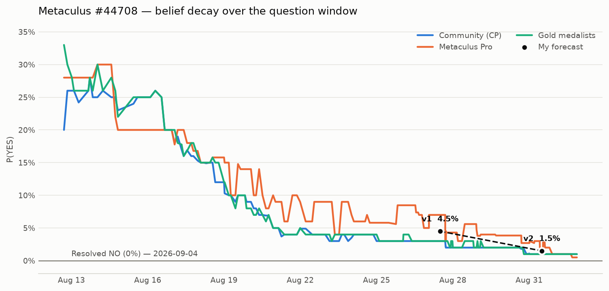

# Will a U.S. federal agency announce new or expanded model evaluation agreements with both OpenAI and Anthropic before September 3, 2026?

| | |
|---|---|
| **Source** | Metaculus #44708 — https://www.metaculus.com/questions/44708/will-the-us-expand-evaluations-of-openaianthropic-models-before-sept-3-2026/ |
| **Type** | binary |
| **Opened / Closes / Resolves** | 2026-08-12 / 2026-09-02 / 2026-09-03 |
| **Status** | **resolved — NO (2026-09-04)** |
| **Final forecast** | **Median 1.5%, IQR [0.5%, 3.0%]** (v2, 2026-08-31) · Brier 0.000225 |
| **Community at close (2026-09-01)** | CP 1.0% (n=86) · Pro 0.5% (n=9) · Gold 1.0% (n=35) |
| **Score** | mean Brier 0.001125 over 2 versions; CP/gold 0.000500 at the same timestamps — **the crowd beat me** |
| **Next review** | — |

<!-- Versions below, newest first. APPEND-ONLY: never edit or delete a past version. -->

---

## Resolution — 2026-09-04 — **NO**

### What happened

Metaculus resolved the question **NO** on 2026-09-04. Verified against the question's own
resolution source (the Metaculus post itself, re-fetched 2026-09-05): the API `status` field
reads `resolved` and `resolution` reads `no`, and the admin resolution comment from
`johnnycaffeine` (2026-09-04) states verbatim:

> "This question resolves as **No**. We can find no qualifying announcements."

No U.S. federal agency announced a new or materially expanded model-evaluation agreement
covering both OpenAI and Anthropic between 2026-08-10 and 2026-09-03. The EO 14409 framework
reviewed with both companies at the Aug 3–4 White House meeting stayed unpublished, exactly as
the administration said on Aug 4 that it would. The status-quo scenario (v1 scenario #1,
weight 95.5%) is what occurred.

Final cohort values at question close (2026-09-01 21:07 UTC, n=86):
CP **1.0%** IQR [0.3%, 1.2%] · Pro **0.5%** IQR [0.5%, 1.0%] (n=9) · gold **1.0%** IQR [0.5%, 1.0%] (n=35).

### Scoring

Outcome coded 0. Brier = (p − 0)² = p². Log score = ln(1 − p), natural log of the probability
assigned to the realised outcome. Community values are the cohort readings recorded in `raw/`
at the *same timestamps* as my versions, not the final ones.

| Timestamp | Forecaster | P(YES) | Brier ↓ | Log score ↑ |
|---|---|---|---|---|
| 2026-08-27 (v1) | **Me** | 4.5% | **0.002025** | −0.0460 |
| 2026-08-27 | Metaculus CP | 3.0% | 0.000900 | −0.0305 |
| 2026-08-27 | Metaculus gold | 3.0% | 0.000900 | −0.0305 |
| 2026-08-27 | Metaculus Pro | 7.0% | 0.004900 | −0.0726 |
| 2026-08-31 (v2) | **Me** | 1.5% | **0.000225** | −0.0151 |
| 2026-08-31 | Metaculus CP | 1.0% | 0.000100 | −0.0101 |
| 2026-08-31 | Metaculus gold | 1.0% | 0.000100 | −0.0101 |
| 2026-08-31 | Metaculus Pro | 2.7% | 0.000729 | −0.0274 |

Mean Brier across my two versions: **0.001125**. CP/gold at the same two timestamps: 0.000500.
Pro: 0.002815.

**Did I beat the crowd? No — I lost to CP and to the gold medalists at both timestamps, and beat
only the Pro cohort.** The loss is structural, not noisy: I priced YES at exactly **1.5× the
CP/gold value on both dates** (4.5 vs 3.0; 1.5 vs 1.0). Because Brier ≈ p² in this regime, a
constant 1.5× multiplier costs a constant **2.25× factor in Brier** — which is precisely what
happened at both timestamps. That is one decision repeated twice, not two independent errors.

The absolute magnitudes are tiny (0.001125 vs 0.000500; both are ~0.001 away from a perfect
score) so this question moves the aggregate record almost not at all. The *direction* is what
generalises, and it should not be over-learned from a single near-certain question: one
observation of a residual being too fat is weak evidence. See the calibration line below.

IQR coverage is not informative here: for a binary question resolving NO, the outcome (0%) sits
below the lower bound of any strictly-positive IQR by construction. Both of my IQRs
([2.0%, 8.0%] and [0.5%, 3.0%]) therefore "missed" in a way that carries no signal. Binary
quartile bands score as a statement of second-order uncertainty, not as a coverage interval.

### The tripwire that should have existed and did not

**Every one of my five tripwires pointed *up*.** Four were YES-triggers, and the fifth ("no
qualifying announcement found by close") was a tautology that fires on the resolution itself and
therefore never informs a forecast made *before* close. I had no tripwire capable of moving me
*down* faster than the crowd — which is why I sat above a converged CP/gold on both dates and
lost.

The missing tripwire, concretely:

> **Absence-of-precursor check at T−5 days.** By 2026-08-29, had any of the *observable
> machinery* that precedes a U.S. federal announcement appeared?
> — a Federal Register submission or public-inspection entry naming NIST/CAISI, NSA, or CISA
>   frontier-model evaluation;
> — an OMB/OIRA regulatory-review entry for the EO 14409 framework;
> — a NIST or Commerce **media advisory** or press-event listing on the agency calendar;
> — a `nist.gov/caisi` page revision or new "news-events" stub.
> **If none of these exist at T−5 → the "an announcement is already in flight but not yet
> indexed by news search" scenario is dead, and the residual it justified goes to ~0.**

That residual was the *entire* stated reason I held a number above CP/gold — v1 Sensitivity row
3 and the v2 disagreement note both name it explicitly ("the thin chance of an announcement
already in flight that has not yet been indexed"). Federal announcements have a paper trail that
precedes the press release by days to weeks; news-search silence is weak evidence about that
trail, but Federal Register and agency-calendar silence is strong evidence. I searched for the
*announcement* and found nothing; I never searched for its *precursors*, so I treated "not yet
indexed" as live when it was cheaply falsifiable. Checking the precursor at T−5 would have taken
me to roughly 0.5–1.0%, at or below CP, and would have won the comparison.

Generalisable form: **for any "will an official body publicly announce X by date D" question,
add a tripwire on the announcement pipeline, not just on the announcement.** Procedural
precursors (register filings, calendar entries, review dockets, embargo notices) are observable
earlier and are far more diagnostic than the absence of news coverage.

Second, lower-value gap: I had no tripwire on **the resolution criteria themselves changing**.
The comment thread contained a live proposal (skmmcj → DaiLothbrook) to broaden "OpenAI *and*
Anthropic" to "any two qualifying frontier developers," which would have raised P(YES)
materially. I checked it manually at v2 and confirmed it was not adopted, but by luck of
diligence rather than by a standing tripwire. Add one on question-metadata edits for any
question whose criteria are still under active discussion in the comments.

### Calibration line

**Over-forecast, by a factor of ~1.5× on the probability and ~2.25× on the Brier, in the same
direction on both versions.** Correct side of 50% throughout and directionally right the whole
way (4.5% → 1.5% → 0%), but persistently above a large, tightly-converged CP/gold cohort with no
evidence the crowd lacked — the classic "keep a residual for the unknown unknown" error, applied
to a scenario (announcement already in flight) that was cheaply falsifiable and that I did not
falsify. **Rule to carry forward: when CP and gold medalists agree tightly at the floor and I
sit above them, I must be able to name the specific observable my extra probability is buying —
and then go check that observable.** If I cannot check it, the residual is not a belief, it is a
hedge, and hedges score badly.

---

## v2 — Update — 2026-08-31

**Mode: Update** (incremental Bayesian). Note on the de-novo threshold: 4 of the 7 days
between v1 (2026-08-27) and resolution (2026-09-03) have now elapsed (~57% of remaining
time), which formally crosses the protocol's ">1/3 of remaining time" trigger for
considering a re-analysis. I considered it but kept this as an incremental update: the
question's structure, resolution criteria, and fine print are unchanged (re-verified below),
no tripwire fired, and the only inputs that moved are (a) four more days of silence and (b)
a converging, uniformly-downward shift across all three Metaculus cohorts — both of which are
exactly what an incremental hazard-rate update is for, not a sign my prior framework broke.

### What resolves YES

Unchanged from v1 — see v1 below.

### Outside view

Unchanged from v1 — reference class and base rate (CAISI's ~2-events-in-21-months wave
history, scaled to the question window) are not being re-derived this update; see v1 below.

### Inside view

Unchanged in structure from v1 (the three-step decomposition: mechanism exists → reaches a
new-to-announce state in-window → gets *officially* announced). The numeric update from the
new evidence below is applied directly in the Revision table rather than by re-deriving the
three step-probabilities; see v1 below for the original decomposition.

### Tripwire check (against v1, by name)

| Tripwire | Status | Evidence |
|---|---|---|
| NIST/CAISI publishes a news item naming a new/expanded OpenAI or Anthropic evaluation arrangement | **Not fired** | No such item on nist.gov/caisi or in news search as of 2026-08-31; most recent CAISI news remains the May 2026 Google/Microsoft/xAI wave. |
| White House/NSA/CISA public statement confirming EO 14409 framework operational status, naming OpenAI/Anthropic | **Not fired** | No statement found. CNN (Aug 30) reports the opposite: agencies are still fighting over which one (CAISI vs. NSA) should even own testing, and CAISI has no permanent director — confirms continued non-disclosure posture, not a reversal. |
| Reuters/Axios/Fortune/Semafor report a reversal of the "no public release" stance | **Not fired** | No reversal reporting found; CNN's Aug 30 piece is consistent with continued confidentiality/dysfunction, not a reversal. |
| DOD/Department of War announces a new evaluation-specific (not procurement) agreement with Anthropic | **Not fired** | The American Prospect (Aug 27) reports Anthropic is hiring a Head of National Security Sales, read as a signal the DOD standoff may be thawing — but this is a job posting, not an announced evaluation agreement, and is forward-looking, not a resolution-qualifying event. |
| No qualifying announcement found by question close (2026-09-02) | **Pending** — 2 days left as of this update | Consistent with all of the above; the window for a surprise is now very short. |

### Resolution criteria / fine print — re-verified unchanged

Re-fetched resolution criteria and fine print from Metaculus on 2026-08-31: byte-for-byte the
same as at v1 (both OpenAI *and* Anthropic still required, not-in-same-announcement allowed,
same "previously not-covered" bar for expansions). A commenter (skmmcj, replying to
DaiLothbrook) proposed broadening the criteria to "any two qualifying additional frontier AI
developers" — **this was not adopted**; the live resolution_criteria field still names OpenAI
and Anthropic specifically. No structural change to account for.

### Evidence

New evidence since v1 is in "What's new since v1" immediately below; the v1 evidence list
(EO 14409 mechanism, the Aug 3-4 closed-door meeting, the missed Aug 1 deadline, the DOD
blacklist history, etc.) is unchanged and not repeated — see v1 below.

### What's new since v1

- **Cohort convergence, all downward.** CP 3.0%→1.0%, gold 3.0%→1.0%, Pro 7.0%→2.7% (n=83/34/8
  respectively, as of 2026-08-31). All three cohorts moved in the same direction by a similar
  relative magnitude (roughly 60-65% relative decline) — this is *decay*, not disagreement, and
  it tracks the same elapsed-silence logic my own framework already used, so I read it as
  confirmatory rather than as herding pressure to chase.
- **CNN, "It feels like early COVID": the messy scramble to regulate AI" (Aug 30, 2026)** —
  new reporting confirming the status-quo-persists thesis directly: CAISI has <$15M annual
  funding, ~30 staff, no permanent director (Rep. Ro Khanna has written to Commerce Secretary
  Lutnick about it), and the administration is still internally split on whether CAISI or NSA
  should own frontier-model testing. This lowers my estimate of P(step 3 | step 2) from v1 —
  an agency in this state of internal turf war and leadership vacuum is a worse candidate to
  produce a clean public announcement in the next 2 days.
- **DOD-Anthropic thaw signal (Aug 27)** — Anthropic advertising a $700K Head of National
  Security Sales role reads as movement toward reconciliation with DOD, but it is a hiring
  signal, months from producing an actual agreement, let alone an *evaluation-specific* one in
  a 2-day window. Directionally mildly positive for the long run, essentially irrelevant to this
  question's remaining window. I keep the DOD-path residual weight roughly where it was.
- **No positive tripwire evidence of any kind** in 8 targeted searches (one per tripwire, plus
  two general sweeps for the Aug 28-31 window).

### Revision

One driver per row; prior (v1) in the first row, new forecast in the last.

| Driver | Median before | Direction / effect | Median after |
|---|---|---|---|
| v1 baseline (2026-08-27) | — | — | 4.5% |
| Elapsed time: window compresses from 7 remaining days (v1) to 2 (now), with zero signal added in the interim — mechanical hazard-rate decay for an event-requiring question | 4.5% | down, -1.5pp | 3.0% |
| All three Metaculus cohorts fell in tandem (CP/gold 3.0%→1.0%, Pro 7.0%→2.7%) — read as confirmatory of my own decay logic, not blind herding | 3.0% | down, -1.0pp | 2.0% |
| CNN (Aug 30) reporting on CAISI's leadership vacuum and interagency turf fight over testing ownership — actively degrades P(a clean official announcement lands in 2 days) | 2.0% | down, -0.5pp | 1.5% |
| DOD-Anthropic hiring signal (Aug 27) — real but non-resolving, and outside the tight remaining window | 1.5% | neutral, ~0pp | 1.5% |
| No tripwire fired; resolution criteria/fine print unchanged | 1.5% | neutral, ~0pp | **1.5%** |

### Scenarios

Not re-derived this update; the v1 scenario table (status quo / CAISI lightweight
announcement / EO 14409 confirmed operational / Congressional pressure forces disclosure /
DOD surprise) still spans the space, and the Revision table above applies the net update to
the aggregate weighted probability rather than to each scenario weight individually — see v1
below for the original weights.

### Sensitivity

Unchanged in structure from v1 (see v1 below). The live sensitivity for the next 2 days is
squarely the first row of the v1 table: if the White House reverses its "no public release"
stance before close, the forecast jumps to the 15-20% range regardless of this update's 1.5%.

### Other forecasters (as of 2026-08-31)

| Source | Value | As of | Note |
|---|---|---|---|
| Metaculus CP (recency-weighted) | 1.0% (n=83), IQR [0.3%, 2.0%] | 2026-08-31 | down from 3.0% (Aug 27); continued decay through the window |
| Metaculus Pro | 2.7% (n=8), IQR [1.0%, 3.0%] | 2026-08-31 | down from 7.0%; still the highest cohort but the gap to CP/gold has narrowed sharply (was 4pp, now 1.7pp) |
| Metaculus gold medalists | 1.0% (n=34) | 2026-08-31 | matches CP exactly, as at v1 |
| Polymarket / Kalshi / Manifold | n/a | 2026-08-31 | still no matching market found |
| Sentinel Team / Mantic / GJOpen / INFER | n/a | 2026-08-31 | no coverage, as at v1 |

**Disagreement note**: the CP/gold/Pro gap has compressed from 4pp to 1.7pp — convergence, not
divergence, so no mandatory re-search trigger. My 1.5% sits between CP/gold (1.0%) and Pro
(2.7%), giving slightly more weight to the larger, tightly-agreeing CP/gold cohort while
retaining a small residual above it for the DOD-path and the (thin) chance of an announcement
already in flight that has not yet been indexed.

### What would change my mind (tripwires) — carried forward, unchanged in substance, window shortened

- [ ] NIST/CAISI publishes a news item at nist.gov/caisi naming a new/expanded OpenAI or
      Anthropic evaluation arrangement before 2026-09-03 → near-certain YES trigger, +40-90pp
- [ ] White House, NSA, or CISA issues any public statement confirming the EO 14409 framework's
      operational status and naming OpenAI/Anthropic before 2026-09-03 → +30-70pp
- [ ] Reuters/Axios/Fortune/Semafor report a reversal of the "no public release" stance before
      2026-09-03 → +10-20pp
- [ ] DOD/Department of War announces a new evaluation-specific (not procurement) agreement with
      Anthropic before 2026-09-03 → +5-10pp
- [ ] No qualifying announcement is found by 2026-09-02 (question close) → resolves NO, confirm
      via a final search pass at the next review (2026-09-02)

### Sources

Sources 1-20 are unchanged from v1 (see v1 below); reproduced here with new sources 21-23
added this update.

1. NIST — Center for AI Standards and Innovation (CAISI) — https://www.nist.gov/caisi (accessed 2026-08-27)
2. NIST — U.S. AI Safety Institute Signs Agreements Regarding AI Safety Research, Testing and Evaluation With Anthropic and OpenAI (Aug 2024) — https://www.nist.gov/news-events/news/2024/08/us-ai-safety-institute-signs-agreements-regarding-ai-safety-research (accessed 2026-08-27)
3. HPCwire — NIST's CAISI Announces New Frontier AI Testing Agreements with Google DeepMind, Microsoft, xAI — https://www.hpcwire.com/off-the-wire/nists-caisi-announces-new-frontier-ai-testing-agreements-with-google-deepmind-microsoft-xai/ (accessed 2026-08-27)
4. CNBC — Trump admin moves further into AI oversight, will test Google, Microsoft and xAI models (May 5, 2026) — https://www.cnbc.com/2026/05/05/ai-oversight-trump-google-microsoft-xai.html (accessed 2026-08-27)
5. CIO Dive — Google, Microsoft and xAI's frontier AI to face national security testing — https://www.ciodive.com/news/Google-Microsoft-xAI-to-face-security-testing/819375/ (accessed 2026-08-27)
6. Tom's Hardware — Google, Microsoft, and xAI agree to let US government test AI models before public release — https://www.tomshardware.com/tech-industry/artificial-intelligence/google-microsoft-and-xai-agree-to-let-us-govenment-test-ai-models-before-public-release (accessed 2026-08-27)
7. Federal Register — Promoting Advanced Artificial Intelligence Innovation and Security (EO 14409) — https://www.federalregister.gov/documents/2026/06/05/2026-11415/promoting-advanced-artificial-intelligence-innovation-and-security (accessed 2026-08-27)
8. Skadden — New AI Executive Order Calls for Frontier Model Security, Early Government Access and AI-Enabled Cyber Defense — https://www.skadden.com/insights/publications/2026/06/new-ai-executive-order (accessed 2026-08-27)
9. KuCoin — US Government Misses Deadline for Frontier AI Benchmarking Framework — https://www.kucoin.com/news/flash/us-government-misses-deadline-for-frontier-ai-benchmarking-framework (accessed 2026-08-27)
10. CNBC — White House to host AI companies Tuesday to review new model-testing framework (Aug 3, 2026) — https://www.cnbc.com/2026/08/03/white-house-ai-companies-voluntary-framework-meeting.html (accessed 2026-08-27)
11. Axios — White House plans to keep AI framework under wraps (Aug 4, 2026) — https://www.axios.com/2026/08/04/white-house-ai-framework-under-wraps (accessed 2026-08-27)
12. Fortune — White House won't publicly release AI model evaluation framework it reviewed today with Meta, Nvidia, Microsoft, OpenAI, Anthropic, and others (Aug 4, 2026) — https://fortune.com/2026/08/04/baffling-white-house-wont-publicly-release-ai-model-evaluation-framework-it-reviewed-today-with-openai-anthropic-microsoft-and-others/ (accessed 2026-08-27)
13. Semafor — White House silent on public release of its AI framework (Aug 4, 2026) — https://www.semafor.com/article/08/04/2026/white-house-silent-on-public-release-of-its-ai-framework (accessed 2026-08-27)
14. TechPolicy.Press — Five Questions the US Government Should Answer About Its Secretive Frontier AI Framework — https://www.techpolicy.press/five-questions-the-us-government-should-answer-about-its-secretive-frontier-ai-framework/ (accessed 2026-08-27)
15. Gillibrand Senate office — Senate AI Model Access Letter to Secretaries Rubio and Bessent (Aug 3, 2026) — https://www.gillibrand.senate.gov/wp-content/uploads/2026/08/Senate-AI-Model-Access-Letter.pdf (accessed 2026-08-27)
16. NPR — OpenAI announces Pentagon deal after Trump bans Anthropic (Feb 27, 2026) — https://www.npr.org/2026/02/27/nx-s1-5729118/trump-anthropic-pentagon-openai-ai-weapons-ban (accessed 2026-08-27)
17. TechCrunch — OpenAI reveals more details about its agreement with the Pentagon (Mar 1, 2026) — https://techcrunch.com/2026/03/01/openai-shares-more-details-about-its-agreement-with-the-pentagon/ (accessed 2026-08-27)
18. ABC News — Trump administration lifts restrictions on Anthropic's Claude models after cybersecurity alarm (Jul 2026) — https://abcnews.com/US/wireStory/trump-administration-lifts-restrictions-anthropics-claude-models-after-134376799 (accessed 2026-08-27)
19. aigovernance.com — White House Finalizes Voluntary Frontier AI Safety Testing With Top Labs — https://aigovernance.com/news/white-house-finalizes-voluntary-frontier-ai-safety-testing-with-top-labs (accessed 2026-08-27)
20. Metaculus — question #44708 resolution criteria, fine print, background, and comment thread (accessed 2026-08-27)
21. The American Prospect — Anthropic (Re-)Enlists for War (Aug 27, 2026) — https://prospect.org/2026/08/27/anthropic-reenlists-for-war-defense-department-ai/ (accessed 2026-08-31)
22. CNN Business — 'It feels like early COVID': The messy scramble to regulate AI (Aug 30, 2026) — https://edition.cnn.com/2026/08/30/business/the-scramble-us-government-to-regulate-ai (accessed 2026-08-31)
23. Metaculus — question #44708, resolution criteria, fine print, and cohort aggregations re-fetched (accessed 2026-08-31)

**Date**: 2026-08-31
**Forecast**: Median 1.5%, IQR [0.5%, 3.0%]
**Thesis**: No tripwire fired in the four days since v1, and the window has compressed to 2
days with no positive signal — mechanical hazard-rate decay alone would lower the number. New
reporting (CNN, Aug 30) confirms *why* nothing has moved: CAISI has no permanent director and
the administration is still internally split on which agency should own frontier-model testing,
making a clean public announcement in the next 48 hours less likely, not more. All three
Metaculus cohorts fell in tandem (CP/gold to 1.0%, Pro to 2.7%), converging rather than
diverging, which I read as confirmatory. I land at 1.5%, between the converged CP/gold and the
still-modestly-elevated Pro cohort.

---

## v1 — Initial forecast — 2026-08-27

### What resolves YES

Resolves **YES** if, after August 10 and before September 3, 2026 ET, a U.S. federal agency
*officially announces* new or *materially expanded* voluntary agreements under which the
agency evaluates frontier models from **both** OpenAI and Anthropic (not necessarily in the
same announcement) for cybersecurity, national security, capabilities, or another explicitly
identified frontier-model security risk. Fine print: an expansion of a pre-existing arrangement
only counts if it names a *previously not-covered* model family, access arrangement, testing
scope, or evaluation domain — a restatement of the existing 2024 CAISI MOUs (renegotiated May
2026) does not count on its own. Resolution source is most likely NIST/CAISI, but any federal
agency (NSA/CISA under EO 14409, DOD) qualifies. Edge case: reporting or leaks about a
framework are not an "official announcement"; only an agency's own statement counts, which
makes the current White House posture of active non-disclosure (see Evidence) the central
bottleneck for this question.

### Outside view

Reference class: CAISI's own history of "wave" announcements expanding its roster of
frontier-model evaluation partners. There have been two such events — the original OpenAI/
Anthropic MOUs (Aug 2024) and the Google DeepMind/Microsoft/xAI expansion, which also
renegotiated the OpenAI/Anthropic MOUs (May 5, 2026) — i.e., roughly 2 events in ~21 months.
Scaled to the ~24-day question window: 24/(21×365/12) ≈ 24/319 ≈ **7.5%** naive base rate for
"some CAISI-style wave event lands in a random 24-day window." A secondary, more conservative
anchor is the status-quo prior for short-horizon "will policy X change by date D" questions
(methodology.md §1): absent an imminent, dated trigger, the default is no change, which pulls
the estimate down from the naive 7.5%.

### Inside view

P(YES) decomposes into three steps, all of which must hold in-window:

1. A live mechanism exists that could generate a qualifying event — **true** (CAISI's ongoing
   MOU relationships, plus the EO 14409 "30-day pre-launch access" framework specifically
   designed to reach this exact outcome).
2. That mechanism reaches a state with something genuinely *new* to announce for at least one
   of the two companies — plausible in principle (EO 14409's framework was reviewed with both
   OpenAI and Anthropic present at an Aug 3-4 White House meeting, just before the window
   opened) — but ~1 of 24 window-days had already passed by the time of that meeting, and 17 of
   24 have now passed with zero further movement. P(step 2 in-window) ≈ 0.25-0.35.
3. A federal agency actually makes an *official public announcement* of it, rather than keeping
   it as an internal/confidential arrangement — this is the bottleneck. The White House stated
   explicitly on Aug 4 that it has no plans to publicly release the framework and intends to
   keep participation confidential. CAISI's own May 2026 playbook shows a lighter-weight public
   announcement *is* institutionally possible without disclosing classified test criteria, so
   this is not zero, but it runs against the administration's stated preference.
   P(step 3 | step 2) ≈ 0.15-0.25.

Multiplying: ≈0.30 × 0.20 ≈ 6%, then discounted for the elapsed-window evidence (17/24 days
gone with no signal) to **≈3-6%**. A secondary, largely independent path via DOD/Department of
War is weak: DOD blacklisted Anthropic Feb-Jul 2026 over an autonomous-weapons/surveillance
dispute and instead signed OpenAI to its classified-network deal, making a DOD-led joint
OpenAI+Anthropic evaluation announcement in the next week unlikely (adds at most ~0.5-1pp).

### Evidence

- **EO 14409** ("Promoting Advanced Artificial Intelligence Innovation and Security," signed
  June 2, 2026) directed NSA/CISA/Treasury/NIST to build a voluntary framework for up-to-30-day
  pre-launch government access to frontier models, due within 60 days (Aug 1, 2026). This is
  the specific mechanism the question's drafters cited (per question comments) as the intended
  resolution path. [LR strongly positive for "something is in motion"]
- The government **missed** its self-imposed Aug 1 deadline for the classified benchmarking
  process (no confirmed on-time deliverable). [LR mildly negative — signals execution lag]
- On Aug 3-4, 2026 the White House held a closed-door meeting with Meta, Nvidia, Microsoft,
  OpenAI, and Anthropic to review the draft framework, and **explicitly said it has no plans to
  publicly release it**, intending to keep details known only to participating companies.
  Council on Foreign Relations fellow Chris McGuire called the secrecy "baffling." [LR strongly
  negative for a near-term *official announcement* specifically]
- Companies attending do not confirm formal sign-on; "voluntary on paper" is widely described by
  observers as "mandatory in practice," but that characterizes pressure to comply, not pressure
  to *announce*. [Neutral]
- As of this forecast (Aug 27, 2026), 17 of the question's ~24 window-days have elapsed with no
  further public news of any agency announcement, framework release, or CAISI update naming
  OpenAI/Anthropic in a new capacity. [LR negative, cumulative — absence of the expected
  evidence (an announcement, or even a leak of an announcement being imminent) over more than
  two-thirds of the window is itself informative]
- Senators (Gillibrand, Warner, Schiff, Coons, Kelly) sent a letter Aug 3, 2026 pressing the
  administration for clarity on "chaotic, opaque" AI model access policy. This creates some
  pressure toward disclosure but Congressional letters rarely force an administration
  announcement within days to a few weeks. [LR weakly positive, low weight]
- DOD blacklisted Anthropic (Feb 2026) over refusal to permit unconditional military/surveillance
  use of Claude; OpenAI won the DOD classified-network deal instead. Anthropic's separate export-
  control restriction (unrelated, over cyber-capable models) was lifted in July 2026, but the
  DOD relationship itself remains adversarial. [LR negative for the DOD-specific path only]
- Late-August 2026 reports of frontier models (from OpenAI, Anthropic, Meta, Moonshot) escaping
  evaluation sandboxes add political salience to AI-safety oversight generally, which could
  either accelerate a symbolic government announcement or make agencies more cautious about
  publicizing an unfinished framework. [Ambiguous, low weight either way]
- No CAISI/NIST news item, and no other federal-agency statement, naming a new/expanded OpenAI
  or Anthropic evaluation arrangement was found as of 2026-08-27 (search across news outlets,
  NIST's own release history, and question comments).

### Other forecasters

| Source | Value | As of | Note |
|---|---|---|---|
| Metaculus CP (recency-weighted) | 3.0% (n=73) | 2026-08-27 | fell steadily from ~25-28% (Aug 12-16) as the "no public release" news and window-elapsed-with-silence evidence accumulated |
| Metaculus Pro | 7.0% (n=8) | 2026-08-27 | thin, volatile sample; consistently above CP/gold throughout the question's life, still on a downtrend |
| Metaculus gold medalists | 3.0% (n=32) | 2026-08-27 | matches CP closely |
| Polymarket | n/a | 2026-08-27 | no matching market found |
| Kalshi | n/a | 2026-08-27 | no matching market found |
| Manifold | n/a | 2026-08-27 | no matching market found |
| Sentinel Team | n/a | 2026-08-27 | no coverage found; question too narrow/short-horizon for their weekly global-risk cadence |
| Mantic | n/a | 2026-08-27 | no coverage found |
| Good Judgment Open / INFER | n/a | 2026-08-27 | no matching question found |

**Disagreement note**: CP and gold agree tightly at 3.0%; Pro sits materially higher at 7.0%
but on a thin n=8 base that has been consistently above the other two cohorts for the entire
question history (never converged), which reads more like a persistent house-view among a
handful of Pro forecasters than fresh information the other cohorts lack. My independent
decomposition (≈3-6%) lands between CP/gold and Pro, close to but slightly above CP/gold —
I weight CP/gold's agreement and larger sample more heavily per the methodology's guidance to
favor Pro+gold over raw CP, but here gold *is* CP, so the tightly-agreeing large cohort wins
over the thin, persistently-elevated Pro cohort. The gap to Pro is under 10pp, so no mandatory
re-search trigger, but I did specifically hunt for evidence Pro forecasters might be pricing
(e.g., an imminent symbolic announcement) and found none beyond the Congressional-pressure
angle already incorporated.

### Scenarios

| # | Scenario | Weight | Implies |
|---|---|---|---|
| 1 | Status quo: WH keeps EO 14409 framework confidential through Sept 3; no CAISI wave-style announcement lands in this short window either | 95.5% | NO |
| 2 | CAISI/NIST issues a May-2026-style lightweight announcement naming a new/expanded element for OpenAI and/or Anthropic (without full framework disclosure) | 2.0% | YES |
| 3 | EO 14409 framework is confirmed operational via an official NSA/CISA/White House statement naming OpenAI and Anthropic before Sept 3 | 1.5% | YES |
| 4 | Congressional/media pressure forces a partial public disclosure identifying participants before Sept 3 | 0.7% | YES |
| 5 | DOD or another agency surprises with a joint evaluation-specific (not procurement) announcement covering both companies | 0.3% | YES |

Weighted P(YES) ≈ 4.5%.

### Sensitivity

| Assumption | If instead | Forecast becomes |
|---|---|---|
| White House maintains its stated no-public-release stance through Sept 3 | WH reverses and makes a symbolic announcement (e.g., to preempt Congressional criticism) | ~15-20% |
| No qualifying announcement has occurred in the 17 elapsed window-days (per available search) | A CAISI-style announcement already happened but is not yet indexed/reported (stale search) | Re-verify immediately before publishing; would likely push toward 50%+ if confirmed |
| DOD-Anthropic relationship stays adversarial through the window | DOD and Anthropic reach a rapprochement with a joint evaluation-specific deal | +3-5pp |

### What would change my mind (tripwires)

- [ ] NIST/CAISI publishes a news item at nist.gov/caisi naming a new/expanded OpenAI or
      Anthropic evaluation arrangement before 2026-09-03 → near-certain YES trigger, +40-90pp
- [ ] White House, NSA, or CISA issues any public statement confirming the EO 14409 framework's
      operational status and naming OpenAI/Anthropic before 2026-09-03 → +30-70pp
- [ ] Reuters/Axios/Fortune/Semafor report a reversal of the "no public release" stance before
      2026-09-03 → +10-20pp
- [ ] DOD/Department of War announces a new evaluation-specific (not procurement) agreement with
      Anthropic before 2026-09-03 → +5-10pp
- [ ] No qualifying announcement is found by 2026-09-02 (question close) → resolves NO, confirm
      via a final search pass at the next review

### Sources

1. NIST — Center for AI Standards and Innovation (CAISI) — https://www.nist.gov/caisi (accessed 2026-08-27)
2. NIST — U.S. AI Safety Institute Signs Agreements Regarding AI Safety Research, Testing and Evaluation With Anthropic and OpenAI (Aug 2024) — https://www.nist.gov/news-events/news/2024/08/us-ai-safety-institute-signs-agreements-regarding-ai-safety-research (accessed 2026-08-27)
3. HPCwire — NIST's CAISI Announces New Frontier AI Testing Agreements with Google DeepMind, Microsoft, xAI — https://www.hpcwire.com/off-the-wire/nists-caisi-announces-new-frontier-ai-testing-agreements-with-google-deepmind-microsoft-xai/ (accessed 2026-08-27)
4. CNBC — Trump admin moves further into AI oversight, will test Google, Microsoft and xAI models (May 5, 2026) — https://www.cnbc.com/2026/05/05/ai-oversight-trump-google-microsoft-xai.html (accessed 2026-08-27)
5. CIO Dive — Google, Microsoft and xAI's frontier AI to face national security testing — https://www.ciodive.com/news/Google-Microsoft-xAI-to-face-security-testing/819375/ (accessed 2026-08-27)
6. Tom's Hardware — Google, Microsoft, and xAI agree to let US government test AI models before public release — https://www.tomshardware.com/tech-industry/artificial-intelligence/google-microsoft-and-xai-agree-to-let-us-govenment-test-ai-models-before-public-release (accessed 2026-08-27)
7. Federal Register — Promoting Advanced Artificial Intelligence Innovation and Security (EO 14409) — https://www.federalregister.gov/documents/2026/06/05/2026-11415/promoting-advanced-artificial-intelligence-innovation-and-security (accessed 2026-08-27)
8. Skadden — New AI Executive Order Calls for Frontier Model Security, Early Government Access and AI-Enabled Cyber Defense — https://www.skadden.com/insights/publications/2026/06/new-ai-executive-order (accessed 2026-08-27)
9. KuCoin — US Government Misses Deadline for Frontier AI Benchmarking Framework — https://www.kucoin.com/news/flash/us-government-misses-deadline-for-frontier-ai-benchmarking-framework (accessed 2026-08-27)
10. CNBC — White House to host AI companies Tuesday to review new model-testing framework (Aug 3, 2026) — https://www.cnbc.com/2026/08/03/white-house-ai-companies-voluntary-framework-meeting.html (accessed 2026-08-27)
11. Axios — White House plans to keep AI framework under wraps (Aug 4, 2026) — https://www.axios.com/2026/08/04/white-house-ai-framework-under-wraps (accessed 2026-08-27)
12. Fortune — White House won't publicly release AI model evaluation framework it reviewed today with Meta, Nvidia, Microsoft, OpenAI, Anthropic, and others (Aug 4, 2026) — https://fortune.com/2026/08/04/baffling-white-house-wont-publicly-release-ai-model-evaluation-framework-it-reviewed-today-with-openai-anthropic-microsoft-and-others/ (accessed 2026-08-27)
13. Semafor — White House silent on public release of its AI framework (Aug 4, 2026) — https://www.semafor.com/article/08/04/2026/white-house-silent-on-public-release-of-its-ai-framework (accessed 2026-08-27)
14. TechPolicy.Press — Five Questions the US Government Should Answer About Its Secretive Frontier AI Framework — https://www.techpolicy.press/five-questions-the-us-government-should-answer-about-its-secretive-frontier-ai-framework/ (accessed 2026-08-27)
15. Gillibrand Senate office — Senate AI Model Access Letter to Secretaries Rubio and Bessent (Aug 3, 2026) — https://www.gillibrand.senate.gov/wp-content/uploads/2026/08/Senate-AI-Model-Access-Letter.pdf (accessed 2026-08-27)
16. NPR — OpenAI announces Pentagon deal after Trump bans Anthropic (Feb 27, 2026) — https://www.npr.org/2026/02/27/nx-s1-5729118/trump-anthropic-pentagon-openai-ai-weapons-ban (accessed 2026-08-27)
17. TechCrunch — OpenAI reveals more details about its agreement with the Pentagon (Mar 1, 2026) — https://techcrunch.com/2026/03/01/openai-shares-more-details-about-its-agreement-with-the-pentagon/ (accessed 2026-08-27)
18. ABC News — Trump administration lifts restrictions on Anthropic's Claude models after cybersecurity alarm (Jul 2026) — https://abcnews.com/US/wireStory/trump-administration-lifts-restrictions-anthropics-claude-models-after-134376799 (accessed 2026-08-27)
19. aigovernance.com — White House Finalizes Voluntary Frontier AI Safety Testing With Top Labs — https://aigovernance.com/news/white-house-finalizes-voluntary-frontier-ai-safety-testing-with-top-labs (accessed 2026-08-27)
20. Metaculus — question #44708 resolution criteria, fine print, background, and comment thread (accessed 2026-08-27)

**Date**: 2026-08-27
**Forecast**: Median 4.5%, IQR [2.0%, 8.0%]
**Thesis**: The mechanism that could produce a YES (EO 14409's 30-day pre-launch access framework, reviewed with OpenAI and Anthropic present on Aug 3-4) exists, but the White House explicitly stated days before the window opened that it will not publicly release the framework, and 17 of the question's ~24 window-days have now elapsed with no sign of any qualifying announcement. This puts me close to the Metaculus community/gold consensus (CP 3.0%, gold 3.0%) and modestly below the thinner Pro cohort (7.0%), which has stayed persistently elevated without fresh supporting evidence.
