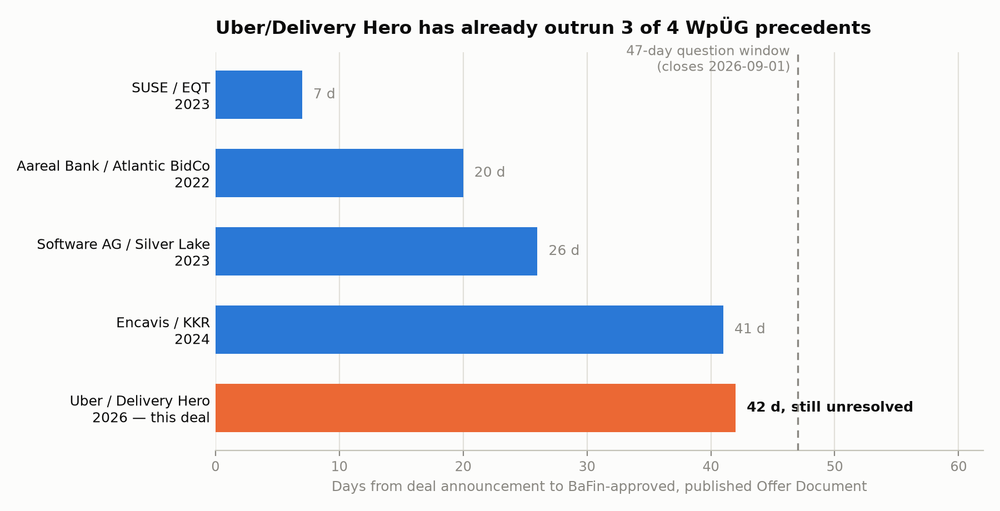

# Will Uber's takeover of Delivery Hero be approved by BaFin before September 2026?

| | |
|---|---|
| **Source** | Metaculus #44921 — https://www.metaculus.com/questions/44921/will-ubers-takeover-of-delivery-hero-be-approved-before-september-2026/ |
| **Type** | binary |
| **Opened / Closes / Resolves** | — / 2026-09-01 / — |
| **Status** | open |
| **Current forecast** | **Median 45.0%, IQR [32.0%, 58.0%]** (v1, 2026-08-27) |
| **Community (as of 2026-08-27)** | CP 51.0% (n=78) · Pro 61.0% (n=6) · Gold 50.0% (n=32) |
| **Next review** | 2026-08-31 |

<!-- Versions below, newest first. APPEND-ONLY: never edit or delete a past version. -->

---

## v1 — Initial forecast — 2026-08-27

### What resolves YES

**This question is narrower than it looks.** It does *not* ask whether the Uber–Delivery Hero
merger clears antitrust review — that multi-jurisdictional process (EU Commission and others)
is expected to run until H2 2027 and is irrelevant here. It resolves **YES** only if Germany's
BaFin approves Uber's formal **Offer Document** for the takeover under the WpÜG (German
Securities Acquisition and Takeover Act) and that document is **formally published** before
2026-09-01 (i.e., by end of day 2026-08-31). Only the *initial* Offer Document counts — later
amendments don't matter, and minor price/term tweaks before publication don't prevent YES as
long as the core Uber/Delivery Hero deal survives. If the Business Combination Agreement (BCA)
is terminated or the offer withdrawn/abandoned before publication, it resolves **NO**
immediately. Because WpÜG §14(2) requires the bidder to publish "without undue delay" once
BaFin approves, approval and publication are practically simultaneous (same or next business
day) — so in effect this is a single event: "does BaFin sign off before the deadline."

### Outside view

Reference class: recent friendly, board-recommended, all-cash German public takeovers under
the WpÜG, measured from the deal announcement (Business Combination/Investment Agreement) to
BaFin-approved, published Offer Document:

| Deal | Announcement → Approved Offer Document | Days |
|---|---|---|
| SUSE / EQT | 2023-08-17 → 2023-08-24 | 7 (atypical — EQT was already SUSE's majority owner) |
| Aareal Bank / Atlantic BidCo | 2022-04-06 → 2022-04-26 | 20 |
| Software AG / Silver Lake | 2023-04-21 → 2023-05-17 | 26 |
| Encavis / KKR | 2024-03-14 → 2024-04-24 | 41 |

n = 4, raw base rate: 3 of 4 resolve within 47 days (this question's window: 2026-07-16 to
2026-09-01). Naively that says ~75% YES. **But** the realized process for Uber/Delivery Hero
has already run 42 of those 47 days (as of 2026-08-27) without a confirmed approval — already
past 3 of the 4 precedents' total timelines. Conditioning on "not yet resolved by day 42"
collapses the base rate toward the Encavis outlier and below: this is a survival-analysis
problem, not a simple historical-frequency one, and the *conditional* rate is close to a coin
flip rather than 75%.

The WpÜG statutory clock: the bidder must submit the Offer Document within **4 weeks** of the
formal §10 announcement (here: 2026-07-16 → statutory deadline ≈2026-08-13). BaFin then
ordinarily has **10 working days** to approve or prohibit a complete filing, with up to 5
extra working days if it requires corrections (longer extensions are reserved for exchange
offers, not applicable to this all-cash deal). Applying that clock to the Aug-13 submission
deadline: fast track lands ≈2026-08-27 (today), full 15-working-day track lands ≈2026-09-03,
and 15 days + a correction request lands ≈2026-09-10 — a distribution that straddles the
Sept-1 cutoff almost exactly.

### Inside view

Actors and incentives: Uber and Delivery Hero are both motivated to move fast (announced deal,
board-recommended, financing secured via term-loan facility, Prosus's ~17% stake already
irrevocably committed, Uber's own ~25% direct stake + derivatives). There is no adversarial
dynamic with BaFin — this is a disclosure/completeness review, not a merits review, so the
question is purely about administrative speed, not about whether approval eventually happens
(that is close to certain; the question is *only* whether it happens by 2026-08-31).

Two things push this deal toward the **slower** end of the reference class rather than the
SUSE-fast end:
1. **Complexity of the filing.** At $14.8B this is the largest food-delivery M&A ever, with a
   cross-border US bidder using both WpÜG and US Exchange Act §14(e)/Regulation 14E procedures,
   plus a concurrent SSW Partners carve-out sale of Delivery Hero's operations in 14 markets
   that plausibly needs coordinated disclosure in the same Offer Document. More moving parts
   raises the odds BaFin requests corrections (the +5 working-day track) rather than clearing
   a first draft outright.
2. **No controlling-shareholder shortcut.** SUSE's 7-day turnaround is not a good comparator:
   EQT was already SUSE's majority shareholder, which typically means informal pre-clearance
   dialogue with BaFin well before the public announcement. Uber holds ~25% + derivative
   exposure but does not control Delivery Hero outright, so it doesn't get that shortcut.

Two things push it toward the **faster** end:
1. Uber and Delivery Hero are both extremely well-advised (BusinessWire/SEC-filing quality
   process, term loan already drawn down, i.e., this is not a scrappy or contested deal) and
   likely engaged informally with BaFin ahead of the formal submission, as is standard
   practice for large friendly German takeovers.
2. There is no known controversy, competing bid, or regulatory objection at the BaFin
   (disclosure-adequacy) level specifically — all of the friction in this deal is in the
   antitrust track, which doesn't gate this question.

### Evidence

Direct, dated evidence that the Offer Document has **not yet** been approved/published as of
2026-08-27:
- BaFin's own published-offer-documents database (bafin.de) — most recent entries as of the
  fetch are VINCI Energies/ALL FOR ONE GROUP (12.08.2026), Galaxy Germany/Nagarro
  (06.08.2026, correction 11.08.2026), Bayerische Gewerbebau/Ludwig Beck (21.07.2026); **no
  Uber/Delivery Hero entry**. Likelihood ratio: strongly favors NO-so-far, though this list may
  lag by a few days, so it does not rule out an imminent approval.
- delivering-value.com (the deal's official microsite) still states BaFin permission "has not
  yet been obtained" as of the fetch.
- No news outlet, SEC filing, EQS-News ad-hoc release, or Delivery Hero investor communication
  (including the Q2 2026 trading-update webcast held 2026-08-26) mentions a BaFin approval or
  offer-document publication.
- The Metaculus comment thread (users mmmeta, Russell-viper, DaiLothbrook) independently
  derived the same Aug-13 submission-deadline logic and, as of 2026-08-15, found no evidence
  the submission itself had been publicly confirmed (submission is not a disclosure event
  under WpÜG, so this is expected either way and is not itself informative).

Net effect: this evidence doesn't move the forecast much beyond what the statutory-clock model
already implies (today, 2026-08-27, sits almost exactly at the "fast-track" 10-working-day
mark from the Aug-13 deadline) — it mainly confirms that if it *is* going to resolve YES, it
should be visible within the next few days, and it hasn't been yet.

### Other forecasters

| Source | Value | As of | Note |
|---|---|---|---|
| Metaculus CP (recency-weighted) | 51.0% (n=78) | 2026-08-27 | |
| Metaculus Pro | 61.0% (n=6) | 2026-08-27 | notably above CP/gold; thin sample |
| Metaculus gold medalists | 50.0% (n=32) | 2026-08-27 | agrees closely with CP |
| Polymarket | — | — | no matching market found |
| Kalshi | — | — | no matching market found |
| Manifold | — | — | no matching market found |
| Sentinel / Mantic / GJOpen | — | — | no coverage found for this narrow, procedural a question |

**Material disagreement**: CP (51%) and gold medalists (50%) agree closely with each other,
while Pro (61%) sits meaningfully above both — but Pro is only 6 forecasters, versus 78 (CP)
and 32 (gold), so a single confident forecaster can move it a lot. I did not find a specific
fact that would justify moving all the way to 61%; my read of the hard evidence (BaFin's own
database, the deal microsite, no ad-hoc disclosures) if anything points slightly *below* the
CP/gold consensus, not above it. I land at 45.0%, roughly 5–6pp below CP/gold and 16pp below
Pro. The gap versus Pro exceeds the 10pp threshold that calls for explicit justification: I
attribute it to (a) Pro's small n making its aggregate noisier, and (b) my inside-view
argument that this deal's complexity (largest-ever food-delivery M&A, bundled SSW carve-out,
cross-border dual-regime filing) plausibly pushes it toward the slower, correction-requiring
track relative to the simpler precedent deals informing the base rate, an argument I did not
see reflected in the public comment thread.

### Scenarios

| # | Scenario | Weight | Implies |
|---|---|---|---|
| 1 | Submission at/near the Aug-13 deadline; BaFin clears it on the standard ~10-working-day fast track (approval landing on or immediately after 2026-08-27) | 30% | YES |
| 2 | Submission on time; BaFin takes 11–15 working days (landing 2026-08-28 to 08-31) | 15% | YES |
| 3 | Submission on time; BaFin needs the full 15 working days plus a correction request, landing 2026-09-03 to 09-10 | 25% | NO |
| 4 | Submission itself slipped a few days to ~2 weeks past the Aug-13 deadline (plausible for a filing this complex), pushing the whole clock past 2026-09-01 regardless of BaFin's speed | 25% | NO |
| 5 | BCA terminated / offer withdrawn or abandoned before publication (financing, board, or shareholder-level rupture) | 5% | NO |

Weighted P(YES) = 30% + 15% = 45.0%.

### Sensitivity

| Assumption | If instead | Forecast becomes |
|---|---|---|
| BaFin's standard review window is 10 working days (used as the "fast track" anchor) | It is routinely 15 working days even for clean filings (i.e., my "standard" and "extended" tracks are mislabeled) | Median drops to ~30–35%, since the fast-track scenario (1) shifts from largely-already-elapsed to still-pending |
| Uber submitted at/near the Aug-13 statutory deadline | Uber in fact submitted earlier (e.g., in the first 1–2 weeks post-announcement, well ahead of the 4-week deadline) | Median rises to ~60–65%, since BaFin's review window would already have expired with time to spare |
| The SSW Partners carve-out doesn't need to be reflected in the Offer Document | It does need integrated disclosure and is a genuine complexity driver | Directionally already assumed; if false (simpler filing than assumed), median rises ~5–10pp |

### What would change my mind (tripwires)

- [ ] BaFin's published-offer-documents database (bafin.de) lists a Uber/Delivery Hero entry, or Delivery Hero/Uber issue an ad-hoc (EQS-News) or SEC 8-K announcement of Offer Document publication, at any point before 2026-09-01 → resolves YES, forecast → ~100%.
- [ ] Any credible report of a BaFin deficiency/correction letter regarding the Offer Document, dated before 2026-08-31 → −20pp (signals the extended track, scenario 3).
- [ ] Any credible report confirming Uber submitted the Offer Document materially before the Aug-13 deadline (e.g., in late July 2026) with no news of approval yet by 2026-08-27 → −10pp (would mean the review itself, not the submission timing, is now the binding constraint and is already running slow).
- [ ] News of BCA termination, offer withdrawal, or a material adverse financing/regulatory development before 2026-09-01 → resolves NO, forecast → ~1%.
- [ ] No BaFin action and no relevant news by 2026-08-31 end of day → resolves NO by the question's own terms (early resolution to 0%, since the deadline is mechanical).

### Sources

1. Metaculus question #44921 (resolution criteria, fine print, background, comments) — https://www.metaculus.com/questions/44921/ (accessed 2026-08-27)
2. Uber Announces Acquisition Offer for Delivery Hero (investor.uber.com) — https://investor.uber.com/news-events/news/press-release-details/2026/Uber-Announces-Acquisition-Offer-for-Delivery-Hero/default.aspx (accessed 2026-08-27)
3. Delivery Hero and Uber to Join Forces (newsroom) — https://www.deliveryhero.com/newsroom/delivery-hero-and-uber-to-join-forces-to-deliver-more-for-customers-vendors-and-riders/ (accessed 2026-08-27)
4. Uber Form 8-K, SEC EDGAR — https://www.sec.gov/Archives/edgar/data/1543151/000155278126000382/e26302_uber-8k.htm (accessed 2026-08-27)
5. delivering-value.com (official deal microsite) — https://www.delivering-value.com (accessed 2026-08-27)
6. BaFin — Homepage, Published offer documents (WpÜG database) — https://www.bafin.de/EN/die-bafin/publikationen-daten/datenbanken-uebersichten/WPUeG/angebotsunterlagen/angebotsunterlagen_en.html (accessed 2026-08-27)
7. BaFin — Supervision of takeover bids under the WpÜG (EN guidance) — https://www.bafin.de/SharedDocs/Standardartikel/EN/bieterpflichten_wpueg_en.html (accessed 2026-08-27)
8. TradingView copy of the WpÜG §10 announcement, Delivery Hero/Uber, 2026-07-16 — https://www.tradingview.com/news/eqs:bc11d54dd094b:0-takeover-offer-target-company-delivery-hero-se-bidder-uber-technologies-inc/ (accessed 2026-08-27)
9. Atlantic BidCo GmbH: Aareal Bank Offer Document Published (Yahoo Finance / AccessNewswire) — https://finance.yahoo.com/news/atlantic-bidco-gmbh-aareal-bank-104500936.html (accessed 2026-08-27)
10. KKR: Acceptance period for Encavis offer commences (MarketScreener) — https://www.marketscreener.com/quote/stock/KKR-CO-INC-44486777/news/KKR-Acceptance-period-for-KKR-s-voluntary-public-takeover-offer-for-ENCAVIS-AG-commences-46514080/ (accessed 2026-08-27)
11. Silver Lake Publishes Offer Document for Software AG (EQS-News) — https://www.eqs-news.com/news/corporate/silver-lake-veroeffentlicht-angebotsunterlage-fuer-freiwilliges-oeffentliches-uebernahmeangebot-fuer-die-software-ag-annahmefrist-beginnt-heute/f87acc27-afe6-4269-b04f-72185b3194d8_en (accessed 2026-08-27)
12. Software AG enters into Investment Agreement with Silver Lake — https://newscenter.softwareag.com/en/news-stories/press-releases/2023/0421-software-ag-enters-into-investment-agreement-with-silver-lake.html (accessed 2026-08-27)
13. EQT Private Equity Announces Voluntary Public Purchase Offer for SUSE — https://www.suse.com/news/eqt-announces-voluntary-public-purchase-offer-and-intention-to-delist-suse/ (accessed 2026-08-27)
14. Uber/Delivery Hero confident deal won't face major antitrust hurdles — Global Competition Review — https://globalcompetitionreview.com/article/uberdelivery-hero-confident-deal-wont-face-major-antitrust-hurdles (accessed 2026-08-27)
15. Delivery Hero stock holds strong as Uber deal reshapes ownership — ad-hoc-news.de — https://www.ad-hoc-news.de/boerse/news/corporate-news/delivery-hero-stock-holds-strong-as-uber-deal-reshapes-ownership/70001326 (accessed 2026-08-27)
16. Delivery Hero confirms approach by Uber Technologies (EQS-News ad-hoc) — https://www.eqs-news.com/news/ad-hoc/delivery-hero-confirms-approach-by-uber-technologies-with-respect-to-potential-takeover-offer/3e8c737d-53d6-4aac-9ad8-33862ad11b0d_en (accessed 2026-08-27)
17. Frasers Group / HUGO BOSS WpÜG §23 announcement (PRNewswire) — https://www.prnewswire.com/news-releases/frasers-group-plc-announcement-pursuant-to-section-231-sentence-1-no-2-of-the-german-securities-acquisition-and-takeover-act-wertpapiererwerbs--und-ubernahmegesetz--wpug-302838896.html (accessed 2026-08-27)
18. Uber Technologies Q2 2026 Prepared Remarks (Q4CDN) — https://s23.q4cdn.com/407969754/files/doc_earnings/2026/q2/transcript/Uber-Q2-26-Prepared-Remarks.pdf (accessed 2026-08-27)

**Date**: 2026-08-27
**Forecast**: Median 45.0%, IQR [32.0%, 58.0%]
**Thesis**: This is a narrow, mechanical question about BaFin's disclosure-review clock, not
about the antitrust merits of the merger. The statutory timeline (4-week submission deadline
≈Aug-13, then a 10–15-working-day BaFin review) straddles the Sept-1 cutoff almost exactly,
and as of today (day 42 of a 47-day window) there is no confirmed approval in BaFin's own
database, on the deal microsite, or in any news/ad-hoc disclosure — pushing the forecast to
roughly a coin flip, slightly below the Metaculus community/gold consensus (~50–51%) given the
deal's unusual complexity (largest-ever food-delivery M&A, bundled SSW carve-out, cross-border
filing) relative to the faster precedent deals.

> **Note (chart)**: `charts/timeline-comparison.png`, referenced above, is a horizontal bar
> chart comparing this deal's elapsed time (42 days, no confirmed approval) against the four
> reference-class precedents. It was generated locally but could not be pushed through this
> API path (binary content); it exists in the session's local git history and was sent
> directly to the operator as a file attachment.
