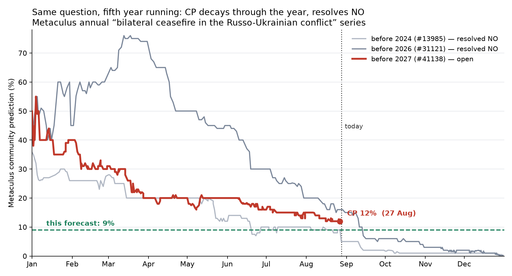

# Will there be a bilateral ceasefire in the Russo-Ukrainian conflict before 2027?

| | |
|---|---|
| **Source** | Metaculus #41138 — https://www.metaculus.com/questions/41138/will-there-be-a-bilateral-ceasefire-in-the-russo-ukrainian-conflict-before-2027/ |
| **Type** | binary |
| **Opened / Closes / Resolves** | 2025-12-19 (first CP point) / 2026-12-31 / 2026-12-31 |
| **Status** | open |
| **Current forecast** | **Median 6.0%, IQR [4.0%, 9.0%]** (v2, 2026-09-24) |
| **Community (as of 2026-09-23)** | CP 6.0% (n=313) · Pro 6.0% (n=24) · Gold 6.0% (n=97) |
| **Next review** | 2026-10-08 |

<!-- Versions below, newest first. APPEND-ONLY: never edit or delete a past version. -->

---

## v2 — Re-analysis — 2026-09-24

Mode: **Re-analysis** (de novo), not an incremental update. The v1 tripwire "Metaculus CP
moves outside [7%, 20%]" fired: the CP reached 6.0% on 2026-09-22. The fall was a steady slide
(12% → 10% on 31 Aug → 9% on 10 Sep → 8% on 15 Sep → 7% on 19 Sep → 6% on 22 Sep), not a
single shock. 27 of the 125 days left at v1 have now passed; 98 remain.

### Revision

| Driver | Direction | Effect |
|---|---|---|
| Prior (v1, 2026-08-28) | — | Median 9.0%, IQR [6.5%, 13.0%] |
| 27 of 125 days gone with no qualifying event (hazard decay; v1 already treated Sep–Oct as mostly dead time, so the decay is less than pro rata) | ↓ | −1.0pp |
| Kremlin restates "settlement first": Peskov on 22 Sep says Russia wants "lasting peace, not a ceasefire" [3]; Russia turned down the energy/air ceasefire, including Trump's 14 Sep energy proposal [4][5]; a leaders' trilateral is "a waste of time" before expert-level talks [6] | ↓ | −2.0pp |
| Diplomacy restarted: Witkoff and Kushner met Putin (5 Sep) and Zelensky (6 Sep); Trump–Putin call on 8 Sep; both sides say trilateral talks could resume in October [1][2][7][8] | ↑ | +0.5pp |
| No mobilisation decree after the 18–20 Sep Duma vote; Putin called the reports "complete nonsense" [9][10]. The drawdown I priced at v1 has not happened, though a "fragmented" call-up is still expected | ↑ | +0.5pp |
| v1 rounded 8% → 9% "to err toward the cohorts"; with the cohorts now at 6%, that reason no longer holds and the rounding goes | ↓ | −1.0pp |
| Battlefield initiative with Ukraine and Russia's fiscal squeeze (ISW; deficit ~6tn ₽ after five months) [11][12] | → | 0 (already in v1; acts on a 2027 horizon) |
| **New forecast** | | **Median 6.0%, IQR [4.0%, 9.0%]** |

A cross-check that does not depend on the row sums: the de-novo scenario table below gives
5.5% YES mass. Outside view scaled to 98 days gives 4.8–5.5%. Markets on a looser definition
sit above that (see Other forecasters). I settle at **6.0%**.

### Tripwire check

| Tripwire from v1 | Fired? | Note |
|---|---|---|
| Putin, Lavrov or Peskov accepts ceasefire-first on the record (by 2026-11-30, +15pp) | **Not fired**. It moved the other way | Peskov on 2026-09-22: "we are in favor of a lasting peace… and not a ceasefire, which, in essence, will achieve nothing" [3] |
| Putin–Trump or Putin–Zelensky summit scheduled with a public date before 2026-12-15 (+6pp) | Not fired | Trump says he will meet Putin only once Putin is ready to sign [7]; Kremlin calls a Putin–Zelensky meeting premature, "a waste of time" [6] |
| Russia publicly accepts the US/Ukrainian air-ceasefire proposal (by 2026-10-31, +4pp) | **Not fired** (partial at most) | Russia rejected energy and aerial ceasefires. The only agreement was a reciprocal halt on strikes against the two capitals during the envoys' 5–6 Sep visit [1][13], plus Kyiv's unilateral pause on Moscow strikes through end-September [5]. Both are partial and short, and neither qualifies |
| Russian mobilisation decree ≥100,000 after the Duma elections (by 2026-10-31, −3pp) | Not fired (still pending) | No decree as of 2026-09-22; Putin denied it on 1–2 Sep [9][10] |
| No trilateral US–Russia–Ukraine round (by 2026-10-31, −2pp) | Pending | Peskov (13 Sep) says October is possible; Kyiv says it is preparing for an October round [2][8] |
| Metaculus CP moves outside [7%, 20%], forcing a re-analysis | **FIRED** 2026-09-22 (CP 6.0%) | This version is that re-analysis |

### What resolves YES

Unchanged from v1. The binding constraint is still the ≥30-day or indefinite stated intent,
taking effect by 2026-12-31. Two points gain weight now that 98 days remain. Branch (a), a 30-day
hold inside 2026, stops being reachable after 2026-12-01. Every Polymarket and Manifold
comparable counts an announcement or a truce of any length, which this question does not.

### Outside view

| Class | Base rate | Scaled to the remaining 98 days (0.268 yr) |
|---|---|---|
| A. Annual question series, 0/4 YES, Laplace 16.7%/yr | 16.7%/yr | 1 − 0.833^0.268 ≈ **4.8%** |
| B. Within-war hazard, 0 events in ~55 months, Laplace ≈ 1.75%/month | 1.75%/mo | 1 − 0.9825^3.2 ≈ **5.5%** |

**Outside-view prior: 5%** (was 7% at v1 on a 125-day window). Classes C and D are
unchanged from v1.

### Inside view

The question still reduces to one decision by Putin. What changed in September is that the
**diplomatic machinery restarted, and Moscow used it to restate its position rather than
move off it**:

- **Envoy round.** Witkoff and Kushner spent 3 hours with Putin plus dinner (5 Sep), then made
  their first visit to Kyiv (6 Sep). Putin said Russia expects to meet its "goals" and have the
  "root causes" addressed. Moscow again rejected a ceasefire on current lines and demanded
  Ukraine's withdrawal from Donbas and no NATO membership. Zelensky afterwards: "we expect the war
  will continue" [1][13].
- **Trump–Putin call on 8 Sep**, described as "frank". Trump offered trade prospects in return for
  ending the war [7]. That is a carrot, not a deadline.
- **Energy ceasefire.** Trump proposed one on 14 Sep and Russia declined. Ukraine hit Moscow
  Oblast with its largest strike package of the war on 19–20 Sep [4].
- **UNGA, 22–23 Sep.** Zelensky offered a reciprocal energy ceasefire and a leaders'
  trilateral "anytime". The Kremlin said a leaders' meeting before expert-level talks is a waste of
  time, and that it wants "peace, not a truce" [3][5][6].
- **Trilateral talks.** "Agreed in principle" and possibly in October [2][8]. The last round
  was in Geneva in February. Going from a first expert round in October to a signed
  comprehensive ceasefire *in effect* by 31 December is roughly 8–10 weeks. That has not happened
  once in this war.

Russia's line explicitly rejects the sequence this question needs (ceasefire first). A YES
therefore now almost certainly needs **path 1 from v1**: a framework settlement whose
implementation includes the ceasefire. That requires either Ukraine to concede Donbas or Russia
to drop the demand, and neither has moved. With ISW assessing that Russia will not take Donetsk
before ~2032 at current rates [11], Moscow's demand is well ahead of what it holds on the
ground. That gap is what keeps the war going, not what ends it before 2027.

### Evidence

New since v1, with likelihood ratios relative to the v1 state:

- Peskov, "peace not truce", 22 Sep [3]: **LR ≈ 0.75**. This is the load-bearing belief
  confirmed in the same month it was tested.
- Energy/air ceasefire rejected despite a direct Trump ask [4][5]: **LR ≈ 0.85**. Moscow will not
  accept even the partial measure.
- Envoy round, Trump–Putin call, October trilateral in principle [1][2][7][8]:
  **LR ≈ 1.15**. Talks are necessary but nowhere near sufficient.
- No mobilisation decree yet [9][10]: **LR ≈ 1.05**. It is only a weak signal: the Kremlin
  denied mobilisation in 2022 days before announcing it, and a "fragmented" call-up is still
  expected.
- Russian fiscal squeeze [12]: no new LR. Full-year deficit forecasts of 5.5–6tn ₽ are in line
  with v1.

**Absent evidence:** no summit date, no draft framework text, and no Russian statement that
accepts a ceasefire of any length beyond a few days.

### Other forecasters

| Source | Value | As of | Note |
|---|---|---|---|
| Metaculus CP (recency-weighted) | **6.0%**, IQR [4%, 8%] (n=313; 978 all-time) | 2026-09-23 | down from 12.0% on 2026-08-27; mean 7.4% |
| Metaculus Pro | **6.0%**, IQR [5.0%, 7.5%] (n=24) | 2026-09-23 | the band narrowed a lot (was [5, 17]) |
| Metaculus gold medalists | **6.0%**, IQR [5%, 8%] (n=97) | 2026-09-23 | identical to CP |
| Polymarket, "ceasefire agreement by Dec 31, 2026" | **23%** (bid 22 / ask 24; $2.68M vol; −3pp over the month) | 2026-09-24 | **looser**: a general pause of *any* length counts, and so does an agreement reached before the date even if it takes effect later. A Christmas truce or a December deal effective in January would count there but not here |
| Polymarket, same ladder, Oct 31 / Nov 30 / Jan 31 2027 | 8% / 14.5% / 29% | 2026-09-24 | the steep ramp across December is Christmas-truce and deal-announcement mass that this question excludes |
| Manifold, "Russia x Ukraine ceasefire in 2026?" | 13.8% (82 traders, M$14k) | 2026-09-24 | was 14.8% at v1; play money, thin market, discounted |

**Cohorts.** All three are at exactly 6.0% again, so there is no disagreement to mine, and I am
now level with them rather than 3pp below. The crowd moved about 6pp over the month while I moved
3pp. Part of that gap is that v1 was already below the crowd because it priced the effective-date
clause and the September–October dead period. **Markets.** Polymarket's 23% is not a
contradiction. Take out an estimated ~10pp for a short Christmas/New Year truce (April and May
2026 both show the parties do agree those) and ~4pp for a deal announced in December but
effective in 2027. What remains is ~6–9%, depending on how much of the rest is a ≥30-day
ceasefire rather than some other general pause. That is the only reason I do not go below 6%.

### Scenarios

| # | Scenario | Weight | Implies |
|---|---|---|---|
| 1 | **Grinding continuation.** Expert-level trilateral talks resume, or do not, without a framework. A fragmented call-up goes ahead; the war runs into 2027 | 70% | NO |
| 2 | **Partial measures only.** An energy or air moratorium, a halt on strikes against the capitals, POW exchanges | 15% | NO |
| 3 | **Short symbolic truce** (Orthodox Christmas falls on 7 Jan, so a New Year / Western Christmas truce of a few days) | 7% | NO |
| 4 | **Framework deal or ≥30-day ceasefire in effect by 31 Dec** | 4.5% | **YES** |
| 5 | **Framework agreed in December, effective 2027** | 2.5% | NO |
| 6 | **Resolution surprise** | 1% | **YES** |

YES mass = **5.5%** → **6.0%** after the market cross-check above.

### Sensitivity

| Assumption | If instead | Forecast becomes |
|---|---|---|
| Branch (b): announced ≥30-day intent is enough | The admin in practice requires a 30-day hold | 3.5% |
| An October trilateral is expert-level only, with no framework | The October round produces a joint framework text naming a ceasefire | 12% |
| Russia keeps "peace, not truce" | Kremlin publicly accepts ceasefire-first | 18% |
| Ceasefire must take effect by 31 Dec | Announcement alone sufficed | 8.5% |

### What would change my mind (tripwires)

- [ ] **Kremlin drops "settlement first"**, on the record from Putin, Lavrov, Peskov or Ushakov,
      by **2026-11-30** → **+12pp**.
- [ ] **A trilateral round convenes and issues a joint statement naming a ceasefire or
      territorial framework**, by **2026-11-15** → **+4pp**.
- [ ] **A Putin–Trump summit is scheduled with a public date** before **2026-12-15** → **+5pp**.
      Trump has tied the summit to Putin being ready to sign.
- [ ] **Russia accepts an energy or air ceasefire**, by **2026-10-31** → **+2pp**.
- [ ] **No trilateral round convenes** by **2026-10-31** → **−1.5pp**.
- [ ] **Russian mobilisation decree of ≥100,000** by **2026-11-30** → **−1.5pp**.
- [ ] **Metaculus CP moves outside [3%, 12%]** → de-novo re-analysis.

### Sources

1. US envoys arrive in Kyiv for Ukraine war talks after meeting Putin — Al Jazeera, 2026-09-05 — https://www.aljazeera.com/news/2026/9/5/russias-putin-meets-us-envoys-to-discuss-trump-proposal-to-end-ukraine-war (accessed 2026-09-24); Witkoff confident of 'good resolution' after Kyiv meeting — CNN, 2026-09-06 — https://www.cnn.com/2026/09/06/europe/witkoff-kushner-visit-kyiv-intl (accessed 2026-09-24)
2. Trilateral Talks on Ukraine Could Resume in October — Kremlin (Sputnik via GlobalSecurity), 2026-09-13 — https://www.globalsecurity.org/wmd/library/news/ukraine/2026/09/ukraine-260913-sputnik03.htm (accessed 2026-09-24)
3. Ukraine Knows What It Must Do for Sustainable Peace — Kremlin (Sputnik via GlobalSecurity), 2026-09-22 — https://www.globalsecurity.org/wmd/library/news/ukraine/2026/09/ukraine-260922-sputnik05.htm; Peskov: Russia Seeks Lasting Peace, Not Temporary Ceasefire — 112.ua — https://112.ua/en/peskov-pro-poziciu-putina-rosia-vistupae-za-micnij-mir-a-ne-za-peremira-186657 (accessed 2026-09-24)
4. Russian Offensive Campaign Assessment, September 20, 2026 — ISW / Critical Threats — https://www.criticalthreats.org/analysis/russian-offensive-campaign-assessment-september-20-2026 (accessed 2026-09-24; search-result summary)
5. Zelenskyy says Ukraine ready for 'energy ceasefire,' calls for trilateral meeting — CNBC, 2026-09-23 — https://www.cnbc.com/2026/09/23/ukraine-war-zelenskyy-putin-trump-russia.html (403 on fetch; search-result summary only); Zelensky After Trump: 7 Takeaways — Kyiv Post, 2026-09-23 — https://www.kyivpost.com/post/85181 (accessed 2026-09-24)
6. Zelenskyy Urges Trump to Bring Putin to Trilateral Peace Talks… Kremlin calls summit a waste of time — Benzinga, 2026-09 — https://www.benzinga.com/news/politics/26/09/61944056/ (accessed 2026-09-24; search-result summary)
7. Trump, Putin hold 'frank' phone call as US revives Ukraine peace efforts — Al Jazeera, 2026-09-08 — https://www.aljazeera.com/news/2026/9/8/trump-putin-hold-frank-phone-call-as-us-restarts-ukraine-deal-efforts; Trump Presses Putin for Swift End to Ukraine War — The Moscow Times, 2026-09-08 — https://www.themoscowtimes.com/2026/09/08/trump-presses-putin-for-swift-end-to-ukraine-war-in-confidential-call-a93663 (accessed 2026-09-24)
8. Kyiv Preparing for Resumption of Trilateral Talks in October — The Epoch Times — https://www.theepochtimes.com/world/kyiv-preparing-for-resumption-of-trilateral-talks-in-october-senior-official-says-6086832 (accessed 2026-09-24; search-result summary)
9. 'Complete Nonsense': Putin Dismisses Mobilization Rumors — The Moscow Times, 2026-09-02 — https://www.themoscowtimes.com/2026/09/02/complete-nonsense-putin-dismisses-mobilization-rumors-a93621 (accessed 2026-09-24)
10. As Putin edges towards mobilization, Russian reservists are already panicking — Kyiv Independent, ~2026-09-21 — https://kyivindependent.com/russias-election-is-over-could-mobilization-be-next/ (accessed 2026-09-24)
11. ISW Russian Offensive Campaign Assessments, 6 and 12 September 2026 — Kyiv Post mirrors — https://www.kyivpost.com/post/83903 ; https://www.kyivpost.com/post/84372 (accessed 2026-09-24; search-result summary)
12. Russia faces budget deficit as oil revenues and tax collections plunge — New Voice of Ukraine — https://english.nv.ua/business/plunging-energy-revenues-leave-russia-s-federal-budget-deep-in-the-red-50616967.html (accessed 2026-09-24)
13. 'The war will continue' — US peace push fails to achieve deal after Witkoff, Kushner's first visit to Kyiv — Kyiv Independent, 2026-09-06 — https://kyivindependent.com/us-envoys-witkoff-kushner-arrive-in-ukraine/ (accessed 2026-09-24)
14. Metaculus #41138 aggregations (CP / Pro / gold) — `raw/metaculus-2026-09-24.json` (fetched 2026-09-24)
15. Polymarket, "Russia x Ukraine ceasefire agreement by…?" — https://polymarket.com/event/russia-x-ukraine-ceasefire-agreement-by — `raw/polymarket-ceasefire-agreement-by-2026-09-24.json` (accessed 2026-09-24)
16. Manifold, "Russia x Ukraine ceasefire in 2026?" — https://manifold.markets/HillaryClinton/russia-x-ukraine-ceasefire-in-2026 — `raw/manifold-ceasefire-2026-2026-09-24.json` (accessed 2026-09-24)

v1 sources [1]–[33] remain valid for the unchanged sections.

**Date**: 2026-09-24
**Forecast**: Median 6.0%, IQR [4.0%, 9.0%]
**Thesis**: The diplomatic track restarted in September (Witkoff/Kushner in Moscow and Kyiv, a Trump–Putin call, and an October trilateral agreed in principle [1][2][7]). Moscow used it to restate "lasting peace, not a ceasefire" (Peskov, 22 Sep [3]) and to reject even an energy/air ceasefire [4][5]. That leaves only a full framework settlement, in effect within ~14 weeks of talks that have not yet resumed, as a route to YES. Hazard decay and a 5% outside view put me level with a unanimous Metaculus (CP = Pro = gold = 6.0%). Polymarket's 23% prices a looser definition that also counts short truces and announce-now, start-later deals.

---

## v1 — Initial forecast — 2026-08-28

### What resolves YES

A bilateral ceasefire between Russia and Ukraine must **go into effect during calendar 2026**
and either (a) last ≥ 30 consecutive days entirely inside 2026, or (b) be **intended** to last
≥ 30 days or indefinitely per the agreement text or a joint statement — *even if it is broken
immediately*. The fine print requires it to be mutually agreed and to cover **all kinetic
fighting by both sides**; minor violations do not break it while both governments say it stands.
There is no scheduled resolution source: a Metaculus admin judges it on credible international
reporting.

Four edge cases carry real weight:

1. **Branch (b) is the operative one.** The bar is an *announced* comprehensive bilateral
   ceasefire with ≥30-day or indefinite stated intent — not a ceasefire that actually holds.
   The top comment thread turns on exactly this: `josheee` (2026-07-10) forecast 10% reading
   the question as requiring a 30-day hold, and `Jgalt` (2026-07-24) corrected him from the
   text. The looser reading is worth several points.
2. **Effective date, not announcement date.** A deal announced on 28 December to start on
   1 January 2027 resolves **NO**. Polymarket's analogous market explicitly counts the
   announcement; Metaculus does not.
3. **Partial ceasefires fail.** The air-only ceasefire the US and Ukraine were preparing to put
   to Russia in late July 2026 [17], energy-infrastructure moratoria and Black Sea arrangements
   all fail "all kinetic fighting". This matters because the *live* proposal on the table is
   one that cannot resolve this question YES.
4. **Two mirrored unilateral declarations fail**, as the sibling question #35969 spells out [4].
   That is how the May 2026 sequence began [8].

Already implicitly ruled out by the admin, since the question was still open at 12% on
2026-08-27: the **April 2026 Easter truce** (32 hours) and the **May 2026 Victory Day truce**
(3 days) [6][7]. Both were bilateral and comprehensive in scope; both fail on intended duration.
**That is the single most clarifying fact about this question** — the mutual-agreement machinery
demonstrably works, so the ≥30-day-intent clause is the entire binding constraint.

### Outside view

| Class | n | Base rate | Scaled to the remaining 125 days |
|---|---|---|---|
| **A. This exact question, run annually** — Metaculus #10050 (before 2023), #13985 (before 2024), #31121 (before 2026), #35969 | 4 calendar years | 0/4 YES; Laplace (0+1)/(4+2) = 16.7%/yr | 1−(1−0.167)^0.342 ≈ **6.0%** |
| **B. Hazard within this war** | 0 qualifying events in 54 months | Laplace 1.79%/month | 1−(1−0.0179)^4.1 ≈ **7.1%** |
| **C. Interstate war termination** — Correlates of War 1823–2003 [20][21] | 95 wars | median duration 139 d, mean 408 d, 79% end within 2 yrs | this war at ~1,650 d sits deep in the fat right tail → **~5%** |
| **D. Ceasefire frequency in protracted conflict** — ETH/PRIO Civil Conflict Ceasefire dataset [22] | 2,200+ ceasefires, 1989–2020 | ceasefires are *common* in long conflicts | pushes **up**, but the dataset is civil-conflict and counts short, unilateral and partial deals that #41138 excludes |

A and B agree closely; C is a soft floor and measures the wrong thing (war *end*, not announced
ceasefire); D is the only upward pull and is the weakest class. **Outside-view prior: 7%.**

Two things in that chart do the work. First, this is the **fifth consecutive year** of the same
question and the previous four all resolved NO. Second, both Trump-era iterations spiked and
then decayed to zero: #31121 peaked at **76% in March 2025** and resolved NO; #41138 opened at
50–66% in December 2025. At the equivalent calendar point in late August, #13985 sat at ~10%
and #31121 at ~16%. Today's 12% is squarely inside that band, and both predecessors went to
~0 from there.

One correction to the base rate, in the YES direction: #31121 required the ceasefire to
**actually stand** 30 days. #41138 only requires stated intent. The series is therefore an
under-estimate of the hazard for *this* question. Note, though, that the looser criterion would
not have changed any past year's outcome — no ≥30-day-intent bilateral ceasefire was ever even
*announced*. In March 2025 Ukraine accepted a 30-day unconditional ceasefire and Russia refused,
so it never became bilateral.

### Inside view

Ukraine has repeatedly accepted a ceasefire-first sequence: Jeddah in March 2025, and Zelensky's
open letter of 2026-06-04 proposing an immediate frontline ceasefire, bilateral talks and an
all-for-all prisoner exchange. The US wants a deliverable. So the question very nearly collapses
to a single decision: **will Putin agree to a ≥30-day or indefinite comprehensive ceasefire
taking effect before 2026-12-31?**

Paths to YES, treated as roughly independent:

| Path | Mechanism | What has to be true | P |
|---|---|---|---|
| 1 | Comprehensive settlement or framework signed; the ceasefire is its implementation | Russia moderates from "all of Donbas + Novorossiya + demilitarisation + no NATO", **or** Ukraine concedes Donbas | 4% |
| 2 | Russia drops "settlement first" and takes a standalone ceasefire under US pressure or fiscal duress | Kremlin reverses an 18-month-old, repeatedly restated position | 3% |
| 3 | Russia accepts a long truce tactically — consolidate, absorb a mobilisation wave, split the US from Europe | Putin chooses pause over escalation, which he has not done since 2022 | 2% |
| 4 | Resolution surprise — the admin reads some other event as qualifying | criteria are tight and the admin has already passed on two 2026 truces | 1% |

`1 − (0.96 × 0.97 × 0.98 × 0.99) ≈ 9.6%`, trimmed to **9%** for the effective-date constraint.

**The window is shorter than 125 days.** Russia holds State Duma elections on **18–20 September
2026** — the first since the full-scale invasion — and analysts across the spectrum expect a
mobilisation of 300k–500k immediately afterwards, deliberately held back until the vote is past
[13][14][15]. That effectively removes September and October on the Russian side. A December
breakthrough plausibly carries a January effective date, which resolves NO. The realistic
window is perhaps six weeks in November–early December.

### Evidence

**What updated me down.**

- **Bloomberg, 2026-08-26 (two days before this forecast): "Putin Moves to Escalate War in
  Ukraine as Talks at Dead End"** [10]. Three people close to the Kremlin say every mechanism for
  peace talks has collapsed and Russia is weighing intensified conventional ballistic strikes on
  central Kyiv and on infrastructure in other cities. Meduza's write-up adds that a growing
  number of Russian officials believe escalation could eventually mean a tactical nuclear weapon
  [11]. The Kremlin publicly denied the report. Even discounting single-sourced Kremlinology and
  the denial, this is the freshest direct read on intent. **LR ≈ 0.6.**
- **The post-Duma mobilisation plan** [13][14][15]. Ukraine's Center for Countering
  Disinformation puts it above 500,000 for autumn 2026; independent analysts describe a phased
  300k–500k programme explicitly aimed at building **operational depth for 2027**. A state
  conscripting half a million men in Q4 is not a state signing a comprehensive ceasefire in Q4.
  **LR ≈ 0.6.**
- **Russia's negotiating position has hardened, not softened.** Thomas Graham (CFR, 2026-07-10)
  notes Putin has *expanded* his territorial demands to include "Novorossiya" [16]. Ryabkov on
  2026-08-21: new ideas are welcome only if they match Putin's goals and "realities on the
  ground"; the conditions remain all of Donbas, demilitarisation, no NATO [12]. Lavrov continues
  to refuse a ceasefire absent a long-term settlement, and Galuzin's "no freeze without
  eliminating the root causes" is unchanged [18]. **LR ≈ 0.7.**
- **The live proposal is the wrong shape.** What the US and Ukraine were preparing in late July
  was an **air-only** ceasefire [17] — which by construction cannot resolve this question YES.
  Peskov called even discussing it premature. When the negotiators' own ambition has shrunk to a
  partial measure, the comprehensive measure is not close.
- **Absence of expected evidence.** If a qualifying ceasefire were coming by December, I would
  expect a scheduled summit, a named trilateral round, or shuttle diplomacy in motion. Peskov on
  2026-08-27: contacts continue "at the working level", no date for a next trilateral round, and
  talks should be private [19]. Kushner and Witkoff have no visit scheduled [12]. Trilateral
  talks have been suspended since February 2026, when the Iran war pulled US attention away.
  Nothing is on the calendar.
- **Ukraine has no forcing function.** The EU's **€90bn** support loan covers 2026–27 against a
  ~€135.7bn gap, with a reparations-loan mechanism of up to €210bn under discussion [23][24].
  Ukrainian polling shows **57% reject withdrawal from held Donbas even with security
  guarantees** [9]. Trump's posture has shifted *toward* Ukraine [16], which reduces rather than
  increases the pressure on Kyiv to sign something bad.
- **The battlefield gives Russia no exit ramp it wants and no defeat that forces one.** ISW:
  the Spring–Summer 2026 offensive has made no operationally significant gains 2.5 months in;
  between 29 January and 12 August Russia seized ~383 km² and lost ~234 km², while Ukraine
  liberated ~627 km² around Oleksandrivka [25][26]. Ukrainian military intelligence, 2026-08-18:
  Russia shows no signs of ceasefire readiness on the battlefield [27]. Stalemate is the
  condition under which this war has already run for three years.

**What updated me up.**

- **Russia's fiscal position is genuinely deteriorating.** 2026 growth cut from 1.3% to 0.4%;
  Q1 GDP −0.3%; oil and gas revenue down ~30% (H1 2026 at 64% of H1 2024); Q1 defence spending
  5.9tn ₽ (~$75bn), 48% of all state spending; H1 deficit ~6tn ₽ (~$77bn), **60% above the
  full-year target**; VAT rising 20%→22% [28][29][30][31]. This is the one mechanism that could
  change Putin's mind. **LR ≈ 1.4** — but it operates on a multi-quarter horizon, and Russia
  still has the National Wealth Fund and a captive domestic debt market. It is a 2027–28 driver
  priced into a 2026 question.
- **Trump-brokered surprise is a live mechanism.** The May 2026 three-day truce came out of a
  "surprise diplomatic intervention" by Trump [8], and Zelensky handed Washington new proposals
  on 2026-08-12 [12]. A US-brokered announcement of a "30-day ceasefire" is precisely the kind
  of deliverable this process generates, and Ukraine would say yes. **LR ≈ 1.3.**
- **The loose resolution criterion.** Announcement with ≥30-day intent suffices; no hold
  required. **LR ≈ 1.5** relative to the historical series.

Odds arithmetic from the 7% prior: `0.0753 × (0.6 × 0.6 × 0.7) × (1.4 × 1.3 × 1.5) ≈ 0.050`,
i.e. ~4.8%. That is lower than my scenario decomposition (9.6%) and lower than I am willing to
go against three agreeing cohorts. The LRs are almost certainly over-stated — the negative items
are correlated (they are all the same underlying fact: Russia intends to fight into 2027), and
counting them as three independent updates triple-counts. Collapsing the negatives into one
LR ≈ 0.65 gives `0.0753 × 0.65 × 2.7 ≈ 0.117` → ~11.7%. The honest range across methods is
**5–12%**, and I settle at **9%**.

### Other forecasters

| Source | Value | As of | Note |
|---|---|---|---|
| Metaculus CP (recency-weighted) | **12.0%**, IQR [9%, 15%] (n=299) | 2026-08-27 | mean 15.7% ≫ median → right-skewed; 965 forecasters have ever forecast |
| Metaculus Pro | **12.0%**, IQR [5%, 17%] (n=23) | 2026-08-27 | same centre, wider band, more downside mass |
| Metaculus gold medalists | **12.0%**, IQR [9%, 15%] (n=96) | 2026-08-27 | identical to CP |
| Manifold — "Russia x Ukraine ceasefire in 2026?" | **14.8%** (82 traders, $13.7k) | 2026-08-28 | ✅ closest genuine comparable: entire front line, long-term intent, no minimum hold. Play-money → discount |
| Manifold — "Ukraine war ends in 2026?" | 12.7% (42 traders) | 2026-08-28 | harder bar than a ceasefire, so ~equal pricing is odd; thin market |
| Polymarket — "ceasefire by end of 2026" | **resolved YES** ($14.5M vol) | May 2026 | ❌ **not comparable** — announcement-only, no duration test; resolved on the 3-day Victory Day truce |
| Polymarket — "ceasefire by May 31, 2026" | resolved YES ($141M vol) | May 2026 | the resolving event; the Manifold mirror of it resolved **CANCEL**, i.e. disputed |
| FutureSearch | 38% | 2026-06-11 | ❌ stale and loose-definition ("formal general pause") |
| Kalshi | — | — | no open market found via the public API across ~1,600 open events; third-party mirrors quote 48% unverifiably. Excluded |
| Sentinel Team / GJOpen / INFER | — | — | no dated numeric forecast on this question found |

**Cohort agreement, and where I sit.** Community, Pro and gold medalists are at *exactly* 12.0%
— unusual, and it means there is no cohort-disagreement signal to mine. That is a real reason
for restraint: when the better-track-record cohorts agree with the crowd, the prior that I am
the one who is wrong is high. I am 3pp below, inside the methodology's 10pp tolerance, on four
grounds:

1. **Freshness.** The Bloomberg dead-end report [10] landed on 26 August; the CP moved only
   0.127 → 0.120 across 26–27 August. It is barely digested.
2. **A shorter effective window than the nominal one.** Duma elections plus a mobilisation wave
   consume September–October; a December deal plausibly takes effect in January and resolves NO.
   I do not think the crowd is pricing the effective-date clause.
3. **Definitional bleed.** With Polymarket having paid out YES on a 3-day truce and a Manifold
   Polymarket-mirror still quoting 18%, some forecasters are plausibly pricing "a ceasefire is
   announced" rather than "a ≥30-day-intent ceasefire takes effect". `josheee`'s comment argues
   exactly this about the crowd. The right-skewed CP mean (15.7% vs 12.0% median) is what that
   would look like.
4. **Series history.** Both Trump-era iterations of this question over-priced diplomatic
   optimism by a wide margin and decayed to zero.

Against all that: Pro forecasters carry an IQR down to 5%, so my number is well within their
distribution rather than contrarian; and Manifold's comparable market sits *above* the CP. I
have not found a fact the cohorts missed — I have found a weighting I would do differently. That
justifies 3pp, not 6pp.

### Scenarios

| # | Scenario | Weight | Implies |
|---|---|---|---|
| 1 | **Grinding continuation.** Russia mobilises after the September Duma vote, escalates strikes, fights into 2027. Working-level US–Russia contacts continue without a trilateral round. | 66% | NO |
| 2 | **Talks resume but produce only partial measures.** Kushner/Witkoff shuttle returns; an air ceasefire, an energy moratorium or a POW deal lands; no comprehensive ceasefire. | 16% | NO (partial measures explicitly fail the criteria) |
| 3 | **Another short symbolic truce.** A Christmas/New Year truce of days, as in April and May 2026. | 8% | NO (fails ≥30-day intent) |
| 4 | **Framework deal, effective 2026.** US-brokered settlement or standalone ≥30-day ceasefire signed and in effect by 31 December. | 7% | **YES** |
| 5 | **Framework deal, effective 2027.** Agreement announced in December, ceasefire starts in January. | 2% | NO — and it will *feel* like YES in the press |
| 6 | **Resolution surprise** — the admin counts something I have judged non-qualifying. | 1% | **YES** |

Weights sum to 100%; YES mass = 7% + 1% = **8%**. Rounded up to **9%** to reflect that scenario 1
is doing a lot of work at 66% and I would rather err toward the cohorts than away.

### Sensitivity

| Assumption | If instead | Forecast becomes |
|---|---|---|
| Branch (b) applies: an *announced* ≥30-day-intent ceasefire suffices, no hold required (`Jgalt`'s reading) | The admin in practice requires the ceasefire to actually stand 30 days | **5.0%** |
| Russia mobilises after the 18–20 September Duma elections and is resourcing 2027 | No mobilisation decree by 2026-10-31 and the Kremlin signals a pause instead | **15%** |
| The ceasefire must be *in effect* by 2026-12-31 | Announcement alone sufficed (Polymarket's rule) | **13%** |
| Russia's fiscal deterioration bites on a 2027–28 horizon | It forces a decision inside Q4 2026 (e.g. NWF liquid assets publicly exhausted) | **16%** |

### What would change my mind (tripwires)

- [ ] **Kremlin drops "settlement first."** Putin, Lavrov or Peskov, on the record, accepts a
      ceasefire-first sequence, by **2026-11-30** → **+15pp** (this is the single load-bearing
      belief; it has held since 2022).
- [ ] **A Putin–Trump or Putin–Zelensky summit is scheduled with a public date** for before
      **2026-12-15** → **+6pp**.
- [ ] **Russia publicly accepts the US/Ukrainian air-ceasefire proposal** by **2026-10-31** →
      **+4pp**. The air ceasefire itself cannot resolve this question YES, but acceptance would
      mean the sequencing objection has cracked.
- [ ] **Russian mobilisation decree of ≥100,000 announced after the 18–20 September Duma
      elections**, by **2026-10-31** → **−3pp** (to ~6%).
- [ ] **No trilateral US–Russia–Ukraine round convenes by 2026-10-31** → **−2pp**; mechanical
      decay alone should take this below 5% by 1 December absent news.
- [ ] **Metaculus CP moves outside [7%, 20%]** → stop nudging and re-derive from scratch; a move
      that large means the world changed or I misread the criteria.

### Sources

1. Will there be a bilateral ceasefire in the Russo-Ukrainian conflict before 2027? — Metaculus #41138 — https://www.metaculus.com/questions/41138/will-there-be-a-bilateral-ceasefire-in-the-russo-ukrainian-conflict-before-2027/ (accessed 2026-08-28)
2. Will there be a bilateral cease-fire or peace agreement in the Russo-Ukraine conflict before 2023? — Metaculus #10050 (resolved NO) — https://www.metaculus.com/questions/10050/bilateral-ceasefire-between-russia--ukraine/ (accessed 2026-08-28)
3. Bilateral Ceasefire in Ukraine before 2024? — Metaculus #13985 (resolved NO) — https://www.metaculus.com/questions/13985/bilateral-ceasefire-in-ukraine-before-2024/ (accessed 2026-08-28)
4. When will a bilateral ceasefire or peace agreement in the Russo-Ukraine conflict first go into effect? — Metaculus #35969 (resolved "Not before 2026") — https://www.metaculus.com/questions/35969/when-will-russia-ukraine-ceasefire-occur/ (accessed 2026-08-28)
5. Will there be a bilateral ceasefire in the Russo-Ukraine conflict before 2026? — Metaculus #31121 (resolved NO) — https://www.metaculus.com/c/future-perfect/31121/ceasefire-in-the-russo-ukraine-conflict-before-2026/ (accessed 2026-08-28)
6. April 2026 Russo-Ukrainian truce — Wikipedia — https://en.wikipedia.org/wiki/April_2026_Russo-Ukrainian_truce (accessed 2026-08-28)
7. May 2026 Russo-Ukrainian truce — Wikipedia — https://en.wikipedia.org/wiki/May_2026_Russo-Ukrainian_truce (accessed 2026-08-28)
8. Russia and Ukraine Agree to U.S.-Brokered Ceasefire This Weekend — The Moscow Times, 2026-05-08 — https://www.themoscowtimes.com/2026/05/08/russia-and-ukraine-agree-to-us-brokered-ceasefire-this-weekend-a92721 (accessed 2026-08-28); and Ukraine and Russia Declare Separate Temporary Ceasefires — The Moscow Times, 2026-05-04 — https://www.themoscowtimes.com/2026/05/04/ukraine-and-russia-declare-separate-temporary-ceasefires-a92680
9. Tear Down the Wall of Silence Around Negotiations To End Russia-Ukraine War — The Moscow Times, 2026-08-20 — https://www.themoscowtimes.com/2026/08/20/tear-down-the-wall-of-silence-around-negotiations-to-end-russia-ukraine-war-a93533 (accessed 2026-08-28)
10. Putin Moves to Escalate War in Ukraine as Talks at Dead End — Bloomberg, 2026-08-26 — https://www.bloomberg.com/news/articles/2026-08-26/putin-moves-to-escalate-war-in-ukraine-with-talks-at-dead-end (paywalled; content confirmed via The Japan Times, 2026-08-27 — https://www.japantimes.co.jp/news/2026/08/27/world/putin-escalate-war-ukraine-talks/) (accessed 2026-08-28)
11. Kremlin sources tell Bloomberg that Putin is preparing to escalate the war in Ukraine — Meduza, 2026-08-26 — https://meduza.io/en/feature/2026/08/26/kremlin-sources-tell-bloomberg-that-putin-is-preparing-to-escalate-the-war-in-ukraine-a-growing-number-of-russian-officials-believe-that-could-eventually-mean-a-tactical-nuclear-weapon (accessed 2026-08-28)
12. Russia says ready for 'new ideas' on Ukraine war that match Putin's goals — Al Jazeera, 2026-08-21 — https://www.aljazeera.com/news/2026/8/21/russia-ready-for-new-ideas-on-ukraine-war-that-match-putins-goals (accessed 2026-08-28); and Zelenskyy says Ukraine has sent proposals to US to end war with Russia — Al Jazeera, 2026-08-12 — https://www.aljazeera.com/news/2026/8/12/zelenskyy-says-ukraine-has-sent-proposals-to-us-to-end-war-with-russia
13. Should Russia Brace for a New Mobilization? — The Moscow Times, 2026-07-21 — https://www.themoscowtimes.com/2026/07/21/should-russia-brace-for-a-new-mobilization-a93256 (accessed 2026-08-28)
14. Will Putin Resume Mobilization? If So, When and Why? — Russia Matters — https://www.russiamatters.org/blog/will-putin-resume-mobilization-if-so-when-and-why (accessed 2026-08-28)
15. Russia's Force-Generation Strategy After the Duma Elections — Saratoga Foundation — https://www.saratoga-foundation.org/p/new-report-russias-force-generation (accessed 2026-08-28); and Russia Is Gearing Up for Nationwide Elections — The Moscow Times, 2026-07-02 — https://www.themoscowtimes.com/2026/07/02/russia-is-gearing-up-for-nationwide-elections-this-is-what-you-need-to-know-a93142
16. The Time Is Ripe for Russia-Ukraine Peace Talks, But Putin Could Escalate Conflict — Thomas Graham, Council on Foreign Relations, 2026-07-10 — https://www.cfr.org/articles/the-time-is-ripe-for-russia-ukraine-peace-talks-but-putin-could-escalate-conflict (accessed 2026-08-28)
17. Russia-Ukraine Air Ceasefire Talks: Inside the 2026 Push — Foreign Policy (pk), July 2026 — https://foreignpolicy.pk/russia-ukraine-air-ceasefire-talks-2026/ (accessed 2026-08-28)
18. Russia seeks to 'remove root causes of conflict,' not ceasefire — Lavrov — Kyiv Independent — https://kyivindependent.com/russia-seeks-to-remove-causes-of-conflict-not-ceasefire-lavrov-on-istanbul-talks-with-ukraine/ (accessed 2026-08-28); and Lavrov Rejects Ceasefire and Threatens Ukraine With "Harsher" Russian Strikes — Kyiv Post, August 2026 — https://www.kyivpost.com/post/82360
19. Russia, US Keep Up Working-Level Engagement on Ukraine Settlement: Kremlin — Sputnik India, 2026-08-27 — https://sputniknews.in/20260827/12073006.html (accessed 2026-08-28); and Kremlin says no talks planned with US envoys this week — anews, 2026-08-25 — https://www.anews.com.tr/world/2026/08/25/kremlin-says-no-talks-planned-with-us-envoys-this-week
20. Trends and fluctuations in the severity of interstate wars — Aaron Clauset, *Science Advances* (2018) — https://www.science.org/doi/10.1126/sciadv.aao3580 (accessed 2026-08-28)
21. Durations of wars — freerangestats, 2026-05-13 (Correlates of War replication: median 139 days, mean 408 days) — https://freerangestats.info/blog/2026/05/13/war-durations (accessed 2026-08-28)
22. Introducing the ETH/PRIO Civil Conflict Ceasefire Dataset — Clayton et al., *Journal of Conflict Resolution* (2023) — https://journals.sagepub.com/doi/10.1177/00220027221129183 (accessed 2026-08-28)
23. EU support to Ukraine in 2026: the saga of the reparations loan — Institut Jacques Delors — https://institutdelors.eu/en/publications/eu-support-to-ukraine-in-2026-the-saga-of-the-reparations-loan/ (accessed 2026-08-28)
24. Financing Ukraine in 2026 and 2027 — European Parliament Research Service briefing — https://www.europarl.europa.eu/RegData/etudes/BRIE/2025/779267/EPRS_BRI(2025)779267_EN.pdf (accessed 2026-08-28)
25. Russian Offensive Campaign Assessment, August 12, 2026 — ISW / Critical Threats — https://www.criticalthreats.org/analysis/russian-offensive-campaign-assessment-august-12-2026 (accessed 2026-08-28)
26. Russian Offensive Campaign Assessment, August 1, 2026 — ISW / Critical Threats — https://www.criticalthreats.org/analysis/russian-offensive-campaign-assessment-august-1-2026 (accessed 2026-08-28)
27. Russia shows no signs of ceasefire readiness on the battlefield — The New Voice of Ukraine, 2026-08-18 — https://english.nv.ua/nation/russia-shows-no-signs-of-ceasefire-readiness-on-the-battlefield-50633527.html (accessed 2026-08-28)
28. Ukraine war: Russia's wartime economy faces growing pressure — CNBC, 2026-08-15 — https://www.cnbc.com/2026/08/15/ukraine-war-russia-economy-putin-oil.html (accessed 2026-08-28)
29. Russia Cuts 2026 Growth Forecast as Oil Revenues and Wartime Pressures Weigh on Economy — The Moscow Times, 2026-05-12 — https://www.themoscowtimes.com/2026/05/12/russia-cuts-2026-growth-forecast-as-oil-revenues-and-wartime-pressures-weigh-on-economy-a92733 (accessed 2026-08-28)
30. Russia's Budget Bleeds: Oil Revenue Down 30%, War Spending Nears $229 Billion — Kyiv Post — https://www.kyivpost.com/post/79047 (accessed 2026-08-28)
31. Russia downgrades 2026 economic growth forecast to 0.4% from 1.3% — Reuters via Investing.com — https://www.investing.com/news/economy-news/russia-downgrades-2026-economic-growth-forecast-to-04-from-13-deputy-pm-says-4678535 (accessed 2026-08-28)
32. Russia x Ukraine ceasefire by end of 2026? — Polymarket (resolved YES, $14.5M volume) — https://polymarket.com/event/russia-x-ukraine-ceasefire-before-2027 (raw event JSON snapshot in `raw/`, accessed 2026-08-28)
33. Russia x Ukraine ceasefire in 2026? — Manifold Markets, 14.8% — https://manifold.markets/HillaryClinton/russia-x-ukraine-ceasefire-in-2026 (accessed 2026-08-28)

**Date**: 2026-08-28
**Forecast**: Median 9.0%, IQR [6.5%, 13.0%]
**Thesis**: The mutual-agreement machinery works — Russia and Ukraine struck bilateral truces in April and May 2026 [6][7] — so the entire binding constraint is the ≥30-day-intent clause, which requires Putin to abandon the "settlement first" position he has held since 2022 [18]; with the Kremlin telling Bloomberg on 26 August that talks are at a dead end and escalation is coming [10], a 300k–500k mobilisation expected right after the 18–20 September Duma elections [13][15], and Ukraine funded through 2027 by the EU's €90bn loan [23], nothing forces a deal inside the ~six usable weeks left. I sit 3pp under an unusually unanimous Metaculus (CP = Pro = gold = 12.0%) chiefly because the community appears not to be pricing the *effective-by-31-December* clause, and because this is the fifth annual run of a question whose four predecessors all resolved NO after spiking on diplomatic optimism [2][3][5].
