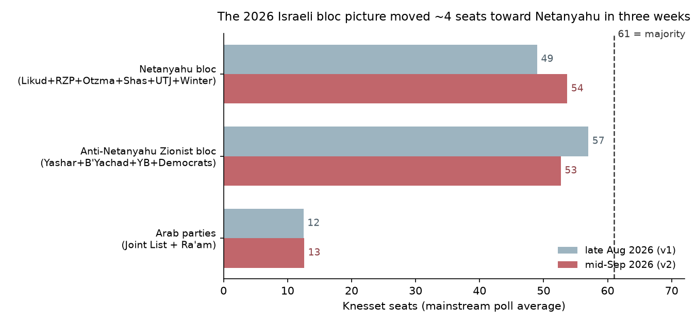
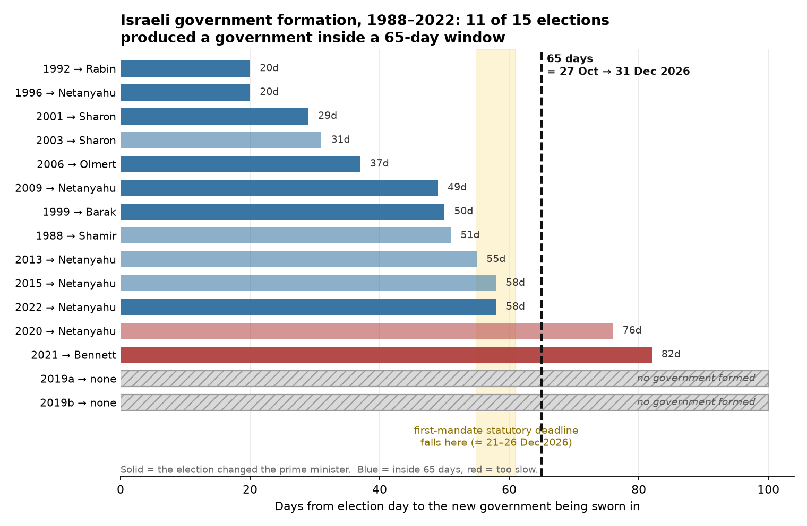
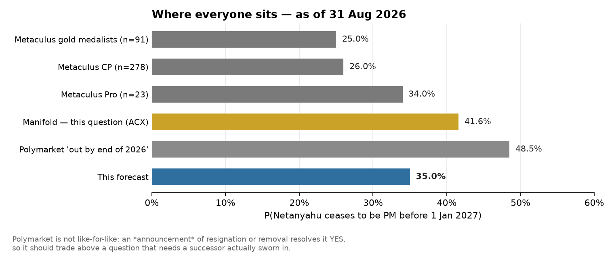

# Will Benjamin Netanyahu cease to be Prime Minister of Israel during 2026?

| | |
|---|---|
| **Source** | Metaculus #40966 — https://www.metaculus.com/questions/40966/will-benjamin-netanyahu-cease-to-be-prime-minister-of-israel-during-2026/ |
| **Type** | binary |
| **Opened / Closes / Resolves** | 2025-12-19 / 2026-12-31 / 2027-01-01 |
| **Status** | open |
| **Current forecast** | **Median 23.0%, IQR [17.0%, 30.0%]** (v3, 2026-10-09) |
| **Community** | CP 22.0% · Pro 22.0% · Gold 24.0% **as of 2026-09-17 (stale; fresh CP unavailable 2026-10-09, Cloudflare block)** · 849 forecasters (API, 2026-10-09) · Polymarket out-by-Dec-31 37.5% (2026-10-09) |
| **Next review** | 2026-10-20 |

<!-- Versions below, newest first. APPEND-ONLY: never edit or delete a past version. -->

---

## v3 — Update — 2026-10-09

**Mode: Update** (incremental). Twenty-one days since v2, 83 days to resolution. v2's
Monte-Carlo model is re-run with updated inputs (`raw/scenario-model-2026-10-09.py`); each
input change is charged separately below. Fresh Metaculus aggregations are **not available
today**: the browser path is blocked by Cloudflare. The official API post JSON confirms the
question is open with 849 forecasters [1].

### Revision

| Driver | Direction | Effect |
|---|---|---|
| Prior (v2, 2026-09-18) | — | Median 28.0%, IQR [22.0%, 35.0%] (model 28.3, posted after a −0.3 shade) |
| **Bloc polls.** In the seven mainstream houses, latest poll each, the anti-Netanyahu Zionist bloc slipped 56.1 → 55.1, the Netanyahu bloc including Amcha Yisrael went 51.5 → 51.9, and the Arab lists went 12.4 → 13.0 [2]. Model inputs: O 53 → 52, A 13 → 13.6 | ↓ | **−1.9 pp** |
| **18 days to the vote rather than 40.** Poll-error sd falls from 6.0 to 5.0 seats. That shrinks the tail where the opposition reaches 61 outright (5.5% → 1.7%) | ↓ | **−0.7 pp** |
| **Eisenkot hardens on Arab partners.** JPost interview, 2026-09-24: Ra'am and the Joint List are "not viable coalition partners"; "I do not see an Arab party that accepts my principles" [3]. The CEC disqualified both lists on 23 Sep; the High Court reversed this on 2 Oct, but Balad's Abu Shehadeh withdrew [4][5]. P(Ra'am recommends Eisenkot) 0.60 → 0.55; P(Joint List recommends) 0.35 → 0.30 | ↓ | **−1.0 pp** |
| **Minority-route formation success 0.45 → 0.42.** If abstention is only tacit, it is harder to deliver inside the 42-day mandate when the leader has publicly ruled the parties out. Liberman's "no 58-seat government" line (17 Aug) still stands [6] | ↓ | **−1.4 pp** |
| **Postponement risk.** IDF chief Zamir reportedly warned US generals that a strike on Iran in the coming weeks could delay the election (Channel 12, 8 Oct) [7]. Polymarket's on-schedule price fell from 96.5% to **91.9%** [8]. Trump has signalled no full-scale escalation before the 3 Nov midterms, and postponement needs 80 MKs, so I shade to **0.93** | ↓ | **−0.7 pp** |
| Elapsed time: the non-electoral floor drops from 1.1% to 0.9% | ↓ | **−0.2 pp** |
| **Unmodelled, up:** the 26 Sep pact among the five opposition leaders, committing them to "establish a government immediately after the elections" [9]. Also Avi Gil's Oct-7 allegations of 8 Oct, with Eisenkot calling for a criminal probe [7]. Separately, v2's −0.3 shade toward the gold cohort is dropped, because the cohort data is now three weeks old | ↑ | **+0.9 pp** |
| **New forecast** | | **Median 23.0%, IQR [17.0%, 30.0%]** |

### Tripwire check

| Tripwire from v2 | Fired? | Note |
|---|---|---|
| By 10-15: Ra'am or the Joint List rules out recommending Eisenkot, or Eisenkot re-commits to "no deals with Arab parties" → −6 pp | **Partially fired** | Eisenkot, 24 Sep: neither is a viable coalition partner [3]. He did not rule out abstention or outside support, and neither Arab list has ruled out recommending him. Credited at about −2.4 pp (the Arab-recommendation and minority-formation rows) |
| By 10-15: an Arab list commits to recommending Eisenkot → +6 pp | Not fired | Hadash/Joint List still states conditions only [10] |
| By 10-20: two or more Yashar candidates refuse a minority government → −4 pp | Not fired | None found |
| By 10-26: mainstream Netanyahu bloc (incl. Amcha) ≥ 57 → −7 pp | Not fired | 51.9 mainstream. Only Channel 14 (63) and i24 (60) are above 57 [2] |
| By 10-26: mainstream Netanyahu bloc < 49 → +6 pp | Not fired | Lowest single house is Midgam at 49 [2] |
| By 10-26: Ra'am below 3.25% in most final-week polls → −4 pp | Not fired | 5–6 seats in every October poll; Polymarket gives it a 94.2% chance of winning a seat [8] |
| 10-28 result; 11-10 recommendation tally; 11-16 mandate; 11-20 mandate timing | Not due | — |
| By 12-17: health event or pardon on retirement terms → +8 pp | Not fired | No new disclosure. Herzog's pardon decision is still deferred pending plea talks |

### What resolves YES

Unchanged from v1/v2. Netanyahu stays PM as caretaker until a successor is sworn in. YES
therefore needs a new government sworn in by 2026-12-31 (or death, or ≥ 14 days of
incapacity). **Postponement of the 27 Oct vote ≈ NO.**

### Outside view

Unchanged from v1.

### Inside view

Structure unchanged from v2. Re-run, 1,000,000 draws:

| Quantity | v2 | v3 |
|---|---|---|
| P(anti-Netanyahu Zionist bloc ≥ 61 outright) | 5.5% | 1.7% |
| P(anti-Netanyahu Zionist bloc > Netanyahu bloc) | 36.4% | 28.9% |
| **P(Eisenkot receives the first mandate)** | 54.7% | **48.8%** |
| P(YES \| electoral path) | 28.4% | 23.2% |
| P(YES) total | 28.3% | **22.5%** → posted 23.0% |

**Consistency with the sister question (#45670, largest party, v3 same day).** That forecast
puts Yashar as largest party at 48.5% and Likud at 50.9%, with a 14% exact-tie branch split
50/50 to match this model's P(Eisenkot first mandate) of 0.49. Required: P(YES here) ≤
P(non-Netanyahu PM) and ≤ P(Yashar resolves there) plus a small allowance for Likud-largest
worlds. 23.0 ≤ 48.5 holds. The implied P(YES | Yashar largest) is about 0.39, and P(YES |
Likud largest) is about 0.08.

### Evidence

- **The bloc picture is flat, but the largest-party race has tightened sharply.** Likud has
  closed on Yashar (−3.4 → −1.3 seats) mostly by taking voters from the Netanyahu bloc's
  own satellites, Amcha Yisrael in particular, which is now below threshold in 3 of 7
  houses. The bloc totals barely moved [2]. Bloc totals drive the mandate, so this
  question moves much less than #45670.
- **Real-money markets moved against YES more than the polls justify.** Polymarket "Netanyahu
  out by Dec 31" fell from 46.5% to **37.5%**. Next-PM: Netanyahu 28.5 → **36.5**, Eizenkot
  51.7 → **43.7**. Kalshi: Netanyahu 36, Eizenkot 44 [8][11]. The Polymarket Likud-seats
  ladder (median ~24) shows traders weighting Channel 14 and i24 heavily. I treat the move as
  mostly the same poll information plus that house weighting, and do not add it on top.
  Cross-check: P(someone other than Netanyahu eventually) ≈ 63.5% implies a timing
  conditional of 23.0 / 63.5 = **0.36**, against v2's 0.39.
- **Absent:** no Arab-list commitment either way, no Yashar defections on record, no verdict
  path, no pardon movement, no new health news.

### Other forecasters

| Source | Value | As of | Note |
|---|---|---|---|
| Metaculus CP (recency-weighted) | 22.0% IQR[17%, 30%] (n=278) | **2026-09-17 (stale)** | **Fresh CP unavailable 2026-10-09 (Cloudflare block)**. 849 forecasters on the post [1] |
| Metaculus Pro | 22.0% (n=24) | **2026-09-17 (stale)** | fresh value unavailable 2026-10-09 (Cloudflare block) |
| Metaculus gold | 24.0% (n=90) | **2026-09-17 (stale)** | fresh value unavailable 2026-10-09 (Cloudflare block) |
| Polymarket, "Netanyahu out by Dec 31" | **37.5%** (0.37/0.38) | 2026-10-09 | was 46.5%. Looser criteria: an announcement counts. $2.66M on this leg [8] |
| Polymarket, next PM after the election | Netanyahu 36.5, Eizenkot 43.7, Bennett 9.5, Lieberman 2.0 | 2026-10-09 | $44.5M volume. Horizon to Dec 2027 [8] |
| Kalshi `KXISRAELPM-26OCT27` | Netanyahu 36 (35/36), Eizenkot 44 (44/45), Bennett 8 | 2026-10-09 | [11] |
| Polymarket, hung parliament | 37.5% | 2026-10-09 | $14k, thin |
| Polymarket, election on schedule | 91.9% | 2026-10-09 | was 96.5% [8] |
| Manifold, ACX mirror of this question | **28.2%** (vol 24.8k) | 2026-10-09 | was 41.6%. Play money, discounted [12] |

I sit about 1 pp above the stale Metaculus CP and gold, and well below Polymarket's
looser-criteria market. The Polymarket gap is explained by the criteria, as before.

### Scenarios

Read off the v3 simulation (electoral weights × 0.93 on-schedule; non-electoral floor 0.9% on top):

| # | Scenario | Weight | P(YES \| scenario) |
|---|---|---|---|
| A | Netanyahu bloc reaches 61 | 0.157 | 0.04 |
| B | Anti-Netanyahu Zionist bloc reaches 61 outright | 0.016 | 0.82 |
| C | Neither reaches 61; Eisenkot takes the first mandate on Arab recommendations | 0.439 | 0.42 |
| D | Neither reaches 61; Netanyahu takes the first mandate | 0.318 | 0.04 |
| E | Election postponed | 0.070 | ≈0 (floor only) |

### Sensitivity

| Assumption | If instead | Forecast becomes (model, before the +0.9 pp adjustment) |
|---|---|---|
| P(minority government sworn in by 12-31 \| Eisenkot mandate) = 0.42 | 0.30 | 17.3% |
| same | 0.55 | 28.2% |
| Election on schedule 0.93 | 0.85 (Iran escalation) | 20.7% |
| Right-skew −1.6 | 0.0 | 27.2% |

### What would change my mind (tripwires)

- [ ] **By 2026-10-20:** Ra'am or the Joint List publicly commits to recommending Eisenkot → **+5 pp**; either publicly rules it out → **−5 pp**.
- [ ] **By 2026-10-20:** the election is formally postponed past 27 Oct → **to ~2%**.
- [ ] **By 2026-10-23 (final polls):** mainstream Netanyahu bloc (incl. Amcha) ≥ 55 → **−5 pp**; ≤ 49 → **+5 pp**.
- [ ] **By 2026-10-23:** two or more named Yashar candidates refuse a minority government on Arab abstention → **−4 pp**.
- [ ] **2026-10-28 (result known):** anti-Netanyahu Zionist bloc ≥ 61 without Arab lists → **to ~70%**; Netanyahu bloc ≥ 61 → **to ~3%**.
- [ ] **By 2026-11-10:** the recommendation tally shows Eisenkot leading → **+15 pp**; Netanyahu leading → **to ~5%**.
- [ ] **By 2026-11-16:** the first mandate goes to Eisenkot → **+15 pp**; to Netanyahu → **to ~5%**.
- [ ] **By 2026-11-20:** the first mandate is assigned after 2026-11-16 → **−8 pp**.
- [ ] **By 2026-12-17:** Netanyahu hospitalised with a transfer of powers > 5 days, a new serious diagnosis, or a pardon on retirement terms → **+8 pp**.

### Sources

1. Metaculus #40966, official API post JSON (bot key; aggregations hidden) — https://www.metaculus.com/questions/40966/ (accessed 2026-10-09; `raw/metaculus-api-2026-10-09.json`). Cohort values carried forward from `raw/metaculus-2026-09-18.json`
2. Opinion polling for the 2026 Israeli legislative election — Wikipedia (raw wikitext), latest poll per house through 7–8 Oct — https://en.wikipedia.org/wiki/Opinion_polling_for_the_2026_Israeli_legislative_election (accessed 2026-10-09; cached in the sister question's `raw/wikipedia-polling-wikitext-2026-10-09.txt`)
3. "Exclusive interview: Gadi Eisenkot lays out vision of change and repair for Israel" — The Jerusalem Post, 2026-09-24 — https://www.jpost.com/israel-election-2026/article-909543 (accessed 2026-10-09)
4. "Central Elections Committee bars Arab Ra'am, Joint List parties from running in October elections" — The Jerusalem Post, 2026-09-23 — https://www.jpost.com/israel-news/politics-and-diplomacy/article-909454 (cited via the Wikipedia polling page, accessed 2026-10-09)
5. The Times of Israel live blog, 2026-10-02 (the High Court reverses the bans; Abu Shehadeh withdraws) — https://www.timesofisrael.com/liveblog-october-02-2026/ (accessed 2026-10-09)
6. JFeed, 2026-08-17 — Liberman: "There will be no minority government" — https://www.jfeed.com/news-israel/minority-government-coalition (accessed 2026-10-09)
7. The Times of Israel live blog, 2026-10-08 (Avi Gil interview; Zamir/Iran postponement report; Ch13 poll) — https://www.timesofisrael.com/liveblog-october-08-2026/ (accessed 2026-10-09); "Eyal Zamir: Return to Iran war may postpone Israel election" — https://www.jpost.com/middle-east/iran-news/article-911125 (accessed 2026-10-09, via search summary)
8. Polymarket gamma API: `netanyahu-out-before-2027`, `who-will-be-the-next-prime-minister-of-israel-after-the-next-election`, `israeli-election-results-in-a-hung-parliament`, `will-israel-election-happen-as-scheduled-20260720204824362`, `which-parties-will-win-a-seat-in-the-2026-knesset-elections` (accessed 2026-10-09; `raw/polymarket-*-2026-10-09.json`)
9. "Israeli opposition leaders sign cooperation pact to oust Netanyahu" — JNS, 2026-09-27 — https://www.jns.org/news/israel-news/israeli-opposition-leaders-sign-cooperation-pact-to-oust-netanyahu (accessed 2026-10-09)
10. "Hadash sets conditions for supporting Eisenkot bloc" — Arutz Sheva, 2026-08-26 — https://www.israelnationalnews.com/news/432244 (accessed 2026-10-09)
11. Kalshi API, `KXISRAELPM-26OCT27` (accessed 2026-10-09; `raw/kalshi-KXISRAELPM-2026-10-09.json`)
12. Manifold Markets API, "[ACX 2026] Will Benjamin Netanyahu cease to be Prime Minister of Israel during 2026?" (accessed 2026-10-09)
13. v2 sources 13–15 (IDI government-formation explainer, Cabinet of Israel formation dates, ToI on the minority-government groundwork) carried forward, still relied on

**Date**: 2026-10-09
**Forecast**: Median 23.0%, IQR [17.0%, 30.0%]
**Thesis**: The statutory clock still governs. Netanyahu stays caretaker PM until a successor is sworn in, so YES needs the first mandate to go to Eisenkot and a government to be sworn in by about 21–26 December. The bloc polls are flat (mainstream: opposition Zionist bloc 55, Netanyahu bloc 52, Arab lists 13) [2]. But Eisenkot's public rejection of Arab partners makes the recommendation and abstention route somewhat harder [3]. With the shorter horizon and a new postponement risk tied to Iran (Polymarket on-schedule 91.9%) [7][8], P(Eisenkot takes the first mandate) falls to 0.49 and the forecast to 23%. Real-money markets moved the same way (Polymarket out-by-Dec-31 46.5 → 37.5) [8].

---

## v2 — Update — 2026-09-18

Incremental update, not a re-analysis. The >10 pp gap to the community would normally trigger a
de-novo rebuild, but the gap has a nameable cause (the statutory-clock argument in v1, which is
unchanged and still correct) and only 18 of the 122 days since v1 have elapsed. What *did* get
rebuilt from scratch is the **scenario layer**: v1's four hand-drawn bloc scenarios are replaced
by an explicit Monte-Carlo over seat outcomes and recommendation counts
(`raw/scenario-model-2026-09-18.py`), because the mandate assignment — not bloc size — turned out
to be the binding quantity.

### Revision

| Driver | Direction | Effect |
|---|---|---|
| Prior (v1, 2026-08-31) | — | Median 35.0%, IQR [28.0%, 43.0%] |
| **Bloc polls swung ~4 seats to Netanyahu.** Mainstream average now Netanyahu bloc 53–54 vs anti-Netanyahu Zionist bloc 51–54 (v1: ~48–50 vs 55–59) [1][2][3]. Scenario B ("opposition reaches 61 outright") falls from weight 0.21 to 0.055 | ↓ | **−10.5 pp** |
| **Ra'am clears the 3.25% threshold in every mid-September poll** (~5 seats), running alone; Hadash–Ta'al–Balad merged as the Joint List at 7–8 [2][4]. v1's single strongest bear point has reversed — no Arab votes are being wasted | ↑ | **+3.0 pp** |
| **Eisenkot commits to the minority-government route.** Channel 12, 2026-09-15: he told his slate to back a government resting on Arab abstention or resign their seats [5]. v1 priced this tripwire at +5 pp | ↑ | **+3.0 pp** |
| **Surplus-vote (Bader–Ofer) agreements signed** by the four opposition factions: Yashar–Democrats, Yisrael Beytenu–B'Yachad [6] | ↑ | **+0.5 pp** |
| **Wasted-vote asymmetry flipped.** Winter's Amcha Yisrael is now *above* threshold at ~4 seats and recommends only Netanyahu; the Hendel–Zelekha list sits at ~2.4 seats *below* it [2][3] | ↓ | **−1.0 pp** |
| **Defection risk inside Yashar's own slate** over the Arab-abstention route, reported the same day as the commitment [5] | ↓ | **−1.5 pp** |
| Elapsed time: non-electoral floor (death, ≥14-day incapacity, pardon-for-retirement) over 3.5 months rather than 4 | ↓ | **−0.1 pp** |
| Shading toward the gold cohort (24.0%, n=90) now that the Pro cohort has converged onto it | ↓ | **−0.4 pp** |
| **New forecast** | | **Median 28.0%, IQR [22.0%, 35.0%]** |

### Tripwire check

| Tripwire from v1 | Fired? | Note |
|---|---|---|
| By 2026-09-09: Ra'am running alone **and** still below 3.25% in most post-deadline polls → −5 pp | **Not fired** | Lists were filed 2026-09-08 [6]. Ra'am *is* running alone — but at **5 seats in every mid-September poll**, comfortably clear [2][4]. Only half the conjunction holds, and the half that failed is the half that mattered |
| By 2026-09-09: Ra'am inside a merged Arab list or a technical bloc with Hadash–Ta'al, clearing comfortably → +5 pp | **Partially fired** | Not the mechanism (Ra'am is separate from the Jabareen–Tibi–Abu Shehadeh Joint List), but the outcome it was proxying for — full Arab representation, nothing wasted — did happen. Credited at +3 pp, not +5 |
| By 2026-10-20: public pre-election pact naming a single PM candidate, or an Eisenkot–Bennett rotation → +5 pp | **Partially fired** | Surplus-vote agreements only (Yashar–Democrats, Yisrael Beytenu–B'Yachad, 2026-09-10) [6]. Seat-maximising, not a PM pact. Credited at +0.5 pp |
| By 2026-10-20: Eisenkot softens on negotiating with Arab-majority parties → +5 pp | **Fired** | 2026-09-15, Channel 12: Eisenkot told his slate that if the four-party bloc misses 61 he will form a minority government on Arab abstention, and that candidates who cannot support it should resign [5]. Credited at +3 pp net of the defection report in the same story |
| By 2026-10-27: Netanyahu-bloc polling average reaches ≥ 57 → −8 pp | **Not fired, but moving toward it** | 53 (MEF poll-of-polls, 2026-09-17), 54 (Channel 13, 2026-09-16), 54.4 (JPost five-poll average, 2026-09-17) [1][2][3]. Charged as the −10.5 pp driver above at its actual magnitude rather than waiting for the 57 threshold |
| 2026-10-28: anti-Netanyahu Zionist bloc ≥ 61 without Arab parties → +35 pp | **Not due** | 39 days out. Model probability now 5.5%, down from v1's implicit ~21% |
| 2026-10-28: Netanyahu bloc ≥ 61 → −31 pp | **Not due** | Model probability ~19% |
| By 2026-11-16: first mandate to Eisenkot → +15 pp / to Netanyahu → −27 pp | **Not due** | This is now the single highest-leverage observable in the question |
| By 2026-11-20: first mandate assigned after 2026-11-16 → −10 pp | **Not due** | — |
| By 2026-12-17: Netanyahu health event or pardon-on-retirement terms → +8 pp | **Not fired** | Herzog's pardon decision is still deferred pending plea-deal mediation; no new health disclosure found [7] |

Score: **one fired (up), two partially fired (one up, one up-but-smaller-than-written), one not fired
in a way that reverses a v1 bear point, one not fired but moving against me, five not due.** The
tripwire ledger reads *net positive* — and the forecast still falls 7 pp, because the one thing the
v1 tripwire list under-covered, the bloc-level poll swing, moved further than everything else
combined. That is the lesson for the next version's tripwire design.

### What resolves YES

Unchanged from v1, and the caretaker mechanic remains the whole question: Netanyahu has been
caretaker PM since the 2026-07-17 dissolution, a caretaker PM *is* the PM, and only the
swearing-in of a successor government (or death, or ≥14-day incapacity ending before 2026-12-31)
resolves YES. Losing the 2026-10-27 election does not. Window for a successor: 2026-10-27 →
2026-12-31, 65 days; the President's first mandate (28 days + a 14-day extension, assigned
~9–14 November) expires ~21–26 December, so YES needs **first-mandate success**, not unusual speed.

### Outside view

Unchanged from v1 — 11/15 Israeli elections 1988–2022 produced a government within 65 days (73%),
falling to 1/5 (20%) in the fragmented 2019–2022 era, and 11 of 13 formed governments came on the
first mandate. What changed is which branch of that spread the inside view now points at.

### Inside view

**The mandate, not the majority, is the crux — and Arab recommendations decide the mandate.**
This is the structural correction in v2. Under Basic Law: The Government §7 the President is not
bound by recommendation counts, but in practice has followed them: Rivlin gave the first mandate
to Gantz in 2020 on 61 recommendations and to Netanyahu in 2021 on 52 against Lapid's 45, the
latter precisely because Ra'am recommended nobody. Arab-party recommendations count toward the
tally **even when those parties would never join the coalition** — the Joint List's 13
recommendations for Gantz in September 2019 are the precedent.

So with the Zionist blocs now within a seat of each other, the question becomes: do Ra'am (≈5) and
the Joint List (≈7–8) recommend Eisenkot? If both do, Eisenkot has ≈66 recommendations against
Netanyahu's ≈54 and takes the first mandate with the December deadline available. If neither does,
Netanyahu takes it on a plurality and the question is effectively over, because the second mandate
runs to mid-January 2027.

Monte-Carlo (1,000,000 draws, `raw/scenario-model-2026-09-18.py`):

| Quantity | Value |
|---|---|
| P(anti-Netanyahu Zionist bloc ≥ 61 outright) | 5.5% |
| P(anti-Netanyahu Zionist bloc > Netanyahu bloc) | 36.4% |
| **P(Eisenkot receives the first mandate)** | **54.7%** |
| P(YES \| electoral path) | 28.4% |
| P(YES) incl. 0.96 election-on-schedule gate and 1.1% non-electoral floor | **28.3%** |

Inputs: anti-Netanyahu Zionist bloc ~N(53 − 1.6 right-skew, 6.0); Arab bloc ~N(13, 1.5);
P(Ra'am recommends Eisenkot) = 0.60; P(Joint List recommends) = 0.35; P(government sworn in by
12-31 | Eisenkot mandate and ≥61 own seats) = 0.80; P(same | mandate but minority) = 0.45;
P(YES | Netanyahu holds the first mandate) = 0.04.

Posted at **28.0%** after a 0.3 pp shade toward the gold cohort.

**Cross-check.** Polymarket's next-PM market puts P(Netanyahu is the next PM) at 28.5%, i.e.
P(someone else eventually) ≈ 71.5% [8]. My 28.0% therefore implies a timing conditional of **0.39**
— down from v1's 0.50. The Metaculus CP of 22% implies 0.31. The disagreement with the crowd is
now 6 pp rather than 13 pp and sits entirely in that conditional, which is exactly where the
statutory-clock argument lives.

### Evidence

**The load-bearing new fact is the poll swing, and it is bad for YES.** Three independent
mid-September readings agree: Middle East Forum poll-of-polls, 2026-09-17 — Netanyahu bloc 53,
opposition 54, Arab 13 [1]; Channel 13, 2026-09-16 — Netanyahu 54, Eisenkot bloc 52 [2]; JPost
five-poll average, 2026-09-17 — Netanyahu 54.4, opposition Zionist 51, Arab 12.2, Hendel–Zelekha
2.4 [3]. Against v1's ~48–50 vs 55–59 this is a ~4-seat swing in each direction in three weeks.
Its effect is nonlinear: it does not merely shrink the "opposition wins outright" branch, it moves
probability mass across the line where Netanyahu, not Eisenkot, receives the first mandate — and
that line is where almost all of this question's probability is decided. LR ≈ **0.55** on
"Eisenkot takes the first mandate".

**Two facts cut the other way and are not small.** First, **Ra'am is polling 5 seats in every
mid-September house** [2][4] — Channel 14, Direct Polls and Kantar all have it there — against v1's
finding that it sat below the threshold in six of nine late-August polls. That was v1's single
strongest bear point and it is gone. Second, **Eisenkot has stopped hedging on the Arab question.**
On 2026-09-15 Channel 12 reported that he told his slate he intends to form a minority government
on Arab abstention if the four-party bloc misses 61, and that candidates unwilling to back it
should resign their seats [5]. v1 explicitly listed this as a +5 pp tripwire on the strength of his
earlier "I won't ask anything of them" line. LR ≈ **1.5** jointly.

**The same story carries the counterweight**, which is why it is credited at +3 pp and not +5:
Yashar's slate is right-leaning and full of political novices, and the report frames internal
defection over Arab-supported government as a live risk [5]. A minority government that loses two
of its own MKs at the investiture vote does not get sworn in. Separately, Netanyahu's campaign has
been explicitly built around making the Arab-support route toxic for Eisenkot [9] — the mirror
image of 2021, and this time the target has pre-committed.

**Cohort convergence, and why it is not independent evidence.** The Pro cohort has fallen from
34.0% to 22.0% since v1, the CP from 26.0% to 22.0%, gold from 25.0% to 24.0%. All three now agree
within 2 pp — the configuration that, under this repo's own rule, obliges me to go looking for the
fact I missed before defending my number. I went looking and found it: the bloc polls. Having
counted that evidence directly at −10.5 pp, counting the cohort move again would be double-counting
and, worse, herding. Only the residual 0.4 pp shade is charged. Two caveats in the other direction:
the Pro cohort has n=24 and swung 0.265→0.37→0.265→0.35→0.37→0.22 over the same three weeks, so
"the Pros moved 12 pp" is mostly a few forecasters, not a consensus; and **no comment has been
posted on the question since 2026-08-13**, so the drift is not argued anywhere public.

**Absent, as before.** No verdict path (testimony cancelled again on security grounds; a verdict
remains 2027+) [7][10]. No pardon-for-retirement: Herzog is still deferring pending plea-deal
mediation [7]. No intra-Likud challenge. No election-postponement move.

### Other forecasters

| Source | Value | As of | Note |
|---|---|---|---|
| Metaculus CP (recency-weighted) | **22.0%** IQR[17%, 30%] (n=278) | 2026-09-17 15:45Z | was 26.0% at v1; drifted down steadily from 2026-09-02 |
| Metaculus Pro | **22.0%** IQR[20%, 28%] (n=24) | 2026-09-17 15:45Z | was 34.0%; highly volatile in between (0.265→0.37→0.22) |
| Metaculus gold medalists | **24.0%** IQR[20%, 30%] (n=90) | 2026-09-17 15:45Z | was 25.0%; the stable cohort, as in v1 |
| Polymarket — "Netanyahu out by end of 2026" | **46.5%** | 2026-09-18 | was 48.5%; $2.50M on this leg. Looser criteria (an *announcement* suffices) — the wedge explanation from v1 still applies |
| Polymarket — next PM after the election | Netanyahu **28.5%**, Eizenkot **51.7%**, Bennett 8.5%, Lieberman 4.6% | 2026-09-18 | $38.0M volume, $2.73M liquidity. Netanyahu ticked *down* from 29.5% while the seat polls improved for him |
| Polymarket — largest party | Yashar **61.0%**, Likud **39.5%** | 2026-09-18 | was a 49.5/46.5 coin flip at v1 — Yashar strengthened here even as its bloc weakened |
| Manifold / Kalshi / Sentinel / GJOpen / INFER | not re-pulled this session | — | v1 values stand; none is load-bearing |

**The market tension is worth naming.** Seat polls moved toward Netanyahu; Polymarket's next-PM
contract moved slightly *against* him and its largest-party contract moved sharply toward Yashar.
The reconciliation I believe is that largest-party and eventual-PM are not the same question as
bloc-arithmetic-in-December, and Polymarket's horizon runs to December 2027 — fourteen months of
extra time in which Netanyahu can still lose office. Metaculus's 22% and Polymarket's 28.5% are
consistent with each other once the horizons are lined up; my 28.0% on a 2026 horizon is the
aggressive number, and I hold it on the statutory clock alone.

### Scenarios

Replaced by the Monte-Carlo above. The equivalent scenario cut, read out of the simulation:

| # | Scenario | Weight | P(YES \| scenario) |
|---|---|---|---|
| A | Netanyahu bloc reaches 61 | 0.19 | 0.03 |
| B | Anti-Netanyahu Zionist bloc reaches 61 outright | 0.055 | 0.76 |
| C | Neither reaches 61; Eisenkot nonetheless takes the first mandate on Arab recommendations | 0.50 | 0.45 |
| D | Neither reaches 61; Netanyahu takes the first mandate | 0.255 | 0.04 |

### Sensitivity

| Assumption | If instead | Forecast becomes |
|---|---|---|
| P(minority government sworn in by 12-31 \| Eisenkot mandate) = 0.45 | 0.30 (defections bite, or the deadline slips) | **21.2%** |
| same | 0.60 (Arab abstention pre-agreed, discipline holds) | **35.5%** |
| Right-skew correction −1.6 seats | −4.0 (full 2015/2020/2022 correction) | **21.4%** |
| same | 0.0 (2021-style, polls over-read the right) | **33.3%** |
| P(Ra'am recommends Eisenkot) = 0.60 | 0.25 | **26.1%** |
| P(Joint List recommends Eisenkot) = 0.35 | 0.10 | **25.9%** |
| Bloc poll error SD 6.0 seats | 8.0 | **30.0%** |

The forecast is now most sensitive to **minority-formation success** and to **polling bias**, and
markedly less sensitive to the Arab-recommendation probabilities than one would guess — because
Eisenkot needs only one of the two Arab lists to tip the recommendation count.

### What would change my mind (tripwires)

- [ ] **By 2026-10-15:** Ra'am or the Joint List publicly rules out recommending Eisenkot, or
      Eisenkot publicly re-commits to "no deals with Arab parties" under campaign pressure
      → **−6 pp**. Either Arab list publicly commits to recommending him → **+6 pp**.
- [ ] **By 2026-10-20:** two or more named Yashar candidates publicly refuse to back a minority
      government resting on Arab abstention → **−4 pp**.
- [ ] **By 2026-10-26:** the mainstream polling average of the Netanyahu bloc (incl. Amcha
      Yisrael) reaches ≥ 57 → **−7 pp**; it falls back below 49 → **+6 pp**.
- [ ] **By 2026-10-26:** Ra'am falls back below the 3.25% threshold in the majority of final-week
      polls → **−4 pp**.
- [ ] **2026-10-28 (result known):** anti-Netanyahu Zionist bloc ≥ 61 without Arab parties
      → **+40 pp (to ~68%)**. Netanyahu bloc ≥ 61 → **−25 pp (to ~3%)**.
- [ ] **By 2026-11-10 (recommendation tally published):** Eisenkot leads the recommendation count
      → **+13 pp**; Netanyahu leads it → **−20 pp**. *This is the highest-leverage single
      observable left in the question.*
- [ ] **By 2026-11-16:** President Herzog assigns the first mandate to Eisenkot → **+15 pp**;
      to Netanyahu → **−22 pp (to ~6%)**.
- [ ] **By 2026-11-20:** the first mandate is assigned later than 2026-11-16, pushing the
      28+14-day deadline past 31 December → **−9 pp** regardless of who holds it.
- [ ] **By 2026-12-17:** Netanyahu hospitalised with a transfer of powers lasting > 5 days, a new
      cancer/cardiac disclosure, or a Herzog pardon on terms requiring exit from political life
      → **+8 pp**.

### Sources

Sources 1–29 from v1 remain as cited there; the ones still load-bearing for v2 are repeated below
with their original access dates so this version stands on its own.

1. Metaculus #40966 — https://www.metaculus.com/questions/40966/will-benjamin-netanyahu-cease-to-be-prime-minister-of-israel-during-2026/ — all three cohorts, 396 history points and 8 comments, pulled via the `metaculus-aggregations` skill with `METACULUS_FORCE_TLS12=1`; snapshot in `raw/metaculus-2026-09-18.json` (accessed 2026-09-18)
2. Middle East Forum — Israel Election 2026 Poll of Polls — https://www.meforum.org/press-releases/middle-east-forum-opens-israel-election-2026-poll-of-polls — poll-of-polls state as of 2026-09-17: Netanyahu bloc 53, opposition 54, Arab parties 13 (accessed 2026-09-18)
3. The Jerusalem Post — "Netanyahu's Likud, Eisenkot's Yashar trade leads as 2026 election picture stays unclear" — https://www.jpost.com/israel-election-2026/article-908444 (accessed 2026-09-18)
4. Haaretz — "In Latest Poll, pro-Netanyahu Bloc Edges Ahead of Eisenkot's Opposition as Likud Drops" (2026-09-17) — https://www.haaretz.com/israel-news/elections/2026-09-17/ty-article/israeli-election-poll-sees-pro-netanyahu-bloc-edge-ahead-of-eisenkot/000001a0-ad41-dea8-afe0-eded00220000 (accessed 2026-09-18)
5. The Jerusalem Post — "Gadi Eisenkot still leads in polls, but Benjamin Netanyahu shortens distance" — five-poll average of 2026-09-17: Netanyahu bloc 54.4, opposition Zionist 51, Arab 12.2, Hendel–Zelekha 2.4 — https://www.jpost.com/israel-election-2026/article-908921 (accessed 2026-09-18)
6. Wikipedia — "Opinion polling for the 2026 Israeli legislative election", 16–17 September entries (Channel 14/Filber + NEXT DATA, Direct Polls/i24, Kantar/Israel Hayom) — https://en.wikipedia.org/wiki/Opinion_polling_for_the_2026_Israeli_legislative_election (accessed 2026-09-18)
7. The Times of Israel — "Report: Eisenkot fears defections from party if he forms minority government with Arab support" (Channel 12, 2026-09-15) — https://www.timesofisrael.com/liveblog_entry/report-eisenkot-fears-defections-from-party-if-he-forms-minority-government-with-arab-support/ (accessed 2026-09-18)
8. The Times of Israel — "Main opposition factions ink surplus-vote deals in bid to maximize Knesset representation"; also the 2026-09-08 candidate-list filing date — https://www.timesofisrael.com/main-opposition-factions-ink-surplus-vote-deals-in-bid-to-maximize-knesset-representation/ (accessed 2026-09-18)
9. The Times of Israel — "Netanyahu's anti-Arab campaign has found Gadi Eisenkot's Achilles' heel" — https://www.timesofisrael.com/netanyahus-anti-arab-campaign-has-found-gadi-eisenkots-achilles-heel/ (accessed 2026-09-18)
10. The Media Line — "Herzog Defers Netanyahu Pardon Decision, Calls for Plea Deal First" — https://themedialine.org/headlines/herzog-defers-netanyahu-pardon-decision-calls-for-plea-deal-first/ (accessed 2026-09-18)
11. Truthout — "Netanyahu's Testimony in Criminal Trial Cancelled Again for 'Security Concerns'" — https://truthout.org/articles/netanyahus-testimony-in-criminal-trial-cancelled-again-for-security-concerns/ (accessed 2026-09-18)
12. Polymarket — "Prime Minister of Israel after the next election?", "Netanyahu out by...?" and "Israeli Legislative Election Winner" — https://polymarket.com/event/netanyahu-out-before-2027 — prices via `gamma-api.polymarket.com` (accessed 2026-09-18)
13. Israel Democracy Institute — "Everything You Need to Know About How a Government is Formed Following Elections" — https://en.idi.org.il/articles/63976 (accessed 2026-08-31, carried forward from v1; the statutory 28+14-day mandate clock)
14. Wikipedia — "Cabinet of Israel", government-formation dates for the 22nd–37th governments — https://en.wikipedia.org/wiki/Cabinet_of_Israel (accessed 2026-08-31, carried forward from v1; the 65-day base rate)
15. The Times of Israel — "Eisenkot lays groundwork for a minority government, if necessary, to oust Netanyahu" — https://www.timesofisrael.com/eisenkot-lays-groundwork-for-a-minority-government-if-necessary-to-oust-netanyahu/ (accessed 2026-08-31, carried forward from v1)

**Date**: 2026-09-18
**Forecast**: Median 28.0%, IQR [22.0%, 35.0%]
**Thesis**: The statutory-clock argument from v1 survives intact — Netanyahu stays caretaker PM until a successor is sworn in, and the President's first mandate expires ~21–26 December, so YES needs first-mandate success rather than unusual speed — but the input it feeds on has deteriorated: three independent mid-September poll averages now put the Netanyahu bloc at 53–54 against an anti-Netanyahu Zionist bloc of 51–54, a ~4-seat swing in three weeks that moves real mass across the line where Netanyahu, not Eisenkot, receives that first mandate [1][2][3]. Partly offsetting, Ra'am is clearing the 3.25% threshold in every current poll (v1's strongest bear point, now reversed) and Eisenkot has publicly committed his slate to a minority government resting on Arab abstention [4][5]. Net −7 pp to 28.0%; the crowd has converged to 22–24% on the same evidence, and the remaining 4–6 pp gap is the timing conditional (0.39 mine vs 0.31 theirs) against Polymarket's unchanged ~71.5% that Netanyahu eventually goes [8].

---

## v1 — Initial forecast — 2026-08-31

### What resolves YES

YES if, at any point before 2027-01-01, Netanyahu **ceases to be** Prime Minister of Israel.
A *temporary* removal — suspension, an acting PM being appointed, incapacity — counts only if
it lasts **≥ 14 consecutive days entirely within 2026**, so any such event beginning after
about 2026-12-17 cannot resolve YES. A permanent cessation (a successor sworn in, resignation
taking effect, death) has no duration requirement. There is no fine print. Resolution is by
Metaculus admin against public reporting; there is no data series and no release schedule.

The decisive mechanic is one most casual readings miss. Under **Basic Law: The Government**,
the outgoing government continues to carry out its functions until the new government is
constituted. Netanyahu has been a **caretaker prime minister since the Knesset dissolved on
2026-07-17**, and a caretaker PM *is* the Prime Minister. Neither the dissolution, nor the
2026-10-27 election, nor **losing** that election resolves this question. Only the swearing-in
of a successor does. Netanyahu losing on October 27 and remaining caretaker PM into January
2027 → **NO**.

So this is not a question about whether Israelis want Netanyahu gone. It is a question about
whether a successor government can be **sworn in inside a 65-day window** (2026-10-27 →
2026-12-31), plus a small floor from death or ≥14-day incapacity.

### Outside view

**Reference class: Israeli elections → new government sworn in within 65 days.**
n = 15 (1988–2022). Days from election day to swearing-in, from the Cabinet of Israel record [20]:

> 20 (1992 Rabin), 20 (1996 Netanyahu), 29 (2001 Sharon), 31 (2003), 37 (2006 Olmert),
> 49 (2009), 50 (1999 Barak), 51 (1988), 55 (2013), 58 (2015), 58 (2022), 76 (2020),
> 82 (2021 Bennett), plus **two elections (2019a, 2019b) that produced no government at all**.

**Raw base rate: 11/15 = 73%.** Median 50 days. Restricted to elections that produced any
government: 11/13 = 85%.

Three partial classes that disagree, all kept:

| Class | n | Rate |
|---|---|---|
| All elections 1988–2022, government within 65 days | 15 | **73%** |
| Fragmented era only (2019a, 2019b, 2020, 2021, 2022) | 5 | **20%** |
| Elections that replaced an incumbent PM with an opposition leader (1992, 1999, 2006, 2021) | 4 | **75%** (20, 50, 37 days; 2021 = 82) |

The long class says 73%, the recent class says 20%. That spread is the honest uncertainty, and
it is why this forecast is not close to either 15% or 60%.

**Status-quo prior** applies with real force here: "will X change by date D" questions usually
resolve NO, and the caretaker rule stacks the deck further — inertia literally keeps Netanyahu
in office by default.

**Mortality floor.** Netanyahu turns 77 on 2026-10-21. Actuarial ~3%/yr for a male of that age
in a high-income country, adjusted for excellent healthcare access against a pacemaker (2023),
hernia surgery (2024), prostate removal (Dec 2024) and radiation-treated early-stage prostate
cancer disclosed 2026-04-24 [17]. ≈ **1.0–1.3%** over 2026-09-01 → 12-31. Manifold prices
"alive on 2026-12-31" at 97.9% [24], consistent.

### Inside view

**The statutory clock is the whole question.** Compiled from the Israel Democracy Institute [18]
and the JPost election-timetable explainer [19]:

| Step | Rule | 2026 date |
|---|---|---|
| Election day | fixed by the Party Funding Law | **2026-10-27** |
| Official results confirmed | ≤ 8 days | 2026-11-04 |
| President's consultations | begin ≤ 7 days after publication | by 2026-11-11 |
| Mandate assigned | historically 8–14 days post-election | **~2026-11-09 to 11-14** |
| **First mandate** | 28 days **+ optional 14-day extension** | **expires ≈ 2026-12-21 to 12-26** |
| Second mandate | 28 days, **no extension** | expires ≈ 2027-01-19 |
| Third attempt / Knesset route | 21 + 14 days | 2027 |

Two consequences, and they pull in opposite directions:

1. **The first-mandate deadline falls just inside 2026.** So YES does *not* require unusual
   speed. It requires only that the **first** mandate-holder is not Netanyahu and succeeds.
   Even running to the full 42-day limit — which is exactly what 2013 (55 days), 2015 (58) and
   2022 (58) all did — lands the swearing-in around 21–26 December.
2. **If the first mandate fails, the question is over.** The second mandate runs to
   mid-January 2027. This is a hard cliff, not a gradual decay.

**Investiture needs no 61.** Israeli law does not require an absolute majority to install a
government — a simple majority of those voting suffices [8][9][18]. The Bennett government
passed 60–59 in 2021. A 58–52 vote with 10 abstentions installs a prime minister. Eisenkot's
camp is reportedly preparing exactly that [8].

**Bloc arithmetic** from the nine polls of 24–30 August 2026 [5][6][7]. Ofer Winter's new
far-right "People of Israel" party counts *inside* the Netanyahu bloc — he has said Netanyahu
"is the only person we will recommend" [13]:

- Netanyahu bloc (Likud + RZP + Otzma + Shas + UTJ + Winter): **43–51 in the seven mainstream
  polls, 59 and 63 in the two right-leaning houses** (Channel 14/Filber, Direct Polls/i24).
  Mainstream median ≈ 48–50.
- Anti-Netanyahu Zionist bloc (Yashar + Together + Yisrael Beiteinu + Democrats): **55–59**.
- Arab parties: **10–15**.

Netanyahu is roughly **11 seats short of 61** on the mainstream median; Eisenkot's bloc is
**2–5 short**. This is the classic Israeli deadlock shape, with the opposition ahead.

**Decomposition.**

P(YES) = P(election held 27 Oct) × Σᵢ wᵢ·P(successor sworn in ≤ 31 Dec | scenario ᵢ)
 + non-electoral paths

= 0.96 × 0.366 + 0.013 ≈ **0.365**, shaded to **0.350** (reconciliation below).

**Cross-check from the other direction.** Kalshi and Polymarket independently price
P(Netanyahu is the *next* PM sworn in) at 28–30% [21][22][23], i.e. P(someone else, eventually)
≈ 0.70. My 35% therefore implies a **timing conditional of ~0.50** — half the worlds where he
eventually goes, he goes inside 2026. The Metaculus CP of 26% implies ~0.37. **That conditional
is the entire disagreement**, and the statutory clock above is my reason for putting it higher.

### Evidence

**Updated me up (from a naive status-quo prior):**

- *The first-mandate deadline lands inside 2026* (LR ≈ 2.0 against a framing of "coalitions
  take ~80 days to replace Netanyahu"). The single most load-bearing fact in this forecast.
- *Eisenkot has pre-positioned a minority government* [8][9]. Aides say a fragile 58–59-seat
  government beats Netanyahu staying, and note that if it collapses **Eisenkot**, not Netanyahu,
  becomes caretaker during the next election. That is an unusually sharp forcing function. LR ≈ 1.5.
- *The 2021 friction is pre-solved.* The thing that cost 2021 its extra 40 days was that
  Netanyahu got the first mandate and the Bennett–Lapid question was unresolved. Bennett and
  Lapid have now **merged into one list ("Together") before the election**, and Yashar is
  clearly the largest opposition party [4][5]. LR ≈ 1.3.
- *Netanyahu's own bloc is fragmenting.* Winter's new party, plus RZP falling below the 3.25%
  threshold in three late-August polls, wastes right-wing votes; Netanyahu has publicly warned
  it "could doom the right" [29]. LR ≈ 1.2.
- *A widely-read low forecast rests on a factual error.* The Metaculus comment carrying 0.18
  (`supernumerate`, 2026-07-23) asserts "a non-Netanyahu government has never formed faster than
  82 days". False, and corrected in-thread by `darkives`: Olmert 37 days (2006), Rabin 20 (1992),
  Barak 50 (1999). The CP slipped ~0.30 → ~0.25 shortly after. Modest reason to discount the CP.

**Updated me down:**

- *Ra'am is below the 3.25% threshold in six of nine late-August polls* (1.1–2.4%) [5][11].
  Ra'am is the one Arab party that has ever sat in a Zionist coalition. Without it, the minority
  route needs **Hadash–Ta'al–Balad** to abstain — and Balad is explicitly anti-Zionist, while the
  Joint List *voted against* the Bennett government in 2021. LR ≈ 0.75. Strongest bear point.
- *Eisenkot has ruled out paying for that abstention*: he "won't ask anything of them" and will
  make no deals with Arab-majority parties [10]. Unreciprocated abstention is a lot to assume.
- *Israeli polls systematically under-read the right.* Across 2015, 2020 and 2022 they
  under-predicted the right bloc by ~5.7 seats and over-predicted centre-left/Arab by ~2.5;
  Likud polled 22 and won 30 in 2015 [25]. I applied a partial correction (60% no bias / 40%
  a +4-seat right skew). Treated cautiously — the source is right-leaning, and **2021 ran the
  other way** (right bloc polled ~59, won 52). LR ≈ 0.8.
- *Eisenkot is a political novice*, and the opposition is visibly quarrelsome (Haaretz:
  "Cannibalizing the Camp: The Petty Politics Destroying Israel's Opposition"). Coalition-building
  is a specialist skill and Netanyahu is the best practitioner alive.
- *Consensus commentary expects a slog*: "both are expected to struggle to form a coalition" [26].
- *Yashar could deflate.* New general-led parties are unstable — Bennett's Yamina polled ~20 at
  peak and won 7 in 2021. Polymarket makes largest-party a coin flip: Yashar 49.5%, Likud 46.5% [22].

**Expected evidence that is absent** (and its absence matters):

- **No verdict path.** Netanyahu finished testimony on 2026-06-24 after 98 hearings; defence
  witnesses and closing arguments remain, and a verdict is a 2027+ event [16]. Legal removal
  in 2026 ≈ 0.
- **No pardon-for-retirement deal.** Herzog **rebuffed** the pardon request and is pushing a plea
  deal; Netanyahu refuses both conditions any deal would carry — admission of guilt and departure
  from political life [15]. ≈ 1–2%, not more.
- **No intra-Likud challenge.** The 2026-08-17 primary confirmed his grip; the Central Committee
  had already handed him eight reserved slots [14]. ≈ 0.
- **No election-postponement move.** Polymarket prices the vote happening on schedule at 96.5% [21].

### Other forecasters

| Source | Value | As of | Note |
|---|---|---|---|
| Metaculus CP (recency-weighted) | **26.0%** IQR[20, 32] (n=278) | 2026-08-31 | flat 24–30% all year across 399 history points |
| Metaculus Pro | **34.0%** IQR[22, 50] (n=23) | 2026-08-31 | **above** CP; widest band of the three |
| Metaculus gold medalists | **25.0%** IQR[20, 30] (n=91) | 2026-08-31 | tightest band; agrees with CP |
| Polymarket — "Netanyahu out by end of 2026" | **48.5%** (bid .48 / ask .49) | 2026-08-31 | $2.23M on this leg, $124M event. **Looser criteria** — see below |
| Polymarket — next PM after the election | Netanyahu **29.5%**, Eizenkot 49.8%, Bennett 7.5% | 2026-08-31 | $34.2M volume, $2.34M liquidity; horizon Dec 2027; caretakers excluded |
| Kalshi — `KXISRAELPM-26OCT27` | Netanyahu **28%**, Eizenkot 55%, Bennett 5% | 2026-08-31 | horizon Oct 2027; independently corroborates Polymarket |
| Polymarket — largest party | Yashar 49.5% / Likud 46.5% | 2026-08-31 | coin flip |
| Polymarket — hung parliament (new election before any government) | 26% | 2026-08-31 | thin ($4.6k), directionally consistent |
| Polymarket — election happens 27 Oct as scheduled | 96.5% | 2026-08-31 | used as the gate |
| Manifold — this exact question (ACX mirror) | **41.6%** | 2026-08-31 | play money, **discounted**; sibling markets 36.5% and 38.4% |
| Sentinel Team / Mantic | — | 2026-08-31 | searched, nothing published on this question |
| Good Judgment Open / INFER | — | 2026-08-31 | no matching question found |

**Cohort disagreement, flagged.** Pro (34%) sits **9pp above** gold (25%) and the CP (26%) — and
the Pro IQR runs [22%, 50%], nearly three times as wide as gold's [20%, 30%]. The Pros are both
higher and much less sure. This is not a case of Pro + gold agreeing against me; they straddle me.
I sit at 35.0%, 1pp above the Pro cohort and 10pp above gold.

**Why I am above gold and the CP.** The two liquid real-money markets ($34M and Kalshi) put
P(Netanyahu is displaced eventually) at ~70%. Everyone therefore agrees on the numerator; the
argument is purely about whether the handover lands before or after New Year. I think the median
Metaculus forecaster is applying "Israeli coalitions are slow, 2021 took 82 days" without noticing
that **the first-mandate statutory deadline itself expires 21–26 December** — so the relevant
question is first-mandate success (11 of 13 formed governments historically; IDI: "the first
nominee has almost always succeeded"), not raw formation speed. I also give weight to the fact
that the most-cited bear comment on the page rests on a base-rate claim that is demonstrably wrong.

**Why Polymarket's 48.5% is not evidence I am too low.** Its rules resolve YES on a mere
*announcement*: "an announcement of Benjamin Netanyahu's resignation or removal before the
resolution date will suffice regardless of if/when he actually steps down." A concession speech
in November plausibly settles Polymarket while Metaculus stays open until a successor is sworn in.
That wedge comfortably explains 48.5% vs my 35%.

### Scenarios

| # | Scenario | Weight | P(YES \| scenario) | Contribution |
|---|---|---|---|---|
| A | **Netanyahu bloc reaches 61.** Polling error, a security rally, or Yashar deflates. He forms a government in 49–58 days as in 2009/2013/2015/2022. | 0.17 | 0.03 | 0.005 |
| B | **Anti-Netanyahu Zionist bloc reaches 61 outright.** Eisenkot takes the first mandate, negotiates 4–5 partners, no Arab dependency. | 0.21 | 0.72 | 0.151 |
| C | **Neither reaches 61; the anti-Netanyahu bloc is larger (modal).** Eisenkot needs Arab abstention for a minority government, or a Haredi defection — *and* has to close it inside the first mandate. | 0.47 | 0.42 | 0.197 |
| D | **Neither reaches 61; the Netanyahu bloc is at least as large.** Netanyahu likely takes the first mandate; a 2019–21-style deadlock runs into 2027. | 0.15 | 0.08 | 0.012 |
| | Weighted total | 1.00 | | **0.366** |
| | × P(election on schedule) = 0.96 | | | 0.351 |
| | + death / ≥14-day incapacity / pardon-driven resignation, net of overlap | | | +0.013 |
| | **Raw model** | | | **0.365** |
| | **Posted, after shading toward the gold cohort** | | | **0.350** |

The shading is deliberate and small: the gold-medalist cohort has the best track record, n=91, and
has sat at 25% with a tight band all year, and my two largest downside risks (Ra'am missing the
threshold, right-leaning polling error) are both live and both recent. I am not willing to give up
the statutory-clock argument, but I am willing to pay 1.5pp for the possibility that 91 good
forecasters see something in the Israeli coalition dynamics that I do not.

### Sensitivity

| Assumption | If instead | Forecast becomes |
|---|---|---|
| First-mandate success given a non-Netanyahu mandate-holder ≈ 0.60 | 0.45 (the fragmented-era rate, weighted up) | **≈ 27%** |
| First-mandate success ≈ 0.60 | 0.75 (the pre-2019 norm) | **≈ 43%** |
| Ra'am misses the 3.25% threshold (base case in 6 of 9 polls) | Ra'am clears and joins or supports → scenario C conditional 0.42 → 0.60 | **≈ 43%** |
| Netanyahu bloc reaches 61 with weight 0.17 | 0.30 (full weight on the ~5.7-seat right-skew correction) | **≈ 29%** |
| Mandate assigned ~2026-11-09 to 11-14 | assigned after the 2026-11-18 appeals deadline → first-mandate deadline slips past 31 Dec | **≈ 22%** |
| Election held 2026-10-27 (96.5%) | postponed nationwide | **≈ 3%** |

The forecast is most sensitive to the **first-mandate success rate** and to the **mandate
assignment date**. The latter is checkable in early November and is the reason for a tripwire on it.

### What would change my mind (tripwires)

- [ ] **By 2026-09-09 (final party lists close):** Ra'am confirmed running alone *and* still
      polling below 3.25% in the majority of post-deadline polls → **−5pp**. Ra'am inside a
      merged Arab list that clears comfortably, or a technical bloc with Hadash–Ta'al → **+5pp**.
- [ ] **By 2026-10-20:** a public pre-election pact among Yashar, Together, Yisrael Beiteinu and
      the Democrats naming a single PM candidate (or an explicit Eisenkot–Bennett rotation)
      → **+5pp**. A public refusal by Bennett or Lieberman to recommend Eisenkot → **−5pp**.
- [ ] **By 2026-10-20:** Eisenkot publicly softens on negotiating with Arab-majority parties, or
      credible reporting of Ra'am/Hadash contacts → **+5pp**. He repeats the "no deals" line after
      a poll showing him short of 61 → **−3pp**.
- [ ] **By 2026-10-27:** the polling average of the Netanyahu bloc (incl. Winter) reaches ≥ 57 in
      the mainstream houses → **−8pp**. It falls below 45 → **+6pp**.
- [ ] **2026-10-28 (result known):** the anti-Netanyahu Zionist bloc reaches ≥ 61 without Arab
      parties → **+35pp (to ~70%)**.
- [ ] **2026-10-28 (result known):** the Netanyahu bloc (incl. Winter) reaches ≥ 61
      → **−31pp (to ~4%)**.
- [ ] **By 2026-11-16:** President Herzog assigns the first mandate to Eisenkot or another
      non-Netanyahu figure → **+15pp**.
- [ ] **By 2026-11-16:** Herzog assigns the first mandate to Netanyahu → **−27pp (to ~8%)**.
- [ ] **By 2026-11-20:** the first mandate is assigned later than 2026-11-16, pushing the
      28+14-day statutory deadline past 31 December → **−10pp** regardless of who holds it.
- [ ] **By 2026-12-17:** Netanyahu hospitalised with a transfer of powers to the acting PM
      lasting > 5 days, a new cancer/cardiac disclosure, or a Herzog pardon granted on terms
      requiring exit from political life → **+8pp** (more if severe).

### Sources

1. Metaculus #40966, "Will Benjamin Netanyahu cease to be Prime Minister of Israel during 2026?" — https://www.metaculus.com/questions/40966/will-benjamin-netanyahu-cease-to-be-prime-minister-of-israel-during-2026/ (aggregations pulled via the `metaculus-aggregations` skill, snapshot in `raw/metaculus-2026-08-31.json`; accessed 2026-08-31)
2. "Israel headed for October election as parliament dissolved" — Al Jazeera — https://www.aljazeera.com/news/2026/7/17/israel-headed-for-october-election-as-parliament-dissolved (accessed 2026-08-31)
3. "Knesset officially disperses, after coalition completes its drastic legislative blitz" — The Times of Israel — https://www.timesofisrael.com/knesset-votes-on-official-dispersal-of-parliament-wrapping-up-final-legislative-blitz/ (accessed 2026-08-31)
4. "2026 Israeli legislative election" — Wikipedia — https://en.wikipedia.org/wiki/2026_Israeli_legislative_election (accessed 2026-08-31)
5. "Opinion polling for the 2026 Israeli legislative election" — Wikipedia — https://en.wikipedia.org/wiki/Opinion_polling_for_the_2026_Israeli_legislative_election (accessed 2026-08-31)
6. "Poll: Likud Sinks to 19 Seats as New Right-wing Party Falls Below Threshold" — Haaretz, 2026-08-26 — https://www.haaretz.com/israel-news/elections/2026-08-26/ty-article/poll-likuds-decline-continues-new-right-wing-party-fails-to-cross-threshold/000001a0-3f77-d1ec-a7ec-7fff54df0000 (accessed 2026-08-31)
7. "Poll: Eisenkot-led Opposition Bloc Just One Seat Short of Winning Majority Without Arab Parties" — Haaretz, 2026-08-11 — https://www.haaretz.com/israel-news/elections/2026-08-11/ty-article/poll-eisenkot-led-opposition-bloc-just-one-seat-short-of-winning-majority/0000019f-ef8d-db03-a9ff-ff9f36b30000 (accessed 2026-08-31)
8. "Eisenkot lays groundwork for a minority government, if necessary, to oust Netanyahu" — The Times of Israel — https://www.timesofisrael.com/eisenkot-lays-groundwork-for-a-minority-government-if-necessary-to-oust-netanyahu/ (accessed 2026-08-31)
9. "Could Eisenkot form a minority government?" — Fruits and Votes, 2026-08-26 — https://fruitsandvotes.wordpress.com/2026/08/26/could-eisenkot-form-a-minority-government/ (accessed 2026-08-31)
10. "Eisenkot takes heat for implying Zionist opposition bloc may partner with Arab parties" — The Times of Israel — https://www.timesofisrael.com/eisenkot-takes-heat-for-implying-zionist-opposition-bloc-may-partner-with-arab-parties/ (accessed 2026-08-31)
11. "Joint List to soon launch without Ra'am, deal in final stages, Hadash-Ta'al leader tells 'Post'" — The Jerusalem Post — https://www.jpost.com/israel-news/politics-and-diplomacy/article-904480 (accessed 2026-08-31)
12. "Arab parties' Joint List deal collapses over electoral slate order" — The Jerusalem Post — https://www.jpost.com/israel-election-2026/article-905009 (accessed 2026-08-31)
13. "Ex-IDF general Ofer Winter says new party will only back Netanyahu for prime minister after election" — The Jewish Chronicle — https://www.thejc.com/news/israel/ofer-winter-only-back-netanyahu-election-ekvs3ttf (accessed 2026-08-31)
14. "Likud primary results boost Netanyahu's bid to reshape sinking party, win back voters" — The Times of Israel, 2026-08-18 — https://www.timesofisrael.com/likud-primary-marks-win-for-netanyahu-bid-to-reshape-sinking-party-and-win-back-voters/ (accessed 2026-08-31)
15. "Rebuffing Netanyahu's pardon request, at least for now, Herzog calls for new plea deal talks" — The Times of Israel — https://www.timesofisrael.com/herzog-pushes-for-new-plea-deal-talks-says-he-wont-consider-netanyahu-pardon-request-yet/ (accessed 2026-08-31)
16. "Netanyahu wraps up trial testimony after 98 hearings across 18 months" — The Times of Israel — https://www.timesofisrael.com/netanyahu-wraps-up-trial-testimony-after-98-hearings-across-18-months/ (accessed 2026-08-31)
17. "Netanyahu reveals he quietly underwent treatment for undisclosed prostate cancer" — CNN, 2026-04-24 — https://www.cnn.com/2026/04/24/middleeast/netanyahu-prostate-cancer-treatment-intl (accessed 2026-08-31)
18. "Everything You Need to Know About How a Government is Formed Following Elections" — Israel Democracy Institute — https://en.idi.org.il/articles/63976 (accessed 2026-08-31)
19. "Election season in Israel: Important dates to note before voters head to the polls" — The Jerusalem Post — https://www.jpost.com/israel-news/politics-and-diplomacy/article-902333 (accessed 2026-08-31)
20. "Cabinet of Israel" (government formation dates, 22nd–37th governments) — Wikipedia — https://en.wikipedia.org/wiki/Cabinet_of_Israel (accessed 2026-08-31)
21. Polymarket, "Netanyahu out by...?" (`netanyahu-out-before-2027`) — https://polymarket.com/event/netanyahu-out-before-2027 — prices via `gamma-api.polymarket.com` (accessed 2026-08-31)
22. Polymarket, "Who will be the next Prime Minister of Israel after the next election" + "Israeli legislative election winner" + "Will Israel election happen as scheduled?" — https://polymarket.com/ — prices via `gamma-api.polymarket.com` (accessed 2026-08-31)
23. Kalshi, `KXISRAELPM-26OCT27` (next Israeli PM) — https://api.elections.kalshi.com/trade-api/v2/markets?series_ticker=KXISRAELPM (accessed 2026-08-31)
24. Manifold Markets, Netanyahu 2026 markets — https://api.manifold.markets/v0/search-markets?term=Netanyahu (accessed 2026-08-31)
25. "Analysis: Just how accurate are the polls in Israel?" — Israel National News — https://www.israelnationalnews.com/news/260263 (accessed 2026-08-31; right-leaning outlet, magnitude treated cautiously)
26. "10 reasons Benjamin Netanyahu could win Israel's next election" — The Week, 2026-08-19 — https://www.theweek.in/news/middle-east/2026/08/19/10-reasons-benjamin-netanyahu-could-win-israels-next-election.html (accessed 2026-08-31)
27. "Israel's general election will be like no other before" — Chatham House, 2026-07 — https://www.chathamhouse.org/2026/07/israels-general-election-will-be-no-other (accessed 2026-08-31)
28. "August 16, 2026 — Kushner meets regional leaders as multiple conflicts roil Middle East" — CNN — https://www.cnn.com/2026/08/16/world/live-news/iran-war-trump (accessed 2026-08-31)
29. "Netanyahu urges Ben Gvir, Smotrich to unite as poll shows Winter's new party surging" — The Times of Israel — https://www.timesofisrael.com/netanyahu-urges-ben-gvir-smotrich-to-unite-as-poll-shows-winters-new-party-surging/ (accessed 2026-08-31)

**Date**: 2026-08-31
**Forecast**: Median 35.0%, IQR [28.0%, 43.0%]
**Thesis**: Netanyahu is already a caretaker PM and stays PM until a successor is sworn in, so the 2026-10-27 election only resolves this question if a rival government is installed inside a 65-day window — but the President's first mandate (28 days + a 14-day extension, assigned ~9–14 November) expires around 21–26 December, so YES needs first-mandate success, not unusual speed, and 11 of 13 formed Israeli governments came on the first mandate [18][20]. Against a mainstream-poll picture that leaves Netanyahu's bloc ~11 seats short of 61 and real-money markets pricing him at only 28–30% to be the next PM [21][22][23], I put the timing conditional at ~0.50 rather than the ~0.37 the community implies — tempered by Ra'am polling below the electoral threshold, Eisenkot's refusal to deal with Arab parties, and a documented right-leaning Israeli polling error [5][10][25].
