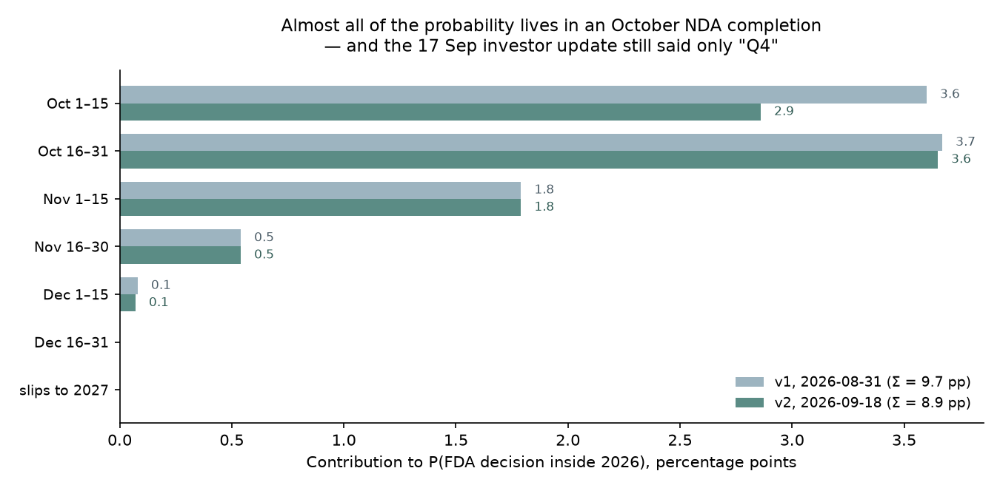
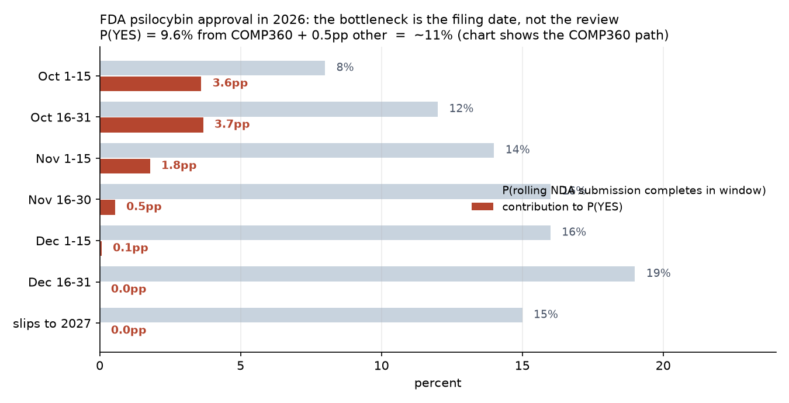

# Will the FDA approve a psilocybin treatment during 2026?

| | |
|---|---|
| **Source** | Metaculus #41172 — https://www.metaculus.com/questions/41172/will-the-fda-approve-a-psilocybin-treatment-during-2026/ |
| **Type** | binary |
| **Opened / Closes / Resolves** | 2025-12-19 / 2026-12-31 / 2026-12-31 |
| **Status** | open |
| **Current forecast** | **Median 9.5%, IQR [7.0%, 13.0%]** (v2, 2026-09-18) |
| **Community (as of 2026-09-18 16:26 UTC)** | CP 11.0% IQR[9%, 15%] (n=245) · Pro 12.0% IQR[9.5%, 14%] (n=24) · Gold 11.0% IQR[8%, 12.2%] (n=80) · 756 forecasters total |
| **Next review** | 2026-10-12 |

<!-- Versions below, newest first. APPEND-ONLY: never edit or delete a past version. -->

---

## v2 — Update — 2026-09-18

Incremental update. Nothing about the question's structure changed, no tripwire fired in either
direction, and the three cohorts moved 1–2 pp down in lockstep. The whole content of this version
is **calendar burn plus one investor event that declined to sharpen the guidance**.

### Revision

| Driver | Direction | Effect |
|---|---|---|
| Prior (v1, 2026-08-31) | — | Median 11.0%, IQR [8.0%, 16.0%] |
| **2026-09-17, Deutsche Bank Healthcare Summit: guidance reiterated as "complete our NDA filing in Q4", still with no month named** [1][2]. Five weeks after the 2026-08-12 Q2 call, at a forum where a company weeks from completion would ordinarily say so. Under the v1 Class-C prior (Q4 guidance clusters late inside the quarter) this back-weights the completion distribution | ↓ | **−1.4 pp** |
| **Makary's "late summer" decision prediction has now definitively failed** — summer 2026 ended with no filing acceptance, let alone a decision [3]. v1 charged LR ≈ 0.6 for the first slip of FDA-leadership timing optimism on this program; this is the same evidence hardening | ↓ | **−0.6 pp** |
| **Still no Psychopharmacologic Drugs Advisory Committee notice for COMP360** — checked the FDA advisory-committee calendar, the Federal Register, trade press and company disclosure [4]. FDA notices adcomms ~2 months out, so silence on 18 September now rules out an adcomm compatible with a *November* decision, not merely a September one. This is the one driver pointing up | ↑ | **+0.6 pp** |
| **CNPV mechanics re-confirmed on the record**: "FDA to have a target review time of 1–2 months"; DEA rescheduling is a *post*-approval 90-day step; REMS expected "very comparable to SPRAVATO" with 6-hour monitoring [2]. All consistent with v1; the H1-2027 launch guidance remains compatible with a December 2026 approval and is not evidence against one | → | **0** |
| **Cohorts drifted down together**: CP 12.0 → 11.0, Pro 14.2 → 12.0, gold 12.0 → 11.0. Mechanical decay, no new argument — no comment has been posted on the question since 2026-07-11 | → | **0** (see note) |
| Elapsed time on an event-requiring question: 122 → 104 days to resolution. Mostly *already* priced, because v1's completion distribution put **zero** mass on September | ↓ | **−0.1 pp** |
| **New forecast** | | **Median 9.5%, IQR [7.0%, 13.0%]** |



### Tripwire check

| Tripwire from v1 | Fired? | Note |
|---|---|---|
| Compass announces completion of the COMP360 rolling NDA submission (by 2026-10-31) → **+16 pp** | **Not fired** | Rolling submission confirmed still *underway* at the 2026-09-17 Deutsche Bank summit; "final submission remains on track to be completed in Q4 2026" [1][2] |
| No completion announcement, or one dated 2026-11-16 or later (by 2026-11-30) → −8 pp | **Not due** | 73 days out |
| FDA filing acceptance confirmed with a stated 2026 goal/PDUFA date (by 2026-11-30) → **+25 pp** | **Not fired** | No filing-acceptance disclosure of any kind. Still the single highest-leverage observable |
| PDAC adcomm meeting noticed for COMP360 (by 2026-12-31) → −8 pp | **Not fired** | FDA advisory-committee calendar and Federal Register searched 2026-09-18; nothing. Credited as +0.6 pp above, because the silence has begun to bite |
| Q3 2026 earnings call reiterates Q4 filing without a date, or shifts into 2027 (by 2026-11-15) → −5 pp | **Not due — but partially pre-empted** | The Q3 call has not happened. The 2026-09-17 investor event did exactly what this tripwire describes, five weeks early, which is why it is charged at −1.4 pp rather than the full −5 pp |
| FDA or Makary publicly names a 2026 decision date (by 2026-11-30) → +10 pp | **Not fired** | The opposite: the standing "late summer or fall 2026" remark has half-expired [3] |
| Complete Response Letter issued to COMP360 (by 2026-12-31) → −10 pp | **Not fired** | No NDA has been filed, so a CRL is not yet possible |

Score: **none fired; two not due; one not-fired-with-teeth** (the adcomm silence). A clean
no-news update — and for a question that needs a specific event inside a shrinking window, no
news is a downward update, which is the whole content of v2.

### What resolves YES

Unchanged from v1. An FDA approval letter dated on or before 2026-12-31 for a drug whose **active
ingredient is psilocybin**. The narrow active-ingredient definition still excludes Cybin's
deuterated psilocin analogue, atai–Beckley's mebufotenin, Transcend's methylone and Lykos's MDMA,
leaving COMP360 and (distantly) Usona. The two traps also stand: DEA rescheduling is a *post*-
approval step, so "launch in H1 2027" is not "approval in 2027"; and the date that matters is the
FDA action date, not the announcement or the launch. Management restated both mechanics on the
record on 2026-09-17 [2].

### Outside view

Unchanged from v1. Classes A (NDA-not-filed-by-31-August → approved same year, ≈0%), B (CNPV
filing→decision, median ≈52 days, range 24–61), C (Q3-given "we will submit in Q4" guidance, ~85%
land inside the quarter and cluster late) and D (Spravato: 182 days with an adcomm) all apply as
written. **Class C is the one doing the work in v2**, and the 2026-09-17 reiteration is a
data point squarely inside it.

### Inside view

Structure unchanged: `P(YES) ≈ Σ_C P(C) × P(decision by 2026-12-31 | C) × P(approval | decision)`.
Two inputs move.

**First, the completion distribution shifts later.** Not because anything went wrong, but because
an investor presentation on 17 September that still says "Q4" rather than "October" or "in the
coming weeks" is weak evidence against the early-October branch — which is where nearly 60% of the
probability lives.

**Second, the conditional for an early completion rises slightly**, because the adcomm that would
kill a 2026 decision now has to be noticed essentially immediately to be held in time.

| Completion window | P(C) v1 → v2 | Days to 12-31 | P(decision in 2026 \| C) v1 → v2 | Contribution |
|---|---|---|---|---|
| Oct 1–15 | 0.08 → **0.06** | ~84 | 0.53 → **0.56** | 3.36 pp |
| Oct 16–31 | 0.12 → **0.11** | ~68 | 0.36 → **0.39** | 4.29 pp |
| Nov 1–15 | 0.14 → **0.14** | ~53 | 0.15 → 0.15 | 2.10 pp |
| Nov 16–30 | 0.16 → **0.16** | ~38 | 0.04 → 0.04 | 0.64 pp |
| Dec 1–15 | 0.16 → **0.17** | ~23 | 0.005 → 0.005 | 0.09 pp |
| Dec 16–31 | 0.19 → **0.20** | ~7 | ~0 | 0.00 pp |
| slips to 2027 | 0.15 → **0.16** | — | 0 | 0.00 pp |

P(FDA decision inside 2026) ≈ **10.5%**. P(approval | decision) held at **0.85** — nothing this
period touched first-time-sponsor CMC risk, facility inspection, REMS negotiation or the modest
−3.6/−3.8 MADRS delta, and bitopertin's February CRL still shows CNPV can deliver a fast *no*.
⇒ 8.9 pp from COMP360, plus ≈0.3 pp for Usona or an unforeseen route (Usona holds a CNPV but has
never guided to a 2026 filing).

⇒ **9.2%**, posted at **9.5%** after a small shade toward the three cohorts.

**Conjunction check, unchanged and still binding.** YES needs (i) an early-October completion,
(ii) FDA compressing or waiving the filing step, (iii) no adcomm, (iv) a ~50-day review, (v)
approval rather than a CRL. Condition (i) alone is now at 6%.

### Evidence

| Finding | Direction | Rough LR / effect |
|---|---|---|
| **2026-09-17 Deutsche Bank summit: "we intend to complete our NDA filing in Q4"; rolling submission and rolling review "underway"; launch "very certain in the first half of 2027"** [1][2] | ↓ mild | LR ≈ 0.85 on an early-October completion. The *absence of sharpening* is the signal, not the words |
| Makary's "late summer or fall 2026" decision expectation: the late-summer half has now expired [3] | ↓ mild | Second confirmed slip of leadership timing optimism on this exact program |
| **No PDAC adcomm notice anywhere as of 2026-09-18** [4] | ↑ mild | The only upward driver. Silence is now informative rather than merely uninformative: an adcomm supporting a November decision would already be on the calendar |
| CNPV "1–2 month target review time" restated on the record; DEA 90-day step confirmed post-approval; REMS expected Spravato-like [2] | → | Confirms v1's mechanism; changes no number |
| Manifold ACX mirror flat at 15.8% (was 15.9%) while Metaculus decayed 12% → 11% | → | Play-money market not repricing calendar burn; discounted, as in v1 |
| No Usona filing, no new CNPV psilocybin program, no CRL | → | Residual path stays ≈0.3 pp |

**Evidence I expected and did not find, second session running:** any public statement anywhere
narrowing "Q4" to a month, and any FDA adcomm notice. The first remains the highest-value missing
fact in the question. Its continued absence is now the main reason the forecast is drifting down
rather than holding.

**Speculation, flagged as such.** The assumption that FDA compresses or waives the 60-day filing
step for a CNPV product is still unevidenced — no published CNPV case documents the gap between
submission completion and the "filing" date. The 0.56/0.39 conditionals in the top two rows rest
on mechanism and political incentive, not on data, and they carry ~7 of the 9.5 points.

### Other forecasters

| Source | Value | As of | Note |
|---|---|---|---|
| Metaculus CP (recency-weighted) | **11.0%** IQR[9.0%, 15.0%] (n=245) | 2026-09-18 16:26Z | was 12.0% at v1; step down on 2026-09-01, flat since |
| Metaculus Pro | **12.0%** IQR[9.5%, 14.0%] (n=24) | 2026-09-18 16:26Z | was 14.2%; smooth monotonic decay, then a step to 11% on 09-13 and back to 12% on 09-17 |
| Metaculus gold medalists | **11.0%** IQR[8.0%, 12.2%] (n=80) | 2026-09-18 16:26Z | was 12.0%; tightest band of the three |
| Manifold — "[ACX 2026] Will the FDA approve a psilocybin treatment during 2026?" | **15.8%** | 2026-09-18 | was 15.9%; $22.4k volume. **Flat while the calendar burned** — the clearest sign this is the least informative of the four |
| Polymarket — "FDA approves a psychedelic for medical use in 2026?" | **closed, resolved YES** | 2026-09-18 | re-verified via `gamma-api`. Definitional artifact (its list includes DXM and PCP and counts ANDAs); carries no signal, exactly as v1 said |
| Kalshi / Sentinel / GJOpen / INFER | no matching question | 2026-09-18 | re-searched |

**Cohort agreement, again.** CP 11.0%, Pro 12.0%, gold 11.0% — a 1 pp spread, tighter than v1's
2.2 pp. There is no cohort disagreement to mine here. I now sit 1.5 pp **below** all three, where
v1 sat 1 pp below CP and 3 pp below Pro. The reason is a specific, stateable disagreement: the
cohorts have decayed roughly linearly with the calendar, and the correct decay is convex — because
the probability is concentrated in an early-October completion, and each passing day without a
completion announcement removes proportionally more of that branch than of the December branches,
which were already worth nothing.

### Scenarios

| # | Scenario | Weight | Implies |
|---|---|---|---|
| 1 | Rolling NDA completes Oct 1–31; FDA compresses the filing step; no adcomm; ~50-day review; approval | 0.085 | **YES** |
| 2 | Completes in October but FDA takes the traditional 60-day acceptance period → decision lands Jan–Feb 2027 | 0.09 | NO |
| 3 | Completes November–December (the modal branch, ~0.50 of all mass) → decision 2027 regardless of review speed | 0.50 | NO |
| 4 | Slips into 2027 entirely | 0.16 | NO |
| 5 | Adcomm noticed in October for a Q1-2027 meeting | 0.13 | NO |
| 6 | Filed and decided in 2026, but the decision is a CRL | 0.015 | NO |
| 7 | Usona or an unforeseen psilocybin route approved in 2026 | 0.003 | **YES** |

### Sensitivity

| Assumption | If instead | Forecast becomes |
|---|---|---|
| P(completion in October) = 0.17 | 0.25 (Compass names a date in early October) | **≈ 13.5%** |
| same | 0.08 (nothing by 2026-10-31) | **≈ 4.5%** |
| FDA compresses the filing step (P(G ≤ 14d) ≈ 0.35) | FDA takes the full traditional 60 days, as management flagged it might | **≈ 3.5%** |
| No adcomm | PDAC notice appears in October | **≈ 1.5%** |
| P(approval \| decision) = 0.85 | 0.70 (CMC/inspection risk for a first-time sponsor weighted up) | **≈ 8.0%** |

### What would change my mind (tripwires)

- [ ] **By 2026-10-15:** Compass announces completion of the rolling NDA submission → **+14 pp**.
      (Down from v1's +16 pp: the review clock would start later, so a completion is worth less
      than it was three weeks ago.)
- [ ] **By 2026-10-31:** completion announced in the second half of October → **+7 pp**.
      No completion announcement at all by 2026-10-31 → **−5 pp (to ~4.5%)**.
- [ ] **By 2026-11-30:** FDA filing acceptance confirmed *with* a stated 2026 goal/PDUFA date
      → **+25 pp**. Still the highest-leverage single observable in the question.
- [ ] **By 2026-12-31:** a Psychopharmacologic Drugs Advisory Committee meeting is noticed for
      COMP360 → **−8 pp**; and if the notice lands before 2026-10-31, **−8 pp to ~1.5%**.
- [ ] **By 2026-11-15:** the Q3 2026 earnings call reiterates "Q4" without a date, or moves
      guidance into 2027 → **−4 pp** / **−8 pp** respectively.
- [ ] **By 2026-11-30:** FDA or Commissioner Makary publicly names a 2026 decision date for
      psilocybin → **+10 pp**.
- [ ] **By 2026-12-31:** a Complete Response Letter is issued to COMP360 → **resolves NO**.

### Sources

Sources 1–24 from v1 remain as cited there; the ones still load-bearing for v2 are repeated below
with their original access dates so this version stands on its own.

1. Investing.com — "COMPASS Pathways at Deutsche Bank summit: launch nears for COMP360", transcript of the 2026-09-17 Deutsche Bank 2026 Healthcare Summit appearance — https://www.investing.com/news/transcripts/compass-pathways-at-deutsche-bank-summit-launch-nears-for-comp360-93CH-4906106 — management on Q4 filing completion, the CNPV 1–2 month target review time, the post-approval DEA 90-day rescheduling step, a Spravato-comparable REMS with 6-hour monitoring, and "very certain" H1-2027 launch (accessed 2026-09-18)
2. COMPASS Pathways plc — Form 8-K, Q2 2026 results press release — https://www.sec.gov/Archives/edgar/data/0001816590/000181659026000059/q22026pressrelease.htm — the 2026-08-12 "on track to complete all modules in Q4" guidance against which the 2026-09-17 reiteration is read (accessed 2026-09-18)
3. Psychiatric Times — "FDA Fast-Tracks Psychedelic Therapies for Depression, PTSD, and Alcohol Use Disorder" — https://www.psychiatrictimes.com/view/fda-fast-tracks-psychedelic-therapies-for-depression-ptsd-and-alcohol-use-disorder — the April 2026 CNPV awards and Makary's "late summer or fall 2026" decision expectation (accessed 2026-09-18)
4. FDA — Psychopharmacologic Drugs Advisory Committee — https://www.fda.gov/advisory-committees/human-drug-advisory-committees/psychopharmacologic-drugs-advisory-committee — searched for a COMP360 meeting notice; **none found** (accessed 2026-09-18)
5. FDA — Advisory Committee Calendar — https://www.fda.gov/advisory-committees/advisory-committee-calendar — same search, same result (accessed 2026-09-18)
6. Psychedelic Beacon — "Psilocybin FDA Approval Status — Tracker & Timeline" — https://psychedelicbeacon.com/blog/psilocybin-fda-approval-tracker — secondary tracker, used only to cross-check dates (accessed 2026-09-18)
7. Polymarket — "FDA approves a psychedelic for medical use in 2026?" — https://polymarket.com/event/fda-approves-a-psychedelic-for-medical-use-in-2026 — re-verified via `gamma-api.polymarket.com` as closed and resolved YES; the definitional artifact identified in v1, carrying no signal (accessed 2026-09-18)
8. Manifold Markets — "[ACX 2026] Will the FDA approve a psilocybin treatment during 2026?" — https://api.manifold.markets/v0/search-markets?term=psilocybin%20FDA%202026 — 15.8%, $22.4k volume (accessed 2026-09-18)
9. Metaculus #41172 — https://www.metaculus.com/questions/41172/will-the-fda-approve-a-psilocybin-treatment-during-2026/ — all three cohorts, history and 10 comments via the `metaculus-aggregations` skill with `METACULUS_FORCE_TLS12=1`; snapshot in `raw/metaculus-2026-09-18.json` (accessed 2026-09-18)
10. Compass Pathways — "Compass Pathways Announces FDA Granted NDA Rolling Review Request and Awarded Commissioner's National Priority Voucher" (2026-04-24) — https://ir.compasspathways.com/News--Events-/news/news-details/2026/Compass-Pathways-Announces-FDA-Granted-NDA-Rolling-Review-Request-and-Awarded-Commissioners-National-Priority-Voucher/default.aspx (accessed 2026-08-31, carried forward from v1)
11. Compass Pathways — "Compass Pathways Announces Six-Month Data from Second Phase 3 Trial Confirming Rapid and Durable Profile" (2026-07-07, the last gating clinical dataset) — https://ir.compasspathways.com/News--Events-/news/news-details/2026/Compass-Pathways-Announces-Six-Month-Data-from-Second-Phase-3-Trial-Confirming-Rapid-and-Durable-Profile/default.aspx (accessed 2026-08-31, carried forward from v1)
12. Compass Pathways — "Compass Pathways Successfully Achieves Primary Endpoint in Second Phase 3 Trial Evaluating COMP360 Psilocybin for Treatment-Resistant Depression" (COMP006, 2026-02-17) — https://ir.compasspathways.com/News--Events-/news/news-details/2026/Compass-Pathways-Successfully-Achieves-Primary-Endpoint-in-Second-Phase-3-Trial-Evaluating-COMP360-Psilocybin-for-Treatment-Resistant-Depression/default.aspx (accessed 2026-08-31, carried forward from v1)

**Date**: 2026-09-18
**Forecast**: Median 9.5%, IQR [7.0%, 13.0%]
**Thesis**: Nothing happened, and for this question nothing happening is the update. At the Deutsche Bank summit on 2026-09-17 Compass reiterated that the COMP360 rolling NDA is still only "on track to be completed in Q4" — five weeks after the Q2 call and with no month named — which back-weights a completion distribution whose early-October branch carries roughly 60% of the probability [1][2]. Makary's "late summer" decision expectation has expired unfulfilled [3], and no Psychopharmacologic Drugs Advisory Committee meeting has been noticed, which is the one fact pointing up: an adcomm compatible with a November decision would already be on the FDA calendar [4]. Net −1.5 pp to 9.5%, now 1.5 pp below a tightly clustered CP/Pro/gold at 11–12% — the disagreement is that the cohorts are decaying linearly with the calendar and the correct decay is convex, because each quiet day destroys the October branch and the December branches were already worth nothing.

---

## v1 — Initial forecast — 2026-08-31

### What resolves YES

An FDA approval letter, dated on or before 2026-12-31, for a drug whose **active ingredient is
psilocybin**, for human medical use (an EUA would also count, but no such pathway exists here).
The active-ingredient definition is narrow and does the real work: it excludes Cybin's
deuterated psilocin analogue, atai–Beckley's mebufotenin (BPL-003), Transcend's methylone and
Lykos's MDMA. In practice only two US programs qualify — Compass Pathways' **COMP360** for
treatment-resistant depression (TRD) and Usona Institute's psilocybin for MDD — and only
COMP360 is close.

Two traps. First, **DEA rescheduling is not required**: psilocybin is Schedule I, and the
~90-day DEA step follows FDA approval. Compass's "commercial launch in H1 2027" guidance is
therefore fully compatible with a YES resolution in December 2026, and reading launch guidance
as approval guidance is the main way to get this question wrong. Second, the date that matters
is the **FDA action date**, not the announcement, the launch, or the DEA notice. Resolution
source is the FDA approval letter (Drugs@FDA / FDA press announcement); there is no scheduled
release, so this is an event question, not a data-cutoff question. Status quo is NO — psilocybin
has never been FDA-approved for anything.

### Outside view

Four partial reference classes, deliberately kept in disagreement.

**A. "NDA not yet submitted on 31 August → approved by 31 December of the same year."** Under
conventional PDUFA arithmetic (60-day filing review, then a 6- or 10-month clock) this is
arithmetically impossible; the historical rate is ≈0%. This is the class the low Metaculus
comments are using — and it is exactly the class the CNPV program was built to break.

**B. CNPV applications, filing → decision** (the load-bearing class). Published day counts:
Hernexeos 44, Foundayo 50, Wegovy HD 54, Tec-Dara 55, Otarmeni 61, Lipfendra 24. **Median ≈52
days, range 24–61.** Program totals as of August 2026: ~22 vouchers, ~11 approvals, 1 CRL
(bitopertin, 2026-02-13). The review itself is *not* the binding constraint any more. [10][11][12][13]

**C. Biotech "we will submit in Q4" guidance, given in Q3.** Roughly 85% land inside the
quarter, and within the quarter submissions cluster **late**. This is the prior that decides
the forecast.

**D. First-in-class interventional psychiatry with a complex REMS.** Spravato (esketamine):
NDA received 2018-09-04, advisory committee 2019-02-12, approved 2019-03-05 — **182 days**,
with priority review. Pre-CNPV, but it is FDA's habitual posture on supervised-administration
psychiatry: an adcomm plus a REMS negotiated through the cycle. [24]

A says ~0%. B says the review is fast. C says the submission date is the bottleneck. D says an
adcomm is a live tail risk that would end 2026 outright.

### Inside view

```
P(YES) ≈ P(rolling NDA completes on date C) × P(decision issued by 2026-12-31 | C) × P(approval | decision)
```

What is established, as of 2026-08-31:

- **COMP005** (June 2025): −3.6 MADRS at week 6, one 25 mg dose vs inert placebo.
- **COMP006** (2026-02-17): **−3.8 MADRS** (95% CI [−5.8, −1.8]), p<0.001, two 25 mg doses vs a
  1 mg comparator; 581 dosed. SAEs 2% in the 25 mg arm; suicidal ideation <1%; the one serious
  suicidal-behaviour event was in the **1 mg comparator** arm. [7]
- **2026-07-07**: positive 26-week durability data — the **last gating clinical dataset**. [6]
- **2026-04-18** Executive Order on serious mental illness; **2026-04-24** FDA grants Compass a
  rolling NDA submission-and-review agreement plus a **CNPV** ("1–2 month review time following
  filing of an NDA"). Usona and Transcend get CNPVs the same day. [2][15][19]
- **2026-07-14** FDA final psychedelic-trials guidance endorses low-dose/active comparators and
  central blinded raters — COMP006's 1 mg design is aligned with it. [17][18]
- **2026-08-12** (Q2 results + Canaccord): "some modules submitted", "on track to complete all
  modules in **Q4**", launch H1 2027, launch-readiness end-2026. Management explicitly flagged
  that FDA "may or may not take the typical, traditional 60-day acceptance period" and that the
  decision date likely falls outside the 1–2 month window. [3][4][5]

So: the science is done, the political tailwind is real, the review mechanism is fast — and the
NDA is still not filed, eight weeks after the last data landed, with guidance no sharper than
"Q4". **The binding constraint is the filing date.**

Let G = gap from completion to FDA "filing", R = review from filing (Class B: median ~52d).
G is the crux: P(G ≤ 14d) ≈ 0.35 (rolling review live since April, CNPV tumour-board model,
political priority), P(G ≈ 15–35d) ≈ 0.30, P(G ≈ 60d) ≈ 0.35 (the traditional period, as
management warned). That gives P(G+R ≤ 84d) ≈ 0.53, ≤69d ≈ 0.36, ≤53d ≈ 0.15, ≤38d ≈ 0.04.

| Completion window | P(C) | Days to 12-31 | P(decision in 2026 \| C) | Contribution to P(YES) |
|---|---|---|---|---|
| Oct 1–15 | 0.08 | ~84 | 0.53 | 3.6pp |
| Oct 16–31 | 0.12 | ~69 | 0.36 | 3.7pp |
| Nov 1–15 | 0.14 | ~53 | 0.15 | 1.8pp |
| Nov 16–30 | 0.16 | ~38 | 0.04 | 0.5pp |
| Dec 1–15 | 0.16 | ~23 | 0.005 | 0.1pp |
| Dec 16–31 | 0.19 | ~8 | ~0 | 0.0pp |
| slips to 2027 | 0.15 | — | 0 | 0.0pp |

P(FDA decision inside 2026) ≈ **11.3%**. P(approval | decision) ≈ **0.85** — held below 0.9 by
first-time-sponsor CMC and facility-inspection risk (Compass has never had a product approved),
REMS negotiation, the modest MADRS delta, and bitopertin proving CNPV can deliver a *fast no*.
⇒ 9.7pp from COMP360, plus ≤0.5pp for Usona or an unforeseen route.



Conjunction check: YES needs (i) an early-Q4 completion, (ii) FDA compressing the filing step,
(iii) no adcomm, (iv) a ~50-day review, (v) approval not CRL. Five conditions — the answer must
sit well under the least likely of them. 11% passes.

### Evidence

| Finding | Direction | Rough LR / effect |
|---|---|---|
| CNPV is real, not rhetoric: 6 published filing→decision times of 24–61 days, ~11 approvals [11][12][13] | ↑ strong | This is what lifts the forecast off the ~0% of Class A. LR ≈ 8 on "review completes fast" |
| Rolling submission live since April; last clinical data in 2026-07-07 [2][6] | ↑ | LR ≈ 2 on "completion happens in Q4" |
| Executive Order + Makary's personal investment in a psychedelic approval [15][16][20] | ↑ | LR ≈ 1.5 on FDA compressing procedure |
| Guidance unchanged at "Q4" since 2026-02-17 and reaffirmed 2026-08-12 [3][7] | → | Stability, but never sharpened to a month |
| **Makary's own "as soon as this summer" prediction has already failed** [20] | ↓ | Direct evidence that FDA-leadership timing optimism over-predicts *on this exact program*. LR ≈ 0.6 |
| Management refuses to claim a 2026 decision; flags the 60-day acceptance period as an open question [5] | ↓ | The people with the most information are hedging. LR ≈ 0.6 |
| No NDA completion in Q3 despite data landing 2026-07-07 [3] | ↓ | Back-weights the completion prior into Nov/Dec |
| Modest effect size (−3.6 / −3.8 MADRS) drew "modest magnitude raises questions" commentary [9] | ↓ mild | Feeds CRL risk, not timing |
| Lykos MDMA CRL (2024-08-09) after a negative adcomm [22][23] | ↓ mild | Precedent for FDA rigour on psychedelics — but its cited defects (functional unblinding, trial conduct, cardiac data) are ones COMP006's 1 mg-comparator design specifically addresses, so it transfers less than the comments assume |

**Evidence I expected to find and did not** — and this is the most important line here: no
Psychopharmacologic Drugs Advisory Committee notice for COMP360 anywhere (FDA calendar, trade
press, company disclosure, the earnings call). For a first-ever classic-psychedelic approval,
an adcomm is a real possibility (~30%) and would kill 2026 outright. FDA typically notices
adcomms ~2 months out, so silence on 2026-08-31 is *weak* evidence against one, not strong —
an October notice remains fully possible. Also absent: any public statement anywhere narrowing
"Q4" to a month. That is the highest-value missing fact in this forecast.

**Speculation, flagged as such:** the guess that FDA waives or compresses the 60-day filing
step is genuinely a guess. There is no published CNPV case where the gap between submission
completion and "filing date" is documented, so the 0.35/0.30/0.35 split over G is reasoning
from mechanism and political incentive, not from data.

### Other forecasters

| Source | Value | As of | Note |
|---|---|---|---|
| Metaculus CP (recency-weighted) | 12.0% (n=244) | 2026-08-31 | IQR [9.0%, 15.0%] |
| Metaculus Pro | 14.2% (n=23) | 2026-08-31 | peaked at 33% in early May, decaying since |
| Metaculus gold medalists | 12.0% (n=81) | 2026-08-31 | tracks CP |
| Manifold — "[ACX 2026] Will the FDA approve a psilocybin treatment during 2026?" | 15.9% | 2026-08-31 | $22.4k volume — heavy for Manifold, but play-money; discounted |
| Polymarket — "FDA approves a psychedelic for medical use in 2026?" | resolved YES, closed 2026-05-06 | 2026-08-31 | **Carries no signal.** Its list includes DXM and PCP and it counts ANDAs; no classic psychedelic was approved by May 2026, so it resolved on a routine generic. Definitional artifact, $46k volume |
| Kalshi | no matching market | 2026-08-31 | only KXFDAAPPROVE-MDMA exists, with no quotes or volume |
| Sentinel Team / Mantic / GJOpen / INFER | no matching question | 2026-08-31 | searched, nothing |
| Sell-side | Jefferies "approval around end of 2026"; consensus PT $23.75, 15/16 Buy | 2026-08 | equity analysts are structurally optimistic on regulatory timing |

**Cohort agreement, not disagreement.** CP 12.0%, Pro 14.2%, gold 12.0% — a 2.2pp spread. The
usual "Pros and gold agree and disagree with me, go find the missed fact" trigger does not
fire. The Pro cohort's May spike to 33% and subsequent decay to 14.2% is the informative
pattern: the smart money priced the CNPV news aggressively, then bled the position down as the
calendar burned without a filing. I sit 1pp below CP and gold and 3pp below the Pros; the tilt
is the adcomm residual plus a completion prior that is back-weighted into December. No gap
above 10pp against anything liquid, so no special justification is owed.

### Scenarios

| # | Scenario | Weight | Implies |
|---|---|---|---|
| 1 | Rolling submission completes in October; FDA waives or compresses the filing step; approval letter Nov–Dec 2026 | 0.078 | **YES** |
| 2 | Completion in early-to-mid November; FDA runs a Lipfendra-style ~24–35 day review; approval late December 2026 | 0.026 | **YES** |
| 3 | Usona or another psilocybin route delivers a 2026 approval | 0.006 | **YES** |
| 4 | A decision lands inside 2026 but it is a CRL (CMC/facility inspection, REMS, or durability) | 0.018 | NO |
| 5 | Completion inside Q4 2026, decision (approval or CRL) lands Q1–Q2 2027 — includes every adcomm branch | 0.725 | NO |
| 6 | Completion of the rolling submission slips into 2027 | 0.147 | NO |

P(YES) = 0.078 + 0.026 + 0.006 = **0.110**.

The IQR is wide relative to the median because the whole question turns on one unobserved
number — the completion date — and a single press release could resolve it in either direction
within days. It is *not* a slow-moving, well-anchored estimate.

### Sensitivity

| Assumption | If instead | Forecast becomes |
|---|---|---|
| Completion mass back-weighted into Nov/Dec (P(Oct) = 0.20) | Compass completes the submission in early October | ~30% |
| P(FDA compresses the filing step to ≤5 weeks) ≈ 0.65 | FDA applies the traditional 60-day filing review | ~3% |
| No advisory committee (implicitly ~70%) | FDA notices a Psychopharmacologic Drugs adcomm for COMP360 | ~2% |
| P(approval \| 2026 decision) = 0.85 | Raised to 0.95 (pure political-will read) | ~12.3% |

### What would change my mind (tripwires)

- [ ] Compass press release or 8-K announcing **completion of the rolling NDA submission on or
      before 2026-10-31** → ↑ **+14 to +19pp** (to ~25–30%).
- [ ] The same announcement dated **2026-11-16 or later**, or no announcement by 2026-11-30 →
      ↓ **−8pp** (to ~3%).
- [ ] Compass or FDA confirms **filing acceptance with a stated 2026 goal/PDUFA date**, by
      2026-11-30 → ↑ **+25pp or more** (to ~40%+).
- [ ] A **Psychopharmacologic Drugs Advisory Committee meeting notice for COMP360** appears in
      the Federal Register or on FDA's advisory-committee calendar, any date → ↓ **−8pp**
      (to ~2–3%); 2026 is over on that signal.
- [ ] **Q3 2026 earnings call (expected ~2026-11-05)** reiterates "Q4" without a completion date,
      or moves guidance into 2027 → ↓ **−5pp**.
- [ ] Any **FDA or Makary public statement naming a 2026 decision date for psilocybin**, by
      2026-11-30 → ↑ **+10pp**.
- [ ] A **CRL issued to COMP360** at any point in 2026 → resolves NO; forecast to 1%.

### Sources

1. Metaculus #41172, "Will the FDA approve a psilocybin treatment during 2026?" — https://www.metaculus.com/questions/41172/will-the-fda-approve-a-psilocybin-treatment-during-2026/ (accessed 2026-08-31; aggregations snapshot in `raw/metaculus-2026-08-31.json`)
2. Compass Pathways, "FDA Granted NDA Rolling Review Request and Awarded Commissioner's National Priority Voucher" (2026-04-24) — https://ir.compasspathways.com/News--Events-/news/news-details/2026/Compass-Pathways-Announces-FDA-Granted-NDA-Rolling-Review-Request-and-Awarded-Commissioners-National-Priority-Voucher/default.aspx (accessed 2026-08-31)
3. Compass Pathways, "Second Quarter and First Half 2026 Financial Results and Business Highlights" (2026-08-12) — https://www.biospace.com/press-releases/compass-pathways-announces-second-quarter-and-first-half-2026-financial-results-and-business-highlights (accessed 2026-08-31)
4. COMPASS Pathways (CMPS) Q2 2026 earnings call transcript, The Motley Fool (2026-08-12) — https://www.fool.com/earnings/call-transcripts/2026/08/12/compass-pathways-cmps-q2-2026-earnings-call-transcript/ (accessed 2026-08-31)
5. "COMPASS Pathways at Canaccord Genuity conference: launch path in focus", Investing.com transcript (2026-08-12) — https://m.investing.com/news/transcripts/compass-pathways-at-canaccord-genuity-conference-launch-path-in-focus-93CH-4855090 (accessed 2026-08-31)
6. Compass Pathways, "Six-Month Data from Second Phase 3 Trial Confirming Rapid and Durable Profile" (2026-07-07) — https://ir.compasspathways.com/News--Events-/news/news-details/2026/Compass-Pathways-Announces-Six-Month-Data-from-Second-Phase-3-Trial-Confirming-Rapid-and-Durable-Profile/default.aspx (accessed 2026-08-31)
7. Compass Pathways, "Successfully Achieves Primary Endpoint in Second Phase 3 Trial (COMP006)" (2026-02-17) — https://ir.compasspathways.com/News--Events-/news/news-details/2026/Compass-Pathways-Successfully-Achieves-Primary-Endpoint-in-Second-Phase-3-Trial-Evaluating-COMP360-Psilocybin-for-Treatment-Resistant-Depression/default.aspx (accessed 2026-08-31)
8. Compass Pathways, "Successfully Achieves Primary Endpoint in First Phase 3 Trial (COMP005)" (2025-06) — https://ir.compasspathways.com/News--Events-/news/news-details/2025/Compass-Pathways-Successfully-Achieves-Primary-Endpoint-in-First-Phase-3-Trial-Evaluating-COMP360-Psilocybin-for-Treatment-Resistant-Depression/default.aspx (accessed 2026-08-31)
9. "Second Positive Phase 3 for Compass' Psilocybin, Though Modest Magnitude Raises Questions", Psychedelic Alpha — https://psychedelicalpha.com/news/breaking-second-positive-phase-3-for-compass-psilocybin-though-modest-magnitude-raises-questions/ (accessed 2026-08-31; headline and summary only)
10. FDA, "Commissioner's National Priority Voucher (CNPV) Pilot Program" — https://www.fda.gov/industry/commissioners-national-priority-voucher-cnpv-pilot-program (accessed 2026-08-31)
11. PRV Watch, "CNPV Dashboard — Commissioner National Priority Voucher Tracker" — https://prvwatch.com/cnpv-dashboard (accessed 2026-08-31)
12. The Bracken Group, "One Year In: Where the FDA Commissioner's National Priority Voucher Pilot Stands" — https://www.thebrackengroup.com/blog/one-year-in-where-the-fda-commissioners-national-priority-voucher-pilot-stands-and-what-sponsors-need-to-know (accessed 2026-08-31)
13. The Pharma Letter, "National priority vouchers: a year of reform?" — https://www.thepharmaletter.com/insights/national-priority-vouchers-a-year-of-reform (accessed 2026-08-31; summary via search, page body did not render)
14. FDA, "FDA Approves First New Molecular Entity Under National Priority Voucher Program" — https://www.fda.gov/news-events/press-announcements/fda-approves-first-new-molecular-entity-under-national-priority-voucher-program (accessed 2026-08-31)
15. The White House, Executive Order "Accelerating Medical Treatments for Serious Mental Illness" (2026-04-18) — https://www.whitehouse.gov/presidential-actions/2026/04/accelerating-medical-treatments-for-serious-mental-illness/ (accessed 2026-08-31)
16. FDA, "FDA Accelerates Action on Treatments for Serious Mental Illness Following Executive Order" — https://www.fda.gov/news-events/press-announcements/fda-accelerates-action-treatments-serious-mental-illness-following-executive-order (accessed 2026-08-31)
17. RAPS, "Psychedelics: FDA offers clarifications, compromises in final clinical trial guidance" — https://www.raps.org/resource/psychedelics-fda-offers-clarifications-compromises-in-final-clinical-trial-guidance.html (accessed 2026-08-31)
18. King & Spalding, "FDA's New Psychedelic Drug Guidance Paves a Path to Approval While Setting a High Evidentiary Bar" — https://www.kslaw.com/news-and-insights/fdas-new-psychedelic-drug-guidance-paves-a-path-to-approval-while-setting-a-high-evidentiary-bar (accessed 2026-08-31)
19. CNN, "FDA moves to fast-track review of psilocybin and methylone for mental health" (2026-04-24) — https://www.cnn.com/2026/04/24/health/fda-psychedelic-drugs-priority-vouchers (accessed 2026-08-31)
20. Citeline Pink Sheet, "Psychedelic Testimonials Alone Cannot Meet Legal Approval Standard, US FDA's Makary Says" — https://insights.citeline.com/pink-sheet/pathways-and-standards/approval-standards/psychedelic-testimonials-alone-cannot-meet-legal-approval-standard-us-fdas-makary-says-OCRVXBPRMJAR3I5LCSA7QER724/ (accessed 2026-08-31)
21. STAT, "Compass Pathways expects earlier FDA approval decision on its psilocybin drug" (2025-11-04) — https://www.statnews.com/2025/11/04/compass-pathways-depression/ (accessed 2026-08-31)
22. Psychedelic Alpha, "Unpacking FDA's MDMA Rejection Letter and the Road Ahead for Lykos" — https://psychedelicalpha.com/news/unpacking-fdas-mdma-rejection-letter-and-the-road-ahead-for-lykos/ (accessed 2026-08-31)
23. BioSpace, "FDA Rejects Lykos' MDMA-Assisted PTSD Therapy After Negative Adcomm" — https://www.biospace.com/drug-development/FDA-Rejects-Lykos-MDMA-Assisted-PTSD-Therapy-After-Negative-Adcomm (accessed 2026-08-31)
24. Drugs.com, "Spravato (esketamine) FDA Approval History" — https://www.drugs.com/history/spravato.html (accessed 2026-08-31)
25. Polymarket, "FDA approves a psychedelic for medical use in 2026?" (gamma API, closed 2026-05-06) — https://polymarket.com/event/fda-approves-a-psychedelic-for-medical-use-in-2026 (accessed 2026-08-31)
26. Manifold Markets, "[ACX 2026] Will the FDA approve a psilocybin treatment during 2026?" (API) — https://manifold.markets/DaftPunkRock/acx-2026-will-the-fda-approve-a-psi (accessed 2026-08-31)
27. Usona Institute, psilocybin programme page — https://www.usonainstitute.org/psilocybin (accessed 2026-08-31)
28. Compass Pathways, "Working with U.S. Department of Veterans Affairs for Investigational Study of Psilocybin" (2026-08) — https://ir.compasspathways.com/News--Events-/news/news-details/2026/Compass-Pathways-Working-with-U-S--Department-of-Veterans-Affairs-for-Investigational-Study-of-Psilocybin/default.aspx (accessed 2026-08-31)

**Date**: 2026-08-31
**Forecast**: Median 11.0%, IQR [8.0%, 16.0%]
**Thesis**: The science and the review mechanism are no longer the constraint — two positive
pivotals, a CNPV whose published record is 24–61 day reviews, and an executive order behind it
— but the NDA is still unfiled on 31 August with guidance no sharper than "Q4", and Q4
submissions cluster in December, which leaves only ~11% of the completion-date mass early
enough for a filing plus a ~50-day review to land inside 2026. Management's own hedging on the
60-day acceptance period, Makary's already-missed "as soon as this summer", and an
unannounced-but-plausible advisory committee hold me a point below the CP.
