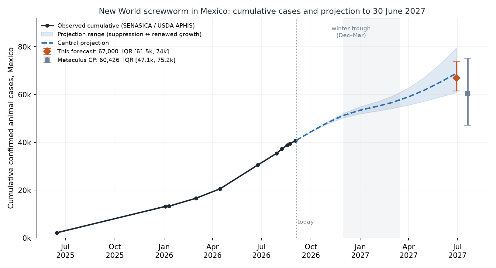
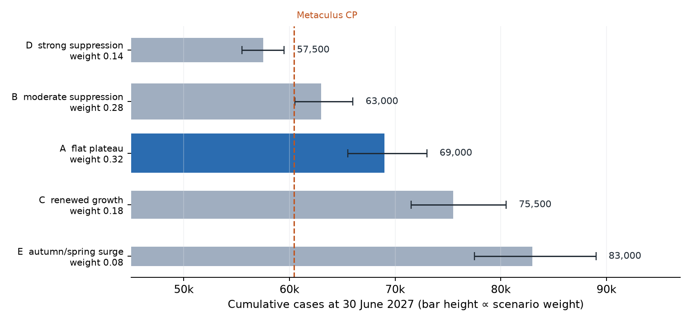

# How many New World screwworm cases will be confirmed in Mexico in total before July 2027?

| | |
|---|---|
| **Source** | Metaculus #43507 — https://www.metaculus.com/questions/43507/how-many-new-world-screwworm-cases-will-be-confirmed-in-mexico-in-total-before-july-2027/ |
| **Type** | numeric — unit `cases` (cumulative animal cases, open both bounds, range 30,000–100,000, rounded to nearest 500) |
| **Opened / Closes / Resolves** | ~2026-06-12 (CP revealed 2026-06-14) / 2027-07-01 / 2027-07-01, off the last USDA report before that date (~2027-06-29) |
| **Status** | open |
| **Current forecast** | **Median 67,000, IQR [61,500, 74,000]** (v1, 2026-09-04) |
| **Community (as of 2026-09-03)** | CP 60,426 (n=29) · Pro 59,018 (n=5) · Gold 62,410 (n=15) · 43 forecasters total |
| **Next review** | 2026-10-06 |

---

## v1 — Initial forecast — 2026-09-04

### What resolves YES

This resolves to the **cumulative count of confirmed animal cases of New World screwworm
(NWS, *Cochliomyia hominivorax*) in Mexico since the outbreak began on 2024-11-20**, as shown
on the USDA APHIS *stop-screwworm* current-status report, taking the **last report published
before 2027-07-01** and rounding to the nearest 500. APHIS updates Tuesdays and Thursdays at
17:00 ET, so the resolving figure is the Tuesday 2027-06-29 (or Thursday 2027-06-24) cut.
The fine print requires that report to be published no earlier than 2027-06-01, and
**annuls** the question if USDA ceases reporting or changes criteria such that the series is
not comparable.

Three edge cases worth pricing:

1. **It is cumulative, not active.** Cases never come off the total. The only way the number
   stops rising is if new cases stop being confirmed — the count is a ratchet.
2. **USDA is a mirror, not a primary source.** APHIS republishes Mexico's SENASICA count.
   Cross-check: a Metaculus commenter read 35,402 off APHIS on 2026-07-29; interpolating
   SENASICA's own series across that date gives 35,748 — a 1.0% gap. So the question is
   effectively "what will SENASICA's cumulative total be at end-June 2027". A SENASICA
   definitional change (counting foci rather than animals, say) would propagate to USDA and
   could trigger annulment.
3. **Both bounds are open**, so there is no ceiling effect at 100,000 and no floor at 30,000.
   30,000 is already history — the count passed it in late June 2026.

### Outside view

**Reference class 1 — established NWS outbreaks under sub-eradication sterile-fly dosing.**
Six Central American countries were invaded in 2023–24. None has eradicated. Nicaragua has
27,916 cumulative animal cases from April 2024 to mid-2026 and is still rising, on a cattle
herd about one-seventh of Mexico's. Panama went from ~25 cases/year to >6,500 in 2023 while
COPEG's 100-million-flies-per-week plant sat inside the country. Region-wide: **>209,400
animal cases** since 2023 (CDC, 2026-08-11). *No country in this class has turned an
established outbreak over inside 30 months.* [1][2][12]

**Reference class 2 — the historical North American eradication.** Florida 1957 → Texas 1962
→ Mexico through the 1980s → Panama late 1990s, at production up to ~500 M flies/week and a
field dose of ~386 sterile flies/week/km² in Mexico (Krafsur 1985). Gutierrez et al. (2019)
put average SIT efficacy at ~1.7% and attribute much of the success to cold winters and
barrier geometry rather than to fly numbers alone. Decades, not months. [3]

**Reference class 3 — the theoretical floor.** Reyes & Barrio (PLoS ONE, 2026-08-28) derive a
feedback-controlled release strategy and find eradication achievable in **60–100 weeks**,
governed by the fly's biology rather than by infestation size — but only with releases at the
outbreak focus and within a 120 km radius. Sixty weeks from today is November 2027, past this
window, and Mexico's outbreak spans 30 states, not one focus. [4]

**Scaling to the window.** Cumulative on 2026-09-04 ≈ **40,900**. Days to the resolving
report: **298**. Naive persistence at the realised 121–140 cases/day gives **+36,000 to
+42,000 → 77,000–83,000**. Seasonality is the only well-evidenced force pulling that down.

### Inside view

**The plateau.** Incidence has been flat at ~140 ± 20 cases/day since mid-April 2026. Active
cases — a ~15-day prevalence window, since SENASICA closes a case 15 days after diagnosis
absent new larvae — went 492 (Jan 7) → 1,295 (Apr 15) → 1,682 (May 11) → ~2,000 (Sep 2):
a 3.4× rise to May, then 1.2×. Active/15 ≈ 130/day, matching the cumulative increments.
The geographic expansion phase is over: 30 of 32 states have cases; only the Baja California
peninsula is clean. What is left is intensification, not invasion.

**The deceleration.** The last four intervals: 184 → 158 → 130 → 121 cases/day
(Jul 29 → Sep 2). Four points is not a trend, but it is the most important live signal and it
argues against naive persistence.

**Seasonality is the load-bearing mechanism.** Larval and pupal development halts below
~14 °C; adult activity falls off below 21 °C. Mexico's own 2025-26 winter: active cases
−57% between 2025-12-10 (1,145, the season peak) and 2026-01-07 (492), and new cases down to
**118 in epidemiological week 2** (17/day) while the epidemic was otherwise growing 4–5×/year.
Some of that dip is the Mexican holiday reporting lull (25 Dec – 6 Jan), but the recovery
profile (Feb ~76/day, Mar ~85, Apr ~100, May ~139) is a seasonal curve, not a control curve.
Winter 2026-27 should bite at least as hard: the *active* burden has moved into the temperate
highlands and the north — Zacatecas 179, Puebla 166, Jalisco 100, San Luis Potosí 98,
Nayarit 97, Querétaro 86, Chihuahua 74, Guanajuato 69 — where the fly cannot overwinter.
The historical year-round zone was the tropical south, Yucatán and a Veracruz–Tamaulipas
band; expect contraction to that reservoir Dec–Mar, then re-expansion from April. [3][5][6]

**Seasonal index used** (September = 1.00): Sep 1.00 · Oct 0.95 · Nov 0.80 · Dec 0.55 ·
Jan 0.40 · Feb 0.45 · Mar 0.60 · Apr 0.75 · May 0.90 · Jun 1.00.

**The sterile-fly dose is not a suppression dose.** COPEG Pacora ~100 M/week (at capacity);
Metapa de Domínguez, Chiapas, inaugurated 2026-06-27, 28 M/week in mid-July, **35 M/week in
August**, target **100 M/week by end-2026**; the $750 M Texas plant (300 M/week) is not online
in this window. Against a historical field rate of ~386 flies/week/km², blanketing Mexico's
~1.5 M km² of affected territory would need ~580 M/week. Available over Mexico today: ~135 M
— **~23% of the historical rate**, ~35% at full Metapa ramp. And the flies are aimed at the
border, not the burden: USDA states its "highest priority remains protecting the United
States," and Mexico's August 2026 releases were 14.97 M over seven Chihuahua municipalities
(27 Jul–11 Aug) and >40 M over fourteen by 23 Aug. Chiapas (7,604 cumulative), Oaxaca (5,074)
and Veracruz (4,720) are effectively untreated. Mexico's own stated goal is eradication in
**~5 years**, once all three plants reach 500 M/week combined. [7][8][9][10]

**The arithmetic that decides the question.** To land on the community prediction of 60,426,
average incidence must be `(60,426 − 40,900) / 298 = 65.5 cases/day` — **48% of today's rate,
sustained for ten months**. Pure seasonality averages ~72% of today's rate over this
particular window (four trough months, six warm ones). Reaching 48% requires seasonality
*plus* a further one-third cut in non-winter incidence — i.e. the sterile-fly programme
working over the southern reservoir, which it is not currently dosing.

**Arithmetic floor.** Even an immediate 70% collapse in incidence plus a hard winter adds
~10,000 → ~51,000. Below 50,000 is a reporting event, not an epidemiological one.

### Evidence

| Finding | Direction | Likelihood ratio (approx.) |
|---|---|---|
| Cumulative 40,684 on 2026-09-02 vs the CP path (~46,000 implied by June's "it doubles") | ↑ | strong: the realised path is already ~5,000 ahead of the CP's implied trajectory. **LR ≈ 4:1** for the >65k region vs the <60k region |
| Incidence plateau, not acceleration, since mid-April | ↓ vs naive persistence | **LR ≈ 3:1** against the 80k+ region |
| Four-interval deceleration 184 → 121/day | ↓ | **LR ≈ 1.5:1** for the 55–65k region; too short a run to weight heavily |
| Sterile-fly dose ~23–35% of the historical field rate, aimed at the northern front not the southern reservoir | ↑ | **LR ≈ 3:1** against a spring-2027 collapse |
| Winter 2025-26 collapse (−57% active, 17 cases/day in epi week 2) | ↓ | **LR ≈ 2.5:1** for the 60–70k region vs 75k+ |
| Active burden now in cold-winter highland/northern states | ↓ (deeper trough) | **LR ≈ 1.5:1** |
| No Central American country has turned an outbreak over in ≤30 months | ↑ | **LR ≈ 2:1** against sub-58k |
| Human myiasis series still expanding (204 cases Apr-2025–Mar-2026; 633 people in 27 states by 2026-08-28) | ↑ | weak, ~1.3:1 — a proxy for animal incidence, and it is not falling |

**Expected evidence that is absent.** If the programme were about to bite, I would expect:
falling *active* cases (they are flat at ~1,900–2,000 since early August, not falling); a
published USDA or SENASICA projection of decline (none exists); sterile-fly releases over
Chiapas/Oaxaca/Veracruz (every August 2026 release story is Chihuahua). Three absences, all
pointing the same way. Conversely, if a surge were coming I would expect active cases to be
climbing into the autumn — they are not.

### Other forecasters

| Source | Value | As of | Note |
|---|---|---|---|
| Metaculus CP (recency-weighted) | 60,426 · IQR [47,133, 75,217] | 2026-09-03 | n=29 |
| Metaculus Pro | 59,018 · IQR [48,343, 72,516] | 2026-09-03 | n=5 — **below** CP |
| Metaculus gold medalists | 62,410 · IQR [50,952, 75,945] | 2026-09-03 | n=15 — above CP |
| Kalshi | — | 2026-09-04 | `KXSCREWWORMCOUNT` covers **US** cases only; no Mexico contract |
| Polymarket | — | 2026-09-04 | no screwworm market found |
| Manifold | — | 2026-09-04 | 6 screwworm markets, all US/eradication-flavoured, ≤$1.7k volume; the "cases by end of June" market is US-only |
| Sentinel Team / Mantic / GJOpen / INFER | — | 2026-09-04 | no matching question |

**Cohort disagreement.** The three Metaculus cohorts span only 59,018–62,410 — a 5.8% spread,
i.e. effectively no disagreement. But that agreement is weaker evidence than it looks: the
recency-weighted and gold-medalist histories begin at *identical* values (62,691 on
2026-06-12), so the gold cohort is largely a subset of the community rather than an
independent panel, and the Pro cohort is five people.

**Where I sit and why.** I am **+6,600 (+11%)** above the CP — beyond the 10-point threshold
that demands justification, so, explicitly: the CP was formed around 2026-06-12 at 62,691
when cumulative stood near 30,000 (a "roughly doubles" prior). It has since drifted *down* to
60,426 while realised cases ran *ahead* of that path, and a commenter flagged the staleness on
2026-08-02 with no visible correction. The community's own lower quartile, 47,133, implies
+6,200 cases in ten months = 21/day — an 83% instant collapse with no mechanism behind it.
That quartile is a fossil of a June belief. With 43 forecasters and one comment, this is a
low-attention question; I judge the gap to be community staleness rather than a fact I am
missing. I searched specifically for the missing fact — a planned SENASICA definitional
change, an area-wide southern release programme, a published decline projection — and found
none of the three.

I deliberately do **not** go to naive persistence (77k–83k): the plateau and the four-interval
deceleration are real, and the winter brake is well evidenced.

### Scenarios

Structure: daily incidence = 131/day baseline × seasonal index × trend, with the trend
interpolated log-linearly from 1.0 today to the scenario's terminal multiplier at 2027-06-29.
200,000 Monte Carlo draws; seasonal amplitude N(1.0, 0.20); model error lognormal σ = 0.10;
6% chance of a counting-regime shift short of annulment (×0.30–0.70 on added cases).

| # | Scenario | Weight | Terminal trend | Implies |
|---|---|---|---|---|
| A | **Flat plateau.** Incidence stays ~130/day in warm months; seasonality does all the work; Metapa's ramp offsets continued northern establishment | 0.32 | 1.00 | ~69,000 |
| B | **Moderate suppression.** The August deceleration is partly real; Metapa reaches 100 M/week and Mexico's intensified campaign cuts warm-month incidence ~40% by spring | 0.28 | 0.60 | ~63,000 |
| C | **Renewed growth.** Establishment in the large northern herds (Chihuahua, Sonora, Coahuila, Nuevo León) plus intensified inspection lifts spring-2027 incidence ~50% above today | 0.18 | 1.50 | ~75,500 |
| D | **Strong suppression.** The turn is genuine; incidence falls ~70% by June 2027 on the SIT ramp plus preventive treatment | 0.14 | 0.30 | ~57,500 |
| E | **Autumn/spring surge.** A mild winter (cf. 1971-72 in northeastern Mexico) plus a wet spring doubles incidence | 0.08 | 2.10 | ~83,000 |

Resulting distribution: p5 54,500 · p10 57,000 · **p25 61,500** · **p50 67,000** ·
**p75 74,000** · p90 81,000 · p95 85,500.
P(> 60,426, i.e. above the CP) ≈ **79%**. P(< 50,000) ≈ **1.3%**.

### Sensitivity

| Assumption | If instead | Forecast becomes |
|---|---|---|
| Baseline incidence 131/day | 110/day (the last 10-day rate) | Median 63,400, IQR [58,600, 69,000] |
| Baseline incidence 131/day | 155/day (the Jul–Aug average) | Median 72,400, IQR [66,100, 80,200] |
| Winter index Jan 0.40 | Deep winter, Jan 0.22 | Median 65,400, IQR [60,300, 71,500] |
| Winter index Jan 0.40 | Mild winter, Jan 0.60 | Median 70,400, IQR [64,400, 77,600] |
| Scenario weights as above | Suppression-heavy (D+B = 0.70) | Median 63,300, IQR [59,200, 68,800] |
| Scenario weights as above | Growth-heavy (C+E = 0.50) | Median 72,200, IQR [65,900, 79,000] |

The forecast is robust: **every** variant I can defend keeps the median above the community
prediction. Even loading 70% of the weight onto suppression gives 63,300.

### What would change my mind (tripwires)

- [ ] **SENASICA weekly cut through 2026-10-31 shows cumulative ≤ 45,500** (i.e. ≤ ~85 cases/day
      sustained from 2026-09-02) → the deceleration is real; **−5,000 to −7,000** on the median.
- [ ] **SENASICA weekly cut through 2026-10-31 shows cumulative ≥ 48,500** (i.e. ≥ ~135/day)
      → plateau confirmed into the autumn peak; **+3,000 to +5,000**.
- [ ] **National active cases fall below 1,400 by 2026-11-30** (from ~2,000 now), outside the
      normal winter timing → genuine suppression; **−6,000**.
- [ ] **Metapa confirmed at ≥ 90 M sterile flies/week by 2026-12-31 *and* documented dispersal
      over Chiapas/Oaxaca/Veracruz** (not just the northern corridor) → **−4,000**.
      Metapa at ≤ 60 M/week on 2026-12-31 → **+2,000**.
- [ ] **Cumulative on the first SENASICA cut after 2027-03-01 exceeds 57,000** → the winter
      trough was shallow and the spring re-expansion is early; **+5,000**.
- [ ] **USDA APHIS stops publishing a Mexico national total, or SENASICA restates the series**
      (e.g. switches to counting foci) → annulment risk; re-read the fine print rather than
      re-forecasting.
- [ ] **A US-side escalation that changes Mexico's incentives** — e.g. a full southern border
      closure to cattle reversing the Douglas AZ reopening of 2026-08-24 — would raise both
      control effort *and* surveillance intensity; sign ambiguous, but it warrants a re-read.

### Sources

1. New World Screwworm Outbreak — situation summary — CDC — https://www.cdc.gov/new-world-screwworm/situation-summary/index.html (accessed 2026-09-04; page last updated 2026-08-11)
2. New World Screwworm: Current Issues — Congressional Research Service IN12558, 2025-06-02 — https://www.congress.gov/crs_external_products/IN/PDF/IN12558/IN12558.1.pdf (accessed 2026-09-04)
3. Gutierrez et al., "Deconstructing the eradication of New World screwworm in North America: retrospective analysis and climate warming effects", 2019 — https://pmc.ncbi.nlm.nih.gov/articles/PMC6849717/ (accessed 2026-09-04)
4. Reyes R. & Barrio R. A., "A mathematical model for the efficient control of the New World screwworm", *PLoS ONE* 21(8):e0355963, 2026-08-28 — https://doi.org/10.1371/journal.pone.0355963 (via PubMed, accessed 2026-09-04)
5. "Winter: The Secret to Slowing the Spread of Screwworm" — Drovers — https://www.drovers.com/news/industry/winter-secret-slowing-spread-screwworm (accessed 2026-09-04)
6. "How Would Winter Temperatures Affect New World Screwworm?" — DTN/Progressive Farmer, 2025-10-08 — https://www.dtnpf.com/agriculture/web/ag/livestock/article/2025/10/08/winter-temperatures-affect-new-world (accessed 2026-09-04)
7. "Gusano barrenador avanza al norte: casos en México aumentan 83.5% en 3 meses" — Excélsior (SADER data: 16,628 @ 2026-03-01 → 30,522 @ 2026-06-24; Metapa plant financials and the 500 M/week five-year eradication goal) — https://www.excelsior.com.mx/nacional/sader-senasica-gusano-barrenador-casos-aumentan-combate-llega-texas (accessed 2026-09-04)
8. "US, Mexico inaugurate sterile fly plant in Chiapas in cross-border screwworm fight" — Reuters via The Spokesman-Review, 2026-06-27 — https://www.spokesman.com/stories/2026/jun/27/us-mexico-inaugurate-sterile-fly-plant-in-chiapas-/ (accessed 2026-09-04)
9. "México dispersa más de 40 millones de moscas estériles en Chihuahua" — Infobae, 2026-08-23 — https://www.infobae.com/mexico/2026/08/23/mexico-dispersa-mas-de-40-millones-de-moscas-esteriles-en-chihuahua-para-combatir-el-gusano-barrenador/ (accessed 2026-09-04)
10. Current Status of New World Screwworm — USDA APHIS (resolution source; Douglas AZ port reopening 2026-08-24; "highest priority remains protecting the United States") — https://www.aphis.usda.gov/livestock-poultry-disease/stop-screwworm/current-status (accessed 2026-09-04); border-case list snapshotted to `raw/aphis-nws-weekly-status-2026-09-04.csv`
11. "Septiembre arranca con baja de casos de gusano barrenador en Guanajuato" — Periódico Correo, 2026-09-02 (**cumulative 40,684 nationally; active ~2,000**) — https://periodicocorreo.com.mx/vida-publica/2026/sep/02/septiembre-arranca-con-baja-de-casos-de-gusano-barrenador-en-guanajuato-estado-cae-al-puesto-14-nacional-165748.html (accessed 2026-09-04)
12. "Gusano barrenador suma 38,820 casos en México, reporta Senasica" — El Tiempo Monclova, 2026-08-20 (38,820 @ 2026-08-18; 1,963 active; state and species breakdown; Metapa at 35 M pupae/week) — https://eltiempomx.com/noticia/2026/gusano-barrenador-suma-38820-casos-en-mexico-reporta-senasica.html (accessed 2026-09-04)
13. "Acumula México 37 mil 241 casos de gusano barrenador en el ganado" — Quadratín, 2026-08-10 (37,241 @ 2026-08-08; 1,818 active) — https://www.quadratin.com.mx/nacionales/mexico-acumula-37-mil-241-casos-de-gusano-barrenador-en-el-ganado/ (accessed 2026-09-04)
14. "Aumentan en una semana casos acumulados de gusano barrenador, reporta Sader" — Diario de México, 2026-01-08 (13,217 → 13,335 across epi weeks 1–2 of 2026; 492 active on 2026-01-07 vs the 1,145 peak of 2025-12-10) — https://www.diariodemexico.com/mi-nacion/aumentan-en-una-semana-casos-acumulados-de-gusano-barrenador-reporta-sader (accessed 2026-09-04)
15. "Registra entidad 64 casos activos de barrenador" — Diario de Chihuahua, 2026-09-02 (SENASICA cut of 2026-09-01) — https://diario.mx/economia/2026/sep/02/registra-entidad-64-casos-activos-de-barrenador-1136405.html (accessed 2026-09-04)
16. Delgado-Cuellar et al., "Human Myiasis Resulting from Reemergence of *Cochliomyia hominivorax* Screwworm, Mexico, 2025–2026", *Emerg Infect Dis* 32(10), 2026 — https://doi.org/10.3201/eid3210.261235 (via PubMed, accessed 2026-09-04)
17. Moo-Llanes et al., "Biological reinvasion of *Cochliomyia hominivorax* in Mexico: impacts and risks under different climate change scenarios", *J Econ Entomol*, 2026-07-09 — https://doi.org/10.1093/jee/toag204 (via PubMed, accessed 2026-09-04)
18. Valdez-Espinoza et al., "The reemergence of the New World screwworm and its potential distribution in North America", *Sci Rep* 15:23819, 2025 — https://doi.org/10.1038/s41598-025-04804-9 (via PubMed, accessed 2026-09-04)
19. "Screwworm cases remain low in U.S., continue to rise in Mexico" — Farm Progress (Mexican cases "climbed by nearly 10,000 since June"; 45 US cases) — https://www.farmprogress.com/animal-health/as-mexico-s-new-world-screwworm-cases-rise-u-s-urged-to-remain-vigilant (accessed 2026-09-04 via search index; direct fetch returned 403)
20. "Gusano Barrenador fuera de control en Nicaragua" — Onda Local (Nicaragua: 27,916 cumulative animal cases incl. 271 human, since April 2024) — https://ondalocalni.com/noticias/3106-gusano-barrenador-fuera-control-nicaragua/ (accessed 2026-09-04 via search index)
21. "Senasica libera casi 15 millones de moscas estériles… en Chihuahua" — La Crónica de Hoy, 2026-08-12 — https://www.cronica.com.mx/nacional/2026/08/12/senasica-libera-casi-15-millones-de-moscas-esteriles-como-parte-de-su-estrategia-contra-el-gusano-barrenador-en-chihuahua/ (accessed 2026-09-04)
22. Metaculus question #43507 aggregations (CP / Pro / gold, history, comments) — snapshotted to `raw/metaculus-2026-09-04.json` (retrieved 2026-09-04)
23. Manifold Markets API search, `screwworm` (6 markets, all US-focused, ≤ $1.7k volume) — https://api.manifold.markets/v0/search-markets?term=screwworm (accessed 2026-09-04)
24. Kalshi `KXSCREWWORMCOUNT` — US screwworm case count series (no Mexico contract) — https://kalshi.com/markets/kxscrewwormcount/screwworm-cases (accessed 2026-09-04 via search index)

**Date**: 2026-09-04
**Forecast**: Median 67,000, IQR [61,500, 74,000]
**Thesis**: Mexico stood at 40,684 cumulative cases on 2026-09-02 with incidence on a
~130/day plateau; hitting the community's 60,426 requires 65.5 cases/day averaged over the
next 298 days — 48% of today's rate — which seasonality alone (~72%) does not deliver and the
sterile-fly programme cannot supply, since it is dosing at ~23–35% of the historical field
rate and aiming at the northern border rather than the Chiapas–Oaxaca–Veracruz reservoir that
generates most cases. I take the winter brake seriously (−57% active cases and 17 cases/day
in epi week 2 of 2026) and the four-interval August deceleration (184 → 121/day) as genuine,
which is why I sit at 67,000 rather than the 77k–83k of naive persistence.
