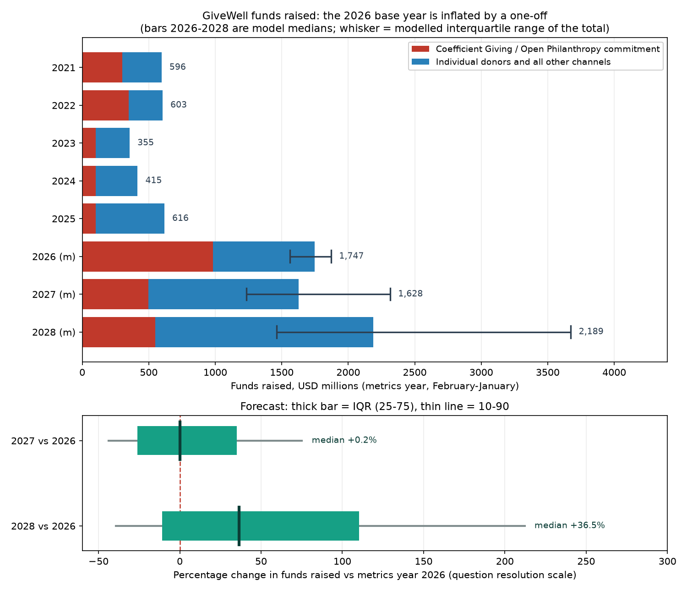

# What will be the percentage change in funds raised by GiveWell between 2026 and the following years?

| | |
|---|---|
| **Source** | Metaculus #45386 — https://www.metaculus.com/questions/45386/ |
| **Type** | numeric group — two subquestions (2027: qid 45575; 2028: qid 45576), unit `%`, range 0–200, both bounds open |
| **Opened / Closes / Resolves** | 2026-09-03 / 2028-07-01 / 2028-09-01 (2027) · 2029-09-01 (2028) |
| **Status** | open |
| **Current forecast** | **2027: Median 0.0%, IQR [−26.0%, +35.0%]** · **2028: Median +36.5%, IQR [−11.0%, +110.0%]** (v1, 2026-09-04) |
| **Community (as of 2026-09-04)** | **none — 0 forecasters, 0 comments; CP, Pro and gold cohorts all empty** |
| **Next review** | 2026-12-15 |

<!-- Versions below, newest first. APPEND-ONLY: never edit or delete a past version. -->

---

## v1 — Initial forecast — 2026-09-04

### What resolves YES

Each subquestion resolves as `100 × (F_i − F₂₀₂₆) / F₂₀₂₆`, where `F` is the **headline
"funds raised" total in GiveWell's annual metrics report** (givewell.org/about/impact) for
the corresponding **metrics year**, which runs February–January: metrics year 2026 = Feb
2026 – Jan 2027, 2027 = Feb 2027 – Jan 2028, 2028 = Feb 2028 – Jan 2029. Nominal USD, no
inflation adjustment; restated 2026 figures are used if GiveWell publishes them; if the
metric is renamed, the most comparable successor figure is used.

Three things about that metric matter more than they look:

1. **It is not the charity's revenue.** It includes donations made *directly to
   recommended charities* that GiveWell tracks, and — decisively here — **commitments that
   GiveWell chooses to recognise as funds raised in a given year**. The question's own
   background cites the ProPublica Form 990 revenue of $269.5m for FY2024; the metrics
   report figure for the overlapping period is $414.9m. Do not mix them.
2. **Recognition follows the commitment year, not the cash.** GiveWell recognised Open
   Philanthropy's full $350m in metrics year 2022 while retaining ~$128m of it for later
   grantmaking, and split the October-2023 $300m pledge as exactly $100m in each of 2023,
   2024 and 2025.
3. **Reports land late.** The 2024 report was published 2025-08-13, the 2025 report
   2026-08-31 — one day before the equivalent scheduled resolution date. A September
   publication would leave the 2027 subquestion unresolvable on 2028-09-01.

**A correction to the question's framing.** The background states that "Coefficient Giving
has committed to set aside $175 million in 2026". That was superseded on 2026-07-23, when
Coefficient Giving (formerly Open Philanthropy), together with Good Ventures, **raised its
2026 allocation to GiveWell's recommendations to $1 billion**. The background does not
mention it. The base year of this question is therefore inflated by roughly $825m of
one-off institutional money, and the 0–200 range encodes an expectation of growth that the
arithmetic does not support for 2027.

### Outside view

The only directly comparable reference class is GiveWell's own series (metrics years;
2020 and earlier are "money moved" and are not comparable):

| Metrics year | Funds raised (USD m) | of which OP / CG | Non-CG | Y/Y total |
|---|---|---|---|---|
| 2021 | 595.5 | 300 | 295.5 | +103% vs 2020 money moved |
| 2022 | 602.9 | 350 | 252.9 | +1.2% |
| 2023 | 355.1 | 100 | 255.1 | **−41.1%** |
| 2024 | 414.9 | 100 | 314.9 | +16.8% |
| 2025 | 616.4 | 100.0 | 516.3 | +48.6% |

Raw base rates: 1-year changes {+1.2, −41.1, +16.8, +48.6}%; 2-year changes (t vs t−2)
{−40.4, −31.2, +73.6}%. Dispersion is on the order of ±40–50pp at one year and ±40–75pp at
two, in a series with *no* one-off in the base year. That alone rules out any IQR narrower
than roughly 50pp wide.

The tightest analogue is **2022 → 2023: −41%**, produced by exactly the mechanism at issue
here — an Open Philanthropy commitment stepping down ($350m → $100m) while the rest of the
donor base was flat. The material difference now is that the rest of the donor base is not
flat: non-CG giving grew +23% then +64% in 2024–2025.

Status-quo prior for a base year containing a declared one-off: subsequent years revert
toward the underlying trend, so the *expected* change is negative unless trend growth in
the remaining block is large enough to fill the hole. Here it plausibly is — which is why
the 2027 answer sits near zero rather than deeply negative.

### Inside view

Decompose `F = CG + IND` and forecast the blocks separately, because they are different
processes: CG is a discrete institutional decision, IND is a fast-compounding, increasingly
mega-donor-concentrated series.

**CG — the institutional block.**
- 2026 committed: **$1,000m** (up from $175m allocated in December 2025).
- Coefficient Giving's own characterisation: *"This substantial increase is a one-off surge
  rather than a new steady state"*, and *"Future funding is far from guaranteed; this is a
  bet on laying the groundwork for others to emerge and pick up the baton."* Its stated
  reasons — grantee scaling takes time, gaps get more expensive once other donors arrive,
  transformative AI may compress the window — are all reasons to spend *early*, i.e. to
  borrow from 2027–2028.
- Against that: CG's 2025 CEO letter says it aims to "prepare for even larger growth in
  2027 and 2028"; Good Ventures is "eager to accelerate"; and CG's non-Good-Ventures donor
  funding more than doubled in 2025 to over $200m. A 2027 steady state well above the
  pre-surge $175m is likely; a repeat of $1bn is not.
- Modelled: 2027 median ~$500m (10–90: $207m–$1,068m), 2028 median ~$550m.

**IND — individuals, family foundations, effective-giving organisations, direct-to-charity.**
- 2025: $516.3m, +64%. The growth is concentrated: $1m+ donors went from 26 donors /
  $151.3m to 39 donors / $359.7m. Retail buckets ($100–$9,999) were roughly flat. So this
  block is now a small-n, high-variance series.
- The forward driver is AI equity turning liquid. Anthropic filed a confidential S-1 on
  2026-06-01 and, as of early September 2026, is reported to be targeting a public
  prospectus after Labor Day and a first trade in late September / early October near a
  $965bn valuation. With the modal 135–180-day lockup (Metaculus multiple-choice CP), that
  puts employee liquidity around **February–April 2027 — the very start of metrics year
  2027**, with the December 2027 giving season inside the same year. OpenAI's IPO (CP
  median 2027-05-18, modal 180-day lockup) lands mostly in **metrics year 2028**.
- All seven Anthropic co-founders have pledged 80% of their wealth; GiveWell is named a
  likely recipient alongside Coefficient Giving and AI-safety organisations.
- Modelled growth: 2026 ×1.48, 2027 ×1.48, 2028 ×1.45 (medians), all with wide lognormal
  spread and a shared latent factor for "how much of the AI wealth actually shows up, and
  how early".

**The arithmetic that decides the 2027 subquestion.** With F₂₀₂₆ ≈ $1.7bn of which ~$1.0bn
is CG, CG falling to ~$500m costs about **−29pp** on its own. Individual giving therefore
has to grow roughly **+45% in one year** just to hold the line — above its historical
median but below its 2025 outturn. That is close to a coin flip, and the model returns one:
`P(2027 change < 0) = 0.50`.

Full model and its assumptions: `scripts/model.py`; output snapshot in
`raw/model-output-2026-09-04.txt`.

| Block | 2026 | 2027 | 2028 |
|---|---|---|---|
| CG commitment recognised (median, $m) | 983 | 498 | 550 |
| Individual / other (median, $m) | 764 | 1,130 | 1,639 |
| **Total funds raised (median, $m)** | **1,717** | **1,692** | **2,307** |
| Total, IQR ($m) | 1,563–1,871 | 1,234–2,315 | 1,460–3,674 |

### Evidence

Updates applied to the outside-view prior, with rough likelihood ratios:

| Finding | Direction | Weight |
|---|---|---|
| CG's 2026 allocation raised $175m → $1,000m (2026-07-23), announced as a *2026 allocation* | inflates the denominator by ~$825m | dominant; LR ≈ 8:1 in favour of a materially lower 2027 ratio than the naive read |
| CG explicitly: "a one-off surge rather than a new steady state" | ↓ numerator 2027 | LR ≈ 4:1 against a repeat |
| GiveWell recognises commitments in the commitment year (2022 precedent: $350m recognised, $128m retained) | ↑ confidence the full $1bn lands in metrics year 2026 | LR ≈ 3:1 |
| GiveWell wording "**near-term** funding commitment" (not "2026") | ↑ chance of a 2026/2027 split | held at 25% |
| Anthropic reportedly targeting a Sept/Oct 2026 listing, ahead of the CP median of 2026-12-23 | ↑ numerator 2027 (lockup expiry moves into Feb–Apr 2027) | LR ≈ 2:1 |
| CG 2025 CEO letter: "prepare for even larger growth in 2027 and 2028"; Good Ventures "eager to accelerate" | ↑ numerator both years | LR ≈ 2:1 |
| 2025 growth was 13 extra $1m+ donors, not a broad retail trend | ↑ variance, not the median | widened the bands |
| EA Forum: much AI-linked giving expected to go to AI safety, not global health; "all on paper right now" | ↓ numerator, fattens the left tail | LR ≈ 1.5:1 |
| GiveWell's own April-2023 projection for 2025 was a 50% CI of $400–800m; actual $616m | calibration check: even the org itself uses a 2:1 band two years out | forced my IQR wider |

**Evidence I expected and did not find** (absence is informative): no GiveWell statement of
expected funds raised for 2027 or 2028, in the style of its April-2023 post; no CG
announcement of a 2027 GiveWell allocation (the 2026 one came on 2025-12-18, so this is
simply not due yet); no third-party market or aggregator forecasting philanthropic
fundraising volumes at all.

### Other forecasters

| Source | Value | As of | Note |
|---|---|---|---|
| Metaculus CP (recency-weighted), both subquestions | **none** | 2026-09-04 | 0 forecasters, 0 forecasts, 0 comments — question opened 2026-09-03 |
| Metaculus Pro | **none** | 2026-09-04 | empty aggregation |
| Metaculus gold medalists | **none** | 2026-09-04 | empty aggregation |
| Metaculus #44767 "When will Anthropic IPO?" | CP 2026-12-23, IQR [2026-10-31, 2027-02-08]; Pro 2026-12-26; gold 2026-12-18 (n=8/1/4) | 2026-09-02 | used for AI-liquidity timing |
| Metaculus #44766 "When will OpenAI IPO?" | CP 2027-05-18, IQR [2027-02-23, 2027-07-10]; Pro 2027-04-12; gold 2027-04-16 (n=7/2/4) | 2026-09-02 | ditto |
| Metaculus #44793 Anthropic lockup length | modal 90–180 days (CP 24%/25%/24% across 90-134/135-179/180) | 2026-09-02 | gold cohort leans slightly longer (180d at 32%) |
| Metaculus #44795 OpenAI lockup length | modal 135–180 days (CP 27%/29%) | 2026-09-04 | |
| Manifold "CG directs ≥$1.5bn in grants in 2026" | 90.5% | 2026-09-04 | play-money, low volume; consistent with the $1bn GiveWell allocation being real |
| Manifold "GiveWell approves ≥$800m in grants in its 2026 grant year" | 50%, 4 traders, last traded 2026-07-22 | 2026-09-04 | **stale** — predates the $1bn news and GiveWell's own "approach or exceed $1bn" guidance. Discarded. |
| Kalshi / Polymarket / GJOpen / INFER / Sentinel / Mantic | — | 2026-09-04 | searched; no coverage of philanthropic fundraising volumes |

**Cohort disagreement**: none is observable, because there is none of anything. This is a
cold forecast with no anchor, which cuts both ways — no herding risk, but also no crowd
correction for a misread. The IPO-timing siblings show Pro and gold cohorts sitting
essentially on top of the CP, so no signal there either. The one place where the outside
world contradicts a Metaculus cohort is Anthropic's IPO date: news reporting from late
August 2026 points at late September / early October, roughly two months earlier than the
CP median of 2026-12-23. I have leaned on the news rather than the CP for that input,
because a filed prospectus is harder evidence than an 8-forecaster aggregate.

### Scenarios

Weights over the joint outcome; the percentages are the implied resolutions.

| # | Scenario | Weight | Implies (2027 / 2028) |
|---|---|---|---|
| 1 | **CG cliff dominates.** Full $1bn recognised in 2026; CG reverts to $200–400m in 2027; AI money arrives slowly, via DAFs, and skews to AI safety. Individual growth ~+15–25%/yr. | 30% | −45% / −25% |
| 2 | **Cliff and wave roughly cancel in 2027, wave wins by 2028.** CG ~$500m in 2027; Anthropic lockup expires Q1–Q2 2027 and the December 2027 giving season delivers; OpenAI money lands in 2028. | 35% | −5% / +45% |
| 3 | **Wave arrives early and big.** Anthropic lists in October 2026 at a very high valuation; founder and employee giving reaches GiveWell fast; CG stays elevated at $700m–1bn as Good Ventures' own AI exposure monetises. | 20% | +45% / +130% |
| 4 | **Recognition splits.** GiveWell books ~$600m of the commitment in 2026 and the balance in 2027 (its "near-term commitment" wording). Denominator smaller, numerator larger — mechanically raises both answers by ~25–35pp. | 10% | +30% / +80% |
| 5 | **AI valuation bust.** IPO pulled or a sharp de-rating; paper wealth does not convert; CG retrenches after front-loading; individual giving flat to down. | 5% | −55% / −60% |

Aggregating the underlying Monte-Carlo rather than the scenario midpoints:

- **2027**: median **0.0%**, IQR **[−26.0%, +35.0%]**, 10–90 [−43.7%, +75.2%].
  `P(< 0) = 0.50`, `P(0–200) = 0.50`, `P(> 200) = 0.005`.
- **2028**: median **+36.5%**, IQR **[−11.0%, +110.0%]**, 10–90 [−39.2%, +212.2%].
  `P(< 0) = 0.31`, `P(0–200) = 0.58`, `P(> 200) = 0.11`.

### Sensitivity

| Assumption | If instead | 2027 median becomes | 2028 median becomes |
|---|---|---|---|
| Individual-giving growth in 2027 ×1.48 | ×1.30 (near the 2024 outturn) | −7% | +22% |
| " | ×1.70 (a repeat of 2025) | +11% | +49% |
| CG 2027 median $430m + carryover | $250m (back near the pre-surge baseline) | −8% | unchanged |
| " | $700m (front-loading only partial) | +22% | unchanged |
| P(full $1bn recognised in metrics year 2026) = 0.75 | 0.85 | −5% | +31% |
| " | 0.45 | +5% | +39% |
| Individual-giving growth in 2026 ×1.48 | ×1.25 (denominator smaller) | −1% | +30% |
| " | ×1.70 | +6% | +42% |
| CG 2028 median $550m | $900m (Good Ventures' AI windfall lands) | unchanged | +64% |

The two assumptions doing the most work are **individual-donor growth in 2027** and **the
CG 2027 level**; between them they swing the 2027 median across roughly −8% to +22%. That
spread is itself the argument for the wide IQR, and it is why I would not defend the exact
median to better than ±10pp.

### Calibration hygiene

- The IQRs are 61pp and 121pp wide. Checked against history: the 2027 IQR contains two of
  the four observed 1-year changes (+1.2%, +16.8%) and the 2028 IQR contains the observed
  2-year change of +73.6%. The observed −41% and −40% sit at roughly my 9th percentile,
  which is defensible given that the 2027 non-CG block is growing where it was flat in
  2023 — but it is the main way I could be wrong on the low side.
- Scope check: doubling the window (2027 → 2028) moves the median from 0% to +36.5% and
  roughly doubles the band width. Directionally right.
- Would I take the other side at my own price? At 0% for 2027, yes in both directions —
  which is what a genuine coin flip should feel like. At +36.5% for 2028 I would rather
  buy than sell, which is a mild warning that the 2028 median may be a touch low; I have
  left it, because the left tail there is driven by a real correlated-failure scenario.

### What would change my mind (tripwires)

- [ ] **Coefficient Giving publishes its 2027 allocation to GiveWell's recommendations**
      (the 2026 one came on 2025-12-18, so expect mid-December 2026 to March 2027).
      ≥ $800m → 2027 median **+25pp**; $300–600m → roughly **no change**; ≤ $200m →
      **−20pp**. This is the single highest-value signal.
- [ ] **Anthropic's IPO completes by 2026-12-31** with a lockup of ≤ 180 days stated in the
      final prospectus → 2027 median **+8pp** (employee liquidity lands inside metrics year
      2027). IPO postponed beyond 2027-03-31 → 2027 median **−12pp**, 2028 **−20pp**.
- [ ] **GiveWell's 2026 metrics report (expect ~2027-08)** shows CG recognised at
      ≥ $950m in metrics year 2026 → confirms the denominator, **narrows the IQR by ~1/3**.
      Recognised at ≤ $700m → both medians **+20 to +30pp**.
- [ ] **GiveWell publishes a forward funds-raised projection** for 2027–2028 (it did this
      in April 2023 for 2023–2025). A stated central estimate above $2bn for 2027 →
      **+20pp**; below $1.2bn → **−15pp**.
- [ ] **Nasdaq AI complex drawdown ≥ 35% from its 2026 peak, sustained past 2027-06-30**
      → 2027 median **−15pp**, 2028 **−30pp**, and fatten both left tails.
- [ ] **A single publicly announced gift or pledge to GiveWell ≥ $250m from an AI-linked
      donor, dated between 2027-02-01 and 2028-01-31** → 2027 median **+15pp**. (2025 shows
      GiveWell already receives $1m+ gifts from 39 donors, so the bar is a step change in
      size, not the existence of large gifts.)

### Sources

1. Metaculus, "What will be the percentage change in funds raised by GiveWell between 2026 and the following years?" (post 45386, subquestions 45575/45576) — https://www.metaculus.com/questions/45386/ (accessed 2026-09-04; JSON snapshot in `raw/`)
2. GiveWell, *Metrics Report 2025* (February 2025 – January 2026) — https://files.givewell.org/files/metrics/GiveWell_Metrics_Report_2025.pdf (accessed 2026-09-04)
3. GiveWell, *Metrics Report 2024* (February 2024 – January 2025) — https://files.givewell.org/files/metrics/GiveWell_Metrics_Report_2024.pdf (accessed 2026-09-04)
4. GiveWell, *Metrics Report 2022* — https://files.givewell.org/files/metrics/GiveWell_Metrics_Report_2022.pdf (accessed 2026-09-04)
5. GiveWell, *Metrics Report 2021* — https://files.givewell.org/files/metrics/GiveWell_Metrics_Report_2021.pdf (accessed 2026-09-04)
6. GiveWell, "GiveWell's Impact" — https://www.givewell.org/about/impact (accessed 2026-09-04)
7. GiveWell blog, "GiveWell's 2025 Metrics and Impact", 2026-08-31 — https://blog.givewell.org/2026/08/31/givewells-2025-metrics-and-impact/ (accessed 2026-09-04)
8. GiveWell blog, "Scaling Our Impact, with Support from a $1 Billion Commitment", 2026-07-23 — https://blog.givewell.org/2026/07/23/scaling-our-impact-with-support/ (accessed 2026-09-04)
9. GiveWell blog, "Coefficient Giving Commits $175 Million to GiveWell Opportunities", 2025-12-18 — https://blog.givewell.org/2025/12/18/coefficient-giving-commits-175-million/ (accessed 2026-09-04)
10. GiveWell blog, "Announcing Our Largest Grant to Date" ($276m to AMF, DRC), 2026-08-24 — https://blog.givewell.org/2026/08/24/announcing-our-largest-grant-to-date/ (accessed 2026-09-04)
11. GiveWell blog, "August 2026 Updates", 2026-08-28 — https://blog.givewell.org/2026/08/28/august-2026-updates/ (accessed 2026-09-04)
12. GiveWell blog, "How much funding does GiveWell expect to raise through 2025?", 2023-04-10 — https://blog.givewell.org/2023/04/10/expected-funds-raised-through-2025/ (accessed 2026-09-04)
13. Coefficient Giving, "Increasing Our 2026 Allocation to GiveWell's Recommendations to $1 Billion" — https://coefficientgiving.org/research/increasing-our-2026-allocation-to-givewells-recommendations-to-1-billion/ (accessed 2026-09-04 via text proxy; the host is unreachable from this container, so the "one-off surge rather than a new steady state" wording was cross-checked against two independent search summaries)
14. Coefficient Giving, "2025 Letter from the CEO" — https://coefficientgiving.org/research/2025-letter-from-the-ceo/ (accessed 2026-09-04 via search summary only)
15. Metaculus, "When will Anthropic IPO?" (post 44767) — https://www.metaculus.com/questions/44767/ (accessed 2026-09-04)
16. Metaculus, "When will OpenAI IPO?" (post 44766) — https://www.metaculus.com/questions/44766/ (accessed 2026-09-04)
17. Metaculus, "How long will the employee lockup period be after Anthropic's IPO?" (post 44793) — https://www.metaculus.com/questions/44793/ (accessed 2026-09-04)
18. Metaculus, "How long will the employee lockup period be after OpenAI's IPO?" (post 44795) — https://www.metaculus.com/questions/44795/ (accessed 2026-09-04)
19. Metaculus, "What will be the percentage change in Coefficient Giving's annual grantmaking from 2026 to the following years?" (post 45374, background section) — https://www.metaculus.com/questions/45374/ (accessed 2026-09-04)
20. Anthropic, "Anthropic confidentially submits draft S-1 to the SEC", 2026-06-01 — https://www.anthropic.com/news/confidential-draft-s1-sec (accessed 2026-09-04 via search)
21. Advisor Perspectives / Bloomberg, "Anthropic's Mega-IPO Plan Looms Over Packed US Listing Calendar", 2026-08-31 — https://advisorperspectives.com/articles/2026/08/31/anthropics-mega-ipo-plan-looms-over-packed-us-listing-calendar-1 (accessed 2026-09-04 via search summary)
22. Transformer News, "Anthropic employees say they'll give away billions. Where will it go?" — https://www.transformernews.ai/p/anthropic-employees-philanthropy-billions-donations-effective-altruism-coefficient-giving-ai-safety (accessed 2026-09-04)
23. EA Forum, "Front-Load Giving Because of Anthropic Donors?" — https://forum.effectivealtruism.org/posts/rRBaP7YbXfZibSn3C/front-load-giving-because-of-anthropic-donors (accessed 2026-09-04)
24. EA Forum, "Coefficient Giving just gave GiveWell $1 billion. Where should other donors give?" — https://forum.effectivealtruism.org/posts/sgzmaRgxDFXZgNAsv/coefficient-giving-just-gave-givewell-usd1-billion-where (accessed 2026-09-04)
25. Chronicle of Philanthropy, "Coefficient Giving boosts pledge to $1 billion, banking on an AI windfall" — https://www.philanthropy.com/news/coefficient-giving-boosts-pledge-to-1-billion-banking-on-an-ai-windfall/ (headline and search summary only; the page returned HTTP 403 from this container, accessed 2026-09-04)
26. Manifold Markets, "Will Coefficient Giving (formerly Open Philanthropy) direct ≥$1.5B in grants in 2026?" and "Will GiveWell approve ≥$800M in grants in its 2026 grant year (Feb 2026–Jan 2027)?" — https://manifold.markets/ (API query, accessed 2026-09-04)

**Date**: 2026-09-04
**Forecast**: 2027 — Median 0.0%, IQR [−26.0%, +35.0%] · 2028 — Median +36.5%, IQR [−11.0%, +110.0%]
**Thesis**: The 2026 base year is inflated by a declared one-off — Coefficient Giving raised its 2026 allocation to GiveWell's recommendations from $175m to $1bn in July 2026 and called it "a one-off surge rather than a new steady state" — a fact the question's own background omits, so the answer is far below the 0–200% range the question implies. Against that, Anthropic's imminent IPO puts employee liquidity at the start of metrics year 2027 and the whole AI-wealth wave inside 2028, which is enough to cancel the cliff at the median in 2027 and outgrow it in 2028. With no community prediction to check against and the two load-bearing assumptions (Coefficient Giving's 2027 allocation, individual-donor growth) each worth ±20pp, the bands are deliberately very wide.
