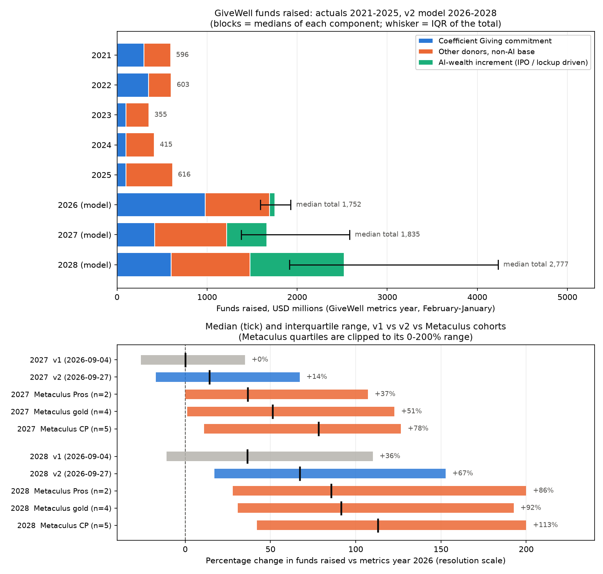

# What will be the percentage change in funds raised by GiveWell between 2026 and the following years?

| | |
|---|---|
| **Source** | Metaculus #45386 — https://www.metaculus.com/questions/45386/ |
| **Type** | numeric group — two subquestions (2027: qid 45575; 2028: qid 45576), unit `%`, range 0–200, both bounds open |
| **Opened / Closes / Resolves** | 2026-09-03 / 2028-07-01 / 2028-09-01 (2027) · 2029-09-01 (2028) |
| **Status** | open |
| **Current forecast** | **2027: Median +14.2%, IQR [−17.2%, +67.1%]** · **2028: Median +67.3%, IQR [+17.1%, +152.7%]** (v2, 2026-09-27) |
| **Community (as of 2026-09-26)** | 2027: CP 78.2% (n=5) · Pro 36.7% (n=2) · Gold 51.2% (n=4) — 2028: CP 113.0% · Pro 85.7% · Gold 91.6% |
| **Next review** | 2026-11-30 |

<!-- Versions below, newest first. APPEND-ONLY: never edit or delete a past version. -->

---

## v2 — Re-analysis — 2026-09-27

Mode: **Re-analysis**. The Metaculus Pro and gold cohorts now sit 37–51 pp above v1 on the 2027
leg, and the operator asked for a red-team first. Both legs are reported. The ledger carries the
2027 leg (qid 45575) because it resolves first.

v1's chart, for comparison: [charts/funds-raised-decomposition.png](charts/funds-raised-decomposition.png).

### Revision

The effects come from switching one assumption at a time in `scripts/model_v2.py`, starting from
the final v2 model. The structural row is the residual that makes each column add up.

| Driver | Direction | 2027 leg | 2028 leg |
|---|---|---|---|
| Prior (v1, 2026-09-04) | — | Median 0.0%, IQR [−26.0%, +35.0%] | Median +36.5%, IQR [−11.0%, +110.0%] |
| Model restructure. AI-linked money becomes its own additive block with explicit IPO/lockup states. v1 grew all non-Coefficient-Giving giving by a flat ×1.48 a year, which treats a one-time jump in the donor pool as a trend. | ↑ | +19.5 pp | +28.1 pp |
| Anthropic's IPO target is now about $2tn (v1 assumed about $965bn). The donor-advised-fund (DAF) pool is now counted explicitly: $20–40bn at a $380bn valuation, which would scale to roughly $80–210bn at listing. | ↑ | +5.5 pp | +3.7 pp |
| Lockup reported as "well over 180 days", with shares free around mid-2027. v1 assumed a modal 135–180 days, i.e. liquidity in Feb–Apr 2027. | ↓ | −8.4 pp | ≈ 0 |
| Insiders may sell part of their stake at the IPO (now November 2026), so some AI-linked money reaches the December 2026 giving season, which counts in the **2026 denominator** | ↓ | −6.4 pp | −9.9 pp |
| Coefficient Giving's 2027 median cut from $430m to $350m (before carryover). GiveWell carries a large unspent balance out of 2026, and new AI donors partly replace Coefficient Giving's money. | ↓ | −5.8 pp | 0 |
| Correlation between Coefficient Giving and AI-linked giving cut from 0.55 to 0.15 (they partly substitute for each other) | ↑ (mostly spread) | +1.4 pp | 0 |
| P(full $1bn booked in metrics year 2026) cut from 0.75 to 0.72 | ↑ | +0.3 pp | +0.3 pp |
| Non-AI base growth in 2026 cut from ×1.48 to ×1.38. The One Big Beautiful Bill Act pulled gifts into calendar 2025, and large donors are being steered elsewhere after the $1bn. | ≈ | −0.3 pp | +0.9 pp |
| *Model v2 output* | | *+6.0%, IQR [−20.0%, +46.7%]* | *+59.6%, IQR [+13.3%, +135.8%]* |
| 30% weight on the pooled Metaculus Pro + gold distribution (linear pool on the CDF; `scripts/pool_v2.py`) | ↑ | +8.2 pp | +7.7 pp |
| **New forecast** | | **Median +14.2%, IQR [−17.2%, +67.1%]** | **Median +67.3%, IQR [+17.1%, +152.7%]** |

### Tripwire check

| Tripwire from v1 | Fired? | Note |
|---|---|---|
| Coefficient Giving publishes a 2027 allocation to GiveWell's recommendations ≥ $800m (by 2027-03-31) | Not fired | Not due. No 2027 allocation found. The 2026 one came on 2025-12-18. |
| Coefficient Giving's 2027 allocation ≤ $200m (by 2027-03-31) | Not fired | Same as above |
| Anthropic IPO completes by 2026-12-31 with a lockup of ≤ 180 days | Not fired, and now unlikely **as worded** | The IPO slipped from October to **November 2026** (WSJ via Forbes 2026-09-23; Motley Fool 2026-09-26). The Information (via Motley Fool 2026-09-05) reports a portion of insider shares sellable at the IPO and the rest locked "well over 180 days", free around **mid-2027**. Replaced by two tripwires below. |
| Anthropic IPO postponed beyond 2027-03-31 | Not fired | The slip is about one month |
| GiveWell's 2026 metrics report recognises ≤ $700m of the Coefficient Giving commitment | Not due | Expected around August 2027 |
| Nasdaq AI complex drawdown ≥ 35%, sustained past 2027-06-30 | Not fired | No drawdown of that size found. Anthropic's IPO target (~$2tn) is higher than at v1. |
| Single ≥ $250m gift or pledge to GiveWell from an AI-linked donor, Feb 2027 – Jan 2028 | Window not open | — |
| GiveWell publishes a forward funds-raised projection | Not fired | No such post on the GiveWell blog through its latest entry (2026-09-03) |

### Red-team (operator-requested `/review`, 2026-09-27)

The strongest case for a materially higher number, and how much of it survives.

1. **Resolution risk: the base year could be smaller than v1 assumed.** GiveWell calls the
   $1bn a "*near-term* funding commitment", not a 2026 one. Coefficient Giving co-funds some
   grants directly (the $276m AMF/DRC net grant), and GiveWell could book those when granted
   rather than when committed. A Metaculus Pro commenter estimates that only ~$600m of the $1bn is
   approved as grants in calendar 2026. If ≥ $300m of the commitment moves into metrics year 2027
   (or into a restated 2026), the 2027 leg jumps to about **+41%** (the model's split branch).
   Against that: Coefficient Giving's post is titled "Increasing Our **2026 Allocation**", and in
   2022 GiveWell recognised a full-year commitment in its year even though $128m was spent later.
   *Survives in part:* P(full recognition) is trimmed from 0.75 to 0.72.
   Smaller risks: GiveWell might redefine its headline metric to split Coefficient Giving out
   (~5%, direction unclear under the "most comparable figure" clause). Metaculus admins have been
   asked whether the 0–200 range was intended; a rescale changes scoring, not the outcome.
2. **Reference class: v1 used the wrong one for the numerator.** v1 used GiveWell's plain
   year-on-year series and the 2022→2023 cliff. A rival class is *"a default giving vehicle in
   the year a large new donor cohort turns liquid"*. GiveWell's record has one clean example,
   2025: +49% total and +64% non-Coefficient-Giving, driven by the $1m+ bucket (26 → 39 donors,
   $151m → $360m). Some of those donors may be AI-linked, but that is not verified. 2021
   (+103% vs 2020 money moved) does not count, because Open Philanthropy's $300m drove most of
   it. Outside GiveWell, recipients of a founder cohort's post-IPO giving can see step changes
   rather than growth rates; no reliable series was found to quantify that. *Survives in
   part:* it describes the numerator, while the denominator carries a $1bn one-off that no
   comparison year had. It is the main reason for the model restructure above.
3. **Conjunction: v1's "≈ 0" needed three things at once.** Full recognition (0.72),
   Coefficient Giving's 2027 level ≲ $500m (≈ 0.7), and only modest AI money in metrics year 2027
   (≈ 0.55) jointly come to ≈ 0.28. If any one fails, the result rises by 20–40 pp. The same test
   cuts the other way against the community prediction. Even with the normal-state AI-linked
   increment raised to a $2bn median, the model's 2027 median only reaches +47%. Reaching +78%
   needs ~$2.5–3bn of new money within ~5–7 months of the lockup ending, or split recognition on
   top of ≥ $1.5bn. The v2 model puts P(2027 ≥ +78%) at 0.15 (0.22 after pooling).
4. **Anchoring.** v1 inherited nothing from the crowd (0 forecasters). It did anchor on its own
   insight — the $1bn that the question background omits. It copied the 2025 total growth (×1.48)
   into the growth rate of the non-Coefficient-Giving block, and it treated a $100bn-scale
   one-time liquidity event as a growth rate. Had a +78% community prediction existed on
   2026-09-04, v1 would probably have landed around +10% to +20%, not 0. The live risk now runs
   the other way, as stickiness to v1.
5. **Missing tripwires.** v1 did not list: the Anthropic S-1's lockup schedule and how DAF-held
   shares are treated; the IPO pricing valuation; any founder foundation or large gift
   announcement; a GiveWell statement that it is over-funded, rolls over funds or tells donors
   to give elsewhere; a mid-year 2027 Coefficient Giving top-up like July 2026's; GiveWell
   changing its metric. All are added below.
6. **IQR width.** v1's IQRs were 61 pp and 121 pp wide. The Metaculus cohorts' 2027 IQRs are
   ~115–120 pp wide. v1 put P(2027 > +100%) at about 6%, which is too thin a right tail when a
   $100bn-plus charitable pool unlocks *inside* metrics year 2027. v2 widens the IQRs to 84 pp
   and 136 pp and puts P(2027 > +100%) at 11% (model) and 17% (pooled). The left tail is kept:
   the observed −41% sits at about the 12th percentile.

**Alternative forecast implied by the red team.** Stack all four red-team assumptions in
`model_v2.py`: AI-linked increment in 2027 of $1.2bn in the normal state, P(full recognition) =
0.5, Coefficient Giving's 2027 allocation at $500m, and 2026 base growth of ×1.25. The model then
gives **2027: +47%, IQR [+5%, +117%]** and **2028: +69%, IQR [+18%, +152%]**. That sits at the
gold-medalist cohort. **Weight: ~25%.** The 30% crowd weight in the revision table covers roughly
that much.

**The evidence that would settle it.** How GiveWell books the $1bn across metrics years 2026 and
2027. It swings the 2027 leg by ~45 pp (full −4% vs split +41%), and GiveWell could state it
long before the August 2027 metrics report. For the numerator, the equivalent is the final
S-1's lockup schedule, including when DAF-held shares can be sold.

### What resolves YES

Unchanged from v1. The resolution-risk refinements are in red-team point 1.

### Outside view

Unchanged from v1, plus the rival reference class in red-team point 2. The raw one-year
changes {+1.2, −41.1, +16.8, +48.6}% still bound the left tail. The liquidity-event years (2021,
2025) inform the right tail.

### Inside view

`F = CG + BASE + AI`, each block modelled separately (`scripts/model_v2.py`, output in
`raw/model-output-2026-09-27.txt`):

| Block (median, $m) | 2026 | 2027 | 2028 |
|---|---|---|---|
| Coefficient Giving recognised (incl. carryover) | 980 | 420 | 599 |
| Non-AI base (individuals, foundations, direct-to-charity) | 713 | 798 | 878 |
| AI-linked increment (IPO-day sales, post-lockup DAF grants and gifts) | 60 | 446 | 1,044 |
| **Total funds raised (median; IQR)** | **1,752 (1,590–1,929)** | **1,835 (1,379–2,581)** | **2,777 (1,915–4,230)** |

**How the AI-linked block is sized (normal state).** Longterm Wiki estimated pre-IPO DAF
holdings at $20–40bn at a $380bn valuation. If they scale with a $1.5–2tn listing, that is
~$80–210bn. The seven co-founders hold ~1.8% each and pledge 80% (non-binding), which adds
~$150–200bn. Take a liquid charitable pool of $150–400bn by H2 2027. If 2–5% of it is granted in
the ~5–7 months of metrics year 2027 after the lockup, and 5–15% of those grants reach giving
that GiveWell tracks, the result is $0.15–3bn, with a geometric centre ≈ $0.7bn. The 2028 full
year uses 5–10% of the pool granted and a 5–12% GiveWell share, giving a centre ≈ $1.4bn.
**This sizing is speculative.** No source estimates the global-health share of AI-linked giving.
Transformer News names GiveWell only as one of several advisory channels, and the EA Forum
expects most of this money to go to AI safety.

**Which way the Anthropic news cuts.** The IPO slipping into November barely matters. A
lockup that ends around mid-2027 still falls inside metrics year 2027, and so does the
December 2027 giving season. What matters is that selling at the IPO pulls some money into the
denominator, and that a lockup ending mid-2027 leaves roughly half a year of liquidity in the
2027 numerator.

### Evidence

| Finding | Direction | Weight |
|---|---|---|
| Pre-IPO DAF holdings $20–40bn at $380bn, already irrevocably committed to charity; no minimum payout rule | ↑ both legs | LR ≈ 1.5:1 for a large AI-linked block. v1 treated this money as "all on paper" pledges, but DAF transfers are legally binding. |
| IPO target ~$2tn, raising up to $100bn; run-rate revenue >$110bn expected by year-end | ↑ both legs | Priced in via AI sizing (+5.5 / +3.7 pp) |
| IPO slips October → November 2026 | ≈ | Still inside calendar 2026 |
| Lockup "well over 180 days", free around mid-2027; a portion sellable at the IPO | ↓ 2027, ↓ both via the denominator | −8.4 and −6.4 pp on 2027 |
| GiveWell: "already committed over $400 million in 2026" by July; grantmaking to "approach or even exceed $1 billion" in 2026 | ↓ Coefficient Giving 2027 | GiveWell raises ~$1.75bn against ~$1bn of grants, leaving a large carryover |
| EA Forum (2026-07-24): large donors advised to redirect their marginal dollar away from GiveWell after the $1bn | ↓ base 2026–2027 | small |
| One Big Beautiful Bill Act: 0.5%-of-AGI floor and 35% cap on the value of itemised charitable deductions from 2026, so gifts were accelerated into 2025 | ↓ 2026 base growth (→ ↑ ratio, but tiny: the ratio is insensitive to the base) | ≈ 0 |
| Metaculus Pro/gold history: Pros fell 114 pp and gold 73 pp on the 2027 leg within ~36 h of the $1bn being explained in comments | moves them toward v1; their remaining gap is partly an information gap | argues for W ≈ 0.3, not 0.5 |

**Evidence expected but not found:** no Coefficient Giving 2027 allocation, no GiveWell forward
projection, no public S-1 (so no confirmed lockup terms), no founder gift announcements, and no
access to coefficientgiving.org or philanthropy.com (still 403 from this container).

### Other forecasters

Aggregations as of 2026-09-26 04:36 UTC, retrieved 2026-09-27. Metaculus clips quartiles to
its 0–200 range; the out-of-range mass is listed separately.

| Source | 2027 leg | 2028 leg | Note |
|---|---|---|---|
| Metaculus CP (recency-weighted), n = 5 | **78.2%**, IQR [11.1, 126.5]; P(<0) 19.6%, P(>200) 6.9% | **113.0%**, IQR [42.0, >200]; P(<0) 10.3%, P(>200) 29.8% | The gold cohort (n = 4) is most of the CP. One commenter (Zaldath) posted medians of 150% / >200% and said they first misread the formula. |
| Metaculus Pros, n = 2 | **36.7%**, IQR [<0, 107.2]; P(<0) 27.0% | **85.7%**, IQR [27.8, >200] | was 151% / 200% before 2026-09-25 18:03 UTC |
| Metaculus gold medalists, n = 4 | **51.2%**, IQR [1.3, 122.7]; P(<0) 24.2% | **91.6%**, IQR [30.7, 192.6] | was 124% / 160% before the same comment |
| Comments (9) | — | — | MaxA laid out the $1bn denominator issue on 2026-09-25 and put weight below 0. Zaldath then said they would also add weight below 0, citing the IPO delay. |
| Kalshi / Polymarket / Manifold / GJOpen / INFER | — | — | no coverage of GiveWell volumes (unchanged from v1) |

**Cohort disagreement.** CP > gold > Pro by ~40 pp on the 2027 leg. That ordering is consistent
with (not proof of) how far each group has absorbed the $1bn base-year fact. Every cohort moved *toward* v1 in the
last 48 hours. v2 still sits 23–37 pp below the Pro and gold cohorts on the 2027 leg. The
written justification: (a) n = 2 and n = 4; (b) their trajectory shows an information gap that
is still closing; (c) the question's 0–200 range and slider make below-zero mass awkward to
enter, which biases the crowd upward on a question whose median may sit near 0. Against that:
they have better track records than one model, and v1's structural error on the AI-linked
block was real. Hence W = 0.3.

### Scenarios

| # | Scenario | Weight | 2027 / 2028 (model medians) |
|---|---|---|---|
| 1 | **Normal.** IPO by 2026-12-31, main lockup ends by ~Sep 2027 | 72% | +17% / +75% |
| 2 | **Delayed.** IPO slips into 2027 or the lockup runs past January 2028 | 18% | −12% / +43% |
| 3 | **Bust.** IPO pulled, or a deep AI de-rating stops paper wealth converting | 10% | −21% / +5% |
| — | Crossed with how the $1bn is booked: full in 2026 (72%) / split into 2027 (20%) / other (8%) | | 2027: −4% / +41% / +8% |

Pooled (model ⊕ 30% Pro+gold):

- **2027**: median **+14.2%**, IQR **[−17.2%, +67.1%]**, 10–90 [−35.7%, +139.4%]; `P(<0) = 0.39`.
- **2028**: median **+67.3%**, IQR **[+17.1%, +152.7%]**, 10–90 [−13.7%, +291.9%]; `P(<0) = 0.16`.

### Sensitivity

One switch at a time on the v2 model, before pooling:

| Assumption | If instead | 2027 median | 2028 median |
|---|---|---|---|
| *Base case (model v2, unpooled)* | | *+6.0%* | *+59.6%* |
| AI-linked increment in 2027, normal-state median $700m | $1.2bn | +22.6% | unchanged |
| " | $250m | −12.1% | unchanged |
| " | $2.0bn | +47.1% | unchanged |
| Coefficient Giving 2027, median $350m | $700m | +30.3% | unchanged |
| " | $200m | −5.0% | unchanged |
| P(full $1bn in metrics year 2026) = 0.72 | 0.50 | +17.2% | +67.1% |
| " | 0.90 | −0.7% | +54.5% |
| IPO-day money in the 2026 denominator (median $60m) | none | +12.4% | +69.5% |
| P(normal IPO/lockup state) = 0.72 | 0.85 | +11.1% | +67.2% |
| Non-AI base growth in 2026, ×1.38 | ×1.20 / ×1.60 | +5.5% / +6.6% | +61.3% / +57.7% |

Three levers dominate the 2027 leg: the size of the AI-linked increment (−18 to +41 pp over
the range tested), Coefficient Giving's 2027 level (−11 to +24 pp), and how the $1bn is booked
(−7 to +11 pp). The size of the 2026 base barely matters, because the non-AI base scales both
years alike.

### Calibration hygiene

- The 2027 IQR (84 pp wide) contains 3 of the 4 historical one-year changes. The fourth, −41%,
  sits at about the 12th percentile. The 2028 IQR (136 pp) contains the +74% two-year change.
  The two historical −31% and −40% two-year changes sit at about the 3rd–5th percentile, which
  is defensible only because 2028 is the first full year of AI liquidity. That is the main way
  the 2028 leg could be too high.
- Scope: from 2027 to 2028 the median rises 53 pp and the IQR widens 1.6×. Directionally right.
- Would I take the other side at my own price? At +14% on 2027, I would sell above about +30%
  and buy below about 0%. At +67% on 2028 I have no strong lean.
- Herding check: 8.2 pp of the 14.2 pp shift on the 2027 leg comes from crowd weight. The other
  6 pp comes from re-derivation. Were the Metaculus cohorts to move again on no new facts,
  that would not justify another shift.

### What would change my mind (tripwires)

- [ ] **Anthropic prices its IPO by 2026-12-31 at ≥ $1.5tn, with the final S-1 releasing the
      main lockup on or before 2027-09-30** → 2027 **+8 pp**, 2028 **+10 pp**.
- [ ] **Anthropic IPO not priced by 2027-03-31** → 2027 **−12 pp**, 2028 **−20 pp**.
- [ ] **Final S-1 lets DAF/charitable holders or ≥ 25% of insider shares sell at the IPO**
      (by 2026-12-31) → cuts both ways: more money lands in the 2026 denominator, but 2027
      liquidity starts earlier. Triggers a re-analysis, not a signed move.
- [ ] **Coefficient Giving publishes its 2027 allocation to GiveWell's recommendations**
      (expect mid-December 2026 to March 2027): ≥ $800m → **+20 pp**; $250–500m → no change;
      ≤ $200m → **−8 pp**.
- [ ] **GiveWell states how the $1bn is booked across metrics years** (any blog post, FAQ or
      metrics report, by 2027-09-30): ≤ $700m in 2026 → 2027 **+25 pp**; full $1bn in 2026 →
      2027 **−7 pp** and IQR narrows by ~¼.
- [ ] **A single gift or pledge ≥ $250m to GiveWell from an AI-linked donor, dated
      2027-02-01 to 2028-01-31** → 2027 **+15 pp**.
- [ ] **GiveWell says it is over-funded, will roll funds over, or tells donors to give
      elsewhere** (by 2027-12-31) → 2027 **−10 pp**.
- [ ] **Nasdaq AI complex drawdown ≥ 35% from its 2026 peak, sustained past 2027-06-30** →
      2027 **−15 pp**, 2028 **−30 pp**.

### Sources

1. Metaculus #45386, aggregations for qids 45575/45576 (CP, Pros, gold medalists) and 9 comments — https://www.metaculus.com/questions/45386/ (accessed 2026-09-27; snapshot `raw/metaculus-2026-09-27.json`)
2. The Motley Fool, "Anthropic's IPO Was Just Delayed to November. Here's the One Number That Has Me Even More Excited.", 2026-09-26 — https://www.fool.com/investing/2026/09/26/anthropic-s-ipo-was-just-delayed-to-november-here-s-the-one-number-that-has-me-even-more-excited/ (accessed 2026-09-27)
3. Forbes (J. Markman), "Anthropic IPO Slips To November As Retail Money Floods Pre-IPO Funds", 2026-09-23 — https://www.forbes.com/sites/jonmarkman/2026/09/23/anthropic-ipo-slips-to-november-as-retail-money-floods-pre-ipo-funds/ (search summary only, citing the WSJ; accessed 2026-09-27)
4. Bloomberg, "US IPO Delays Raise Caution as Anthropic Prepares for Market Debut", 2026-09-22 — https://www.bloomberg.com/news/articles/2026-09-22/derailed-ipo-plans-rattle-us-market-ahead-of-anthropic-debut (headline via search only; accessed 2026-09-27)
5. The Motley Fool, "Anthropic Weighs Lockup Periods Longer Than the Standard 180 Days. Here's Why That Matters.", 2026-09-05, reporting The Information — https://www.fool.com/investing/2026/09/05/anthropic-lockup-periods-longer-180-day-ipo/ (accessed 2026-09-27)
6. The Motley Fool, "Anthropic Is Reportedly Planning to Unveil IPO Prospectus After Labor Day", 2026-09-03 — https://www.fool.com/investing/2026/09/03/anthropic-planning-unveil-ipo-details-labor-day/ (accessed 2026-09-27)
7. Longterm Wiki, "Anthropic Pre-IPO DAF Transfers" (data as of March 2026) — https://www.longtermwiki.com/wiki/anthropic-pre-ipo-daf-transfers (accessed 2026-09-27)
8. EA Forum, "The Anthropic IPO Is Coming. We Aren't Ready for It." — https://forum.effectivealtruism.org/posts/ychu2LAw54sNcocKH/the-anthropic-ipo-is-coming-we-aren-t-ready-for-it (co-founder stakes ~1.8% each; accessed 2026-09-27)
9. Transformer News, "Anthropic employees say they'll give away billions. Where will it go?", 2026-03-12 — https://www.transformernews.ai/p/anthropic-employees-philanthropy-billions-donations-effective-altruism-coefficient-giving-ai-safety (accessed 2026-09-27)
10. GiveWell blog, "Scaling Our Impact, with Support from a $1 Billion Commitment", 2026-07-23 — https://blog.givewell.org/2026/07/23/scaling-our-impact-with-support/ (accessed 2026-09-27)
11. GiveWell blog, "GiveWell's 2025 Metrics and Impact", 2026-08-31 — https://blog.givewell.org/2026/08/31/givewells-2025-metrics-and-impact/ (accessed 2026-09-27)
12. GiveWell blog index (latest post 2026-09-03) — https://blog.givewell.org/ (accessed 2026-09-27)
13. EA Forum (J. Lewars), "Coefficient Giving just gave GiveWell $1 billion. Where should other donors give?", 2026-07-24 — https://forum.effectivealtruism.org/posts/sgzmaRgxDFXZgNAsv/coefficient-giving-just-gave-givewell-usd1-billion-where (accessed 2026-09-27)
14. Tax Foundation, "Changes to Charitable Giving Under the One Big Beautiful Bill Act" — https://taxfoundation.org/blog/charitable-deduction-big-beautiful-bill/ (search summary; accessed 2026-09-27)
15. Fidelity Charitable, "One Big Beautiful Bill: Impact on Charitable Giving" — https://www.fidelitycharitable.org/articles/obbb-tax-reform.html (search summary; accessed 2026-09-27)
16. Chronicle of Philanthropy, "Coefficient Giving boosts pledge to $1 billion, banking on an AI windfall" — https://www.philanthropy.com/news/coefficient-giving-boosts-pledge-to-1-billion-banking-on-an-ai-windfall/ (search summary only; accessed 2026-09-27)
17. Coefficient Giving, "Increasing Our 2026 Allocation to GiveWell's Recommendations to $1 Billion" — https://coefficientgiving.org/research/increasing-our-2026-allocation-to-givewells-recommendations-to-1-billion/ (accessed 2026-09-04 via text proxy for v1; HTTP 403 on 2026-09-27, so not re-verified)
18. GiveWell metrics reports 2021–2025 — series carried from v1, `raw/givewell-funds-raised-series-2026-09-04.json`

**Date**: 2026-09-27
**Forecast**: 2027 — Median +14.2%, IQR [−17.2%, +67.1%] · 2028 — Median +67.3%, IQR [+17.1%, +152.7%]
**Thesis**: The 2026 base still carries Coefficient Giving's one-off $1bn, so 2027 needs roughly $0.8bn of new money to stand still. v1 badly under-modelled the one source that could supply it. Anthropic insiders' donor-advised funds (roughly $80–210bn at a ~$2tn listing) and founder pledges unlock around mid-2027, inside metrics year 2027. The red-team, the restructured model and a 30% weight on the Metaculus Pro and gold cohorts (37% / 51%) lift both legs. The model alone still says ≈ +6% for 2027, because of the later lockup, IPO-day sales landing in the base year, and Coefficient Giving's likely 2027 step-down.

---

## v1 — Initial forecast — 2026-09-04

### What resolves YES

Each subquestion resolves as `100 × (F_i − F₂₀₂₆) / F₂₀₂₆`, where `F` is the **headline
"funds raised" total in GiveWell's annual metrics report** (givewell.org/about/impact) for
the corresponding **metrics year**, which runs February–January: metrics year 2026 = Feb
2026 – Jan 2027, 2027 = Feb 2027 – Jan 2028, 2028 = Feb 2028 – Jan 2029. Nominal USD, no
inflation adjustment; restated 2026 figures are used if GiveWell publishes them; if the
metric is renamed, the most comparable successor figure is used.

Three things about that metric matter more than they look:

1. **It is not the charity's revenue.** It includes donations made *directly to
   recommended charities* that GiveWell tracks, and — decisively here — **commitments that
   GiveWell chooses to recognise as funds raised in a given year**. The question's own
   background cites the ProPublica Form 990 revenue of $269.5m for FY2024; the metrics
   report figure for the overlapping period is $414.9m. Do not mix them.
2. **Recognition follows the commitment year, not the cash.** GiveWell recognised Open
   Philanthropy's full $350m in metrics year 2022 while retaining ~$128m of it for later
   grantmaking, and split the October-2023 $300m pledge as exactly $100m in each of 2023,
   2024 and 2025.
3. **Reports land late.** The 2024 report was published 2025-08-13, the 2025 report
   2026-08-31 — one day before the equivalent scheduled resolution date. A September
   publication would leave the 2027 subquestion unresolvable on 2028-09-01.

**A correction to the question's framing.** The background states that "Coefficient Giving
has committed to set aside $175 million in 2026". That was superseded on 2026-07-23, when
Coefficient Giving (formerly Open Philanthropy), together with Good Ventures, **raised its
2026 allocation to GiveWell's recommendations to $1 billion**. The background does not
mention it. The base year of this question is therefore inflated by roughly $825m of
one-off institutional money, and the 0–200 range encodes an expectation of growth that the
arithmetic does not support for 2027.

### Outside view

The only directly comparable reference class is GiveWell's own series (metrics years;
2020 and earlier are "money moved" and are not comparable):

| Metrics year | Funds raised (USD m) | of which OP / CG | Non-CG | Y/Y total |
|---|---|---|---|---|
| 2021 | 595.5 | 300 | 295.5 | +103% vs 2020 money moved |
| 2022 | 602.9 | 350 | 252.9 | +1.2% |
| 2023 | 355.1 | 100 | 255.1 | **−41.1%** |
| 2024 | 414.9 | 100 | 314.9 | +16.8% |
| 2025 | 616.4 | 100.0 | 516.3 | +48.6% |

Raw base rates: 1-year changes {+1.2, −41.1, +16.8, +48.6}%; 2-year changes (t vs t−2)
{−40.4, −31.2, +73.6}%. Dispersion is on the order of ±40–50pp at one year and ±40–75pp at
two, in a series with *no* one-off in the base year. That alone rules out any IQR narrower
than roughly 50pp wide.

The tightest analogue is **2022 → 2023: −41%**, produced by exactly the mechanism at issue
here — an Open Philanthropy commitment stepping down ($350m → $100m) while the rest of the
donor base was flat. The material difference now is that the rest of the donor base is not
flat: non-CG giving grew +23% then +64% in 2024–2025.

Status-quo prior for a base year containing a declared one-off: subsequent years revert
toward the underlying trend, so the *expected* change is negative unless trend growth in
the remaining block is large enough to fill the hole. Here it plausibly is — which is why
the 2027 answer sits near zero rather than deeply negative.

### Inside view

Decompose `F = CG + IND` and forecast the blocks separately, because they are different
processes: CG is a discrete institutional decision, IND is a fast-compounding, increasingly
mega-donor-concentrated series.

**CG — the institutional block.**
- 2026 committed: **$1,000m** (up from $175m allocated in December 2025).
- Coefficient Giving's own characterisation: *"This substantial increase is a one-off surge
  rather than a new steady state"*, and *"Future funding is far from guaranteed; this is a
  bet on laying the groundwork for others to emerge and pick up the baton."* Its stated
  reasons — grantee scaling takes time, gaps get more expensive once other donors arrive,
  transformative AI may compress the window — are all reasons to spend *early*, i.e. to
  borrow from 2027–2028.
- Against that: CG's 2025 CEO letter says it aims to "prepare for even larger growth in
  2027 and 2028"; Good Ventures is "eager to accelerate"; and CG's non-Good-Ventures donor
  funding more than doubled in 2025 to over $200m. A 2027 steady state well above the
  pre-surge $175m is likely; a repeat of $1bn is not.
- Modelled: 2027 median ~$500m (10–90: $207m–$1,068m), 2028 median ~$550m.

**IND — individuals, family foundations, effective-giving organisations, direct-to-charity.**
- 2025: $516.3m, +64%. The growth is concentrated: $1m+ donors went from 26 donors /
  $151.3m to 39 donors / $359.7m. Retail buckets ($100–$9,999) were roughly flat. So this
  block is now a small-n, high-variance series.
- The forward driver is AI equity turning liquid. Anthropic filed a confidential S-1 on
  2026-06-01 and, as of early September 2026, is reported to be targeting a public
  prospectus after Labor Day and a first trade in late September / early October near a
  $965bn valuation. With the modal 135–180-day lockup (Metaculus multiple-choice CP), that
  puts employee liquidity around **February–April 2027 — the very start of metrics year
  2027**, with the December 2027 giving season inside the same year. OpenAI's IPO (CP
  median 2027-05-18, modal 180-day lockup) lands mostly in **metrics year 2028**.
- All seven Anthropic co-founders have pledged 80% of their wealth; GiveWell is named a
  likely recipient alongside Coefficient Giving and AI-safety organisations.
- Modelled growth: 2026 ×1.48, 2027 ×1.48, 2028 ×1.45 (medians), all with wide lognormal
  spread and a shared latent factor for "how much of the AI wealth actually shows up, and
  how early".

**The arithmetic that decides the 2027 subquestion.** With F₂₀₂₆ ≈ $1.7bn of which ~$1.0bn
is CG, CG falling to ~$500m costs about **−29pp** on its own. Individual giving therefore
has to grow roughly **+45% in one year** just to hold the line — above its historical
median but below its 2025 outturn. That is close to a coin flip, and the model returns one:
`P(2027 change < 0) = 0.50`.

Full model and its assumptions: `scripts/model.py`; output snapshot in
`raw/model-output-2026-09-04.txt`.

| Block | 2026 | 2027 | 2028 |
|---|---|---|---|
| CG commitment recognised (median, $m) | 983 | 498 | 550 |
| Individual / other (median, $m) | 764 | 1,130 | 1,639 |
| **Total funds raised (median, $m)** | **1,717** | **1,692** | **2,307** |
| Total, IQR ($m) | 1,563–1,871 | 1,234–2,315 | 1,460–3,674 |

### Evidence

Updates applied to the outside-view prior, with rough likelihood ratios:

| Finding | Direction | Weight |
|---|---|---|
| CG's 2026 allocation raised $175m → $1,000m (2026-07-23), announced as a *2026 allocation* | inflates the denominator by ~$825m | dominant; LR ≈ 8:1 in favour of a materially lower 2027 ratio than the naive read |
| CG explicitly: "a one-off surge rather than a new steady state" | ↓ numerator 2027 | LR ≈ 4:1 against a repeat |
| GiveWell recognises commitments in the commitment year (2022 precedent: $350m recognised, $128m retained) | ↑ confidence the full $1bn lands in metrics year 2026 | LR ≈ 3:1 |
| GiveWell wording "**near-term** funding commitment" (not "2026") | ↑ chance of a 2026/2027 split | held at 25% |
| Anthropic reportedly targeting a Sept/Oct 2026 listing, ahead of the CP median of 2026-12-23 | ↑ numerator 2027 (lockup expiry moves into Feb–Apr 2027) | LR ≈ 2:1 |
| CG 2025 CEO letter: "prepare for even larger growth in 2027 and 2028"; Good Ventures "eager to accelerate" | ↑ numerator both years | LR ≈ 2:1 |
| 2025 growth was 13 extra $1m+ donors, not a broad retail trend | ↑ variance, not the median | widened the bands |
| EA Forum: much AI-linked giving expected to go to AI safety, not global health; "all on paper right now" | ↓ numerator, fattens the left tail | LR ≈ 1.5:1 |
| GiveWell's own April-2023 projection for 2025 was a 50% CI of $400–800m; actual $616m | calibration check: even the org itself uses a 2:1 band two years out | forced my IQR wider |

**Evidence I expected and did not find** (absence is informative): no GiveWell statement of
expected funds raised for 2027 or 2028, in the style of its April-2023 post; no CG
announcement of a 2027 GiveWell allocation (the 2026 one came on 2025-12-18, so this is
simply not due yet); no third-party market or aggregator forecasting philanthropic
fundraising volumes at all.

### Other forecasters

| Source | Value | As of | Note |
|---|---|---|---|
| Metaculus CP (recency-weighted), both subquestions | **none** | 2026-09-04 | 0 forecasters, 0 forecasts, 0 comments — question opened 2026-09-03 |
| Metaculus Pro | **none** | 2026-09-04 | empty aggregation |
| Metaculus gold medalists | **none** | 2026-09-04 | empty aggregation |
| Metaculus #44767 "When will Anthropic IPO?" | CP 2026-12-23, IQR [2026-10-31, 2027-02-08]; Pro 2026-12-26; gold 2026-12-18 (n=8/1/4) | 2026-09-02 | used for AI-liquidity timing |
| Metaculus #44766 "When will OpenAI IPO?" | CP 2027-05-18, IQR [2027-02-23, 2027-07-10]; Pro 2027-04-12; gold 2027-04-16 (n=7/2/4) | 2026-09-02 | ditto |
| Metaculus #44793 Anthropic lockup length | modal 90–180 days (CP 24%/25%/24% across 90-134/135-179/180) | 2026-09-02 | gold cohort leans slightly longer (180d at 32%) |
| Metaculus #44795 OpenAI lockup length | modal 135–180 days (CP 27%/29%) | 2026-09-04 | |
| Manifold "CG directs ≥$1.5bn in grants in 2026" | 90.5% | 2026-09-04 | play-money, low volume; consistent with the $1bn GiveWell allocation being real |
| Manifold "GiveWell approves ≥$800m in grants in its 2026 grant year" | 50%, 4 traders, last traded 2026-07-22 | 2026-09-04 | **stale** — predates the $1bn news and GiveWell's own "approach or exceed $1bn" guidance. Discarded. |
| Kalshi / Polymarket / GJOpen / INFER / Sentinel / Mantic | — | 2026-09-04 | searched; no coverage of philanthropic fundraising volumes |

**Cohort disagreement**: none is observable, because there is none of anything. This is a
cold forecast with no anchor, which cuts both ways — no herding risk, but also no crowd
correction for a misread. The IPO-timing siblings show Pro and gold cohorts sitting
essentially on top of the CP, so no signal there either. The one place where the outside
world contradicts a Metaculus cohort is Anthropic's IPO date: news reporting from late
August 2026 points at late September / early October, roughly two months earlier than the
CP median of 2026-12-23. I have leaned on the news rather than the CP for that input,
because a filed prospectus is harder evidence than an 8-forecaster aggregate.

### Scenarios

Weights over the joint outcome; the percentages are the implied resolutions.

| # | Scenario | Weight | Implies (2027 / 2028) |
|---|---|---|---|
| 1 | **CG cliff dominates.** Full $1bn recognised in 2026; CG reverts to $200–400m in 2027; AI money arrives slowly, via DAFs, and skews to AI safety. Individual growth ~+15–25%/yr. | 30% | −45% / −25% |
| 2 | **Cliff and wave roughly cancel in 2027, wave wins by 2028.** CG ~$500m in 2027; Anthropic lockup expires Q1–Q2 2027 and the December 2027 giving season delivers; OpenAI money lands in 2028. | 35% | −5% / +45% |
| 3 | **Wave arrives early and big.** Anthropic lists in October 2026 at a very high valuation; founder and employee giving reaches GiveWell fast; CG stays elevated at $700m–1bn as Good Ventures' own AI exposure monetises. | 20% | +45% / +130% |
| 4 | **Recognition splits.** GiveWell books ~$600m of the commitment in 2026 and the balance in 2027 (its "near-term commitment" wording). Denominator smaller, numerator larger — mechanically raises both answers by ~25–35pp. | 10% | +30% / +80% |
| 5 | **AI valuation bust.** IPO pulled or a sharp de-rating; paper wealth does not convert; CG retrenches after front-loading; individual giving flat to down. | 5% | −55% / −60% |

Aggregating the underlying Monte-Carlo rather than the scenario midpoints:

- **2027**: median **0.0%**, IQR **[−26.0%, +35.0%]**, 10–90 [−43.7%, +75.2%].
  `P(< 0) = 0.50`, `P(0–200) = 0.50`, `P(> 200) = 0.005`.
- **2028**: median **+36.5%**, IQR **[−11.0%, +110.0%]**, 10–90 [−39.2%, +212.2%].
  `P(< 0) = 0.31`, `P(0–200) = 0.58`, `P(> 200) = 0.11`.

### Sensitivity

| Assumption | If instead | 2027 median becomes | 2028 median becomes |
|---|---|---|---|
| Individual-giving growth in 2027 ×1.48 | ×1.30 (near the 2024 outturn) | −7% | +22% |
| " | ×1.70 (a repeat of 2025) | +11% | +49% |
| CG 2027 median $430m + carryover | $250m (back near the pre-surge baseline) | −8% | unchanged |
| " | $700m (front-loading only partial) | +22% | unchanged |
| P(full $1bn recognised in metrics year 2026) = 0.75 | 0.85 | −5% | +31% |
| " | 0.45 | +5% | +39% |
| Individual-giving growth in 2026 ×1.48 | ×1.25 (denominator smaller) | −1% | +30% |
| " | ×1.70 | +6% | +42% |
| CG 2028 median $550m | $900m (Good Ventures' AI windfall lands) | unchanged | +64% |

The two assumptions doing the most work are **individual-donor growth in 2027** and **the
CG 2027 level**; between them they swing the 2027 median across roughly −8% to +22%. That
spread is itself the argument for the wide IQR, and it is why I would not defend the exact
median to better than ±10pp.

### Calibration hygiene

- The IQRs are 61pp and 121pp wide. Checked against history: the 2027 IQR contains two of
  the four observed 1-year changes (+1.2%, +16.8%) and the 2028 IQR contains the observed
  2-year change of +73.6%. The observed −41% and −40% sit at roughly my 9th percentile,
  which is defensible given that the 2027 non-CG block is growing where it was flat in
  2023 — but it is the main way I could be wrong on the low side.
- Scope check: doubling the window (2027 → 2028) moves the median from 0% to +36.5% and
  roughly doubles the band width. Directionally right.
- Would I take the other side at my own price? At 0% for 2027, yes in both directions —
  which is what a genuine coin flip should feel like. At +36.5% for 2028 I would rather
  buy than sell, which is a mild warning that the 2028 median may be a touch low; I have
  left it, because the left tail there is driven by a real correlated-failure scenario.

### What would change my mind (tripwires)

- [ ] **Coefficient Giving publishes its 2027 allocation to GiveWell's recommendations**
      (the 2026 one came on 2025-12-18, so expect mid-December 2026 to March 2027).
      ≥ $800m → 2027 median **+25pp**; $300–600m → roughly **no change**; ≤ $200m →
      **−20pp**. This is the single highest-value signal.
- [ ] **Anthropic's IPO completes by 2026-12-31** with a lockup of ≤ 180 days stated in the
      final prospectus → 2027 median **+8pp** (employee liquidity lands inside metrics year
      2027). IPO postponed beyond 2027-03-31 → 2027 median **−12pp**, 2028 **−20pp**.
- [ ] **GiveWell's 2026 metrics report (expect ~2027-08)** shows CG recognised at
      ≥ $950m in metrics year 2026 → confirms the denominator, **narrows the IQR by ~1/3**.
      Recognised at ≤ $700m → both medians **+20 to +30pp**.
- [ ] **GiveWell publishes a forward funds-raised projection** for 2027–2028 (it did this
      in April 2023 for 2023–2025). A stated central estimate above $2bn for 2027 →
      **+20pp**; below $1.2bn → **−15pp**.
- [ ] **Nasdaq AI complex drawdown ≥ 35% from its 2026 peak, sustained past 2027-06-30**
      → 2027 median **−15pp**, 2028 **−30pp**, and fatten both left tails.
- [ ] **A single publicly announced gift or pledge to GiveWell ≥ $250m from an AI-linked
      donor, dated between 2027-02-01 and 2028-01-31** → 2027 median **+15pp**. (2025 shows
      GiveWell already receives $1m+ gifts from 39 donors, so the bar is a step change in
      size, not the existence of large gifts.)

### Sources

1. Metaculus, "What will be the percentage change in funds raised by GiveWell between 2026 and the following years?" (post 45386, subquestions 45575/45576) — https://www.metaculus.com/questions/45386/ (accessed 2026-09-04; JSON snapshot in `raw/`)
2. GiveWell, *Metrics Report 2025* (February 2025 – January 2026) — https://files.givewell.org/files/metrics/GiveWell_Metrics_Report_2025.pdf (accessed 2026-09-04)
3. GiveWell, *Metrics Report 2024* (February 2024 – January 2025) — https://files.givewell.org/files/metrics/GiveWell_Metrics_Report_2024.pdf (accessed 2026-09-04)
4. GiveWell, *Metrics Report 2022* — https://files.givewell.org/files/metrics/GiveWell_Metrics_Report_2022.pdf (accessed 2026-09-04)
5. GiveWell, *Metrics Report 2021* — https://files.givewell.org/files/metrics/GiveWell_Metrics_Report_2021.pdf (accessed 2026-09-04)
6. GiveWell, "GiveWell's Impact" — https://www.givewell.org/about/impact (accessed 2026-09-04)
7. GiveWell blog, "GiveWell's 2025 Metrics and Impact", 2026-08-31 — https://blog.givewell.org/2026/08/31/givewells-2025-metrics-and-impact/ (accessed 2026-09-04)
8. GiveWell blog, "Scaling Our Impact, with Support from a $1 Billion Commitment", 2026-07-23 — https://blog.givewell.org/2026/07/23/scaling-our-impact-with-support/ (accessed 2026-09-04)
9. GiveWell blog, "Coefficient Giving Commits $175 Million to GiveWell Opportunities", 2025-12-18 — https://blog.givewell.org/2025/12/18/coefficient-giving-commits-175-million/ (accessed 2026-09-04)
10. GiveWell blog, "Announcing Our Largest Grant to Date" ($276m to AMF, DRC), 2026-08-24 — https://blog.givewell.org/2026/08/24/announcing-our-largest-grant-to-date/ (accessed 2026-09-04)
11. GiveWell blog, "August 2026 Updates", 2026-08-28 — https://blog.givewell.org/2026/08/28/august-2026-updates/ (accessed 2026-09-04)
12. GiveWell blog, "How much funding does GiveWell expect to raise through 2025?", 2023-04-10 — https://blog.givewell.org/2023/04/10/expected-funds-raised-through-2025/ (accessed 2026-09-04)
13. Coefficient Giving, "Increasing Our 2026 Allocation to GiveWell's Recommendations to $1 Billion" — https://coefficientgiving.org/research/increasing-our-2026-allocation-to-givewells-recommendations-to-1-billion/ (accessed 2026-09-04 via text proxy; the host is unreachable from this container, so the "one-off surge rather than a new steady state" wording was cross-checked against two independent search summaries)
14. Coefficient Giving, "2025 Letter from the CEO" — https://coefficientgiving.org/research/2025-letter-from-the-ceo/ (accessed 2026-09-04 via search summary only)
15. Metaculus, "When will Anthropic IPO?" (post 44767) — https://www.metaculus.com/questions/44767/ (accessed 2026-09-04)
16. Metaculus, "When will OpenAI IPO?" (post 44766) — https://www.metaculus.com/questions/44766/ (accessed 2026-09-04)
17. Metaculus, "How long will the employee lockup period be after Anthropic's IPO?" (post 44793) — https://www.metaculus.com/questions/44793/ (accessed 2026-09-04)
18. Metaculus, "How long will the employee lockup period be after OpenAI's IPO?" (post 44795) — https://www.metaculus.com/questions/44795/ (accessed 2026-09-04)
19. Metaculus, "What will be the percentage change in Coefficient Giving's annual grantmaking from 2026 to the following years?" (post 45374, background section) — https://www.metaculus.com/questions/45374/ (accessed 2026-09-04)
20. Anthropic, "Anthropic confidentially submits draft S-1 to the SEC", 2026-06-01 — https://www.anthropic.com/news/confidential-draft-s1-sec (accessed 2026-09-04 via search)
21. Advisor Perspectives / Bloomberg, "Anthropic's Mega-IPO Plan Looms Over Packed US Listing Calendar", 2026-08-31 — https://advisorperspectives.com/articles/2026/08/31/anthropics-mega-ipo-plan-looms-over-packed-us-listing-calendar-1 (accessed 2026-09-04 via search summary)
22. Transformer News, "Anthropic employees say they'll give away billions. Where will it go?" — https://www.transformernews.ai/p/anthropic-employees-philanthropy-billions-donations-effective-altruism-coefficient-giving-ai-safety (accessed 2026-09-04)
23. EA Forum, "Front-Load Giving Because of Anthropic Donors?" — https://forum.effectivealtruism.org/posts/rRBaP7YbXfZibSn3C/front-load-giving-because-of-anthropic-donors (accessed 2026-09-04)
24. EA Forum, "Coefficient Giving just gave GiveWell $1 billion. Where should other donors give?" — https://forum.effectivealtruism.org/posts/sgzmaRgxDFXZgNAsv/coefficient-giving-just-gave-givewell-usd1-billion-where (accessed 2026-09-04)
25. Chronicle of Philanthropy, "Coefficient Giving boosts pledge to $1 billion, banking on an AI windfall" — https://www.philanthropy.com/news/coefficient-giving-boosts-pledge-to-1-billion-banking-on-an-ai-windfall/ (headline and search summary only; the page returned HTTP 403 from this container, accessed 2026-09-04)
26. Manifold Markets, "Will Coefficient Giving (formerly Open Philanthropy) direct ≥$1.5B in grants in 2026?" and "Will GiveWell approve ≥$800M in grants in its 2026 grant year (Feb 2026–Jan 2027)?" — https://manifold.markets/ (API query, accessed 2026-09-04)

**Date**: 2026-09-04
**Forecast**: 2027 — Median 0.0%, IQR [−26.0%, +35.0%] · 2028 — Median +36.5%, IQR [−11.0%, +110.0%]
**Thesis**: The 2026 base year is inflated by a declared one-off — Coefficient Giving raised its 2026 allocation to GiveWell's recommendations from $175m to $1bn in July 2026 and called it "a one-off surge rather than a new steady state" — a fact the question's own background omits, so the answer is far below the 0–200% range the question implies. Against that, Anthropic's imminent IPO puts employee liquidity at the start of metrics year 2027 and the whole AI-wealth wave inside 2028, which is enough to cancel the cliff at the median in 2027 and outgrow it in 2028. With no community prediction to check against and the two load-bearing assumptions (Coefficient Giving's 2027 allocation, individual-donor growth) each worth ±20pp, the bands are deliberately very wide.
