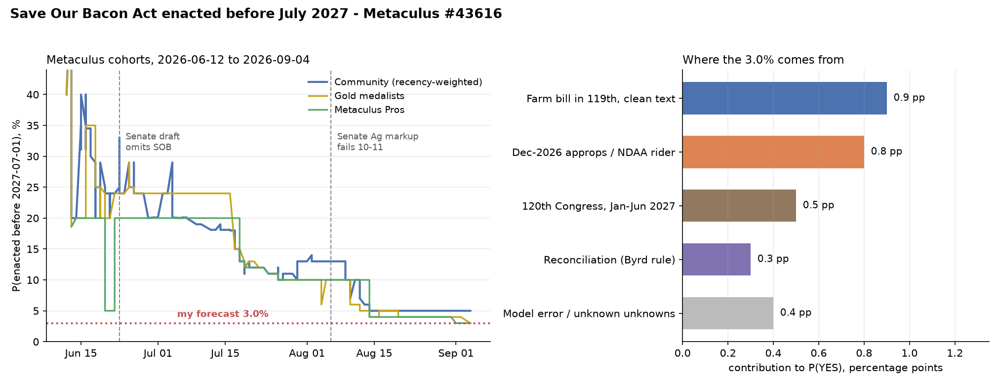

# Will the Save Our Bacon Act be enacted into law before July 2027?

| | |
|---|---|
| **Source** | Metaculus #43616 — https://www.metaculus.com/questions/43616/will-the-save-our-bacon-act-be-enacted-into-law-before-july-2027/ |
| **Type** | binary |
| **Opened / Closes / Resolves** | 2026-06-12 (CP reveal 2026-06-14) / 2027-04-01 / 2027-07-01 |
| **Status** | open |
| **Current forecast** | **Median 3.0%, IQR [2.0%, 4.5%]** (v1, 2026-09-05) |
| **Community (as of 2026-09-04)** | CP 5.0% (n=37 recent, 61 total) · Pro 3.0% (n=6) · Gold 3.0% (n=16) |
| **Next review** | 2026-10-05 |

<!-- Versions below, newest first. APPEND-ONLY: never edit or delete a past version. -->

---

## v1 — Initial forecast — 2026-09-05

### What resolves YES

Federal legislation must be **enacted** — signed, allowed to become law without signature, or
passed over a veto — **before 2027-07-01**, establishing that pork producers may raise and
market in interstate commerce free of state or local *production-process* standards imposed on
pigs raised outside that state's borders. It can be standalone (H.R. 4673 / S. 1326) or a
provision inside a Farm Bill, appropriations act or NDAA. Coverage of other livestock is
allowed; **pork coverage is what the question turns on**. The effective date is irrelevant —
only the enactment date.

Three exclusions do most of the work, and I think they are systematically under-weighted:

1. **Non-legislative routes do not count.** The DOJ's 2026-07-09 suit against California over
   Prop 12's egg provisions, and the livestock executive orders of 2026-08 and 2026-09-04, are
   irrelevant to resolution however they turn out.
2. **A bill that grandfathers existing state laws, applies only prospectively, or contains a
   state opt-out resolves NO.** This is the crux. Every *negotiated* Prop 12 compromise
   that could plausibly attract Democratic votes has one of those three features by
   construction — grandfathering California and Massachusetts is precisely the concession
   that buys the votes. So the modal "Congress finally does something on Prop 12" outcome
   resolves **NO**. YES requires the clean House-passed text surviving intact.
3. The question is about the *policy*, not the bill number: SOB language riding inside
   H.R. 7567 counts, and H.R. 4673 never has to move on its own.

Resolution source is simply the U.S. Statutes at Large / congress.gov; no data-vintage or
revision risk. In this sandbox, `congress.gov` returns HTTP 403 to WebFetch — use the govinfo
BILLSTATUS bulk XML (`https://www.govinfo.gov/bulkdata/BILLSTATUS/119/hr/BILLSTATUS-119hr7567.xml`)
via `curl` instead.

### Outside view

**Dominant reference class: this exact policy's own record.** Federal preemption of state
farm-animal-welfare laws has been attempted at least five times since 2006 and enacted zero
times: the King Amendment passed the House in the 2013/14 Farm Bill and was **stripped in
conference**; a King-style provision was **defeated in the final 2018 negotiations**; PICA
(2019), the EATS Act (2023–24) and now SOB/FSFPA (2025–26). Humane World Action Fund counts
this as the sixth attempt [5]. A Laplace estimate on 0/5 gives ≈ 14% **per multi-year attempt
cycle** — but our window is 10 months of a cycle in which the Senate has already excluded the
language, so that figure must be conditioned down hard, not used raw.

**Sharper sub-class**: House-passed preemption language where the Senate's own bill omits it —
**0 for 2** (2013/14, 2018). In both cases the Farm Bill itself passed; the rider did not.

**Bill-level base rate**: ~2–4% of introduced bills become law. H.R. 4673 sits below that
median — 25 cosponsors, **all 25 Republican**, no committee action in the 13.5 months since
introduction [2]. Bipartisan cosponsorship is the single best predictor of enactment and this
bill has none. S. 1326 is worse: 8 cosponsors, all Republican, untouched for 17 months [4].

**Status-quo prior**: the question asks whether a long-standing status quo changes inside 10
months. Short horizons pull hard toward "no change."

Combining: a starting prior in the **4–7%** range before the 2026-specific evidence, which is
almost entirely negative.

### Inside view

`P(YES) = Σ over near-disjoint enactment paths`, with the window split at 2027-01-03, when the
119th Congress dies and everything unenacted restarts from zero.

| Path | Chain | P |
|---|---|---|
| **1. Farm bill enacted in the 119th carrying clean SOB text** | P(farm bill enacted by 2027-01-03) ≈ **0.22** × P(any Prop 12 provision in the final text) ≈ **0.10** × P(that text is clean — no grandfather, no opt-out, not prospective-only) ≈ **0.42** | **0.9%** |
| **2. Another 119th vehicle**: the December-2026 appropriations package or NDAA | P(a large year-end package passes) ≈ 0.85 × P(clean SOB rides on it) ≈ 0.01 | **0.8%** |
| **3. 120th Congress, Jan–Jun 2027** | P(R holds the House) ≈ 0.2 × P(a vehicle is enacted in a new Congress's first six months *and* carries clean SOB) ≈ 0.02, plus a sliver under divided government | **0.5%** |
| **4. Reconciliation** (51 votes, bypassing the filibuster) | P(an FY2027 reconciliation bill happens) ≈ 0.4 × P(a pure regulatory preemption survives the Byrd rule as more than "merely incidental") ≈ 0.05 × P(included at all) ≈ 0.15 | **0.3%** |
| **5. Model error / unknown unknowns** | — | **+0.4%** |
| **Total** | | **≈ 3.0%** |

Three structural facts set those numbers:

**The 60-vote wall.** The Senate is 53 R / 47 D+I [23]. A Farm Bill needs 60, so Republicans
need at least seven Democratic votes. **Thirty-two senators** are on record objecting to
S. 1326 "in the next Farm Bill **or in any other legislation**" [11]. Chairman Boozman — an
Arkansas Republican who says he personally wants Prop 12 fixed — put it plainly on 2026-06-30:
*"We're going to need a number of Democratic votes in order to get this passed on the floor.
So, because of that, we really haven't identified anybody who will step up and say that they're
for this on the Democratic side"* [9]. That is the chairman conceding the arithmetic. This same
wall applies to the appropriations and NDAA paths, which is why Path 2 is not a meaningful
escape hatch.

**The conjunction in Path 1 is anti-correlated, not independent.** A Farm Bill that actually
clears 60 votes is, by construction, one where the poison pills were traded away. That is
literally what happened in 2014 and again in 2018 — and the 2018 bill passed *in a lame duck,
after Republicans lost the House*, precisely by dropping both parties' riders. So conditioning
on "the Farm Bill passed" should **lower**, not raise, P(SOB survived).

**The vehicle is not moving.** H.R. 7567 passed the House 224–200 on 2026-04-30 and has sat at
"referred to subcommittee" in the Senate since 2026-05-20 [3]. The Senate wrote its own bill,
which omits SOB [5][12], and that bill **failed in committee 10–11 on 2026-08-06** over SNAP
error-rate cost-sharing, not over Prop 12 [7][8]. Boozman himself called passage before the
midterms "a miracle" [8]. With a mid-September retry, then a six-week campaign recess, then a
lame duck sharing floor time with a 2026-12-11 funding deadline [19], P(enacted by 2027-01-03)
≈ 0.22 is if anything generous.

### Evidence

Starting from the outside-view prior of ~5–6%, the 2026-specific evidence is one-directional:

| Finding | Direction | Rough LR | Effect |
|---|---|---|---|
| Senate discussion draft (2026-06-23) omits SOB entirely [5][12] | ↓ | ~0.35 | the single biggest update; the community priced it too |
| Boozman on the record that no Democrat will support it [9] | ↓ | ~0.4 | chairman of the committee, from an ag state, wants the policy, says the votes are absent |
| 32 senators + 182 House Democrats formally on record against, explicitly "in any other legislation" [11][13] | ↓ | ~0.5 | closes the rider path as well as the Farm Bill path |
| 2026-08-06 markup fails 10–11; among >200 amendments filed and 48 voted, **no Prop 12/SOB amendment appears** [7] | ↓ | ~0.6 | SOB's own backers did not force a committee vote — revealed preference about the count |
| S. 1326 untouched for 17 months; H.R. 4673 untouched for 13.5 months, R-only cosponsors [2][4] | ↓ | ~0.6 | no standalone path |
| Luna–Garbarino–Fitzpatrick–Costa amendment to strike SOB had 7+ named Republicans and was **blocked by the Rules Committee** rather than defeated [21] | ↓ | ~0.7 | suggests SOB might not survive a clean House floor vote either |
| Likely Democratic House after 2026-11-03 [20][24] | ↓ | ~0.7 | closes the Jan–Jun 2027 window |
| NPPC + 330-group coalition still pushing; "the fight isn't over… we still have a bit of time in this Congress" [15][16] | ↑ | ~1.3 | genuine, well-funded, motivated lobbying; keeps the tail alive |
| House passed SOB inside the Farm Bill 224–200 [3]; Rules blocked the strike amendment [21] | ↑ | ~1.4 | one chamber has already voted for it — this is why the answer is not <1% |
| Trump administration is aggressively pro-producer on livestock (EOs 2026-08, 2026-09-04; DOJ suit 2026-07-09) | ↑ | ~1.1 | White House would sign; but explicitly cannot resolve the question itself |

**Absence of expected evidence.** If YES were live, I would expect at least one named Senate
Democrat floating a deal, or an SOB amendment actually offered at the August markup, or Senate
floor time scheduled for H.R. 7567. None of the three is present. Absence of evidence you would
expect to see is evidence of absence.

**The compromise trap.** There is a reported (but, note, **unverified** — I could not confirm it
against a primary source) suggestion that Boozman floated a compromise grandfathering states
with existing laws. If that is the shape of any eventual deal, it resolves this question **NO**
while looking like a pork-industry win in the headlines. This is the most likely way a naive
reader gets this question wrong, and it is why I am comfortable slightly below the CP.

### Other forecasters

| Source | Value | As of | Note |
|---|---|---|---|
| Metaculus CP (recency-weighted) | 5.0% (n=37 recent, 61 total) | 2026-09-04 | down from 40% on 2026-06-12 |
| Metaculus Pro | 3.0% (n=6) | 2026-09-04 | tight IQR [3%, 3%] |
| Metaculus gold medalists | 3.0% (n=16) | 2026-09-04 | IQR [3%, 5%] |
| Kalshi | no market | 2026-09-05 | searched; none found |
| Polymarket | no market | 2026-09-05 | searched; none found |
| Manifold | no market found | 2026-09-05 | searched; nothing on SOB or 2026 Farm Bill passage |
| Sentinel Team / Mantic / GJOpen / INFER | not covered | 2026-09-05 | outside their remit |

**Cohort disagreement**: mild but real and directionally informative. Pros (3.0%) and gold
medalists (3.0%) agree with each other and sit **2 pp below** the community (5.0%). Per this
repo's rules I weight Pro and gold above the raw CP; both cohorts also moved *first* at each
step-down (gold cut to 4% on 2026-08-11, three days before the CP). The CP's residual 5% looks
like the usual small-probability stickiness plus a few stale forecasters — one commenter
("mmmeta", 2026-07-19) already flagged the CP as stale and too high for exactly this reason.
I land at 3.0%, i.e. with the Pros and gold, which is inside the 10 pp tolerance and needs no
special justification. There is no liquid market to disagree with.

### Scenarios

| # | Scenario | Weight | Implies |
|---|---|---|---|
| 1 | No Farm Bill in the 119th; a fourth extension rides on the December package; reauthorisation restarts in a likely-divided 120th Congress | **52%** | NO |
| 2 | Farm Bill enacted (lame duck or early 2027) with **no** Prop 12 provision at all — the 2014/2018 pattern repeats | **28%** | NO |
| 3 | Farm Bill enacted with a **negotiated** Prop 12 provision that grandfathers existing laws, applies prospectively, or carries an opt-out | **11%** | **NO** — the trap; looks like YES in headlines |
| 4 | Everything collapses: Senate never reports a bill, no year-end package, pure status quo through 2027-07-01 | **6%** | NO |
| 5 | Clean, retroactive, no-opt-out preemption enacted via any vehicle before 2027-07-01 | **3%** | **YES** |

Weights sum to 100%. Scenario 3 is the reason my number sits below a naive "will Congress do
something about Prop 12" reading.

### Sensitivity

| Assumption | If instead | Forecast becomes |
|---|---|---|
| No Senate Democrat will vote for clean preemption (Boozman, 2026-06-30) | Two or three named Senate Democrats publicly open the door to a clean fix | **12–18%** |
| A Farm Bill reaching 60 votes is one where riders were traded away | Republicans find a 51-vote vehicle (reconciliation) *and* the parliamentarian lets a preemption through the Byrd rule | **8–12%** |
| Any enacted Prop 12 provision is ~58% likely to be a grandfathered/opt-out compromise | Pork-state Republicans hold out for clean text as the price of their Farm Bill votes | **5–6%** |
| P(Farm Bill enacted by 2027-01-03) ≈ 0.22 | Boozman reports a bill in September and the Senate passes it on the floor before the midterms | **7–9%** |

### What would change my mind (tripwires)

- [ ] **Senate Ag Committee reports a Farm Bill by 2026-10-15** (Boozman's mid-September retry
      succeeds) → +2 pp, and re-analyse whether any Prop 12 amendment was offered.
- [ ] **Any Prop 12 / SOB amendment is actually offered at a Senate Ag markup or on the Senate
      floor before 2026-12-11**, whatever the outcome → direction depends on the vote; treat
      as a re-analysis trigger.
- [ ] **A named sitting Senate Democrat publicly supports clean preemption (no grandfather, no
      opt-out) before 2027-03-31** → +8 pp. This is the load-bearing assumption; one defector
      is worth more than any amount of pork-industry lobbying news.
- [ ] **Legislative text of a Prop 12 provision is released containing a grandfather clause, an
      opt-out, or a prospective-only effective date, before 2027-03-31** → −1.5 pp, and the
      question should be treated as near-settled NO even if that bill passes.
- [ ] **A fourth Farm Bill extension is enacted (2026-09-30 or in the December package)
      without a new reauthorisation** → −1 pp; the only realistic vehicle has slipped.
- [ ] **Republicans hold the House on 2026-11-03** → +1 pp (reopens the Jan–Jun 2027 path);
      **Democrats take the House** → −0.5 pp and effectively closes it.
- [ ] **No Farm Bill enacted by 2027-01-03** → drop to ≈ 1%; only exotic vehicles remain.

### Sources

1. Will the Save Our Bacon Act be enacted into law before July 2027? — Metaculus #43616 — https://www.metaculus.com/questions/43616/will-the-save-our-bacon-act-be-enacted-into-law-before-july-2027/ (accessed 2026-09-05; aggregations snapshot in `raw/metaculus-2026-09-05.json`)
2. H.R. 4673, Save Our Bacon Act — bill status XML — https://www.govinfo.gov/bulkdata/BILLSTATUS/119/hr/BILLSTATUS-119hr4673.xml (accessed 2026-09-05)
3. H.R. 7567, Farm, Food, and National Security Act of 2026 — bill status XML — https://www.govinfo.gov/bulkdata/BILLSTATUS/119/hr/BILLSTATUS-119hr7567.xml (accessed 2026-09-05)
4. S. 1326, Food Security and Farm Protection Act — bill status XML — https://www.govinfo.gov/bulkdata/BILLSTATUS/119/s/BILLSTATUS-119s1326.xml (accessed 2026-09-05)
5. Senate Farm Bill excludes Save Our Bacon Act — Humane World Action Fund — https://humaneaction.org/press-release/2026/06/statement-senate-farm-bill-excludes-save-our-bacon-act-reckless-attempt (accessed 2026-09-05)
6. Animal protection triumphs in the Senate: 'Save Our Bacon Act' abandoned as Farm Bill stalls — Humane World Action Fund — https://humaneaction.org/press-release/2026/08/senate-farm-bill-save-our-bacon-act-august-update (accessed 2026-09-05)
7. The Senate Farm Bill Markup: What Happened and What's Next — National Sustainable Agriculture Coalition — https://sustainableagriculture.net/blog/the-senate-farm-bill-markup-what-happened-and-whats-next/ (accessed 2026-09-05)
8. Senate Farm Bill Fails, Ag Committee to Vote Again in September — Farm Policy News, U. of Illinois — https://farmpolicynews.illinois.edu/2026/08/senate-farm-bill-fails-ag-committee-to-vote-again-in-september/ (accessed 2026-09-05)
9. Boozman Explains Why Prop 12 Was Left Out of the Senate Farm Bill — RFD-TV, 2026-06-30 — https://www.rfdtv.com/boozman-explains-why-prop-12-was-left-out-of-the-senate-farm-bill (accessed 2026-09-05)
10. Controversial Farm Bill measure targeting state animal laws heads to Senate showdown — The New Lede — https://www.thenewlede.org/2026/05/farm-bill-save-our-bacon-livestock-cafos/ (accessed 2026-09-05)
11. Sens. Schiff, Padilla, Booker, Markey Lead 28 Senate Colleagues in Effort to Protect California's Proposition 12 — https://www.schiff.senate.gov/news/press-releases/news-sen-schiff-leads-30-senate-colleagues-in-effort-to-protect-californias-proposition-12/ (accessed 2026-09-05)
12. Senate Farm Bill draft leaves out industry-backed provision to undo state animal welfare standards — The New Lede — https://www.thenewlede.org/2026/06/senate-farm-bill-draft-save-our-bacon-act/ (accessed 2026-09-05)
13. Congresswoman Simon, McGovern, Costa lead 182 Democrats protecting California's Prop 12 — https://simon.house.gov/media/press-releases/congresswoman-simon-mcgovern-costa-lead-182-democrats-protecting-californias (accessed 2026-09-05)
14. Pork Producers Disappointed Senate Farm Bill Fails to Pass — National Pork Producers Council — https://nppc.org/news/pork-producers-disappointed-senate-farm-bill-fails-to-pass-ags-needs-including-a-prop-12-fix-still-stand/ (accessed 2026-09-05)
15. NPPC Leads 330 Groups in Asking for Prop. 12 Fix as Senate Farm Bill Discussion Draft is Released — https://nppc.org/news/nppc-leads-330-groups-in-asking-for-prop-12-fix-as-senate-farm-bill-discussion-draft-is-released/ (accessed 2026-09-05)
16. Senate committee rejects Prop 12 farm bill language, NPPC vows to keep fighting — Ag Information Network of the West — https://www.aginfo.net/report/66093/2/Senate-committee-rejects-Prop-12-farm-bill-language-NPPC-vows-to-keep-fighting (accessed 2026-09-05)
17. Farm Bill's Fate Could Turn on Midterm Results — and Lame-Duck Math — Ag Bull Trading — https://www.agbull.com/farm-bills-fate-could-turn-on-midterm-results-and-lame-duck-math/ (accessed 2026-09-05)
18. House ag chair Thompson backs Senate farm bill draft, eyes summer pre-conference — Brownfield Ag News — https://www.brownfieldagnews.com/news/house-ag-chair-thompson-backs-senate-farm-bill-draft-eyes-summer-pre-conference/ (accessed 2026-09-05)
19. Appropriations Watch: FY 2027 — Committee for a Responsible Federal Budget — https://www.crfb.org/blogs/appropriations-watch-fy-2027 (accessed 2026-09-05)
20. 2026 Midterm Election Forecast: Senate & House — Silver Bulletin — https://www.natesilver.net/p/nate-silver-2026-midterm-election-polls-model (accessed 2026-09-05)
21. Farmers Applaud Luna, Garbarino, Fitzpatrick & Costa for Farm Bill Amendment to Strip Pork Policy Rider — National Law Review — https://natlawreview.com/press-releases/farmers-applaud-luna-garbarino-fitzpatrick-costa-farm-bill-amendment-strip (accessed 2026-09-05)
22. Prop 12 Is Under Attack Again, But Some Republicans Aren't On Board — Sentient Media — https://sentientmedia.org/prop-12-is-under-attack-again/ (accessed 2026-09-05)
23. Membership of the 119th Congress: A Profile — CRS R48535 — https://www.congress.gov/crs-product/R48535 (accessed 2026-09-05)
24. 2026 United States elections — Wikipedia — https://en.wikipedia.org/wiki/2026_United_States_elections (accessed 2026-09-05)
25. Save Our Bacon Act Left Out of Senate Farm Bill — Food Tank — https://foodtank.com/news/2026/07/save-our-bacon-act-left-out-of-senate-farm-bill/ (accessed 2026-09-05)
26. Legislative Analysis of H.R. 4673 — Harvard Animal Law & Policy Program — https://animal.law.harvard.edu/wp-content/uploads/Legislative-Analysis-of-HR4673.pdf (accessed 2026-09-05)
27. Expiration of the 2018 Farm Bill and Extension for 2025 — CRS R47659 — https://www.congress.gov/crs-product/R47659 (accessed 2026-09-05)

**Date**: 2026-09-05
**Forecast**: Median 3.0%, IQR [2.0%, 4.5%]
**Thesis**: Clean, retroactive preemption of Prop 12 needs 60 Senate votes it does not have — Chairman Boozman said on 2026-06-30 he cannot find one supportive Democrat [9], 32 senators are formally on record against it in *any* vehicle [11], and the Senate's own Farm Bill omits the language and failed 10–11 in committee on 2026-08-06 over SNAP [5][7]. The identical rider was stripped in conference in 2014 and 2018 [5][26], and the fine print rules out the one compromise shape — grandfathering existing state laws — that could plausibly buy Democratic votes, so even a "Prop 12 fix" headline would most likely resolve NO.
