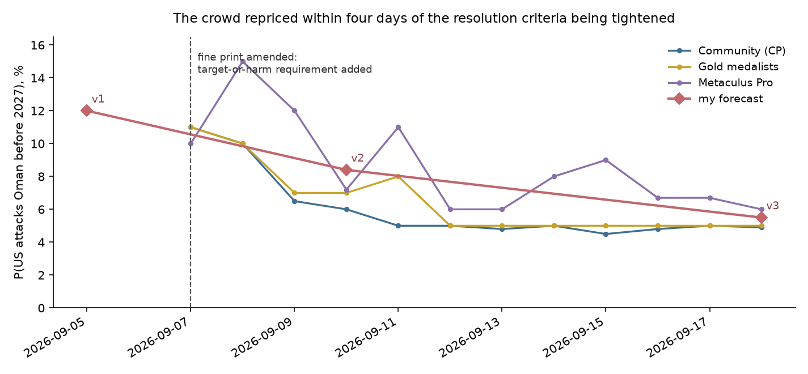
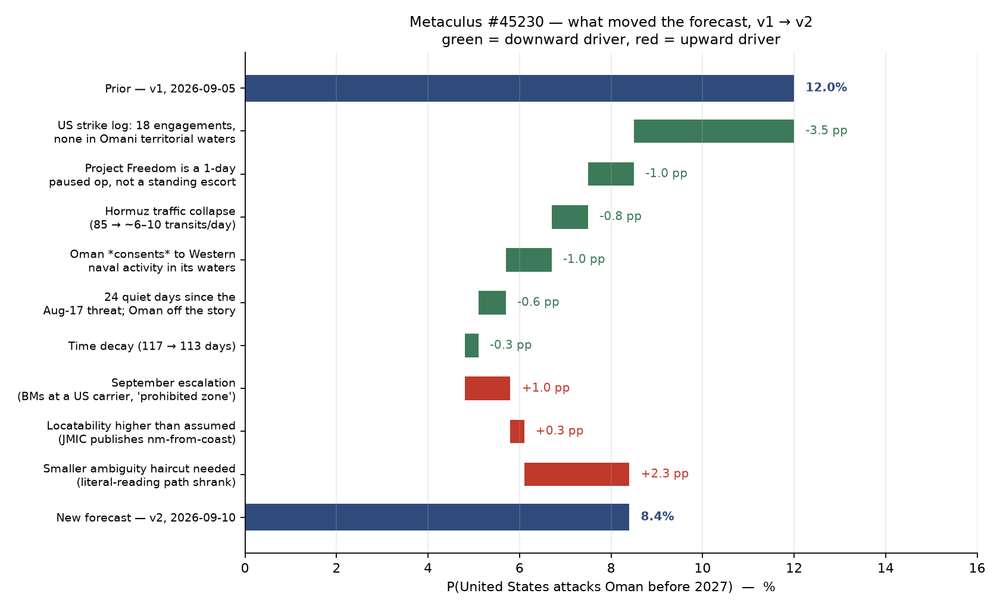

# Will the United States attack Oman before 2027?

| | |
|---|---|
| **Source** | Metaculus #45230 — https://www.metaculus.com/questions/45230/ |
| **Type** | binary |
| **Opened / Closes / Resolves** | 2026-09-07 / 2026-11-01 / 2027-01-01 |
| **Status** | open |
| **Current forecast** | **Median 3.5%, IQR [2.0%, 5.5%]** (v4, 2026-10-16) |
| **Community (as of 2026-10-16 00:24 UTC)** | CP 2.0% IQR[1.0%, 3.4%] (n=148) · Pro 3.0% IQR[3.0%, 5.0%] (n=11) · Gold 3.0% IQR[2.0%, 3.0%] (n=37) · 185 forecasters total |
| **Next review** | 2026-10-30 |

<!-- Versions below, newest first. APPEND-ONLY: never edit or delete a past version. -->

---

## v4 — Update — 2026-10-16

**Mode: Update, not re-analysis.** The criteria and fine print are byte-identical to the 2026-09-18
snapshot; no cohort is more than 1.5 pp from me; 28 days is under a third of the remaining window.
This is the third downward move in a row (v1 12.0% → v2 8.4% → v3 5.5%), which the protocol flags as
possible anchoring drift. I checked: v2→v3 was a structural repricing (fine-print amendment) and this
move is mechanical hazard decay plus quiet time on an event-requiring question. Successive declines
are what a correctly specified forecast of a non-occurring event *should* show, so the drift flag is
noted but not acted on.

### Revision

| Driver | Direction | Effect |
|---|---|---|
| Prior (v3, 2026-09-18) | — | Median 5.5%, IQR [3.5%, 8.5%] |
| **Window shrinks 105 → 77 days** (27% less exposure on every path, at an unchanged hazard rate) | ↓ | **−1.5 pp** |
| **28 more quiet days with the US still shooting in the Gulf of Oman.** CENTCOM destroyed an "Iranian-affiliated" dhow on 6 Oct and disabled the Panama-flagged *Ocean Molica* on 10 Oct, both in the Gulf of Oman; neither harmed anything reported as Omani [2][3]. Iran hit ~29 more merchant ships 18 Sep–13 Oct; none attributed to the US [4]. Every Omani-coast casualty event, e.g. the *On Peace* 9 nm off Limah on 6 Oct, is non-US [5]. 7.5 months of war, zero qualifying events | ↓ | **−0.4 pp** |
| **Diplomatic warming since the August threat**: Rubio–Al Busaidi call 15 Sep, US–Houthi meeting hosted in Muscat ~16 Sep, Oman invited to the 22 Sep Trump–GCC meeting at UNGA, where Trump said the war could end right after the 3 Nov midterms [1][6]. No Trump statement on Oman found since 17 Aug | ↓ | **−0.3 pp** |
| **Cohorts drifted down**: CP 4.0 → 2.0%, Pro 4.0 → 3.0%, gold 5.0 → 3.0% [1]. No new fact behind it that I have not counted above; weighted lightly to avoid herding | ↓ | **−0.2 pp** |
| **Collateral path is live, not hypothetical**: the US is now destroying *dhows* in the Gulf of Oman, a vessel class where Omani registration or crew is common, and the 6 Oct dhow's flag and crew nationality were never disclosed [2]. Partial offset to the decay on the collateral path | ↑ | **+0.4 pp** |
| **New forecast** | | **Median 3.5%, IQR [2.0%, 5.5%]** |

### Tripwire check

| Tripwire from v3 | Fired? | Note |
|---|---|---|
| Omani national killed/injured aboard a US-struck vessel, or Omani-flagged/owned vessel damaged by US ordnance (by 2026-12-31) → +25 pp | **Not fired — nearest miss so far** | 6 Oct dhow destroyed by CENTCOM in the Gulf of Oman after crew removed; no flag or nationality disclosed, no Omani statement; *Ocean Molica* (Panama) disabled 10 Oct, no injuries [2][3] |
| Oman formally protests a US military action (by 2026-12-31) → +20 pp | **Not fired** | No Omani MFA statement against Washington found |
| Oman suspends/restricts Duqm/Salalah access or denies transit/overflight (by 2026-11-30) → +15 pp | **Not fired** | Nothing found |
| Trump repeats the Oman threat with an operational referent (by 2026-12-31) → +8 pp | **Not fired** | No Oman statement since 17 Aug found; tone toward Gulf states is "endgame" diplomacy [6] |
| Question author narrows/widens fine print (by 2026-12-31) → re-analysis | **Not fired** | Criteria and fine print identical to the 2026-09-18 snapshot [1] |
| 2026-10-31 passes with no US munition harming Omani property/forces/nationals → −1.5 pp | **Not due** | 15 days out; largely priced in the hazard-decay row |
| US–Iran ceasefire or Hormuz agreement signed and holding ≥ 30 days (by 2026-12-15) → −2 pp | **Not fired** | No ceasefire in force; strait effectively closed; US blockade enforcement continuing [3][4] |
| CP, Pro and gold all move outside 2%–9% (by 2026-10-16) → re-examine | **Not fired (edge)** | CP exactly 2.0%, Pro 3.0%, gold 3.0%. Pro and gold remain inside |

### What resolves YES

Unchanged from v3. Fine print re-checked against `raw/metaculus-2026-10-16.json`: identical.
`DeRuina` (30 Sep) asked in-thread whether the resolver would wait for an official Omani statement
if a US strike hit a vessel of unconfirmed Omani registration [1]. No answer yet. That is exactly the
6 Oct dhow case, and it is the most likely way this question gets disputed.

### Outside view

Unchanged from v3, with Class C refreshed: 0 events in **7.5** months. Jeffreys λ ≈ 0.5/7.5 =
0.067/mo → P(≥1 in 2.5 mo) ≈ **15%** (was 23%). That is still the structural ceiling before the
discounts (access agreement, mediation role, military asymmetry) that bring it into low single digits.

### Inside view

| Path | v3 (105 d) | v4 (77 d) | Why |
|---|---|---|---|
| Deliberate US strike as coercion | 0.015 | **0.008** | time decay, plus the Rubio call, Muscat-hosted US–Houthi talks and GCC-summit inclusion. Trump's "end after midterms" framing points to settlement, not new targets |
| Collateral harm to Omani property, forces or nationals | 0.032 | **0.022** | time decay (→0.023), small further quiet-time decrement, offset by US strikes on dhows in the Gulf of Oman |
| Oman obstructs → US strike, or Muscat calls a US action an attack | 0.012 | **0.007** | time decay; Oman keeps doing rescue and evacuation, not obstruction [5] |

`P(YES) = 1 − (0.992 × 0.978 × 0.993) ≈ 3.7%`, less an ambiguity haircut of −0.2 pp (an
undisclosed-flag dhow is precisely the kind of case the no-consensus clause or an "ambiguous"
resolution could absorb) → **3.5%**.

### Evidence

- **US kinetic activity near Oman continues at tempo.** The blockade is being enforced in the Gulf
  of Oman itself: dhow destroyed 6 Oct, cargo ship disabled 10 Oct [2][3]. This keeps the
  collateral path from decaying faster than the calendar. But CENTCOM is visibly taking care over
  crews ("crew safely removed", "without harming the crew"), which lowers P(harm | strike).
- **Oman is the rescuer, not the victim, of US fire.** 6 Oct: the Omani MoD evacuated injured crew of
  the *On Peace*, hit 9 nm off Limah by an unclaimed attacker [5]. Same pattern as *El Gaia* in v3.
- **US–Oman channel active.** 8 Oct US Embassy Muscat security alert is about Iranian threats to US
  interests in Oman, i.e. the embassy is open and the threat model treats Oman as host, not target [7].
- **Absent:** an Omani protest, a Trump repetition, any access restriction, and any prediction
  market. The Wikipedia Oman-strikes page's US-reactions log still ends on 2026-08-25 [8].

### Other forecasters

| Source | Value | As of | Note |
|---|---|---|---|
| Metaculus CP (recency-weighted) | **2.0%** IQR[1.0%, 3.4%] (n=148; 185 total) | 2026-10-16 00:24Z | was 4.0% at v3 |
| Metaculus Pro | **3.0%** IQR[3.0%, 5.0%] (n=11) | 2026-10-16 00:24Z | was 4.0% |
| Metaculus gold medalists | **3.0%** IQR[2.0%, 3.0%] (n=37) | 2026-10-16 00:24Z | was 5.0% |
| Polymarket / Kalshi | no market | 2026-10-16 | re-searched |
| Manifold, Sentinel, GJO, INFER | nothing on US–Oman | 2026-10-16 | — |
| Comment-thread individuals | `VectorWright` 7%, `sai_39` ~10%, `Russell-viper` 15%, `sheikah` 0.1% | Sep–Oct | the high tail cites the two Trump threats plus the accidental path |

**Cohorts agree with each other** (1 pp spread) and all moved down 1–2 pp. I sit 0.5 pp above Pro
and gold and 1.5 pp above the CP. The reason is the same as in v3: the Jeffreys discipline, plus
continued US strikes on small craft in the Gulf of Oman. The v3 claim that the Omani-nationals route
was "mentioned in none of the comments" is **no longer true**: `DeRuina` and `VectorWright` both
name the accidental-harm path and the Omani-dhow case [1]. The crowd has seen it and still sits at 2–3%.

### Scenarios

| # | Scenario | Weight | Implies |
|---|---|---|---|
| 1 | Attrition continues to year-end, Oman mediating and rescuing | 0.63 | NO |
| 2 | Post-midterm deal / partial reopening | 0.20 | NO |
| 3 | US engagements near/inside Omani waters harm nothing Omani | 0.127 | NO |
| 4 | Collateral harm to Omani property/forces/nationals, attributed | 0.022 | **YES** |
| 5 | Oman obstructs → US strike, or Muscat calls a US action an attack | 0.007 | **YES** |
| 6 | Deliberate punitive strike | 0.008 | **YES** |
| 7 | Ambiguous / no-consensus incident | 0.006 | not YES |

### Sensitivity

| Assumption | If instead | Forecast becomes |
|---|---|---|
| Collateral 0.022 | US strike tempo in Gulf of Oman doubles | ≈ 5.5% |
| Collateral 0.022 | resolver requires an official Omani statement for disputed-registration vessels | ≈ 3.0% |
| Deliberate 0.008 | Trump re-threatens Oman with a named target | ≈ 11% |
| Jeffreys floor retained | dropped (structural argument only) | ≈ 2.2% |
| Quiet through 2026-11-30 | nothing happens | ≈ 2.0% |

### What would change my mind (tripwires)

- [ ] **An Omani national killed/injured aboard a US-struck vessel, or an Omani-flagged/owned vessel
      (incl. a dhow) damaged by US ordnance**, by 2026-12-31 → **+25 pp**. Watch for any later
      disclosure of the 6 Oct dhow's registration or crew.
- [ ] **Oman formally protests a US military action**, by 2026-12-31 → **+20 pp**.
- [ ] **Oman restricts Duqm/Salalah access or denies US transit/overflight**, by 2026-11-30 → **+15 pp**.
- [ ] **Trump repeats the Oman threat with an operational referent**, by 2026-12-31 → **+8 pp**.
- [ ] **Admins answer `DeRuina`'s disputed-registration question, or amend the fine print**, by
      2026-12-31 → re-analysis.
- [ ] **2026-11-30 passes with no US munition harming anything Omani** → **−1.0 pp**.
- [ ] **US–Iran ceasefire or Hormuz agreement signed and holding ≥ 30 days**, by 2026-12-15 → **−1.5 pp**.
- [ ] **CP, Pro and gold all move outside 1%–7%**, by 2026-11-01 (question close) → re-examine.

### Sources

1. Metaculus #45230 — https://www.metaculus.com/questions/45230/ — CP/Pro/gold, 262 history points and 8 comments, pre-fetched snapshot `raw/metaculus-2026-10-16.json` (accessed 2026-10-16)
2. gCaptain — "U.S. Forces Destroy Iranian-Linked Dhow Accused of Targeting Navy Ships" — https://gcaptain.com/u-s-forces-destroy-iranian-linked-dhow-accused-of-targeting-navy-ships/ (accessed 2026-10-16); corroborated by Jerusalem Post — https://www.jpost.com/middle-east/iran-news/article-911742 (accessed 2026-10-16)
3. Al Jazeera — "US forces disable ship 'attempting to run' Iran blockade in Gulf of Oman" (2026-10-11) — https://www.aljazeera.com/news/2026/10/11/us-forces-disable-ship-attempting-to-run-iran-blockade-in-gulf-of-oman (accessed 2026-10-16)
4. Wikipedia — "2026 Strait of Hormuz crisis", list of ships attacked by Iran, 18 Sep–13 Oct — https://en.wikipedia.org/wiki/2026_Strait_of_Hormuz_crisis (accessed 2026-10-16)
5. Al Jazeera — "Oman evacuates injured crew from attacked tanker in Strait of Hormuz" (2026-10-07) — https://www.aljazeera.com/news/2026/10/7/oman-evacuates-injured-crew-from-attacked-tanker-in-strait-of-hormuz (accessed 2026-10-16)
6. Al Jazeera — "Trump-GCC Summit in New York: What does each side want?" (2026-09-22) — https://www.aljazeera.com/news/2026/9/22/trump-gcc-summit-in-new-york-what-does-each-side-want (accessed 2026-10-16)
7. U.S. Embassy Muscat — Security Alert, 2026-10-08 — https://om.usembassy.gov/security-alert-u-s-embassy-muscat-october-8-2026/ (accessed 2026-10-16)
8. Wikipedia — "2026 Iranian strikes on Oman" — https://en.wikipedia.org/wiki/2026_Iranian_strikes_on_Oman (accessed 2026-10-16)
9. Polymarket / Kalshi — re-searched for a US-attacks-Oman contract; none exists — https://polymarket.com/ (accessed 2026-10-16)
10. CNBC — "Trump threatens Oman, Hormuz Strait traffic slows, Iran ceasefire ends" (2026-08-17), the last Trump threat against Oman, carried forward from v3 — https://www.cnbc.com/2026/08/17/us-iran-war-trump-hormuz.html (accessed 2026-09-18)
11. Wikipedia — "2026 Iran war ceasefire", the June MoU and its lapse, carried forward from v3 for the ceasefire tripwire — https://en.wikipedia.org/wiki/2026_Iran_war_ceasefire (accessed 2026-09-18)

News snapshot cached in `raw/news-2026-10-16.json`.

**Question**: [Will the United States attack Oman before 2027?](https://www.metaculus.com/questions/45230/)
**Date**: 2026-10-16
**Forecast**: Median 3.5%, IQR [2.0%, 5.5%]
**Thesis**: Nothing tripped. With 77 days left, every path decays mechanically: zero qualifying events in 7.5 months of war; Oman acts as rescuer and US diplomatic channel, not target (Rubio call, Muscat-hosted US–Houthi talks, GCC-summit inclusion); no Trump threat since 17 Aug [1][5][6]. I stay 0.5 pp above Pro and gold (3.0%) and 1.5 pp above the CP (2.0%) because the US is still destroying small craft in the Gulf of Oman. The 6 Oct dhow's flag and crew were never disclosed, so the collateral "Omani nationals or vessels" route remains live [2][3].

---

## v3 — Re-analysis — 2026-09-18

**Why re-analysis and not an incremental update.** v2's own highest-priority tripwire said so:
*"The Metaculus fetch succeeds and the CP/Pro/gold numbers land outside 4%–18% → re-analysis, not
a nudge."* The fetch succeeded and the CP is **4.0%**, at the bottom edge of that band, with Pro at
4.0% and gold at 5.0%. Independently, **the resolution criteria changed on 2026-09-07** — the fine
print now carries a target-or-harm requirement that did not exist when v1 and v2 were written. A
changed question structure is itself a re-analysis trigger under `docs/update-protocol.md`. Both
fire, so the number is rebuilt rather than adjusted.

### Revision

| Driver | Direction | Effect |
|---|---|---|
| Prior (v2, 2026-09-10) | — | Median 8.4%, IQR [5.0%, 13.0%] |
| **The fine print was amended on 2026-09-07 and the literal reading is dead.** The question author added: *"To qualify, the attack will need to target or physically harm Omani buildings, infrastructure, vessels, military forces, or nationals. Cyberattacks, warning shots, and strikes that cause no such harm will not count, **regardless of where they land**."* [1] A US strike on an *Iranian* vessel inside Omani territorial waters no longer qualifies. v2's literal branch (P = 0.12, worth 1.9 pp) goes to zero | ↓ | **−2.0 pp** |
| **The cohorts are visible for the first time and sit far below both previous versions**: CP 4.0%, Pro 4.0%, gold 5.0%, n=127 — against n=25 and *unrevealed* at v1, and a total Cloudflare/TLS blackout at v2 [1] | ↓ | **−0.6 pp** |
| **32 more quiet days, 52 since the 17 August threat.** The Wikipedia Oman page's US-reactions log has no entry after 2026-08-25; no Omani protest; no US munition on Omani anything, in what is now ~6.6 months of war [2][3] | ↓ | **−0.3 pp** |
| Elapsed time: window 113 → **105 days** | ↓ | **−0.2 pp** |
| **New path opened by the same fine print: Omani *nationals*.** "Physically harm Omani ... nationals" counts wherever it happens. US strikes have disabled or destroyed ~20 vessels and Gulf tanker crews are multinational; an Omani crew member harmed in a US strike on an Iranian tanker is now a literal YES | ↑ | **+0.2 pp** |
| **New forecast** | | **Median 5.5%, IQR [3.5%, 8.5%]** |

### Tripwire check

| Tripwire from v2 | Fired? | Note |
|---|---|---|
| Metaculus fetch succeeds and CP/Pro/gold land outside 4%–18% → **re-analysis** (by 2026-09-17) | **FIRED** | CP **4.0%**, Pro **4.0%**, gold **5.0%**. This version is the mandated re-analysis. Root cause of the two failed fetches also found: not Cloudflare but the local egress proxy resetting Chromium's TLS 1.3 handshake — `METACULUS_FORCE_TLS12=1` works first time |
| Metaculus admins answer the 2026-09-04 clarification request (by 2026-09-30): literal ruling → +8 pp; intent/consent ruling → −2 pp | **FIRED, intent side, and harder than v2 anticipated** | On 2026-09-07 the author (`skmmcj`) wrote: *"The best approach imo is to resolve as Yes if Omani individuals/infrastructure/vessels/etc were hit or targeted and no otherwise. I added a fine print point"* — and explicitly rejected the consent framing on the grounds that states rarely state consent. `darkives` and `ChaosCondensate` accepted it in-thread [1] |
| UKMTO or JMIC publishes a position inside 12 nm of the Omani coast for a *US* engagement (by 2026-12-31) → +25 pp | **Not fired — and now largely defused** | Under the amended fine print, location alone no longer resolves anything |
| Oman formally protests a US military action (by 2026-12-31) → +20 pp | **Not fired** | No Omani statement against Washington. The 2026-09-13 *El Gaia* attack north of the Musandam peninsula was attributed by the US to an **Iranian** drone; Oman evacuated the crew [2] |
| Oman suspends or restricts the 2019 Duqm/Salalah access agreement (by 2026-11-30) → +15 pp | **Not fired** | Agreement in effect; the US Navy is still clearing mines in Oman's corridor [3] |
| Iran enforces its 6 Sep "prohibited zone" against a US-escorted convoy in the southern Omani lane (by 2026-11-30) → +6 pp | **Not fired** | Iran is enforcing it — 09-09 *Hercules Star* off Dubai (one crew killed), 09-13 *El Gaia* — but against **merchant** traffic, not US escorts [2] |
| Strait transits recover above 40/day (by 2026-11-30) → +4 pp | **Not fired; moved the other way** | Kpler: **no large ships through the strait since early September**; ~10 ships/day at the 5 Sep reading [2] |
| US–Iran ceasefire or Hormuz agreement signed and holding ≥ 30 days (by 2026-12-15) → −4 pp | **Not fired** | Fighting resumed 1 September after the June MoU lapsed on 17 August [2][4] |
| 2026-10-31 passes with no reported US munition impact on Omani territory, waters or forces → −3 pp | **Not due** | 43 days out |
| Trump publicly walks back the Oman threat, or a US–Oman leaders' meeting is announced (by 2026-12-31) → −2 pp | **Not fired** | No walk-back, but also no repetition since 2026-08-17 |

Score: **two fired — the two that mattered — six not fired (all downward-if-absent), one not due.**
Both firings were pre-registered in v2 as the highest-leverage observables in the question, and both
landed on the bearish side.

### What resolves YES

**Materially changed on 2026-09-07 — this is the heart of v3.** Before 2027-01-01, the United
States carries out a military attack against Oman's territory (incl. territorial waters) or
military forces, purposefully or accidentally. The new fine-print sentence supplies the operative
test: the attack must **target or physically harm Omani buildings, infrastructure, vessels,
military forces, or nationals**, and cyberattacks, warning shots and strikes that cause no such
harm do not count **regardless of where they land**.

Three consequences, and each one moves the forecast.

1. **Geography stopped being the criterion.** v1 and v2 both spent most of their length on whether
   a US engagement could be placed inside the 12-nautical-mile Omani belt, and v2 carried a
   12% weight on the reading under which such a placement alone resolves YES. That reading is
   now explicitly excluded: a US missile that destroys an Iranian tanker four miles off the
   Omani coast harms nothing Omani and does not count.
2. **"Omani nationals" is a new, non-geographic route in.** The clause is about *whose* things
   and *whose* people are hit, not where. The US has destroyed or disabled roughly twenty vessels
   in this campaign and Gulf crews are routinely multinational; an Omani seafarer killed or
   injured on an Iranian-operated tanker struck by CENTCOM would satisfy the words as written.
   No comment on the question raises this, and I think the crowd is not pricing it.
3. **The no-consensus escape clause survives and now bites differently.** It still excludes
   incidents where no credible source agrees the attack occurred in Omani territory *and* neither
   government claims it did. But since the test is now harm to identified Omani property or
   people, which Muscat would be the first to announce, the clause catches fewer YES worlds than
   v2 assumed. The ambiguity haircut shrinks accordingly.

The author also explicitly **rejected the consent carve-out** that user `tejvn` proposed and that
v2 leaned on as a secondary argument, on the grounds that states rarely state consent or its
absence for political reasons [1]. v2's conclusion happened to be right; its route to it is not
the one the criteria took.

### Outside view

| Class | n | Window | Rate | Change from v2 |
|---|---|---|---|---|
| **A** — US military attacks on a GCC state, 1971–2026 | 0 | 55 years | ~0 | unchanged |
| **B** — public US-presidential threats to bomb a *non-adversary* converting to a strike within ~6 months | ~6–8 | 2017–2026 | ~5–10% | unchanged; Trump is now **0 for 2** on Oman specifically (28 May, 17 Aug), with the named trigger having fired twice in between |
| **C (ceiling)** — 0 US attacks on Oman in **6.6** months of war. Jeffreys/Poisson λ ≈ 0.5/6.6 = 0.076/mo → P(≥1 in 3.45 mo) | — | Mar–Sep 2026 | **23%** | was 25% |
| **D** — errant US munitions physically harming a partner state during an air campaign | several | 2014–2026 | low, non-zero per campaign-quarter | unchanged |
| **E** — US kinetic engagements credibly located inside Omani territorial waters | 0 / ~20 | Apr–Sep 2026 | ≈0.10/mo | **now largely irrelevant** — the amended fine print retires the branch this class was built to price |

Class C remains the honest ceiling and the reason this forecast does not go to 2%. Zero events in
6.6 months of the most intense US–Iran fighting in history does not license a rate of zero; it
licenses a Jeffreys-style λ that still puts ~23% on at least one event of *any* qualifying kind in
the remaining window, before any structural discount. The structural discounts — Duqm and Salalah
access, the mediation channel, Oman's total military asymmetry, and the fact that the US is
actively *clearing mines in Oman's own corridor* — are what take 23% down to single digits.

### Inside view

The mixture over readings collapses to a single reading. `P(YES)` is now a straight union over
three disjointish paths in a 105-day window.

| Path | v2 | v3 | Why it moved |
|---|---|---|---|
| **Deliberate US strike on Oman as coercion** | 0.025 | **0.015** | Threat-to-execution is 0 for 2 with the named trigger tested twice (Iran–Oman route deal 17 Aug, revenue deal 26 Aug) and nothing following. The stated *rationale* was then removed on 25 Aug when the US Navy cleared the Hormuz mines itself [3]. Oman appears nowhere in September war reporting |
| **US munition targets or physically harms Omani buildings, infrastructure, vessels, forces or nationals — accidentally or as collateral** | 0.045 | **0.032** | Two offsetting moves. Down: the new fine print requires harm to *Omani* things, not merely an impact on Omani territory, and 32 more days passed with none. Up: the "nationals" clause opens the crew-aboard-a-struck-vessel route, worth perhaps 0.008 of the 0.032 |
| **Oman obstructs → US strikes Omani assets, or Muscat calls a US action an attack** | 0.020 | **0.012** | Oman keeps doing the opposite: it evacuated the *El Gaia* crew on 13 September after an attack the US itself attributed to an Iranian drone [2] |

`P(YES) = 1 − (0.985 × 0.968 × 0.988) = **0.058**`

**Ambiguity haircut −0.3 pp** (was −1.2). Most of v2's haircut was charged against the literal
path, which no longer exists; and the remainder shrinks because harm to identified Omani property
or persons is far more observable than a disputed 12-nm position, so fewer YES worlds route to the
no-credible-consensus exclusion.

→ **5.5%**.

### Evidence

**The decisive new fact is procedural, not military.** On 2026-09-07 — the day the question opened
to the public and one day before CP reveal — the author closed the ambiguity that v1 called "worth
more to this forecast than any plausible news event," and closed it against the reading that
carried v1's 6.0 pp and v2's 1.9 pp. v1 was right about the ambiguity's importance and wrong about
which way it would break; v2 halved the exposure for good structural reasons and still carried
some. The crowd repriced inside four days: CP 11% (09-07) → 10% (09-08, reveal) → 6.5% (09-09) →
5% (09-11), and has sat at 4.5–5.0% since. My v2, written on 09-10 while blind to all of this,
was reasoning against a resolution rule that had already been superseded. **LR on the combined
literal+geographic thesis ≈ 0.1.**

**The war escalated and Oman still is not in it.** Since v2: Iran declared a "prohibited zone"
from the US blockade line through the strait (05-09); the *Hercules Star* was hit off Dubai killing
one crew member (09-09); the *El Gaia* was hit north of the Musandam peninsula (09-13), with the
IRGC claiming a mine and the US saying an Iranian drone, two crew missing and the rest evacuated
**by Oman**; Kpler reports no large ships through the strait since early September, against an
85/day pre-crisis baseline [2]. Every one of those is Iranian ordnance or Iranian mines. The
asymmetry v2 identified — the Omani belt is a place Iran shoots into and the US shoots around —
held through another 32 days and another round of escalation. The collapse in traffic also keeps
the escort-exposure mechanism dead: there is nothing in the corridor to escort.

**What the crowd argues, and where I part from it.** The 127 forecasters converge on structural
grounds, and the arguments are good ones: Duqm's value as the only deep-water port outside the
strait where US carriers and submarines can dock (`SharpNimbus`); the mediation channel Washington
cannot replace (`Koboh`, `Bas_`, `sheikah`); Oman's total military asymmetry making a deliberate
war pointless (`Bas_`); and `Theomachado`'s specific point that Trump is 0-for-2 on Oman threats
*with the named trigger tested in between*, plus the claim — which I have **not independently
verified and therefore do not lean on** — that Oman's 5-year CDS sits around 77 bp, below its own
March war-start level [1]. I accept all of it. I sit 1.5 pp above the CP and 0.5 pp above the gold
cohort for two reasons only: the Jeffreys/Poisson discipline of Class C, which says 0 events in 6.6
months does not license 2%; and the Omani-nationals clause, which is new, literal, and unmentioned
in any of the twelve comments.

**What I looked for and did not find**, third session running: no Omani protest against Washington,
no suspension of the 2019 access agreement, no US munition reported on Omani territory or property
at any point in 6.6 months of war, no prediction market anywhere on a US attack on Oman, and
nothing from Sentinel Team, Good Judgment Open or INFER.

### Other forecasters

| Source | Value | As of | Note |
|---|---|---|---|
| Metaculus CP (recency-weighted) | **4.0%** IQR[2.0%, 6.0%] (n=127) | 2026-09-18 17:09Z | first visible reading. 11% on 09-07 → 5% by 09-11 → flat |
| Metaculus Pro | **4.0%** IQR[3.5%, 6.7%] (n=11) | 2026-09-18 17:09Z | small cohort, noisy (0.15 → 0.06 over eleven days); widest upper tail of the three |
| Metaculus gold medalists | **5.0%** IQR[3.5%, 6.0%] (n=36) | 2026-09-18 17:09Z | flat at 5.0% since 09-12. The cohort I weight most, and the one closest to me |
| Polymarket / Kalshi — US attack on Oman | **no such market** | 2026-09-18 | re-searched; still nothing, against heavy Iran-war volume |
| Manifold | none found | 2026-09-18 | — |
| Sentinel Team, Good Judgment Open, INFER | nothing on US–Oman | 2026-09-18 | searched |

**Cohort agreement, assessable at last.** CP 4.0%, Pro 4.0%, gold 5.0% — a 1 pp spread across 127
forecasters, and my two previous versions both sat outside all three IQRs. That is the
configuration this repo treats as an instruction to find the missed fact before defending the
number. The missed fact was the 2026-09-07 fine-print amendment, and having found it I have moved
to the edge of their band rather than into the middle of it, for the two stated reasons.

### Scenarios

| # | Scenario | Weight | Implies |
|---|---|---|---|
| 1 | **Attrition continues.** US–Iran exchange fire around the strait and on Iranian soil; Oman keeps mediating, keeps absorbing Iranian ordnance, keeps hosting US access | 0.66 | NO |
| 2 | **Interim deal / partial reopening.** A US–Iran–Oman arrangement lands and traffic resumes; US escorts return but shooting subsides | 0.13 | NO |
| 3 | **US engagements occur near or inside Omani waters but harm nothing Omani** — explicitly excluded by the 2026-09-07 fine print | 0.145 | NO |
| 4 | **Collateral harm.** A US munition damages Omani property or injures Omani forces or nationals, and it is attributed | 0.032 | **YES** |
| 5 | **Oman obstructs → the US strikes Omani assets**, or Muscat formally calls a US action an attack | 0.012 | **YES** |
| 6 | **Trump follows through** — deliberate punitive strike on Oman | 0.015 | **YES** |
| 7 | **Ambiguous.** A contested incident the no-consensus clause excludes | 0.006 | not YES |

YES = 0.032 + 0.012 + 0.015 ≈ **5.8%** gross; **5.5%** after the ambiguity haircut.

### Sensitivity

| Assumption | If instead | Forecast becomes |
|---|---|---|
| Collateral path 0.032 | US strike tempo doubles for the rest of the year | **≈ 8.5%** |
| Collateral path 0.032 | the Omani-nationals sub-path is worth ~0 (crew nationality never reported, or admins read "nationals" narrowly) | **≈ 4.8%** |
| Deliberate path 0.015 | Oman signs a formal corridor-enforcement understanding with Iran that excludes US escorts | **≈ 14%** |
| Class C Jeffreys discipline retained | dropped in favour of the structural argument alone, as the CP appears to do | **≈ 3.5%** |
| All quiet through October | 2026-10-31 passes with nothing | **≈ 3.5%** |
| Fine print as amended | admins reinterpret "targets" to include any US munition detonating inside Omani waters | **≈ 12%** |

### What would change my mind (tripwires)

- [ ] **An Omani national is reported killed or injured aboard a vessel struck by US forces**, or an
      Omani-flagged or Omani-owned vessel is damaged by US ordnance — by 2026-12-31 → **+25 pp**.
      *This is the modal YES path under the amended criteria and the one the crowd is not discussing.*
- [ ] **Oman formally protests a US military action** (foreign-ministry statement or ambassador
      summoned) — by 2026-12-31 → **+20 pp**.
- [ ] **Oman suspends or restricts the 2019 Duqm/Salalah access agreement, or denies US transit or
      overflight** — by 2026-11-30 → **+15 pp**.
- [ ] **Trump repeats the Oman threat with an operational referent** (a named target, a deadline, a
      force movement) rather than an aside — by 2026-12-31 → **+8 pp**.
- [ ] **The question author narrows or widens the fine print again** — by 2026-12-31 → re-analysis.
      The 2026-09-07 amendment moved this forecast by more than any military event of the whole war;
      the criteria thread is the highest-value page to watch, not the news.
- [ ] **2026-10-31 passes with no US munition harming Omani property, forces or nationals**
      → **−1.5 pp** (mechanical hazard decay; smaller than v2's −3 pp because the base is smaller).
- [ ] **A US–Iran ceasefire or Hormuz agreement is signed and holds ≥ 30 days** — by 2026-12-15
      → **−2 pp**.
- [ ] **CP, Pro and gold all move outside 2%–9%** — by 2026-10-16 → re-examine, though after v3 a
      move *down* inside that band is not by itself a reason to follow.

### Sources

Sources from v1 and v2 remain as cited there; the ones still load-bearing for v3 are repeated
below with their original access dates so this version stands on its own.

1. Metaculus #45230 — https://www.metaculus.com/questions/45230/ — all three cohorts, 268 history points and 12 comments via the `metaculus-aggregations` skill with `METACULUS_FORCE_TLS12=1`; snapshot in `raw/metaculus-2026-09-18.json`. Carries the **amended fine print** and the 2026-09-07 author comment establishing it, plus the `Theomachado` / `SharpNimbus` / `Bas_` / `Koboh` / `sheikah` structural arguments and the (unverified) Oman CDS claim (accessed 2026-09-18)
2. Wikipedia — "2026 Strait of Hormuz crisis", September timeline: the 05-09 US/Iran standoff and "prohibited zone"; Kpler on 27 missile strikes and no large ships since early September; 09-09 *Hercules Star*; 09-13 *El Gaia* north of Musandam — https://en.wikipedia.org/wiki/2026_Strait_of_Hormuz_crisis (accessed 2026-09-18 via the MediaWiki `action=query&prop=extracts` API)
3. Wikipedia — "2026 Iranian strikes on Oman", including the full US-reactions log, whose **last entry is 2026-08-25** (US Navy mine clearance in Oman's corridor) — https://en.wikipedia.org/wiki/2026_Iranian_strikes_on_Oman (accessed 2026-09-18, same API)
4. Wikipedia — "2026 Iran war ceasefire" — the April ceasefire, the June MoU and its 2026-08-17 lapse — https://en.wikipedia.org/wiki/2026_Iran_war_ceasefire (accessed 2026-09-18)
5. CNBC — "Trump threatens Oman, Hormuz Strait traffic slows, Iran ceasefire ends" (2026-08-17) — https://www.cnbc.com/2026/08/17/us-iran-war-trump-hormuz.html (accessed 2026-09-18)
6. Al Jazeera — "Iran, Oman, US 'close' to Hormuz deal: What do they all want?" (2026-08-05) — https://www.aljazeera.com/news/2026/8/5/iran-oman-us-close-to-hormuz-deal-what-do-they-all-want (accessed 2026-09-18)
7. Al Jazeera — "Iran war updates: Tehran, Oman agree on route coordinates in Hormuz Strait" (2026-08-05) — https://www.aljazeera.com/news/liveblog/2026/8/5/iran-war-live-tehran-oman-talks-on-hormuz-positive-ship-hit-in-red-sea (accessed 2026-09-18)
8. Congressional Research Service, R45281 — "The Strait of Hormuz: Security Developments and Impacts on Oil, Gas, and Other Commodities" — https://www.congress.gov/crs-product/R45281 (accessed 2026-09-18)
9. Al Jazeera — "Iran, Oman agree on temporary Hormuz route: What we know" (2026-08-26), the joint statement asserting sovereignty over territorial waters — https://www.aljazeera.com/news/2026/8/26/iran-oman-agree-on-temporary-hormuz-route-what-we-know (accessed 2026-09-10, carried forward from v2)
10. Critical Threats (AEI/ISW) — "Iran Update, September 7, 2026", which **contains no mention of Oman** — https://www.criticalthreats.org/analysis/iran-update-september-7-2026 (accessed 2026-09-10, carried forward from v2)
11. Wikipedia — "Operation Project Freedom", establishing the 4–5 May one-day duration and the 5 May pause that v2's re-analysis turned on — https://en.wikipedia.org/wiki/Operation_Project_Freedom (accessed 2026-09-10, carried forward from v2)
12. JMIC Advisory Note 004-26 of 2026-05-04, via UKMTO and secondary reporting — https://www.ukmto.org/-/media/ukmto/products/jmic-advisory-note-004-26.pdf (accessed 2026-09-10, carried forward from v2; ukmto.org returns HTTP 403 to this container, so content came from the search index)
13. Polymarket and Kalshi — re-searched 2026-09-18 for any US-attacks-Oman contract; **none exists on either venue** — https://polymarket.com/ (accessed 2026-09-18)

**Date**: 2026-09-18
**Forecast**: Median 5.5%, IQR [3.5%, 8.5%]
**Thesis**: The question's fine print was amended on 2026-09-07, one day before CP reveal and three days before v2 was written blind: an attack now has to **target or physically harm Omani buildings, infrastructure, vessels, forces or nationals**, and strikes causing no such harm do not count *regardless of where they land* [1]. That kills the geographic reading both previous versions were built around — a US missile destroying an Iranian tanker four miles off the Omani coast harms nothing Omani — and the crowd repriced from 11% to 5% within four days of it. What survives is three narrow paths: deliberate coercion (Trump is 0-for-2 on Oman threats with the named trigger tested twice in between, and the stated rationale was removed when the US Navy cleared Oman's own corridor of mines on 25 August [3]), collateral harm, and Omani obstruction — union ≈5.8%, less a small ambiguity haircut. I sit 1.5 pp above the CP and 0.5 pp above the gold cohort for two reasons: zero events in 6.6 months of the most intense US–Iran fighting on record does not license 2% under any Jeffreys-style prior; and the amended clause's reference to Omani **nationals** opens a route — an Omani seafarer harmed aboard a vessel struck by CENTCOM — that is literal, non-geographic, and mentioned in none of the twelve comments.

---

## v2 — Re-analysis — 2026-09-10

**Why re-analysis and not an incremental update.** Only five days elapsed, but v1's load-bearing
mechanism turned out to be materially misdescribed. v1 treated *Operation Project Freedom* as a
standing escort campaign ("destroyers, 100+ aircraft, 15,000 personnel") whose corridor routes US
warships through Omani territorial waters, and put **P(a US kinetic engagement occurs inside Omani
territorial waters in the window) ≈ 0.75** on that basis. Project Freedom was in fact a **one-day
operation, 4–5 May 2026, paused on 5 May** and thereafter run at low tempo [4]. More decisively, the
full log of US ship engagements — which v1 never pulled — places **zero of them inside Omani
territorial waters** across five months [2]. That is a re-derivation of the central quantity, not a
nudge, so the number is rebuilt from scratch below rather than adjusted.

### Revision

| Driver | Direction | Effect |
|---|---|---|
| Prior (v1, 2026-09-05) | — | Median 12.0%, IQR [7.0%, 19.0%] |
| **US strike log**: ≥18 named US ship engagements 19 Apr – 5 Sep, located in the Arabian Sea, Indian Ocean, Persian Gulf, Gulf of Oman, off Malaysia, off India, near Kharg Island and near Jask — **none inside Omani territorial waters** [2] | ↓ | −3.5 pp |
| **Project Freedom is a paused one-day operation**, not a standing escort campaign; Saudi Arabia denied the US its bases and airspace over it; Lloyd's List reports owners never resumed transits [4] | ↓ | −1.0 pp |
| **Hormuz traffic collapse**: PortWatch counted **6 transits on 2026-08-30 against an 85/day pre-crisis baseline**; ~10/day over the following ten days, lowest since May; Kpler says no large ships since early September [10,11,12] | ↓ | −0.8 pp |
| **Oman consents to Western naval activity in its waters**: on 4 Jul the UK and France said Oman had committed to work with them on safe navigation through its territorial waters; on 25 Aug US officials confirmed the US Navy cleared >100 suspected mines from the Traffic Separation Scheme — "Oman's primary maritime corridor" — with underwater drones and contractors [3] | ↓ | −1.0 pp |
| **24 quiet days since the 17 Aug threat**, through the exact trigger Trump named: Iran and Oman announced Hormuz route and revenue deals on 17 and 26 Aug [3,13] and the US response was neither a strike nor a further threat. Oman does not appear **at all** in Critical Threats' 7 Sep Iran Update [8] | ↓ | −0.6 pp |
| **Elapsed time** on an event-requiring question: window 117 → 113 days | ↓ | −0.3 pp |
| **September escalation**: on 5 Sep the IRGC fired ballistic missiles at a US carrier and a destroyer and the US destroyed/disabled three Iranian tankers; on 6 Sep Iran declared a "prohibited zone" running from the US blockade line through the strait; Trump warned Iran "we will have to hit them very hard" [2,7,8,9] | ↑ | +1.0 pp |
| **Locatability is better than v1 assumed**: JMIC/UKMTO publish incident positions as distance from the Omani coast — "4 nautical miles from the coast of Oman" (*Senegal Prosperity*, 30 Aug), "8 nautical miles northeast of Limah", "7.5 nm southeast of Dahit", "5 nm north of Khasab" [3,6]. v1's 0.6 discount for un-locatable incidents was too steep | ↑ | +0.3 pp |
| **Smaller ambiguity haircut needed**: v1 took −3.0 pp, almost all of it against the literal-reading path, which has now shrunk from 6.0 pp to 1.9 pp of the total. Only −1.2 pp of haircut is still warranted | ↑ | +2.3 pp |
| **New forecast** | | **Median 8.4%, IQR [5.0%, 13.0%]** |

### Tripwire check

| Tripwire from v1 | Fired? | Note |
|---|---|---|
| Metaculus admins answer the 2026-09-04 clarification request (by 2026-09-20) — *highest-leverage single event* | **Could not check** | metaculus.com returned HTTP 403 with `cf-mitigated: challenge` to all five attempts of the repo's `metaculus-aggregations` skill, to the `metaculus-scraper` fallback, and to plain HTTPS. Recorded in `raw/metaculus-2026-09-10-FETCH-FAILED.json` |
| US/Omani government, UKMTO or JMIC states a US strike occurred inside Omani territorial waters (by 2026-12-31) | **Not fired** | ≥18 US ship engagements Apr–Sep; every located one sits outside the 12-nm Omani belt [2] |
| Oman formally protests a US military action (by 2026-12-31) | **Not fired** | The opposite: the 26 Aug Iran–Oman joint statement asserts sovereignty over territorial waters and sets up a joint working group [13]; no Omani statement against Washington found |
| Oman suspends or restricts the 2019 Duqm/Salalah access agreement, or denies US transit/overflight (by 2026-11-30) | **Not fired** | Agreement still in effect [3]. The GCC states that *did* restrict US access were **Saudi Arabia and Kuwait** on 7 May, over Project Freedom — not Oman [4] |
| US–Iran ceasefire or Hormuz agreement signed and holding ≥ 30 days (by 2026-12-15) | **Not fired** | The opposite: the June Islamabad MoU lapsed on 17 Aug, and open US–Iran fighting resumed on 1 Sep after ~a month of relative calm [8,9] |
| Project Freedom formally ends or moves its corridor out of Omani waters (by 2026-11-30) | **Partially fired** | Not formally ended — Hegseth said in mid-June it "never stopped" — but it was a one-day operation paused on 5 May, and the corridor it created is now nearly empty (6–10 transits/day vs 85) [4,10,11] |
| 2026-10-31 passes with no US munition impact on Omani territory or forces | **Not due** | 51 days out |
| Metaculus CP on reveal (2026-09-08) lands outside 5%–25% | **Could not check** | Same Cloudflare block. v2 remains unanchored to the community, exactly as v1 was |

Score: **five not fired, one partially fired, one not due, two unverifiable.** Every unfired tripwire
was a *downward-if-absent* signal for the deliberate and obstruction paths, and the one partial firing
is also downward.

### What resolves YES

Unchanged from v1. Before 2027-01-01, the US carries out a military attack against Oman's territory
(**including territorial waters**) or military forces, purposefully or accidentally, with **physical**
effect; cyber operations and warning shots in international waters do not count. Disputed
attribution goes to credible sources or resolves **ambiguous**; an incident with no credible-source
consensus that it happened inside Omani territory, and which neither Washington nor Muscat claims
happened there, does not count at all. Window now **113 days**.

The 2026-09-04 clarification request — does a US strike on an *Iranian* vessel that credible sources
place inside Omani territorial waters count? — remains, as far as I can establish, unanswered, and
I could not check. But two facts found this session cut against the literal reading independently of
what the admins say. On **4 July** the UK and France announced Oman had *committed to work with them*
on safe navigation through its territorial waters, and on **25 August** the US Navy was confirmed to
have cleared more than 100 suspected mines from the Traffic Separation Scheme in that same corridor,
with private contractors detonating them [3]. Both are Western military activity, one of them
explosive, inside Omani territorial waters with Omani consent — and nobody, Muscat included, has
described either as an attack on Oman. That is the consent carve-out being applied in the world
already, before any admin rules on it.

### Outside view

Classes A, B and D unchanged from v1. Class C is recomputed, and a new Class E replaces v1's
inside-view assumption.

| Class | n | Window | Rate |
|---|---|---|---|
| **A** — US military attacks on a GCC state, 1971–2026 | **0** | 55 years | ~0 |
| **B** — public US-presidential threats to bomb a *non-adversary* converting to a strike within ~6 months | ~6–8 | 2017–2026 | ~5–10% |
| **C (ceiling, recomputed)** — 0 US attacks on Oman in **6.4** months of war. Jeffreys/Poisson λ ≈ 0.5/6.4 = 0.078/mo → P(≥1 in 3.7 mo) | — | Feb–Sep 2026 | **25%** (was 27%) |
| **D** — errant US munitions physically affecting a partner state during an air campaign | several | 2014–2026 | low, non-zero per campaign-quarter |
| **E (new, replaces v1's inference)** — **US kinetic engagements credibly located inside Omani territorial waters**: 0 in ~5.0 months of US operations in the strait (from the 11 Apr "clearing"). Jeffreys/Poisson λ ≈ 0.10/mo → P(≥1 in 3.7 mo) ≈ 31%, then ×0.65 for the traffic collapse that removes the escort exposure | **0 / 18+** | Apr–Sep 2026 | **≈ 21%** |

Class E is the correction that does most of the work. v1 put this at 0.75 from the geometry of the
JMIC corridor. The corridor is real — JMIC Advisory Note 004-26 of 4 May 2026 established an
"enhanced security area" **south of the Traffic Separation Scheme, inside Omani territorial waters**,
and advised coordination with Omani authorities on VHF 16 [5] — but the geometry did not produce the
events. The US fights Iran in the Gulf of Oman, the Persian Gulf, the Arabian Sea and on Iranian soil;
it is **Iran**, not the US, that shoots inside the Omani belt.

### Inside view

`P(YES) = P(literal) × P(YES | literal) + P(intent) × P(YES | intent)`, then an ambiguity haircut.

**Reading L — literal** (any US attack physically inside Omani territory/waters counts, whatever the
target, whoever consented).

- P(a US kinetic engagement occurs inside Omani territorial waters in 113 days) ≈ **0.21** (Class E),
  down from v1's 0.75.
- P(credible sources place it inside the 12-nm line) ≈ **0.75**, up from v1's 0.6 — JMIC and UKMTO
  publish nm-from-coast for exactly these incidents [3,6].
- → **P(YES | L) ≈ 0.16** (was 0.50).
- **P(L adopted) ≈ 0.12**, unchanged. I have no new information on the admins' thinking; the 4 July
  and 25 August consent precedents argue against L but they were already implicit in v1's reasoning.

**Reading I — intent** (the attack must be against Oman, or at minimum without Omani consent).

| Path | v1 | v2 | Why |
|---|---|---|---|
| Deliberate US strike on Oman as coercion | 0.035 | **0.025** | The named trigger fired *twice more* — Iran–Oman route deal 17 Aug, revenue deal 26 Aug — and drew nothing. Oman is absent from September war reporting entirely [8] |
| Accidental US munition physically affecting Omani territory or forces, attributed | 0.05 | **0.045** | Barely moved. Elapsed quiet time pushes down; the 5 Sep escalation and Iran's "prohibited zone" over the strait push back up. Class C's 25% ceiling is a standing caution against going lower |
| Oman obstructs → US strikes Omani assets, or Muscat protests a US strike as an attack | 0.03 | **0.020** | Oman is doing the opposite of obstructing: joint mine-clearance corridor with the US, navigation commitments to the UK and France [3] |

→ `P(YES | I) = 1 − (0.975 × 0.955 × 0.980) = **0.088**` (was 0.111)

`P(YES) = 0.12 × 0.16 + 0.88 × 0.088 = 0.019 + 0.077 = **0.096**`

**Ambiguity haircut −1.2 pp** (was −3.0). The haircut is smaller because it was mostly charged against
the literal path, which has shrunk from 6.0 pp to 1.9 pp. What remains: roughly a fifth of
accident-path YES outcomes route to "no credible-source consensus, neither government claims it" and
therefore do not count at all under the fine print (−0.9 pp), plus the residual contested-12-nm case
(−0.3 pp).

→ **8.4%**.

### Evidence

**The single most important finding is a negative one, and it is quantitative.** The Wikipedia
tabulation of ships attacked by the United States, cross-checked against CENTCOM reporting, lists
their locations: *Touska* — northern Arabian Sea; *Deep Sea*, *Sevin* — off Malaysia; *Dorena*,
*Derya* — off India; two more in the Indian Ocean; an unnamed tanker — Persian Gulf, by USS *Rafael
Peralta*; *Sevan* — Arabian Sea; *Lian Star*, *Marivex*, *Jalveer* — Gulf of Oman; *Belma* — Persian
Gulf; and on 5 September *Downy* near Kharg Island, *Stark 1* near Jask, *Kylo* in the Gulf of Oman
[2,9]. Not one is placed inside Omani territorial waters. Against this, the *Iranian* attack log is
full of precise Omani-water positions — 5 nm north of Khasab, 8 nm northeast of Limah, 7.5 nm
southeast of Dahit, 4 nm off the Omani coast [3,6]. The asymmetry is the answer to the question:
the belt is a place Iran shoots into and the US shoots *around*. LR on the literal path ≈ **0.28**.

**"Gulf of Oman" is not Omani territorial waters, and this is where a forecaster loses this question.**
The Gulf of Oman is the sea area between Iran and Oman; the US strikes there sit in international
water or on the Iranian side. Three separate headlines this week — "CENTCOM sinks Iranian oil tanker
in Gulf of Oman" [9] — would read to a careless forecaster as a US attack in Omani waters. It is not.
This is the mirror image of v1's misconception warning (Iranian strikes on Oman read as American
ones), and it cuts the other way.

**Escalation is real but it is pointed at Iran.** On 5 September the IRGC Aerospace Force fired
ballistic missiles at a US carrier and a destroyer enforcing the blockade — they missed — and CENTCOM
disabled two Iranian tankers and destroyed a third in response [8,9]. On 6 September Iran's SNSC
secretary Rezaei announced a "restricted maritime zone" from the US blockade line through the strait
into the Persian Gulf, with non-coordinating vessels to be sanctioned [7,8]. Trump added
"we will have to hit them very hard" over activity at Pickaxe Mountain [7]. Critical Threats' 7
September Iran Update runs to Iranian missile fire on the Saudi Aramco Jizan refinery and Iranian
fuel prices — and **does not mention Oman once** [8]. Higher intensity raises the accident hazard,
which is why I held that path near its v1 value instead of decaying it; it does not create a path to
a deliberate strike on Muscat.

**The escort exposure has largely evaporated.** PortWatch recorded **6 transits through the strait on
2026-08-30 against an 85/day pre-crisis baseline** [10]; ABC reports ~10 commodity ships/day over the
following ten days, the lowest since May; Kpler says no large ships have passed since early September
and counts 27 missile strikes in the strait between 6 July and early September [11,12]. Whatever the
JMIC corridor's geometry, there is almost nothing left in it for a US warship to escort — and the
one recorded case of US destroyers shooting in the strait to protect transits (six or seven Iranian
small boats destroyed, 4 May) is *unlocated* in the reporting and predates the collapse [3].

**Oman's position has hardened in the co-victim direction, not the adversary direction.** The 26
August Iran–Oman joint statement reaffirms safe passage "while emphasizing their sovereignty and
sovereign rights over their territorial waters" and creates a foreign-ministry joint working group
[13]. The temporary route it implements sends **outbound traffic through a southern lane in Omani
waters coordinated with Iran**, inbound through Iranian waters [13]. That is precisely Trump's
grievance — a bilateral arrangement that excludes Washington — and it has now been announced twice
without a US strike. Kpler's read on 18 August is that Iran has partially *lost* control of the
strait because of increased use of the UN-authorised Omani route [3].

**What I looked for and did not find.** No Omani protest against Washington. No suspension of the
2019 Duqm/Salalah access agreement. No US munition reported on Omani soil at any point in 6.4 months
of war, against many Iranian ones. No prediction market anywhere on a US attack on Oman. No Sentinel
Team, Good Judgment Open or INFER question on it. Absence of expected evidence, on every path.

**Speculative, flagged as such.** If the interim US–Iran–Oman agreement lands and the strait reopens,
escort volume through the Omani lane returns to something like normal and the literal-reading
exposure goes *back up* even as shooting goes down. If Iran enforces its new "prohibited zone" over
the southern lane and the US escorts against it, the same thing happens with shooting going up. Both
are genuine upside routes and both are inside the IQR; I put maybe 20% on one of them materialising
before year-end.

### Other forecasters

| Source | Value | As of | Note |
|---|---|---|---|
| Metaculus CP (recency-weighted) | **unavailable** | 2026-09-10 | Cloudflare managed challenge, 403 on every path. Reveal was due 2026-09-08T17:00Z; n=25 at the 2026-09-05 snapshot |
| Metaculus Pro | **unavailable** | 2026-09-10 | same |
| Metaculus gold medalists | **unavailable** | 2026-09-10 | same |
| Polymarket / Kalshi — US attack on Oman | **no such market** | 2026-09-10 | re-searched; still nothing, against >$200M of Iran-war volume including a ~90% "US forces enter Iran by 31 Dec" contract [14] |
| Manifold | none found | 2026-09-10 | — |
| Sentinel Team, Good Judgment Open, INFER | nothing on US–Oman | 2026-09-10 | searched |
| Adjacent: Straits Daily Brief escalation index | "extreme band and rising" | 2026-09-08 | on the *war*, not on Oman [10] |

**Cohort disagreement: still not assessable**, now for a worse reason than in v1 — the numbers exist
and I cannot see them. This is the largest known weakness in v2 and the reason `next_review` is set
one week out rather than two: the first task next session is to re-attempt the fetch. If the CP came
in materially above ~20%, the most likely explanation is that the crowd is pricing the literal reading
higher than my 0.12, and I would want to see the admin thread before defending 8.4%.

### Scenarios

| # | Scenario | Weight | Implies |
|---|---|---|---|
| 1 | **Attrition continues.** US–Iran exchange fire around the strait and on Iranian soil; Oman keeps mediating and keeps absorbing Iranian strikes; no US munition touches Oman or Omani waters | 0.62 | NO |
| 2 | **Interim deal / partial reopening.** The US–Iran–Oman interim arrangement lands; traffic resumes through the Omani lane; US escorts return but shooting subsides | 0.14 | NO |
| 3 | **US engagements inside the Omani belt occur but do not qualify** — either unlocated in reporting, or located but read as consented third-party action | 0.13 | NO |
| 4 | **Accident.** An errant US munition, or a US strike on an Iranian craft, physically hits Omani territory, an Omani vessel or Omani forces, and is attributed | 0.037 | YES |
| 5 | **Literal ruling + a located US strike inside the 12-nm line** | 0.019 | YES |
| 6 | **Oman obstructs → US strikes Omani assets**, or Muscat formally protests a US strike as an attack on Oman | 0.016 | YES |
| 7 | **Trump follows through** — deliberate punitive strike on Oman | 0.023 | YES |
| 8 | **Ambiguous.** A contested incident admins cannot resolve, or that the fine print's no-consensus clause excludes | 0.015 | not YES |

YES = 0.037 + 0.019 + 0.016 + 0.023 = **0.095** ≈ 9.6% gross; **8.4%** after the ambiguity haircut.

### Sensitivity

| Assumption | If instead | Forecast becomes |
|---|---|---|
| P(literal reading) = 0.12, P(YES\|L) = 0.16 | Admins adopt the literal reading outright | **~16%** |
| Class E rate: 0 US engagements in the Omani belt in 5 months | v1's assumption restored — P(engagement inside the belt) = 0.75 | **~13%** |
| Traffic stays collapsed (6–10/day) | Strait reopens and escort volume returns to baseline | **~11%** |
| Accident path 0.045 | US strike tempo doubles from the 5 Sep level for the rest of the year | **~11%** |
| Deliberate path 0.025 | Oman signs a formal defence or corridor-enforcement understanding with Iran that excludes US escorts | **~22%** |
| All quiet through October | 2026-10-31 passes with nothing | **~6%** |

### What would change my mind (tripwires)

- [ ] **The Metaculus fetch succeeds and the CP/Pro/gold numbers land outside 4%–18%** — by 2026-09-17 → re-analysis, not a nudge. *Highest-priority action item, not just a signal.*
- [ ] **Metaculus admins answer the 2026-09-04 clarification request** — by 2026-09-30 → literal ruling: **up 8 pp**; intent/consent ruling: **down 2 pp**. (Leverage is far lower than in v1: under the literal reading the forecast is now ~16%, not ~50%.)
- [ ] **UKMTO or JMIC publishes a position inside 12 nm of the Omani coast for a *US* engagement** — by 2026-12-31 → **up 25 pp**
- [ ] **Oman formally protests a US military action** (foreign-ministry statement or ambassador summoned) — by 2026-12-31 → **up 20 pp**
- [ ] **Oman suspends or restricts the 2019 Duqm/Salalah access agreement, or denies US transit or overflight** — by 2026-11-30 → **up 15 pp**
- [ ] **Iran enforces its 6 Sep "prohibited zone" against a US-escorted convoy in the southern (Omani) lane** — by 2026-11-30 → **up 6 pp** (restores the escort-exposure mechanism v1 assumed)
- [ ] **Strait transits recover above 40/day** (PortWatch) — by 2026-11-30 → **up 4 pp** (more escort exposure inside the Omani lane, even in a calmer war)
- [ ] **A US–Iran ceasefire or Hormuz agreement is signed and holds ≥ 30 days** — by 2026-12-15 → **down 4 pp** (smaller than v1's −7 pp: the accident path, not the deliberate path, now carries most of the probability)
- [ ] **2026-10-31 passes with no reported US munition impact on Omani territory, waters or forces** → **down 3 pp** (mechanical hazard decay)
- [ ] **Trump publicly walks back the Oman threat, or a US–Oman leaders' meeting is announced** — by 2026-12-31 → **down 2 pp**

### Sources

Sources 1–26 from v1 remain as cited there. New or re-accessed this session:

1. Metaculus — question #45230 — https://www.metaculus.com/questions/45230/ (access attempted 2026-09-10, **failed**: HTTP 403, `cf-mitigated: challenge`; failure recorded in `raw/metaculus-2026-09-10-FETCH-FAILED.json`; last good snapshot `raw/metaculus-2026-09-05.json`, accessed 2026-09-05)
2. Wikipedia — "2026 Strait of Hormuz crisis", incl. the "List of ships attacked by the United States" table and the September timeline — https://en.wikipedia.org/wiki/2026_Strait_of_Hormuz_crisis (accessed 2026-09-10 via the MediaWiki `action=parse` API)
3. Wikipedia — "2026 Iranian strikes on Oman", incl. the May–August timeline, the 4 Jul UK/France navigation commitment and the 25 Aug US mine-clearance confirmation — https://en.wikipedia.org/wiki/2026_Iranian_strikes_on_Oman (accessed 2026-09-10, same API)
4. Wikipedia — "Operation Project Freedom" — https://en.wikipedia.org/wiki/Operation_Project_Freedom (accessed 2026-09-10, same API). Establishes the 4–5 May one-day duration, the 5 May pause, the Saudi denial of bases and airspace, Hegseth's mid-June "never stopped", and Lloyd's List on non-resumption of transits
5. JMIC Advisory Note 004-26, 4 May 2026, via UKMTO and secondary reporting — https://www.ukmto.org/-/media/ukmto/products/jmic-advisory-note-004-26.pdf and https://maritimesutra.com/2026/05/05/joint-maritime-information-center-jmic-establishes-an-enhanced-security-area-in-soh/ (accessed 2026-09-10; **ukmto.org returns HTTP 403 to this container** — content from the search index and the secondary source)
6. Update 092 to JMIC Advisory Note, 1 September 2026 — https://www.ukmto.org/-/media/ukmto/products/update-092-jmic-advisory-note-01-september.pdf (accessed 2026-09-10; **403 on direct fetch** — content from the search index: threat level SEVERE; *Senegal Prosperity* attacked 30 Aug "4 nautical miles from the coast of Oman")
7. ABC News live updates — Iran's planned "restricted zone"; Trump on Pickaxe Mountain — https://abcnews.com/International/live-updates/iran-live-updates-tehran-plans-new-restricted-zone/?id=136249116 (accessed 2026-09-10)
8. Critical Threats (AEI/ISW) — "Iran Update, September 7, 2026" — https://www.criticalthreats.org/analysis/iran-update-september-7-2026 (accessed 2026-09-10). **Contains no mention of Oman**
9. Al Jazeera — "US says it hit Iran oil tankers accused of helping 'regional proxies'" (5 Sep 2026) — https://www.aljazeera.com/news/2026/9/5/us-says-it-hit-iran-oil-tankers-helping-finance-regional-proxies ; and Jerusalem Post — "CENTCOM sinks Iranian oil tanker in Gulf of Oman" — https://www.jpost.com/middle-east/iran-news/article-907662 (both accessed 2026-09-10)
10. Straits Daily Brief — "Strait of Hormuz Status: September 8, 2026" — https://straits.live/briefs/2026-09-08 (accessed 2026-09-10). PortWatch: 6 transits on 2026-08-30 vs an 85/day pre-crisis baseline
11. ABC News / shipping data — ~10 commodity ships/day over the ten days to ~7 Sep, lowest since May (accessed 2026-09-10 via search index)
12. Kpler via the Wikipedia September timeline [2] — 27 missile strikes in the strait 6 Jul – early Sep; no large ships since early September
13. Al Jazeera — "Iran, Oman agree on temporary Hormuz route: What we know" (26 Aug 2026) — https://www.aljazeera.com/news/2026/8/26/iran-oman-agree-on-temporary-hormuz-route-what-we-know ; Oman MFA — "Oman and the Islamic Republic of Iran issue a joint statement" — https://www.fm.gov.om/en/48943/ (both accessed 2026-09-10)
14. Polymarket / Kalshi — re-searched 2026-09-10; no US-attacks-Oman market on either venue

**Date**: 2026-09-10
**Forecast**: Median 8.4%, IQR [5.0%, 13.0%]
**Thesis**: v1's central mechanism does not survive contact with the strike log: Operation Project Freedom was a one-day operation paused on 5 May, not a standing escort campaign, and across ≥18 named US ship engagements from 19 April to 5 September **not one is placed inside Omani territorial waters** — the US fights Iran in the Gulf of Oman, the Persian Gulf and on Iranian soil, while it is Iran that shoots inside the Omani 12-nm belt [2,3,4]. Strait traffic has meanwhile collapsed to ~6–10 transits a day against an 85/day baseline, emptying the corridor that was supposed to generate the exposure, and Oman has spent the period *consenting* to Western naval activity in its waters — UK/France navigation commitments on 4 July, US mine-clearance in its corridor on 25 August — which is the consent carve-out already operating in the world [3,10]. Five of eight v1 tripwires are unfired and all of them were downward-if-absent; the offsetting risk is the 5–6 September escalation (Iranian ballistic missiles at a US carrier, Iran's new "prohibited zone" over the strait), which keeps the accident path alive [7,8]. **Caveat that bounds this version:** Metaculus was behind a Cloudflare managed challenge all session, so the CP, Pro and gold cohorts revealed on 8 September are unseen and the admin clarification remains unchecked — v2 is unanchored to the crowd, and re-fetching is the first task next session.

---

## v1 — Initial forecast — 2026-09-05

### What resolves YES

Before 2027-01-01, the United States carries out a military attack against **Oman's territory or
military forces**, **purposefully or accidentally**. Territory **includes territorial waters** —
which, in the Strait of Hormuz, means the entire southern half of the waterway out to 12 nautical
miles from the Musandam peninsula. The attack must **physically affect** Omani territory or forces:
cyber operations, and warning shots in international waters, do not count. Disputed attribution is
referred to credible sources and may resolve **ambiguous**; an incident with no credible-source
consensus that it happened inside Omani territory, and which neither Washington nor Muscat claims
happened there, does not count at all. Window: **117 days**.

**The load-bearing ambiguity is unresolved.** A clarification request filed on 2026-09-04 by user
*ChaosCondensate* — does a US strike on an *Iranian* vessel that credible sources place inside
Omani territorial waters count? — was still unanswered when I forecast. A second user, *tejvn*,
proposed a consent carve-out (attack on Omani territory without Omani consent → YES regardless of
target; with consent → NO). How admins answer is worth more to this forecast than any plausible
news event, because the US Navy has *deliberately routed the shipping it escorts into Omani
territorial waters* (see below). I therefore forecast a mixture over the two readings rather than
pretending the criteria are settled.

### Outside view

| Class | n | Window | Rate |
|---|---|---|---|
| **A** — US military attacks on a GCC state (Oman, Saudi Arabia, UAE, Qatar, Kuwait, Bahrain) | **0** | 1971–2026, 55 years | **~0** |
| **B (primary for the deliberate path)** — explicit public US-presidential threats to bomb a *non-adversary* state converting to an actual strike within ~6 months (Trump on Mexico/cartels, Denmark over Greenland, Nigeria, Oman ×2; historically "fire and fury" on North Korea) | ~6–8 | 2017–2026 | **~5–10%** |
| **C (upper bound)** — hazard rate implied by this war: **0 US attacks on Oman in 6.2 months** of maximum-intensity operations. Jeffreys/Poisson → λ ≈ 0.08/month → P(≥1 in 3.9 months) ≈ **27%** | — | Feb–Sep 2026 | 27% |
| **D** — errant/accidental US munitions physically affecting a partner state's territory during an air campaign | several | 2014–2026 | low, non-zero per campaign-quarter |

Class C is deliberately generous and should be treated as a ceiling: it assumes a homogeneous
hazard, whereas the risk here is concentrated in rhetorical spikes — and **the spike has already
passed without a strike**. Trump named a trigger ("if Oman gets in the way", specifically the
Iran–Oman strait deal); the trigger fired in August 2026; the response was a second threat, not a
bomb. That is direct evidence on the conversion rate of *these* threats, and it points down.

Class A is the dominant prior and it is stark: in 55 years the United States has attacked Iran,
Iraq, Libya, Syria, Yemen, Afghanistan, Somalia, Sudan and Serbia, and has never attacked a Gulf
Cooperation Council state.

### Inside view

The crucial structural fact, which the question's framing obscures: **the US and Oman are not
adversaries in this war — they are co-victims.** From 2026-03-01 Iran struck Duqm, Salalah, Sohar,
Bukha and Mina Al Fahal *and US military infrastructure inside Oman*, killing 14 Omanis and
injuring 35. The 2019 US access agreement covering Duqm and Salalah remains in effect. Oman is the
channel through which Washington talks to Tehran. Trump's grievance is that Oman is brokering a
Hormuz settlement that **excludes** the US and would legitimise Iranian control of a northern
corridor — a diplomatic affront, not a casus belli.

I therefore split on the reading:

**Reading L — literal.** Any US attack physically occurring inside Omani territory or territorial
waters counts, whatever the target and whoever consented.

- P(a US kinetic engagement occurs inside Omani territorial waters within 117 days) ≈ **0.75**.
  Under Operation Project Freedom (launched 2026-05-04, CENTCOM: destroyers, 100+ aircraft, 15,000
  personnel) the US Navy and the Joint Maritime Information Centre **directed all commercial
  traffic out of the traditional lanes and into Omani territorial waters**, an "enhanced security
  area", with warships positioned to respond to Iranian interference. Iran attacked ≥13 commercial
  vessels in August alone. US destroyers engaging those attackers are, geometrically, shooting
  inside Omani waters.
- P(credible sources place a specific incident inside the 12-nm line) ≈ **0.6**. Reporting says
  "off the coast of Oman", "northeast of Khasab", "Gulf of Oman"; explicit territorial-water
  attribution generally requires an Omani protest or a UKMTO/JMIC position report.
- → P(YES | L) ≈ **0.50**.
- **P(L adopted) ≈ 0.12.** The title, background and fine print are framed around US–Oman
  hostilities; "an attack **against** Oman's territory or military forces" reads target-directed;
  the consent carve-out is well-argued and Metaculus admins routinely adopt such proposals; and
  resolving *"Will the US attack Oman?"* YES because a US destroyer downed an Iranian drone over
  Omani water with Muscat's blessing would be a resolution almost everyone would call wrong.

**Reading I — intent.** The attack must be against Oman, or at minimum without Omani consent.

| Path | p |
|---|---|
| Deliberate US strike on Oman as coercion (Trump follows through) | 0.035 |
| Accidental US munition physically affecting Omani territory or forces — errant missile, an Omani patrol boat or fishing vessel hit during a strike on an Iranian craft, off-target ordnance on Musandam — reported and attributed | 0.05 |
| Oman actively obstructs (denies transit, enforces the Iran–Oman corridor against US escorts) and the US strikes Omani assets; **or** Oman publicly protests a specific US strike in its waters as an attack on Oman | 0.03 |

→ P(YES | I) = 1 − (0.965 × 0.95 × 0.97) = **0.111**

`P(YES) = 0.12 × 0.50 + 0.88 × 0.111 = 0.060 + 0.098 = 15.8%`

**−3 pp for the ambiguous sink.** The fine print offers "ambiguous" explicitly, and the incidents
most likely to be genuinely contested — a strike whose 12-nm status is disputed — are exactly the
ones that route to *ambiguous* rather than YES.

→ **12%**.

### Evidence

**Moving up.** Project Freedom is the single most important finding and it is not in the question's
background: the US Navy has *chosen* to conduct its escort mission inside Omani territorial waters.
Combined with an explicit "accidentally counts" clause and a shooting war that produced two US
strikes on ships in the Strait in the week of 1–4 September, this makes a physically-inside-Oman US
engagement close to a base case rather than a tail (LR ≈ 2.5 on the naïve "US doesn't attack
allies" view). Two presidential bombing threats in three months, with the second following the
expiry of a 60-day ultimatum, are a genuine escalation in rhetoric.

**Moving down, and moving me more.** Three things.

First, **six months of the most intense US military operations in the region since 2003 have
produced zero US attacks on Oman**, while producing many Iranian ones. CENTCOM's retaliatory
strikes are documented as hitting Iranian territory (Qeshm Island, Iranian military and
communications sites). Absence of expected evidence: if the US were drifting toward striking Oman,
I would expect at least a boundary incident, an Omani protest against Washington, or a suspension
of the Duqm/Salalah access agreement. None exists (LR ≈ 0.4).

Second, **the named trigger already fired.** Trump's condition was Oman "getting in the way" —
concretely, cutting a bilateral strait deal with Iran. Oman did that in August. The response was a
second verbal threat. Threats that survive their own trigger are cheap talk with high probability.

Third, **the incentives run hard against it.** Attacking Oman would cost the US its Duqm and
Salalah access, its only working channel to Tehran, and GCC cohesion, in exchange for nothing
militarily useful — Oman has no capability the US needs to destroy. Crisis Group's read on
2026-09-01 is that *neither* side wants a return to full-scale war and that the stalemate is
becoming unsustainable for both; oil transit rose to 5–7 mb/d in August. The trend is toward a
deal, not toward opening a second front against a partner.

**A misconception worth naming.** Headlines through 2026 read "Omani port hit by drones", "US
military assets in Oman targeted", "Salalah struck". Every one of those is **Iran** attacking Oman.
A forecaster who anchors on "Oman is being bombed" without checking attribution will be badly high.

### Other forecasters

| Source | Value | As of | Note |
|---|---|---|---|
| Metaculus CP (recency-weighted) | **not revealed** | 2026-09-05 | status `upcoming`; CP reveal 2026-09-08T17:00Z; 25 forecasters already submitted |
| Metaculus Pro | not revealed | 2026-09-05 | same |
| Metaculus gold medalists | not revealed | 2026-09-05 | same |
| Polymarket — *US attack on Oman* | **no such market** | 2026-09-05 | searched |
| Polymarket — US forces enter Iran by 2026-12-31 | ~90% | reported 2026 | ~$115M; confirms an intense, deep, but **Iran-focused** market |
| Polymarket — Hormuz traffic normal by 2026-04-30 / 05-31 | 11% / 33% | earlier 2026 | stale, quoted for context only |
| Polymarket — Iran–Oman Hormuz agreement announced by 2026-08-31 | 37% | late Aug 2026 | after a 47 pp weekly slide; the market did **not** treat an Oman–Iran deal as settled |
| Kalshi — Hormuz closure | $7.3M volume | 2026 | no Oman contract |
| Sentinel Team / GJOpen / INFER | nothing found on US–Oman | 2026-09-05 | searched |

**Cohort disagreement**: not assessable — all three Metaculus cohorts are hidden until 2026-09-08.
There is also **no market anywhere on this specific event**, despite >$200M of Iran-war prediction
volume. That absence is itself weak evidence that traders do not regard a US attack on Oman as a
live, tradeable proposition. My forecast is unanchored, which is why the IQR is wide.

### Scenarios

| # | Scenario | Weight | Implies |
|---|---|---|---|
| 1 | **Stalemate or de-escalation.** US–Iran attrition continues or a deal emerges; Oman keeps mediating and keeps absorbing Iranian strikes; Trump keeps threatening; no US munition touches Oman. | 0.68 | NO |
| 2 | **Incidents occur but do not qualify.** US engagements happen inside or near Omani waters, but reporting stays at "off the coast of Oman", no Omani protest against Washington, and admins adopt the intent reading. | 0.14 | NO |
| 3 | **Literal reading + located incident.** Admins rule that any US attack inside the 12-nm line counts, and a strike is credibly placed there. | 0.06 | YES |
| 4 | **Accident.** An errant US munition, or a US strike on an Iranian craft, physically hits Omani territory, an Omani vessel, or Omani forces; attributed. | 0.04 | YES |
| 5 | **Oman obstructs → US strikes Omani assets**, or Muscat formally protests a US strike as an attack on Oman. | 0.02 | YES |
| 6 | **Ambiguous.** A contested incident that admins cannot resolve. | 0.03 | annulled/ambiguous (not YES) |
| 7 | **Trump follows through** — deliberate punitive strike on Oman. | 0.03 | YES |

YES = 0.06 + 0.04 + 0.02 + 0.03 = **0.15** gross; **0.12** after the ambiguity haircut applied
within scenarios 3–5.

### Sensitivity

| Assumption | If instead | Forecast becomes |
|---|---|---|
| Admins adopt the intent/consent reading (P ≈ 0.88) | Admins adopt the literal "inside 12 nm counts regardless of target" reading | **~50%** |
| Admins adopt the intent reading | Admins explicitly rule that third-party strikes in Omani waters never count | **~9%** |
| Trump's threats are cheap talk (trigger already fired without a strike) | Oman formally blocks US escort transits or signs a defence understanding with Iran | **~30%** |
| The war continues at roughly current intensity | A US–Iran ceasefire holds from October | **~5%** |

### What would change my mind (tripwires)

- [ ] **Metaculus admins answer the 2026-09-04 clarification request** — by 2026-09-20 → literal ruling: up 38 pp; intent/consent ruling: down 3 pp. *Highest-leverage single event.*
- [ ] **US or Omani government, UKMTO or JMIC states that a US strike occurred inside Omani territorial waters** — by 2026-12-31 → up 35 pp
- [ ] **Oman formally protests a US military action** (foreign-ministry statement, ambassador summoned) — by 2026-12-31 → up 20 pp
- [ ] **Oman suspends or restricts the 2019 US access agreement (Duqm/Salalah), or denies US transit/overflight** — by 2026-11-30 → up 15 pp
- [ ] **A US–Iran ceasefire or Hormuz agreement is signed and holds ≥ 30 days** — by 2026-12-15 → down 7 pp
- [ ] **Operation Project Freedom formally ends or moves its escort corridor out of Omani waters** — by 2026-11-30 → down 5 pp
- [ ] **2026-10-31 passes with no reported US munition impact on Omani territory or forces** → down 4 pp (mechanical time decay)
- [ ] **Metaculus CP on reveal (2026-09-08) lands outside 5%–25%** → direction unknown; trigger a re-analysis, not a nudge

### Sources

1. Metaculus — question #45230, resolution criteria, fine print, background and comments — https://www.metaculus.com/questions/45230/ ; snapshot in `raw/metaculus-2026-09-05.json` (accessed 2026-09-05)
2. Wikipedia — "2026 Strait of Hormuz crisis" — https://en.wikipedia.org/wiki/2026_Strait_of_Hormuz_crisis (accessed 2026-09-05)
3. Wikipedia — "2026 Iranian strikes on Oman" — https://en.wikipedia.org/wiki/2026_Iranian_strikes_on_Oman (accessed 2026-09-05)
4. Wikipedia — "Operation Project Freedom" — https://en.wikipedia.org/wiki/Operation_Project_Freedom (accessed 2026-09-05)
5. Wikipedia — "2026 United States naval blockade of Iran" — https://en.wikipedia.org/wiki/2026_United_States_naval_blockade_of_Iran (accessed 2026-09-05)
6. Al Jazeera — "Why has Trump threatened to bomb Oman – for a second time?" (18 Aug 2026) — https://www.aljazeera.com/news/2026/8/18/why-has-trump-threatened-to-bomb-oman-for-a-second-time (accessed 2026-09-05)
7. CNN — "Trump's threats anger Omanis, leave observers puzzled" (18 Aug 2026) — https://www.cnn.com/2026/08/18/middleeast/trumps-threats-anger-omanis-intl (accessed 2026-09-05, via search index)
8. CNN live blog — "Deadline to reach US-Iran deal expires, Trump threatens Oman" (17 Aug 2026) — https://www.cnn.com/2026/08/17/world/live-news/iran-war-trump (accessed 2026-09-05)
9. Washington Post — "Trump threatens to bomb Oman if it 'gets in the way'" (17 Aug 2026) — https://www.washingtonpost.com/world/2026/08/17/trump-threatens-bomb-oman-if-it-gets-way/ (accessed 2026-09-05)
10. CBS News live updates — "Trump threatens to bomb Oman with Iran war stuck in stalemate as 60-day negotiation period ends" — https://www.cbsnews.com/live-updates/us-iran-war-deal-expired-strait-of-hormuz/ (accessed 2026-09-05)
11. Fox News — Trump interview confirming the IRGC backchannel and the Oman remark (17 Aug 2026) — https://www.foxnews.com/world/trump-confirms-irgc-backchannel-calls-irans-white-flag-surrender (cited in the question background; accessed 2026-09-05)
12. CNN — Trump's May 2026 warning to Oman — https://edition.cnn.com/2026/05/27/world/live-news/iran-war-us-news#cmpoc4ge900003b6u9s3zjw35 (cited in the question background; accessed 2026-09-05)
13. USNI News — "U.S., Iran Trade Strikes in Strait of Hormuz as Both Battle on Social Media" (4 Sep 2026) — https://news.usni.org/2026/09/04/u-s-iran-trade-strikes-in-strait-of-hormuz-as-both-battle-on-social-media (accessed 2026-09-05; **direct fetch returned HTTP 403 — content from search index only**)
14. CNN — "The US wants to manage the stalemate in the Strait of Hormuz. Iran wants to break it" (4 Sep 2026) — https://www.cnn.com/2026/09/04/middleeast/us-iran-strait-of-hormuz-stalemate-intl (accessed 2026-09-05; **direct fetch returned HTTP 451 and archive.is is blocked in this sandbox — content from search index only**)
15. International Crisis Group — "Hormuz 1 September 2026" — https://www.crisisgroup.org/content/hormuz-1-september-2026-1 (accessed 2026-09-05)
16. Al Jazeera — "Ships attacked in the Strait of Hormuz: What that means for ongoing talks" (7 Jul 2026) — https://www.aljazeera.com/news/2026/7/7/ships-attacked-in-the-strait-of-hormuz-what-that-means-for-ongoing-talks (accessed 2026-09-05)
17. Al Jazeera — "US Embassy in Riyadh, Omani port hit by drones; US base in Bahrain targeted" (3 Mar 2026) — https://aljazeera.com/news/2026/3/3/us-embassy-in-saudi-capital-riyadh-hit-by-drones-fire-reported-ministry (accessed 2026-09-05)
18. Al Jazeera — "Oman renews push for diplomacy, says 'off-ramps available' in Iran war" (3 Mar 2026) — https://www.aljazeera.com/amp/news/2026/3/3/oman-calls-for-immediate-ceasefire-says-off-ramps (accessed 2026-09-05)
19. Jerusalem Post — "Trump's threats put Oman's balancing act under growing pressure" — https://www.jpost.com/middle-east/article-905795 (accessed 2026-09-05)
20. CNBC — "Ship attack in Hormuz kills crew member while Trump says strait is 'open and operating'" (18 Aug 2026) — https://www.cnbc.com/2026/08/18/iran-war-strait-hormuz-ship-traffic-oil.html (accessed 2026-09-05)
21. CNN — "'Project Freedom': Trump's plan to 'guide' ships through the Strait of Hormuz" (4 May 2026) — https://www.cnn.com/2026/05/04/middleeast/project-freedom-hormuz-guide-ships-intl-hnk-ml (accessed 2026-09-05)
22. The National — "Trump's 'Project Freedom': What we know" (4 May 2026) — https://www.thenationalnews.com/news/mena/2026/05/04/iran-warns-us-against-entering-strait-of-hormuz-amid-plan-to-guide-ships-out/ (accessed 2026-09-05)
23. Army Recognition — "Project Freedom Reveals How US Destroyers Would Protect Hormuz Shipping From Iranian Drones and Missiles" — https://www.armyrecognition.com/news/navy-news/2026/project-freedom-reveals-how-us-destroyers-would-protect-hormuz-shipping-from-iranian-drones-and-missiles (accessed 2026-09-05)
24. Congressional Research Service R45281 — "The Strait of Hormuz: Security Developments and Impacts on Oil, Gas, and Other Commodities" — https://www.congress.gov/crs-product/R45281 (accessed 2026-09-05; used for the territorial-waters geography of the strait)
25. ASPI Strategist — "How to lose friends and alienate allies: Trump's approach to Oman" — https://www.aspistrategist.org.au/how-to-lose-friends-and-alienate-allies-trumps-approach-to-oman/ (cited in the question background; accessed 2026-09-05)
26. Polymarket — Iran event pages and Iran–Oman Hormuz agreement contract — https://polymarket.com/iran (accessed 2026-09-05; no US-attacks-Oman market exists)

**Date**: 2026-09-05
**Forecast**: Median 12.0%, IQR [7.0%, 19.0%]
**Thesis**: The United States has never attacked a GCC state in 55 years, and six months of maximum-intensity war have produced many *Iranian* strikes on Oman — Duqm, Salalah, Sohar, 14 dead, plus US assets inside Oman — and zero American ones, while the trigger Trump named (an Iran–Oman strait deal) already fired in August and drew a second threat rather than a bomb [3,6,9]. The real live path is not Trump's rhetoric but geometry: Operation Project Freedom routes the shipping the US Navy escorts *through Omani territorial waters*, so US engagements physically inside Oman are likely, and the forecast is therefore dominated by an unanswered admin clarification — a literal "inside 12 nm counts" ruling would put this near 50%, an intent/consent ruling near 9% [1,4,21].
