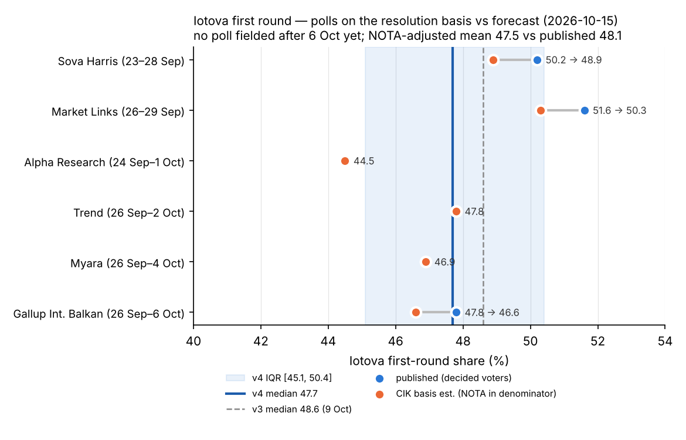
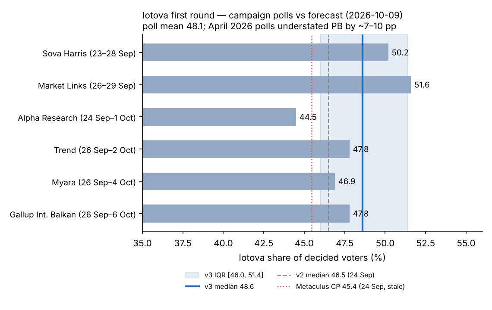
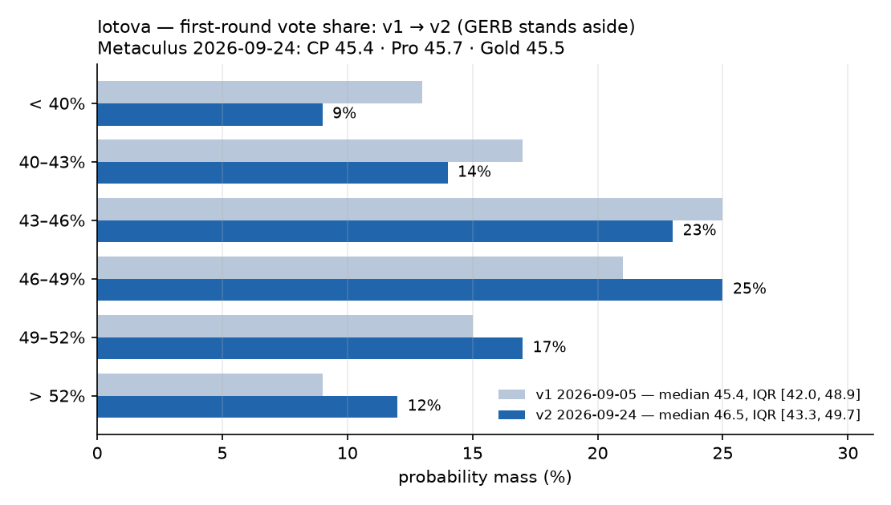
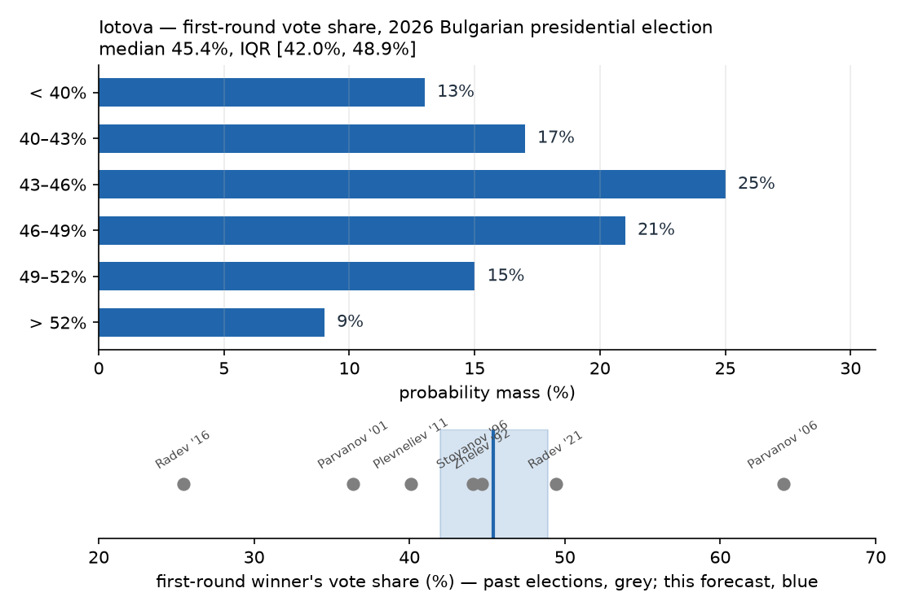

# What first round vote share will Iliana Iotova win in the 2026 Bulgarian Presidential election?

| | |
|---|---|
| **Source** | Metaculus #45262 — https://www.metaculus.com/questions/45262/ |
| **Type** | numeric (%) — Metaculus range 35–55, **open at both bounds** |
| **Opened / Closes / Resolves** | 2026-09-07 / 2026-10-24 / 2026-10-31 (election 2026-10-25) |
| **Status** | open |
| **Current forecast** | **Median 47.7%, IQR [45.1%, 50.4%]** (v4, 2026-10-15) |
| **Community (as of 2026-09-24 — stale; fresh CP unavailable 2026-10-09 and 2026-10-15, Cloudflare block)** | CP 45.4 [42.2, 49.1] (n=110) · Pro 45.7 [42.8, 48.8] (n=10) · Gold 45.5 [42.5, 48.7] (n=32) · API n=140 on 2026-10-15 |
| **Next review** | 2026-10-18 |

<!-- Versions below, newest first. APPEND-ONLY: never edit or delete a past version. -->

---

## v4 — Re-analysis — 2026-10-15

Mode: **Re-analysis**. Six of the 16 days left at v3 have passed, which is more than 1/3, so the
protocol calls for a de-novo pass. No new poll exists, so the anchor is still the six-poll average.
I re-derived it on the **resolution basis** (CIK, all valid votes including "I support no one")
instead of reusing v3's decided-voter mean, then added the news since 9 Oct. The revision table
reconciles the result with the v3 prior.

### Revision
| Driver | Direction | Effect |
|---|---|---|
| Prior (v3, 2026-10-09) | — | Median 48.6%, IQR [46.0%, 51.4%] |
| **No new named-agency poll since v3.** The last fieldwork ended 6 Oct. The Wikipedia table and the Mediapool election section were unchanged on 15 Oct [1,2]. The six campaign polls stay the anchor | → | none |
| **Denominator re-check** (re-derived from the v1/v3 digest). CIK's base includes "I support no one" (NOTA). Trend, Alpha and Myara already carry NOTA in their base (4.6 / 2.9 / 2.3). Gallup, Market Links and Sova Harris report none. Sova's base is "respondents who named a pair", with 13.4% for the other 24 tickets [3,4]. Rescaling those three by ~0.975 (NOTA ≈ 2.5%, the 2021 level) moves the six-poll mean from 48.1 to **~47.5**. v3's −0.3 row bundled NOTA and fragmentation; separated, they come to ~−0.8. The net effect after a smaller shrink toward the outside view (the anchor is already lower) is shown here | ↓ | −0.3 pp |
| **Black Sea drone strikes**, 6 and 13 Oct: four ships hit, two sunk, ~21 crew missing. On 14 Oct the government said Russia was likely behind them [8,9]. Gyurov and PP–DB call the response from Iotova and the government "timid" and demand NATO Article 4 consultations [10,11]. Alpha's Petrova and Dimitrova see the main risk in turnout, plus a possible Iotova–Radev rift that keeps some of her voters home [12,13]. *Speculative*: no poll covers the period after the strikes | ↓ | −0.3 pp |
| **Cabinet trust 39% vs distrust 40%** (Market Links, fieldwork 26–29 Sep, published 2 Oct; 50/24 in May) [14]. Trust is below distrust and has fallen for four months. The fieldwork matches the polls, so only the drift over the remaining ~4 weeks is new | ↓ | −0.1 pp |
| **Polymarket first-round margin market** (15 Oct; $16k traded, $309k resting liquidity): normalised median margin **≈ 21.5 pp**. The polls give ~22.5 and v3 implied ~23. Thin market, weighted ~20% [19] | ↓ | −0.2 pp |
| Polymarket winner market (includes the runoff): Iotova 86.5%, up from 71% on 23 Sep. First-round-winner market 97%; "any outright first-round win" 6% [19]. These price who wins and the 50%-turnout rule, not her share | → | none |
| **DPS**: Peevski said on 7 Oct, "на първи тур никого няма да подкрепим" ("we will back no one in the first round") [5]. The tripwire closes unfired. Alpha finds that DPS voters who do vote lean Iotova [12], which the polls already contain | → | none |
| **GERB**: no call to vote for Gyurov found by 15 Oct. Borissov's stated line is still "Непоискана подкрепа не давам" ("I don't give support nobody asked for") [6] | → | none |
| Iotova declined a debate before the first round (9 Oct), after saying on 13 Sep "Аз никога няма да се откажа" ("I will never back down") [7]. A standard front-runner move with low salience | → | none |
| Metaculus: still no fresh cohort reading (Cloudflare 403). The API shows 140 forecasters (133 on 10-09) and 1,389 forecasts (1,246) [21]. That is activity with no visible direction | → | none |
| Band: six fewer days of campaign variance, offset by a new security shock and the continued absence of final-week polls. The left tail is slightly fatter | band | IQR 5.4 → 5.3 pp |
| **New forecast** | | **Median 47.7%, IQR [45.1%, 50.4%]** |

### Tripwire check
| Tripwire from v3 | Fired? | Note |
|---|---|---|
| Final-week poll average (Trend, Gallup, Alpha, Market Links, Myara, Sova Harris) — by 2026-10-23 | Not yet (pending) | As of 15 Oct, no poll fielded after 6 Oct has been published [1,2]. Releases are expected ~18–23 Oct |
| GERB or Borissov openly calls to vote for Gyurov — by 2026-10-22 | Not fired (as of 10-15) | No call found. Borissov still says support must be requested [6]. Alpha: about half of GERB voters say they will probably stay home, and the rest lean Gyurov [12] |
| DPS endorsement — by 2026-10-22 | **Not fired; closed** | Peevski said on 7 Oct that DPS backs no one in round 1 [5]. The statement predates v3, which missed it |
| Polls of record put expected turnout above 45% — by 2026-10-22 | Not fired | No new turnout reading. Sova Harris's "47.4% intend to vote" is declared intention; its own analyst projects < 2.5m voters (≈ 38% of the 6.6m on the lists) [3]. The other houses give 35.4–40% |
| Fresh Metaculus Pro/gold median below 46.0 — by 2026-10-20 | **Unobservable** | No cohort reading since 24 Sep (Cloudflare 403 on 10-09 and 10-15) [21] |
| Major campaign scandal or debate collapse touching Iotova or the Radev government — by 2026-10-23 | **Partial** | The 6 and 13 Oct Black Sea strikes put the response from the government and Iotova under fire [8–11], and she declined a debate [7]. Neither is a scandal in the tripwire's sense, and the effect on her vote could go either way. Applied −0.3 rather than −1.5 |

### What resolves YES
unchanged from v1. Re-read today against the 2026-10-15 API JSON, where the criteria and fine print
are unchanged [21]: the question resolves to "the percentage vote share received by Iliana Iotova in
the first round … as declared by the Bulgarian Central Election Commission". CIK percentages are
shares of **all valid votes, including "I support no one"**. The question is annulled if no result
is declared by 2026-12-31. **A v4 clarification**: polls quoted "among decided voters" are on that
basis only if NOTA is in their base, so Gallup, Market Links and Sova Harris overstate the
CIK-basis figure by ~1 pp each (see the revision row). The question closes on 24 Oct at 22:59 UTC,
before any exit poll.

### Outside view
unchanged from v1. First-round winners have a median of 44.1. Incumbents seeking a full term average 48.3.
PB took 43.91% of valid votes in April. The poll average remains the dominant anchor; the outside
view sets the tails and a small shrink.

### Inside view (re-derived)

**Anchor: the six campaign polls on the CIK basis.**

| Poll (fieldwork) | Published, decided | NOTA in base? | CIK-basis estimate |
|---|---|---|---|
| Sova Harris for Trud (23–28 Sep) | 50.2 | no (base = named a pair) [3] | 48.9 |
| Market Links/bTV (26–29 Sep) | 51.6 | not reported | 50.3 |
| Alpha Research (24 Sep–1 Oct) | 44.5 | yes, 2.9 [4] | 44.5 |
| Trend/24 Chasa (26 Sep–2 Oct) | 47.8 | yes, 4.6 | 47.8 |
| Myara (26 Sep–4 Oct) | 46.9 | yes, 2.3 | 46.9 |
| Gallup Int. Balkan (26 Sep–6 Oct) | 47.8 | not reported | 46.6 |
| **Mean** | **48.1** | | **47.5** |

If all six bases already contained NOTA, the anchor would be 48.1, and if NOTA is nearer the
polls' own 3.3% average it would be 47.3. I take 47.5.

**Adjustments.**

| Adjustment | Δ |
|---|---|
| April 2026 precedent: polls understated PB by 7–10 pp; credited at ~1/8 (as in v3) | +0.9 |
| Low turnout (35–40%) favours the organised PB vote, mostly already in the polls (as in v3) | +0.3 |
| Fragmentation: 24 minor tickets usually beat their small poll shares (NOTA now handled in the anchor) | −0.2 |
| Black Sea strikes: turnout risk and a security debate on Gyurov's ground (speculative) | −0.3 |
| Cabinet-trust drift after the poll fieldwork | −0.1 |
| Polymarket margin market at ~21.5 pp vs ~22.5 in the polls (weight ~20%) | −0.2 |
| Shrink toward the outside view (44.1–48.3), smaller than v3's −0.4 because the anchor already moved | −0.2 |

→ 47.5 + 0.9 + 0.3 − 0.2 − 0.3 − 0.1 − 0.2 − 0.2 = **47.7**.

Reconciliation with v3 (48.6): anchor −0.6, fragmentation/NOTA row +0.1, smaller shrink +0.2 (these
three net to the −0.3 "denominator" row), and −0.6 of new evidence.

**Distribution:**

| Bin | Mass | Cumulative |
|---|---|---|
| < 40% | 4% | 4 |
| 40–43% | 10% | 14 |
| 43–46% | 20% | 34 |
| **46–49%** | **28%** | 62 |
| 49–52% | 23% | 85 |
| > 52% | 15% | 100 |

→ p5 40.2 · p10 42.3 · **p25 45.1 · median 47.7 · p75 50.4** · p90 52.9 · p95 54.4. About 4% of
the mass lies above the question's 55 bound and ~1% below 35 (both bounds are open).

### Evidence

- **Polls.** No new release. The Wikipedia table still ends with Gallup (fieldwork to 6 Oct) [1].
  Searches for Trend, Gallup, Alpha, Market Links, Myara, Sova Harris, Global Metrics, Mediana and
  Exacta in Bulgarian and English found nothing newer. The **Sova Harris primary write-up** (dir.bg,
  2 Oct, commissioned by *Trud*) is now found. Its base is respondents who named a pair, the 24
  minor tickets total 13.4%, and no NOTA share is given. 47.4% say they will vote, but the analyst
  projects fewer than 2.5m voters [3]. Alpha's primary page confirms a "firmly decided" base, that
  30% of those voters are not fully sure of their choice, and a turnout of ~37% (2.4–2.6m) [4].
- **Black Sea security shock.** On 6 Oct drones hit two ships ~70 nm off Byala, and one sank with
  10 crew. Iotova convened the National Security Consultative Council on 7 Oct, and Peevski praised
  the step [5]. On 13 Oct HS Dignity sank off Krapets with 11 missing, and the Chelsea 3 was
  damaged [8]. The government said on 14 Oct that Russia was "likely" behind it (WaPo headline; the
  page returned 403) [9]. Iotova condemned the attacks and called for de-escalation through
  diplomacy; Sega called it a "vague e-mail" [10]. Gyurov demanded NATO Art. 4 consultations and
  called her reaction "timid" [11]. Alpha's Petrova (9 Oct) said the risk is "не толкоз за кого ще
  гласоподават, а дали въобще ще отидат до урните" ("not so much whom they vote for as whether
  they go to the polls at all") and pointed to possible Iotova–Radev friction [13]. Dimitrova (14 Oct)
  said Iotova "запазва водещите си позиции" ("keeps her leading positions") but that the attacks
  change the situation [12]. **My read (speculative)**: a peace-first electorate limits the damage,
  but the topic favours Gyurov's framing, and a turnout dip among soft PB voters is the likelier
  channel. Hence a small negative, not a large one.
- **Government standing.** Market Links (26–29 Sep) measured cabinet trust at 39% against 40%
  distrust, down from 50/24 in May. Radev personally is at 44/39 [14]. This is below the 40% line
  that v2 used as a tripwire. v3 missed it, but the polls from the same fieldwork already reflect it.
- **Endorsements.** DPS is explicitly neutral in round 1 [5]. GERB has made no call, and Borissov
  repeats that unsolicited support is not given [6]. Club Z's Stoynev, extrapolating from the polls,
  puts GERB voters leaning Gyurov at ~65k versus about half that for Iotova [15]. That is already
  in the polls.
- **Campaign.** PP called on her to withdraw on 5 Oct over the 2022 "Petrich Escobar" pardon [16].
  That fell within the late fieldwork of the Gallup and Myara polls. Nothing new since then.
  Finance as of 12 Oct: Gyurov's committee had €375.6k, including three €100k donors; Iotova's had
  €277.9k, mostly small donations [17]. A Ukrainian outlet's 14 Oct summary repeats 44–47% vs
  24–26% [18].
- **Absent:** a final-week poll, a GERB call, a turnout projection above 45%, and any fresh
  Metaculus cohort.

### Other forecasters
| Source | Value | As of | Note |
|---|---|---|---|
| Metaculus CP (recency-weighted) | 45.4, IQR [42.2, 49.1] (n=110) | **2026-09-24 (stale)** | fresh CP unavailable 2026-10-09 and 2026-10-15 (Cloudflare 403); predates every campaign poll |
| Metaculus Pro | 45.7, IQR [42.8, 48.8] (n=10) | **2026-09-24 (stale)** | same |
| Metaculus gold medalists | 45.5, IQR [42.5, 48.7] (n=32) | **2026-09-24 (stale)** | same |
| Metaculus activity (API) | 140 forecasters, 1,389 forecasts | 2026-10-15 | 133 / 1,246 on 10-09 |
| Campaign poll mean (6), decided basis | 48.1 (44.5–51.6) | fieldwork to 2026-10-06 | as published |
| Same, CIK basis (NOTA-adjusted) | ~47.5 (44.5–50.3) | fieldwork to 2026-10-06 | **primary anchor** |
| Polymarket first-round margin | median ≈ 21.5 pp (20–30: 50%; 10–20: 29%; <10: 9%; 30+: 8%; Gyurov first: 4%) | 2026-10-15 | $16k traded; normalised for a 6.8% overround [19] |
| Polymarket winner (incl. runoff) | Iotova 86.5% / Gyurov 13.5% | 2026-10-15 | $1.18M event volume; 71% on 23 Sep, 81.5% on 29 Sep [19,20] |
| Polymarket first-round winner | Iotova 97% | 2026-10-15 | $15k |
| Polymarket "any outright first-round win" | 6% | 2026-10-15 | gated by the ≥50%-turnout rule |
| Kalshi winner | no quotes | 2026-10-15 | 11 listed markets, no bid/ask [22] |
| Manifold | no market | 2026-10-15 | [22] |

**Cohort disagreement:** not observable today. The only cohort reading (24 Sep) had all three within
0.3 pp, and it predates every poll. I am now **2.0–2.3 pp above that stale cluster**, down from
~3 pp at v3. The one live crowd signal on her share is the thin Polymarket margin market, which
sits ~1 pp narrower than the polls, and it is one of the reasons for this cut. If a fresh reading
shows Pro/gold still at ~45.5 after the polls, look first for a NOTA or house-effect convention I
have not caught.

### Scenarios
| # | Scenario | Weight | Implies |
|---|---|---|---|
| 1 | Polls right on the CIK basis; low turnout; minor tickets slightly beat their polls | 0.45 | 45.5–49.5% |
| 2 | April-style understatement repeats in part; PB machine plus an opposition that stays home | 0.22 | 49.5–54% |
| 3 | Late swing against the government (Black Sea shock, trust erosion); soft Iotova voters stay home | 0.23 | 42.5–45.5% |
| 4 | Alpha's low reading is the right one, plus a larger others/NOTA share | 0.10 | 39.5–43.5% |

### Sensitivity
| Assumption | If instead | Forecast becomes |
|---|---|---|
| Gallup, Market Links and Sova Harris omit NOTA | All six bases already include it | median ~48.1 |
| Poll bias ≈ +1 toward Iotova (April credit) | No bias (2021-style) | median ~46.8 |
| Same | Half of April's miss (+4) | median ~50.6 |
| Black Sea strikes −0.3 | No effect, or a rally to the incumbent | median ~48.0 |
| Final-week polls ≈ 47.5 on the CIK basis | Final-week CIK-basis mean ≤ 45 | median ~45.8 |
| Same | Final-week CIK-basis mean ≥ 50 | median ~49.5 |
| No GERB call | GERB openly mobilises for Gyurov | −1.5 |

### What would change my mind (tripwires)
- [ ] **Final-week poll average** (Trend, Gallup, Alpha, Market Links, Myara, Sova Harris; releases ~18–23 Oct), **converted to the CIK basis** (NOTA in the base) — by 2026-10-23 → move ~70% of the way to that mean
- [ ] **GERB or Borissov openly calls to vote for Gyurov** — by 2026-10-22 → −1.5 pp
- [ ] **A pollster's projected turnout (not declared intention) above 45%** — by 2026-10-22 → −1.0 pp
- [ ] **A further Black Sea strike with casualties in Bulgarian waters or on its territory, or an open Iotova–Radev split over the response** (BTA/Mediapool headline) — by 2026-10-23 → −0.7 pp
- [ ] **New pardon-file revelation or another scandal touching Iotova personally** (BTA/Capital headline) — by 2026-10-23 → −1.0 pp
- [ ] **Polymarket first-round margin median below 18 pp or above 25 pp** — by 2026-10-24 → move ~0.5 pp in the same direction
- [ ] **Fresh Metaculus Pro/gold median below 46.0** — by 2026-10-24 → re-examine for a missed fact (NOTA basis, house effects), not a nudge

### Sources
1. Wikipedia — "2026 Bulgarian presidential election" (opinion-poll table "recalculated … by excluding undecided and non-voters"; no poll after 6 Oct) — https://en.wikipedia.org/wiki/2026_Bulgarian_presidential_election (accessed 2026-10-15)
2. Mediapool — "Президентски избори 2026" section (headlines 25 Sep–13 Oct) — https://www.mediapool.bg/prezidentski-izbori-2026/ (accessed 2026-10-15)
3. dir.bg — "„Сова Харис“: Йотова-Вълчев - 50.2%, Гюров-Кандев - 23.7%, Костадинов-Волгин - 12.7%" (2 Oct 2026; for *Trud*) — https://dnes.dir.bg/na-fokus/sova-haris-jotova-valchev-50-2-gyurov-kandev-23-7-kostadinov-volgin-12-7 (accessed 2026-10-15)
4. Alpha Research — "Предизборни нагласи на старта на кампанията за Президентски избори 2026" — https://alpharesearch.bg/post/1054-predizborni-naglasi-na-starta-na-kampaniata-za-prezidentski-izbori-2026.html (accessed 2026-10-15)
5. 24 Chasa — "Делян Пеевски: ДПС няма да подкрепи никого за президент на първия тур, за втория ще мислим" (7 Oct 2026) — https://www.24chasa.bg/bulgaria/article/23689490 (accessed 2026-10-15)
6. Sega — "Борисов допусна вариант да подкрепи Гюров и Кандев" (10 Sep 2026) — https://www.segabg.com/hot/category-bulgaria/borisov-dopusna-variant-da-podkrepi-gyurov-i-kandev (accessed 2026-10-15)
7. Club Z — "Йотова отказа дебат с Гюров преди първия тур. А обеща: 'Никога няма да се откажа'" (9 Oct 2026) — https://clubz.bg/180357 (accessed 2026-10-15)
8. Al Jazeera — "Drone attack sinks ship off Bulgaria's Black Sea coast, PM says" (13 Oct 2026) — https://www.aljazeera.com/news/2026/10/13/drone-attack-sinks-ship-off-bulgarias-black-sea-coast-pm-says ; Euronews (6 Oct) — https://www.euronews.com/2026/10/06/drones-hit-two-ships-off-coast-of-bulgaria-as-government-calls-emergency-meeting (accessed 2026-10-15)
9. Washington Post — "Bulgaria says Russia was likely behind Black Sea drone strikes as rescue operations continue" (14 Oct 2026; direct fetch HTTP 403, headline via search index) — https://www.washingtonpost.com/business/2026/10/14/bulgaria-russia-ukraine-drone-attacks-radev-yotova/ff75351c-c7c4-11f1-aefb-abe4112d087e_story.html (accessed 2026-10-15)
10. Sega — "С вял имейл Йотова призова за деескалация след новата атака с дронове" (13 Oct 2026) — https://www.segabg.com/hot/category-bulgaria/vyal-imeyl-yotova-prizova-za-deeskalaciya-sled-novata-ataka-dronove (accessed 2026-10-15)
11. Club Z — "Гюров настоява правителството 'незабавно да поиска консултации по чл. 4 от договора за НАТО'" (13 Oct 2026) — https://clubz.bg/180468 (accessed 2026-10-15)
12. Taralej — "Боряна Димитрова пред 'Таралеж': Йотова води, но атаките в Черно море променят ситуацията" (14 Oct 2026) — https://taralej.bg/mnenia/borqna-dimitrova-pred-taralej-yotova-vodi-no-atakite-v-cherno-more-promenqt-situaciqta (accessed 2026-10-15)
13. Novini247 / Studio Actualno — Genoveva Petrova (Alpha Research) on drones and turnout (9 Oct 2026) — https://novini247.com/novini/vmesto-da-mobilizirat-izbiratelite-poslednite-sabitiya-okolo-udarenite-ot-dronove_11282152.html (accessed 2026-10-15)
14. Focus News — "Недоверието към кабинета 'Радев' почти се удвои за 4 месеца" (Market Links/bTV, 2 Oct 2026) — https://www.focus-news.net/novini/Bylgaria/Nedoverieto-kum-kabineta-Radev-pochti-se-udvoi-za-4-meseca-3033756 (accessed 2026-10-15)
15. Club Z — Veselin Stoynev, "Може ли да се стопи разликата между Йотова и Гюров?" (6 Oct 2026, opinion) — https://clubz.bg/180218 (accessed 2026-10-15)
16. Mediapool — "ПП призова Йотова да се оттегли от изборите заради 'Петричкия Ескобар'" (5 Oct 2026) — https://www.mediapool.bg/prezidentski-izbori-2026/pp-prizova-yotova-da-se-ottegli-ot-izborite-zaradi-petrichkiya-eskobar/ (accessed 2026-10-15)
17. BTA — "Media Review: October 13" (campaign finance from Segabg) — https://www.bta.bg/en/news/bulgaria/1223450-media-review-october-13 (accessed 2026-10-15)
18. European Pravda — "How Bulgaria's pro-Russian PM could gain his own president and why it matters" (14 Oct 2026) — https://www.eurointegration.com.ua/eng/news/2026/10/14/7247686/ (accessed 2026-10-15)
19. Polymarket — gamma API, events "bulgaria-presidential-election", "…-first-round-margin-of-victory", "…-first-round-winner", "will-any-presidential-candidate-win-outright-…" — https://gamma-api.polymarket.com/events?slug=bulgaria-presidential-election-first-round-margin-of-victory (accessed 2026-10-15); snapshot `raw/polymarket-2026-10-15.json`
20. The Traders Spread — "Bulgaria Presidential Election: Iotova's 81.5% Prices the Run-Off" (29 Sep 2026; via search index) — https://thetradersspread.com/prediction-markets/bulgaria-presidential-election-iotova-81-5-percent-prices-run-off (accessed 2026-10-15)
21. Metaculus #45262 — official API post JSON (bot key; metadata only, aggregations hidden) — `raw/metaculus-api-2026-10-15.json` (retrieved by the parent session 2026-10-15); last cohort snapshot `raw/metaculus-2026-09-24.json`; https://www.metaculus.com/questions/45262/ (accessed 2026-10-15)
22. Kalshi trade API — https://api.elections.kalshi.com/trade-api/v2/events/KXBULGARIAPRES-26NOV15 ; Manifold — https://api.manifold.markets/v0/search-markets?term=Iotova (accessed 2026-10-15)
23. v3 poll sources (Trend, Market Links, Alpha, Myara, Gallup releases), e.g. Mediapool — "„Тренд“: 47.8% за Йотова и 24.6% за Гюров" — https://www.mediapool.bg/prezidentski-izbori-2026/trend-478-za-yotova-i-246-za-gyurov/ (accessed 2026-10-09)
24. Raw snapshot — `raw/news-2026-10-15.json` (accessed 2026-10-15)

**Question**: [What first round vote share will Iliana Iotova win in the 2026 Bulgarian Presidential election?](https://www.metaculus.com/questions/45262/)
**Date**: 2026-10-15
**Forecast**: Median 47.7%, IQR [45.1%, 50.4%]
**Thesis**: No poll has been fielded since 6 Oct, and on the resolution basis the six-poll anchor is lower than published: CIK counts "I support no one" in the denominator while Gallup, Market Links and Sova Harris leave it out, so the mean is ~47.5 rather than 48.1 [1,3,4]. The 6 and 13 Oct Black Sea drone strikes, cabinet trust at 39/40 and a thin Polymarket margin market at ~21.5 pp each shade her down slightly (−0.6 together) [8–14,19]. The +0.9 credit for April's polling miss stays, which gives 47.7; DPS backs no one in round 1, GERB has made no call, and the Metaculus cohorts are stale (24 Sep: 45.4–45.7).

---

## v3 — Re-analysis — 2026-10-09

Mode: **Re-analysis**. The v2 tripwire for this case said "re-analyse", and it fired six times
over: six named-agency campaign polls were published between 30 Sep and 8 Oct. Also, 15 of the
31 days left at v2 have passed (more than 1/3). The anchor is now the poll average, not the
July party-vote rescaling.

### Revision
| Driver | Direction | Effect |
|---|---|---|
| Prior (v2, 2026-09-24) | — | Median 46.5%, IQR [43.3%, 49.7%] |
| **Six campaign polls** (fieldwork 23 Sep–6 Oct), decided-voter basis: Sova Harris 50.2, Market Links 51.6, Alpha 44.5, Trend 47.8, Myara 46.9, Gallup 47.8. **Mean 48.1, median 47.8**, sd ≈ 2.6 [1–6]. The tripwire rule was to move ~60% toward the poll; I take ~75% because there are six polls, not one | ↑ | +1.2 pp |
| **April 2026 precedent**: final polls had PB at 30–35% and it took 44.6% of ballots; exit polls also undershot by 6–7 pp [7,8]. Credited at ~1/8 because a governing party is now better measured, and the 2021 Radev presidential polls were close to the result | ↑ | +0.9 pp |
| More than 20 minor tickets plus "I support no one" usually beat their small poll shares in fragmented Bulgarian ballots, and the denominator includes NOTA (2.3–4.6% in polls) | ↓ | −0.3 pp |
| Expected turnout 35–40% in every poll (below April's 50.7%) [2,4,5,6]. A low-turnout race favours PB's organised vote; already partly in the polls | ↑ | +0.3 pp |
| No GERB or DPS endorsement; no new approval reading (last 42%) | → | none |
| Metaculus cohorts: **no fresh reading** (Cloudflare block). The 24 Sep CP 45.4 / Pro 45.7 / Gold 45.5 came before any poll, so the polls supersede it as evidence | → | none |
| Polls cut the uncertainty that remained without a named-candidate horse race; poll spread and the April-style miss keep the right tail fat | band | IQR 6.4 → 5.4 pp |
| **New forecast** | | **Median 48.6%, IQR [46.0%, 51.4%]** |

### Tripwire check
| Tripwire from v2 | Fired? | Note |
|---|---|---|
| First named-candidate campaign poll by 2026-10-10 → move ~60% toward it | **Fired** (six polls) | Mean 48.1, decided basis [1–6]. Applied +1.2 and re-analysed (see above) |
| GERB/Borissov informally backs Gyurov by 2026-10-18 | Not fired (as of 10-09) | No call to vote found. Borissov keeps attacking Iotova as an "ideological opponent" [9]. Pollsters put GERB's parliamentary vote at 14.2% (Trend), and its voters are already in the presidential splits |
| DPS endorsement by 2026-10-15 | Not fired (as of 10-09) | No endorsement found. Peevski blames Iotova over the Gyurov caretaker appointment [10], which is criticism, not backing for Gyurov |
| Govt approval < 40% by 2026-10-15 | Not fired | No reading after August found; the last ones were 42% (Gallup, Alpha, Market Links) [11] |
| Expected turnout > 45% by 2026-10-20 | **Not fired** | Polls give 35.4–40% [2,4,5,6] |
| Metaculus Pro/gold outside 43.5–48.5 by 2026-10-20 | **Unknown** | No aggregation was available on 2026-10-09 (Cloudflare block). The API shows 133 forecasters (110 on 24 Sep) [12] |

### What resolves YES
unchanged from v1. Resolves to Iotova's share of **valid votes, including "I support no one"**,
in the 25 Oct first round, as declared by CIK. A v3 caveat: poll shares on the "decided" basis
sometimes leave out NOTA, so they run slightly above the CIK-basis figure. The −0.3 row covers this.

### Outside view
unchanged from v1. First-round winners median 44.1; incumbents seeking a full term mean 48.3.
PB took 43.91% of valid votes in April. The **poll average is now the dominant anchor**. The outside
view is used only to set the width of the tails.

### Inside view (re-derived)

**Anchor: campaign polls.** Six polls of about 1,000 respondents each, all from established
agencies, with fieldwork that overlaps in the first two weeks of the campaign. Iotova's share
ranges from 44.5 (Alpha) to 51.6 (Market Links). Gyurov sits at 23.7–27.5 and Kostadinov at
8–12.7. The ratio of Iotova to Gyurov is stable at about 1.7–2.2. Mean **48.1**.

**Calibrating the polls.** Two Bulgarian precedents point in opposite directions:
- *April 2026 parliamentary*: every final poll undershot PB, by 7–10 pp in pollster-level error
  tables [7,8]. Plausible causes were late momentum for a new party, a "shy" protest vote, and
  undecided voters breaking to Radev. Some of that persists, since the same coalition and machine
  are behind Iotova. But PB is now the governing party with six months of record, which usually
  removes the novelty surge.
- *2021 presidential*: Radev's decided-voter polls ran about 48–52, and he took 49.42%. That is
  roughly unbiased to slightly high for the incumbent.

I treat the expected poll bias as **about +1 pp toward Iotova**, with a wide spread around it
(σ ≈ 3.5–4 pp for the whole poll-to-result error, which is larger than sampling error alone).

**Structural adjustments.** Fragmentation and NOTA −0.3. Low turnout (35–40%) favouring a
disciplined vote +0.3, mostly already in the polls. The campaign has two weeks left. Undecideds
(20.4% raw in Market Links; 12.5% of Gallup voters decide in the last days) have no clear lean.
Alpha's Dimitrova says the race is "not predetermined". Gallup frames it as a duel in which
"nothing is decided".

→ 48.1 + 0.9 − 0.3 + 0.3 − (shrink ~0.4 toward the v2 prior / outside view) ≈ **48.6**.

**Distribution:**

| Bin | Mass | Cumulative |
|---|---|---|
| < 40% | 3% | 3 |
| 40–43% | 7% | 10 |
| 43–46% | 15% | 25 |
| **46–49%** | **28%** | 53 |
| 49–52% | 27% | 80 |
| > 52% | 20% | 100 |

→ p5 40.9 · p10 43.0 · **p25 46.0 · median 48.6 · p75 51.4** · p90 54.0 · p95 55.5.

### Evidence

- **Polls** (all accessed 2026-10-09):
  - Market Links/bTV (26–29 Sep, n=1,006): raw 41.4 / 21.9 / 6.4 with 20.4% undecided, which is
    51.6 on the decided base. Turnout ~40% [3].
  - Alpha Research (24 Sep–1 Oct, n=1,000): 44.5 / 26.1 / 10.5. Turnout 37–38% [4].
  - Trend/24 Chasa (26 Sep–2 Oct, n=1,003): 47.8 / 24.6 / 9.7. 38% will "definitely" vote; "no
    significant change over the past month" [1].
  - Myara (26 Sep–4 Oct, n=1,000): 46.9 / 25.3 / 8.8, NOTA 2.3. Declared turnout 35.4% [5].
  - Gallup International Balkan (26 Sep–6 Oct, n=987): 44.9 / 24.8 / 10.9 among those intending
    to vote, 47.8 on the decided base. Turnout ~36%. 12.5% decide in the final days [6].
  - Sova Harris (23–28 Sep): 50.2 / 23.7 / 12.7 on the decided base. Taken from the Wikipedia
    table only, because I could not find the original release [2].
- **The house spread is real.** Alpha is the lowest, as it was in April, when it was also the
  most wrong about PB. Market Links is the highest. Even if both outliers are dropped, the mean
  of the middle four is 48.2.
- **Absent:** no GERB or DPS endorsement, and no fresh government-approval number. I searched
  BTA, Capital and Bulgarian news in Bulgarian.
- Polymarket's **winner** market (which includes the runoff) had Iotova at 71% on 23 Sep (PredScope,
  about $561k traded in total) [13]. It is not a vote-share market and cannot be converted into one.

### Other forecasters
| Source | Value | As of | Note |
|---|---|---|---|
| Metaculus CP (recency-weighted) | 45.4, IQR [42.2, 49.1] (n=110) | **2026-09-24 (stale)** | fresh CP unavailable 2026-10-09 (Cloudflare block); predates every campaign poll |
| Metaculus Pro | 45.7, IQR [42.8, 48.8] (n=10) | **2026-09-24 (stale)** | fresh CP unavailable 2026-10-09 (Cloudflare block) |
| Metaculus gold medalists | 45.5, IQR [42.5, 48.7] (n=32) | **2026-09-24 (stale)** | fresh CP unavailable 2026-10-09 (Cloudflare block) |
| Metaculus forecaster count (API) | 133 | 2026-10-09 | up from 110; activity since the polls is likely but its direction is unknown |
| Campaign poll mean (6 polls, decided basis) | 48.1 (range 44.5–51.6) | fieldwork to 2026-10-06 | primary anchor |
| Polymarket winner market | Iotova 71% / Gyurov 28% | 2026-09-23 | winner, not vote share; ~$561k total volume |
| Manifold / Kalshi | no vote-share market found | 2026-10-09 | — |

**Cohort disagreement:** the three cohorts agreed with each other (within 0.3 pp) on 24 Sep. I am
now **~3 pp above that stale cluster**. The whole gap comes from evidence the cohorts did not have
then, namely the six polls. If a fresh reading shows Pro/gold still at ~45.5 *after* the polls, I
should look for the fact I missed (for example, a known house effect or a NOTA convention) before
defending 48.6.

### Scenarios
| # | Scenario | Weight | Implies |
|---|---|---|---|
| 1 | Polls roughly right; low turnout; minor tickets slightly beat their polls | 0.45 | 46–50% |
| 2 | April-style understatement repeats in part; PB machine plus a stay-home opposition | 0.25 | 50–55% |
| 3 | Late swing against the government; anti-establishment voters break for Gyurov/Kostadinov | 0.20 | 43–46% |
| 4 | Alpha-like low reading is the right one, plus a larger "others"/NOTA share | 0.10 | 40–44% |

### Sensitivity
| Assumption | If instead | Forecast becomes |
|---|---|---|
| Poll bias ≈ +1 toward Iotova | No bias (2021-style) | median ~47.9 |
| Same | Half of April's miss (+4) | median ~51.5 |
| Final-week polls ≈ 48 | Final polls average ≤ 45 | median ~46 |
| No endorsements | GERB openly mobilises for Gyurov | −1.5 |

### What would change my mind (tripwires)
- [ ] **Final-week poll average** (Trend, Gallup, Alpha, Market Links, Myara, Sova Harris; releases ~18–23 Oct) — by 2026-10-23 → move ~70% of the way to the new decided-basis mean
- [ ] **GERB or Borissov openly calls to vote for Gyurov** — by 2026-10-22 → −1.5 pp
- [ ] **DPS endorsement** — by 2026-10-22 → for Iotova +0.7 pp; for Gyurov −0.7 pp
- [ ] **Polls of record put expected turnout above 45%** — by 2026-10-22 → −1.0 pp
- [ ] **Fresh Metaculus Pro/gold median below 46.0 after the polls** — by 2026-10-20 → re-examine for a missed fact (house effects, NOTA basis), not a nudge
- [ ] **Major campaign scandal or debate collapse touching Iotova or the Radev government** (BTA/Capital headline) — by 2026-10-23 → −1 to −2 pp

### Sources
1. Mediapool — "„Тренд“: 47.8% за Йотова и 24.6% за Гюров" (6 Oct 2026) — https://www.mediapool.bg/prezidentski-izbori-2026/trend-478-za-yotova-i-246-za-gyurov/ (accessed 2026-10-09)
2. Wikipedia — "2026 Bulgarian presidential election" (opinion-poll table, decided-voter basis; endorsements) — https://en.wikipedia.org/wiki/2026_Bulgarian_presidential_election (accessed 2026-10-09)
3. Sofia Globe — "Bulgaria's 2026 presidential elections: Yotova 41.4%, Gyurov 21.9% – poll" (30 Sep 2026) — https://sofiaglobe.com/2026/09/30/bulgarias-2026-presidential-elections-yotova-41-4-gyurov-21-9-poll/ (accessed 2026-10-09)
4. Novinite — "Bulgaria's 2026 presidential elections: Yotova 44.5%, Gyurov 26.1%" (Alpha Research, 5 Oct 2026) — https://balgarianovinite.com/en/bulgaria-2026-presidential-elections-yotova-gy-2/ (accessed 2026-10-09)
5. Taralej (via BTA) — "Според проучване на „Мяра“: Йотова с убедителна преднина пред Гюров" — https://taralej.bg/politika/spored-prouchvane-na-mqra-yotova-s-ubeditelna-prednina-pred-gyurov-pri-prezidentski-vot ; Banker.bg (5 Oct) — https://banker.bg/2026/10/05/jotova-i-valchev-sa-s-469-podkrepa/ (accessed 2026-10-09)
6. Taralej — "„Галъп“: Йотова води с над 20%, Гюров е втори, Костадинов - трети" — https://taralej.bg/politika/galap-interneshanal-bolkan-yotova-vodi-s-nad-20-gyurov-e-vtori-kostadinov-treti ; Banker.bg (8 Oct) — https://banker.bg/2026/10/08/jotova-valchev-gyurov-kandev-galup/ (accessed 2026-10-09)
7. PolitPro — "Bulgaria's General Election: Official Results" (pollster error table, 19 Apr 2026) — https://politpro.eu/en/bulgaria/election/2026-04-19/parliamentary-election (accessed 2026-10-09)
8. Sofia Globe — April 2026 exit polls (Alpha 37.5, Market Links 38.9 for PB) — https://sofiaglobe.com/?p=127307 ; Novinite final result — https://www.novinite.com/view_news.php?id=238115 (accessed 2026-10-09)
9. BTA — "Илияна Йотова е мой идеологически противник…, каза Бойко Борисов в Пазарджик" — https://www.bta.bg/bg/news/1203237-iliyana-yotova-e-moy-ideologicheski-protivnik-sazdal-sam-gerb-za-da-pobedya-bs (accessed 2026-10-09)
10. DPS — Peevski statement on Gyurov's caretaker appointment (undated page) — https://www.dpsbg.eu/en/news/delyan-peevski-leader-of-the-mrf-and-the-parliamentary-group-of-the-mrf-new-beginning-europe-confirms-the-appointment-of-interim-prime-minister-gyurov-is-illegal-iotova-is-responsible.html (accessed 2026-10-09)
11. Intellinews — "Bulgarian PM Radev's approval falls for second straight month, poll shows" — https://www.intellinews.com/bulgarian-pm-radev-s-approval-falls-for-second-straight-month-poll-shows-456629/ ; Sofia Globe — Alpha Research 42% — https://sofiaglobe.com/?p=128501 (accessed 2026-10-09)
12. Metaculus #45262 — official API post JSON (metadata only; aggregations hidden from bot key) — `raw/metaculus-api-2026-10-09.json`; prior aggregations `raw/metaculus-2026-09-24.json` (retrieved 2026-09-24)
13. PredScope — Bulgaria Presidential Election (Polymarket mirror, updated 23 Sep 2026) — https://predscope.com/event/bulgaria-presidential-election (accessed 2026-10-09)
14. Raw snapshot — `raw/news-2026-10-09.json`

**Date**: 2026-10-09
**Forecast**: Median 48.6%, IQR [46.0%, 51.4%]
**Thesis**: Six campaign polls taken 23 Sep–6 Oct (Sova Harris, Market Links, Alpha, Trend, Myara, Gallup) put Iotova at 44.5–51.6% of decided voters, with a mean of 48.1 [1–6]. I add about +1 pp because Bulgarian polls understated PB by 7–10 pp in April [7,8], net of fragmentation/NOTA drag, which gives a median of 48.6. The band stays ~5.4 pp wide for house spread and poll error. I am ~3 pp above the 24 Sep Metaculus cluster (45.4–45.7). That cluster is stale and predates every poll; no fresh CP was available on 2026-10-09.

---

## v2 — Re-analysis — 2026-09-24

Mode: **Re-analysis** — 19 of the 50 days that remained at v1 have elapsed (> 1/3), and the
single largest structural variable (GERB's decision) has resolved. The number is re-derived from
the anchor below, then checked against the v1 prior through the revision table.

### Revision
| Driver | Direction | Effect |
|---|---|---|
| Prior (v1, 2026-09-05) | — | Median 45.4%, IQR [42.0%, 48.9%] |
| **GERB stands aside** (8 Sep), no endorsement; Borissov will not vote Iotova but "won't harm" Gyurov [1,2,3] — tripwire said +2.5; trimmed because GERB's remaining voters lean Gyurov, not abstention only | ↑ | +2.0 pp |
| Vazrazhdane ticket = **Kostadinov + Volgin** (22 Sep) [4] — Volgin on the ticket but as running mate; the party leader has a known ~5–7% ceiling, so the Volgin-breakout tail shrinks yet the ticket is stronger than a low-profile one | ↓ | −0.3 pp |
| **Field of 27–28 tickets** (vs ~9 assumed in v1; 2021 had 23) incl. Siderov [5,6] — more "others" leakage | ↓ | −0.5 pp |
| VMRO-BND joins Iotova's backers; some GERB members sit on her initiative committee [5,7] | ↑ | +0.3 pp |
| DPS registered but fields no candidate, no endorsement [5,8] — its voters partly abstain, shrinking the denominator | ↑ | +0.2 pp |
| Metaculus Pro 45.7 / gold 45.5, set **after** the GERB news, both below me — treated as evidence that the stand-aside is partly offset (LR mild), not as an anchor [9] | ↓ | −0.6 pp |
| Raichev projection ~1.1m of <3m votes (≈40–45%, "would not be surprised at 50%") [10]; Gallup govt approval 42% [11] | → | none |
| GERB uncertainty resolved; still no campaign poll | band | IQR 6.9 → 6.4 pp |
| **New forecast** | | **Median 46.5%, IQR [43.3%, 49.7%]** |

### Tripwire check
| Tripwire from v1 | Fired? | Note |
|---|---|---|
| GERB decision by 2026-09-22 | **Fired — stands aside** | 8 Sep executive-committee decision, no nominee and no endorsement [1,2]; applied +2.0 (not the full +2.5, see revision) |
| Vazrazhdane ticket by 2026-09-15 | **Partial** (late, 22 Sep) | Kostadinov for president, Volgin for VP [4] — neither "Volgin at the top" (−2.0) nor "low-profile" (+0.5); −0.3 |
| First named-candidate campaign poll by 2026-10-10 | Not yet | none from Trend, Gallup Int. Balkan, Alpha Research, Market Links, Myara; campaign opens 25 Sep |
| DPS endorsement by 2026-10-10 | Not fired | DPS registered, no candidate, silent [5,8] |
| Govt approval < 40% by 2026-10-15 | Not fired | latest Gallup 42% (100 days) [11]; Alpha Research July 42% positive |
| Turnout expectation > 45% by 2026-10-20 | Not fired | Raichev expects < 3m voters (~45% of ~6.6m registered at most; well under April's 50.7%) [10] |
| Metaculus CP on reveal outside 41–50 | **Not fired** | CP 45.4 [42.2, 49.1] — inside the band, within 0.1 of v1 median [9] |

### What resolves YES
unchanged from v1 (share of valid votes incl. "I support no one", first round 25 Oct, CIK; annul if no result by 2026-12-31).

### Outside view
unchanged from v1 (first-round winners 1992–2021 median 44.1; incumbents seeking a full term mean 48.3; PB April 43.91%).

### Inside view (re-derived)

Start from the Global Metrics vote-intention split (Jun–Jul, the only named-agency horse-race
data): Iotova's camp 44.5 (PB 39.7 + BSP–OL 4.8), GERB 11.5, PP–DB 13.3. **Remove GERB as a
candidate.** If roughly half of its 11.5 abstain (Raichev's estimate [10]) and the rest split
~55/20/25 Gyurov/Iotova/others, the denominator falls to ~94 and Iotova gets ~45.6/94 ≈ **48.4%**
before campaign effects. Then:

| Adjustment | Δ |
|---|---|
| Six months of governing incumbency; July poll predates any campaign attack | −1.5 |
| 27–28 tickets incl. Kostadinov (party leader) and Siderov | −0.7 |
| Undecideds (26% in July) break modestly against the establishment candidate | −0.5 |
| VMRO-BND + GERB-member defections to her committee; DPS abstention | +0.5 |
| Pro/gold cohorts at 45.5–45.7 post-GERB-news (weight ~25%) | −0.6 |

→ **≈ 45.6–46.6**, centred **46.5** once the April precedent (polls understated PB by ~13 pp)
is allowed as right-skew. This reconciles with the prior + revision table.

**Distribution:**

| Bin | Mass | Cumulative |
|---|---|---|
| < 40% | 9% | 9 |
| 40–43% | 14% | 23 |
| 43–46% | 23% | 46 |
| **46–49%** | **25%** | 71 |
| 49–52% | 17% | 88 |
| > 52% | 12% | 100 |

→ median 46.5 · p25 43.3 · p75 49.7.

### Evidence

- **GERB out.** For the first time in its 20-year history GERB neither fields nor backs a
  presidential candidate [1,2]. Borissov's framing — a GERB candidate would split the pro-European
  vote and "be the greatest service to Iotova" — implies he expects his voters to drift to Gyurov
  or stay home; he then said he would not vote Iotova and would not harm Gyurov [3]. Net: her
  opponents consolidate somewhat, but the electorate shrinks more than Gyurov grows.
- **Fragmentation is larger than assumed.** 27–28 tickets registered (Wikipedia list [5]; BTA says
  24 nomination committees plus parties [6]). Most are negligible, but each takes a sliver, and
  the "I support no one" line stays in the denominator.
- **No new named-agency horse-race poll.** Searched Trend, Gallup International Balkan, Alpha
  Research, Market Links, Myara in Bulgarian and English. The only projection is Raichev's
  analytical estimate (~1.1m votes for Iotova; Gyurov 450k–540k depending on outlet; turnout
  < 3m) — **not a poll**, and it implies ~40–45% if turnout is 2.5–2.8m valid votes; he adds he
  would "not be surprised" at 50% [10].
- **Metaculus commenter note** (Theomachado, 11 Sep): PB April = 44.6% — that is the share of
  party votes excluding "support no one"; CIK's 43.91% of all valid votes is the like-for-like
  figure for this question. Minor, but it biases naive anchors up ~0.7 pp.
- **Disinformation** caveat from v1 still stands; nothing un-attributed was used.

### Other forecasters
| Source | Value | As of | Note |
|---|---|---|---|
| Metaculus CP (recency-weighted) | 45.4, IQR [42.2, 49.1] (n=110) | 2026-09-24 | revealed 10 Sep; ~at v1 median |
| Metaculus Pro | 45.7, IQR [42.8, 48.8] (n=10) | 2026-09-24 | |
| Metaculus gold medalists | 45.5, IQR [42.5, 48.7] (n=32) | 2026-09-24 | |
| Raichev (dir.bg analysis) | ~1.1m votes ≈ 40–45% | 2026-09-23 | analysis, not a poll |
| Polymarket winner market (via Octagon) | Iotova 74% to win | 2026-09-24 | zero volume; not a vote-share market; ignored |
| Global Metrics | 39.7% PB candidate (+4.8 BSP) | fieldwork Jun–Jul | still the only horse-race poll |

**Cohort disagreement:** none — the three cohorts sit within 0.3 pp of each other. I am **~0.8–1.1 pp above all three**, entirely on the GERB stand-aside.
Their IQRs have not shifted up since the decision was known, which is why I shaded the GERB
effect rather than taking the full tripwire value.

### Scenarios
| # | Scenario | Weight | Implies |
|---|---|---|---|
| 1 | GERB voters mostly stay home; low turnout (~35%) favours Iotova's machine | 0.35 | 47–51% |
| 2 | GERB voters split meaningfully to Gyurov; clean two-way race | 0.30 | 44–47% |
| 3 | Campaign erosion / undecideds break against the government; Kostadinov outperforms | 0.20 | 40–44% |
| 4 | April-style polling miss upward, opposition stays demoralised | 0.15 | 51–56% |

### Sensitivity
| Assumption | If instead | Forecast becomes |
|---|---|---|
| ~Half of GERB voters abstain | GERB informally mobilises for Gyurov | median ~44.5 |
| First campaign poll consistent with ~46 | Named-agency poll puts Iotova ≥ 50 of decided voters | median ~48.5 |
| Same | Poll puts her ≤ 40 | median ~43 |
| DPS silent | DPS openly backs Iotova | +1.0 |

### What would change my mind (tripwires)
- [ ] **First named-candidate campaign poll** (Trend, Gallup Int. Balkan, Alpha Research, Market Links, Myara, Global Metrics) — by 2026-10-10 → move ~60% of the way to the poll's Iotova share of valid votes (re-analyse; up to ±5 pp)
- [ ] **GERB or Borissov informally backs Gyurov** (joint event, call to vote) — by 2026-10-18 → −2.0 pp
- [ ] **DPS endorsement** — by 2026-10-15 → for Iotova +1.0 pp; for Gyurov −1.0 pp
- [ ] **Radev-government approval published below 40%** — by 2026-10-15 → −1.5 pp
- [ ] **Polls of record put expected turnout above 45%** — by 2026-10-20 → −1.5 pp
- [ ] **Metaculus Pro/gold median moves outside 43.5–48.5** — by 2026-10-20 → re-examine for a missed fact, not a nudge

### Sources
1. BTA — "GERB Decides not to Field Candidate in Presidential Elections" — https://www.bta.bg/en/news/bulgaria/1199851-gerb-decides-not-to-field-candidate-in-presidential-elections (accessed 2026-09-24)
2. Sofia Globe — "Borissov's GERB will not nominate a candidate in Bulgaria's 2026 presidential elections – official" (8 Sep 2026) — https://sofiaglobe.com/2026/09/08/borissovs-gerb-will-not-nominate-a-candidate-in-bulgarias-2026-presidential-elections-official/ ; Novinite — https://www.novinite.com/articles/240501/GERB+Steps+Out+of+Bulgaria%E2%80%99s+Presidential+Race (accessed 2026-09-24)
3. BTA — "GERB Leader Borissov Rules Out Voting for Iotova at Presidential Election" (13 Sep 2026) — https://www.bta.bg/en/news/bulgaria/1203254-gerb-leader-borissov-rules-out-voting-for-iotova-at-presidential-election (accessed 2026-09-24)
4. BTA — "Vazrazhdane Nominates Party Leader Kostadinov for Presidential Candidate" (22 Sep 2026) — https://www.bta.bg/en/news/bulgaria/1209204-vazrazhdane-nominates-party-leader-kostadinov-for-presidential-candidate (accessed 2026-09-24)
5. Wikipedia — "2026 Bulgarian presidential election" (candidate list, backers, polling) — https://en.wikipedia.org/wiki/2026_Bulgarian_presidential_election (accessed 2026-09-24)
6. BTA — "Media Review: September 23" — https://www.bta.bg/en/news/bulgaria/1209509-media-review-september-23 (accessed 2026-09-24)
7. Balkan Insight — "Bulgaria's Presidential Elections Will Test PM Radev's Grip on Power" (14 Sep 2026; partly paywalled) — https://balkaninsight.com/2026/09/14/bulgarias-presidential-elections-will-test-pm-radevs-grip-on-power/bi/ (accessed 2026-09-24)
8. Segabg — "Само кандидатите за президент на 'Възраждане' и ДПС са неясни" — https://www.segabg.com/hot/category-bulgaria/samo-kandidatite-za-prezident-na-vuzrazhdane-i-dps-sa-neyasni ; Banker.bg — "ДПС се регистрира за участие в президентските избори" (4 Sep) — https://banker.bg/2026/09/04/dps-registracziya-za-prezidentskite-izbori/ (accessed 2026-09-24)
9. Metaculus #45262 — CP/Pro/gold aggregations and comments — https://www.metaculus.com/questions/45262/ ; snapshot `raw/metaculus-2026-09-24.json` (accessed 2026-09-24)
10. dir.bg — "Андрей Райчев в анализ за Dir.bg: Йотова - вероятно 1,1 милион гласа, Гюров - 450 000" — https://dnes.dir.bg/na-fokus/andrey-raychev-v-analiz-za-dir-bg-jotova-veroyatno-1-1-milion-glasa-gyurov-450-000 ; Dunavmost (23 Sep, "540k") — https://www.dunavmost.com/novini/andrei-raichev-iotova-vodi-s-nad-polovin-milion-glasa-pred-gyurov (accessed 2026-09-24)
11. Investor.bg — "Галъп: 42% одобрение за правителството на Радев след първите 100 дни" — https://www.investor.bg/a/516-politika/434707-galap-42-odobrenie-za-pravitelstvoto-na-radev-sled-parvite-100-dni (accessed 2026-09-24)
12. Octagon AI — Polymarket Bulgaria presidential election odds (no trading volume) — https://www.octagonai.co/markets/politics/world-elections/bulgaria-presidential-election (accessed 2026-09-24)
13. Petel.bg — Boryana Dimitrova (Alpha Research): "Йотова влиза силна в кампанията, но изборите не са предрешени" (6 Sep) — https://petel.bg/SHefat-na-Alfa-Risarch--Yotova-vliza-silna-v-kampaniyata--no-izborite-ne-sa-predresheni__667869 (accessed 2026-09-24)
14. Raw news snapshot — `raw/news-2026-09-24.json`

**Date**: 2026-09-24
**Forecast**: Median 46.5%, IQR [43.3%, 49.7%]
**Thesis**: GERB's 8 September decision to field and back no one removes an ~11.5% bloc from the ballot; with roughly half of it expected to abstain, Iotova's 44.5% July base (PB 39.7 + BSP 4.8) re-scales to ~48% before campaign erosion and a 27-ticket field pull it back to ~46.5 [1,3,5,10]. I sit ~1 pp above the Metaculus CP/Pro/gold cluster (45.4–45.7), shading the GERB effect toward them; the band stays ~6.4 pp wide because there is still no named-agency horse-race poll, and Bulgarian polls understated this camp by ~13 pp in April [9].

---

## v1 — Initial forecast — 2026-09-05

### What resolves YES

The percentage of the vote received by **Iliana Iotova in the first round** of the Bulgarian
presidential election of **25 October 2026**, as declared by the **Central Election Commission**
(ЦИК, https://results.cik.bg/). If the election is postponed or cancelled such that no result is
declared by 2026-12-31, the question is **annulled** — not resolved as zero.

Three mechanics matter:

- CIK reports **share of valid votes cast**. Bulgaria's ballot carries an explicit *"I support no
  one"* option which counts as a valid vote and therefore sits in the denominator — it took 2.7% in
  the 2021 first round. This is a real, if small, drag on every candidate's percentage.
- A runoff is scheduled for **1 November 2026** and is irrelevant here.
- Bulgaria requires **both** >50% of votes **and** ≥50% turnout to win outright. **No candidate has
  ever managed it** — Parvanov took **64.05%** in 2006 and still faced a runoff because turnout was
  42.5%. So the widely-quoted claim that "there is a 99.9% probability of a runoff" is true and
  carries **no information** about whether Iotova clears 50% of the vote. Do not read it as one.

### Outside view

| Class | Data | Central value |
|---|---|---|
| **A — every Bulgarian first-round winner, 1992–2021** | 44.66 (Zhelev '92) · 44.07 (Stoyanov '96) · 36.39 (Parvanov '01) · **64.05** (Parvanov '06) · 40.11 (Plevneliev '11) · **25.44** (Radev '16) · 49.42 (Radev '21) | median **44.1**, mean 43.5 |
| **B — incumbent presidents seeking a full term** | Zhelev '92 44.66 · Stoyanov '01 34.95 (lost) · Parvanov '06 64.05 · Radev '21 49.42 | mean **48.3** |
| **C — dominant governing party, fragmented opposition** | Radev 2021: his backers (BSP ~10 + ITN ~9.5 + PP ~25.7 of the Nov-2021 vote) delivered 49.42% — a modest over-performance of the assembled base | small positive coattail |
| **D — party share → presidential share** | Progressive Bulgaria took **43.91%** on 19 April 2026 (131 of 240 seats, turnout 50.70%) | near-parity |
| **E — Bulgarian polling error on the leader's share** | 2021 accurate (Radev polled ~48–52, got 49.42); **2016 catastrophic** (Tsacheva led, took 21.96% against Radev's 25.44%); Alpha Research had PB at 30.8% five months before it polled 43.91% | σ ≥ 4 pp |

A–D converge on **44–48%**. E is why the band is wide rather than tight — and note its most recent
instance ran in Iotova's camp's favour, with PB outperforming a March poll by ~13 pp.

### Inside view

**The starting number is 44.5%, not 50%.** The only published poll — Global Metrics, 23 June–11
July 2026, n=1,503, face-to-face TAPI — reported two different things, which are being conflated
everywhere including in this question's own background:

1. **Support-readiness**: ~**50%** said they would "more likely or definitely support" Iotova
   (Gyurov 23%, Daniel Valchev 18%, Hristanov 12%). **The pollster explicitly warned this "is not
   an election forecast, since the question measures readiness for a given person to be supported,
   rather than choice among mutually exclusive candidates."**
2. **Vote intention among those planning to vote**:

| Candidate's backing | % |
|---|---|
| **Progressive Bulgaria → Iotova** | **39.7** |
| PP–DB → Gyurov | 13.3 |
| GERB–SDS | 11.5 |
| Vazrazhdane | 5.5 |
| **BSP–OL → now backs Iotova** | **4.8** |
| Anticorruption bloc | 4.4 |
| DPS | 3.6 |
| MECh → Vasilev | 2.2 |
| Others | 14.9 |

Iotova runs by initiative committee with Progressive Bulgaria, BSP, PDSD, SDP, DNN and
"Изправи се БГ" behind her, so her assembled base is **39.7 + 4.8 = 44.5%**. That is the anchor.

**Adjustments:**

| Adjustment | Reasoning | Δ |
|---|---|---|
| **GERB's decision** | On 2026-08-30 Borissov called Iotova "an exceptionally strong candidate" who "outplayed all the politicians", said she "has outgrown the rest of the political class" and "united all the left", and stated **"GERB does not take part in elections it cannot win"** — proposing instead a unification of the right. P(GERB runs its own) ≈ 0.30 → Iotova 42–44; P(GERB backs Gyurov / a united right) ≈ 0.40 → 45–47; P(GERB stands aside, its voters abstain) ≈ 0.30 → 47–50 | **+1.5** |
| **Lower presidential turnout** | 2021: 38.2% presidential vs 40.2% parliamentary; expect ~35–42% here against April's 50.70%. Low turnout in Bulgaria rewards organised machines, and PB + BSP is the largest | **+1.0** |
| **Six months of governing incumbency** by election day; Bulgarian governments shed support quickly | partly offset — the 7 August "first 100 days" poll put Iotova's approval highest of any senior state official | **−1.5** |
| **Anti-Radev consolidation, and the Volgin risk** | Gyurov is a credible unifier for the right; and sociologist Kancho Stoychev names journalist **Petar Volgin** as a strong potential Vazrazhdane nominee who could challenge *both* camps — he would take sovereigntist/pro-Russian voters otherwise reachable by Iotova's camp | **−1.0** |
| **Undecideds** (26.4% expressed no preference) breaking against the establishment candidate | standard, modest | **−0.5** |
| **Fragmentation** — nine-plus tickets, most minor, shaving the "others" pool more than the leader | | **+0.5** |

Net ≈ 44.5 + 0.0; rounded to **45.4** for Borissov's public read on her strength and the completed
BSP consolidation.

**Distribution:**

| Bin | Mass | Cumulative |
|---|---|---|
| < 40% | 13% | 13 |
| 40–43% | 17% | 30 |
| **43–46%** | **25%** | 55 |
| 46–49% | 21% | 76 |
| 49–52% | 15% | 91 |
| > 52% | 9% | 100 |

→ **median 45.4 · p25 42.1 · p75 48.9**. About 1–2% of mass falls below the question's 35 bound
and ~2% above 55, which is appropriate for open bounds.

### Evidence

**The most valuable single finding is a negative one.** The question's background says a poll showed
"around half of respondents said they would be likely to support her". That is the support-readiness
number the pollster disclaimed. The vote-intention figure from the same study is **39.7%** for a PB
candidate. A forecaster who anchors on 50% starts roughly 5 pp too high; one who anchors on 39.7%
without adding BSP's 4.8% starts ~5 pp too low. Both errors are easy and both are seeded by the
sources people will read first (LR ≈ 3 in favour of the 44.5% anchor over either).

**Moving up.** Borissov's 30 August remarks are unusually informative: the leader of the largest
opposition party publicly rated the incumbent as exceptionally strong and signalled GERB may not
contest at all. Progressive Bulgaria holds an outright parliamentary majority won five months ago
on 43.91%. Iotova's approval leads every senior office-holder. And Bulgarian polls *understated*
PB by ~13 pp between March and April 2026, which is the most recent and most relevant polling-error
observation available.

**Moving down.** She is not Radev. Radev's 49.42% in 2021 rested on a personal brand built over
five years; Iotova spent nine years as his vice-president and inherited the office rather than
winning it. Her camp now owns the government, and six months of incumbency by 25 October is enough
for the usual Bulgarian erosion. BSP–OL — one of her backers — fell **below the 4% threshold** in
April for the first time since 1991, so part of her declared coalition is a spent electoral force
rather than a machine.

**What I looked for and did not find.** No campaign-period poll with a *named-candidate*
vote-intention question exists yet; nothing from Trend, Gallup International Balkan, Alpha Research,
Market Links or Myara. That absence is why the IQR is nearly 7 pp wide rather than 4. I also found
an active disinformation warning: factcheck.bg and clubz.bg document **fabricated "sociological
surveys" and renamed Facebook groups** circulating since late August specifically to steer the
presidential race. Any un-attributed poll surfacing between now and 25 October should be treated as
suspect by default.

### Other forecasters

| Source | Value | As of | Note |
|---|---|---|---|
| Metaculus CP (recency-weighted) | **not revealed** | 2026-09-05 | status `upcoming`; CP reveal 2026-09-10T17:00Z; 16 forecasters already submitted |
| Metaculus Pro | not revealed | 2026-09-05 | same |
| Metaculus gold medalists | not revealed | 2026-09-05 | same |
| **Global Metrics** (vote intention, PB candidate) | **39.7%** | fieldwork 23 Jun–11 Jul 2026 | n=1,503; +4.8 pp BSP–OL now aligned → 44.5% |
| Global Metrics (support-readiness — **not a forecast**) | ~50% | same | pollster's own disclaimer |
| Zlatina Zehirova, Dnevnik.bg (via Balkan Insight) | "quite a comfortable lead" | early Sep 2026 | qualitative |
| Metaculus commenter *tejvn* | Iotova 1st, Gyurov 2nd | 2026-09-05 | agrees on ordering, gives no number |
| Polymarket / Kalshi / Manifold / politpro | **no market on the vote share** | 2026-09-05 | searched |

**Cohort disagreement**: not assessable — all three Metaculus cohorts are hidden until 2026-09-10.
The Metaculus range of 35–55 implies the question writers centre on ~45, which is where I land, but
that is weak corroboration since range-setting is not a forecast.

### Scenarios

| # | Scenario | Weight | Implies |
|---|---|---|---|
| 1 | **GERB stands aside; its voters largely abstain.** Turnout ~35%; Iotova's organised base dominates a shrunken electorate. | 0.24 | 47–51% |
| 2 | **GERB backs Gyurov or a "united right" candidate.** Gyurov consolidates to ~28–32%; Iotova holds her base but the race is a clean two-way. | 0.30 | 44–47% |
| 3 | **GERB fields its own.** Four-way split of the non-Iotova vote; her share is capped near her base. | 0.24 | 42–45% |
| 4 | **Vazrazhdane nominates Volgin and he breaks out**, taking sovereigntist voters from Iotova's flank while GERB also runs. | 0.13 | 38–42% |
| 5 | **PB coattail surge** — the April polling error repeats, government approval holds, opposition stays fragmented. | 0.09 | 51–56% |

### Sensitivity

| Assumption | If instead | Forecast becomes |
|---|---|---|
| Iotova's base is 44.5% (PB 39.7 + BSP–OL 4.8) | The support-readiness ~50% is taken as the vote-intention anchor | median ~50, IQR [46, 54] — **this is the error to avoid** |
| GERB's decision is a genuine coin-flip weighted toward standing aside | GERB confirms its own candidate before 22 Sep | median ~43.5, IQR [40.5, 46.5] |
| GERB's decision is open | GERB confirms it will not run | median ~47.5, IQR [44.5, 50.5] |
| Presidential turnout ~35–42% | Turnout exceeds 45%, mobilising unaligned anti-government voters | median ~43 |
| Vazrazhdane's nominee is a low-profile figure | Petar Volgin is nominated and polls above 10% | median ~42.5 |

### What would change my mind (tripwires)

- [ ] **GERB announces its decision on fielding a candidate** — by 2026-09-22 (registration deadline) → own candidate: **−2.0 pp**; endorses Gyurov or a united-right candidate: **−0.5 pp**; stands aside entirely: **+2.5 pp**
- [ ] **Vazrazhdane names its ticket** — by 2026-09-15 → Petar Volgin nominated: **−2.0 pp**; low-profile nominee: **+0.5 pp**
- [ ] **First campaign-period named-candidate poll** from Trend, Gallup International Balkan, Alpha Research, Market Links or Myara — by 2026-10-10 → move ~60% of the way to the poll's Iotova figure, magnitude up to **6 pp**
- [ ] **DPS (3.6%) issues an endorsement** — by 2026-10-10 → for Iotova: **+1.5 pp**; for another candidate: **−1.0 pp**
- [ ] **Radev-government approval published below 40%** — by 2026-10-15 → **−2.0 pp**
- [ ] **Any polls-of-record put turnout expectation above 45%** — by 2026-10-20 → **−1.5 pp**
- [ ] **Metaculus CP on reveal (2026-09-10) sits outside 41–50** → direction unknown; trigger a re-analysis rather than a nudge

### Sources

1. Metaculus — question #45262, resolution criteria, fine print, background, comments — https://www.metaculus.com/questions/45262/ ; snapshot in `raw/metaculus-2026-09-05.json` (accessed 2026-09-05)
2. Bulgarian Central Election Commission — results portal (resolution source) — https://results.cik.bg/ (accessed 2026-09-05)
3. Wikipedia (BG) — "Президентски избори в България (2026)" — full candidate list and the Global Metrics vote-intention breakdown — https://bg.wikipedia.org/wiki/Президентски_избори_в_България_(2026) (accessed 2026-09-05)
4. Wikipedia (EN) — "2026 Bulgarian presidential election" — https://en.wikipedia.org/wiki/2026_Bulgarian_presidential_election (accessed 2026-09-05)
5. Wikipedia (EN) — "2026 Bulgarian parliamentary election" — full April 2026 results and turnout — https://en.wikipedia.org/wiki/2026_Bulgarian_parliamentary_election (accessed 2026-09-05)
6. BTA — "Илияна Йотова е в най-силна стартова позиция за президентските избори, Андрей Гюров е втори, отчита изследване на агенция 'Глобал Метрикс'" (28/29 Jul 2026) — https://www.bta.bg/bg/news/bulgaria/1174784-iliyana-yotova-e-v-nay-silna-startova-pozitsiya-za-prezidentskite-izbori-andrey (accessed 2026-09-05)
7. Eurocom — "Проучване: Кандидат на ПБ води за президент, Йотова с висок рейтинг" (29 Jul 2026) — https://eurocom.bg/2026/07/29/marina-dimitrova-iliyana-jotova-s-nay-visoka-podkrepa-za-prezidentskite-izbori (accessed 2026-09-05)
8. Mediapool — "Борисов: 'Йотова надигра всички'. ГЕРБ още мисли дали да издигне свой кандидат за президент" (30 Aug 2026) — https://www.mediapool.bg/borisov-yotova-nadigra-vsichki-gerb-oshte-misli-dali-da-izdigne-svoi-kandidat-za-prezident-news387037.html (accessed 2026-09-05)
9. Glasove — "Борисов: ГЕРБ не участва на избори, които не може да спечели" — https://glasove.com/intervyuta/borisov-gerb-ne-uchastva-na-izbori-koito-ne-mozhe-da-specheli-yotova-nadigra-vsichki-polititsi (accessed 2026-09-05)
10. BNT News — "Бойко Борисов: Илияна Йотова е изключително силен кандидат за президент" — https://bntnews.bg/news/boiko-borisov-yotova-e-izklyuchitelno-silen-kandidat-za-prezident-1404983news.html (accessed 2026-09-05)
11. dir.bg — "Борисов определи Йотова като силен кандидат за президент и предложи обединение на десницата" — https://dnes.dir.bg/politika/borisov-opredeli-jotova-kato-silen-kandidat-za-prezident-i-predlozhi-obedinenie-na-desnitsata (accessed 2026-09-05)
12. BTA — "Borissov: GERB's Presidential Candidate to Be Decided in September" (20 Aug 2026) — https://www.bta.bg/en/news/bulgaria/1189178-borissov-gerb-s-presidential-candidate-to-be-decided-in-september (accessed 2026-09-05)
13. BTA — "Vazrazhdane Submits Papers to Register for October 25 Presidential Elections" (2 Sep 2026) — https://www.bta.bg/en/news/bulgaria/1196531-vazrazhdane-submits-papers-to-register-for-october-25-presidential-elections (accessed 2026-09-05)
14. BTA — "Vazrazhdane to Unveil Presidential Ticket within Ten Days" (1 Sep 2026) — https://www.bta.bg/en/news/bulgaria/1195809-vazrazhdane-to-unveil-presidential-ticket-within-ten-days (accessed 2026-09-05)
15. BTA — "Media Review: September 3" — Stoychev, Damyanova and Stoinev on GERB's dilemma and a possible Volgin candidacy — https://www.bta.bg/en/news/bulgaria/1197345-media-review-september-3 (accessed 2026-09-05)
16. BTA — "Iotova: Vice-Presidential Candidate to Be Announced Next Week, Initiative Committee Members on Sept. 8" — https://www.bta.bg/en/news/bulgaria/1194404-iotova-vice-presidential-candidate-to-be-announced-next-week-initiative-commit (accessed 2026-09-05)
17. BTA — "Head of State Iliana Iotova to Run for President in Upcoming Election" (24 Jul 2026) — https://www.bta.bg/en/news/bulgaria/1173487-head-of-state-iliana-iotova-to-run-for-president-in-upcoming-election (accessed 2026-09-05)
18. BTA — "Iliana Iotova Becomes Bulgaria's Acting President After Constitutional Court Ruling" (23 Jan 2026) — https://www.bta.bg/en/news/bulgaria/1049637-iliana-iotova-becomes-bulgaria-s-acting-president-after-constitutional-court-rul (accessed 2026-09-05)
19. Balkan Insight — "Bulgaria's Former Interim PM Andrey Gyurov Confirms Presidential Bid" (1 Sep 2026) — https://balkaninsight.com/2026/09/01/bulgarias-former-interim-pm-andrey-gyurov-confirms-presidential-bid/bi/ (accessed 2026-09-05)
20. Balkan Insight — "Election Race Starts As Bulgaria's Acting President Seeks Full Mandate" (4 Aug 2026) — https://balkaninsight.com/2026/08/04/election-race-starts-as-bulgarias-acting-president-seeks-full-mandate/bi/ (accessed 2026-09-05; **direct fetch returned HTTP 403 — content via search index**)
21. The Sofia Globe — "Bulgaria sets October 25 date for 2026 presidential elections" (29 Jul 2026) — https://sofiaglobe.com/2026/07/29/bulgaria-sets-october-25-date-for-2026-presidential-elections/ (accessed 2026-09-05)
22. The Sofia Globe — "Alpha Research poll: Radev's Progressive Bulgaria 30.8%, GERB-UDF 21.2%" (29 Mar 2026) — https://sofiaglobe.com/2026/03/29/alpha-research-poll-radevs-progressive-bulgaria-30-8-gerb-udf-21-2/ (accessed 2026-09-05; the ~13 pp understatement of PB before the April election)
23. Politico Europe — "Rumen Radev sweeps into power, Bulgaria names new prime minister" — https://www.politico.eu/article/rumen-radev-sweeps-into-power-bulgaria-names-new-prime-minister/ (accessed 2026-09-05)
24. IBNA — "Rumen Radev first 100 days government Bulgaria poll" (7 Aug 2026) — Iotova has the highest approval of any senior state official — https://www.ibnaeu.com/en/2026/08/07/rumen-radev-first-100-days-government-bulgaria-poll/ (accessed 2026-09-05)
25. Factcheck.bg — "Изфабрикувани социологически проучвания и преименувани групи: как се подготвят социалните мрежи за президентските избори" — https://factcheck.bg/izfabrikuvani-sociologicheski-prouchvaniya-i-preimenuvani-grupi-kak-se-podgotvyat-socialnite-mrezhi-za-prezidentskite-izbori/ (accessed 2026-09-05)
26. Dunavmost — "Социолог: С 99,9% вероятност ще има балотаж на президентските избори" — https://www.dunavmost.com/novini/sotsiolog-s-99-9-veroyatnost-shte-ima-balotazh-na-prezidentskite-izbori (accessed 2026-09-05)
27. Wikipedia — "Iliana Iotova" and "Andrey Gyurov" biographies — https://en.wikipedia.org/wiki/Iliana_Iotova , https://en.wikipedia.org/wiki/Andrey_Gyurov (accessed 2026-09-05)
28. Wikipedia — 1992/1996/2001/2006/2011/2016/2021 Bulgarian presidential elections (first-round winner shares, class A) — https://en.wikipedia.org/wiki/2006_Bulgarian_presidential_election etc. (accessed 2026-09-05)

**Date**: 2026-09-05
**Forecast**: Median 45.4%, IQR [42.0%, 48.9%]
**Thesis**: Iotova's real anchor is **44.5%** — the 39.7% vote-intention share for a Progressive Bulgaria candidate in the only published poll, plus the 4.8% of BSP–OL voters whose party now backs her — and *not* the ~50% "support-readiness" figure that the pollster itself disclaimed as not a forecast and that this question's background repeats [3,6]. That base sits right on Progressive Bulgaria's 43.91% April landslide and on the 1992–2021 median first-round winner's share of 44.1%, and the main live swing factor is GERB: Borissov called her "an exceptionally strong candidate" who "outplayed all the politicians" and said GERB "does not take part in elections it cannot win", which points toward a stand-aside worth roughly +2.5 pp [5,8,9]. The band is nearly 7 pp wide because there is not yet a single named-candidate campaign poll, Vazrazhdane's ticket is unannounced, and Bulgarian polling understated this same party by ~13 pp five months ago [15,22].
