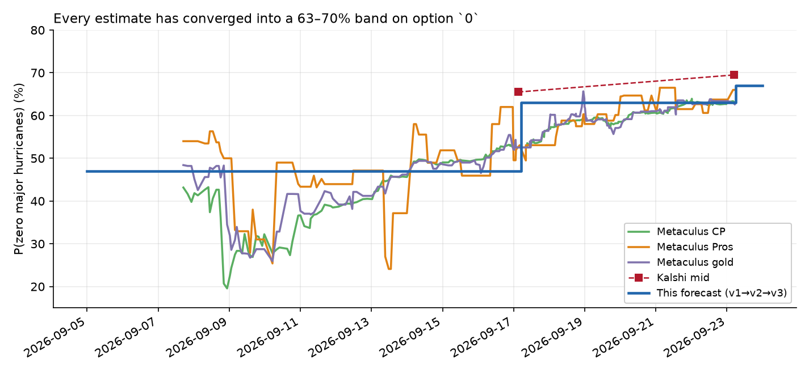
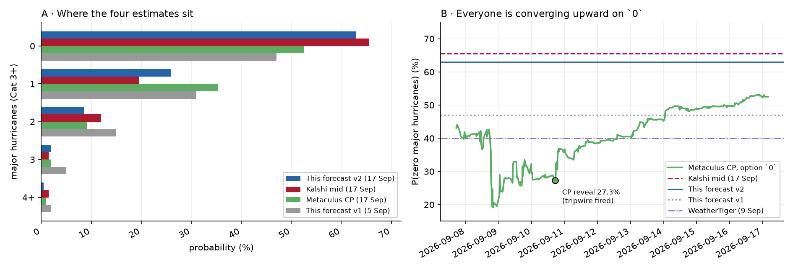
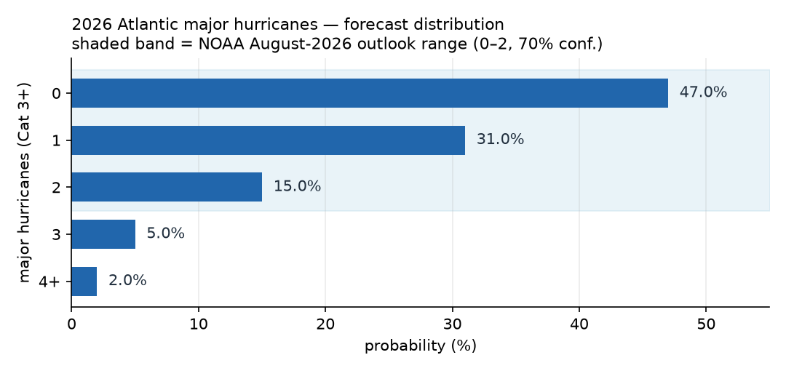

# How many Major Atlantic Hurricanes will occur in the 2026 Atlantic hurricane season?

| | |
|---|---|
| **Source** | Metaculus #45381 — https://www.metaculus.com/questions/45381/ |
| **Type** | multiple choice — options `0`, `1`, `2`, `3`, `4+` |
| **Opened / Closes / Resolves** | 2026-09-07 / 2026-10-16 / 2026-11-30 (NHC data as of 2026-12-01) |
| **Status** | open |
| **Current forecast** | **0: 70.0% · 1: 22.5% · 2: 5.5% · 3: 1.5% · 4+: 0.5%** — leading option `0`, IQR [63.5%, 76.0%] (v4, 2026-09-26) |
| **Community (as of 2026-09-26)** | CP **0: 70.7%** · Pro **71.2%** (n=10) · gold **70.1%** (n=33) — n=132 forecasters; cohorts within 1.1 pp |
| **Market (as of 2026-09-26)** | **Kalshi `KXHURCTOTMAJ-26DEC01`: P(0) ≈ 62.5%** (`>0` strike 36/39¢, last 39¢, 17.5k contracts; thin fresh volume) |
| **Next review** | 2026-09-30 |

<!-- Versions below, newest first. APPEND-ONLY: never edit or delete a past version. -->

---

## v4 — Update — 2026-09-26

**Mode: Update** (incremental). Three days since v3. No market or cohort contradicts me by more
than 10pp. The question's structure has not changed. My last two versions did move the same way
(47 → 63 → 67), which is one of the protocol's re-analysis triggers. The movement is driven by
the calendar: each week without a major hurricane removes season that could have produced one.
It is not an argument I keep leaning on, so I re-derived the rate from scratch below rather than
nudging it. The operator also asked for the full option vector in the ledger's new
`distribution` field. This version supplies it.

### Revision table

| Driver | Direction | Effect on P(`0`) |
|---|---|---|
| **Prior (v3, 2026-09-23)** | — | **67.0%** (1: 24.0 · 2: 6.5 · 3: 2.0 · 4+: 0.5) |
| **Hazard decay, and the next week is already spoken for.** Still zero hurricanes on 26 Sep [1][2]. NHC's 26 Sep outlook: **Tropical Storm Gonzalo** (35 kt, forecast to become a remnant low within 12h and dissipate by 30 Sep) [3]; **Tropical Depression Fay** regenerated WSW of the Azores (30 kt, peak forecast 30 kt, dissipating ~1 Oct) [4]; and one subtropical trough SE of Bermuda at 10% / 20% (2-day / 7-day formation) [1]. None can reach Cat 3. So through ~3 Oct the basin is effectively closed to majors. The climatological share of major-hurricane activity left falls from ~33% (v3) to ~24% after 3 Oct. λ goes 0.30 → **0.25**. v2's four-branch mixture moves 71.2% → ~75%; with v3's shade kept, that is +3.5 on my number | ↑ | **+3.5 pp** |
| **Kalshi moved the other way, P(0) ≈ 69.5% → ≈ 62.5%.** The `>0` strike is at 36/39¢ (last 39¢), against 28/33¢ at v3. But T0 volume grew only from 16.6k to 17.5k contracts, so ~900 contracts moved it. The upper strikes are incoherent: `>1` at 17/21¢ implies P(exactly 1) ≈ 18% but P(≥2) ≈ 19%. That points to a thin book, not information. Still, it is a real-money anchor that disagrees with the cohorts | ↓ | **−1.0 pp** |
| **Metaculus cohorts rose into agreement at ~71%**: CP 63.0 → **70.7**, Pros 66.0 → **71.2**, gold 62.6 → **70.1**. Largely the same calendar evidence I am using, so it gets a small weight | ↑ | **+0.5 pp** |
| **New forecast (v4)** | | **0: 70.0%** · 1: 22.5 · 2: 5.5 · 3: 1.5 · 4+: 0.5, IQR on `0` [63.5%, 76.0%] |

**Rate construction.** At λ ≈ 0.25, v2's four-branch mixture gives 0 ≈ 75%. I keep v3's
deliberate shade of ~4pp toward the higher counts, which gives ~70.5%. The shade has two
reasons: (a) the ECMWF early-October relaxation signal (v3 row 3) is not yet refuted, only
pushed later; (b) a single favourable window can make two majors (2002). The Kalshi (−1) and
cohort (+0.5) rows then land it at 70.0%. The shade leaves 1 at 22.5 and 2+ at 7.5, above what the pure Poisson tail
(0.25) would give (2+ ≈ 2.6%). The overdispersion is deliberate: one good window can produce
more than one storm.

### Tripwire check (v3 list)

| # | Tripwire | Status | Evidence |
|---|---|---|---|
| 1 | Any Atlantic system reaches Cat 3 | **Not fired** | No hurricanes at all. Gonzalo peaked at 35 kt; Fay regenerated as a 30 kt depression [3][4] |
| 2 | Still zero hurricanes on 2026-09-30 → +4pp | **Not due, all but certain to fire** | Nothing on the map can reach 64 kt before 30 Sep [1][3][4]. Its effect is already in row 2 above, so it will not be added again on 30 Sep |
| 3 | CSU two-week forecast of 2026-09-30 is near/above normal → −5pp; below normal → +2pp | Not due | Issue date 2026-09-30 |
| 4 | NHC ≥ 50% 7-day in the Gulf, western Caribbean or Bahamas/western Atlantic → −6pp | **Not fired** | The only area is a subtropical trough SE of Bermuda at 20% 7-day, moving north then east [1] |
| 5 | 2026-10-10 passes with zero majors → `0` to ~80% | Not due | 14 days away |
| 6 | CPC ENSO update (~10-08) puts OND RONI below +2.0 → −5pp | Not due | — |
| 7 | Kalshi `>0` outside 22–42¢ → re-check, do not nudge | **Not fired (near the upper edge)** | 36/39¢, last 39¢ [5] |
| 8 | Metaculus Pros below 58% or above 75% | **Not fired** | Pros 71.2% (n=10) [6] |

### What resolves YES

Unchanged from v3.

### Outside view

Unchanged from v3.

### Scenarios

Unchanged from v3, except the scenario weights, which follow the new vector: shear never
relaxes enough 0.70 · one window, one major 0.225 · the 2002 shape 0.055 · genuine
back-loading 0.015 · full repeat 0.005. The option labels used in the ledger are Metaculus's
exact strings `0`, `1`, `2`, `3`, `4+`.

### Inside view

Unchanged from v3.

### Evidence

Unchanged from v3.

### Other forecasters (2026-09-26)

| Source | P(0 majors) | As of | Note |
|---|---|---|---|
| **Kalshi `KXHURCTOTMAJ-26DEC01`** | **≈ 62.5%** (`>0` 36/39¢) | 2026-09-26 | T0 17.5k contracts (was 16.6k); implied 1: ~18.5 · 2: ~12 · 3+: ~6.5 on a thin, inconsistent upper book [5] |
| **Metaculus CP** | **70.7%** | 2026-09-26 19:29 | n=132 |
| **Metaculus Pros** | **71.2%** | 2026-09-26 | n=10 |
| **Metaculus gold medalists** | **70.1%** | 2026-09-26 | n=33 |
| WeatherTiger | paywalled | 2026-09-25 | The public teaser says "no tropical threats to Florida or the continental U.S. for the next week or more". A search snippet puts the chance of beating 1983's record-low activity at 30–35% [7] |

**Cohort agreement**: all three Metaculus cohorts are within 1.1pp of each other. I am 0.1–1.2pp
below them. Kalshi sits 7.5pp below me on thin fresh volume.

### Sensitivity

| Assumption | If instead | Forecast becomes |
|---|---|---|
| λ ≈ 0.25 for 26 Sep – 30 Nov | 0.30: the ECMWF early-October window at v3's half face value, not pushed later | 0: ~67% |
| — | 0.20: pure decay, no relaxation window at all | 0: ~75% |
| — | 0.40: the ECMWF window at full face value | 0: ~60%, near Kalshi's 62.5% |
| No major by 10 Oct | (checkable 2026-10-10) | 0: ~79% |

### What would change my mind (tripwires)

- [ ] **Any Atlantic system reaches Category 3**, by 2026-11-30 → `0` collapses to ~0%.
- [ ] **CSU two-week forecast of 2026-09-30 favours near- or above-normal activity** → down ~5pp; "below normal" again → up ~2pp.
- [ ] **NHC TWO flags ≥ 50% 7-day formation in the Gulf, western Caribbean or Bahamas/western Atlantic**, by 2026-10-31 → down ~6pp; if NHC forecasts such a system to Cat 2+ → down a further ~10pp.
- [ ] **2026-10-10 passes with zero majors** → `0` to ~79%.
- [ ] **CPC ENSO update (~2026-10-08) puts OND RONI below +2.0 or shows El Niño peaking early** → down ~5pp.
- [ ] **Kalshi `>0` trades outside 25–45¢** (P(0) outside 55–75%) on more than 3k fresh contracts → re-check, do not nudge.
- [ ] **Metaculus Pros fall below 62% or rise above 80%**.

### Sources

1. NHC Atlantic Tropical Weather Outlook, 2:00 PM EDT Sat 26 Sep 2026 — https://www.nhc.noaa.gov/gtwo.php?basin=atlc&fdays=7 (accessed 2026-09-26)
2. First Atlantic hurricane season without a hurricane by Sept. 21 in 112 years — WCAX, 2026-09-21 — https://www.wcax.com/2026/09/21/first-atlantic-hurricane-season-without-hurricane-by-sept-21-112-years/ (accessed 2026-09-26, via search summary)
3. NHC Tropical Storm Gonzalo Discussion, 26 Sep 2026 15Z — https://www.nhc.noaa.gov/text/refresh/MIATCDAT2+shtml/ (accessed 2026-09-26)
4. NHC Tropical Depression Fay Discussion, 26 Sep 2026 15Z — https://www.nhc.noaa.gov/text/refresh/MIATCDAT1+shtml/ (accessed 2026-09-26)
5. Kalshi `KXHURCTOTMAJ` series, trade API — https://kalshi.com/markets/kxhurctotmaj (accessed 2026-09-26; `raw/kalshi-KXHURCTOTMAJ-2026-09-26.json`)
6. Metaculus question 45381, three-cohort aggregations and comments — https://www.metaculus.com/questions/45381/ (accessed 2026-09-26; `raw/metaculus-2026-09-26.json`)
7. Don't Call it a Comeback: The Hurricane Watch for Sept. 25th — WeatherTiger — https://weathertiger.substack.com/p/dont-call-it-a-comeback-the-hurricane-4ad (accessed 2026-09-26; public teaser only)
8. Wikipedia — "2026 Atlantic hurricane season": Fay 19–22 Sep, 70 mph; 6 NS / 0 H / 0 MH; ACE ≈ 6.3 as of 22 Sep — https://en.wikipedia.org/wiki/2026_Atlantic_hurricane_season (accessed 2026-09-23) — carried forward from v3 [43], still relied on
9. Michael Lowry — "Fast-Forming Fay Nearly Ends Record Atlantic Hurricane Drought, Now Quickly Fading" — https://michaelrlowry.substack.com/p/fast-forming-fay-nearly-ends-record (accessed 2026-09-23) — carried forward from v3 [44], still relied on
10. WeatherTiger — "THE Miami Hurricane: WeatherTiger's Weekly Hurricane Column for September 18th" (ECMWF 40% / 70% / 60% of normal activity by window) — https://weathertiger.substack.com/p/the-miami-hurricane-weathertigers (accessed 2026-09-23) — carried forward from v3 [45], still relied on
11. WeatherTiger — "There Was An Attempt: The Hurricane Watch for Sept. 21th" (season 62.4% complete by storm energy) — https://weathertiger.substack.com/p/there-was-an-attempt-the-hurricane (accessed 2026-09-23) — carried forward from v3 [47], still relied on
12. NOAA CPC — Global Tropics Hazards Outlook, issued 2026-09-22 — https://www.cpc.ncep.noaa.gov/products/precip/CWlink/ghazards/index.php (accessed 2026-09-23) — carried forward from v3 [48], still relied on
13. Boston Globe — "Atlantic hurricane activity remains quiet while Pacific roars" (21–22 Sep 2026) — https://www.bostonglobe.com/2026/09/22/metro/record-quiet-2026-atlantic-hurricane-season/ (accessed 2026-09-23) — carried forward from v3 [49], still relied on
14. Philip Klotzbach on X (22 Sep 2026): least ACE to date since 1950 — https://x.com/philklotzbach/status/2102423003397288003 (accessed 2026-09-23 via search index; direct fetch not attempted) — carried forward from v3 [51], still relied on

**Date**: 2026-09-26
**Forecast**: 0: 70.0%, 1: 22.5%, 2: 5.5%, 3: 1.5%, 4+: 0.5% — IQR on `0` [63.5%, 76.0%]
**Thesis**: Up 3pp. Still no hurricane of any strength on 26 Sep. The only systems on the map, Gonzalo, Fay and a 20% trough, cannot reach Category 3, which effectively closes the basin to majors until ~3 Oct and cuts the remaining rate from ~0.30 to ~0.25 [1][3][4]. All three Metaculus cohorts converged at 70–71% [6]. Kalshi slipped to ~62.5% [5], but on ~900 contracts and an internally inconsistent upper book, so I keep v3's shade toward one late major rather than follow it.

---

## v3 — Update — 2026-09-23

**Mode: Update (incremental).** Six days since v2. The Metaculus community prediction (CP) has
converged onto v2's number rather than contradicting it, there is only one prior incremental
step to drift from (v1 → v2 was a re-analysis), and the question's structure is unchanged.
None of the re-analysis triggers in `docs/update-protocol.md` §6 holds.

### Revision table

| Driver | Direction | Effect on P(`0`) |
|---|---|---|
| **Prior — v2, 2026-09-17** | — | **63.0%** |
| **Hazard decay.** Six more days at the climatological peak with no hurricane. WeatherTiger's almanac puts the Atlantic 62.4% through its season by storm energy on 21 Sep [47]; for *major* activity, ~44% of the climatological share remained on 17 Sep and ~33% remains now — a 0.75× factor on λ. Re-running v2's four-branch mixture at 0.75× moves it from 67.5% to 74.1% | ↑ | **+6.5 pp** |
| **ECMWF extended ensemble signals a pattern change.** WeatherTiger (18 Sep) reports the European model at ~40% of normal Atlantic activity for days 1–10, rising to **~70% for days 11–17 and ~60% for days 18–25**, with "a less hostile environment for development in the Gulf or western Atlantic towards the end of September or beginning of October" [45]. v2's λ implied ~25% of normal. This is the first model evidence against the "shear never relaxes" branch, and it points at exactly the Gulf/western-Atlantic route | ↓ | **−3 pp** |
| **Fay out-performed its guidance.** A compact storm formed SW of the Azores on 20 Sep, reached **70 mph** — 4 mph short of a hurricane — after NHC first flagged it only on 19 Sep while watching Invest 98L instead [43,44,46]. It never approached Cat 3, but it shows short-fused intensification the outlooks miss is possible outside the main development region (MDR) | ↓ | **−1 pp** |
| **Near-term map stays hostile.** NHC 2026-09-23: no active systems, one area — a wave off Africa, 20% / 40% (2-day / 7-day), with "strong upper-level winds" expected to end development by the weekend [42]. CPC's Global Tropics Hazards outlook (22 Sep) posts **no week-3 Atlantic genesis areas**, citing a lack of support in extended-range tools [48] | ↑ | **+0.5 pp** |
| **No October Gulf system in any super El Niño since 1960** (Boston Globe, citing the record) [49] — the ECMWF pattern-change route runs into a null base rate in the strongest analogues | ↑ | **+0.5 pp** |
| **Independent anchors moved up.** Kalshi `>0` 33/36¢ → **28/33¢** (P(0) 65.5% → ~69.5%, trades 30–37¢ today) [50]; Metaculus Pros 53.1% → **66.0%** (n=10). Partly the same evidence I am using, so small weight — not herding toward the CP, which is *at* my prior | ↑ | **+0.5 pp** |
| **v3 — 2026-09-23** | — | **67.0%** |

### Tripwire check (v2's list)

| # | Tripwire | Status | What actually happened |
|---|---|---|---|
| 1 | Any Atlantic system reaches Category 3 | **not fired** | Still zero hurricanes of any category; Fay peaked at 70 mph [43,46] |
| 2 | Still zero hurricanes on 2026-09-30 → +6 pp | **not due** | Zero as of 2026-09-23; the season is the first since 1914 without a hurricane this late [46,49]. Seven days left; the decay is already in row 2 of the revision table, so the residual on 30 Sep is ~+4 pp |
| 3 | NHC TWO ≥ 50% 7-day in the western Caribbean or the Bahamas | **not fired** | Only area is a Cabo Verde wave at 40% 7-day [42] |
| 4 | AL98 or a successor subtropical low becomes a named storm and NHC forecasts Cat 2+ | **not fired (near miss on the first half)** | AL98 "ended with nothing" (Metaculus comment, 19 Sep) [1]. A *different* disturbance near the Azores became Fay; NHC's forecasts allowed at most a brief Cat 1, never Cat 2 [44]. Signal partly present — non-MDR development — so −1 pp above, not −5 |
| 5 | 2026-10-10 passes with zero majors | **not due** | 17 days away |
| 6 | CPC ENSO update (~2026-10-08) puts OND RONI below +2.0 | **not due** | — |
| 7 | Kalshi `KXHURCTOTMAJ-26DEC01-T0` outside 25–45¢ | **not fired** | 28/33¢, last trades 30–37¢, 16.6k contracts volume [50] |
| 8 | Metaculus CP on `0` overshoots 63% or falls below 45% | **touched (upper edge)** | CP peaked at **63.4%** at 04:08Z on 23 Sep and sits at **63.0%** (n=119). It has levelled off at my number, not below it — the "crowd sees a floor I do not" case did not happen. Pros are *above* me at 66.0% |
| 9 | WeatherTiger revises P(no major) below 35% or above 55% | **not observable** | The 15, 18 and 21 Sep pieces are partly paywalled; the free portions carry no revised P(no major). The 18 Sep column's ECMWF pattern-change remark is the closest thing and is priced in the revision table |

### What resolves YES (which option)

Unchanged from v2.

### Outside view

Unchanged from v2 (super-El-Niño post-17-September base rate, 0.83 majors; empirical P(0) = 33%).
The one refinement: of the four post-17-Sep majors in that class, **Isidore (formed 17 Sep) and
Debby (Cat 4 on 18 Sep)** are now behind the calendar. Debby and Emily (22 Sep peak) both would
already have happened by today in their seasons. Re-cut to "majors after 23 September" the class
gives **Lili (2002, formed 21 Sep, Cat 4 on 2–3 Oct) and Joaquin (2015, Cat 4 on 1 Oct)**: 2
majors in 6 seasons, 2 of 6 seasons with ≥ 1, **empirical P(0) = 67%** — the outside view has
now caught up with where the inside view was a week ago.

### Inside view — where the season stands on 2026-09-23

| Metric | 2026 to date | Full-season normal | Change since v2 |
|---|---|---|---|
| Named storms | **6** (… Edouard, **Fay**) | 14 | +1 (Fay, 19–22 Sep, 70 mph, far NE Atlantic) [43,46] |
| Hurricanes | **0** | 7 | none — first season since 1914 without one this late [49] |
| Major hurricanes | **0** | 3.2 | — |
| ACE | **≈ 6.3** (22 Sep) | ≈ 123 | +1.9 from Fay; still the lowest to date since 1950 (Klotzbach, 22 Sep) [46,51] |
| NHC 7-day outlook | one 40% Cabo Verde wave, shear-limited | — | AL98 dissipated |
| Extended range | ECMWF 60–70% of normal for ~1–15 Oct; CPC: no week-3 genesis areas | — | **first relaxation signal of the season** [45,48] |

**Rate construction.** v2's centre λ ≈ 0.35 over 17 Sep – 30 Nov. Mechanical decay to today
gives 0.26. The ECMWF signal argues the conditional rate over the next three weeks is higher
than v2 assumed; I take the pattern change at roughly half face value, because (a) CPC's own
extended-range TC tools post nothing for week 3, and (b) the super-El-Niño record has no
October Gulf system since 1960. Net **λ ≈ 0.30**. v2's four-branch mixture at that centre gives
0: 71.2% · 1: 22.9% · 2: 4.8% · 3: 0.9%. I keep v2's deliberate shade of ~4 pp toward the
higher counts for the same two reasons — WeatherTiger's last public number (40%) remains the
lowest anchor, and a single favourable window can produce two majors (2002) — giving:

**Final distribution: 0 = 67.0% · 1 = 24.0% · 2 = 6.5% · 3 = 2.0% · 4+ = 0.5%** (mean 0.45).
IQR on P(`0`): **[60.0%, 73.0%]** — narrowed slightly from v2 because four independent anchors
now sit inside 63–70%.

### Evidence

New since v2, both directions:

- **Against me (for ≥ 1 major).** The ECMWF extended ensemble's late-September/early-October
  pattern change toward "a less hostile environment for development in the Gulf or western
  Atlantic" [45]. Fay's unforecast run to 70 mph [44]. Michael Lowry flags a low along a stalled
  front off the Mid-Atlantic with a ~20% chance of becoming tropical [44] — a Joaquin-like
  non-tropical origin, though at latitudes and SSTs that rarely support Cat 3.
- **For me.** NHC's only area is expected to be sheared apart [42]; CPC posts no week-3 genesis
  [48]; the Gulf/Caribbean escape route has no October precedent in any super El Niño since 1960
  [49]; Klotzbach on 22 Sep: least ACE to date since 1950, "we really can pretty much put all the
  blame on El Niño" [51]. Meanwhile the eastern Pacific runs ~77% above normal ACE with a Cat 5
  (Genevieve) — the classic El Niño see-saw, still fully engaged [52].

**The misconception worth restating** (from v1/v2): Fay was 4 mph from being the first
hurricane and the coverage framed it as nearly "ending the drought". For this question it was
never close — 70 mph is 41 mph short of Cat 3. The resolving quantity is majors, and a
shear-dominated basin's likely late output is short-lived Cat 1–2 storms.

### Other forecasters

| Source | P(0 majors) | As of | Note |
|---|---|---|---|
| **Kalshi `KXHURCTOTMAJ-26DEC01`** | **≈ 69.5%** (`>0` 28/33¢) | 2026-09-23 04:53Z | trades 30–37¢; 16.6k contracts volume, 6.8k OI on `>0`; implied buckets 0: 69.5 · 1: 15.5 · 2: 10.5 · 3+: ~4.5 (upper strikes are 1–4¢ dust) [50] |
| **Metaculus CP** | **63.0%** | 2026-09-23 05:18 | n=119; levelled at 60–63% since 21 Sep [1] |
| **Metaculus Pro** | **66.0%** | 2026-09-23 05:18 | n=10; IQR [60, 66.5] |
| **Metaculus gold medalists** | **62.6%** | 2026-09-23 05:18 | n=33 |
| WeatherTiger | 40% (last public) | 2026-09-09 | no public revision; 18 Sep column relays ECMWF 60–70% of normal for early Oct [45] |
| CSU two-week | below normal | 2026-09-02 / 16 | next issue 2026-09-30 |
| Polymarket / Manifold | no major-hurricane-count market found | 2026-09-23 | re-searched |

**Cohort agreement.** All three Metaculus cohorts are within 3.4 pp (gold 62.6 – Pro 66.0); Pro
highest. Kalshi–CP gap narrowed from 13 pp to 6.5 pp, confirming v2's reading of it as lag. I sit
between the Pros and Kalshi. No anchor contradicts me by more than 4 pp except WeatherTiger's
stale 40%.

### Scenarios

| # | Scenario | Weight | Implies |
|---|---|---|---|
| 1 | **Shear never relaxes enough.** The ECMWF pattern change produces at most weak Gulf/western-Atlantic storms; El Niño peaks into OND. | 0.67 | **0** |
| 2 | **One window, one major.** The early-October relaxation (or a Bahamas/subtropical spin-up of the Joaquin type) yields a single Cat 3+. | 0.24 | **1** |
| 3 | **The 2002 shape.** One window, two majors. | 0.065 | **2** |
| 4 | **Genuine back-loading.** | 0.02 | **3** |
| 5 | **Full-strength repeat of a back-loaded season.** | 0.005 | **4+** |

### Sensitivity

| Assumption | If instead | Forecast becomes |
|---|---|---|
| ECMWF pattern change at half face value (λ ≈ 0.30) | full face value, λ ≈ 0.45 | 0: ~60% |
| — | ignored, pure decay, λ ≈ 0.26 | 0: ~71% |
| No hurricane at all by 1 Oct | (checkable 2026-09-30) | 0: ~71% |
| No major by 10 Oct | (checkable 2026-10-10) | 0: ~80% |

### What would change my mind (tripwires)

- [ ] **Any Atlantic system reaches Category 3** — by 2026-11-30 → `0` collapses to ~0%
- [ ] **Still zero hurricanes on 2026-09-30** → up ~4 pp on `0`
- [ ] **CSU two-week forecast of 2026-09-30 favours near- or above-normal activity** (i.e. the ECMWF pattern change is corroborated) → down ~5 pp; "below normal" again → up ~2 pp
- [ ] **NHC TWO flags ≥ 50% 7-day formation in the Gulf, western Caribbean or Bahamas/western Atlantic** — by 2026-10-31 → down ~6 pp; any such system with an NHC forecast of Cat 2+ → down a further ~10 pp
- [ ] **2026-10-10 passes with zero majors** → `0` to ~80%
- [ ] **CPC ENSO update (~2026-10-08) puts OND RONI below +2.0 or shows El Niño peaking early** → down ~5 pp
- [ ] **Kalshi `>0` strike trades outside 22–42¢** (P(0) outside 58–78%) → re-check, do not nudge
- [ ] **Metaculus Pros fall below 58% or rise above 75%** — the best-track-record cohort is now the one to watch, not the CP

### Sources

Sources 1–41 as in v2 (source 1 re-fetched: snapshot `raw/metaculus-2026-09-23.json`, accessed 2026-09-23).

42. NOAA NHC — Atlantic Tropical Weather Outlook, 2026-09-23 02:00 EDT (Cangialosi): no active systems; Cabo Verde wave 20% / 40% — https://www.nhc.noaa.gov/gtwo.php?basin=atlc&fdays=7 (accessed 2026-09-23)
43. Wikipedia — "2026 Atlantic hurricane season": Fay 19–22 Sep, 70 mph; 6 NS / 0 H / 0 MH; ACE ≈ 6.3 as of 22 Sep — https://en.wikipedia.org/wiki/2026_Atlantic_hurricane_season (accessed 2026-09-23)
44. Michael Lowry — "Fast-Forming Fay Nearly Ends Record Atlantic Hurricane Drought, Now Quickly Fading" — https://michaelrlowry.substack.com/p/fast-forming-fay-nearly-ends-record (accessed 2026-09-23)
45. WeatherTiger — "THE Miami Hurricane: WeatherTiger's Weekly Hurricane Column for September 18th" (ECMWF 40% / 70% / 60% of normal activity by window) — https://weathertiger.substack.com/p/the-miami-hurricane-weathertigers (accessed 2026-09-23)
46. Yale Climate Connections — "Atlantic remains hurricane-free as Tropical Storm Fay forms near the Azores" (19–20 Sep 2026) — https://yaleclimateconnections.org/2026/09/atlantic-remains-hurricane-free-as-tropical-depression-six-forms-near-the-azores/ (accessed 2026-09-23)
47. WeatherTiger — "There Was An Attempt: The Hurricane Watch for Sept. 21th" (season 62.4% complete by storm energy) — https://weathertiger.substack.com/p/there-was-an-attempt-the-hurricane (accessed 2026-09-23)
48. NOAA CPC — Global Tropics Hazards Outlook, issued 2026-09-22 — https://www.cpc.ncep.noaa.gov/products/precip/CWlink/ghazards/index.php (accessed 2026-09-23)
49. Boston Globe — "Atlantic hurricane activity remains quiet while Pacific roars" (21–22 Sep 2026) — https://www.bostonglobe.com/2026/09/22/metro/record-quiet-2026-atlantic-hurricane-season/ (accessed 2026-09-23)
50. Kalshi public API — series `KXHURCTOTMAJ`, event `KXHURCTOTMAJ-26DEC01`, all strikes plus the 15 latest `>0` trades — https://api.elections.kalshi.com/trade-api/v2/markets?series_ticker=KXHURCTOTMAJ ; snapshots `raw/kalshi-KXHURCTOTMAJ-2026-09-23.json`, `raw/kalshi-trades-T0-2026-09-23.json` (accessed 2026-09-23)
51. Philip Klotzbach on X (22 Sep 2026): least ACE to date since 1950 — https://x.com/philklotzbach/status/2102423003397288003 (accessed 2026-09-23 via search index; direct fetch not attempted)
52. Yale Climate Connections (as 46): eastern Pacific ACE 178.5, ~77% above average; Cat 5 Genevieve (accessed 2026-09-23)

**Date**: 2026-09-23
**Forecast**: Median 67.0%, IQR [60.0%, 73.0%] — on option `0`; full distribution 0: 67.0% · 1: 24.0% · 2: 6.5% · 3: 2.0% · 4+: 0.5%
**Thesis**: Six more peak-season days without a hurricane cut the remaining climatological share of major activity by a quarter (hazard +6.5 pp), partly offset by the first relaxation signal of the season — ECMWF extended guidance at 60–70% of normal for early October in the Gulf/western Atlantic (WeatherTiger, 18 Sep; −3 pp) — and by Fay's unforecast run to 70 mph. Metaculus Pros (66.0%), CP (63.0%) and Kalshi (~69.5%) now bracket me; the main exposure is that the ECMWF pattern change is real and October delivers a Lili/Joaquin-type Cat 4.

---

## v2 — Re-analysis — 2026-09-17

**Mode: Re-analysis, not incremental update.** Two of the conditions in
`docs/update-protocol.md` §6 hold. v1's own tripwire 7 fired — the Metaculus CP on reveal
(2026-09-10 17:01Z) sat at **27.3%** on option `0`, below the 30% threshold at which v1 wrote
"trigger a re-analysis rather than a nudge". And a real-money market that v1 recorded as
non-existent turns out to exist and to disagree with v1 by 18.5 pp. The reference class below is
rebuilt from scratch (post-17-September majors in super-El-Niño seasons), not adjusted from v1's
classes A/B/C.

### Revision table

| Driver | Direction | Effect on P(`0`) |
|---|---|---|
| **Prior — v1, 2026-09-05** | — | **47.0%** |
| **Hazard decay.** 12 days elapsed, zero events, including the 10 September climatological peak. The climatological share of major-hurricane activity still ahead falls from ~55% (post-12 Sep) to ~44% (post-17 Sep) — a 0.80× factor on λ with nothing banked against it [25] | ↑ | **+6 pp** |
| **Record wind shear, now quantified.** Klotzbach: the 30-day mean shear over the Caribbean-to-Africa corridor in early September was the strongest since the 1979 satellite record began, averaging **more than 3 knots above any other year** [26,27]. v1 knew the basin was sheared; it did not know the anomaly was this far outside the historical envelope | ↑ | **+5 pp** |
| **El Niño upgraded from "super" to "possibly historic".** CPC's 2026-09-10 discussion: Niño 3.4 at **+1.8 °C** in August, **> 90%** chance of a very strong event through fall/winter, and a **75%** chance the Oct–Dec RONI exceeds **every event since 1950** [28]. The forcing peaks *after* the question window closes, so the suppression does not relax inside it | ↑ | **+3 pp** |
| **Kalshi market discovered.** `KXHURCTOTMAJ-26DEC01` trades this exact quantity; its `>0` strike is at 33–36¢, i.e. **P(0) ≈ 65.5%**, with live two-way flow on 2026-09-17 and 12.1k contracts traded [29]. v1's search log recorded "no market found" — that was a research miss, not an absence | ↑ | **+4 pp** |
| **Metaculus cohorts revealed and agree.** CP 52.5%, Pro 53.1%, gold 52.5% — no cohort disagreement to mine. The CP has climbed from 27.3% to 52.5% in seven days and is still rising ~2 pp/day, i.e. it is trending *toward* me from below | ↑ | **+1 pp** |
| **WeatherTiger pulls the other way.** Truchelut's 2026-09-09 model run gives **40%** for zero majors, full-season ACE ≈ 34 and a point forecast of 1 major [30]. A domain specialist with dynamical sub-seasonal guidance I do not have, sitting 25 pp below me, is the main reason not to go higher | ↓ | **−3 pp** |
| **v2 — 2026-09-17** | — | **63.0%** |

### Tripwire check (v1's list)

| # | Tripwire | Status | What actually happened |
|---|---|---|---|
| 1 | First Atlantic hurricane forms by 2026-09-30 | **not fired** | Still **zero** hurricanes on 2026-09-17. The satellite-era record for the latest first hurricane (11 September, 2002 and 2013) **has now been broken** [22,23,31]. The conditional "+12 pp onto `0` if none by 30 Sep" is not yet due |
| 2 | Any Atlantic system reaches Category 3 | **not fired** | No Atlantic system has reached even Category 1 all season |
| 3 | NHC TWO flags ≥ 60% 7-day formation chance in the western Caribbean | **not fired** | NHC's 2026-09-17 02:00 EDT outlook carries exactly one area: **AL98**, a small subtropical low a few hundred miles east of Bermuda, 40% / 40% (2-day / 7-day). The Caribbean and the main development region are empty [24] |
| 4 | CPC ONI shows El Niño peaking or weakening early (ASO/SON below +1.5) | **fired in reverse** | The opposite: +1.8 °C in August, > 90% for a very strong event, 75% for a *historic* OND [28]. This is the tripwire whose failure mode I had not priced — I wrote it as a one-sided check and it moved hard the other way |
| 5 | 2026-10-15 passes with still zero hurricanes | **not due** | 28 days away |
| 6 | Further CSU or NOAA downward revision before close | **partially fired** | Neither body issues a seasonal update after August, so the literal signal cannot fire. Its functional equivalent did: CSU's 2026-09-02 two-week forecast "strongly favouring below-normal activity" through 15 September **verified**, and Klotzbach's 10 September statistics (least ACE of any season through 10 September since 1950; record shear) are a downward revision in all but name [26,27] |
| 7 | Metaculus CP on reveal below 30% or above 62% | **FIRED (low side)** | CP at reveal = **27.3%** on option `0`. Pros were at 49.0% and gold at 41.7% at the same instant — the better-track-record cohorts started far closer to v1's 47% than the raw community did, and the community has since converged up through both |

### What resolves YES (which option)

Unchanged from v1. The number of major hurricanes — Category 3+, sustained winds ≥ 111 mph —
in the Atlantic basin between 1 June and 30 November 2026, **as reported by the NHC on
1 December 2026**; later reanalysis upgrades are explicitly excluded, which biases the resolving
number slightly below the eventual best-track. Buckets `0`/`1`/`2`/`3`/`4+` are exhaustive and
`4+` includes exactly 4 (admin comment, 2026-09-05).

One clarification worth adding now that a market exists: **Kalshi's window is 1 January –
1 December 2026 and Metaculus's is 1 June – 30 November 2026.** For the Atlantic these are the
same question — no Cat 3+ has ever occurred in an Atlantic January–May or on 1 December — so I
treat the Kalshi price as a direct read on this question rather than adjusting it.

### Outside view — rebuilt

v1's reference classes were built around "seasons with no hurricane by 5 September" and "strong
El Niño seasons", both scored over the *whole* season. That double-counts the three months
already in the bag. The question that actually matters on 17 September is narrower:

> **In a strong-El-Niño season, how many major hurricanes form after 17 September?**

The satellite-era super-El-Niño set, defined by three-month maximum RONI (Relative Oceanic Niño
Index — the Niño 3.4 anomaly measured against the tropical-mean sea-surface temperature, which
strips out global ocean warming and is the index hurricane forecasters now prefer), is
**1972, 1982, 1987, 1997, 2002, 2015** [32].

| Year | Majors after 17 Sep | Which |
|---|---|---|
| 1972 | 0 | no majors at all that season |
| 1982 | **1** | Debby — Cat 4 on **18 September**, the season's only major [33] |
| 1987 | **1** | Emily — Cat 3, peak **22 September**, the season's only major [34] |
| 1997 | 0 | Erika (Cat 3) peaked 8 September; nothing after |
| 2002 | **2** | Isidore (Cat 3, ~21 September) and Lili (Cat 4, 2–3 October) [35,36] |
| 2015 | **1** | Joaquin — Cat 4 on **1 October**, from a non-tropical low near the Bahamas [37] |

**Mean 0.83 majors after 17 September; 4 of 6 seasons produced at least one; empirical
P(0) = 33%.** This is the honest base rate and it argues *against* a high P(`0`), not for it.
Two entries deserve naming rather than averaging away:

- **2002 is the closest structural analogue that exists.** It was a super El Niño *and* the
  previous holder of the latest-first-hurricane record (Gustav, 11 September) — and it still
  delivered two majors, one of them a Cat 4, entirely after 17 September. A record-late start
  demonstrably does not imply a dead back half.
- **1982 was quieter than 2026 looks likely to be** — 5 named storms, 2 hurricanes, ACE 17.4,
  still the satellite-era floor — and it produced a **Category 4** on 18 September.

A cross-check on the climatological share, from a different direction: roughly **85% of Atlantic
major-hurricane activity falls in the 20 August – 10 October window**, and 96% of major-hurricane
days fall in August–October [25]. As of 17 September, 28 of those 51 core days are spent. Summing
the remainder of the core window plus the thin post-10-October tail gives **~44%** of climatological
major activity still ahead, or 3.2 × 0.44 ≈ **1.41 majors** on a normal season. Two independent
routes (reference class 0.83, climatology 1.41 before any suppression) bracket the starting point.

### Inside view — where the season stands on 2026-09-17

| Metric | 2026 to date | Full-season normal | Note |
|---|---|---|---|
| Named storms | **5** (Arthur, Bertha, Cristobal, Dolly, Edouard) | 14 | none since Edouard dissipated 3 September |
| Hurricanes | **0** | 7 | satellite-era record for latest first hurricane, **broken** |
| Major hurricanes | **0** | 3.2 | — |
| ACE | **4.4** (through 10 Sep) | ≈ 123 | **lowest of any season through 10 September since 1950** [27] |
| 30-day mean shear, early Sep | **strongest since 1979**, by > 3 kt | — | the proximate cause [26] |
| Niño 3.4, August | **+1.8 °C**, strengthening | — | 75% chance OND beats every event since 1950 [28] |

Three things are new since v1 and all of them cut the same way.

**1. The shear anomaly is far outside the historical envelope.** "Strongest since 1979" would be
unremarkable on its own — some year has to hold the record. **"More than 3 knots above any other
year"** is not: seasonal shear records normally fall by fractions of a knot. This is the single
most important new number in this update, because it is a *measurement* of the suppression
mechanism rather than a forecast of it, and because seasonal shear anomalies driven by ENSO are
strongly autocorrelated month to month.

**2. The forcing strengthens through the entire remaining window.** v1 assumed a super El Niño
holding steady. CPC now puts 75% on the Oct–Dec RONI exceeding **every event since 1950** [28].
The peak arrives after the question closes. There is no relaxation to wait for inside the window.

**3. The peak week was consumed with the basin empty.** Between 5 and 17 September — spanning the
10 September climatological peak — not one system formed, and NHC currently shows nothing at all
in the Caribbean or the main development region.

**Rate construction.** Start from the super-El-Niño post-17-September rate, λ₀ ≈ 0.83, and apply
the conditioning that none of those six seasons shared. Every one of them had already produced a
hurricane by 17 September; 1982 had a storm spinning that became a Cat 4 the next day; 2002 had
Isidore already named. 2026 has an empty map. Marginal multipliers, each discounted for overlap
with the others because they are largely one causal story:

| Factor | Multiplier | Why not lower/higher |
|---|---|---|
| Record-low ACE through the peak (4.4, lowest since 1950) | 0.55 | seasons in the bottom decile at the peak finish very low; this is the headline conditioning |
| Record shear, > 3 kt beyond any prior year | 0.75 | mostly collinear with the above — it *is* the cause — so only a marginal cut |
| El Niño stronger than all six analogues, still strengthening | 0.85 | again partly collinear; the increment is that no analogue had forcing this strong *in* its late window |
| Empty basin today; only a 40% subtropical low near Bermuda | 0.90 | removes ~7–10 days of a ~75-day window, not all of it |

Product ≈ 0.32; I use **0.37** deliberately, because multiplying four correlated factors is the
most likely way for this chain to be wrong, and the error is one-directional. → **λ ≈ 0.31**.
The climatological route gives 1.41 × ~0.28 ≈ 0.39. **Centre λ ≈ 0.35**, and mix over the
residual uncertainty rather than pretending to know it:

| Branch | λ | Weight | P(0) |
|---|---|---|---|
| Shear stays record-hostile to the end (the 1972 / 1997 path) | 0.20 | 0.30 | 81.9% |
| Central | 0.35 | 0.40 | 70.5% |
| One favourable window opens (the 1982 / 1987 / 2015 path) | 0.60 | 0.22 | 54.9% |
| Basin back-loads hard (the 2002 Isidore/Lili path) | 1.10 | 0.08 | 33.3% |

The mixture yields 0: 67.5% · 1: 25.0% · 2: 6.0% · 3: 1.3% · 4+: 0.3%. I then shade P(`0`) down
to **63%** and fatten the `2` bucket, for two stated reasons: WeatherTiger's 40% is a specialist
model run and sits 25 pp below me, and Kalshi prices a visibly fatter upper tail than my mixture
does (P(2) = 12% against my 6%), which is the overdispersion signature — one favourable
late-September pattern delivers two majors, as 2002 showed — and the market is expressing it more
strongly than a Poisson mixture can.

**Final distribution: 0 = 63.0% · 1 = 26.0% · 2 = 8.5% · 3 = 2.0% · 4+ = 0.5%** (mean 0.51).

### Evidence

**The seasonal-forecast picture has not been refreshed — and cannot be.** Neither CSU nor NOAA
issues a seasonal update after August, so the "0–2 majors" (NOAA, 2026-08-06) and "1 major" (CSU,
2026-08-05) numbers still circulating in the Metaculus comment thread are six weeks old and were
issued when the season had **two** named storms. Three more have formed and failed since. The only
still-running products are CSU's two-week forecasts — the 2026-09-02 issue "strongly favouring
below-normal activity" through 15 September, which verified — and Klotzbach's running statistics.

| Forecaster | Issued | Named | Hurricanes | **Majors** | ACE | Live? |
|---|---|---|---|---|---|---|
| CSU (final seasonal) | 2026-08-05 | 9 | 4 | **1** | 40–45% of normal | stale |
| NOAA CPC (Aug update) | 2026-08-06 | 7–13 | 2–6 | **0–2** (70%) | 30–90% of median | stale |
| CSU two-week | 2026-09-02 | — | — | — | below normal through 15 Sep | **verified** |
| **WeatherTiger** | **2026-09-09** | **~10** | **2** | **1** (40% chance of none) | **≈ 34** | **current** |

**Three new measurements, all pointing the same way** [26,27,28]: ACE 4.4 through 10 September is
the lowest of any season through that date since 1950; the early-September 30-day mean shear was
the strongest since the 1979 satellite record began, by more than 3 knots; and Niño 3.4 reached
+1.8 °C in August with a 75% chance the Oct–Dec RONI exceeds every event since 1950. The first two
are observations, not forecasts — that is what makes them worth more than another model run.

**Actively looking for the disconfirming case.** Three specific things would argue for `1` or
more, and I checked each:

1. **The 2023 escape hatch — record Atlantic SSTs overwhelming El Niño shear.** Still absent.
   NOAA describes 2026 Atlantic SSTs as only slightly above normal. Ruled out again.
2. **A live system.** The nearest thing to one is AL98, a small subtropical low a few hundred
   miles east of Bermuda at 40% / 40% [38]. This is not nothing: **both** Joaquin (2015, Cat 4)
   and Debby (1982, Cat 4) — the two post-17-September majors in the strongest El Niño analogues —
   formed outside the main development region, Joaquin from a non-tropical low near the Bahamas.
   The non-MDR route is precisely the one that stays open when shear kills the tropical wave
   train. But mid-September SSTs near Bermuda are marginal for Cat 3, and NHC does not yet give
   AL98 even odds of becoming a depression.
3. **The October western-Caribbean window.** The mechanism that produced Lili (Cat 4, 3 Oct 2002)
   and kept v1 at 22% on `2`+. It has not closed — but the shear anomaly is centred on exactly the
   Caribbean-to-Africa corridor where it would have to open [26], and WeatherTiger reports "no
   sign of an impending shift towards a more conducive environment" [30].

**Absence of expected evidence.** If the basin were about to turn, NHC would be flagging African
wave activity or a Caribbean gyre by mid-September. Twelve days after v1 made the same
observation, the map still shows neither. That is the second consecutive draw from a distribution
that should, on a normal season, have produced something by now (LR ≈ 0.5 against the higher
counts, roughly repeating v1's).

**The misconception from v1, restated because it still governs.** "Zero hurricanes" and "zero
*major* hurricanes" are different claims and coverage keeps conflating them. A shear-dominated
basin's most likely late-season output is weak, short-lived Category 1–2 hurricanes. 2026 could
produce three of those in October and still resolve `0`. The `0` bucket is fatter than the
"will there be any hurricane at all?" framing implies — and note that WeatherTiger's own central
case, 2 hurricanes and 1 major, sits a single intensity category away from resolving this `0`.

### Other forecasters

| Source | P(0 majors) / value | As of | Note |
|---|---|---|---|
| **Kalshi `KXHURCTOTMAJ-26DEC01`** | **≈ 65.5%** (`>0` at 33/36¢) | 2026-09-17 02:45Z | real money, live two-way flow today, 12.1k contracts on the `>0` strike, 6.5k open interest; implied buckets 0: 65.5 · 1: 19.5 · 2: 12.0 · 3: 1.5 · 4+: 1.5 [29] |
| **Metaculus CP** (recency-weighted) | **52.5%** | 2026-09-17 04:03 | n=103; 27.3% → 52.5% in seven days, still rising [1] |
| **Metaculus Pro** | **53.1%** | 2026-09-17 04:03 | n=9; was 49.0% at reveal — barely moved, i.e. Pros were right early |
| **Metaculus gold medalists** | **52.5%** | 2026-09-17 04:03 | n=28 |
| **WeatherTiger** (Truchelut) | **40%** | 2026-09-09 | full-season ACE ≈ 34, ~10 NS / 2 H / **1 major**; 20% chance 2026 finishes below 1982's record-low 17.4 ACE; "no sign of an impending shift towards a more conducive environment" [30] |
| CSU (Klotzbach et al.) | 1 major; ACE 40–45% of normal | 2026-08-05 | no September seasonal update exists; the two-week product of 2026-09-02 verified below-normal |
| NOAA CPC | 0–2 majors, 70% conf.; P(below normal) 75% | 2026-08-06 | stale by six weeks and five named storms |
| Polymarket / Manifold | no market found | 2026-09-17 | re-searched |

**Cohort agreement.** All three Metaculus cohorts sit within 0.6 pp of each other — there is no
Pro-vs-community gap to mine here. The informative split is between **Metaculus (52.5%) and
Kalshi (65.5%)**, a 13 pp gap on an identically-resolving question. I read it as a lag rather
than a disagreement: the CP is recency-weighted but still carries forecasts submitted before
14 September, it has climbed monotonically for eight days without levelling, and the comment
thread shows several forecasters anchoring on NOAA's August "0–2 majors" and CSU's "1 major" —
both issued when only two named storms existed. I sit between the two, nearer Kalshi.

**Where I could be wrong, stated sharply.** The specialist forecaster is the *lowest* of all the
anchors. WeatherTiger has dynamical sub-seasonal guidance on October shear that I do not, and if
that guidance shows a relaxation, 40% is the number and 63% is badly overconfident. Against that:
their run predates eight further dead days, and operational hurricane messaging carries a
structural reluctance to publish "nothing will happen" — the same column ends on "it only takes
one". I have weighted them at −3 pp rather than deferring, and flag this as the update's main
exposure.

### Scenarios

| # | Scenario | Weight | Implies |
|---|---|---|---|
| 1 | **Shear never relaxes.** Record shear persists as El Niño strengthens into its historic OND peak; any late storm stays Cat 1–2 or subtropical. | 0.63 | **0** |
| 2 | **One window, one major.** A single low-shear break — western Caribbean in October, or a Bahamas/subtropical spin-up of the Joaquin type — produces one Cat 3+. | 0.26 | **1** |
| 3 | **The 2002 shape.** One favourable late-September pattern delivers two, Isidore-and-Lili style. | 0.085 | **2** |
| 4 | **Genuine back-loading.** MJO delivers a sustained favourable phase and October–November run near normal. | 0.02 | **3** |
| 5 | **2001/2002 repeat at full strength.** | 0.005 | **4+** |

### Sensitivity

| Assumption | If instead | Forecast becomes |
|---|---|---|
| λ ≈ 0.35 over the remaining window | WeatherTiger's implied λ ≈ 0.83 is right (no conditioning credit for the quiet peak) | 0: ~44% · 1: ~36% · 2: ~15% · 3: ~4% |
| λ ≈ 0.35 | Shear relaxes in October to λ ≈ 0.60 | 0: ~55% · 1: ~33% · 2: ~10% · 3: ~2% |
| λ ≈ 0.35 | Record shear holds to 30 November, λ ≈ 0.20 | 0: ~82% · 1: ~16% · 2: ~2% |
| Kalshi is a fair read on this question | Kalshi's `>0` strike is depressed by one-sided "no" carry flow | shift ~4 pp off `0` |
| No hurricane at all forms before 1 October | (checkable on 2026-10-01) | 0: ~75% · 1: ~21% · 2: ~4% |

### What would change my mind (tripwires)

- [ ] **Any Atlantic system reaches Category 3** — by 2026-11-30 → `0` collapses to ~0%; mass to `1`/`2`
- [ ] **Still zero hurricanes on 2026-09-30** → up ~6 pp on `0` (smaller than v1's +12 pp: most of that decay is now already priced)
- [ ] **NHC TWO flags ≥ 50% 7-day formation chance in the western Caribbean or the Bahamas** — by 2026-10-31 → down ~8 pp on `0`. This is now the *only* live route to a major; threshold lowered from v1's 60% because the basin is quiet enough that a 50% flag is itself a regime signal
- [ ] **AL98, or a successor subtropical low, becomes a named storm and NHC forecasts it to Cat 2 or stronger** — by 2026-09-30 → down ~5 pp on `0`. Joaquin (2015) and Debby (1982) both took this non-MDR route in super-El-Niño years
- [ ] **2026-10-10 passes with zero majors** — the 20 Aug – 10 Oct window holding ~85% of climatological major activity closes → `0` to ~80%
- [ ] **CPC ENSO update (due ~2026-10-08) puts OND RONI below +2.0, or shows El Niño peaking early** → down ~5 pp on `0`
- [ ] **Kalshi `KXHURCTOTMAJ-26DEC01-T0` trades outside 25–45¢** (P(0) outside 55–75%) → re-check; a move to the low end against a static basin would mean I am reading the market wrong
- [ ] **Metaculus CP on `0` overshoots 63% or falls back below 45%** → re-check. It has risen ~2 pp/day for eight days; a level-off *below* me is the signal that the crowd sees a floor I do not
- [ ] **WeatherTiger publishes a revised P(no major) below 35% or above 55%** → re-weight the −3 pp specialist discount

### Sources

Sources 1–24 are carried from v1 and were not re-verified except where noted. New and re-fetched
for v2:

1. Metaculus — question #45381, all three cohort aggregations and 304-point history — https://www.metaculus.com/questions/45381/ ; snapshot in `raw/metaculus-2026-09-17.json` (accessed 2026-09-17; the fetcher needed `METACULUS_FORCE_TLS12=1` — a plain run returned status 0, no HTTP response at all)
25. NOAA NHC — Tropical Cyclone Climatology (share of major-hurricane activity in the 20 Aug – 10 Oct window; 96% of major-hurricane days in Aug–Oct) — https://www.nhc.noaa.gov/climo/ (accessed 2026-09-17)
26. weather.com — "Atlantic hurricane season peak: a record hurricane delay" (10 Sep 2026), quoting Klotzbach on shear strongest since 1979 — https://weather.com/2026/09/10/storms/hurricane/atlantic-hurricane-season-quiet-during-peak-september (accessed 2026-09-17)
27. Klotzbach (CSU) via Yahoo/weather.com syndication — ACE 4.4 through 10 September, lowest of any season through that date since 1950; 30-day shear > 3 kt above any prior year since 1979 — https://www.yahoo.com/news/weather-news/articles/atlantic-hurricane-season-2026-sets-100212628.html (accessed 2026-09-17)
28. NOAA CPC — ENSO Diagnostic Discussion, issued 2026-09-10: El Niño Advisory, Niño 3.4 +1.8 °C (August), > 90% chance of a very strong event in NH fall/winter 2026-27, 75% chance the OND RONI exceeds +2.5 and every event since 1950 — https://www.cpc.ncep.noaa.gov/products/analysis_monitoring/enso_advisory/ensodisc.shtml (accessed 2026-09-17)
29. Kalshi — series `KXHURCTOTMAJ`, event `KXHURCTOTMAJ-26DEC01`, all eight strikes with bid/ask/last/volume/open interest, plus the 15 most recent trades on the `>0` strike — https://api.elections.kalshi.com/trade-api/v2/markets?series_ticker=KXHURCTOTMAJ ; snapshot in `raw/kalshi-KXHURCTOTMAJ-2026-09-17.json` (accessed 2026-09-17; the web UI returned HTTP 429, the public API did not)
30. WeatherTiger (Ryan Truchelut) — "Friends in Low ACEs", 2026-09-09: 40% chance of no major hurricane, full-season ACE ≈ 34, 20% chance of finishing below 1982's record-low 17.4 — https://weathertiger.substack.com/p/friends-in-low-aces-weathertigers (accessed 2026-09-17)
31. AOL / weather.com — "2026 Atlantic Hurricane Season Sets Record for Latest First Hurricane Formation" — https://www.aol.com/articles/2026-atlantic-hurricane-season-sets-003046000.html (accessed 2026-09-17)
32. Fox Weather / weather.com — satellite-era super-El-Niño set by three-month maximum RONI in Jun–Nov: 1972, 1982, 1987, 1997, 2002, 2015 (1991 and 2023 El Niño but not super in-season); those seasons averaged 11 named storms / 4 hurricanes / 2 majors — https://weather.com/2026/08/12/storms/hurricane/hurricanes-didnt-care-super-el-nino (accessed 2026-09-17)
33. Wikipedia — "Hurricane Debby (1982)": only major of the 1982 season, peaked Cat 4 (130 mph) on 18 September; 1982 had 2 hurricanes, a satellite-era record low tied with 2013 — https://en.wikipedia.org/wiki/Hurricane_Debby_(1982) (accessed 2026-09-17)
34. Wikipedia — "Hurricane Emily (1987)": Cat 3, peak 125 mph / 958 mbar on 22 September, only major of the 1987 season — https://en.wikipedia.org/wiki/Hurricane_Emily_(1987) (accessed 2026-09-17)
35. Wikipedia — "Hurricane Isidore" (2002): first major of 2002, Cat 3, named 17 September south of Jamaica — https://en.wikipedia.org/wiki/Hurricane_Isidore (accessed 2026-09-17)
36. Wikipedia — "Hurricane Lili" (2002): second major of 2002, formed 21 September, peaked Cat 4, landfall 3 October — https://en.wikipedia.org/wiki/Hurricane_Lili (accessed 2026-09-17)
37. Wikipedia / NHC TCR AL112015 — "Hurricane Joaquin": reached hurricane strength 30 September 2015, Cat 4 on 1 October, peak 155 mph, developed from a non-tropical low — https://en.wikipedia.org/wiki/Hurricane_Joaquin and https://www.nhc.noaa.gov/data/tcr/AL112015_Joaquin.pdf (accessed 2026-09-17)
38. NOAA NHC — Graphical Tropical Weather Outlook, Atlantic, 2026-09-17 02:00 EDT: single area AL98, subtropical low a few hundred miles east of Bermuda, 40% / 40% — https://www.nhc.noaa.gov/gtwo.php?basin=atlc&fdays=7 (accessed 2026-09-17)
39. Wikipedia — "2026 Atlantic hurricane season", storm-by-storm list and ACE through 12 September — https://en.wikipedia.org/wiki/2026_Atlantic_hurricane_season (accessed 2026-09-17)
40. Insurance Journal / Bloomberg — "Atlantic Hurricane Season Remains Most Tranquil Since 1941" (4 Sep 2026) — https://www.insurancejournal.com/news/national/2026/09/04/884092.htm (accessed 2026-09-17)
41. CNN — "El Niño has broken Atlantic hurricanes. Now the season is breaking records" (12 Sep 2026) — https://www.cnn.com/2026/09/12/weather/el-nino-hurricane-storm-atlantic-record-climate (accessed 2026-09-17)

**Date**: 2026-09-17
**Forecast**: 0: 63.0%, 1: 26.0%, 2: 8.5%, 3: 2.0%, 4+: 0.5% — leading option `0`, IQR [56.0%, 70.0%]
**Thesis**: Twelve quiet days consumed the 10 September peak and broke the satellite-era record for the latest first hurricane, and the suppression mechanism is now measured rather than forecast — early-September 30-day shear was the strongest since 1979 by more than 3 knots, ACE 4.4 is the lowest through 10 September since 1950, and CPC gives 75% that the Oct–Dec El Niño exceeds every event since 1950, peaking after this question closes [26,27,28]. Rebuilding from the super-El-Niño post-17-September base rate (0.83 majors, 4 of 6 seasons ≥ 1) and conditioning on a basin no analogue matched gives λ ≈ 0.35, so `0` runs at 63% — below Kalshi's 65.5% and above a Metaculus CP that has climbed 27.3% → 52.5% in seven days without levelling [1,29]. The main exposure is WeatherTiger's specialist 40%, discounted but not dismissed [30].

---

## v1 — Initial forecast — 2026-09-05

### What resolves YES (which option)

The number of **major hurricanes** — Category 3 or higher on the Saffir–Simpson scale, sustained
winds ≥ 111 mph / 178 km/h — occurring in the Atlantic basin between **1 June and 30 November 2026
inclusive**, as reported by the **National Hurricane Center on 1 December 2026**. Buckets are
`0`, `1`, `2`, `3`, `4+`; an admin confirmed in comments on 2026-09-05 that they are exhaustive
and that **4+ includes exactly 4**.

Two details in the fine print do real work:

- **The 1 December operational count governs.** "Any subsequent revisions upgrading or downgrading
  a storm's intensity will not be considered." Post-season Tropical Cyclone Reports, published
  months later, historically upgrade more storms to major status than they downgrade — especially
  systems never sampled by reconnaissance aircraft. This is a small but real **downward** bias on
  the resolving number relative to the eventual best-track.
- Named cross-reference sources are the NHC Advisory Archive and the Monthly Atlantic Tropical
  Weather Summary, the December issue of which covers November.

### Outside view

Unconditionally, the 1991–2020 normal is **3.2 major hurricanes**, and only **5 of 60** seasons
since 1966 (1968, 1972, 1986, 1994, 2013) finished with zero — a base rate of **8%**. That is the
wrong anchor here, because the season is already three months old and has produced nothing.

| Class | n | Members (major-hurricane count) | Mean |
|---|---|---|---|
| **A — no hurricane by 5 September** (satellite era) | 4 | 2001: **4** · 2002: **2** · 1984: **1** · 2013: **0** | 1.75 |
| **B — strong El Niño, ONI ≥ ~1.5 in ASO** | 7 | 1972: 0 · 1982: 1 · 1987: 1 · 1991: 2 · 1997: 1 · 2015: 2 · 2023: 3 | 1.43 |
| **C — seasons with total ACE 30–60** | ~10 | 1968:0 · 1972:0 · 1986:0 · 1994:0 · 2013:0 · 1987:1 · 1993:1 · 1997:1 · 1991:2 · 2009:2 | ~0.7 |

Classes A and B both pull **upward**, and both are contaminated in the same way: **every one of
the seven strong-El-Niño years already had a hurricane by 5 September**, most of them a major
(Bob Cat 3 on 19 Aug 1991; Danny Cat 3 on 21 Aug 2015; three majors by 5 Sep 2023). And none of
the four members of class A had an El Niño of this strength — 2001, the 4-major case, was a
favourable-basin year that then produced Erin, Felix, Iris and Michelle. 2026 is more suppressed
than every member of both classes. **Class C**, matched to where the ACE trajectory is actually
heading, is the honest anchor at ~0.7.

### Inside view

**Where the season actually stands on 2026-09-05:**

| Metric | 2026 to date | Full-season normal |
|---|---|---|
| Named storms | **5** — Arthur (45 mph), Bertha (60), Cristobal (45), Dolly (40), Edouard (60) | 14 |
| Hurricanes | **0** | 7 |
| Major hurricanes | **0** | 3.2 |
| ACE | **≈ 4.4** (3.6% of a normal season) | ≈ 123 |

Nothing has come within 15 mph of hurricane strength all year. Two facts make this extreme rather
than merely quiet:

1. **The satellite-era record for the latest first Atlantic hurricane is 11 September**, set twice
   — Gustav (2002) and Humberto (2013). 2026 is days from breaking it, and US outlets are openly
   asking whether the basin could finish with *zero* hurricanes.
2. **NHC's Tropical Weather Outlook of 4 September 2026 forecasts no tropical cyclone formation
   anywhere in the Atlantic, Caribbean or Gulf for the following seven days** — straight through
   the 10 September climatological peak. The record will therefore almost certainly fall, and the
   effective remaining window starts around **12 September**.

**Rate construction.** Climatologically ~55% of a season's major hurricanes form after 12
September → 1.8 majors on a normal season. CSU's final August call was ACE and NTC at **40–45% of
normal**; since that figure already banks a near-zero first half, the implied remainder multiplier
is somewhat higher, but the season is running at ~13% of normal ACE pace and El Niño is
*intensifying*, so it should not be marked up much. Take 0.42.

`λ ≈ 1.8 × 0.42 ≈ 0.76`, widened to **λ ≈ 0.85** for the western-Caribbean October window, which
has delivered majors even under El Niño — Lili (Cat 4, 3 Oct 2002) and Joaquin (Cat 4, late
Sep–Oct 2015) are the proof that a single favourable synoptic window is enough.

Poisson(0.85) gives 0: 42.7% · 1: 36.3% · 2: 15.4% · 3: 4.4% · 4+: 1.2%. Major-hurricane counts
are over-dispersed relative to Poisson — one favourable window can produce two or three — so mass
moves from the centre to both tails; and the fine print's operational-count rule shifts a little
more onto the low side.

**Final distribution: 0 = 47.0% · 1 = 31.0% · 2 = 15.0% · 3 = 5.0% · 4+ = 2.0%** (mean 0.85).

### Evidence

Every seasonal forecaster has revised **down**, monotonically, all year:

| Forecaster | Issued | Named | Hurricanes | **Majors** | ACE |
|---|---|---|---|---|---|
| Tropical Storm Risk | Dec 2025 | 14 | 7 | 3 | 125 |
| NOAA CPC | 2026-05-21 | 8–14 | 3–6 | 1–3 | — |
| UK Met Office | 2026-05-28 | 9 | 5 | 2 | 72 |
| CSU | 2026-06-10 | 11 | 5 | 2 | — |
| **CSU (final)** | **2026-08-05** | **9** | **4** | **1** | **40–45% of normal** |
| **NOAA CPC (Aug update)** | **2026-08-06** | **7–13** | **2–6** | **0–2** (70% conf.) | 30–90% of median |

NOAA also raised P(below-normal season) from 55% to **75%**. Crucially, **both August forecasts
were issued when only two named storms had formed**; three more have since formed and every one
failed to reach hurricane strength. A month of pure downside news is not yet in those numbers.

**What would have to be true for me to be wrong on the high side**, and whether I see it: the 2023
escape hatch — record Atlantic SSTs overwhelming El Niño shear — is not available, because NOAA
describes 2026 Atlantic SSTs as only *slightly* above normal, not record-breaking. I looked for it
specifically and it is absent. Absence of expected evidence: if the basin were about to turn, I
would expect NHC to be flagging African-wave activity in the first week of September; instead it
flags nothing for seven days (LR ≈ 0.5 against the higher counts).

**What keeps me off zero as a modal certainty**: class A shows that a record-late first hurricane
does **not** imply a dead season. 2002's first hurricane came on 11 September and the season still
produced Isidore (Cat 3) and Lili (Cat 4). Late-season western-Caribbean development is the
mechanism, and it is exactly what a suppressed main-development-region season leaves behind. That
is why P(1) is still 31% and P(2) is a non-trivial 15%.

**A misconception worth naming.** "Zero hurricanes so far" and "zero major hurricanes" are being
conflated in coverage. The question asks only about Category 3+. A season can produce four
Category 1–2 hurricanes in October and still resolve `0` — and given a shear-dominated basin,
weak, short-lived hurricanes are exactly the most likely form of any late activity. The `0` bucket
is therefore fatter than the "will there be any hurricane at all?" framing suggests.

### Other forecasters

| Source | Value | As of | Note |
|---|---|---|---|
| Metaculus CP (recency-weighted) | **not revealed** | 2026-09-05 | status `upcoming`; CP reveal 2026-09-10T17:00Z; 20 forecasters already submitted |
| Metaculus Pro | not revealed | 2026-09-05 | same |
| Metaculus gold medalists | not revealed | 2026-09-05 | same |
| **NOAA CPC** | 0–2 majors, 70% confidence; P(below normal) 75% | 2026-08-06 | official; the closest thing to a market on this question |
| **CSU (Klotzbach et al.)** | **1** major; ACE/NTC 40–45% of normal | 2026-08-05 | best-track-record academic forecaster |
| UK Met Office | 2 majors, ACE 72 | 2026-05-28 | stale — pre-dates the El Niño confirmation |
| Tropical Storm Risk | 3 majors, ACE 125 | Dec 2025 | badly stale; ignore |
| Polymarket / Kalshi / Manifold | **no market found** | 2026-09-05 | searched |

**Cohort disagreement**: not assessable — all three Metaculus cohorts are hidden until 2026-09-10.
My distribution is a shade more pessimistic than CSU's point forecast of 1 (my mean is 0.85), which
is justified by a further month of nothing since 5 August, and it sits comfortably inside NOAA's
0–2 band (I give that band 93%).

### Scenarios

| # | Scenario | Weight | Implies |
|---|---|---|---|
| 1 | **Shear wins outright.** El Niño peaks strong through October; the first hurricane forms mid-to-late September or later and stays Cat 1–2; the October Caribbean window never opens. | 0.47 | **0** |
| 2 | **One window opens.** A single low-shear western-Caribbean or Bahamas period in late September or October produces one Cat 3+ system. | 0.31 | **1** |
| 3 | **Two windows, or one storm plus a late-October Caribbean major** (the 2002 Isidore/Lili shape). | 0.15 | **2** |
| 4 | **Basin recovers.** El Niño stalls, MJO delivers a sustained favourable phase, and the season back-loads hard. | 0.05 | **3** |
| 5 | **2001 repeat** — record-late start followed by a genuinely active October–November. | 0.02 | **4+** |

### Sensitivity

| Assumption | If instead | Forecast becomes |
|---|---|---|
| Remaining-season activity ≈ 42% of normal (λ ≈ 0.85) | El Niño weakens and the remainder runs at ~70% of normal (λ ≈ 1.3) | 0: 30% · 1: 33% · 2: 22% · 3: 10% · 4+: 5% |
| Remaining-season activity ≈ 42% of normal | Shear stays hostile through November (λ ≈ 0.45) | 0: 62% · 1: 27% · 2: 8% · 3: 2.5% · 4+: 0.5% |
| First hurricane forms ~12–20 September | No hurricane at all forms before 1 October | 0: ~70% · 1: ~22% · 2: ~6% · 3+: ~2% |
| The operational 1 December count governs | Final best-track governed (it does not) | shift ~2 pp from `0`/`1` upward |

### What would change my mind (tripwires)

- [ ] **First Atlantic hurricane of 2026 forms** — by 2026-09-30 → shifts ~8 pp from `0` to `1`/`2`; if it forms after 2026-09-30, shift ~12 pp *onto* `0`
- [ ] **Any Atlantic system reaches Category 3** — by 2026-11-30 → `0` collapses to ~0%; mass moves to `1`/`2`
- [ ] **NHC Tropical Weather Outlook flags a ≥ 60% 7-day formation chance in the western Caribbean** — by 2026-10-31 → up ~6 pp on `1`+`2`, down on `0`
- [ ] **CPC ONI update shows El Niño peaking or weakening earlier than forecast** (ASO/SON value below +1.5) — by 2026-10-15 → up ~7 pp on `2`+`3`
- [ ] **2026-10-15 passes with still zero hurricanes** → `0` rises to ~72%
- [ ] **CSU or NOAA issue any further downward revision** — by 2026-10-16 (question close) → up ~4 pp on `0`
- [ ] **Metaculus CP on reveal (2026-09-10) puts `0` below 30% or above 62%** → direction unknown; trigger a re-analysis rather than a nudge

### Sources

1. Metaculus — question #45381, resolution criteria, fine print, background, comments — https://www.metaculus.com/questions/45381/ ; snapshot in `raw/metaculus-2026-09-05.json` (accessed 2026-09-05)
2. Wikipedia — "2026 Atlantic hurricane season" — https://en.wikipedia.org/wiki/2026_Atlantic_hurricane_season (accessed 2026-09-05)
3. NOAA National Hurricane Center — Graphical Tropical Weather Outlook, dated 2026-09-04 — https://www.nhc.noaa.gov/gtwo.php (accessed 2026-09-05)
4. NOAA — "NOAA maintains prediction for below-normal Atlantic hurricane season" (August update, 2026-08-06) — https://www.noaa.gov/news-release/noaa-maintains-prediction-for-below-normal-atlantic-hurricane-season (accessed 2026-09-05)
5. NOAA CPC — 2026 Atlantic Hurricane Season Outlook — https://www.cpc.ncep.noaa.gov/products/outlooks/hurricane.shtml (accessed 2026-09-05)
6. NOAA — "NOAA predicts below-normal 2026 Atlantic hurricane season" (May outlook) — https://www.noaa.gov/news-release/noaa-predicts-below-normal-2026-atlantic-hurricane-season (accessed 2026-09-05)
7. Colorado State University (Klotzbach et al.) — "Forecast of Atlantic Hurricane Activity for 2026", August 2026 — https://tropical.colostate.edu/Forecast/2026-08.pdf (accessed 2026-09-05; **direct fetch returned HTTP 403 — figures taken from the search index and corroborated by source 9**)
8. Colorado State University — CSU seasonal forecast archive — https://tropical.colostate.edu/archive.html (accessed 2026-09-05)
9. weather.com — "Atlantic hurricane season likely to be very quiet, final CSU says" (5 Aug 2026) — https://weather.com/2026/08/05/storms/hurricane/atlantic-hurricane-season-outlook-csu-august-final-update (accessed 2026-09-05)
10. weather.com — "2026 Atlantic season's first hurricane: A record wait?" (1 Sep 2026) — https://weather.com/2026/09/01/storms/hurricane/first-hurricane-atlantic-record-long-wait-2026 (accessed 2026-09-05)
11. Fox Weather — "2026 Atlantic hurricane season nears historic territory for latest first hurricane amid looming Super El Niño" — https://www.foxweather.com/weather-news/atlantic-hurricane-season-late-first-hurricane-super-el-nino-2026 (accessed 2026-09-05; **direct fetch returned HTTP 404 — content from search index**)
12. Fox Weather — "NOAA releases updated 2026 Atlantic hurricane outlook as looming 'Super' El Niño aims to limit activity" — https://www.foxweather.com/weather-news/noaa-2026-hurricane-season-forecast-august-super-el-nino (accessed 2026-09-05)
13. KSAT — "Could the 2026 hurricane season beat a record? Possibly!" (2 Sep 2026) — https://www.ksat.com/weather/2026/09/02/could-the-2026-hurricane-season-beat-a-record-possibly/ (accessed 2026-09-05)
14. WJHG — "Historic lack of hurricanes inches closer to all-time record in the Atlantic Basin" (3 Sep 2026) — https://www.wjhg.com/2026/09/03/historic-lack-hurricanes-inches-closer-all-time-record-atlantic-basin/ (accessed 2026-09-05)
15. News 12 Connecticut — "Could The Atlantic Have No Hurricanes For The First Time On Record" (3 Sep 2026) — https://connecticut.news12.com/2026/09/03/could-the-atlantic-have-no-hurricanes-for-the-first-time-on-record/7CO2eGCBDyRXacSNQ9Ocbl (accessed 2026-09-05)
16. TechTimes — "Atlantic Hurricane Season Has Zero Hurricanes, 10 Days From Breaking Record" (1 Sep 2026) — https://www.techtimes.com/articles/326117/20260901/atlantic-hurricane-season-has-zero-hurricanes-10-days-breaking-record.htm (accessed 2026-09-05)
17. AccuWeather — "Atlantic hurricane season forecast 2026: 11-16 named storms predicted" — https://www.accuweather.com/en/hurricane/atlantic-hurricane-season-forecast-2026-11-16-named-storms-predicted-by-accuweather/1875776 (accessed 2026-09-05)
18. NOAA NHC — Saffir–Simpson Hurricane Wind Scale — https://www.nhc.noaa.gov/aboutsshws.php (accessed 2026-09-05)
19. NOAA NHC — 2026 Atlantic Tropical Cyclone Reports index — https://www.nhc.noaa.gov/data/tcr/index.php (accessed 2026-09-05)
20. NOAA NHC — Monthly Atlantic Tropical Weather Summary — https://www.nhc.noaa.gov/text/MIATWSAT.shtml (accessed 2026-09-05)
21. Wikipedia — "1914 Atlantic hurricane season" (latest season start on record, 14 September 1914) — https://en.wikipedia.org/wiki/1914_Atlantic_hurricane_season (accessed 2026-09-05)
22. Wikipedia — "2013 Atlantic hurricane season" and "2002 Atlantic hurricane season" (the two 11-September first-hurricane analogues) — https://en.wikipedia.org/wiki/2013_Atlantic_hurricane_season (accessed 2026-09-05)
23. Climate Central — Climate Reporting Resources: 2026 Hurricane Season — https://www.climatecentral.org/climate-matters/hurricane-season (accessed 2026-09-05)
24. Fox News — "Humberto becomes first hurricane of 2013" (11 Sep 2013) — https://www.foxnews.com/world/humberto-becomes-first-hurricane-of-2013 (accessed 2026-09-05; used to date the record)

**Date**: 2026-09-05
**Forecast**: 0: 47.0%, 1: 31.0%, 2: 15.0%, 3: 5.0%, 4+: 2.0% — leading option `0`, IQR [40.0%, 54.0%]
**Thesis**: With 96 days of season gone the Atlantic has 5 named storms, **zero** hurricanes and an ACE of 4.4 against a normal-season 123, a super El Niño is still intensifying, and NHC's 4 September outlook forecasts no formation for seven days — straight through the climatological peak — so the satellite-era record for the latest first hurricane (11 September, 2002 and 2013) will almost certainly fall [2,3,10,11]. Building the count from the ~55% of climatological majors that form after 12 September, scaled by CSU's 40–45%-of-normal activity, gives λ ≈ 0.85, which puts `0` and `1` together at 78%; I hold 22% on 2 or more because 2002 shows a record-late start is fully compatible with an Isidore/Lili October [4,7,9].
