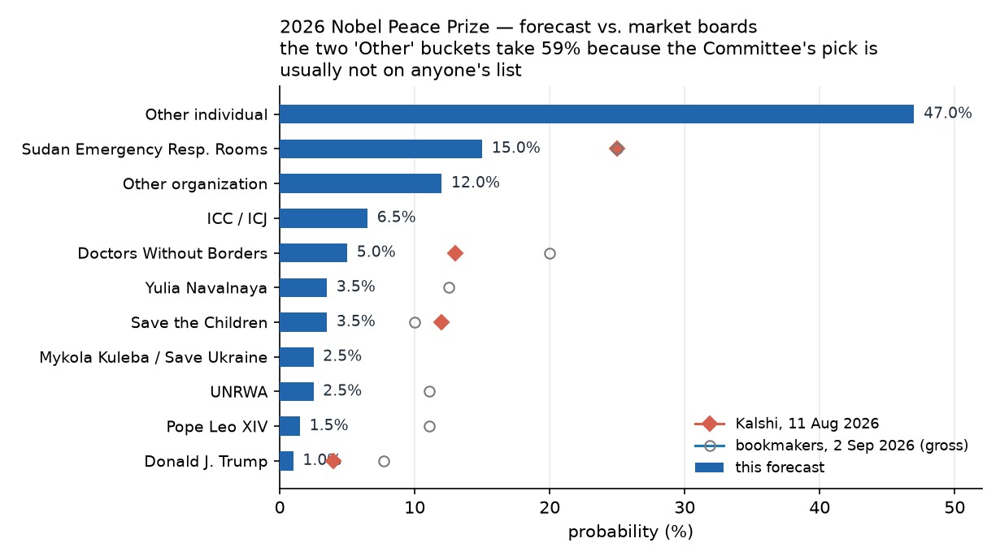

# Who will be awarded the 2026 Nobel Peace Prize?

| | |
|---|---|
| **Source** | Metaculus #45383 — https://www.metaculus.com/questions/45383/ |
| **Type** | multiple choice — 11 options |
| **Opened / Closes / Resolves** | 2026-09-07 / 2026-10-08 / 2026-10-09 |
| **Status** | open |
| **Current forecast** | **Other individual 47.0% · Sudan ERRs 15.0% · Other organization 12.0% · ICC/ICJ 6.5% · MSF 5.0% · Navalnaya 3.5% · Save the Children 3.5% · Kuleba/Save Ukraine 2.5% · UNRWA 2.5% · Pope Leo XIV 1.5% · Trump 1.0%** — leading option IQR [40.0%, 54.0%] (v1, 2026-09-05) |
| **Community (as of 2026-09-05)** | **not yet revealed** — status `upcoming`, CP reveal 2026-09-10T17:00Z (n=13 forecasters already in) |
| **Next review** | 2026-09-28 |

<!-- Versions below, newest first. APPEND-ONLY: never edit or delete a past version. -->

---

## v1 — Initial forecast — 2026-09-05

### What resolves YES

The recipient of the 2026 Nobel Peace Prize, announced by the Norwegian Nobel Committee on
**Friday 9 October 2026 at 11:00 CEST** at the Norwegian Nobel Institute in Oslo. A recipient not
named among the nine specific options resolves as **Other individual** or **Other organization**.
If no prize is awarded, the question is **annulled**.

**The shared-prize rule does real work.** If the prize is shared, the question resolves as the
option naming one of the recipients — but **if more than one recipient is named in the options, or
none is, it resolves according to the recipient listed first in the official announcement.**
34 of 106 prizes have been shared, so this is a ~1-in-3 contingency. It matters concretely here:
PRIO's 2026 recommendation is **Mykola Kuleba *and* Save the Children jointly**, and both appear as
separate options — that exact award would be decided by announcement order alone. Two other options
bundle entities: "ICC / ICJ" covers two distinct courts, and "Mykola Kuleba / Save Ukraine" covers a
man and his organisation.

287 candidates were nominated — **208 individuals and 79 organisations**. Nominations are sealed for
50 years; nominators may publicise their own picks, which is why every visible "shortlist" is a
biased sample of a secret pool.

### Outside view

| Base rate | Value |
|---|---|
| Prizes awarded / laureates | 106 / 143 |
| Laureates: individuals vs organisations | 112 / 31 → **22% organisations** |
| Single-laureate prizes | 72 of 106 (68%) |
| **First-listed recipient was an organisation, last 10 prizes** (2017 ICAN, 2020 WFP, 2024 Nihon Hidankyo) | **3 / 10 = 30%** |

So under this question's first-listed rule, **P(organisation) ≈ 30%** is the anchor. Six of the nine
named options are organisations, which is a warning sign, not a licence.

**The decisive base rate, though, is about predictability.** Was the eventual laureate among the
eight-to-ten most-discussed pre-announcement names?

| Year | Laureate | On the visible list? |
|---|---|---|
| 2025 | María Corina Machado | yes |
| 2024 | Nihon Hidankyo | **no** |
| 2023 | Narges Mohammadi | yes (borderline) |
| 2022 | Bialiatski / Memorial / CCL | **no** |
| 2021 | Ressa / Muratov | **no** |
| 2020 | World Food Programme | **no** |
| 2019 | Abiy Ahmed | borderline (Thunberg was the heavy favourite) |
| 2018 | Mukwege / Murad | yes |
| 2017 | ICAN | **no** |
| 2016 | Santos | yes |

**≈ 4–5 of 10**, and the pre-announcement *favourite* has won perhaps **1–2 times in 10**. That is
why the two "Other" buckets carry 59% here.

**The one honourable exception is the PRIO Director's Shortlist.** Same-year hits since 2014:
Malala (2014), Mukwege + Murad (2018), Abiy (2019), Memorial (2022), Mohammadi (2023), Nihon
Hidankyo (2024) — **6 of 11 years ≈ 55%** for a five-item list. (Wikipedia's headline "10 of the
speculated candidates were eventually awarded" conflates later-year hits — Santos listed 2015 won
2016, WFP listed 2018 won 2020, Muratov listed 2020 won 2021 — which I exclude.) I use **≈ 45%**,
discounting for small sample and for one eccentric 2026 entry.

### Inside view

**PRIO Director's 2026 shortlist:** (1) Mykola Kuleba and Save the Children — war's impact on
children; (2) **Sudan's Emergency Response Rooms** — local civilian humanitarian networks;
(3) **the World Trade Organization** — multilateral trade as a foundation of interstate peace;
(4) **the Committee to Protect Journalists**; (5) **the ICJ and ICC** — accountability and
international law. **Two of the five (WTO, CPJ) fall into "Other organization"** on this ballot, so
even a PRIO hit does not guarantee a named option.

**Market boards.** Kalshi (2026-08-11, ~$800k volume): Sudan ERRs **25%**, MSF 13%, Save the
Children 12%, Zelenskyy 5%, Trump 4% (down from 35¢). Bookmakers (OLBG, 2026-09-02, gross of a
119.4% overround with **no "any other" price at all**): Sudan ERRs 3/1, MSF 4/1, Zelenskyy 6/1,
Navalnaya 7/1, Pope Leo XIV 8/1, UNRWA 8/1, Save the Children 9/1, Trump 12/1, Francesca Albanese
12/1. Manifold: Trump 2%.

**Construction.** P(on PRIO's list) ≈ 0.45 → Sudan ERR 0.15, ICJ/ICC 0.10, Kuleba + Save the
Children 0.08, CPJ 0.07, WTO 0.05. P(not on PRIO's list) ≈ 0.55 → MSF 0.05, Navalnaya 0.035,
UNRWA 0.025, Pope 0.015, Trump 0.01, everything else 0.415. Then I constrain the organisation share
toward the 30% base rate — pushing it to ~44%, not the ~60% my raw components implied, because the
*mechanism* behind the boards' org-heaviness is that **organisations are easier to name in advance
than individuals**. That is exactly the bias that has made the favourite lose eight or nine years
out of ten.

| Option | P | Reasoning |
|---|---|---|
| **Other individual** | **47.0%** | Zelenskyy (Kalshi 5%), Shehbaz Sharif, Francesca Albanese, Narges Mohammadi, Greta Thunberg, Maia Sandu, Tamim bin Hamad Al Thani, Guterres — plus ~200 secret nominees. This is where the Committee usually lands |
| Sudan Emergency Response Rooms | 15.0% | Market favourite **and** PRIO-listed — the strongest signal convergence available, and squarely in the Committee's recent taste for grassroots networks (Nihon Hidankyo 2024, Memorial/CCL 2022, Tunisian Quartet 2015). Discounted from 25% for favourite-overpricing |
| **Other organization** | **12.0%** | Contains the two PRIO-listed entries that are not options — **WTO** and **CPJ** — plus UNICEF, UNHCR, ICRC, RSF |
| ICC / ICJ | 6.5% | PRIO-listed; awarding the courts while the ICC is under US sanctions is a classic Norwegian statement. Never awarded before, which cuts both ways |
| Doctors Without Borders | 5.0% | **Already won in 1999.** Repeat organisational awards exist (ICRC ×3, UNHCR ×2) but are rare and long-gapped. Markets appear to over-rate it as a safe name |
| Yulia Navalnaya | 3.5% | Russian dissent was honoured in 2021 and 2022, which reduces rather than raises the need |
| Save the Children | 3.5% | PRIO-listed jointly with Kuleba; the joint-award branch splits between this row and the next on announcement order |
| Mykola Kuleba / Save Ukraine | 2.5% | as above |
| UNRWA | 2.5% | The Committee declined it in 2024 and 2025, when Gaza pressure was at its peak |
| Pope Leo XIV | 1.5% | **No pope has ever won** — not even John Paul II. Barely a year into the papacy |
| Donald J. Trump | 1.0% | see below |

P(organisation) = **44.5%**, P(individual) = **55.5%**.

### Evidence

**Trump is the biggest single move in the field, and it is downward.** He was odds-on before
Christmas 2025 — 55% implied (4/5) — on the Gaza framework, the Abraham Accords, the "Board of
Peace" charter, and public nominations from the leaders of Cambodia, Israel and Pakistan. He now
prices at 1–4% everywhere: Kalshi 4¢ (from 35¢), Manifold 2%, bookmakers 12/1. The mechanism is
explicit in Kalshi's own commentary: **the United States has been at war with Iran since
2026-02-28** — an air campaign, a naval blockade of Iranian ports, a collapsed July ceasefire — and
on 2026-08-17 the President publicly threatened to "bomb the s--- out of" Oman, a US security
partner. Meanwhile Gaza's Phase 2 has been stalled since January with "little progress" as of July,
and the April and May 2026 Russo-Ukrainian "truces" were a 32-hour Orthodox Easter pause and a
three-day Victory Day pause — humanitarian gestures, not settlements (LR ≈ 0.05 against the
December-2025 view).

**That absence is itself the year's defining fact: there is no live peacemaker narrative for 2026.**
When no settlement is available to reward, the Committee reliably falls back on humanitarian work,
civil society, human rights or international law — which is exactly what both the market board and
the PRIO list are pointing at, and exactly the category in which its picks are least predictable.

**What I looked for and did not find.** A reason to trust the concentration of the boards. Kalshi's
three organisational favourites sum to **50%**, which would imply P(organisation) ≥ 50% against a
30% base rate on the first-listed rule. Nothing in the 2026 record justifies that; the boards are
concentrated because organisations are nameable, not because the Committee has narrowed.

**A misconception worth naming, and a caveat on my own evidence.** The bookmaker board's nine prices
sum to 119.4% **with no "any other" price at all**. Normalising it — the obvious move — would
silently assign zero probability to the ~50% of outcomes that historically fall outside every
published list. I used it for ordering, not for levels. Separately, my extraction of the Polymarket
board ($23.7M volume, by far the deepest market) was **partial and I flag it as unreliable**: it
returned Navalnaya 8%, UNRWA 5.8%, Zelenskyy 4.2%, ICJ 3.5%, Pope 2%, Trump 2% and a long sub-1%
tail, with Sudan ERRs and MSF absent and the listed names summing to only ~34%. Either the fetch
truncated or Polymarket is far more diffuse than Kalshi. I have not leaned on it in either
direction, and resolving it is the first task of the next update.

### Other forecasters

| Source | Value | As of | Note |
|---|---|---|---|
| Metaculus CP (recency-weighted) | **not revealed** | 2026-09-05 | status `upcoming`; CP reveal 2026-09-10T17:00Z; 13 forecasters already submitted |
| Metaculus Pro | not revealed | 2026-09-05 | same |
| Metaculus gold medalists | not revealed | 2026-09-05 | same |
| **Kalshi** | Sudan ERRs 25% · MSF 13% · Save the Children 12% · Zelenskyy 5% · Trump 4% | 2026-08-11 | real-money, but only ~$800k volume — thin for a 30-outcome market |
| **Polymarket** | Navalnaya 8% · UNRWA 5.8% · Zelenskyy 4.2% · ICJ 3.5% · Pope 2% · Trump 2% (**partial extraction, unreliable**) | 2026-09-05 | $23.7M volume — the deepest market; listed names sum to only ~34% |
| **Bookmakers (OLBG)** | Sudan ERRs 3/1 · MSF 4/1 · Zelenskyy 6/1 · Navalnaya 7/1 · Pope 8/1 · UNRWA 8/1 · StC 9/1 · Trump 12/1 · Albanese 12/1 | 2026-09-02 | gross of a 119.4% overround; **no field price** |
| Manifold | Trump 2% | 2026-08-11 | play-money, discounted; agrees with Kalshi |
| **PRIO Director's list** | Kuleba + Save the Children · Sudan ERRs · WTO · CPJ · ICJ + ICC | 2026 | ~55% same-year hit rate for a 5-item list — the best non-market signal |
| Sentinel Team / GJOpen / INFER | nothing found | 2026-09-05 | searched |

**Cohort disagreement**: not assessable — all three Metaculus cohorts are hidden until 2026-09-10.

**Where I differ from a market by more than 10 pp, and why**: Kalshi has Sudan ERRs at 25%; I have
15%. The justification is the pre-announcement-favourite record (1–2 wins in 10 years), Kalshi's
thin $800k volume in a many-outcome novelty market, and the structural point that Kalshi's implied
P(organisation) exceeds 50% against a 30% base rate. I have deliberately *not* discounted Sudan ERRs
to the level that argument alone would suggest, because it is the one candidate carrying both the
market's top price and a PRIO listing.

### Scenarios

| # | Scenario | Weight | Implies |
|---|---|---|---|
| 1 | **The usual outcome** — the Committee picks a human-rights defender, journalist, dissident or peace campaigner who was not on any published list, from the 208 secret individual nominees. | 0.42 | Other individual |
| 2 | **Sudan wins.** The world's largest humanitarian catastrophe is honoured through its grassroots mutual-aid networks — the Nihon Hidankyo / Tunisian Quartet template. | 0.15 | Sudan ERRs |
| 3 | **An unlisted organisation** — the Committee to Protect Journalists, the WTO, UNICEF, UNHCR, ICRC or Reporters Without Borders. | 0.12 | Other organization |
| 4 | **A defence-of-international-law statement** — the ICC and/or ICJ, amid US sanctions on the Court. | 0.065 | ICC / ICJ |
| 5 | **A named humanitarian organisation** — MSF, Save the Children (alone or first-listed with Kuleba), or UNRWA. | 0.11 | MSF / StC / UNRWA |
| 6 | **A named individual on the visible board** — Navalnaya, Kuleba, Pope Leo XIV. | 0.075 | those options |
| 7 | **A late Iran settlement revives the peacemaker narrative** before 9 October. | 0.01 | Trump |

### Sensitivity

| Assumption | If instead | Forecast becomes |
|---|---|---|
| The "Other" buckets deserve ~59% (favourite wins 1–2 in 10) | Kalshi's board is taken at face value | Sudan ERRs ~25%, MSF ~13%, StC ~12%, Others ~35% |
| P(organisation) ≈ 44%, constrained toward the 30% base rate | The org-heavy boards are treated as fully informative (P(org) ≈ 60%) | Sudan ERRs ~20%, Other org ~16%, Other individual ~33% |
| PRIO's list carries ~45% of the mass | PRIO's ~55% raw hit rate is used unadjusted | Sudan ERRs ~18%, ICC/ICJ ~8%, Other org ~14%, Other individual ~42% |
| No Iran settlement before 9 October | A US–Iran peace agreement is signed in September | Trump ~8–12%, everything else scaled down |
| No leak | Norwegian media break the name in the final week | collapses to a near-certainty on one option |

### What would change my mind (tripwires)

- [ ] **Norwegian media (NRK, Aftenposten, VG) report a leak of the laureate's name** — by 2026-10-09 → collapse the vector onto that option, up to 85 pp
- [ ] **Kalshi's Sudan ERRs price moves outside 15–35%** — by 2026-10-08 → move ~40% of the way toward the new price, up to 6 pp on that option
- [ ] **A full, reliable Polymarket board is obtained and Sudan ERRs / MSF price materially differently from Kalshi** — by 2026-09-20 → re-weight the market inputs; up to 5 pp on the leading options
- [ ] **A US–Iran ceasefire or comprehensive settlement is signed** — by 2026-10-08 → Trump up 8 pp
- [ ] **Gaza Phase 2 implementation restarts with a signed agreement** — by 2026-10-08 → Trump up 4 pp, Other individual down
- [ ] **A named option's principal becomes ineligible or is discredited** (e.g. a scandal at an ERR network, or a death — the prize is not awarded posthumously) — by 2026-10-08 → redistribute that option's mass
- [ ] **Metaculus CP on reveal (2026-09-10) puts the two "Other" buckets combined below 40% or above 75%** → direction unknown; trigger a re-analysis rather than a nudge

### Sources

1. Metaculus — question #45383, resolution criteria, fine print, background — https://www.metaculus.com/questions/45383/ ; snapshot in `raw/metaculus-2026-09-05.json` (accessed 2026-09-05)
2. Wikipedia — "2026 Nobel Peace Prize" — https://en.wikipedia.org/wiki/2026_Nobel_Peace_Prize (accessed 2026-09-05)
3. NobelPrize.org — Nobel Peace Prize facts (106 prizes, 143 laureates, 112 individuals / 31 organisations, 72 single / 34 shared) — https://www.nobelprize.org/prizes/facts/facts-on-the-nobel-peace-prize/ (accessed 2026-09-05)
4. NobelPrize.org — All Nobel Peace Prizes — https://www.nobelprize.org/prizes/lists/all-nobel-peace-prizes/ (accessed 2026-09-05)
5. Nobel Peace Prize — "Nominations for the Nobel Peace Prize 2026" (287 candidates: 208 individuals, 79 organisations) — https://www.nobelpeaceprize.org/press/press-releases/nominations-for-the-nobel-peace-prize-2026 (accessed 2026-09-05)
6. NobelPrize.org — "The 2026 Nobel Prize announcements" (Peace Prize 9 October 2026, 11:00 CEST) — https://www.nobelprize.org/press-release/the-2026-nobel-prize-announcements/ (accessed 2026-09-05)
7. **PRIO — "PRIO Director's 2026 Nobel Peace Prize List"** — https://www.prio.org/nobellist/2026 (accessed 2026-09-05)
8. PRIO — "Nobel Peace Prize 2026: PRIO Director's list announced" — https://www.prio.org/news/3693 (accessed 2026-09-05)
9. Wikipedia — "PRIO Director's Shortlist" (historical hit rate) — https://en.wikipedia.org/wiki/PRIO_Director%27s_Shortlist (accessed 2026-09-05)
10. **Covers.com — "Kalshi Nobel Peace Prize Odds: Trump vs. Sudan's ERRs"** (board captured 2026-08-11) — https://www.covers.com/entertainment/nobel-peace-prize-odds (accessed 2026-09-05)
11. **OLBG — "Nobel Peace Prize 2026 Odds: Trump Drifts As Sudan Group Leads"** (board updated 2026-09-02) — https://www.olbg.com/news/nobel-peace-prize-2026-odds-trump-drifts-sudan-group-leads (accessed 2026-09-05)
12. OLBG — "2026 Nobel Peace Prize Odds: Sudan's Emergency Response Rooms Lead, Trump 4/1 Second Favourite" — https://www.olbg.com/news/2026-nobel-peace-prize-odds-sudans-emergency-response-rooms-lead-trump-4-1-second-favourite (accessed 2026-09-05)
13. Oddspedia — "Nobel Peace Prize Odds 2026 | ERRs Lead Pope Leo & Trump" — https://oddspedia.com/insights/features/nobel-peace-prize-odds-and-predictions (accessed 2026-09-05; **direct fetch returned HTTP 403 — board read via search index**)
14. Polymarket — "Nobel Peace Prize Winner 2026" ($23.7M volume) — https://polymarket.com/event/nobel-peace-prize-winner-2026-139 (accessed 2026-09-05; **extraction partial and flagged unreliable — see Evidence**)
15. Tech Insider — "Trump's 2026 Nobel Peace Prize Odds Crater to 2% on Manifold as Bettors Pile In" (2026-08-11) — https://tech-insider.org/trump-nobel-peace-prize-2026-manifold-odds-2-percent/ (accessed 2026-09-05)
16. Newsweek — "Donald Trump's Odds of Winning 2026 Nobel Peace Prize Surge" — https://www.newsweek.com/donald-trumps-odds-winning-2026-nobel-peace-prize-11899995 (accessed 2026-09-05)
17. Washington Times — "Trump tops Nobel Peace Prize odds, matching his self-assessment" (2026-01-20) — https://www.washingtontimes.com/news/2026/jan/20/trump-tops-nobel-peace-prize-odds-matching-self-assessment/ (accessed 2026-09-05)
18. Federal News Network — "Tracking Odds for Nobel Peace Prize After Trump Signs Board of Peace Charter" (Jan 2026) — https://federalnewsnetwork.com/prediction-markets/2026/01/odds-nobel-peace-prize-trump-signs-board-of-peace-charter/ (accessed 2026-09-05)
19. The Irish Times — "Forecasting the world in 2026: Will Trump win the Nobel peace prize?" (2025-12-29) — https://www.irishtimes.com/world/2025/12/29/forecasting-the-world-in-2026-will-trump-win-the-nobel-peace-prize-will-starmer-survive/ (accessed 2026-09-05)
20. Wikipedia — "Gaza peace plan" — https://en.wikipedia.org/wiki/Gaza_peace_plan (accessed 2026-09-05)
21. Council on Foreign Relations — "A Guide to the Gaza Peace Deal" — https://www.cfr.org/articles/guide-trumps-twenty-point-gaza-peace-deal (accessed 2026-09-05)
22. Al Jazeera — "'Neither war nor peace': What Gaza looks like six months into 'ceasefire'" (2026-04-10) — https://www.aljazeera.com/news/2026/4/10/neither-war-nor-peace-what-gaza-looks-like-six-months-into-ceasefire (accessed 2026-09-05)
23. J Street — "Nine Months In: Assessing the Status of the Gaza Ceasefire" — https://jstreet.org/nine-months-in-assessing-the-status-of-the-gaza-ceasefire/ (accessed 2026-09-05)
24. Wikipedia — "April 2026 Russo-Ukrainian truce" and "May 2026 Russo-Ukrainian truce" — https://en.wikipedia.org/wiki/April_2026_Russo-Ukrainian_truce (accessed 2026-09-05)
25. Wikipedia — "2025 Nobel Peace Prize" (María Corina Machado) and "2024 Nobel Peace Prize" (Nihon Hidankyo) — https://en.wikipedia.org/wiki/2025_Nobel_Peace_Prize (accessed 2026-09-05)
26. Sunday Guardian — "Donald Trump 'Likely' for Nobel Peace Prize 2026? … Committee Keeps 287 Nominees Secret" — https://sundayguardianlive.com/world/donald-trump-likely-for-nobel-peace-prize-2026-chances-spark-debate-as-committee-keeps-287-nominees-secret-with-no-official-confirmation-187766/ (accessed 2026-09-05)

**Date**: 2026-09-05
**Forecast**: Other individual 47.0%, Sudan Emergency Response Rooms 15.0%, Other organization 12.0%, ICC/ICJ 6.5%, Doctors Without Borders 5.0%, Yulia Navalnaya 3.5%, Save the Children 3.5%, Mykola Kuleba/Save Ukraine 2.5%, UNRWA 2.5%, Pope Leo XIV 1.5%, Donald J. Trump 1.0% — leading option IQR [40.0%, 54.0%]
**Thesis**: In the last ten years the eventual laureate was among the visible pre-announcement favourites only about four or five times and the outright favourite won once or twice, so the two "Other" buckets deserve ~59% — Kalshi's three organisational favourites summing to 50% would imply P(organisation) above 50% against a 30% base rate under this question's first-listed-recipient rule [3,10]. Sudan's Emergency Response Rooms get the largest named slot at 15% because they are the one candidate carrying both the market's top price and a PRIO listing, and PRIO's five-item shortlist has contained the same-year laureate in roughly 6 of the last 11 years [7,9]. Trump falls to 1%: he was odds-on at 55% before Christmas, but the United States has been bombing and blockading Iran since 28 February, Gaza's Phase 2 has been stalled since January, and the 2026 Ukraine "truces" lasted 32 hours and three days — there is no peacemaker narrative left to reward [10,15,20,24].
