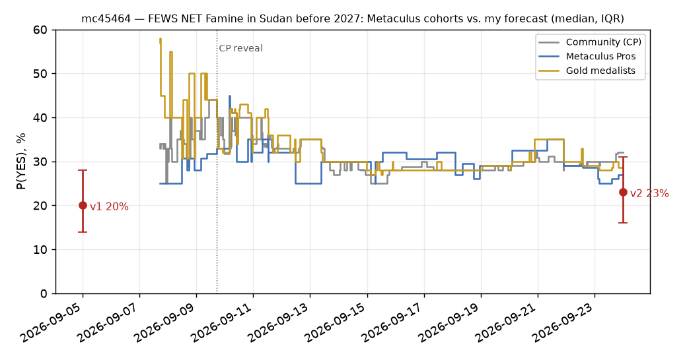

# Will FEWS NET classify any area of Sudan as experiencing Famine before 2027?

| | |
|---|---|
| **Source** | Metaculus #45464 — https://www.metaculus.com/questions/45464/ |
| **Type** | binary |
| **Opened / Closes / Resolves** | 2026-09-07 / 2026-10-31 / 2026-12-31 |
| **Status** | open |
| **Current forecast** | **Median 25.0%, IQR [17.0%, 34.0%]** (v3, 2026-10-09) |
| **Community (as of 2026-09-24; fresh CP unavailable 2026-10-09)** | CP 32.0% (n=112; n=141 on 2026-10-09) · Pro 27.0% · Gold 28.7% |
| **Next review** | 2026-10-28 |

<!-- Versions below, newest first. APPEND-ONLY: never edit or delete a past version. -->

---

## v3 — Update — 2026-10-09

Mode: **Update** (incremental). v2 was a re-analysis 15 days ago. No market contradicts me by more
than 10 pp, and less than a third of the window has passed since v2. Prior = v2 (23.0%).

### Revision
| Driver | Direction | Effect |
|---|---|---|
| Prior (v2, 2026-09-24) | — | Median 23.0%, IQR [16.0%, 31.0%] |
| The **Sept 2026 KMU** (Key Message Update), the first map that counts for resolution, has published. It has **zero** Phase 5 area units: 171 units in Phase 4, 196 in Phase 3, 23 in Phase 2 (FEWS NET Data Warehouse, FDW, retrieved 2026-10-09) [33,34]. One of the ~4 qualifying shots is used up. KMUs were the low-hazard shots anyway | ↓ | −2.0 pp |
| **New escalation in that KMU: risk of Famine extends to South Darfur, Sharg Aj-Jabal (East Jebel Marra).** In **2 of 4 IDP camps** surveyed in late Aug and early Sep, GAM (global acute malnutrition, weight-for-height) is **above the Famine threshold**. Food consumption and mortality are still at Phase 4. FEWS NET writes that more drought-driven displacement would make Famine "the most likely outcome" there [33]. IDP settlements are units that count for resolution. One of the three IPC outcome legs is already met there, so this is a new path (F) | ↑ | +3.5 pp |
| September rainfall was "severely below average", and harvests will be below to severely below average across Greater Darfur and Kordofan, with localised crop failure. This confirms the harvest-failure leg of FEWS NET's conjunctive Famine scenario. HRP (Humanitarian Response Plan) funding is 41%, and 3.7M people were reached in August (<20% of need) [33] | ↑ | +1.0 pp |
| Quiet elsewhere: no FRC (IPC Famine Review Committee), no FEWS NET Alert, no new mortality survey from the six named sites. No reported closure of El Obeid's eastern route and no announced WFP ration cut (searched 2026-10-09) [35,36,37] | ↓ | −0.5 pp |
| Metaculus cohorts: no fresh aggregation (blocked by Cloudflare on 2026-10-09). Forecaster count rose from 112 to 141 [38]. Weighting is unchanged from v2 | → | 0 pp |
| **New forecast** | | **Median 25.0%, IQR [17.0%, 34.0%]** |

### Tripwire check
| Tripwire from v2 | Fired? | Note |
|---|---|---|
| A FEWS NET Sudan map Reported Sept–Dec 2026 shows a current-period Phase 5 area | **Not fired** | The Sept KMU map has 0 Phase 5 units (FDW `reporting_date` 2026-09-01) [34] |
| Sept KMU publishes with no Phase 5 area **and no escalation** | **Half fired** | No Phase 5 area, but there *is* escalation: the risk area expands to South Darfur, GAM is above the Famine threshold in 2 camps, and Famine is conditionally "most likely". The −2 pp tripwire therefore does not apply as written. The net is shown in the revision table |
| Oct 2026 Food Security Outlook publishes with no current-period Phase 5 and no Famine-most-likely projection | Pending | Due ~early Nov |
| IPC FRC convened for Sudan | Not fired | Nothing found. The last IPC round (May 2026) had no Famine classification [36] |
| Mortality/SMART survey from Um Baru, Kernoi, At-Tine, Dilling, Kadugli or El Obeid with CDR (crude death rate) > 2/10,000/day | Not fired | The only new surveys are from South Darfur, with mortality at Phase 4 levels [33] |
| FEWS NET Alert, or Famine projected most-likely for any period | **Partial** | No Alert. Famine is "most likely" only *conditional on* further displacement into Sharg Aj-Jabal. That is not the most-likely scenario on the map [33] |
| El Obeid's eastern supply route closes | Not fired | No October reporting found. FEWS NET says Catastrophe (Phase 5) is likely for *populations* in and around El Obeid [33,37] |
| WFP announces ration suspension or cuts for North Darfur, Tawila or Kordofan | Not fired | Only the 14 Sep "within weeks" warning. No announced cut found [35] |
| Sudan suspended, or no Sudan map by 2026-10-31 | **Not fired (resolved NO side)** | The Sept KMU published, so the map tripwire can no longer fire |

### What resolves YES
Unchanged from v2. The Sept KMU now counts as one qualifying map, and it came out NO. Remaining
shots: the **Oct Food Security Outlook** (the full re-analysis with a current-situation map,
published ~early Nov), plus the Nov and Dec KMUs. Note the timing: the October Outlook
usually publishes in the first half of November, so it is still inside the window.

### Outside view
Unchanged from v2. The FDW series now reads **9 straight maps with no Phase 5 unit (Feb–Sep 2026)** [34].

### Inside view
| Path | v2 p | v3 p | Why |
|---|---|---|---|
| A — NW/central North Darfur (Um Baru, Kernoi, At-Tine) | 0.13 | **0.12** | Still named, with Phase 5 populations. The Sept map did not convert. No new evidence |
| B — El Obeid | 0.07 | **0.07** | FEWS NET now states Catastrophe is "likely" in El Obeid and its surroundings. No encirclement |
| C — Kadugli / Dilling | 0.05 | **0.05** | Unchanged. No sign of re-siege found |
| D — Q4 IPC/FRC round | 0.03 | **0.025** | Time decay |
| E — Aid-withdrawal conversion | 0.02 | **0.02** | The cut is warned of but not yet announced |
| **F — South Darfur, Sharg Aj-Jabal IDP camps** (new) | — | **0.05** | The GAM leg is already met in 2 camps. The October Outlook needs consumption deficits (≥ 20% of households) or CDR > 2 to cross the threshold on "reasonable" evidence. FEWS NET explicitly gives the trigger: displacement driven by crop failure, at harvest time, with poor September rains already observed [33] |

`1 − (0.88 × 0.93 × 0.95 × 0.975 × 0.98 × 0.95) = 29.3%`. Structural adjustments as in v2: −4 pp
for FEWS NET's own projection, now reaffirmed twice. The Sept KMU had the camp GAM data and still
did not classify. Then −2 pp for the post-harvest window (smaller, because harvests are failing),
and +1 pp for the low settlement bar. That gives an **inside view of ~24%**. I weight the stale
(2026-09-24) Pro/gold numbers at ~28% lightly, as in v2, which lands at **25%**.

### Evidence
**Up:** For the first time since Jan 2026, FEWS NET reports a Famine-threshold *outcome
indicator* in a specific population (GAM above 30% in 2 IDP camps, East Jebel Marra). It also
names the mechanism that would complete the classification [33]. Independent early-warning
reporting (Dabanga, 17 Sep) also flags Jebel Marra, El Malha, Buram and Tawila as fast-
deteriorating [39]. NGOs launched a joint harvest-protection appeal on 2026-10-05 [40].
**Down:** FEWS NET had these survey results in hand and wrote explicitly that they "do not
establish a Famine classification". Mortality and food consumption were both Phase 4. The
resolver has been conservative for 9 maps, and the conditional is a further step (*more*
displacement) beyond the current state.

### Other forecasters
| Source | Value | As of | Note |
|---|---|---|---|
| Metaculus CP | 32.0% IQR [27, 36] | **2026-09-24 (stale)** | fresh CP unavailable 2026-10-09 (Cloudflare block). Forecaster count 141 per official API, 2026-10-09 [38] |
| Metaculus Pro | 27.0% IQR [25, 35] | **2026-09-24 (stale)** | fresh CP unavailable 2026-10-09 (Cloudflare block) |
| Metaculus gold | 28.7% IQR [27, 34.8] | **2026-09-24 (stale)** | fresh CP unavailable 2026-10-09 (Cloudflare block) |
| Kalshi / Polymarket / Manifold | no matching market | 2026-10-09 | unchanged |
| FEWS NET (implicit) | No Phase 5 area. Famine "most likely" only conditionally, in South Darfur | Sept 2026 KMU | [33] |

On the stale numbers I am 2–7 pp below Pros, gold and the CP. The gap has narrowed since v2.

### Scenarios
| # | Scenario | Weight | Implies |
|---|---|---|---|
| 1 | Status quo holds through the Dec KMU | 0.54 | NO |
| 2 | Deterioration without current-period classification (Alert, conditional or 2027 Famine projection) | 0.20 | NO |
| 3 | October Outlook classifies a North Darfur area or IDP settlement (path A) | 0.10 | YES |
| 4 | Sharg Aj-Jabal camps classified after displacement or consumption data (path F) | 0.05 | YES |
| 5 | El Obeid / Kadugli / Dilling classification | 0.08 | YES |
| 6 | Aid-cut conversion or an FRC elsewhere | 0.02 | YES |
| 7 | Mechanical NO | 0.01 | NO |

Weighted YES: 0.10 + 0.05 + 0.08 + 0.02 = **0.25**.

### Sensitivity
If the **October Outlook** publishes with no Phase 5 area → **~7–9%**. If it projects Famine as
most-likely for Feb–May 2027 with no current-period Phase 5 → ~12% (the KMUs could still update
the current period). If any camp in Sharg Aj-Jabal gets a mortality survey with CDR > 2 → ~50%.

### What would change my mind (tripwires)
- [ ] **A FEWS NET Sudan map Reported Oct–Dec 2026 shows a current-period Phase 5 area** — by 2026-12-31 → resolves YES
- [ ] **The Oct 2026 Food Security Outlook publishes with no current-period Phase 5 area** — by 2026-11-20 → down 16 pp
- [ ] **A mortality (CDR > 2/10,000/day) or food-consumption survey from Sharg Aj-Jabal camps, Um Baru, Kernoi, At-Tine, Dilling, Kadugli or El Obeid** — by 2026-12-15 → up 20 pp
- [ ] **FEWS NET Alert, or Famine projected as the unconditional most-likely outcome anywhere** — by 2026-12-15 → up 12 pp
- [ ] **IPC FRC convened for Sudan** — by 2026-11-30 → up 10 pp
- [ ] **Reports of a major new displacement wave into East Jebel Marra (> 50,000 people, per OCHA or IOM DTM)** — by 2026-11-30 → up 6 pp
- [ ] **El Obeid's eastern supply route closes** — by 2026-11-30 → up 8 pp
- [ ] **WFP announces ration suspension or cuts for Darfur or Kordofan caseloads** — by 2026-11-15 → up 3 pp

### Sources
Numbering continues from v2. The earlier sources re-cited in this version are repeated here (unchanged from v2); the rest of 1–32 are as in v1/v2.

25. FEWS NET — Sudan country page — https://fews.net/east-africa/sudan (accessed 2026-09-24)
27. FEWS NET — Sudan Acute Food Insecurity Classification, August 2026 – January 2027 — https://fews.net/sudan-acute-food-insecurity-classification-august-2026-january-2027 (accessed 2026-09-24)
32. Metaculus — question #45464, aggregation snapshot incl. cohort history and comments — https://www.metaculus.com/questions/45464/ ; cached in `raw/metaculus-2026-09-24.json` (accessed 2026-09-24)
33. FEWS NET — Sudan Key Message Update, September 2026 – January 2027, "As drought compounds conflict, the risk of Famine expands to parts of South Darfur" — https://fews.net/east-africa/sudan/key-message-update/september-2026 (accessed 2026-10-09)
34. FEWS NET Data Warehouse — IPC phase API, Sudan, 2026 — https://fdw.fews.net/api/ipcphase/?format=json&country_code=SD&start_date=2026-06-01&end_date=2026-12-31&fields=simple ; summary in `raw/fewsnet-fdw-phase-counts-2026-10-09.json` (accessed 2026-10-09)
35. The National — "WFP warns Sudan food aid could be cut within weeks…" (14 Sep 2026) — https://www.thenationalnews.com/news/us/2026/09/14/wfp-warns-sudan-food-aid-could-be-cut-within-weeks-as-20-million-face-acute-hunger/ (accessed 2026-10-09 via search; no later cut announcement found)
36. UNICEF/WFP/FAO — "Risk of Famine persists…" (May 2026 IPC) — https://www.unicef.ie/pr-news/risk-of-famine-persists-in-sudan/ (accessed 2026-10-09 via search)
37. ACLED — "Can RSF seize El Obeid?" — https://acleddata.com/expert-comment/can-rsf-seize-el-obeid (accessed 2026-10-09 via search; no October 2026 encirclement reporting found)
38. Metaculus — official API post JSON, #45464 (bot key; status open, closes 2026-10-31, nr_forecasters 141; aggregations hidden) — cached in `raw/metaculus-api-2026-10-09.json` (accessed 2026-10-09). Cohort numbers above come from `raw/metaculus-2026-09-24.json` [32]
39. Dabanga via AllAfrica — "Urgent Report Underlines Sudan Famine Risk As Food Insecurity Worsens" (17 Sep 2026) — https://allafrica.com/stories/202609180010.html (accessed 2026-10-09)
40. fundsforNGOs News — "Humanitarian groups issue joint call to protect Sudan's October 2026 to January 2027 harvest" (8 Oct 2026) — https://news.fundsforngos.org/2026/10/08/sudan-joint-call-protect-oct-2026-jan-2027-harvest-hunger-risk/ (accessed 2026-10-09 via search)

**Date**: 2026-10-09
**Forecast**: Median 25.0%, IQR [17.0%, 34.0%]
**Thesis**: The Sept KMU, the first qualifying map, still has zero Phase 5 units (9 straight maps) [33,34]. But it expands the risk of Famine to East Jebel Marra IDP camps, where GAM already exceeds the Famine threshold, and it names displacement driven by crop failure as the trigger that would make Famine most likely [33]. A failing harvest makes that trigger plausible. The October Outlook (due ~early Nov) remains the main shot.

---

## v2 — Re-analysis — 2026-09-24

Mode: **Re-analysis**, as v1 required. The CP-reveal tripwire fired: at reveal (2026-09-09 17:03Z)
the CP was 44% and gold medalists 44%, both above the 8%–32% band. The path probabilities below
are re-derived from scratch rather than nudged.

### Revision
| Driver | Direction | Effect |
|---|---|---|
| Prior (v1, 2026-09-05) | — | Median 20.0%, IQR [14.0%, 28.0%] |
| FEWS NET's August 2026 Outlook Update (published 2026-08-31, data as of 31 Aug) has **zero** Phase 5 area units in the FEWS NET Data Warehouse (FDW), the 8th straight map without one since Feb 2026. It still calls Famine a "credible risk" rather than the most-likely outcome, has no Alert, and already knew about the rainfall failure and the aid cuts [25,26,28] | ↓ | −2.0 pp |
| Elapsed time: 19 of ~117 days have passed, but no qualifying map has published yet. The Aug-31 map is "Reported" August, so it falls outside the window. All ~4 shots (Sept KMU, Oct Outlook, Nov and Dec KMU) are still ahead | → | −0.5 pp |
| WFP pipeline break: 2026 funding is $206M against $645M in 2025, with "significant" cut-backs "within weeks" (14 Sep). FEWS NET expects 1.5M more people to lose aid by year-end. Withdrawing aid is what turns a "4!" area into a 5 [26,29] | ↑ | +1.5 pp |
| North Kordofan escalation: fighting intensified in August and ~15,000 families were displaced into El Obeid. The city is **not** fully encircled, because the eastern SAF supply route is open [26,30] | ↑ | +0.5 pp |
| FDW history shows FEWS NET put a Phase 5 unit on its **June 2024** map, before the Aug 2024 FRC. FEWS NET can therefore classify on its own, and my v1 "FRC is the mechanism" framing was too strong [28] | ↑ | +1.0 pp |
| Metaculus cohorts: Pros 27%, gold 28.7%, CP 32% (n=112), all above me. I weight Pros and gold at ~30% against my inside view of ~21% (see Other forecasters) | ↑ | +2.5 pp |
| **New forecast** | | **Median 23.0%, IQR [16.0%, 31.0%]** |

### Tripwire check
| Tripwire from v1 | Fired? | Note |
|---|---|---|
| A FEWS NET Sudan map Reported Sept–Dec 2026 shows a current-period Phase 5 area | **Not fired** | No qualifying map yet. The Sept KMU is due ~end Sept |
| IPC Famine Review Committee convened for Sudan | Not fired | No announcement found. The last FRC was Oct 2025 [9] |
| Mortality / SMART survey from Um Baru, Kernoi, At-Tine, Dilling, Kadugli or El Obeid with CDR > 2/10,000/day | Not fired | Aug OU cites 26 SMART surveys, max GAM 26.6% (Beida, W. Darfur), none from the six named sites and **no mortality data** [26] |
| FEWS NET Alert, or Famine projected as most-likely for any period | Not fired | Latest Sudan Alert is 2025-09-05. Famine is still only a "credible risk" in 7 areas [25,26] |
| El Obeid fully encircled / last supply road closed | Not fired (partial pressure) | RSF holds the N, W and S sides. The eastern route is open but precarious [30] |
| Sept/Oct map repeats credible-risk language with no Phase 5 and no escalation | **Partial** | The August OU (not a qualifying map) did exactly this. The Sept/Oct maps are not out yet |
| Sudan added to the State Dept suspended list, or no map by 2026-10-31 | Not fired | Only Somalia, Yemen and Afghanistan are named suspended [21,31] |
| Metaculus CP on reveal outside 8%–32% | **Fired** | CP 44% → 40% within minutes of reveal, gold 44% → 40%, Pros 33%. Since then it has converged to CP 32 / Pro 27 / gold 28.7 [32] → this re-analysis |

### What resolves YES
Unchanged from v1, with one clarification. The **"Reported" date must fall after August 2026**, so the
Aug-2026 Outlook Update (published 2026-08-31) does not qualify even if one reads it generously.
The qualifying publications are therefore the **Sept KMU, the Oct Food Security Outlook** (the
full re-analysis with a new current-situation map, due ~early Nov but dated October), **and the
Nov and Dec KMUs**. KMUs usually carry the previous map forward unless something changes, so
the October Outlook is the main shot. The others are mostly chances to react to shocks.

Resolution-reading check prompted by the Metaculus comments: the criteria admit **"solid *or
reasonable*"** evidence. One commenter had misread this as solid-only and raised their number.
I had it right in v1, so no change.

### Outside view
Unchanged from v1 (Class A anchor ~12–15%), plus one new data series. FEWS NET's own Data
Warehouse (FDW) lets me count Phase 5 area units per Sudan map directly [28]:

| Map reporting month | Phase 5 units (near-term / current) |
|---|---|
| Jun–Sep 2024 | 1 (Zamzam / El Fasher area) |
| Oct 2024 | 1 |
| Nov–Dec 2024 | 10 |
| (Jan–Sep 2025) | no maps (FEWS NET offline, then resuming) |
| Oct–Nov 2025 | 2 |
| Dec 2025 – Jan 2026 | 1 |
| **Feb – Aug 2026 (8 maps)** | **0** |

This is a regime-switch series. Once in, FEWS NET stayed in for 6–8 months. Once out, it has
stayed out for 7 months. The switches happened when a siege configuration changed (Zamzam and
El Fasher in 2024, Kadugli in 2025, the sieges lifted in 2026). No siege has closed yet in 2026.
El Obeid is the candidate, and it is not closed.

### Inside view
Paths re-derived. `P(YES) = 1 − Π(1 − p_i)`:

| Path | v1 p | v2 p | Why it moved |
|---|---|---|---|
| **A — NW/central North Darfur** (Um Baru, Kernoi, At-Tine) | 0.12 | **0.13** | The Aug OU now states outright that **households** there are in Catastrophe (Phase 5) in the current period. Darfur's driest season since 1984 is confirmed. The October Outlook will be the first map written knowing the harvest has failed. The evidence gap is still open: no mortality data and no new surveys from these sites [26,29] |
| **B — El Obeid** | 0.08 | **0.07** | Pressure rose (IDP influx, drones), but the eastern corridor is still open. A "siege without full encirclement" has not produced a Famine classification in ~18 months [30] |
| **C — Kadugli / Dilling** | 0.06 | **0.05** | Named again among the 7 credible-risk areas with Phase-5 IDP populations. No sign of re-encirclement found |
| **D — Q4 IPC/FRC round** | 0.04 | **0.03** | Three weeks with no signal of a new IPC round or FRC |
| **E — Aid-withdrawal conversion** (new) | — | **0.02** | The WFP funding cliff removes aid in places FEWS NET may currently hold at 4 *because* of aid. The Tawila half-ration caseload alone is ~950,000 people [29] |

`1 − (0.87 × 0.93 × 0.95 × 0.97 × 0.98) = 26.9%`. I apply the same structural adjustments as in v1: −4 pp for FEWS
NET's own projection (reaffirmed on 31 Aug), −3 pp for the post-harvest window, +1 pp for the low
settlement bar. That gives an **inside view of ~21%**.

### Evidence
**New since v1, up:** The Aug OU names Phase 5 *household* populations in six locations: three in
North Darfur, plus El Obeid, Kadugli and Dilling IDPs [26]. FEWS NET's map puts an area in
Phase 5 when ≥ 20% of its population is in Phase 5, so the gap is now one of *share and
evidence*, not of kind. The WFP funding collapse is the most important new fact. It is a
known, dated mechanism that removes the assistance keeping areas out of Phase 5 (and "4!" does
not count). The FDW data correct a v1 claim: FEWS NET does not need an FRC first [28].

**New since v1, down:** The single most informative data point is again the resolver's own
latest judgement. It was written on 31 August, *after* the rainfall failure, the El Obeid
escalation and the anticipated aid cuts were all known, and it still has zero Phase 5 units and
no Famine-most-likely projection. Its scenario language is explicitly conjunctive: Famine
"*if* conflict escalates **and** severe sieges resume … **in combination with** marginal-to-no
harvests". A conjunction of three conditions is a low-probability event in a 4-month window.

**Absent:** no Alert, no FRC signal, no new mortality data, no full encirclement. Any of these
would be the staging I would expect before a Phase 5 classification.

### Other forecasters
| Source | Value | As of | Note |
|---|---|---|---|
| Metaculus CP (recency-weighted) | **32.0%**, IQR [27, 36] (n=112) | 2026-09-23 23:53Z | reveal 44% → 40%. Low of 25% on 15 Sep, drifting back up since |
| Metaculus Pro | **27.0%**, IQR [25, 35] (n=10) | 2026-09-23 | at reveal 33% |
| Metaculus gold medalists | **28.7%**, IQR [27, 34.8] (n=34) | 2026-09-23 | at reveal 44% |
| Kalshi / Polymarket / Manifold | no matching market | 2026-09-24 | unchanged from v1 |
| FEWS NET (implicit) | Famine not most-likely anywhere through Jan 2027 | 2026-08-31 | reaffirmed |

**Cohort disagreement.** The CP is 4–5 pp above Pros and gold. That is modest, and it follows the
usual pattern of the crowd running hotter on a headline-heavy question. The substantive gap is
between me (~21% inside view) and Pros/gold (~28%). **What they might know that I don't:** I
looked for it. The comments cite the same FEWS NET "credible risk" language, the rainfall failure
and the WFP cut. One comment explicitly anchors 35–45% on the "credible risk across multiple
areas" headline. I found no fact in the comments that I lacked. **What I might be
over-weighting:** the "evidence gap" argument. FEWS NET classified Zamzam in June 2024 on
reasonable evidence before the FRC [28], so the gap is less binding than I claimed. That is
already in the revision table. Net: I move ~30% of the way to Pros/gold (+2.5 pp). That is
weighting a better-calibrated cohort, not herding on the CP.

### Scenarios
| # | Scenario | Weight | Implies |
|---|---|---|---|
| 1 | Status quo holds through the Dec KMU | 0.58 | NO |
| 2 | Deterioration without current-period classification (Alert or Feb–May 2027 Famine projection) | 0.18 | NO |
| 3 | Evidence arrives from NW North Darfur (survey, mortality, or an October Outlook that re-reads existing data as ≥ 20% in Phase 5) | 0.12 | YES |
| 4 | El Obeid collapses: last road closes, rapid classification | 0.07 | YES |
| 5 | Kadugli/Dilling re-besieged, or aid-cut conversion elsewhere (Tawila etc.) | 0.04 | YES |
| 6 | Mechanical NO (suspension, no map) | 0.01 | NO |

Weighted YES: 0.12 + 0.07 + 0.04 = **0.23**.

### Sensitivity
Unchanged from v1, except the "no FRC" row is weaker: an FRC now moves the forecast to ~30%,
not ~32%, since FEWS NET can act without one. One new row: if the **Oct Outlook** (the main shot)
publishes with no Phase 5 area, the forecast drops to **~8–10%**. Only the Nov/Dec KMUs would
remain, and they react only to shocks.

### What would change my mind (tripwires)
- [ ] **A FEWS NET Sudan map Reported Sept–Dec 2026 shows a current-period Phase 5 area** — by 2026-12-31 → resolves YES
- [ ] **The Sept 2026 KMU publishes with no Phase 5 area and no escalation** — by 2026-10-10 → down 2 pp
- [ ] **The Oct 2026 Food Security Outlook publishes with no current-period Phase 5 and no Famine-most-likely projection** — by 2026-11-15 → down 13 pp
- [ ] **An IPC Famine Review Committee is convened for Sudan** — by 2026-11-30 → up 10 pp
- [ ] **A mortality (CDR) or SMART survey from Um Baru, Kernoi, At-Tine, Dilling, Kadugli or El Obeid shows CDR > 2/10,000/day** — by 2026-12-15 → up 15 pp
- [ ] **FEWS NET issues a Sudan Alert, or projects Famine as most-likely for any period** — by 2026-12-15 → up 12 pp
- [ ] **El Obeid's eastern supply route closes (full encirclement)**, per OCHA, WFP or Yale HRL — by 2026-11-30 → up 8 pp
- [ ] **WFP announces ration suspension or cuts for North Darfur, Tawila or Kordofan caseloads** — by 2026-10-31 → up 3 pp
- [ ] **Sudan added to the State Dept suspended-reporting list, or no Sudan map by 2026-10-31** → down 12 pp

### Sources
Numbering continues from v1. The v1 sources re-cited in this version are repeated here. The rest of 1–24 are as in v1.

2. FEWS NET — Key Message Update, Sudan, July 2026 – January 2027 — https://fews.net/east-africa/sudan/key-message-update/july-2026 (accessed 2026-09-05)
3. FEWS NET — Food Security Outlook, Sudan, June 2026 – January 2027 — https://fews.net/east-africa/sudan/food-security-outlook/june-2026 (accessed 2026-09-24; the Metaculus comment citing it says Famine is only the conditional alternative scenario)
4. FEWS NET — Food Security Outlook, Sudan, February 2026, "Famine thresholds no longer met…" — https://fews.net/east-africa/sudan/food-security-outlook/february-2026 (accessed 2026-09-05)
9. IPC — Famine Review Committee: Sudan, October 2025 — https://www.ipcinfo.org/fileadmin/user_upload/ipcinfo/docs/IPC_Famine_Review_Committee_Report_Sudan_Oct_2025.pdf (accessed 2026-09-24)
11. IPC — "SUDAN: Famine threshold for acute malnutrition surpassed in two more North Darfur localities…" (issue 143) — https://www.ipcinfo.org/ipcinfo-website/countries-in-focus-archive/issue-143/en/ (accessed 2026-09-24, via search index)
14. UNICEF / WFP / FAO — "Risk of Famine persists as nearly 19.5 million people face acute food insecurity in Sudan" (May 2026) — https://www.unicef.org/press-releases/risk-famine-persists-nearly-195-million-people-face-acute-food-insecurity-sudan (accessed 2026-09-24)
17. Al Jazeera — "El-Obeid under siege by RSF: Could this be Sudan's next el-Fasher?" (6 Jul 2026) — https://www.aljazeera.com/news/2026/7/6/el-obeid-under-siege-by-rsf-could-this-be-sudans-next-el-fasher (accessed 2026-09-24)
21. NPR (via KPCW) — "Whatever happened to the U.S. famine alert system…" (31 Aug 2026) — https://www.kpcw.org/npr-news/2026-08-31/whatever-happened-to-the-u-s-famine-alert-system-that-trump-shut-down-then-reopened (accessed 2026-09-05)
25. FEWS NET — Sudan country page — https://fews.net/east-africa/sudan (accessed 2026-09-24)
26. FEWS NET — Sudan Food Security Outlook Update, August 2026 – January 2027, "Conflict and poor rains to drive Emergency and risk of Famine during harvest" — https://fews.net/east-africa/sudan/food-security-outlook-update/august-2026 (accessed 2026-09-24)
27. FEWS NET — Sudan Acute Food Insecurity Classification, August 2026 – January 2027 — https://fews.net/sudan-acute-food-insecurity-classification-august-2026-january-2027 (accessed 2026-09-24)
28. FEWS NET Data Warehouse — IPC phase API, Sudan, 2023–2026 — https://fdw.fews.net/api/ipcphase/?format=json&country_code=SD&start_date=2024-01-01&end_date=2026-12-31&fields=simple ; summarised in `raw/fewsnet-fdw-phase-counts-2026-09-24.json` (accessed 2026-09-24)
29. The National — "WFP warns Sudan food aid could be cut within weeks as 20 million face acute hunger" (14 Sep 2026) — https://www.thenationalnews.com/news/us/2026/09/14/wfp-warns-sudan-food-aid-could-be-cut-within-weeks-as-20-million-face-acute-hunger/ (accessed 2026-09-24)
30. Wikipedia — "Siege of El Obeid" — https://en.wikipedia.org/wiki/Siege_of_El_Obeid (accessed 2026-09-24; tertiary, used only for encirclement status and corroborated by [26])
31. NPR — "Whatever happened to the U.S. famine alert system that Trump shut down, then reopened" (1 Sep 2026) — https://www.npr.org/2026/09/01/nx-s1-5944472/famine-usaid-fews-net (accessed 2026-09-24)
32. Metaculus — question #45464, aggregation snapshot incl. cohort history and comments — https://www.metaculus.com/questions/45464/ ; cached in `raw/metaculus-2026-09-24.json` (accessed 2026-09-24)

**Date**: 2026-09-24
**Forecast**: Median 23.0%, IQR [16.0%, 31.0%]
**Thesis**: FEWS NET's 31-Aug Outlook Update still has zero Phase 5 areas (8 straight maps since Feb 2026), though it already knew about the Darfur harvest failure and the aid cuts. Its Famine scenario needs escalation, resumed sieges and failed harvests together [26,28]. I move up modestly for three reasons: the WFP funding cliff removes the aid that keeps areas out of Phase 5 [29], FDW history shows FEWS NET can classify without an FRC [28], and Metaculus Pros/gold sit at 27–29% [32]. The October Outlook is the main qualifying shot.

---

## v1 — Initial forecast — 2026-09-05

### What resolves YES

A **FEWS NET** classification map for Sudan whose **"Reported" date falls after August 2026 and
before January 2027** must show at least one *area, urban settlement, or settlement of displaced
populations* in **IPC Phase 5: Famine**, with solid **or reasonable** evidence, **for the current
period**. Three exclusions do most of the work:

1. **Phase 4 with "!"** — "would likely be Phase 5 without assistance" — is explicitly excluded
   by fine print, and FEWS NET applies that annotation widely in Sudan.
2. **"Risk of Famine"** is not a classification. FEWS NET's Sudan pages currently carry the word
   *Famine* in almost every headline while classifying **nothing** in Phase 5. Reading the
   headlines rather than the map legend is the main way to get this question wrong.
3. The **current period**, not a projection. A map projecting Famine for Feb–May 2027 is a NO.

The resolver is FEWS NET (https://fews.net/east-africa/sudan), not the IPC. Publication cadence:
Food Security Outlook ≈ Feb/Jun/Oct, Outlook Update at mid-points, Key Message Updates otherwise
— so roughly **3–5 qualifying maps** in the window. The most recent publication as of today is
the Key Message Update **July 2026 – January 2027**, which classifies no area in Phase 5.

Note one mechanical NO tail: on 2026-08-31 NPR reported the State Department had suspended FEWS
NET reporting on Somalia, Yemen and Afghanistan in mid-August, with coverage varying by "policy
priorities". Sudan was not suspended, but a suspension would force NO regardless of conditions.

### Outside view

The state of the world is **"FEWS NET says credible risk of Famine, and classifies no area in
Phase 5."** The right reference class is therefore *how often such a risk designation converts
into an actual current-period Phase 5 classification within ~4 months.*

| Class | n | Window | Rate |
|---|---|---|---|
| **A (primary)** — FEWS NET "risk of Famine" episodes converting to a current-period Phase 5 classification within ~4 months: Yemen 2017–19 (repeatedly, never), Tigray 2021 (never), South Sudan 2020–22 (never — Pibor 2020 came closest), Somalia 2022 (projected, **did not** materialise after aid scale-up), NE Nigeria 2016/2021 (never formally), Afghanistan 2021–22 (never), Gaza 2024–25 (converted 2025), Sudan 2024 & 2025 (converted twice) | ~25–30 | 2011–2026 | **~10–15%** |
| **B (upper bound)** — share of 4-month windows since Aug 2024 in which a FEWS NET Sudan map carried current-period Phase 5 | 6 | Aug 2024–Aug 2026 | ~75% |
| **C (lower bound / status quo)** — same, but only since the Feb-2026 de-classification | 2 | Feb–Sep 2026 | 0% |
| **D (sanity floor)** — global famine declarations per year, any system (Somalia 2011, S. Sudan 2017, Sudan 2024, Gaza 2025, Sudan 2025) | 5 | 16 years | ~0.3/yr worldwide |

Class B is the trap. It averages over a siege configuration that **no longer exists**: El Fasher
fell to the RSF in late Oct 2025 (ending the siege by capture), and the Dilling and Kadugli sieges
were broken at the end of Jan 2026 with the first major UN convoy on 18 Feb 2026. That is precisely
*why* FEWS NET wrote in February 2026 that "Famine thresholds are no longer met". Class C is the
opposite trap — two observations of a sticky status quo say little about a deteriorating one.

Anchor on **Class A ≈ 12–15%**, adjusted up because Sudan is the world's highest-conversion
environment (two conversions since 2024, against roughly zero for every other risk-of-Famine
country in the same period) and because there are 3–5 independent shots on goal in the window.

### Inside view

`P(YES) = 1 − Π(1 − p_i)` over four roughly-independent paths:

| Path | Mechanism | p |
|---|---|---|
| **A — NW/central North Darfur** (Um Baru, Kernoi, At-Tine) | Famine's **malnutrition threshold is already surpassed**: Dec-2025 surveys put GAM at **52.9%** (SAM 18.1%) in Um Baru and **34.0%** in Kernoi, against a 30% famine threshold. Rainfall is the **driest in the 40-year record**, 20–30 days late, planting 2–4+ weeks behind → effectively no October harvest. Population "largely unreachable by humanitarians." The missing leg is **mortality and food-consumption evidence** — and access is deteriorating, so new evidence is getting *less* likely. FEWS NET has held the GAM data for ~9 months without converting. | 0.12 |
| **B — El Obeid**, North Kordofan | ~**500,000 trapped**, incl. 105,000 IDPs; ~18 months of drone-enforced siege ("a siege without a full encirclement"); food prices **+300%**; WFP (Jul 2026): food stocks "critically depleted by September, exhausted by October", nutrition supplies out from August. Structurally the El Fasher pattern. Against it: the observed lag from siege-tightening to formal classification was ~18 months (El Fasher) and ~30 months (Kadugli); the fast case (Zamzam, ~3 months) needed a pre-existing camp survey. | 0.08 |
| **C — Kadugli / Dilling re-encirclement** | FEWS NET calls the relief corridor volatile and the area heavily contested; both towns still hold populations in Catastrophe, so a re-siege re-crosses thresholds quickly from an already-collapsed baseline. | 0.06 |
| **D — a Q4-2026 IPC/FRC round** lowers the evidentiary bar somewhere not covered above and FEWS NET adopts it on the December map | Post-harvest IPC rounds for Sudan have historically landed Sept–Dec, and the FRC is the mechanism that produced *both* prior conversions. Mostly overlapping A–C; counted as marginal only. | 0.04 |

`1 − (0.88 × 0.92 × 0.94 × 0.96) = **26.9%**`

Adjustments to that:

- **−4 pp** — FEWS NET's own June and July 2026 analyses project through January 2027 and do
  **not** carry Famine as the most-likely outcome anywhere. The institution that resolves this
  question has published what it expects to publish.
- **−3 pp** — the qualifying maps cover **October–January**, the post-harvest period. Even a
  catastrophic harvest is a marginal improvement on the Aug–Sep lean-season peak in most areas,
  and FEWS NET expects calmer eastern areas to reach Stressed (Phase 2).
- **+1 pp** — the "settlement of displaced populations" clause is a genuinely low bar (Zamzam in
  Aug 2024 was exactly that), and 3–5 publications give multiple attempts.
- **No haircut for political interference.** I considered discounting for State Department control
  of FEWS NET, and rejected it: FEWS NET published Famine classifications for Sudan in Oct–Dec 2025
  under this same arrangement. The Somalia/Yemen/Afghanistan suspension enters only as a small
  mechanical-NO tail.

→ **20%**.

### Evidence

**What moved me up.** The Um Baru / Kernoi malnutrition data is the strongest YES evidence:
GAM at 52.9% is not "approaching" the famine threshold, it is 1.8× it. Combined with the driest
rainfall in 40 years and near-total inaccessibility, the *conditions* in NW North Darfur are
almost certainly famine conditions. El Obeid is a second, independent, and rapidly worsening
candidate that did not exist as a famine locus a year ago (LR ≈ 1.6 on the pre-El-Obeid view).

**What moved me down, and moved me more.** Three things.

First, **the mechanism behind the last classification has been dismantled**. El Fasher's siege
ended by RSF capture; Kadugli's and Dilling's by relief. FEWS NET's February 2026 de-classification
was a considered judgement, not an artefact, and it has held for **seven consecutive monthly
publications**.

Second, **the binding constraint is evidence, not conditions**. A Phase 5 classification needs
convergence on three legs — ≥20% of households in extreme food gap, GAM >30%, crude death rate
>2/10,000/day. Um Baru clears the GAM leg spectacularly and FEWS NET *still* declined to classify,
because the areas are unreachable and there is no mortality survey. The Oct-2025 FRC explicitly
could not rule on Dilling "due to extremely limited data availability" even while ruling on
Kadugli next door. Deteriorating access makes the missing evidence *less* likely to appear, not
more. This is the asymmetry most likely to be underweighted by forecasters reading the headlines.

Third, and decisively for calibration: **absence of expected evidence**. If FEWS NET were on the
verge of a Phase 5 classification, I would expect to see it stage the ground — an Alert, a
"Famine likely" or "Famine expected" projection, or an FRC convocation. The June and July 2026
analyses contain none of these; they contain harvest-driven *improvement* assumptions and a
projected fall in assistance targeting from 4.7M to 3.4M people per month. That absence is
evidence of absence here, because staging is exactly what FEWS NET did before Aug 2024 and
Sep 2025 (LR ≈ 0.5 against my inside-view number).

**A misconception worth naming.** Numerous secondary sources — including the IRC, quoted as
recently as August 2026 — write "famine confirmed in El Fasher and Kadugli" in the present tense.
They are restating the October-2025 FRC finding. FEWS NET withdrew it in February 2026. Anyone
forecasting this question off news headlines rather than the map legend will be far too high.

### Other forecasters

| Source | Value | As of | Note |
|---|---|---|---|
| Metaculus CP (recency-weighted) | **not revealed** | 2026-09-05 | question status `upcoming`; CP reveals 2026-09-09T17:00Z; 13 forecasters already submitted |
| Metaculus Pro | not revealed | 2026-09-05 | same |
| Metaculus gold medalists | not revealed | 2026-09-05 | same |
| Kalshi / Polymarket | **no matching market found** | 2026-09-05 | searched; famine classification is not a traded contract |
| Manifold | none found | 2026-09-05 | |
| Sentinel Team | no Sudan-famine-classification number found | 2026-09-05 | searched their published weekly output |
| **FEWS NET itself (implicit)** | Famine **not** the most-likely outcome anywhere through Jan 2027 | 2026-07 | the resolver's own published expectation — the most informative external anchor available |

**Cohort disagreement**: not assessable — all three Metaculus cohorts are hidden until 2026-09-09.
This forecast is therefore fully unanchored, which is methodologically clean but removes the
usual error-check. **This is the single largest reason my IQR is wide.** If the CP on 2026-09-09
lands more than ~12 pp from 20%, that is a mandatory re-analysis trigger, not a nudge.

### Scenarios

| # | Scenario | Weight | Implies |
|---|---|---|---|
| 1 | **Status quo holds.** Oct harvest gives partial relief in calmer areas; FEWS NET keeps "Emergency + credible risk of Famine" language on every map through December; no new mortality data emerges from NW North Darfur. | 0.62 | NO |
| 2 | **Deterioration without classification.** El Obeid stocks run out, NW North Darfur worsens, FEWS NET escalates to an Alert and/or projects Famine for the Feb–May 2027 period — but the current-period map stays Phase 4/4! for want of evidence. | 0.17 | **NO** (the most likely way a forecaster loses this bet by being directionally right) |
| 3 | **Evidence arrives.** A mortality or SMART survey reaches NW North Darfur (Um Baru/Kernoi/At-Tine) or an IDP settlement, converging with the existing 34–53% GAM, and FEWS NET classifies Phase 5 on the Oct or Nov map. | 0.10 | YES |
| 4 | **El Obeid collapses fast.** Full encirclement closes the last road in Sept–Oct; conditions in the city and its IDP sites deteriorate faster than the historical classification lag; an FRC review in Nov–Dec confirms Famine and FEWS NET's December map carries it. | 0.07 | YES |
| 5 | **Kadugli/Dilling re-besieged** and re-classified from an already-Catastrophe baseline. | 0.03 | YES |
| 6 | **Mechanical NO** — Sudan reporting suspended or delayed such that no qualifying map publishes in the window. | 0.01 | NO |

Weighted: 0.10 + 0.07 + 0.03 = **0.20**.

### Sensitivity

| Assumption | If instead | Forecast becomes |
|---|---|---|
| The binding constraint is *evidence availability*, not conditions | The binding constraint is conditions, and FEWS NET will classify on GAM + convergent qualitative evidence alone (as arguably done for Zamzam) | **~35%** |
| No FRC round convenes for Sudan in Q4 2026 | An FRC review is convened in Nov–Dec 2026 (as in Oct 2025) | **~32%** |
| October harvest gives at least marginal relief outside the front lines | Harvest fails outright nationally (rainfall deficit verifies at the 40-year-worst level everywhere, not just North Darfur) | **~27%** |
| FEWS NET keeps publishing Sudan maps on schedule | Sudan reporting is suspended like Somalia/Yemen/Afghanistan | **~3%** |

### What would change my mind (tripwires)

- [ ] **A FEWS NET Sudan publication with a "Reported" date in Sept–Dec 2026 uses the words "Famine (IPC Phase 5)" for a *current period* area** — by 2026-12-31 → resolves YES; up 80 pp
- [ ] **An IPC Famine Review Committee is convened for Sudan** (announcement by IPC or a partner) — by 2026-11-30 → up 12 pp
- [ ] **A mortality (CDR) or SMART survey is published from Um Baru, Kernoi, At-Tine, Dilling, Kadugli or El Obeid** showing CDR > 2/10,000/day — by 2026-12-15 → up 15 pp
- [ ] **FEWS NET issues an Alert for Sudan, or projects Famine as the most-likely outcome for any period** (this is the staging step that preceded Aug-2024 and Sep-2025) — by 2026-12-15 → up 15 pp
- [ ] **El Obeid is fully encircled / the last supply road closes**, per UN OCHA, WFP or Yale HRL — by 2026-11-30 → up 8 pp
- [ ] **The Sept or Oct 2026 FEWS NET map repeats "credible risk of Famine" with no Phase 5 and no escalation** — by 2026-10-31 → down 6 pp (mechanical: one of ~4 shots spent)
- [ ] **Sudan added to the State Department's suspended-reporting list**, or no Sudan map publishes by 2026-10-31 → down 12 pp
- [ ] **Metaculus CP on reveal (2026-09-09) lands outside 8%–32%** → direction unknown; trigger a full re-analysis rather than a nudge

### Sources

1. FEWS NET — Sudan country page — https://fews.net/east-africa/sudan (accessed 2026-09-05)
2. FEWS NET — Key Message Update, Sudan, July 2026 – January 2027, "Conflict and poor rainfall to drive Emergency and risk of Famine through January" — https://fews.net/east-africa/sudan/key-message-update/july-2026 (accessed 2026-09-05)
3. FEWS NET — Food Security Outlook, Sudan, June 2026 – January 2027, "Emergency and risk of Famine to persist through harvest in the worst-affected areas" — https://fews.net/east-africa/sudan/food-security-outlook/june-2026 (accessed 2026-09-05)
4. FEWS NET — Food Security Outlook, Sudan, February 2026, "Famine thresholds no longer met, but credible risk of Famine persists in parts of Sudan" — https://fews.net/east-africa/sudan/food-security-outlook/february-2026 (accessed 2026-09-05)
5. FEWS NET — Key Message Update, Sudan, March 2026, "The risk of Famine (IPC Phase 5) persists in South Kordofan and North Darfur" — https://fews.net/east-africa/sudan/key-message-update/march-2026 (accessed 2026-09-05)
6. FEWS NET — Key Message Update, Sudan, May 2026, "Emergency and risk of Famine persist in North Darfur and South Kordofan" — https://fews.net/east-africa/sudan/key-message-update/may-2026 (accessed 2026-09-05)
7. FEWS NET — Key Message Update, Sudan, January 2026, "Famine remains possible despite siege breakthrough in South Kordofan" — https://fews.net/east-africa/sudan/key-message-update/january-2026 (accessed 2026-09-05)
8. FEWS NET — Sudan Acute Food Insecurity Classification, April 2026 – September 2026 — https://fews.net/sudan-acute-food-insecurity-classification-april-2026-september-2026 (accessed 2026-09-05)
9. IPC — Famine Review Committee: Sudan, October 2025, Conclusions and Recommendations — https://www.ipcinfo.org/fileadmin/user_upload/ipcinfo/docs/IPC_Famine_Review_Committee_Report_Sudan_Oct_2025.pdf (accessed 2026-09-05)
10. IPC — "SUDAN: Famine confirmed in El Fasher and Kadugli towns, 20 other areas at risk of Famine" — https://www.ipcinfo.org/ipcinfo-website/countries-in-focus-archive/issue-137/en/ (accessed 2026-09-05)
11. IPC — "SUDAN: Famine threshold for acute malnutrition surpassed in two more North Darfur localities, crisis worsening in Greater Kordofan" (issue 143) — https://www.ipcinfo.org/ipcinfo-website/countries-in-focus-archive/issue-143/en/ (accessed 2026-09-05; page returned 403 to direct fetch, content read via search index and corroborated by source 12)
12. Save the Children — "Children Dying Because of Hunger as Famine Risks Detected in Two New Locations in Sudan" — https://www.savethechildren.org/us/about-us/media-and-news/2026-press-releases/children-dying-hunger-famine-risks-detected-sudan (accessed 2026-09-05)
13. IPC — Sudan: Acute Food Insecurity Situation for February–May 2026 and Projections for June–September 2026 and October 2026–January 2027 — https://www.ipcinfo.org/ipc-country-analysis/details-map/en/c/1163315/ (accessed 2026-09-05)
14. UNICEF — "Risk of Famine persists as nearly 19.5 million people face acute food insecurity in Sudan" (May 2026) — https://www.unicef.org/press-releases/risk-famine-persists-nearly-195-million-people-face-acute-food-insecurity-sudan (accessed 2026-09-05)
15. WFP — "Famine conditions confirmed in Sudan's El Fasher and Kadugli, but hunger and malnutrition ease where conflict subsides" — https://www.wfp.org/news/famine-conditions-confirmed-sudans-el-fasher-and-kadugli-hunger-and-malnutrition-ease-where (accessed 2026-09-05)
16. UNICEF / WFP — "Joint UN convoy brings vital aid to cut-off communities in Sudan's South Kordofan State" (18 Feb 2026) — https://www.unicef.org/sudan/press-releases/joint-un-convoy-brings-vital-aid-cut-communities-sudans-south-kordofan-state (accessed 2026-09-05)
17. Al Jazeera — "El-Obeid under siege by RSF: Could this be Sudan's next el-Fasher?" (6 Jul 2026) — https://www.aljazeera.com/news/2026/7/6/el-obeid-under-siege-by-rsf-could-this-be-sudans-next-el-fasher (accessed 2026-09-05)
18. WFP via GlobalSecurity — "WFP warns El Obeid is becoming the new epicentre of Sudan's displacement and hunger crisis" (17 Jul 2026) — https://www.globalsecurity.org/military/library/news/2026/07/mil-260717-wfp02.htm (accessed 2026-09-05)
19. Yale Humanitarian Research Lab via allAfrica — "Possible Siege Preparations Around North Kordofan Capital, El Obeid" (Jan 2026) — https://allafrica.com/stories/202601190042.html (accessed 2026-09-05)
20. allAfrica — "Sudan: RSF Claims Control of North Darfur's El Fasher" (Oct 2025) — https://allafrica.com/stories/202510270580.html (accessed 2026-09-05)
21. NPR (via KPCW) — "Whatever happened to the U.S. famine alert system that Trump shut down, then reopened" (31 Aug 2026) — https://www.kpcw.org/npr-news/2026-08-31/whatever-happened-to-the-u-s-famine-alert-system-that-trump-shut-down-then-reopened (accessed 2026-09-05)
22. UN News — "Child malnutrition hits catastrophic levels in parts of Sudan" (Feb 2026) — https://news.un.org/en/story/2026/02/1166898 (accessed 2026-09-05)
23. Arab News — "What the lifting of the RSF's Kadugli siege means for Sudanese civilians" — https://www.arabnews.com/node/2632028/middle-east (accessed 2026-09-05)
24. Metaculus — question #45464 aggregation snapshot (CP not yet revealed) — `raw/metaculus-2026-09-05.json` (accessed 2026-09-05)

**Date**: 2026-09-05
**Forecast**: Median 20.0%, IQR [14.0%, 28.0%]
**Thesis**: FEWS NET withdrew its El Fasher/Kadugli Famine classification in February 2026 after both sieges ended, and has published seven straight months of "Emergency + credible risk of Famine" without classifying anything in Phase 5 — including for Um Baru, where GAM is 52.9% against a 30% threshold, because the missing evidentiary leg is mortality data from areas that are getting *less* accessible, not more [2,3,4,11]. Against that status quo I weight three live deterioration paths — NW North Darfur with no October harvest after the driest rainfall in 40 years, the ~500,000-person El Obeid siege with WFP-projected stock exhaustion in October, and a possible Q4 FRC round [11,17,18] — which together with 3–5 qualifying map publications put this well above the ~12–15% global conversion rate for "risk of Famine" designations, but well below the headlines.
