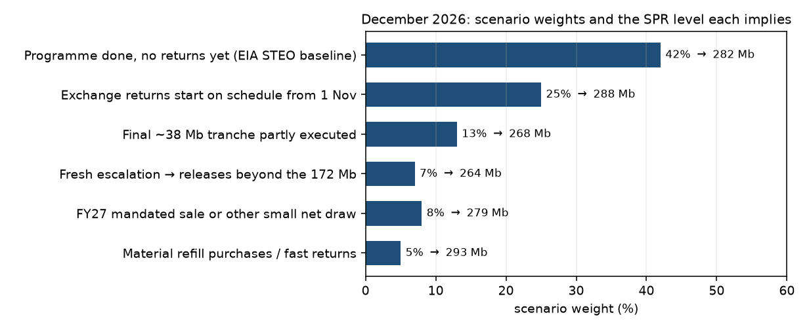
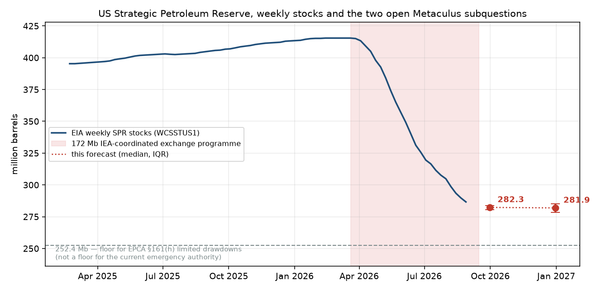

# How many barrels of crude oil will the Strategic Petroleum Reserve hold in December 2026?

| | |
|---|---|
| **Source** | Metaculus #15240 (question group), subquestion id **31308** — https://www.metaculus.com/questions/15240/how-many-barrels-of-crude-oil-will-the-strategic-petroleum-reserve-hold-on-the-following-dates/ |
| **Type** | numeric (barrels) |
| **Opened / Closes / Resolves** | 2025-01-20 / 2026-12-30 / ~2027-02-26 (EIA *Petroleum Supply Monthly* print) |
| **Status** | open |
| **Current forecast** | **Median 281,900,000 barrels, IQR [278,300,000, 285,200,000]** (v1, 2026-09-07) |
| **Community (as of 2026-08-27)** | CP 399,811,115 (n=4) · Pro 400,242,449 (n=1) · Gold 399,811,115 (n=4) |
| **Next review** | 2026-09-21 |

<!-- Versions below, newest first. APPEND-ONLY: never edit or delete a past version. -->

---

## v1 — Initial forecast — 2026-09-07

### What resolves YES

The question resolves to the **EIA monthly series MCSSTUS1** — "U.S. Crude Oil Stocks in
the Strategic Petroleum Reserve", thousand barrels, **end of month** — for December 2026,
multiplied by 1,000. The only stated ambiguity clause ("if the EIA stops updating this
tracker, the question will resolve as ambiguous") is not live. The December figure prints
in the *Petroleum Supply Monthly* around **2027-02-26**, roughly two months after the
question closes on 2026-12-30. Two mechanics to keep straight:

1. **The weekly series (WCSSTUS1) is not the resolution source**, but it is the only live
   read. MCSSTUS1 is the stock at the last *calendar* day of the month; interpolating the
   weekly path to that date reproduced the three published 2026 drawdown months to within
   1.1 Mb (residual SD ≈ 0.6 Mb) — see `research.md`.
2. **DOE's "SPR Quick Facts" inventory is a different number** (294.1 Mb at 2026-08-20 vs
   EIA's 289.7 Mb for the same week). Only EIA resolves this.

Mb = million barrels throughout. IQR = interquartile range, the middle 50% of the belief
distribution.

### Outside view

Unconditional MCSSTUS1 base rates (n = 315 three-month windows since 2000): median change
**0**, IQR **[−2,498, +3,924] thousand barrels**, p10 −14,592, p90 +10,896. Only 28.9% of
months since 1977 move more than 3 Mb. So the status-quo prior for a ~4-month-ahead SPR
question is a near-flat level with fat tails on both sides — and, unlike the September
sibling, that prior is close to right here, because the drawdown programme is exhausted
before the window even opens.

The second reference class is **announced SPR programmes versus delivered volume**, and it
governs the left tail: 2022's 180 Mb release executed in full, 140 Mb of FY24–FY27
congressionally mandated sales were cancelled, and the 2026 exchange has awarded only
133.5 of 172 Mb (78%). Announced volume is an intention with roughly a coin-flip
completion rate — which is exactly the status of the remaining ~38.5 Mb.

### Inside view

The Q4 level is the September level plus four discrete policy terms, not a trend.

**Starting point.** From the 415.442 Mb plateau to 286.604 Mb on 2026-08-28, DOE delivered
128.838 Mb against 133.5 Mb awarded across five exchange tranches — a residual of ~4.7 Mb.
The sibling forecast puts 30 September at **282.3 Mb (IQR 280.6–283.8)**.

**Term 1 — exchange returns (up).** The programme is an *exchange*: barrels come back with
an 18–24% in-kind premium, with returns reported to begin **1 November 2026** at Big Hill
and running to September 2028. That start date depends on the Big Hill LE2 life-extension
build finishing (GAO-26-106918 had the site offline with zero fill/drawdown capability as
of ~May 2026), and EIA's own STEO models **no returns before July 2027**. DOE-wide fill
capability of 0.44 Mb/d caps November plus December at ~26 Mb. → **45% × ~+6 Mb**.

**Term 2 — the final ~38.5 Mb tranche (down).** DOE offered 40 Mb on 2026-06-10 and
awarded 0.5 Mb — a 1.25% take-up, after a 17–18 June US–Iran ceasefire removed the
prompt-scarcity value that made a ~26% in-kind premium worth paying. Reporting says Trump
still plans "a final 39 million barrel release" that would take the reserve to ~243 Mb.
No solicitation has appeared in the three months since, including through the July–August
re-escalation when WTI crossed $100 on 2026-07-23. → P(RFP by mid-November) ≈ 35% ×
P(clears materially) ≈ 45% × P(delivers before 31 Dec) ≈ 85% ≈ **13%, centre −18 Mb**.

**Term 3 — fresh escalation (down).** The war is ongoing; Brent ~$95 and WTI ~$90.5 in
early September with elevated Hormuz risk. But the IEA has spent most of its collective
ammunition, US drawdown capability is 61% of design, and the reserve is at a 43-year low.
→ **7% × ~−18 Mb**.

**Term 4 — mandated sale and refill (small, both signs).** ~7 Mb of congressionally
mandated sales remain scheduled across FY2026–27 (10% × ~−3 Mb); refill purchases or
Venezuela heavy-for-light swap barrels actually delivered in 2026 (12% × ~+2.5 Mb). The
$20 bn refill request is not appropriated and the SPR Petroleum Account is depleted.

Monte Carlo, 500k draws, in `raw/scenario-model-2026-09-07.py`:
median 281.9, IQR [278.3, 285.2], p5 259.1, p95 292.4. P(Dec > Sep) = 47.4%;
P(Dec < 275 Mb) = 17.4%; P(Dec < 252.4 Mb) = 1.8%.

The distribution is deliberately **left-skewed**. The upside is capped by physical fill
capability and by the fact that returns can only start once; the downside carries a 38 Mb
policy option DOE says it still intends to exercise. Median ≈ mean − 1.8 Mb.

### Evidence

- **The June tranche failure is the load-bearing fact** (LR strongly toward "flat"). It
  converts "172 Mb will be released" into "133.5 Mb was released" and leaves the remaining
  38.5 Mb contingent on a market that has already refused it once at these premiums.
- **Absence of expected evidence.** If DOE meant to finish the programme, the July–August
  re-escalation was the window, and DOE's petroleum-reserves news feed carries no SPR item
  after 2026-07-09. Three months of silence is informative.
- **EIA's STEO holds `COSQPUS` flat at 284.803 Mb from August 2026 through June 2027**,
  with returns only from July 2027 at 0.555 Mb/d. That is a bookkeeping convention rather
  than a modelled schedule, so I do not treat it as a hard forecast — but it is the
  resolution agency's working assumption and it says both "no more drawdown" and "no 2026
  returns".
- **Physical constraints bound both tails.** GAO-26-106918: drawdown 2.7 of 4.415 Mb/d,
  fill 0.44 of 0.785 Mb/d, infrastructure held together "with Band-Aids". Fortune
  (2026-08-25) details upconing, salt creep and thermal shock. The SPR cannot move ±40 Mb
  in a quarter in the *upward* direction under any scenario.
- **A misconception worth correcting, including in the popular coverage.** Fortune and
  Hydrocarbon Processing describe 252.4 Mb as a hard statutory floor. CRS IN12542 is
  explicit that there is **no statutory minimum inventory level**; 252.4 Mb is the floor
  below which EPCA §161(h) *limited* drawdown authority may not be used, and the current
  programme runs on a severe-supply-interruption finding plus an IEP collective action —
  which is why DOE's own stated end-point of ~243 Mb sits below it. The US is also a net
  petroleum exporter, so the IEA 90-day reserve obligation does not bind. Do not model
  252.4 as a stop.
- **Disconfirming evidence I hunted for.** A hidden July/August tranche (none — and the
  observed cumulative draw leaves no room for one); an appropriated refill that would push
  the level up (the $20 bn request dates to March 2025 and is not enacted); a scheduled
  large return in Q4 (the 1 November date comes from a secondary source, not a DOE
  document, and EIA disagrees with it — this is the single weakest link in the forecast).

### Other forecasters

| Source | Value | As of | Note |
|---|---|---|---|
| Metaculus CP (recency-weighted), q31308 | 399,811,115 (IQR 364.8–429.3 Mb) | 2026-08-27 | n = 4; no update in 11 days |
| Metaculus Pro, q31308 | 400,242,449 | 2026-08-27 | **n = 1** |
| Metaculus gold medalists, q31308 | 399,811,115 | 2026-08-27 | n = 4; identical to the CP, i.e. the CP *is* the gold cohort here |
| EIA STEO `COSQPUS` (Aug-2026 vintage) | 284,803,000 | 2026-08-11 | the resolution agency's own baseline |
| Kalshi | no market | 2026-09-07 | `KXSPRMIN`/`KXSPR` return empty via the trade API |
| Polymarket | no live market | 2026-09-07 | only an expired "reserves fall to __ by June 5" event |
| Manifold — "SPR lowest value in 2026" | P(<250 Mb) 34.7%, P(<200 Mb) 18.3%, P(<150 Mb) 8.3% | 2026-09-07 | 12 bettors; the hi-res sibling violates monotonicity (P(>275) 53.6% vs P(>250) 50.9%) — heavily discounted |
| Manifold — "when will the SPR start increasing again" | 41% before Oct, 48% before Nov, 50% before Dec 2026 | 2026-09-07 | 6 bettors; agrees with a flat-to-slightly-up Q4 |
| Sentinel Team / Mantic / GJOpen / INFER | no matching question | 2026-09-07 | |

**Material disagreement, stated plainly.** I sit ~118 Mb below the community prediction
and ~118 Mb below the single Pro forecaster. Note that the CP and the gold cohort are the
*same number* here — four forecasters, all gold medalists, so there is no independent
cohort to triangulate against, and the last movement was 2026-08-27. A gap this size
against a Pro cohort normally means I have missed something; here it is checkable in one
click: **the SPR was already at 286.604 Mb on 2026-08-28**, and a return to 400 Mb by
December would require +114 Mb in four months against a maximum fill capability of
0.44 Mb/d (~53 Mb in four months, and that only if every site could receive
simultaneously). The cohorts' number is physically impossible, not merely optimistic.
These are pre-war forecasts on a low-traffic subquestion of a 13-part group. I am not
deferring.

My real disagreement is with **Manifold's 34.7% on the SPR dipping below 250 Mb at some
point in 2026** versus my 1.8% for December (and roughly 5% for any point in Q4). That is
play money, 12 bettors, and a contract shape with severe longshot bias — but it is the
only forecaster source that materially disagrees on the *tail*, so it is the one to watch
if the final tranche is re-offered.

### Scenarios

| # | Scenario | Weight | Implies (Mb) |
|---|---|---|---|
| 1 | Programme done, returns have not started, no new tranche (EIA STEO path) | 42% | 280–284 |
| 2 | Exchange returns begin on schedule from 1 Nov (Big Hill LE2 complete) | 25% | 285–294 |
| 3 | Final ~38 Mb tranche re-offered and partly executed before 31 Dec | 13% | 258–277 |
| 4 | FY27 mandated sale or other small net draw, returns still absent | 8% | 277–280 |
| 5 | Fresh escalation → releases beyond the 172 Mb programme | 7% | 250–270 |
| 6 | Material refill purchases, Venezuela swap barrels, or fast returns | 5% | 290–300 |

### Sensitivity

| Assumption | If instead | Forecast becomes |
|---|---|---|
| Returns begin 1 Nov with only 45% probability (Big Hill LE2 risk; EIA says July 2027) | Returns are contractually certain from 1 Nov at ~5 Mb/month | median ≈ 289 Mb, IQR [285, 293] |
| 13% chance the final ~38 Mb tranche delivers before 31 Dec | DOE re-offers in October and it clears like tranches 1–4 (~55% take-up) | median ≈ 268 Mb, IQR [258, 280] |
| No further escalation beyond the current war (7%) | Hormuz re-closes and a second IEA collective action is agreed | median ≈ 265 Mb, with a tail to 245 |
| September lands at 282.3 Mb | September lands at 278 Mb (award tally understated) | median ≈ 277.6 Mb, whole distribution shifts down ~4 Mb |

### What would change my mind (tripwires)

- [ ] **2026-11-15** DOE issues an RFP for the remaining ~38 Mb →
      **down ~8,000,000 barrels**
- [ ] **2026-11-30** such an RFP is awarded at **more than 15 Mb** →
      **down ~15,000,000 barrels**
- [ ] **2026-11-20** first week-on-week **build** in WCSSTUS1 on or before the week ending
      2026-11-13 (Big Hill returns started on schedule) → **up ~4,000,000 barrels**
- [ ] **2026-12-05** still no week-on-week build through the week ending 2026-12-04 →
      returns have slipped to 2027 → **up ~1,500,000 barrels** (mass onto the flat scenario)
- [ ] **2026-12-15** Strait of Hormuz re-closed, or a new IEA collective action announced →
      **down ~10,000,000 barrels**
- [ ] **2026-12-01** SPR refill appropriations enacted, or a Venezuela-swap contract signed
      with 2026 delivery dates → **up ~3,000,000 barrels**

### Sources

1. EIA, *Weekly U.S. Ending Stocks of Crude Oil in the SPR* (WCSSTUS1) — https://www.eia.gov/dnav/pet/hist/LeafHandler.ashx?n=PET&s=WCSSTUS1&f=W (via api.eia.gov v2; accessed 2026-09-07; snapshot in `raw/`)
2. EIA, *U.S. Crude Oil Stocks in the SPR, Monthly* (MCSSTUS1) — https://www.eia.gov/dnav/pet/hist/LeafHandler.ashx?n=PET&s=MCSSTUS1&f=M (accessed 2026-09-07; snapshot in `raw/`)
3. EIA, *Short-Term Energy Outlook*, series `COSQPUS` and `COSQ_DRAW` — https://www.eia.gov/outlooks/steo/ (accessed 2026-09-07; snapshot in `raw/`)
4. EIA, *Weekly Petroleum Status Report* schedule — https://www.eia.gov/petroleum/supply/weekly/ (accessed 2026-09-07)
5. Metaculus, question group 15240, aggregations for question ids 31307 and 31308 — https://www.metaculus.com/questions/15240/ (accessed 2026-09-07; snapshot in `raw/`)
6. DOE, *United States to Release 172 Million Barrels of Oil From the Strategic Petroleum Reserve* — https://www.energy.gov/articles/united-states-release-172-million-barrels-oil-strategic-petroleum-reserve (accessed 2026-09-07)
7. DOE, *Energy Department Initiates Additional SPR Emergency Exchange* (2026-04-01, 10 Mb, Bryan Mound) — https://www.energy.gov/hgeo/articles/energy-department-initiates-additional-strategic-petroleum-reserve-emergency-exchange (accessed 2026-09-07)
8. DOE, *Energy Department Awards Contracts for 8.5 Million Barrels from SPR in Second Phase of Emergency Exchange* — https://www.energy.gov/hgeo/opr/articles/energy-department-awards-contracts-85-million-barrels-spr-second-phase-emergency (accessed 2026-09-07)
9. DOE, *Energy Department Continues Initiating SPR Emergency Exchanges* (2026-04-09, 30 Mb, West Hackberry) — https://www.energy.gov/hgeo/opr/articles/energy-department-continues-initiating-strategic-petroleum-reserve-emergency (accessed 2026-09-07)
10. DOE, *Petroleum Reserves News* listing (most recent item 2026-07-09) — https://www.energy.gov/hgeo/opr/listings/petroleum-reserves-news (accessed 2026-09-07)
11. DOE, *SPR Quick Facts* (294.1 Mb as of 2026-08-20) — https://www.energy.gov/hgeo/opr/spr-quick-facts (accessed 2026-09-07)
12. S. A. Perera, *The Forty Million Barrels That Did Not Clear* — https://shanakaanslemperera.substack.com/p/the-forty-million-barrels-that-did (accessed 2026-09-07). Secondary analysis; source of the per-tranche take-up rates (53/85/87/58/1.25%).
13. Hydrocarbon Processing, *Depleted U.S. SPR loses potency as Iran war grinds on* (Aug 2026) — https://www.hydrocarbonprocessing.com/news/2026/08/depleted-us-spr-loses-potency-as-iran-war-grinds-on/ (accessed 2026-09-07). Source of the "final 39 Mb release → ~243 Mb" plan.
14. Fortune, *Less than 300 million barrels left: the engineering limits threatening the American SPR* (2026-08-25) — https://fortune.com/2026/08/25/strategic-petroleum-reserve-oil-energy-gas-hormuz/ (accessed 2026-09-07)
15. Congressional Research Service, IN12542, *Strategic Petroleum Reserve: Inventory Outlook and Policy Considerations* — https://www.congress.gov/crs-product/IN12542 (read via https://www.everycrsreport.com/reports/IN12542.html; accessed 2026-09-07)
16. GAO-26-106918, *Energy Security: Congress and DOE Need a Unified Plan to Align Priorities and Investments for the SPR* — https://files.gao.gov/reports/GAO-26-106918/index.html (accessed 2026-09-07)
17. Plainview Energy, *US Strategic Petroleum Reserve Deep Dive: Drawdowns and the 2026 Exchange Program* — https://www.plainview-energy.com/p/us-strategic-petroleum-reserve-deep (accessed 2026-09-07). Secondary; source of the "returns from 1 November 2026 at Big Hill" claim, **not independently verified against a DOE document**.
18. Al Jazeera, *IEA agrees to release 400 million barrels of oil from strategic reserves* (2026-03-11) — https://www.aljazeera.com/news/2026/3/11/iea-proposes-release-of-400m-barrels-of-oil-from-strategic-reserves (accessed 2026-09-07)
19. EnergyNow, *Oil Holds Near Five-Week Highs as U.S.-Iran Fighting Keeps Hormuz Risk Elevated* (Sept 2026) — https://energynow.com/2026/09/oil-holds-near-five-week-highs-as-u-s-iran-fighting-keeps-hormuz-risk-elevated/ (accessed 2026-09-07)
20. BOE Report / Reuters, *Venezuela's heavy crude could be swapped for American oil to fill emergency reserve, Wright says* (2026-09-03) — https://boereport.com/2026/09/03/venezuelas-heavy-crude-could-be-swapped-for-american-oil-to-fill-emergency-reserve-wright-says/ (accessed 2026-09-07)
21. Seeking Alpha, *Energy secretary to seek $20B to refill depleted U.S. strategic oil reserve* — https://seekingalpha.com/news/4418711-energy-secretary-to-seek-20b-to-refill-depleted-u_s_-strategic-oil-reserve (accessed 2026-09-07)
22. Manifold Markets, SPR markets (`us-strategic-petroleum-reserve-lowe`, `us-announces-another-drawdown-of-st`, `when-will-the-us-strategic-petroleu`) — https://manifold.markets/ (accessed 2026-09-07; snapshot in `raw/`)
23. Kalshi trade API, series `KXSPRMIN` / `KXSPR` / `SPR` — https://api.elections.kalshi.com/trade-api/v2/markets (accessed 2026-09-07; empty, no SPR-level market)
24. Wikipedia, *2026–2028 world oil market chronology* — https://en.wikipedia.org/wiki/2026%E2%80%932028_world_oil_market_chronology (accessed 2026-09-07; used only for the dated price/event skeleton)

**Date**: 2026-09-07
**Forecast**: Median 281,900,000 barrels, IQR [278,300,000, 285,200,000]
**Thesis**: The 172-Mb IEA-coordinated exchange has awarded only 133.5 Mb and delivered 128.8 Mb of it by 2026-08-28, so the drawdown exhausts itself in September at ~282 Mb and Q4 is a plateau, not a trend — which is also EIA's own STEO assumption (flat 284.8 Mb through June 2027). The forecast is really about two tails: a 45% chance exchange returns start at Big Hill on the contractual 1 November date (+6 Mb) against a 13% chance DOE finally places the un-awarded ~38.5 Mb after its 2026-06-10 tranche drew a single 0.5 Mb bid. The Metaculus cohorts near 400 Mb are pre-war forecasts and are physically unreachable at DOE's 0.44 Mb/d fill capability.
