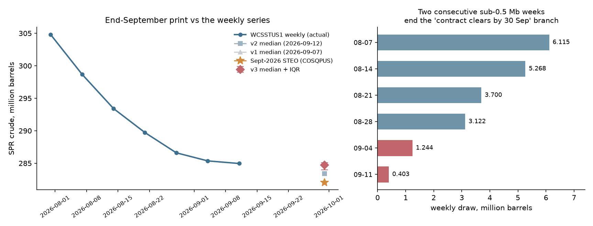
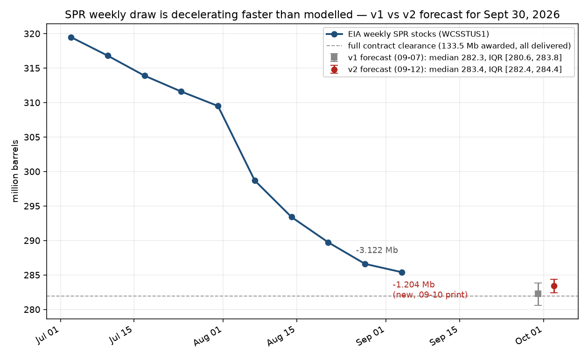
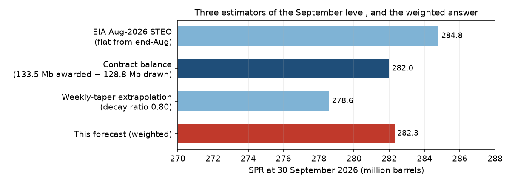

# How many barrels of crude oil will the Strategic Petroleum Reserve hold in September 2026?

| | |
|---|---|
| **Source** | Metaculus #15240 (question group), subquestion id **31307** — https://www.metaculus.com/questions/15240/how-many-barrels-of-crude-oil-will-the-strategic-petroleum-reserve-hold-on-the-following-dates/ |
| **Type** | numeric (barrels) |
| **Opened / Closes / Resolves** | 2025-01-20 / 2026-09-30 / ~2026-11-30 (EIA *Petroleum Supply Monthly* print) |
| **Status** | open |
| **Current forecast** | **Median 284,200,000 barrels, IQR [283,800,000, 284,500,000]** (v4, 2026-09-24) |
| **Community** | **no snapshot taken for v4** — post 15240 returned HTTP 403 twice on 2026-09-24 (as on 2026-09-18). Last good values (2026-09-07): CP 317,131,973 · Pro 403,880,899 · Gold 379,133,973, all physically impossible against a 284.55 Mb observed level |
| **Next review** | 2026-09-30 |

<!-- Versions below, newest first. APPEND-ONLY: never edit or delete a past version. -->

---

## v4 — Update — 2026-09-24

### Revision

| Driver | Direction | Effect |
|---|---|---|
| Prior (v3, 2026-09-18) | — | Median 284.7 Mb, IQR [284.0, 285.1] |
| **2026-09-23 WPSR (week ending 09-18): 284.552 Mb, a draw of 0.405 Mb** — *the same size* as the week before (0.403) [1]. The week-on-week ratio is 1.00, not the 0.30–0.55 that v3's modal regime ("geometric taper to ~zero", 45%) assumed; that regime would have printed 0.12–0.22 Mb. The draw has stopped decaying and settled into a flat trickle. Neither v3 tripwire for this print fired, because both were placed outside this outcome (< 0.15 or > 1.2 Mb) — see the tripwire table | ↓ | **−0.55 Mb** (reweighting: flat trickle 25% → 53%, taper 45% → 25%) |
| Level effect of the print itself: 284.552 is ~0.1 Mb below where v3's median path had the 09-18 weekly (~284.65) | ↓ | −0.1 Mb (inside the row above) |
| Residual award balance now **2.61 Mb** (133.5 awarded − 130.890 delivered through 09-18) [1][4]. It caps the downside: even at the v3-era peak rates the programme cannot take more than ~2.6 Mb before 30 September without a new award | ↑ (left tail) | p5 unchanged at ~282.8 |
| **DOE Petroleum Reserves News re-checked 2026-09-24: still nothing after 2026-07-09** [4]. Brent $104.82 on 09-17 and record diesel ($6.53/gal, 09-22) have not produced an SPR action [7][8]; with six days to close, a new solicitation cannot move barrels before month end | → | 0 |
| Bridge (monthly − weekly-interpolated month end) re-used from v3, N(+0.18, 0.28) Mb; MCSSTUS1 re-downloaded, still ends June 2026, no new calibration points [2] | → | 0 |
| **New forecast** | | **Median 284.2 Mb, IQR [283.8, 284.5]** |

### Tripwire check (against v3)

| Tripwire from v3 | Fired? | Note |
|---|---|---|
| WPSR 2026-09-23 (wk. 09-18) shows a build or a draw < 0.15 Mb → up ~250,000 barrels | **Not fired** | Draw 0.405 Mb |
| WPSR 2026-09-23 draw > 1.2 Mb → down ~700,000 barrels | **Not fired** | Draw 0.405 Mb |
| WPSR 2026-09-30 (wk. 09-25), same thresholds, half magnitudes | Not yet due | Releases 2026-09-30, the question's close date |
| DOE issues any new SPR exchange RFP, award or re-offer by 2026-09-30 → down ~1,500,000 barrels | **Not fired** | Listing re-read 2026-09-24; last item 2026-07-09 [4] |
| October STEO `COSQPUS` for Sept near 284.7 (confirm) vs near 282 (investigate) | Not yet due | STEO due ~2026-10-06 |
| PSM July/August actuals vs weekly-implied (bridge test) | Not yet due | MCSSTUS1 still ends 2026-06 in the 09-24 download [2] |

**Tripwire design miss, recorded for the post-mortem.** v3 bracketed the 09-23 print with
"< 0.15" and "> 1.2" and put no tripwire on the middle, which is exactly where the print landed
and exactly the outcome that falsified v3's modal regime. The information came in anyway, but
not through a pre-committed signal. v4's tripwires for the 09-30 print cover the middle band.

### What resolves YES

Unchanged from v3: EIA *Petroleum Supply Monthly*, series MCSSTUS1, end-September 2026, thousand
barrels × 1,000, printing around 2026-11-30; the weekly series WCSSTUS1 is the leading
indicator, not the resolution source.

### Outside view

Unchanged from v3. The "awarded ≠ lifted" reference class still frames the residual: 2.61 Mb
of awarded barrels remain, and a slow partial lift rather than a clean clear or a clean stop is
the ordinary end-of-programme pattern.

### Inside view

Anchor **284.552 Mb at 2026-09-18**, 12 days to month end. Weekly draws since the programme's
peak tempo:

| Week ending | Draw (Mb) | Ratio to prior week |
|---|---|---|
| 2026-08-28 | 3.122 | 0.844 |
| 2026-09-04 | 1.244 | 0.398 |
| 2026-09-11 | 0.403 | 0.324 |
| **2026-09-18** | **0.405** | **1.005** |

Two equal weeks at ~0.4 Mb (≈58 kb/d) look like a steady trickle: one or two contract holders
lifting the tail of their awards at a constant rate. At that rate the 2.61 Mb residual would
take ~6.5 weeks to clear, i.e. into early November. That matters for the December sibling,
which v4 feeds.

Monte Carlo, 1,000,000 draws (`raw/scenario-model-2026-09-24.py`):

| Regime | Weight | Further draw 09-18 → 09-30 (Mb) |
|---|---|---|
| Flat trickle continues at 0.30–0.50 Mb/week | 53% | 0.51–0.86 |
| Taper resumes toward zero (ratio 0.30–0.60) | 25% | 0.15–0.35 |
| Finished; flat or tiny build | 10% | −0.30 to +0.05 |
| Residual lifts fast (the STEO-like path) | 12% | 1.0–2.61 |

Plus the calibrated bridge N(+0.18, 0.28) Mb.

Output: **median 284.16**, IQR **[283.84, 284.49]**, p5 282.79, p95 284.95.
P(print below 283.0) = 6.6%; P(print above 284.7) = 13.4%.

Posted as **median 284,200,000, IQR [283,800,000, 284,500,000]**.

### Evidence

- **The 0.405 Mb print is the whole update.** It is a small number but a large likelihood ratio
  between regimes: under "taper to zero" a ~0.4 Mb week was a ≲5% outcome; under "flat trickle"
  it is the central one. LR ≈ 4–5 toward the trickle, which is what moves ~28 pp of regime
  weight.
- **The print is not a revision artifact.** The 09-11 value stands unrevised at 284,957 in the
  2026-09-24 download [1]; independent press reporting of the release gives the same 284.6 Mb
  and ~405 kb weekly loss [5].
- **No SPR action despite pressure.** Brent closed at $104.82 on 09-17 and $103.08 on 09-23,
  Hormuz traffic remains restricted, diesel set a record $6.53/gal on 09-22 [6][7][8]. DOE's
  news feed is still silent [4]. With six days left this bears on December far more than on
  September.
- **Absent, and looked for:** any DOE or press statement about the 2.61 Mb residual being
  rescheduled, cancelled or re-offered. Not found.

### Other forecasters

| Source | Value | As of | Note |
|---|---|---|---|
| Metaculus CP / Pro / gold, q31307 | **no community snapshot taken for this version** | 2026-09-24 | Post 15240 returned HTTP 403 on two attempts today (default TLS and `METACULUS_FORCE_TLS12=1`), the same group-post refusal as on 2026-09-18. Last good values (2026-09-07): CP 317.1 Mb, Pro 403.9 Mb, gold 379.1 Mb — all physically unreachable, stale, not used |
| EIA STEO Sept-2026, `COSQPUS` end-Sept | 282.052 Mb | 2026-09-09 vintage | 2.1 Mb below my median; see v3 for why it is down-weighted. Held as part of the 12% fast-lift regime |
| Kalshi / Polymarket | no SPR-level market | 2026-09-24 | Kalshi `KXSPR` empty; Polymarket has only a Venezuela-oil-into-SPR market (relevant to December, not here) |
| Manifold | no September-level market | 2026-09-24 | only drawdown-announcement markets, 6–12 bettors, internally incoherent — ignored |

### Scenarios

| # | Scenario | Weight | Implies (Mb, monthly print) |
|---|---|---|---|
| 1 | Flat trickle continues | 53% | 283.6–284.3 |
| 2 | Taper resumes toward zero | 25% | 284.2–284.6 |
| 3 | Finished; flat | 10% | 284.6–285.0 |
| 4 | Residual lifts fast / STEO path | 12% | 282.1–283.7 |

### Sensitivity

| Assumption | If instead | Forecast becomes |
|---|---|---|
| Trickle weight 53% | trickle 80% (two equal weeks = the new constant) | median ≈ 284.1, IQR [283.8, 284.3] |
| Taper weight 25% | taper back to v3's 45% | median ≈ 284.3 |
| Bridge N(+0.18, 0.28) | bridge unbiased (v1) | median ≈ 284.0 |
| No new award before close | re-offer lifts ~1 Mb in the last week | median ≈ 283.2 |

### What would change my mind (tripwires)

- [ ] **2026-09-30** WPSR (week ending 09-25) draw **0.25–0.60 Mb** → trickle confirmed →
      **down ~100,000 barrels**, tighten IQR to ±0.25 Mb.
- [ ] **2026-09-30** WPSR draw **< 0.15 Mb or a build** → programme done → **up ~350,000 barrels**.
- [ ] **2026-09-30** WPSR draw **> 0.9 Mb** → residual lifting fast → **down ~600,000 barrels**.
- [ ] **By 2026-09-30:** DOE issues any new SPR exchange RFP, award or re-offer →
      **down ~500,000 barrels** (too late to move many barrels by month end).
- [ ] **By 2026-10-14:** October STEO `COSQPUS` for September within 0.5 Mb of 284.2 → confirm;
      if still near 282 while the weekly series sits near 284, **investigate the delivery-paperwork
      gap** → down ~500,000 barrels pending explanation.
- [ ] **By 2026-10-31:** PSM prints August 2026 near the STEO's 284.15 rather than the
      weekly-implied ~286.07 → bridge wrong for this regime → **down ~1,500,000 barrels**, widen.

### Sources

1. EIA — *Weekly U.S. Ending Stocks of Crude Oil in the SPR* (WCSSTUS1) — https://www.eia.gov/dnav/pet/hist_xls/WCSSTUS1w.xls — week ending 2026-09-18 = **284,552** thousand barrels; 09-11 unrevised at 284,957. Snapshot `raw/eia-weekly-wcsstus1-2026-09-24.xls` (accessed 2026-09-24)
2. EIA — *U.S. Crude Oil Stocks in the SPR, Monthly* (MCSSTUS1) — https://www.eia.gov/dnav/pet/hist_xls/MCSSTUS1m.xls — still ends June 2026 (322,186). Snapshot `raw/eia-monthly-mcsstus1-2026-09-24.xls` (accessed 2026-09-24)
3. EIA — *Short-Term Energy Outlook*, September 2026 base case, `COSQPUS` — https://www.eia.gov/outlooks/steo/archives/sep26_base.xlsx (accessed 2026-09-18, carried forward from v3)
4. DOE — *Petroleum Reserves News* listing — https://www.energy.gov/hgeo/opr/listings/petroleum-reserves-news — latest item 2026-07-09; last SPR actions the 2026-06-10 RFP and 2026-05-11 awards (accessed 2026-09-24)
5. The Daily Caller — *America's Emergency Oil Stockpile Is Running Low As Winter Nears* (2026-09-23) — https://dailycaller.com/2026/09/23/strategic-petroleum-reserve-drawdown-diesel-heating-oil-winter/ — 284.6 Mb, ~405 kb weekly loss; DOE says ~200 Mb will be returned "within the next year" (accessed 2026-09-24)
6. CNBC — *Oil prices rise, snap five day losing streak as Iran vows it will not surrender* (2026-09-23) — https://www.cnbc.com/2026/09/23/iran-us-talks-crude-oil-un-wti.html — Brent $103.08, WTI $92.16; cited from search-result text, page itself returned 403 (accessed 2026-09-24)
7. Wikipedia — *2026–2028 world oil market chronology* — https://en.wikipedia.org/wiki/2026%E2%80%932028_world_oil_market_chronology — Brent $104.82 on 2026-09-17; Saudi exports through Hormuz resumed 09-17 (accessed 2026-09-24)
8. Scripps News — *Diesel prices hit record $6.51 as White House says no export ban planned* — https://www.scrippsnews.com/us-news/diesel-prices-hit-record-high-as-fuel-costs-continue-to-climb — no SPR action mentioned (accessed 2026-09-24)
9. Metaculus — question group 15240, subquestion 31307 — https://www.metaculus.com/questions/15240/ — attempted 2026-09-24, HTTP 403 (accessed 2026-09-24, no data returned) (two attempts by the parent session); no snapshot
10. Kalshi trade API `KXSPR` — https://api.elections.kalshi.com/trade-api/v2/markets?series_ticker=KXSPR — empty (accessed 2026-09-24); Manifold search API — https://api.manifold.markets/v0/search-markets?term=strategic%20petroleum%20reserve (accessed 2026-09-24)

**Date**: 2026-09-24
**Forecast**: Median 284,200,000, IQR [283,800,000, 284,500,000]
**Thesis**: The 2026-09-23 WPSR printed a 0.405 Mb draw for the week ending 09-18, the same size as the week before, so the weekly draw has stopped shrinking and settled at a flat ~0.4 Mb/week trickle. That rules out v3's modal "taper to zero" path and makes the trickle the modal regime (53%), which projects ~0.5–0.9 Mb more before 30 September [1]. The 2.61 Mb residual award balance caps the downside, DOE's news feed is still silent since 2026-07-09 despite Brent above $100 [4][7], and the calibrated weekly-to-monthly bridge (+0.18 Mb) carries over from v3. Net −0.5 Mb to 284.2; no Metaculus community snapshot was taken for this version.

---

## v3 — Update — 2026-09-18

### Revision

| Driver | Direction | Effect |
|---|---|---|
| Prior (v2, 2026-09-12) | — | Median 283.4 Mb, IQR [282.4, 284.4] |
| **2026-09-16 WPSR (week ending 09-11): 284.957 Mb, a draw of just 0.403 Mb** — the second consecutive sub-1.3 Mb week, and a third of the previous week's already-collapsed 1.244 Mb [1]. The v2 tripwire at "< 0.6 Mb" fired. Two small weeks in a row cannot be a Labor-Day reporting artifact, which was v2's stated reason for holding 30% on full contract clearance | ↑ | **+1.0 Mb** |
| **The "contract balance clears by 30 September" branch is now arithmetically dead.** Residual award balance is **3.055 Mb** (133.5 awarded − 130.445 delivered through 09-11). Clearing it in the 19 days to month end needs ~1.1 Mb/week against 0.403 observed and a fitted weekly decay of 0.32–0.40. v2 gave this branch 30% weight; v3 gives the whole "deferred deliveries or a re-offer lift part of the residual" family 12% | ↑ | **+0.4 Mb** |
| **The weekly→monthly bridge is now calibrated, not assumed.** Regressing 36 months of MCSSTUS1 against a linear interpolation of WCSSTUS1 at month end: mean residual **+134 thousand barrels, SD 234** (last 12 months: +242, SD 338) [1][2]. v1 assumed SD ≈ 600 and no bias. The monthly print sits *slightly above* the weekly interpolation, reliably — including through the April–June drawdown (+1,078 / +527 / +54 kb) | ↑ | **+0.2 Mb, IQR narrows sharply** |
| **September-2026 STEO retrieved and read — v2's open item closed.** `COSQPUS` end-September = **282.052 Mb**, revised *down* from the August vintage's 284.803 [3]. But its own "last historical month" (August 2026) reads **284.152 Mb** against a weekly-implied ~286.07 — the STEO's SPR block is running ~1.9 Mb below the observed series at the last month it claims to know, and its modelling cutoff was 2026-09-03, before both collapsing prints. Weight cut from 20–25% as a standalone anchor to a 12% scenario | ↑ | **+0.3 Mb** |
| **DOE petroleum-reserves news feed re-checked through 2026-09-18: still nothing since 2026-07-09.** Last SPR action of any kind was the 2026-06-10 RFP and the 2026-05-11 awards [4]. Twelve days less runway before the 09-30 close | ↑ (marginal) | **+0.1 Mb** |
| Downward revision to the 09-04 print (285.400 → **285.360** in the current series) | ↓ | **−0.04 Mb** |
| **New forecast** | | **Median 284.7 Mb, IQR [284.0, 285.1]** |

### Tripwire check (against v2)

| Tripwire from v2 | Fired? | Note |
|---|---|---|
| WPSR 2026-09-16 (wk. 09-11) draw **< 0.6 Mb** → **up ~1,000,000 barrels** | **FIRED** | Draw **0.403 Mb**. The prescribed move was +1.0 Mb; the actual move is +1.3 Mb, the extra coming from the bridge recalibration and the STEO downgrade, both of which are independent of this print |
| WPSR 2026-09-16 draw **> 2.5 Mb** → down ~1,500,000 barrels | **Not fired** | The opposite, by a factor of six |
| Any week-on-week **build** in WCSSTUS1 by wk. ending 09-25 → up ~2,000,000 barrels | **Not yet due** | Prints for weeks ending 09-18 and 09-25 release 2026-09-23 and 2026-09-30. Still a draw, but a very small one |
| Cumulative draw from 09-04 exceeds the 3.458 Mb residual before close → down ~1,500,000 barrels | **Not fired, and now effectively unreachable** | Cumulative draw since 09-04 is **0.403 Mb** |
| DOE issues any new SPR exchange RFP or award before close → down ~3,000,000 barrels | **Not fired** | DOE Petroleum Reserves News listing re-read 2026-09-18: nothing after 2026-07-09 [4] |
| *(v2 open item, not a tripwire)* Sept-2026 STEO `COSQPUS` value | **Resolved** | 282.052 Mb, and the STEO's own August "historical" figure is ~1.9 Mb below the weekly series — see the revision table |

Score: **one fired (up), one resolved (net up), three not fired (two of them structurally
favourable), one not due.** Everything moved the same way, which is why this is the largest
single-version move in this question's history and why the IQR halves at the same time.

### What resolves YES

Unchanged from v1. Resolution is the EIA *Petroleum Supply Monthly* end-of-September 2026 value
for crude oil in the SPR (series **MCSSTUS1**), expected around 2026-11-30 — **not** the weekly
WCSSTUS1 series, which is an estimate. The weekly→monthly bridge is therefore part of the
forecast, not a rounding detail, and v3 is the first version to calibrate it against data rather
than assume it.

### Outside view

Unchanged framing from v1 — the 2026 drawdown sits in the ~29% "active programme" reference class
— but one outside-view point is now doing real work and deserves naming: **"announced ≠
delivered" has a companion, "awarded ≠ lifted."** Per-tranche take-up in this programme has run
53%, 85%, 87%, 58% and 1.25% [v1 source 12]. A residual balance going unlifted at the end of a
programme is the *modal* outcome in this reference class, not an anomaly. v1 and v2 both treated
the 3.5–4.7 Mb residual as something that would probably clear; the reference class says
otherwise, and the last two weekly prints say otherwise.

### Inside view

The anchor is **284.957 Mb at 2026-09-11**, and 19 days remain to month end. The six observed
weekly draws since the programme's peak tempo:

| Week ending | Draw (Mb) | Ratio to prior week |
|---|---|---|
| 2026-08-07 | 6.115 | — |
| 2026-08-14 | 5.268 | 0.861 |
| 2026-08-21 | 3.700 | 0.702 |
| 2026-08-28 | 3.122 | 0.844 |
| 2026-09-04 | 1.244 | 0.398 |
| **2026-09-11** | **0.403** | **0.324** |

The decay has itself accelerated: the first four weeks fit a ratio around 0.80, the last two
around 0.35. That is the signature of a programme finishing, not of a programme pausing.

Monte Carlo, 1,000,000 draws (`raw/scenario-model-2026-09-18.py`):

| Regime | Weight | Further draw to 09-30 (Mb) |
|---|---|---|
| Geometric taper continues to ~zero (weekly ratio 0.30–0.55) | 45% | 0.15–0.35 |
| Taper flattens at a small persistent rate (0.25–0.55 Mb/week) | 25% | 0.68–1.49 |
| Programme finished; flat, or returns begin and stocks build slightly | 18% | −0.35 to +0.10 |
| Deferred deliveries or a re-offer lift part of the 3.055 Mb residual — **this is also the branch in which EIA's own STEO is right** | 12% | 1.2–3.1 |

Plus the calibrated bridge, N(+0.18, 0.28) Mb.

Output: **median 284.71**, IQR **[284.08, 285.06]**, p5 282.83, p95 285.48.
P(print below 283.0) = 6.1%; P(print above 285.0) = 29.0%.

Posted as **median 284,700,000, IQR [284,000,000, 285,100,000]**.

### Evidence

- **The 0.403 Mb draw is the load-bearing fact, and its value is mostly in being the *second*
  one.** A single collapsed week (1.244 Mb, into a holiday-shifted release) was genuinely
  ambiguous, and v2 said so, keeping 30% on full contract clearance specifically because a
  Labor-Day logistics artifact could not be ruled out. A second week at a third of that removes
  the artifact explanation: two independent reporting weeks do not both compress the same way.
  LR strongly toward "the exchange programme's deliveries are essentially complete."
- **The bridge calibration is the quiet improvement.** Three versions have now forecast a
  *monthly* series while reasoning almost entirely about a *weekly* one, with the gap handled by
  an assumed SD of 0.6 Mb. The actual 36-month record is mean +0.13 Mb, SD 0.23 — a
  well-behaved, slightly positive offset that holds even through the steepest drawdown months of
  April–June 2026. Using it shifts the median up ~0.2 Mb and takes roughly a third out of the
  IQR width on its own.
- **The September STEO is the disconfirming source I went looking for, and it disconfirms
  itself.** It says 282.05 Mb — 2.7 Mb below my median, and it *lowered* its own August-vintage
  number while the weekly data was going the other way. The reason to discount it rather than
  split the difference is internal: its last "historical" month, August 2026, reads 284.15 Mb
  against a weekly-implied ~286.07, and its modelling was completed on 2026-09-03, before both
  of the prints that define this update [3]. It is a contract-schedule projection, and the
  contract schedule is exactly what the weekly data has falsified. I keep it as a 12% scenario
  rather than dismissing it, because EIA sees delivery paperwork I do not.
- **Continued DOE silence, re-verified through 2026-09-18** [4]. Nothing since the 2026-07-09
  post; the last SPR action of any kind was the 2026-06-10 RFP and the 2026-05-11 awards. With
  12 days to close, a new solicitation that moves barrels before 09-30 is close to impossible.
- **Absent, and I looked:** any DOE or trade-press report of the residual 3.055 Mb being
  rescheduled, deferred, cancelled or re-offered. That single fact would collapse most of the
  remaining uncertainty and I could not find it either way.

### Other forecasters

| Source | Value | As of | Note |
|---|---|---|---|
| Metaculus CP (recency-weighted), q31307 | 317,131,973 (IQR 263.7–408.2 Mb) | 2026-09-07 (stale) | **Re-fetch attempted three times on 2026-09-18, failed every time** — HTTP 403, a genuine Cloudflare response, distinct from the `status 0` TLS-handshake failure that blocked v2 and that `METACULUS_FORCE_TLS12=1` fixes. The three sibling questions updated this session fetched cleanly with that flag immediately before and after, so this is specific to post 15240 — a 30-plus-subquestion group whose aggregation request is large enough to draw a challenge |
| *fallback:* `metaculus-scraper` on post 15240 | rendered, but **no CP** | 2026-09-18 | The scraper loaded the page and returned 33 forecasters, 37 comments and the resolution criteria, but a question *group* carries no headline community prediction and the scraper cannot reach per-subquestion aggregations. It did re-verify what resolves: "based on the EIA monthly data — MCSSTUS1 ... 416,393 thousand barrels ... would resolve as 416,393,000" |
| Metaculus Pro, q31307 | 403,880,899 | 2026-09-07 (stale) | n = 1 |
| Metaculus gold medalists, q31307 | 379,133,973 | 2026-09-07 (stale) | n = 5 |

**Why the failed re-fetch does not bound this version, unlike in v2.** All three cohort values
sit **32 to 119 million barrels above a level the SPR has already fallen below**, and DOE's own
published fill-capability limits make a recovery of that size physically impossible in the time
available. They are pre-war vintage forecasts on a question-group subquestion almost nobody has
revisited (n = 1 to 6 in-window). A fresh pull would be interesting only if it showed the cohorts
had finally moved toward the physical series; it cannot discipline a number derived from EIA's
own weekly print. This is the one question in this repo where I am comfortable forecasting
without the community anchor, and v1 and v2 both said so.

### Scenarios

| # | Scenario | Weight | Implies (Mb) |
|---|---|---|---|
| 1 | Taper continues to ~zero | 45% | 284.7–285.1 |
| 2 | Taper flattens at a small persistent weekly rate | 25% | 283.6–284.5 |
| 3 | Programme finished; flat or small build | 18% | 285.0–285.5 |
| 4 | Deferred deliveries / re-offer lifts part of the residual (incl. the STEO being right) | 12% | 282.0–284.0 |

### Sensitivity

| Assumption | If instead | Forecast becomes |
|---|---|---|
| The 09-11 draw (0.403 Mb) is the true new pace | both small weeks are reporting artifacts and the pace reverts to ~3 Mb/week | median ≈ 283.0, IQR [282.3, 283.7] |
| Bridge = N(+0.18, 0.28) | v1's assumption of no bias and SD 0.6 | median ≈ 284.5, IQR [283.8, 285.2] |
| STEO weighted at 12% | STEO weighted at 40% (trusting EIA's delivery visibility over the weekly series) | median ≈ 283.9 |
| No new solicitation before 2026-09-30 | DOE re-offers the residual and it starts lifting in the week of 09-21 | median ≈ 283.6, left tail to ~282.0 |
| 133.5 Mb awarded in total | award tally understated by 6 Mb | median ≈ 284.3 (less sensitive than in v2 — the binding constraint is now lifting rate, not balance) |

### What would change my mind (tripwires)

- [ ] **2026-09-23** WPSR (week ending 09-18) shows a **build**, or a draw under 0.15 Mb →
      the programme is over → **up ~250,000 barrels** and tighten the IQR to ±0.4 Mb.
- [ ] **2026-09-23** WPSR shows a draw **larger than 1.2 Mb** → the taper has reversed and
      deferred deliveries are landing → **down ~700,000 barrels**.
- [ ] **2026-09-30** WPSR (week ending 09-25) — same two thresholds, half the magnitudes. This
      is the last weekly print before month end and the last material information before
      resolution.
- [ ] **By 2026-09-30:** DOE issues any new SPR exchange RFP, award or re-offer →
      **down ~1,500,000 barrels** (smaller than v2's −3.0 Mb: there is no longer time for a new
      solicitation to move many barrels before month end).
- [ ] **By 2026-10-14:** the October-2026 STEO revises `COSQPUS` for September 2026 to within
      0.5 Mb of 284.7 → **confirms**, hold. If it holds near 282 while the weekly series sits
      near 285, **investigate the delivery-paperwork gap before trusting either** — that
      divergence would be the most informative single fact left in this question.
- [ ] **By 2026-10-31:** the *Petroleum Supply Monthly* prints July and August 2026 actuals. If
      the August actual comes in near EIA's 284.15 rather than the weekly-implied ~286.07,
      the bridge calibration is wrong for this regime → **down ~1,500,000 barrels** and widen.

### Sources

Sources 1–18 from v1 and 19–22 from v2 carry forward; the ones still load-bearing for v3 are
repeated below with their access dates so this version stands on its own.

1. EIA — *Weekly U.S. Ending Stocks of Crude Oil in the SPR* (WCSSTUS1), full history — https://www.eia.gov/dnav/pet/hist_xls/WCSSTUS1w.xls — direct download succeeded this session; week ending 2026-09-11 = **284,957 thousand barrels**, and the 2026-09-04 value stands revised to 285,360. Snapshot in `raw/eia-weekly-wcsstus1-2026-09-18.xls` (accessed 2026-09-18)
2. EIA — *U.S. Crude Oil Stocks in the SPR, Monthly* (MCSSTUS1), full history — https://www.eia.gov/dnav/pet/hist_xls/MCSSTUS1m.xls — used to calibrate the weekly→monthly bridge over 36 months; series currently ends June 2026. Snapshot in `raw/eia-monthly-mcsstus1-2026-09-18.xls` (accessed 2026-09-18)
3. EIA — *Short-Term Energy Outlook*, **September 2026 base case**, table `4atab`, series `COSQPUS` — https://www.eia.gov/outlooks/steo/archives/sep26_base.xlsx — end-September 2026 = **282.052 Mb**; last historical month flagged 202608 at **284.152 Mb**; modelling completed **2026-09-03**. Snapshot in `raw/eia-steo-sep2026-base.xlsx` (accessed 2026-09-18)
4. DOE — *Petroleum Reserves News* listing — https://www.energy.gov/hgeo/opr/listings/petroleum-reserves-news — nothing after 2026-07-09; last SPR actions were the 2026-06-10 RFP and the 2026-05-11 awards for 53.3 Mb (accessed 2026-09-18)
5. EIA — *Weekly Petroleum Status Report* release schedule — https://www.eia.gov/petroleum/supply/weekly/ — next prints 2026-09-23 and 2026-09-30 (accessed 2026-09-18)
6. EIA — *Short-Term Energy Outlook*, energy-security article — https://www.eia.gov/outlooks/steo/report/energysecurity/article.php (accessed 2026-09-18)
7. DOE — *SPR Quick Facts* — https://www.energy.gov/hgeo/opr/spr-quick-facts — authorized capacity 714 Mb and current fill percentage (accessed 2026-09-18)
8. Wikipedia — "Strategic Petroleum Reserve (United States)" — https://en.wikipedia.org/wiki/Strategic_Petroleum_Reserve_(United_States) — the 2026-03-11 authorisation of the 172 Mb release as the US share of a 400 Mb IEA collective action (accessed 2026-09-18)
9. Metaculus — question group 15240, subquestion 31307 — https://www.metaculus.com/questions/15240/how-many-barrels-of-crude-oil-will-the-strategic-petroleum-reserve-hold-on-the-following-dates/ — re-fetch attempted twice on 2026-09-18 and **failed with HTTP 403** on both; last good snapshot `raw/metaculus-15240-aggregations-2026-09-07.json`, accessed 2026-09-07 (re-access attempted three times and refused with HTTP 403 on 2026-09-18)
14. Metaculus post 15240, rendered page via the `metaculus-scraper` fallback skill — https://www.metaculus.com/questions/15240/ — no community prediction (a question group has none), but it re-verified the resolution rule: EIA monthly series MCSSTUS1, thousand barrels x 1,000 (accessed 2026-09-18)
10. DOE — *United States to Release 172 Million Barrels of Oil From the Strategic Petroleum Reserve* — https://www.energy.gov/articles/united-states-release-172-million-barrels-oil-strategic-petroleum-reserve (accessed 2026-09-07, carried forward from v1)
11. S. A. Perera — *The Forty Million Barrels That Did Not Clear* — https://shanakaanslemperera.substack.com/p/the-forty-million-barrels-that-did — source of the per-tranche take-up rates (53 / 85 / 87 / 58 / 1.25%) that underpin the "awarded ≠ lifted" outside view (accessed 2026-09-07, carried forward from v1)
12. Congressional Research Service, IN12542 — *Strategic Petroleum Reserve: Inventory Outlook and Policy Considerations* — https://www.congress.gov/crs-product/IN12542 (accessed 2026-09-07, carried forward from v1)
13. GAO-26-106918 — *Energy Security: Congress and DOE Need a Unified Plan to Align Priorities and Investments for the SPR* — https://files.gao.gov/reports/GAO-26-106918/index.html — the physical fill-capability limits that make the stale Metaculus cohort values impossible (accessed 2026-09-07, carried forward from v1)

**Date**: 2026-09-18
**Forecast**: Median 284,700,000, IQR [284,000,000, 285,100,000]
**Thesis**: The 2026-09-16 WPSR printed a draw of just **0.403 Mb** for the week ending 09-11 — the second consecutive collapsed week after 1.244 Mb, which is what kills the Labor-Day-artifact explanation v2 explicitly held 30% of its weight for, and which makes clearing the 3.055 Mb residual contract balance in the remaining 19 days arithmetically implausible at any decay rate consistent with the data [1]. Two independent improvements push the same way: the weekly→monthly bridge is now calibrated against 36 months of MCSSTUS1 (mean **+134 thousand barrels, SD 234**, versus v1's assumed unbiased SD 600), which both raises the median and halves the IQR [1][2]; and the September STEO — v2's open item, now retrieved — says 282.05 Mb but carries an August "historical" figure of 284.15 against a weekly-implied ~286.07 and a 2026-09-03 modelling cutoff, so it is a contract-schedule projection of exactly the schedule the weekly data has falsified, and it drops from a 20–25% anchor to a 12% scenario [3]. DOE's news feed is still silent since 2026-07-09 [4]. Net **+1.3 Mb to 284.7** with the IQR halved to [284.0, 285.1]; the Metaculus cohorts remain stale and physically impossible (317 / 404 / 379 Mb against an observed 284.96) and all three re-fetch attempts returned HTTP 403, but for this question alone that is not a binding limitation.

---

## v2 — Update — 2026-09-12

### Revision

| Driver | Direction | Effect |
|---|---|---|
| Prior (v1, 2026-09-07) | — | Median 282.3 Mb, IQR [280.6, 283.8] |
| New WPSR print (2026-09-10, week ending 09-04): 285.400 Mb, a draw of only **1.204 Mb** — well under the ≥3.0 Mb tripwire and under half of what the v1 decay-0.80 taper model implied (~2.5 Mb) for that week | ↑ | +1.1 Mb |
| Contract-balance residual shrinks to **3.458 Mb** (133.5 awarded − 130.042 delivered through 09-04, down from 4.662 Mb at v1) — small enough that the two previously-conflicting v1 estimators (contract-balance 282.0 vs weekly-taper-extrapolation 278.6) now sit within ~1.5 Mb of each other once the taper model is refit on the new decay rate | ↑ | +0.3 Mb, IQR narrows |
| DOE petroleum-reserves news feed re-checked through 2026-09-12: still nothing since 2026-07-09 (non-exchange). Tripwire #4 (new RFP/award) not fired; re-offer probability inside the ~2.5 weeks left before close cut from 9% to 4% | ↑ (marginal) | +0.1 Mb |
| September-2026 STEO released 2026-09-09 as scheduled, but its `COSQPUS` table value could not be independently confirmed this session (PDF not machine-readable via the available fetch tools; HTML page doesn't carry the table). Treated as an unresolved tripwire, not fired-or-not; the 284.8 Mb Aug-vintage anchor is kept but downweighted (25%→20%) since it is now staler than the fresh weekly print | → | ~0 |
| Metaculus cohorts not refreshed — both the aggregations API (403, Cloudflare-challenged after full retry) and the Playwright scraper fallback (timed out riding out the same block) failed this session. Not treated as informative either way; v1 already established these cohorts are stale/uninformative for this subquestion (see Other forecasters below) | → | 0 |
| Elapsed time: 5 fewer days to question close (2026-09-30); less runway for a new escalation event to matter for *this* subquestion | → (narrows tails) | 0 |
| **New forecast** | | **Median 283.4 Mb, IQR [282.4, 284.4]** |

### Tripwire check (against v1)

| Tripwire from v1 | Fired? | Note |
|---|---|---|
| WPSR 2026-09-10 (wk. 09-04) draw > 3.0 Mb | **No** | Actual draw 1.204 Mb — the taper is tightening faster than modelled, not slower |
| Any WoW build in WCSSTUS1 by wk. ending 09-18 | Not yet due | Still a draw through 09-04; next two prints (09-16, 09-23) pending |
| Cumulative draw from 08-28 exceeds 6.0 Mb by wk. ending 09-18 | Not yet due, trending **against** | Only 1.204 Mb cumulative through 09-04; would need >2.4 Mb/week for two more weeks, against the observed deceleration |
| DOE issues new SPR exchange RFP/award before close | **No** | DOE news feed silent since 2026-07-09; nothing new through 2026-09-12 |
| Sept-2026 STEO moves `COSQPUS` off 284.803 | **Unconfirmed** | STEO published 2026-09-09 on schedule; exact SPR table value not extracted this session — carried to the next review as an open item |

### What resolves YES

Unchanged from v1 — resolution source, ambiguity clause, and the weekly→monthly bridge
calibration (residual SD ≈ 0.6 Mb) all still apply.

### Outside view

Unchanged from v1. The 2026 drawdown remains in the ~29% "active programme" reference
class (median +4.1 Mb/month, p5 −19.5 Mb), and "announced ≠ delivered" still holds: no new
evidence this update changes the outside-view framing.

### Inside view

The single new fact this update rests on is the **2026-09-10 WPSR**: SPR stocks at
285.400 Mb for the week ending 2026-09-04, a draw of just **1.204 Mb** — the smallest
weekly draw since the programme began, and roughly a third of the ~3.1 Mb draw the week
before. Fitting a geometric decay across all five observed weekly draws (−6.115, −5.268,
−3.700, −3.122, **−1.204**) gives a ratio of **0.686/week** (down from the 0.80 used in
v1, and the single latest week-on-week ratio is even sharper at 0.386).

That single data point resolves the tension that defined v1: the contract-balance
estimator (~282.0 Mb, assuming the remaining award clears by month end) and the
weekly-taper estimator (~278.6 Mb under the old 0.80 decay, which over-shot the 4.7 Mb
contract balance and was flagged as *only right if the award tally was understated*) no
longer disagree by ~4 Mb. Refit on the new decay rate, the taper estimator projects
**~2.06 Mb** of further draw by 2026-09-30 (three more weekly prints plus a partial week),
comfortably inside the **3.458 Mb** residual — so the "understated award tally" branch
that justified 20% weight on the pessimistic estimator in v1 is no longer needed.

Updated three-way mixture (Monte Carlo, 500k draws,
`raw/scenario-model-2026-09-12.py`, run on the new 285.400 Mb anchor):

| Estimator | Projected further draw by 09-30 (Mb) | End-Sept level (Mb) | Weight |
|---|---|---|---|
| Fitted-taper continuation (decay 0.686, refit on all 5 weeks) | 2.1 | 283.3 | 45% |
| Full/near-full contract clearance | 3.0 | 282.4 | 30% |
| Near-stop (last week's deceleration is real and continues sharply, converging on the stale STEO anchor) | 0.6 | 284.8 | 25% (weight cut from v1's 25% on the STEO estimator alone — this is now a scenario within the mixture, not an independent anchor) |

Plus a residual-capped 4% chance of a re-offered tranche starting to lift barrels before
close (down from 9% — same silence in the DOE feed, but less runway left) and a 4% chance
of a token refill. Output: **median 283.4, IQR [282.4, 284.4]**, p5 280.9, p95 285.5.

One flag on the new data point itself: 2026-09-07 was a federal holiday (Labor Day fell in
the prior week, shifting the WPSR release from Wednesday to Thursday), which can compress
reported pipeline/barge movements for that week. I cannot rule out that some of the sharp
deceleration is a reporting/logistics artifact rather than a durable trend break — which is
why the mixture keeps 30% weight on "clears close to the full contract balance" rather than
collapsing entirely onto the near-stop reading, and why the IQR is not narrower still.

### Evidence

- **The 1.204 Mb draw (LR ≫ 1 toward "programme is nearly done, higher residual stock than
  v1 assumed").** This is the load-bearing update. It simultaneously (a) shrinks the
  residual balance to a level small enough that full clearance and taper-extrapolation
  converge, and (b) pushes the point estimate up relative to v1, because less was drawn in
  the most recent observed week than any of v1's three estimators implied for it.
- **Continued absence of a new RFP or award (DOE feed silent since 2026-07-09, now checked
  through 09-12).** Same conclusion as v1, re-verified; the probability of a late re-offer
  mattering before the 09-30 close is mechanically lower now than it was five days ago,
  simply from elapsed time (hazard-rate decay, not new information).
- **Disconfirming check I went looking for and could not fully resolve.** I tried to
  confirm whether the September-2026 STEO (released 2026-09-09, on schedule) moved its
  `COSQPUS` end-September figure off the stale 284.803 Mb August-vintage number. Web search
  confirms the STEO's release date and headline distillate/gas findings but not the SPR
  table value; the full STEO PDF could not be parsed by the tools available this session.
  Flagged as an open item for the next review rather than guessed at.

### Other forecasters

Not independently refreshed this update — both automated Metaculus paths failed:

| Source | Value | As of | Note |
|---|---|---|---|
| Metaculus CP (recency-weighted), q31307 | 317,131,973 (IQR 263.7–408.2 Mb) | 2026-09-07 (stale) | aggregations API returned 403 after full internal retry (Cloudflare-challenged); scraper fallback timed out riding out the same IP-level block |
| Metaculus Pro, q31307 | 403,880,899 | 2026-09-07 (stale) | n = 1, pre-war vintage per v1 |
| Metaculus gold medalists, q31307 | 379,133,973 | 2026-09-07 (stale) | n = 5, also stale per v1 |

This does not change the read from v1: the CP/Pro/gold cohorts were already established as
un-updated and physically inconsistent with the observed weekly print (all three sit above
what DOE's own fill-capability limits allow from an already-below-them anchor). A fresh
pull would be informative if it had moved toward the physical series; it remains an open
task for the next review, not a blocker on this one.

### Scenarios

| # | Scenario | Weight | Implies (Mb) |
|---|---|---|---|
| 1 | Fitted taper continues at the new (faster) decay rate | 45% | 282–284.5 |
| 2 | Contract balance (3.458 Mb) clears in full by month end | 30% | 281.9–282.9 |
| 3 | Deceleration continues sharply / programme effectively over now | 25% | 284–285.5 |
| 4 | Re-offered tranche starts lifting barrels before 30 Sep | 4% | 278–283 |

### Sensitivity

| Assumption | If instead | Forecast becomes |
|---|---|---|
| The 09-04 draw (1.204 Mb) reflects the true new pace | It was a holiday-week reporting artifact and the pace reverts to ~3 Mb/week | median ≈ 282.0, IQR [281.0, 283.0] |
| 133.5 Mb awarded in total | 140 Mb was actually awarded (award tally understated) | median ≈ 279–280 Mb |
| No new solicitation before 2026-09-30 | DOE re-offers the residual and it clears in the week of 09-14 | median ≈ 282.0, left tail to ~279 |

### What would change my mind (tripwires)

- [ ] **2026-09-17** WPSR (week ending 09-11) shows a draw **smaller than 0.6 Mb** →
      the 09-04 deceleration was structural, not a holiday-week artifact → **up ~1,000,000 barrels**
- [ ] **2026-09-17** WPSR (week ending 09-11) shows a draw **larger than 2.5 Mb** →
      the deceleration reverses, resuming the pre-09-04 pace → **down ~1,500,000 barrels**
- [ ] **2026-10-01** any week-on-week **build** in WCSSTUS1 by the week ending 09-25 →
      the programme is finished and returns have begun → **up ~2,000,000 barrels**
- [ ] **2026-09-30** cumulative draw from 2026-09-04 exceeds the full **3.458 Mb** residual
      before question close → the balance cleared faster than the taper model implies →
      **down ~1,500,000 barrels**
- [ ] **2026-09-30** DOE issues any new SPR exchange RFP or award →
      **down ~3,000,000 barrels**

### Sources

Sources 1–18 below carry forward from v1 (still load-bearing for v2's reasoning: the
weekly/monthly series, the contract award tally, the physical limits, and the DOE news
feed history against which "still silent" is checked). 19–22 are new or re-verified this
session.

1. EIA, *Weekly U.S. Ending Stocks of Crude Oil in the SPR* (WCSSTUS1) — https://www.eia.gov/dnav/pet/hist/LeafHandler.ashx?n=PET&s=WCSSTUS1&f=W (via api.eia.gov v2; accessed 2026-09-07; snapshot in `raw/`)
2. EIA, *U.S. Crude Oil Stocks in the SPR, Monthly* (MCSSTUS1) — https://www.eia.gov/dnav/pet/hist/LeafHandler.ashx?n=PET&s=MCSSTUS1&f=M (accessed 2026-09-07; snapshot in `raw/`)
3. EIA, *Short-Term Energy Outlook*, series `COSQPUS` and `COSQ_DRAW` (August-2026 vintage) — https://www.eia.gov/outlooks/steo/ (accessed 2026-09-07; snapshot in `raw/`)
4. EIA, *Weekly Petroleum Status Report* schedule — https://www.eia.gov/petroleum/supply/weekly/ (accessed 2026-09-07)
5. Metaculus, question group 15240, aggregations for question ids 31307 and 31308 — https://www.metaculus.com/questions/15240/ (accessed 2026-09-07; snapshot in `raw/`; re-fetch attempted 2026-09-12, failed — see Other forecasters)
6. DOE, *United States to Release 172 Million Barrels of Oil From the Strategic Petroleum Reserve* — https://www.energy.gov/articles/united-states-release-172-million-barrels-oil-strategic-petroleum-reserve (accessed 2026-09-07)
7. DOE, *Energy Department Initiates Additional SPR Emergency Exchange* (2026-04-01, 10 Mb, Bryan Mound) — https://www.energy.gov/hgeo/articles/energy-department-initiates-additional-strategic-petroleum-reserve-emergency-exchange (accessed 2026-09-07)
8. DOE, *Energy Department Awards Contracts for 8.5 Million Barrels from SPR in Second Phase of Emergency Exchange* — https://www.energy.gov/hgeo/opr/articles/energy-department-awards-contracts-85-million-barrels-spr-second-phase-emergency (accessed 2026-09-07)
9. DOE, *Energy Department Continues Initiating SPR Emergency Exchanges* (2026-04-09, 30 Mb, West Hackberry) — https://www.energy.gov/hgeo/opr/articles/energy-department-continues-initiating-strategic-petroleum-reserve-emergency (accessed 2026-09-07)
10. DOE, *Petroleum Reserves News* listing (checked through 2026-07-09 at v1) — https://www.energy.gov/hgeo/opr/listings/petroleum-reserves-news (accessed 2026-09-07)
11. DOE, *SPR Quick Facts* (294.1 Mb as of 2026-08-20) — https://www.energy.gov/hgeo/opr/spr-quick-facts (accessed 2026-09-07)
12. S. A. Perera, *The Forty Million Barrels That Did Not Clear* — https://shanakaanslemperera.substack.com/p/the-forty-million-barrels-that-did (accessed 2026-09-07). Source of the per-tranche take-up rates (53/85/87/58/1.25%).
13. Hydrocarbon Processing, *Depleted U.S. SPR loses potency as Iran war grinds on* (Aug 2026) — https://www.hydrocarbonprocessing.com/news/2026/08/depleted-us-spr-loses-potency-as-iran-war-grinds-on/ (accessed 2026-09-07)
14. Fortune, *Less than 300 million barrels left: the engineering limits threatening the American SPR* (2026-08-25) — https://fortune.com/2026/08/25/strategic-petroleum-reserve-oil-energy-gas-hormuz/ (accessed 2026-09-07)
15. Congressional Research Service, IN12542, *Strategic Petroleum Reserve: Inventory Outlook and Policy Considerations* — https://www.congress.gov/crs-product/IN12542 (accessed 2026-09-07)
16. GAO-26-106918, *Energy Security: Congress and DOE Need a Unified Plan to Align Priorities and Investments for the SPR* — https://files.gao.gov/reports/GAO-26-106918/index.html (accessed 2026-09-07)
17. Plainview Energy, *US Strategic Petroleum Reserve Deep Dive* — https://www.plainview-energy.com/p/us-strategic-petroleum-reserve-deep (accessed 2026-09-07). Secondary; "returns from November 2026" not independently verified.
18. Al Jazeera, *IEA agrees to release 400 million barrels of oil from strategic reserves* (2026-03-11) — https://www.aljazeera.com/news/2026/3/11/iea-proposes-release-of-400m-barrels-of-oil-from-strategic-reserves (accessed 2026-09-07)
19. EIA, *Weekly Petroleum Status Report*, week ending 2026-09-04 (released 2026-09-10): 285.400 Mb, a 1.204 Mb draw, lowest since 1982-11-05 — https://www.eia.gov/petroleum/supply/weekly/ (accessed 2026-09-12; snapshot `raw/eia-weekly-wcsstus1-2026-09-12.json`)
20. BOE Report, *Oil Stocks in US Strategic Petroleum Reserve Fall by 1.2 Million Barrels to Lowest Level Since 1982* — https://boereport.com/2026/09/08/oil-stocks-in-us-strategic-petroleum-reserve-fall-by-1-2-million-barrels-to-lowest-level-since-1982/ (accessed 2026-09-12; corroborates 19, cross-checked against EnergyNow, Washington Examiner and Baltimore Sun coverage of the same WPSR release)
21. EIA, *Short-Term Energy Outlook*, September-2026 edition (released 2026-09-09, on schedule) — https://www.eia.gov/outlooks/steo/ (accessed 2026-09-12; release date confirmed, but the `COSQPUS` table value could not be extracted this session — see Evidence and the open tripwire)
22. DOE, *Petroleum Reserves News* listing, re-checked through 2026-09-12 (most recent item still 2026-07-09, non-exchange; no new RFP or award) — https://www.energy.gov/hgeo/opr/listings/petroleum-reserves-news (accessed 2026-09-12)

**Date**: 2026-09-12
**Forecast**: Median 283,400,000 barrels, IQR [282,400,000, 284,400,000]
**Thesis**: The 2026-09-10 WPSR print (285.400 Mb, a 1.204 Mb draw — the smallest of the
drawdown) resolves v1's central tension: refit on the new, faster decay rate, the
weekly-taper estimator (~283.3 Mb) and the contract-balance estimator (~282.4 Mb, only
3.46 Mb of awarded exchange volume left undelivered) now converge instead of disagreeing
by ~4 Mb, and DOE's news feed remains silent on any new tranche through 2026-09-12. Median
moves up ~1.1 Mb from v1 because less was drawn last week than any v1 estimator implied;
IQR narrows slightly as the estimators converge. Metaculus cohorts could not be refreshed
this session (403/timeout on both automated paths) but were already flagged in v1 as stale
and physically inconsistent with the observed print.

## v1 — Initial forecast — 2026-09-07

### What resolves YES

The question resolves to the **EIA monthly series MCSSTUS1** — "U.S. Crude Oil Stocks in
the Strategic Petroleum Reserve", thousand barrels, **end of month** — for September 2026,
multiplied by 1,000. The only stated ambiguity clause is "if the EIA stops updating this
tracker, the question will resolve as ambiguous"; it is not live. MCSSTUS1 comes from the
*Petroleum Supply Monthly* on roughly a two-month lag, so the September figure will not
print until about **2026-11-30**, well after the question closes on 2026-09-30. Two
mechanics matter and are easy to get wrong:

1. **The weekly series is not the resolution source.** WCSSTUS1 (weekly, Friday) is the
   only live read, but MCSSTUS1 is the stock at the last *calendar* day of the month.
   Interpolating the weekly path to that date reproduced the three published 2026
   drawdown months to within 1.1 Mb (residual SD ≈ 0.6 Mb) — see `research.md`.
2. **DOE's own "SPR Quick Facts" inventory is a different number** (294.1 Mb at 2026-08-20
   vs EIA's 289.7 Mb for the same week). Only EIA resolves this.

Mb = million barrels throughout. IQR = interquartile range, the middle 50% of the belief
distribution.

### Outside view

Unconditional base rates from MCSSTUS1 itself (n = 584 months since 1977, n = 317 since
2000): the median one-month change is **0**, the 2000+ IQR is **[−5, +1,438] thousand
barrels**, and only 28.9% of months move by more than 3 Mb in either direction. The
status-quo prior for a 3-week-ahead SPR question is therefore "almost no change" — which
here means the last weekly print, 286.604 Mb, is the naïve anchor.

That prior is the wrong one right now: 2026 is squarely in the ~29% "active programme"
tail, where the monthly base rate is median +4.1 Mb with a p5 of −19.5 Mb. The better
outside view is a different class — **announced SPR programmes versus delivered volume**
— and it says announced ≠ delivered: 2022's 180 Mb release was executed in full, but
140 Mb of FY24–FY27 congressionally mandated sales were cancelled, and the 2026 exchange
has awarded only 133.5 of 172 Mb (78%). Roughly half the SPR volume announced in the last
decade never moved.

### Inside view

The SPR level is not a free variable; it is the running total of contracted deliveries.
On 2026-02-28 the Strait of Hormuz closed in the US–Iran war; on 2026-03-11 the IEA agreed
a 400 Mb collective release, of which the US committed **172 Mb** — structured as an
*exchange* (borrowed barrels returned later with an 18–24% in-kind premium), not a sale.
Five tranches have been solicited:

| Tranche | RFP | Offered (Mb) | Awarded (Mb) | Take-up |
|---|---|---|---|---|
| 1 | 2026-03-10, three sites | 86 | 45.2 | 53% |
| 2 | 2026-04-01, Bryan Mound | 10 | 8.5 | 85% |
| 3 | 2026-04-09, West Hackberry | 30 | 26.0 | 87% |
| 4 | end-April, multisite | 92.5 | 53.3 | 58% |
| 5 | **2026-06-10, 40 Mb** | 40 | **0.5** (Vitol) | **1.25%** |
| | | 258.5 | **133.5** | |

The June collapse is the pivot of this forecast. A US–Iran ceasefire signed 17–18 June
destroyed the prompt-scarcity value that made a ~26% in-kind premium worth paying, and
the tranche failed. **No SPR solicitation has been issued since**: DOE's own petroleum-
reserves news feed has no SPR item after 2026-07-09.

Cumulative deliveries are then pinned by arithmetic: from the 415.442 Mb plateau (weeks
2026-02-13 → 2026-03-20) to 286.604 Mb on 2026-08-28 is **128.838 Mb delivered**, leaving
a contract balance of only **≈ 4.7 Mb**. That is consistent with the observed taper —
weekly draws of −6.115, −5.268, −3.700, −3.122 Mb, decay ratio ≈ 0.80 — and it says the
drawdown runs out in roughly two more weeks, not two more months.

Three estimators of the 30 September level, weighted:

| Estimator | Value (Mb) | Weight | Why |
|---|---|---|---|
| Contract balance (133.5 awarded − 128.838 drawn) | 282.0 | 55% | a hard physical constraint, corroborated by DOE award releases |
| Weekly-taper extrapolation at decay 0.80 | 278.6 | 20% | implies 12.4 Mb of future draw, i.e. *exceeds* the contract balance — only right if the award tally is understated |
| EIA August-2026 STEO (`COSQPUS`, flat from end-Aug) | 284.8 | 25% | the resolution agency's own model, but built on data through 2026-08-07 and using a "flat thereafter" convention |

Plus two small adjustments: a 9% chance a re-offered final tranche starts lifting barrels
before 30 September (−1 to −7 Mb), and a 6% chance of a token refill delivery
(+0.3 to +1.5 Mb). Monte Carlo, 500k draws, in `raw/scenario-model-2026-09-07.py`.

### Evidence

- **The 2026-06-10 tranche failure (LR ≫ 1 toward "programme ends near 282")**. 40 Mb
  offered, 0.5 Mb awarded. Combined with the DOE news feed's silence since 2026-07-09,
  this converts "172 Mb will be released" into "133.5 Mb was released". This single fact
  moves the September answer by ~40 Mb relative to a naïve reading of the announcement.
- **Deceleration is real and monotone in the last three weeks** (−5.268, −3.700, −3.122).
  Absence of the expected evidence — a fresh RFP during the July–August re-escalation,
  when WTI crossed $100 on 2026-07-23 — is genuine evidence of absence here: if DOE meant
  to move the final 39 Mb quickly, that was the window.
- **EIA's own STEO already assumes the programme is over**, holding `COSQPUS` flat at
  284.803 Mb from August 2026 through June 2027 and modelling exchange returns only from
  July 2027. That is a conservative bookkeeping convention, not a forecast, but it is the
  resolution agency's working assumption and it agrees on direction.
- **Physical limits cap the tails.** GAO-26-106918 puts drawdown capability at 2.7 of
  4.415 Mb/d and fill capability at 0.44 of 0.785 Mb/d, with Big Hill offline for its LE2
  life-extension build. Fortune (2026-08-25) details upconing, salt creep and thermal-shock
  constraints. The reserve cannot move far in three weeks in either direction.
- **Disconfirming evidence I went looking for, and what I found.** (i) *A hidden July/August
  tranche* — none in DOE's news feed, and the observed cumulative draw matches the known
  awards to within ~5 Mb, so there is no room for one. (ii) *A hard 252.4 Mb floor forcing
  an early stop* — CRS IN12542 is explicit that there is **no statutory minimum inventory
  level**; 252.4 Mb is only the floor below which EPCA §161(h) *limited* drawdown authority
  may not be used, and the current programme runs on a severe-supply-interruption finding
  plus an IEP collective action. The popular coverage has this wrong. (iii) *Renewed war
  driving a fresh release inside September* — the war is ongoing (Brent ~$95, WTI ~$90.5 on
  2026-09-02/03, Hormuz risk elevated), which is why I keep 9% on it rather than zero.

### Other forecasters

| Source | Value | As of | Note |
|---|---|---|---|
| Metaculus CP (recency-weighted), q31307 | 317,131,973 (IQR 263.7–408.2 Mb) | 2026-09-07 | only 6 forecasters in the recency window; fell from 426 Mb in June |
| Metaculus Pro, q31307 | 403,880,899 | 2026-09-07 | **n = 1**, not updated since the pre-war period |
| Metaculus gold medalists, q31307 | 379,133,973 | 2026-09-07 | n = 5, also stale |
| EIA STEO `COSQPUS` (Aug-2026 vintage) | 284,803,000 | 2026-08-11 | the resolution agency's own baseline |
| Kalshi | no market | 2026-09-07 | `KXSPRMIN`/`KXSPR` return empty via the trade API |
| Polymarket | no live market | 2026-09-07 | only an expired "reserves fall to __ by June 5" event |
| Manifold — "US announces another drawdown before October 1st" | 71.6% | 2026-09-07 | 12 bettors, ~197 mana — noise; and "announces" ≠ delivers |
| Manifold — "SPR lowest value in 2026" | P(<250 Mb) 34.7%, P(<200 Mb) 18.3% | 2026-09-07 | 12 bettors; the hi-res sibling violates monotonicity (P(>275) 53.6% vs P(>250) 50.9%) — discounted to ~zero weight |
| Sentinel Team / Mantic / GJOpen / INFER | no matching question | 2026-09-07 | |

**Material disagreement, stated plainly.** I sit ~35 Mb below the community prediction,
~122 Mb below the single Pro forecaster and ~97 Mb below the gold cohort. Normally a
divergence this size against agreeing Pro and gold cohorts means I have missed a fact.
Here it does not, and the reason is checkable in one click: **the SPR was already at
286.604 Mb on 2026-08-28**, and DOE's maximum fill capability of 0.44 Mb/d makes any level
above ~300 Mb on 30 September physically impossible. These are un-updated forecasts on a
low-traffic subquestion of a 13-part group — the Pro cohort is a single forecaster whose
number dates from before the February 2026 Hormuz closure, and the CP only began moving in
August. This is the rare case where the cohorts carry no information and the primary series
does. I am not deferring, and I would not be if all three agreed.

### Scenarios

| # | Scenario | Weight | Implies (Mb) |
|---|---|---|---|
| 1 | Contract balance runs out mid-September; no new tranche | 55% | 281–283 |
| 2 | Deliveries taper more slowly than the contract tally implies (award total understated) | 20% | 276–280 |
| 3 | Programme effectively stopped at end-August (EIA STEO path) | 16% | 284–286 |
| 4 | Final ~38 Mb tranche re-offered and starts lifting before 30 Sep | 9% | 273–281 |

### Sensitivity

| Assumption | If instead | Forecast becomes |
|---|---|---|
| 133.5 Mb awarded in total (from DOE releases + reported take-up rates) | 140 Mb was actually awarded | median ≈ 278 Mb, IQR [275, 281] |
| No new solicitation before 2026-09-30 | DOE re-offers ~38 Mb in the week of 2026-09-14 and it clears | median ≈ 279 Mb, left tail to 272 |
| EIA STEO's 284.8 is a stale convention | It reflects DOE's actual delivery schedule | median ≈ 284.5 Mb, IQR [283.5, 285.5] |

### What would change my mind (tripwires)

- [ ] **2026-09-10** WPSR (week ending 09-04) shows a draw **larger than 3.0 Mb** → the taper
      is not tightening and my award tally is low → **down ~2,000,000 barrels**
- [ ] **2026-09-24** any week-on-week **build** in WCSSTUS1 by the week ending 09-18 → the
      programme is finished → **up ~2,000,000 barrels**
- [ ] **2026-09-24** cumulative draw from 2026-08-28 exceeds **6.0 Mb** by the week ending
      09-18 → the 133.5 Mb award tally is wrong → **down ~4,000,000 barrels**
- [ ] **2026-09-30** DOE issues any new SPR exchange RFP or award →
      **down ~3,000,000 barrels**
- [ ] **2026-09-12** the September STEO (due ~2026-09-09) moves `COSQPUS` for Sep-2026 off
      284.803 → re-analyse (direction unknown)

### Sources

1. EIA, *Weekly U.S. Ending Stocks of Crude Oil in the SPR* (WCSSTUS1) — https://www.eia.gov/dnav/pet/hist/LeafHandler.ashx?n=PET&s=WCSSTUS1&f=W (via api.eia.gov v2; accessed 2026-09-07; snapshot in `raw/`)
2. EIA, *U.S. Crude Oil Stocks in the SPR, Monthly* (MCSSTUS1) — https://www.eia.gov/dnav/pet/hist/LeafHandler.ashx?n=PET&s=MCSSTUS1&f=M (accessed 2026-09-07; snapshot in `raw/`)
3. EIA, *Short-Term Energy Outlook*, series `COSQPUS` and `COSQ_DRAW` — https://www.eia.gov/outlooks/steo/ (accessed 2026-09-07; snapshot in `raw/`)
4. EIA, *Weekly Petroleum Status Report* schedule — https://www.eia.gov/petroleum/supply/weekly/ (accessed 2026-09-07)
5. Metaculus, question group 15240, aggregations for question ids 31307 and 31308 — https://www.metaculus.com/questions/15240/ (accessed 2026-09-07; snapshot in `raw/`)
6. DOE, *United States to Release 172 Million Barrels of Oil From the Strategic Petroleum Reserve* — https://www.energy.gov/articles/united-states-release-172-million-barrels-oil-strategic-petroleum-reserve (accessed 2026-09-07)
7. DOE, *Energy Department Initiates Additional SPR Emergency Exchange* (2026-04-01, 10 Mb, Bryan Mound) — https://www.energy.gov/hgeo/articles/energy-department-initiates-additional-strategic-petroleum-reserve-emergency-exchange (accessed 2026-09-07)
8. DOE, *Energy Department Awards Contracts for 8.5 Million Barrels from SPR in Second Phase of Emergency Exchange* — https://www.energy.gov/hgeo/opr/articles/energy-department-awards-contracts-85-million-barrels-spr-second-phase-emergency (accessed 2026-09-07)
9. DOE, *Energy Department Continues Initiating SPR Emergency Exchanges* (2026-04-09, 30 Mb, West Hackberry) — https://www.energy.gov/hgeo/opr/articles/energy-department-continues-initiating-strategic-petroleum-reserve-emergency (accessed 2026-09-07)
10. DOE, *Petroleum Reserves News* listing (most recent item 2026-07-09) — https://www.energy.gov/hgeo/opr/listings/petroleum-reserves-news (accessed 2026-09-07)
11. DOE, *SPR Quick Facts* (294.1 Mb as of 2026-08-20) — https://www.energy.gov/hgeo/opr/spr-quick-facts (accessed 2026-09-07)
12. S. A. Perera, *The Forty Million Barrels That Did Not Clear* — https://shanakaanslemperera.substack.com/p/the-forty-million-barrels-that-did (accessed 2026-09-07). Secondary analysis; source of the per-tranche take-up rates (53/85/87/58/1.25%).
13. Hydrocarbon Processing, *Depleted U.S. SPR loses potency as Iran war grinds on* (Aug 2026) — https://www.hydrocarbonprocessing.com/news/2026/08/depleted-us-spr-loses-potency-as-iran-war-grinds-on/ (accessed 2026-09-07)
14. Fortune, *Less than 300 million barrels left: the engineering limits threatening the American SPR* (2026-08-25) — https://fortune.com/2026/08/25/strategic-petroleum-reserve-oil-energy-gas-hormuz/ (accessed 2026-09-07)
15. Congressional Research Service, IN12542, *Strategic Petroleum Reserve: Inventory Outlook and Policy Considerations* — https://www.congress.gov/crs-product/IN12542 (read via https://www.everycrsreport.com/reports/IN12542.html; accessed 2026-09-07)
16. GAO-26-106918, *Energy Security: Congress and DOE Need a Unified Plan to Align Priorities and Investments for the SPR* — https://files.gao.gov/reports/GAO-26-106918/index.html (accessed 2026-09-07)
17. Plainview Energy, *US Strategic Petroleum Reserve Deep Dive: Drawdowns and the 2026 Exchange Program* — https://www.plainview-energy.com/p/us-strategic-petroleum-reserve-deep (accessed 2026-09-07). Secondary; source of the "returns from November 2026" claim, **not independently verified against a DOE document**.
18. Al Jazeera, *IEA agrees to release 400 million barrels of oil from strategic reserves* (2026-03-11) — https://www.aljazeera.com/news/2026/3/11/iea-proposes-release-of-400m-barrels-of-oil-from-strategic-reserves (accessed 2026-09-07)
19. EnergyNow, *Oil Holds Near Five-Week Highs as U.S.-Iran Fighting Keeps Hormuz Risk Elevated* (Sept 2026) — https://energynow.com/2026/09/oil-holds-near-five-week-highs-as-u-s-iran-fighting-keeps-hormuz-risk-elevated/ (accessed 2026-09-07)
20. BOE Report / Reuters, *Venezuela's heavy crude could be swapped for American oil to fill emergency reserve, Wright says* (2026-09-03) — https://boereport.com/2026/09/03/venezuelas-heavy-crude-could-be-swapped-for-american-oil-to-fill-emergency-reserve-wright-says/ (accessed 2026-09-07)
21. CNBC, *Oil in U.S. Strategic Petroleum Reserve falls below 300 million barrels, lowest since 1983* (2026-08-10) — https://www.cnbc.com/2026/08/10/oil-in-strategic-petroleum-reserve-falls-below-300-million-barrels-lowest-since-1983.html (headline only; the page 403s from this sandbox and archive.is is blocked; accessed 2026-09-07)
22. Manifold Markets, SPR markets (`us-strategic-petroleum-reserve-lowe`, `us-announces-another-drawdown-of-st`, `when-will-the-us-strategic-petroleu`) — https://manifold.markets/ (accessed 2026-09-07; snapshot in `raw/`)
23. Kalshi trade API, series `KXSPRMIN` / `KXSPR` / `SPR` — https://api.elections.kalshi.com/trade-api/v2/markets (accessed 2026-09-07; empty, no SPR-level market)
24. Wikipedia, *2026–2028 world oil market chronology* — https://en.wikipedia.org/wiki/2026%E2%80%932028_world_oil_market_chronology (accessed 2026-09-07; used only for the dated price/event skeleton)

**Date**: 2026-09-07
**Forecast**: Median 282,300,000 barrels, IQR [280,600,000, 283,800,000]
**Thesis**: The SPR was already at 286.604 Mb on 2026-08-28 (EIA WCSSTUS1) and the 172-Mb IEA-coordinated exchange has awarded only 133.5 Mb, of which 128.8 Mb is already delivered — so barely ~4.7 Mb of contracted barrels remain and the draw should stop by mid-September. DOE's 2026-06-10 tranche drew a single 0.5 Mb bid and no solicitation has followed in three months, while EIA's own STEO already holds the SPR flat at 284.8 Mb from August onward. The Metaculus cohorts (CP 317 Mb, Pro 404 Mb, gold 379 Mb) are pre-war forecasts on a stale subquestion and are physically impossible given a 0.44 Mb/d fill capability.
