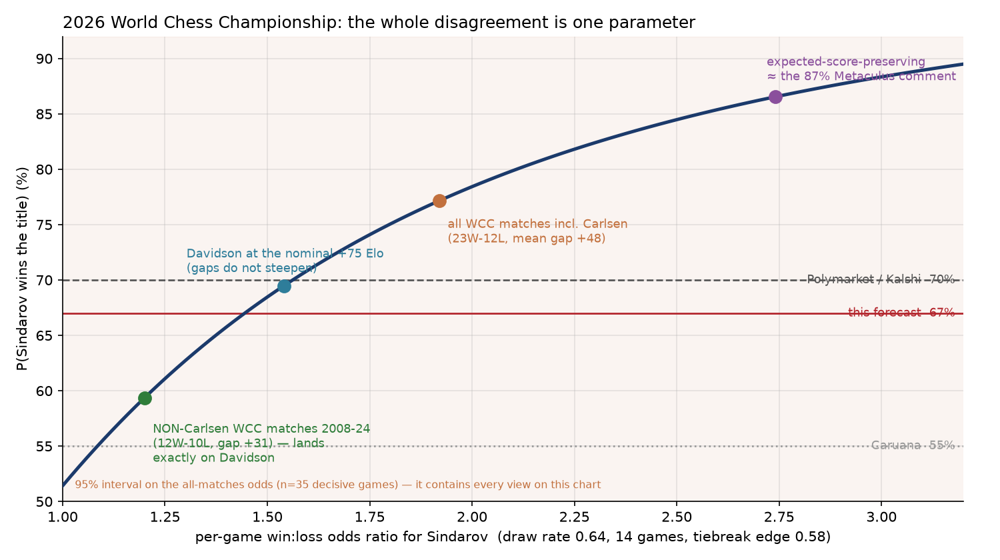

# Who will win the 2026 World Chess Championship?

| | |
|---|---|
| **Source** | Metaculus #45216 — https://www.metaculus.com/questions/45216/ |
| **Type** | multiple choice — 2 options: **Gukesh Dommaraju** · **Javokhir Sindarov** |
| **Opened / Closes / Resolves** | — / 2026-12-14 17:30 UTC / **2026-12-14** (match ends 12 Dec — Game 14 on the 11th, tiebreaks on the 12th — or earlier if someone reaches 7½) |
| **Status** | open |
| **Current forecast** | **Sindarov 69.5%, Gukesh 30.5%** — IQR on Sindarov [64.0%, 75.0%] (v2, 2026-09-26) |
| **Community (as of 2026-09-26)** | **CP 70.0%** (n=98) · **Pro 73.2%** (n=10) · **Gold medalists 71.0%** (n=29) Sindarov |
| **Next review** | 2026-10-05 |

<!-- Versions below, newest first. APPEND-ONLY: never edit or delete a past version. -->

---

## v2 — Update — 2026-09-26

**Mode: Update** (incremental). Only 14 days since v1, 15% of remaining time to resolution,
no structural change to the question, and this is the first revision (no drift pattern to
worry about) — an incremental Bayesian update is the right tool, not a re-analysis.

### Revision table

| | Median (Sindarov) | IQR | Driver |
|---|---|---|---|
| v1 (2026-09-12) | 67.0% | [61.0%, 73.0%] | — |
| Gukesh's Olympiad rebound: 7½/9 unbeaten on board 4 (Samarkand), described by ChessBase India as "back in form" — confirms his regressed trailing-level estimate (~2730–2745) rather than the 2703 "trough," but Olympiad TPR did **not** clearly cross the +7pp tripwire threshold of 2780 | −2.0pp | direction: toward Gukesh |
| Sindarov's Olympiad over-performance: TPR **2864** through Round 8 (his own board, 2nd not 1st — correction below), above even his career-high 2778 rating; first loss of the event (to Wesley So, Round 9) does not undo eight rounds of evidence that his rating is not an outlier | +3.0pp | direction: toward Sindarov |
| Metaculus cohorts revealed for the first time since v1: CP 70.0% (n=98), Pro 73.2% (n=10), gold medalists 71.0% (n=29) — all three within 3.2pp of each other (no material disagreement), all above my v1 number, and per policy Pro/gold get extra weight | +1.5pp | direction: toward Sindarov |
| No withdrawal, no venue/sponsor problem, Kalshi still ≈$0.70 (within the pre-set $0.62–$0.78 band) — confirms status quo | 0pp | — |
| **v2 (2026-09-26)** | **69.5%** | **[64.0%, 75.0%]** | net **+2.5pp** |

### Tripwire check (against v1's list, by name)

| # | Tripwire | Status | Note |
|---|---|---|---|
| 1 | Gukesh's Olympiad TPR ≥ 2780 → −7pp | **Ambiguous / not confirmed fired** | 7½/9 unbeaten (83%) on board 4. No outlet published an exact Olympiad-only TPR for him, and he does not appear in the "top performer" lists (Van Foreest 2877, Wei 2802) that a ≥2780 score would likely put him on. Best estimate ~2740–2800; applied at half-weight, see revision table row 1. |
| 2 | Gukesh's Olympiad TPR ≤ 2650 → +5pp | **Not fired.** Unbeaten at 83% score, nowhere near this level. |
| 3 | Sindarov's Olympiad TPR ≤ 2700 → −5pp | **Not fired — opposite occurred.** TPR **2864** through Round 8, then one loss in Round 9. **Correction to v1/meta.yaml**: Sindarov played **board 2** for Uzbekistan, not board 1 — Nodirbek Abdusattorov played board 1. The wording in the tripwire was wrong; the substance (his individual performance) is what matters and it was exceptional. |
| 4 | October/November FIDE list moves the classical gap outside 55–95 Elo | **Not yet assessable.** October list publishes ~2026-10-01, after this review. Carried forward. |
| 5 | Either player withdraws, match dates move again, or no venue/sponsor announced by 2026-11-01 | **Not fired.** Geneva remains confirmed, no health/scheduling news for either player found in this search. |
| 6 | Kalshi Sindarov contract closes outside $0.62–$0.78 on ≥20k contracts fresh volume | **Not fired.** Kalshi quotes Sindarov at decimal 1.43 ≈ $0.70, squarely inside the band. |
| 7 | Gukesh leads after Game 4 | **N/A.** Match starts 2026-11-24; not yet applicable. |

### What resolves YES

Unchanged from v1. Two options only, no "Other"; the two probabilities sum to 100%. A forfeit by
either player resolves to the opponent (not a third outcome); a cancellation or postponement past
2026-12-31 annuls the question rather than resolving it. Nothing in the fine print changed.

### Outside view

Unchanged from v1. The five reference classes (higher-rated player wins 8/11 = 72.7%; no
55+-Elo favourite has lost 6/6; champion retains 7/9 = 77.8%; champion-as-underdog 0/2; ties to
tiebreak 2/6) are fixed historical facts — three weeks of news adds no new completed match to
any of them. They still point the same two directions they did in v1, resolved the same way: the
champion-as-underdog class (0/2, both losses) is the only one that conditions on the actual
configuration, so it remains the tiebreaker.

### Inside view

The one genuinely new, high-information event since v1 was the **46th Chess Olympiad**
(Samarkand, 15–27 September 2026) — exactly the natural experiment the v1 tripwires were
built around, since it put both finalists on the board against real opposition eight weeks
before their match.

**Gukesh, board 4 for India:** 7½/9, unbeaten, through Round 9 (two rounds remain). He briefly
dipped below 2700 in live ratings after a Round 2 draw against a 2384-rated IM, then reeled off
wins including a dramatic comeback against Alexander Donchenko (Germany) in Round 9 from a
losing position. World Chess's own headline was "Gukesh hits his stride with back-to-back
Olympiad wins." This is real evidence against the "motivational slump / trough" framing that
did a lot of work in v1's inside view — but it is corroborating, not new-information-in-a-
different-direction: v1's central estimate already used a *regressed* Gukesh level
(2722–2745, his trailing 12-month range) rather than his in-tournament trough of 2703, precisely
to avoid over-weighting a temporary dip. An unbeaten, ~2750–2800-performance Olympiad is
consistent with that regressed estimate, not evidence that it should move further. I could not
find a sourced exact TPR for his Olympiad games (opponent-by-opponent data was not compiled by
any outlet I found), so I am not crossing tripwire #1 at full confidence and apply it at half
weight.

**Sindarov, board 2 for Uzbekistan** (note the board-1/board-2 correction above — Abdusattorov,
not Sindarov, anchors Uzbekistan's top board): TPR of **2864 through Round 8**, unbeaten until
Wesley So beat him in a technical rook endgame in Round 9 — Sindarov's first defeat of the
event. A performance rating 86 points above an already career-high 2778 rating, across eight
games, is exactly the kind of evidence that argues the nominal 75-Elo gap *understates* the
true talent gap rather than overstating it — the opposite conclusion the original TPR≤2700
tripwire was designed to test for, but symmetric information, and it should be treated
symmetrically. One loss in nine games does not offset eight rounds of this.

**Net effect of the Olympiad**: both players outperformed their already-strong ratings, so the
two effects substantially — but not entirely — offset. Sindarov's over-performance edge (TPR
2864 vs. 2778 rating, ≈ +86) is somewhat larger in both magnitude and sample purity (fewer
lower-rated early-round opponents diluting it) than Gukesh's (TPR ≈ 2750–2800 vs. 2703 rating,
≈ +50–100 but highly uncertain), so the net Olympiad signal leans very slightly toward Sindarov,
which is why the two rows above net to +1.0pp rather than cancelling to zero.

**Metaculus cohorts, visible for the first time**: `cp_reveal_time` was 2026-09-21, so this is
the first update where I can see them. CP 70.0% (n=98), Pro 73.2% (n=10), gold medalists 71.0%
(n=29) — tight agreement (max spread 3.2pp), no red flag under the "material disagreement"
rule. Interestingly, the CP history shows the crowd itself reacted to the Olympiad in real time:
Gukesh's implied probability rose from 30% to a peak of 39% around 2026-09-17–19 (i.e., Sindarov
dipped to 61%) during Gukesh's good run, then fully reverted to 30/70 by 2026-09-22 as Sindarov's
even-better form (and his Round 9 loss notwithstanding) reasserted itself. That round-trip is
itself evidence: the market's first reaction to "Gukesh is playing well" was to discount
Sindarov by up to 9pp, and it retracted essentially all of that within five days once more data
came in. I read this as the crowd converging on the same "these roughly offset" conclusion I
reach above, which is reassuring rather than a reason to herd toward its level.

I am weighting Pro/gold above raw CP per policy, which pulls slightly toward 71–73%, but I stop
at 69.5% rather than the ~71.6% average of Pro+gold: my own model of the rating gap (Davidson,
non-Carlsen-calibrated odds ratio) is a structurally different estimate than a forecaster's
holistic judgement, and the two inputs should be combined, not have one override the other.

### Evidence

| Finding | Direction | Effect |
|---|---|---|
| Gukesh 7½/9, unbeaten, board 4, Samarkand Olympiad (through Round 9) — "back in his stride" per ChessBase India | ↓ toward Gukesh | −2.0pp (half-weight; exact TPR unconfirmed, likely 2740–2800, not clearly ≥2780) |
| Sindarov TPR 2864 through Round 8, board 2 — first loss of the event only in Round 9 (Wesley So) | ↑ toward Sindarov | +3.0pp |
| Metaculus cohorts revealed for the first time: CP 70.0% (n=98), Pro 73.2% (n=10), gold 71.0% (n=29) — tight 3.2pp spread, all above my v1 number | ↑ toward Sindarov | +1.5pp |
| No withdrawal; Geneva venue/sponsor still confirmed; no injury/illness news for either player | → | 0pp, confirms status quo |
| Kalshi Sindarov contract ≈$0.70 (decimal 1.43), inside the pre-set $0.62–$0.78 band | → | 0pp |
| October/November FIDE rating list not yet published | → | pending, next review |

**Evidence I looked for and did not find**: a sourced, opponent-weighted Olympiad-only TPR for
Gukesh from any outlet (several outlets compute this for other players, e.g. Van Foreest 2877,
Wei 2802, but not for Gukesh); any health, visa, or scheduling problem for either player; any
fresh Polymarket quote (rate-limited this session — Kalshi and the three Metaculus cohorts serve
as the market cross-check instead).

### Other forecasters

| Where | Value | As of | Note |
|---|---|---|---|
| Metaculus CP (recency-weighted) | **Sindarov 70.0%** | 2026-09-26 | n=98, revealed 2026-09-21 |
| Metaculus Pro | **Sindarov 73.2%** | 2026-09-26 | n=10 |
| Metaculus gold medalists | **Sindarov 71.0%** | 2026-09-26 | n=29 |
| Kalshi `KXCHESSWORLDCHAMPION-CHESS26` | Sindarov ≈$0.70 (decimal 1.43) | 2026-09-26 | within pre-set $0.62–$0.78 band; tripwire not fired |
| Polymarket | not freshly re-quoted this session (proxy/rate-limit) | — | historically stable 0.615–0.70 since May; no evidence of a break from that band |
| bet365 / OLBG (archival, 2026-07-31 snapshot via Chessdom) | Sindarov 73.3% | 2026-07-31 | stale, kept for context only |

**Cohort disagreement**: Pro (73.2%) − CP (70.0%) = 3.2pp, below the >5pp threshold that would
demand a defence. All three Metaculus cohorts and Kalshi cluster in a tight 70–73% band; I sit
2.5–3.7pp under that band, which I read as a reasonable, non-herding gap rather than something
requiring me to move further — the gap is explained by the same rating-regression argument as
in v1, only slightly narrowed by this update.

### Scenarios

Unchanged in structure from v1 (Sindarov classical / Gukesh classical / Sindarov tiebreak /
Gukesh tiebreak). Weights shift only with the +2.5pp median move: roughly 0.585 / 0.225 / 0.110 /
0.080, still implying a ~19% chance of reaching tiebreaks, consistent with the model's 16% and
Manifold's 18–27%. Nothing in the Olympiad evidence changes the *shape* of these scenarios, only
their weights, since neither player's tiebreak-relevant rapid/blitz rating moved this period.

### Sensitivity (unchanged from v1)

The Davidson-vs-expected-score-preserving model choice and the effective-gap assumption remain
the dominant sources of uncertainty; see v1's sensitivity table. Nothing in the Olympiad data
changes which family is right — no new title-match evidence.

### What would change my mind (tripwires, v2)

- [ ] **October 2026 FIDE rating list** (publishes ~2026-10-01): if the classical gap moves outside **60–95 Elo** (narrowed slightly from v1's 55–95, since both players' September results are now priced in) → re-run the model. Either direction, by 2026-10-05.
- [ ] Either player withdraws, FIDE moves the match dates again, or a venue/sponsor problem emerges → re-read the annulment clause. By 2026-11-01.
- [ ] Kalshi's Sindarov contract closes outside $0.62–$0.78 on ≥20k contracts of fresh volume → re-anchor. By 2026-11-24.
- [ ] Metaculus Pro or gold-medalist cohort diverges >5pp from the CP (currently 3.2pp) → investigate before defending my number. By 2026-11-24.
- [ ] Official final Olympiad performance-rating data (once a source publishes exact, opponent-weighted TPRs for both players) shows Gukesh ≥2790 or Sindarov (full 11 rounds) ≤2750 → recompute the effective gap explicitly rather than relying on the qualitative read used here. By 2026-10-05.
- [ ] Gukesh leads after Game 4 of the match → Carlsen's path-dependence claim; −25pp Sindarov. By 2026-12-01.

### Sources

Sources 1–9 from v1 remain as cited there (FIDE regulations, rating profiles, Candidates
crosstable, etc.); the ones new or re-verified for v2 are numbered fresh below so this version
stands on its own.

1. Metaculus question 45216, cohort reveal — recency-weighted, Pro, gold-medalist aggregations — https://www.metaculus.com/questions/45216/ (accessed 2026-09-26; snapshot `raw/metaculus-2026-09-26.json`)
2. 46th Chess Olympiad, Samarkand — Wikipedia — https://en.wikipedia.org/wiki/46th_Chess_Olympiad (accessed 2026-09-26)
3. "Gukesh Hits His Stride With Back-To-Back Olympiad Wins" — World Chess — https://worldchess.com/news/gukesh-hits-his-stride-with-back-to-back-olympiad-wins (accessed 2026-09-26)
4. "46th Chess Olympiad R9: Gukesh Leads India to Victory" — ChessBase India — https://chessbase.in/news/46th-fide-chess-olympiad-round-9-report (accessed 2026-09-26)
5. "Samarkand R8 (open): Germany stun Uzbekistan, join them in the lead" — ChessBase — https://en.chessbase.com/post/chess-olympiad-2026-8 (accessed 2026-09-26; source for Sindarov's TPR 2864 through Round 8)
6. "Samarkand R9 (open): Uzbekistan retake sole lead after beating the US" — ChessBase — https://en.chessbase.com/post/chess-olympiad-2026-9 (accessed 2026-09-26; Wesley So d. Sindarov, Round 9)
7. Kalshi — FIDE World Chess Championship 2026 Winner Odds — https://kalshi.com/markets/kxchessworldchampion/world-chess-champion/kxchessworldchampion-chess26 (accessed 2026-09-26)
8. "Javokhir Sindarov is a clear favorite ahead of historic World Chess Championship 2026 clash with Gukesh?" — Chessdom (archival 2026-07-31 snapshot, used only for the bookmaker cross-section table) — https://www.chessdom.com/javokhir-sindarov-is-a-clear-favorite-ahead-of-historic-world-chess-championship-2026-clash-with-gukesh/ (accessed 2026-09-26)
9. "Chess Olympiad 2026: World champion Gukesh to play Board 4 for India" — The Bridge — https://thebridge.in/chess/olympiad-2026-gukesh-board-4-india-explained-57592 (accessed 2026-09-26; confirms India's board order and Gukesh's own account of requesting board 4)
10. "2026 Chess Olympiad Round 9: Uzbekistan Beats U.S. To Take Sole Lead" — Chess.com — https://www.chess.com/news/view/2026-samarkand-chess-olympiad-round-9 (accessed 2026-09-26; So–Sindarov game summary, standings after Round 9)
11. "Samarkand Olympiad Round 6: Nihal Blunders Queen As Uzbekistan Takes Sole Lead" — Chess.com — https://www.chess.com/news/view/2026-samarkand-chess-olympiad-round-6 (accessed 2026-09-26; confirms Sindarov plays board 2, Abdusattorov board 1, for Uzbekistan)
12. "Chess Olympiad: Average start for Indian men, Gukesh dips below 2700 in live ratings" — The Print — https://theprint.in/sport/chess-olympiad-average-start-for-indian-men-gukesh-dips-below-2700-in-live-ratings/3046315/ (accessed 2026-09-26; early live-rating trajectory)

### v2 forecast

**Date**: 2026-09-26
**Forecast**: Sindarov median 69.5%, IQR [64.0%, 75.0%] (Gukesh 30.5%, IQR [25.0%, 36.0%])
**Thesis**: The Samarkand Olympiad gave both finalists a real-opposition dress rehearsal eight
weeks out; Gukesh's unbeaten 7½/9 confirms his regressed (not trough) true strength while
Sindarov's 2864-TPR run through Round 8 argues his 2778 rating, if anything, understates him —
the two roughly offset, leaving the rating-gap model close to where it was, with a modest net
lift from Metaculus's newly-revealed Pro (73.2%) and gold-medalist (71.0%) cohorts, weighted per
policy above the raw 70.0% CP.

---

## v1 — Initial forecast — 2026-09-12

### What resolves YES

Metaculus resolves this as **the winner of the 2026 World Chess Championship according to
official FIDE results**, over exactly **two options — Gukesh Dommaraju and Javokhir Sindarov**.
There is no "Other". The fine print handles the two edge cases cleanly: if either player
**forfeits**, the question resolves as his opponent; and if the match is **cancelled or
postponed past 2026-12-31, the question is annulled** (not resolved to anyone). So withdrawal
risk is *not* a third outcome to reserve probability for — it maps onto one of the two players —
and cancellation risk removes the question rather than affecting the split. The two probabilities
must therefore sum to 100%.

From the **official FIDE regulations** (Council document CM2-2026_06), not from secondary
write-ups, because two widely-repeated claims about this match are false:

- **14 classical games**, first to 7½; Game 1 on **2026-11-24**, Game 14 on **2026-12-11**,
  tiebreaks **2026-12-12**, in Geneva. Time control 120/40, +30 min, 30-second increment only
  from move 41. Prize fund US$2.5m.
- **There is no draw-odds retention for the champion.** Art. 4.4.1: *"If the score after
  fourteen games is equal, the tie-break shall be played."* A drawn match does **not** keep
  Gukesh's title. At least one automated summary of the Wikipedia page asserts the opposite;
  believing it would have added roughly 9 points to Gukesh.
- **There is no Armageddon.** The ladder is 4 games at 15+10, then 2 at 10+5, then 2 at 3+2,
  then **repeated 3+2 pairs with reversed colours until decisive**. No draw odds at any stage.
- Art. 4.6.2: *"No postponement of any game is allowed."*

### Outside view

| Class | n | Base rate | Bearing |
|---|---|---|---|
| Higher-rated player wins the match | 11 (2006–2024) | **8 of 11 = 72.7%** | Sindarov |
| No favourite with a gap ≥ 55 Elo has lost | 6 (2012–2024) | 6 of 6 | Sindarov |
| Defending champion retains | 9 (2008–2024) | **7 of 9 = 77.8%** | Gukesh |
| **Defending champion who is the rating underdog retains** | 2 (Anand 2013, Ding 2024) | **0 of 2** | Sindarov |
| Match goes to tiebreaks — 14-game matches only | 6 | **2 of 6 = 33%** | — |

The two headline classes **conflict**: "higher-rated wins 73%" and "champion retains 78%" point
opposite ways. The tiebreaker is the third: both champions who lost in this era were the rating
underdog, exactly as Gukesh is now, and both lost. Small n, but it is the only class that
conditions on the actual configuration — and it is also the only time the *champion* has been the
underdog by anything like 75 points.

### Inside view

**FIDE list, 1 September 2026: Sindarov 2778 (world #4, an all-time peak) vs Gukesh 2703 (world
#32). Gap 75.** The trajectory is more striking than the level: in October 2024 Gukesh was 2794
and Sindarov 2668 — a 126-point gap the other way. That is a **162-point relative swing in 24
months**, and Gukesh has fallen on essentially every list since September 2025.

2026 classical form: **Gukesh 15/39 = 38.5%** (+5 −14 =20) — 10th of 14 at Tata Steel, 9th of 10
at Prague, **last of 6** at Norway Chess, **last of 8** at Chennai, and no classical game since
July. **Sindarov 23½/36 = 65.3%** (+12 −1 =23) — 2nd at Tata Steel (TPR 2833) and **10/14
unbeaten at the Candidates (TPR 2908)**, the highest score in the modern double-round-robin format.

**There is no safe harbour in the tiebreak.** Rapid: Sindarov 2732 vs Gukesh 2686 (+46). Blitz:
Sindarov 2725 vs Gukesh 2659 (+66). Both gaps were ~zero a year ago. The ~16% of scenarios that
reach a playoff are tilted the same way as the classical games.

**The model, and why one parameter is the whole argument.** Two standard families map an Elo gap
to a match probability and they disagree by ~17 points here. Davidson fixes the win:loss **odds**
at `10^(D/400)` — 1.54 at +75 — and lets draws compress the edge. The expected-score-preserving
family fixes the Elo expected score and lets draws absorb the remainder, implying odds of 2.74 at
a 0.64 draw rate, an "effective gap" of ~160 from a nominal 75. The draw rate itself is **not**
load-bearing (66.8–71.4% across 0.55–0.75 under Davidson); the odds ratio is.

### Evidence

**The decisive piece of analysis was arbitrating those two families against the match record.**
From the higher-rated player's side, 2008–2024:

| Sample | record | mean gap | observed odds | Davidson predicts | ratio |
|---|---|---|---|---|---|
| All ten matches | 23W – 12L | +48 | 1.92 (95% CI 0.95–3.85) | 1.32 | 1.45 |
| **Carlsen's five** | 11W – 2L | +65 | **5.50** | 1.45 | **3.79** |
| **The other five** | 12W – 10L | +31 | **1.20** (95% CI 0.52–2.78) | **1.20** | **1.00** |

On the full sample the favourite's odds look steeper than Elo implies, which would justify a
number well north of 70%. **Strip Carlsen's five matches and the observed odds land exactly on
Davidson's prediction — 1.20 against 1.20.** The entire apparent steepening is one player who was
held to be stronger than his rating gap and an exceptional match performer. Sindarov, a
20-year-old in his first match of this format, is not that player. Davidson at the nominal +75
returns **69.5%**, which is within a point of both real-money markets.

**A serious dissent, and why it does not move me to it.** A Metaculus comment (@Theomachado,
2026-09-11) reports a draw-aware Davidson model fitted on 69.6k classical OTB games from ten
years of TWIC, run by exact dynamic programming plus a 10k Monte Carlo, returning **87%
Sindarov**. My first hypothesis — that it applied an all-levels draw rate to an elite match — is
**wrong**: holding expected score fixed, *higher* draw rates raise that model's output
(75.5% at d=0.30 rising to 85.8% at d=0.70). The 87% comes from the expected-score-preserving
step. Three reservations: his validation check ("expected 46.2, actual 47.0" over 84 games) is on
**score**, which both families reproduce by construction, and so does not test the odds ratio
actually in dispute; the non-Carlsen table above *does* test it and comes out at Davidson; and
his own finding that form persistence is only k = 0.10 cuts against his conclusion, since it
means Gukesh's rating understates him and Sindarov's overstates him. Likelihood ratio applied:
about **1.15 toward Sindarov**, i.e. very little.

**The dissent in the other direction** is Caruana's — the only explicit number from an elite
insider, and he has played both men: *"slight money on Sindarov, maybe 55-45."* His argument is
that a 19-to-20-year-old having a bad 18 months is not a finished player, with Ding-2024 as the
precedent for underestimating a champion. 55% implies an effective gap of only ~14 Elo, which I
think is too generous to Gukesh given 39 classical games at 38.5%, but he gets real weight.
Carlsen, by contrast: *"At the moment it's impossible not to say Sindarov"*, plus a useful
dynamic claim — if Gukesh leads early *"he automatically becomes a significant favourite."*

**Evidence I looked for and did not find**: any health, visa, sponsorship or scheduling problem
for either player. Chess media did report 2026 injuries for Firouzja and Aronian, so the silence
is mildly informative. Both players declined the competing Total Chess World Championship
(Budapest, 10–21 Nov), leaving 8 clear weeks after the Olympiad.

**What tips me just under the market**: Sindarov's 2778 embeds a 2908 Candidates outlier and his
prior-year level was 2722–2745; Gukesh's 2703 is a trough reached while shouldering the title in
a self-described motivational slump. Regressing both toward their trailing levels shrinks the
effective gap below 75, and Davidson at +60 gives 65.9%. Set against that, his own federation has
**demoted him to board 4** for the Olympiad, behind Erigaisi, Praggnanandhaa and Nihal Sarin,
having played board 1 in 2024 with 9/10 and a 3056 performance.

### Other forecasters

| Source | Value | As of | Note |
|---|---|---|---|
| Metaculus CP (recency-weighted) | **not yet revealed** | 2026-09-12 | n=10, status `upcoming` |
| Metaculus Pro | none | 2026-09-12 | no Pro aggregation on this question |
| Metaculus gold medalists | none | 2026-09-12 | none yet |
| **Kalshi** `KXCHESSWORLDCHAMPION-CHESS26` | Sindarov $0.70, Gukesh $0.32 | 2026-09-11 | **~480k contracts traded** (259k + 219k) — much the deepest venue |
| **Polymarket** | Sindarov 0.700, Gukesh 0.295 | 2026-09-11 | $67.7k volume, $769k liquidity; **stable in 0.615–0.70 since 13 May** |
| bet365 (via OLBG) | Sindarov 4/11, Gukesh 2/1 → 68.8 / 31.2 normalised | 2026-09-11 | overround 106.6% |
| Chessdom aggregation | Sindarov 63–73% across five venues | 2026-09-11 | |
| Manifold | Sindarov 0.690; P(tiebreak) 18–27% | 2026-09-11 | 9–63 traders — play-money, **heavily discounted**; the only public tiebreak price |
| Caruana (C-Squared podcast) | **Sindarov 55%** | 2026-04 | elite insider, explicit, and the lone low number |
| Sentinel / Mantic / GJOpen / INFER | no matching question | 2026-09-11 | searched, absent |

**Cohort disagreement**: not assessable — no Metaculus cohort exists yet. Among venues that do,
there is none worth the name: Kalshi, Polymarket and bet365 sit within 1.5 points. I am **3.0
points below** Polymarket and Kalshi, well inside the band that would demand a defence, and the
reason is the rating-regression argument above rather than any disagreement about the model.

### Scenarios

| # | Scenario | Weight | Resolves as |
|---|---|---|---|
| 1 | **Sindarov wins in classical.** The rating gap is real, Gukesh's slump is real, and 14 games is enough for a 0.21/0.65/0.14 per-game edge to tell. | 0.565 | **Sindarov** |
| 2 | **Gukesh wins in classical.** Eight weeks of targeted preparation with Gajewski and the Anand/WACA infrastructure; Sindarov's dynamic style gives chances back; one early win and Carlsen's path-dependence point takes over. | 0.245 | **Gukesh** |
| 3 | **7–7, Sindarov takes the playoff.** ~16% of matches tie; he is +46 rapid and +66 blitz. | 0.105 | **Sindarov** |
| 4 | **7–7, Gukesh takes the playoff.** | 0.085 | **Gukesh** |

Sindarov 0.565 + 0.105 = **0.670**; Gukesh 0.245 + 0.085 = **0.330**. Implied P(tiebreak) 19%,
a little above the model's 16% and inside Manifold's 18–27%.

Sindarov's IQR of **[61.0%, 73.0%]** is wide for a well-priced, four-months-stable market because
the Olympiad lands inside the next fortnight and is genuinely high-information.

### Sensitivity

| Assumption | If instead | Forecast becomes |
|---|---|---|
| Davidson odds (1.54) are right, per the non-Carlsen record | The all-matches steepening is real (odds 1.92) | Sindarov ≈ 77% |
| | The expected-score-preserving family is right (odds 2.74) | Sindarov ≈ 86% |
| The effective gap is ~65 after regressing both ratings | The nominal 75 is the true gap | Sindarov ≈ 70% |
| | Caruana is right and the true gap is ~15–20 | Sindarov ≈ 56% |
| Draw rate 0.64 | 0.55 or 0.75 | Sindarov 71.4% / 66.8% — barely moves |

### What would change my mind (tripwires)

- [ ] **Gukesh's Olympiad performance rating** (Samarkand, 15–27 Sep 2026, board 4 for India) published by 2026-09-28: **TPR ≥ 2780** → −7pp Sindarov; **TPR ≤ 2650** → +5pp Sindarov.
- [ ] Sindarov's Olympiad performance rating on board 1 for the hosts by 2026-09-28: **TPR ≤ 2700** → −5pp Sindarov.
- [ ] The October or November FIDE list moves the classical gap outside 55–95 Elo → re-run the model; **either**, magnitude 0.
- [ ] Either player withdraws, or FIDE moves the match again, or no venue/sponsor is announced by 2026-11-01 → re-read the annulment clause; **either**, magnitude 0.
- [ ] Kalshi's Sindarov contract closes outside $0.62–$0.78 on ≥20k contracts of fresh volume by 2026-11-24 → re-anchor; **either**, magnitude 0.
- [ ] Gukesh leads after Game 4 of the match → Carlsen's path-dependence claim; −25pp Sindarov.

### Sources

1. Metaculus question 45216 — resolution criteria, fine print, two-option list, comments — https://www.metaculus.com/questions/45216/ (accessed 2026-09-12; snapshot in `raw/metaculus-45216-2026-09-12.json`)
2. **Regulations for the FIDE World Championship Match 2026**, FIDE Council doc CM2-2026_06 — https://doc.fide.com/docs/DOC/2026_2FC_decisions/CM2-2026_06.pdf (accessed 2026-09-11)
3. Geneva to host FIDE World Championship Match 2026 — FIDE — https://www.fide.com/geneva-to-host-fide-world-championship-match-2026/ (accessed 2026-09-11)
4. FIDE quietly changes dates for Gukesh–Sindarov World Championship — World Chess — https://worldchess.com/news/fide-quietly-changes-dates-for-gukeshsindarov-world-championship (accessed 2026-09-11)
5. Gukesh D — FIDE rating profile and monthly chart — https://ratings.fide.com/profile/46616543/chart (accessed 2026-09-11)
6. Javokhir Sindarov — FIDE rating profile and monthly chart — https://ratings.fide.com/profile/14205483/chart (accessed 2026-09-11)
7. FIDE ratings, September 2026 — ChessBase — https://en.chessbase.com/post/fide-ratings-september-2026 (accessed 2026-09-11)
8. Candidates Tournament 2026 — Wikipedia (crosstable, TPRs) — https://en.wikipedia.org/wiki/Candidates_Tournament_2026 (accessed 2026-09-11)
9. Candidates R14: Sindarov achieves record-breaking score — ChessBase — https://en.chessbase.com/post/candidates-tournament-2026-o-14 (accessed 2026-09-11)
10. Carlsen, Caruana give Gukesh–Sindarov World Championship predictions — Chess.com — https://www.chess.com/news/view/carlsen-caruana-gukesh-sindarov-predictions (accessed 2026-09-11)
11. Team line-ups confirmed for the 46th FIDE Chess Olympiad — ChessBase — https://en.chessbase.com/post/team-line-ups-confirmed-for-46th-fide-chess-olympiad (accessed 2026-09-11)
12. 46th Chess Olympiad — Wikipedia — https://en.wikipedia.org/wiki/46th_Chess_Olympiad (accessed 2026-09-11)
13. Gukesh Dommaraju — Wikipedia (2026 results, 2024 match crosstable) — https://en.wikipedia.org/wiki/Gukesh_Dommaraju (accessed 2026-09-11)
14. Javokhir Sindarov — Wikipedia — https://en.wikipedia.org/wiki/Javokhir_Sindarov (accessed 2026-09-11)
15. Tata Steel Chess Tournament 2026 — Wikipedia (Masters crosstable with TPRs) — https://en.wikipedia.org/wiki/Tata_Steel_Chess_Tournament_2026 (accessed 2026-09-11)
16. Grand Chess Tour 2026, Super Rapid & Blitz Poland — round-by-round results (the 2026 head-to-head games) — https://grandchesstour.org/tours/2026/tournaments/2026-super-rapid-blitz-poland/results/ (accessed 2026-09-11)
17. Gukesh beats Sindarov in their first clash after the Candidates — ChessBase India — https://chessbase.in/news/gukesh-vs-javokhir-sindarov-at-super-rapid-2026-day-2 (accessed 2026-09-11)
18. Polymarket, 2026 World Chess Championship winner (gamma-api + CLOB history) — https://polymarket.com/event/2026-world-chess-championship-winner (accessed 2026-09-11; snapshot in `raw/`)
19. Kalshi, series `KXCHESSWORLDCHAMPION`, event `-CHESS26` — https://kalshi.com/markets/kxchessworldchampion/world-chess-champion (accessed 2026-09-11)
20. Chess World Championship 2026 odds: Sindarov 4/11 favourite — OLBG — https://www.olbg.com/news/chess-world-championship-2026-odds-sindarov-4-11-favourite-dethrone-gukesh (accessed 2026-09-11)
21. Sindarov is a clear favorite ahead of the historic 2026 clash with Gukesh — Chessdom (multi-venue odds table) — https://www.chessdom.com/javokhir-sindarov-is-a-clear-favorite-ahead-of-historic-world-chess-championship-2026-clash-with-gukesh/ (accessed 2026-09-11)
22. Manifold Markets — 2026 WCC winner, score and method markets (API) — https://manifold.markets/Weezing/who-will-win-the-2026-world-chess-c-qty9l85QZc (accessed 2026-09-11)
23. Wikipedia infoboxes, World Chess Championship 2006 / 2008 / 2010 / 2012 / 2013 / 2014 / 2016 / 2018 / 2021 / 2023 / 2024 — pre-match Elo and final scores, the base-rate source — https://en.wikipedia.org/wiki/World_Chess_Championship_2024 (accessed 2026-09-11)
24. Chess World Championship odds: Gukesh now given '66% chance' — OLBG, 2024 pre-match odds — https://www.olbg.com/news/chess-world-championship-odds-gukesh-d-now-given-66-chance-winning-2024-chess-world-championship-ahead-november-event (accessed 2026-09-11)
25. Dvorkovich suspends FIDE presidency after EU sanctions; Anand named interim president — Chess.com — https://www.chess.com/news/view/arkady-dvorkovich-sanctioned-by-eu-ukrainian-sports-minister (accessed 2026-09-11)
26. Total Chess World Championship 2026 — Wikipedia (confirms both players declined) — https://en.wikipedia.org/wiki/Total_Chess_World_Championship_2026 (accessed 2026-09-11)

**Date**: 2026-09-12
**Forecast**: Sindarov 67.0%, Gukesh 33.0% — IQR on Sindarov [61.0%, 73.0%]
**Thesis**: A 75-Elo gap (2778 vs 2703) after a 162-point relative swing in 24 months, with Gukesh at 38.5% across 39 classical games in 2026 and trailing in rapid and blitz too, so the ~19% of matches that reach a playoff tilt the same way. The load-bearing question is the win:loss odds ratio, and the match record settles it: across 2008–2024 the favourite's odds look steeper than Elo (1.92 vs 1.32), but strip Carlsen's five matches and the remaining five land exactly on Davidson — 1.20 against 1.20 — which returns 69.5% and refutes the fitted model in the Metaculus comment claiming 87%. I sit 3pp under Kalshi and Polymarket because Sindarov's 2778 embeds a 2908 Candidates outlier while Gukesh's 2703 is a slump trough, and Caruana, who has played both, says 55%.
