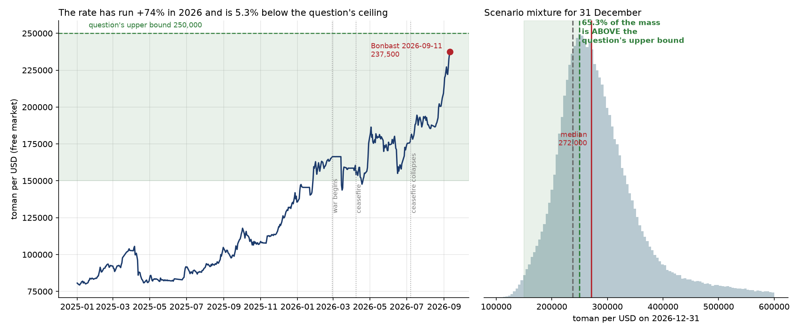

# What will be the open market US Dollar/Iranian Toman exchange rate on December 31, 2026?

| | |
|---|---|
| **Source** | Metaculus #45340 — https://www.metaculus.com/questions/45340/ |
| **Type** | numeric (toman per USD); range **150,000–250,000, both bounds open**, 500-toman steps |
| **Opened / Closes / Resolves** | — / 2026-11-30 23:00 UTC / **2026-12-31** (value date, Tehran time) |
| **Status** | open |
| **Current forecast** | **Median 272,000 toman/USD, IQR [236,000, 320,000]** — **P(resolves above the 250,000 upper bound) = 65%** (v1, 2026-09-12) |
| **Community (as of 2026-09-12)** | **CP not yet revealed** — n=6 forecasters, status `upcoming`; no Pro or gold-medalist aggregation |
| **Next review** | 2026-10-10 |

<!-- Versions below, newest first. APPEND-ONLY: never edit or delete a past version. -->

---

## v1 — Initial forecast — 2026-09-12

### What resolves YES

The question resolves to *"the open market US Dollar/Iranian Toman exchange rate on December 31,
2026 (Tehran time)"*, with **Bonbast** (bonbast.com/graph) named as the primary source and the
explicit reminder that **one toman = ten rials**. The fine print excludes the official tier:
*"Iran's official Central Bank rate will not be used as resolution, only the market rate."*

Three mechanical points do most of the work here.

1. **The range is 150,000–250,000 with both bounds open, and the rate is already at 237,500.**
   Bonbast printed **237,500 toman** on 2026-09-11 (sell; buy 237,400) — **5.3% below the
   question's own ceiling**, after rising **+74% year-to-date** and **+18.3% in the fifteen days**
   to 11 September. The live question is therefore not "what number" but "does it close above
   250,000", and on the distribution below it does with about **65%** probability.
2. **The question closes 2026-11-30, a month before the value date.** Forecasts are locked a
   month early, so a December de-escalation cannot be traded on. That asymmetry argues for a
   wider band than the calendar alone suggests.
3. **The rial/toman factor-of-ten trap.** The parallel Polymarket contract is titled "USD x
   Iranian **rials**" and its brackets are in rials; this question is in **toman**. Every
   Polymarket bracket must be divided by ten before comparison. Verified empirically: Polymarket
   prices "2.2M+" for September at 90.5%, and 237,500 toman = 2,375,000 rials.

Two unhedged risks worth stating. **Redenomination**: the four-zeros law came into force
2025-12-07 (1 new rial = 1,000 toman) and the *toman* name was dropped from the final text;
every quoting source still uses old units today, so this is a 2027+ risk, but Polymarket's
contract carries an explicit conversion clause and **Metaculus's does not**. **Source outage**:
bonbast.com was forced offline in January 2025 by DDoS attacks after public criticism from the
then-CBI governor, and the question names no fallback.

### Outside view

From the tgju daily free-market series, 3,948 observations from 2011-11-26 to 2026-09-10,
snapshotted to `raw/` and converted to toman:

| Class | n | Base rate over a 111-day horizon | Applied to 237,500 |
|---|---|---|---|
| All 111-day windows, 2012+ | 3,837 | median ×1.064, IQR [0.992, 1.213] | 252,700, IQR [235,600, 288,100] |
| Post-2018 (maximum-pressure era) | 2,348 | median ×1.136, IQR [1.001, 1.284] | 269,800, IQR [237,700, 305,000] |
| Post-2024 | 679 | median ×1.184, IQR [1.037, 1.302] | 281,200, IQR [246,300, 309,200] |
| Same calendar window, 11 Sep → 31 Dec, by year | 14 | median +9.8%, IQR [+0.5%, +31.0%] | 260,700, IQR [238,700, 311,100] |

All four were kept; they disagree by ~28,000 toman at the median, which is itself information
about how much the answer depends on which regime you think 2026 resembles. The four cluster at
**253,000–281,000**, i.e. just at or above the question's ceiling.

Two facts from the annual series discipline the tails. The toman has **appreciated year-on-year
in only 2 of 14 years** (2013 and 2015, both negotiation years — Rouhani's election and the
JCPOA). And the one large *within-year* reversal, 2018, went **13,716 on 11 Sep → 10,500 on
31 Dec, −23.4%**, following an overshoot spike very like the one now in progress. That is the
shape of the left tail: it exists, it is large, and it needs a policy trigger.

### Inside view

The end-December level is spot × (war/sanctions path) × (monetary path).

**The monetary path is a floor, not a variable.** CPI is running **84.4% year-on-year** (August,
Statistical Centre of Iran) with food at ~128%; M2 growth is above 40%; government debt to the
central bank is up 68% year-on-year; and the executive vice-president has said in terms,
*"because our budget is unbalanced, we are forced to print money."* Oil export revenue is the
binding constraint and it has gone: exports fell from 2.16 mb/d in February to an estimated
120–260 kb/d, and the CBI governor says revenue *"fell to zero"*. That alone puts roughly
×1.10–1.15 into 111 days.

**The war path is the variance.** Day 195 of a US–Iran war as of 11 September: the ceasefire that
ran 8 April – 8 July collapsed, the US blockade was re-imposed 14 July, the 60-day Islamabad MoU
window expired on 13 August with no deal, and 7–10 September brought the largest tit-for-tat
shipping attacks of the war. Trump on 1 September: *"We don't want to speak to them."* Treasury
Secretary Bessent: *"We are going to economically asphyxiate this regime."*

**But de-escalation is more likely than the headlines suggest, and that is what pulled my median
down.** Polymarket prices a **64% chance the US announces an end to the blockade by 31 December**
(37% by 31 October) — while giving only **19%** to Hormuz traffic actually returning to normal.
So the market expects an *announcement* without a reopening. The historical precedent is that
such rallies are real but fade: the June MoU took the rate 179,000 → 153,000 (−14%) and it was
back near 172,000 within two weeks. The April 2025 Oman talks produced −22.3% in a single month.
A genuine reopening with asset unfreezing is the one scenario that produces a durable move below
spot.

**Momentum versus mean reversion.** +18.3% in fifteen days, with the CBI selling $500m of
physical banknotes into it on 25 August and the rate rising 17% in the following sixteen days, is
capitulation pricing, not equilibrium. Roughly 26–27% of historical 3-month windows are negative.
That is why real mass sits below spot even in a war.

### Evidence

Live readings on 2026-09-11, from two independent sources, agreeing to within 0.6%:

| Source | Value | Unit | Note |
|---|---|---|---|
| **bonbast.com** `usd1` / `usd2` | **237,500 / 237,400** | toman | the named resolution source; last_modified 20:31 |
| tgju.org `price_dollar_rl`, 2026-09-10 close | 2,359,750 | rial = **235,975 toman** | day high 2,360,200 / low 2,338,600 |
| CBI reference (SANA), 2026-09-10 | 1,629,244 | rial = 162,924 toman | **excluded by the fine print**; free market is +44% |

The single largest update came from the Metaculus comment on this question (@Theomachado,
2026-09-11), which supplied the Polymarket conditional odds above. **Likelihood ratio ≈ 2.4
toward de-escalation** relative to the 11% I had been using for a formal nuclear deal by
year-end: that number is right for a *deal*, but the blockade-announcement contract at 64% is the
better-matched instrument, and it moved the combined de-escalation weight from 0.14 to 0.40
across two branches and the median from 290,000 down to 272,000.

Two supply-side facts I had not had: **since 18 August the UAE has suspended all trade and
financial transactions with Iran**, and Dubai's dirham remittance rate effectively sets the
Tehran dollar price — which explains the violence of the August–September move as a supply shock
rather than pure panic.

**The strongest disconfirming evidence against my own number is local**: Tehran-based analysts
project **240,000–250,000 by late December** and only 250,000–300,000 by March 2027, implying
1–3% monthly growth and treating the current level as an overshoot. One institutional forecast
from mid-August (spot then ~188,000) put end-2026 at ~180,000. If the local analysts are right,
the question resolves *inside* its range and my median is ~30,000 too high. I give them real
weight — they are the reason scenario 2 carries 0.30 — but they have been persistently behind
this series all year.

**Absent evidence, noted**: no IMF, World Bank, EIU, Fitch, Capital Economics or Oxford Economics
published rial/toman path for end-2026 could be found. The IMF's April 2026 WEO gives Iran
inflation of 68.9% (severe case >75%) and GDP −6.1%, and its July global update explicitly
assumed Hormuz reopens by mid-July — an assumption already falsified.

### Other forecasters

| Source | Value | As of | Note |
|---|---|---|---|
| Metaculus CP | **not yet revealed** | 2026-09-12 | n=6, status `upcoming` |
| Metaculus Pro / gold | none | 2026-09-12 | no aggregation exists yet |
| **Polymarket** "USD x Iranian rials End of December" | implied median **≈ 300,600 toman**; p25 218,400, p75 339,000 | 2026-09-11 | $9.4k volume, $18.9k liquidity — **thin**, book sums to 93.7%, and the 300–350k bracket quotes bid 0.10 / ask 0.153 |
| Polymarket "…End of September" | "2.2M+ rial" (220,000 toman) at **90.5%** | 2026-09-11 | $43k volume; ~9.5% on a fall below 220,000 within 19 days |
| Polymarket, US–Iran blockade ends by 31 Dec | **64%** | 2026-09-11 | via the Metaculus comment |
| Polymarket, US–Iran nuclear deal by 31 Dec | **11%** | 2026-09-11 | $2.69m volume — the deep, well-matched contract on the *deal* branch |
| Kalshi | no Iranian FX market | 2026-09-11 | searched events and series tickers |
| Manifold | none found | 2026-09-11 | |
| Tehran analysts (eghtesadnews) | 240,000–250,000 by late December | 2026-08/09 | full text 503; search summary only |
| Sentinel Team | 25% (18–30%) the Islamic Republic falls by end-2026 | 2026-09-11 | feeds the discontinuity branch |

Converting Polymarket's December brackets from rials to toman and normalising:

| Bracket (toman) | This forecast | Polymarket |
|---|---|---|
| < 200,000 | 8.3% | 16.5% |
| 200,000 – 250,000 | 26.4% | 22.9% |
| 250,000 – 300,000 | **31.3%** | **10.1%** |
| 300,000 – 350,000 | 18.1% | **32.6%** |
| 350,000 – 400,000 | 7.3% | 13.5% |
| > 400,000 | 8.6% | 4.3% |

My median sits **~28,000 toman below** Polymarket's. I am comfortable with that gap: the contract
has $9.4k of volume against $43k on its own September sibling, its book underrounds to 93.7%, and
its implausible bimodality — a dip to 10.1% in the 250–300k bucket sandwiched between 22.9% and
32.6% — is exactly what wide spreads on a thin book produce. I do take its *direction* seriously,
which is why my median is above every unconditional base rate.

### Scenarios

| # | Scenario | Weight | Median implied |
|---|---|---|---|
| 1 | **Genuine reopening.** Blockade lifted *and* Hormuz traffic resumes, with asset unfreezing, early enough to persist to 31 December. Polymarket gives 19% to normal traffic; this requires it to stick. | 0.10 | ~190,000 |
| 2 | **De-escalation announcement, rally partly fades.** The 64% contract pays but the 19% one does not — headlines without a reopening. The June-MoU pattern: a sharp drop that gives most of itself back. | 0.30 | ~242,000 |
| 3 | **No relief, or relief that fades entirely.** Monetary grind continues on zero oil revenue, 84% inflation and an unbalanced budget financed by the printing press. | 0.45 | ~294,500 |
| 4 | **Escalation.** US invasion (Polymarket 16% before 2027), regime rupture, a fuel-price revolt, or a hyperinflationary leg. | 0.15 | ~404,000 |

Resulting percentiles: p5 186,000 · p10 206,000 · **p25 236,000** · **p50 272,000** ·
**p75 320,000** · p90 386,000 · p95 461,000.

**P(above the 250,000 upper bound) = 65.3%. P(inside the range) = 34.0%. P(below 150,000) = 0.7%.
P(below today's spot) = 26.3%.**

### Sensitivity

| Assumption | If instead | Forecast becomes |
|---|---|---|
| De-escalation branches total 0.40 (from the 64% blockade contract discounted for fade) | Only the 11% nuclear-deal contract is the right instrument | median ≈ 292,000, P(>250k) ≈ 73% |
| | The Tehran analysts are right and the current level is an overshoot | median ≈ 248,000, P(>250k) ≈ 48% |
| The monetary floor is ~×1.12 over 111 days | Hyperinflation dynamics take hold (>6%/month) | median ≈ 320,000, P(>250k) ≈ 80% |
| Bonbast keeps quoting in old units | It or Iran switches to new rials before resolution | the question's number changes by ~1,000× for nominal reasons; resolution is ambiguous |

### What would change my mind (tripwires)

- [ ] Bonbast's 31 October close comes in **at or below 230,000 toman** → the September spike is retracing; **−25,000 toman**.
- [ ] Bonbast's 31 October close comes in **at or above 280,000 toman** → the melt-up is compounding; **+35,000 toman**.
- [ ] A formal US announcement ending the naval blockade, or a resumed US–Iran negotiating round, before 2026-11-30 → **−30,000 toman**.
- [ ] Hormuz commercial transits recover above 40/day (PortWatch, baseline 85/day) for a full week before 2026-11-30 → **−40,000 toman**.
- [ ] US ground invasion of Iran, or confirmed removal of the Supreme Leader, before 2026-11-30 → **+60,000 toman**.
- [ ] Bonbast goes dark for more than five consecutive days, or any major source switches to new rials, before 2026-12-31 → resolution-source risk, re-read the criteria; **either**, magnitude 0.

### Sources

1. Metaculus question 45340 — resolution criteria, fine print, 150,000–250,000 open range, comments — https://www.metaculus.com/questions/45340/ (accessed 2026-09-12; snapshot in `raw/metaculus-45340-2026-09-12.json`)
2. Bonbast live rates, POST `/json` — USD 237,500 toman sell / 237,400 buy — https://www.bonbast.com/ (accessed 2026-09-11; snapshot in `raw/bonbast-2026-09-11.json`)
3. Bonbast USD graph, the named resolution source — https://www.bonbast.com/graph (accessed 2026-09-12)
4. tgju.org, قیمت دلار آزاد daily series, 3,948 rows 2011-11-26 → 2026-09-10 — https://www.tgju.org/profile/price_dollar_rl (accessed 2026-09-11; snapshot in `raw/tgju-usd-free-market-daily-2026-09-11.json`)
5. Polymarket, "USD x Iranian rials End of December" — https://polymarket.com/event/usd-x-iranian-rials-end-of-december (accessed 2026-09-11; snapshot in `raw/`)
6. Polymarket, "USD x Iranian rials End of September" — https://polymarket.com/event/usd-x-iranian-rials-end-of-september (accessed 2026-09-11; snapshot in `raw/`)
7. Polymarket, "US–Iran final nuclear deal by…" — 11% for 31 December, $2.69m volume — https://polymarket.com/event/us-iran-final-nuclear-deal-by-20260621201254412 (accessed 2026-09-11)
8. Central Bank of Iran reference rate, 2026-09-10, via Trend.az — https://www.trend.az/business/4222416.html (accessed 2026-09-11)
9. IranWire, "Iran's inflation crisis deepens as year-on-year rate hits 84.4% in August" — https://iranwire.com/en/news/156819-irans-inflation-crisis-deepens-as-year-on-year-rate-hits-844-in-august/ (accessed 2026-09-11)
10. IranWire, "Statistical Centre reports 128% food inflation in August" — https://iranwire.com/en/news/156878-statistical-center-reports-128-food-inflation-in-august/ (accessed 2026-09-11)
11. IranWire, "Dollar hits 213,000 tomans as gold prices surge" — the CBI's $500m banknote release of 2026-08-25 — https://iranwire.com/en/news/157024-dollar-hits-213000-tomans-as-gold-prices-surge-in-iran/ (accessed 2026-09-11)
12. Euronews, "Iranian rial in freefall as dollar breaks 2.1 million mark", 2026-09-02 — https://www.euronews.com/business/2026/09/02/iranian-rial-hits-record-low-as-us-dollar-breaks-22-million-mark (accessed 2026-09-11)
13. The National, "Iran's currency hits record low as US prepares economic offensive", 2026-08-24 — https://www.thenationalnews.com/business/2026/08/24/irans-currency-hits-record-low-as-us-prepares-to-hit-tehran-with-economic-offensive/ (accessed 2026-09-11)
14. NCRI, "Dollar breaks 220,000 as money-printing admission and infighting deepen Iran's crisis", 2026-09-02 — https://www.ncr-iran.org/en/news/economy/dollar-breaks-220000-as-money-printing-admission-and-infighting-deepen-irans-crisis/ (accessed 2026-09-11)
15. FDD, "Trump's blockade is zeroing out Iran's oil exports", 2026-06-05 — https://www.fdd.org/analysis/2026/06/05/trumps-blockade-is-zeroing-out-irans-oil-exports/ (accessed 2026-09-11)
16. GlobalSecurity, "Iran War 2026 — Day 195 update, 10 September 2026" — https://www.globalsecurity.org/military/ops/iran-war-oprep.htm (accessed 2026-09-11)
17. TIME, "Iran's president signals willingness to resume peace talks", 2026-09-01 — https://time.com/article/2026/09/01/irans-president-willing-to-resume-peace-talks-what-stands-in-the-way-/ (accessed 2026-09-11)
18. CNBC, "Brent crude tops $100 as US–Iran tit-for-tat strikes stoke supply worries", 2026-09-09 — https://www.cnbc.com/2026/09/09/oil-prices-today-wti-brent-us-iran-hormuz-attacks.html (accessed 2026-09-11)
19. US State Department, "Completion of UN sanctions snapback on Iran", September 2025 — https://www.state.gov/releases/office-of-the-spokesperson/2025/09/completion-of-un-sanctions-snapback-on-iran/ (accessed 2026-09-11)
20. bne IntelliNews, "Iran to phase out old rial by 2030 in four-zero redenomination" — https://www.intellinews.com/iran-to-phase-out-old-rial-by-2030-in-four-zero-redenomination-427812/ (accessed 2026-09-11)
21. Bloomberg, "Iran Bonbast.com FX website offline due to cyber attacks", 2025-01-09 — https://www.bloomberg.com/news/articles/2025-01-09/iran-bonbast-com-fx-website-offline-due-to-cyber-attacks (accessed 2026-09-11)
22. IMF April 2026 World Economic Outlook, Iran figures (inflation 68.9%, GDP −6.1%), via EconomyHeights — https://economyheights.com/blog/iran-economic-outlook-imf-2026-forecast/ (accessed 2026-09-11)
23. Al Jazeera, "IMF cuts 2026 world growth forecast, citing Iran war fallout", 2026-07-09 — https://www.aljazeera.com/economy/2026/7/9/imf-cuts-2026-world-growth-forecast-citing-iran-war-fallout (accessed 2026-09-11)
24. Sentinel Team, Global Risks Weekly Roundup #13/2026 — https://blog.sentinel-team.org/p/iranian-steel-and-nuclear-plants (accessed 2026-09-11)
25. Alanchand, USD open-market and havaleh rates — https://alanchand.com/en/currencies-price/usd (accessed 2026-09-11)

**Date**: 2026-09-12
**Forecast**: Median 272,000 toman/USD, IQR [236,000, 320,000] — P(above the 250,000 upper bound) = 65%
**Thesis**: Bonbast is at 237,500 after +74% year-to-date and +18.3% in fifteen days, only 5.3% below the question's own ceiling, so the real question is P(>250,000) and the answer is about two-thirds. Zero oil revenue, 84% inflation and openly acknowledged deficit monetisation put a ~×1.12 floor into the 111 days; against that, Polymarket's 64% on a US announcement ending the blockade — but only 19% on Hormuz traffic actually normalising — plus the June-MoU pattern of rallies fading, is what keeps 40% of the weight on de-escalation and holds my median ~28,000 below Polymarket's thin, underrounded December book. Note the question closes 2026-11-30, a month before the value date, and its criteria do not hedge the four-zeros redenomination.
