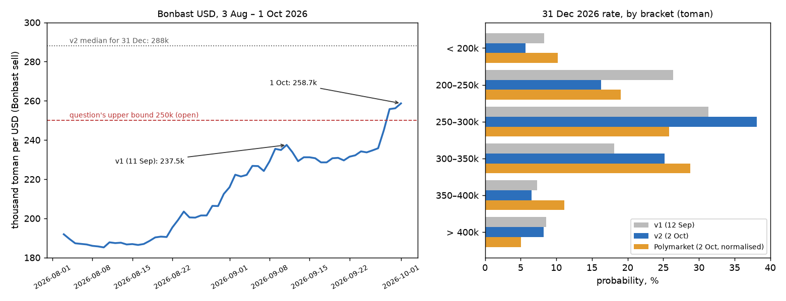

# What will be the open market US Dollar/Iranian Toman exchange rate on December 31, 2026?

| | |
|---|---|
| **Source** | Metaculus #45340 — https://www.metaculus.com/questions/45340/ |
| **Type** | numeric (toman per USD); range **150,000–250,000, both bounds open**, 500-toman steps |
| **Opened / Closes / Resolves** | — / 2026-11-30 23:00 UTC / **2026-12-31** (value date, Tehran time) |
| **Status** | open |
| **Current forecast** | **Median 291,000 toman/USD, IQR [258,000, 328,000]**. **P(resolves above the 250,000 upper bound) ≈ 80%** (v3, 2026-10-16) |
| **Community (as of 2026-10-16)** | CP, Pro and gold medians **and lower quartiles** are all clipped at the 250,000 bound (n=110 / 10 / 30). Polymarket's December median is ≈ 283,000 |
| **Next review** | 2026-11-01 |

<!-- Versions below, newest first. APPEND-ONLY: never edit or delete a past version. -->

---

## v3 — Update — 2026-10-16

**Mode: Update** (incremental). It has been 14 days since v2, 16% of the 90 days that remained
then. That is below the one-third trigger. The question's structure is unchanged: same range,
same close date, same source. The nearest market, Polymarket's December book, has a median
about 8,000 below mine. That is within 3%, and the gap is explained below, so no market contradicts
me without explanation. This is the second update. v2 moved up and v3 moves up again, so if v4 also
moves up, it must be a de-novo re-analysis.

### Revision table

| Driver | Direction | Effect on median (toman) |
|---|---|---|
| **Prior (v2, 2026-10-02)** | — | **288,000**, IQR [255,000, 322,000]; P(>250k) 78% |
| **Spot rebased, 258,700 → 266,500 (+3.0%).** Bonbast peaked at 269,600 on 5 Oct, dipped to 259,800 on 13 Oct, and was at 266,700 on 15 Oct and 266,500 on 16 Oct at 04:22 Tehran time [1][2]. v2's implied drift (×1.113 over 90 days), scaled to the 76 days left, is ×1.095, which gives 291,800 | up | **+3,800** |
| **The central bank is intervening, and it is visibly damping the rate.** State banks began selling up to **$2bn** around 3–4 Oct. bne IntelliNews reports that eight-day volatility fell from 15% to 1.2%, and the Ferdowsi St. dollar fell 0.83% to 262,800 on 12 Oct [3][4]. The Bonbast series confirms it: 11 days inside 259,800–269,600 [2]. The money is finite. Hemmati himself says part of it is leaking into arbitrage, and hardliners are attacking the policy [4]. That limits the effect to a near-term dampener | down | −3,000 |
| **The de-escalation markets collapsed.** Polymarket "US announces end of blockade" is at 31 Oct **5.5%** (was 24.5%), 30 Nov **21.5%** (was 38%), 31 Dec **35%** (was 53.7%) [5]. Trump on 8 Oct: the blockade stays "in full force and effect". Iran calls the US response "insufficient" [6][7]. I cut de-escalation weight from 0.34 to 0.27 | up | +4,000 |
| **Escalation is now scheduled rather than threatened.** Trump pledged on 8 Oct that there would be "no attacking Iran at any time prior to the Midterm Elections" [6]. But the White House has asked for strike options for after 3 Nov, and CNN reports MOAB plans against energy and nuclear sites [7][8]. The pre-midterm pledge removes some October tail risk, and the post-midterm risk rises. Escalation weight goes from 0.16 to 0.20 | up | +1,500 |
| **Polymarket's December book shifted down.** The "2.0–2.5M" bracket rose **+8 pp in a week**, to 25.5%. The normalised implied median is ≈ **283,000**, p25 ≈ 234,000, p75 ≈ 336,000, and P(>250k) ≈ 67%. Volume is $117.8k but liquidity only $50.6k [9]. I read the bracket move as the market pricing the intervention, which is one row above. I give it partial weight because the book is thin, sums to 103.5%, and its October sibling ("2.8M+" at 51.5% with spot at 266.5k) points the other way [10] | down | −3,000 |
| **Rounding to the scenario mixture** | — | −300 |
| **New median (v3)** | | **291,000** |
| **Lower quartile raised, 255,000 → 258,000.** Spot has spent 18 days above 245,000. The post-spike outside-view class gives p25 ×0.98 of spot, which is 261,000 [11]. All three Metaculus cohorts' lower quartiles have moved up to the 250,000 bound [12]. Polymarket's p25 of 234,000 pulls the other way. **Upper quartile raised, 322,000 → 328,000**, for the extra escalation weight | — | (IQR only) |
| **New forecast (v3)** | | **291,000**, IQR [258,000, 328,000]; P(>250k) **≈ 80%** |

### Tripwire check (v2 list)

| Tripwire | Status | Evidence |
|---|---|---|
| Bonbast's 31 Oct close at or below 240,000 → −20,000 | Not due (spot 266,500; low since 1 Oct 259,800) | [1][2] |
| Bonbast's 31 Oct close at or above 300,000 → +30,000 | Not due (12.6% above spot) | The thin Polymarket October book has "2.8M+" at 51.5% [10] |
| Formal US announcement ending the blockade, or a signed framework → −35,000 | **Not fired** | Trump says the blockade stays "in full force" [6]. Polymarket puts an announcement by 30 Nov at 21.5% [5] |
| Hormuz transits above 40/day (PortWatch) for a full week → −30,000 | **Not fired (partial signal)** | CENTCOM claims "over 40 vessels" in the 24 hours to 15 Oct [8]. Lloyd's List counts 477 non-Iranian transits in September [13]. That is a single day, it is not PortWatch, and it is US-escorted non-Iranian traffic while the blockade on Iranian shipping tightens. It is not the de-escalation this tripwire stands for. PortWatch shows 4 transits on 4 Oct [14] |
| US or Israeli strikes on Iranian territory resume → +25,000 | **Not fired** | There is a pledge of no strikes before 3 Nov [6], and strike options are being prepared for after [7][8]. Houthi strikes on Riyadh and IRGC strikes on shipping are not on Iranian territory |
| Bonbast dark for more than five days, or a source switches to new rials | Not fired | Bonbast was live on 16 Oct at 04:22 and still quotes old toman [1] |

### What resolves YES

Unchanged from v2.

### Outside view

Unchanged from v2. Applied to the new spot of 266,500 over 76 days, scaling log-drift by
76/90: the post-2018 class gives median ≈ 292,000 and IQR ≈ [266,000, 318,000]. The post-spike
class gives median ≈ 296,000 and IQR ≈ [261,000, 325,000] [11].

### Inside view

Unchanged in structure from v2. Three facts are new:

- **Central-bank intervention.** This is the first visible defence of the open-market rate in this
  episode. It has worked so far: the rate has been flat at 260–270k for 11 days [2][3]. The 2018
  and 2020 analogues say such defences buy weeks, not quarters, when the fundamental pressure
  (blockade, 60–85% inflation) is unchanged. That is speculation from analogy, flagged as such.
- **The blockade is tightening, not easing.** Treasury designated 17 shadow-fleet vessels on
  8 Oct and 26 more Iran-linked targets on 15 Oct. Bessent says the pressure "will continue"
  [6][8]. Brent is ≈ $105 [8].
- **The calendar sets the decision date.** The 3 Nov midterms are now the explicit pivot. Before
  them comes a pledged strike pause. After them, either strikes or a deal. Trump says the war will
  end "very quickly … one way or the other" [8].

### Scenarios

Re-weighted and re-based to the spot of 266,500, for the 76 days to 31 December:

| # | Scenario | Weight (v2 → v3) | Median implied |
|---|---|---|---|
| 1 | **Genuine reopening**: an enhanced MoU, the blockade lifted, it holds | 0.09 → **0.07** | ~200,000 (×0.75) |
| 2 | **Announcement, rally partly fades**, or the intervention holds the rate flat | 0.25 → **0.20** | ~264,000 (×0.99) |
| 3 | **No relief**: the monetary grind, damped by intervention while it lasts | 0.50 → **0.53** | ~290,000 (×1.09) |
| 4 | **Escalation**: post-midterm strikes, invasion, or regime rupture | 0.16 → **0.20** | ~375,000 (×1.41) |

The raw mixture gives p25 264,000, p50 288,000 and p75 319,000, with P(>250k) 86%. That is
narrower than the outside view in the upper tail and more confident than Polymarket in the
lower tail. I widen it toward both. Final percentiles: p5 205,000 · p10 233,000 · **p25 258,000** ·
**p50 291,000** · **p75 328,000** · p90 382,000 · p95 425,000.

**P(above the 250,000 upper bound) ≈ 80%. P(inside the range) ≈ 19.5%. P(below 150,000) ≈ 0.5%.
P(below today's spot of 266,500) ≈ 31%.**

### Evidence

v2's evidence stands. New items are in the revision table.

### Other forecasters (2026-10-16)

| Source | Value | As of | Note |
|---|---|---|---|
| **Metaculus CP** | median **≥ 250,000**, IQR **[≥250,000, ≥250,000]** | 2026-10-16 02:17 | n=110 (119 total). The lower quartile has also reached the bound, so P(>250k) ≥ 75% [12] |
| **Metaculus Pros** | median ≥ 250,000, IQR at the bound | 2026-10-16 | n=10 |
| **Metaculus gold medalists** | median ≥ 250,000, IQR at the bound | 2026-10-16 | n=30 |
| Metaculus commenters | Vlad25 86% >250k. eylonbsh ~89% >250k, median ~290k. VectorWright endorses ~290–299k from inflation parity | 2026-10-11 | [12] |
| **Polymarket** "USD x Iranian rials End of December" | implied median **≈ 283,000**, p25 ≈ 234,000, p75 ≈ 336,000, P(>250k) ≈ 67% | 2026-10-16 | $117.8k volume, $50.6k liquidity. "2.0–2.5M" is +8 pp on the week [9] |
| Polymarket "…End of October" | "2.8M+" at **51.5%**, 2.6–2.8M at 34% | 2026-10-16 | $47.1k volume, but only $5.3k liquidity [10] |
| Polymarket, US announces end of blockade | 31 Oct 5.5% · 30 Nov 21.5% · 31 Dec **35%** · 31 Mar 58.5% | 2026-10-16 | $40.6m volume [5] |

**Cohort disagreement**: there is none within Metaculus. All three cohorts are clipped at the
bound through their lower quartile. My lower quartile, 258,000, is consistent with theirs. The
main external disagreement is Polymarket's fat 200–250k bracket. I take half of it.

Bracket comparison (Polymarket rials ÷ 10, normalised):

| Bracket (toman) | v2 | **v3** | Polymarket (2026-10-16) |
|---|---|---|---|
| < 200,000 | 5.7% | **4.0%** | 8.2% |
| 200,000 – 250,000 | 16.3% | **16.0%** | 24.6% |
| 250,000 – 300,000 | 38.1% | **37.0%** | 26.1% |
| 300,000 – 350,000 | 25.2% | **24.0%** | 22.2% |
| 350,000 – 400,000 | 6.5% | **10.5%** | 12.6% |
| > 400,000 | 8.2% | **8.5%** | 6.1% |

### Sensitivity

| Assumption | If instead | Forecast becomes |
|---|---|---|
| Escalation weight 0.20 | post-midterm strikes happen (weights 0.03 / 0.10 / 0.50 / 0.37) | median ≈ 315,000, P(>250k) ≈ 92% |
| De-escalation weight 0.27 | a framework is signed in November (weights 0.40 / 0.40 / 0.17 / 0.03) | median ≈ 245,000, P(>250k) ≈ 45% |
| The intervention damps the rate for 1–2 months | it holds the rate flat at ~265k to year-end | median ≈ 268,000, P(>250k) ≈ 80% |

### What would change my mind (tripwires)

- [ ] Bonbast's **31 October close at or below 245,000 toman**: the intervention is gaining traction, **−20,000 toman**.
- [ ] Bonbast's **31 October close at or above 300,000 toman**: the intervention has failed, **+30,000 toman**.
- [ ] A **formal US announcement ending the blockade, or a signed US–Iran framework**, before 2026-11-30: **−35,000 toman**.
- [ ] **Iranian-linked tankers transit Hormuz unblocked** (PortWatch above 40/day for a full week, *with* the blockade eased) before 2026-11-30: **−30,000 toman**.
- [ ] **US or Israeli strikes on Iranian territory resume** before 2026-11-30: **+25,000 toman**. A **ground invasion or regime rupture**: **+60,000 toman**.
- [ ] **The central bank halts or exhausts the $2bn dollar sales** (official announcement, or Bonbast up more than 5% in a week) before 2026-11-30: **+12,000 toman**.
- [ ] **Bonbast goes dark** for more than five consecutive days, or any major source switches to new rials, before 2026-12-31: re-read the criteria. **Either** direction, magnitude 0.

### Sources

1. Bonbast live rates, POST `/json` with page token and cookie: USD 266,500 sell / 266,300 buy, last modified 2026-10-16 04:22. https://www.bonbast.com/ (accessed 2026-10-16; `raw/bonbast-2026-10-16.json`)
2. Bonbast USD graph, the named resolution source, daily series 17 Aug – 15 Oct 2026. https://www.bonbast.com/graph/usd (accessed 2026-10-16; `raw/bonbast-graph-usd-2026-10-16.json`)
3. bne IntelliNews, "Iran's dollar volatility falls from 15% to 1.2% after central bank intervention", 2026-10-12. https://www.intellinews.com/iran-s-dollar-volatility-falls-from-15-to-1-2-after-central-bank-intervention-475354 (accessed 2026-10-16, via search summary)
4. Iran International, "Tehran divided over $2 billion plan to prop up rial", 2026-10-07. https://www.iranintl.com/en/202610076990. Also Yahoo Finance, "Iran's rial hits fresh low as $2 billion currency intervention fails to stem slide". https://finance.yahoo.com/markets/currencies/articles/iran-rial-hits-fresh-low-204319407.html (both accessed 2026-10-16, via search summary)
5. Polymarket, "US announces end of Iranian blockade by…?" (gamma API). https://polymarket.com/event/us-announces-end-of-iranian-blockade-byptptpt-20260713152715080 (accessed 2026-10-16; `raw/polymarket-us-announces-end-of-iranian-blockade-2026-10-16.json`)
6. CBS News live updates, "Trump promises not to resume strikes before midterm elections", 7–8 Oct 2026. https://www.cbsnews.com/live-updates/iran-war-nuclear-donald-trump-vance-rubio-strait-of-hormuz/ (accessed 2026-10-16)
7. CBS News, "Iran calls U.S. response 'insufficient' amid stalled talks to end the war". https://www.cbsnews.com/live-updates/iran-war-trump-us-elections-saudi-arabia-yemen-houthis/. Also CNBC, "Trump downplays Iran deal as U.S. readies renewed strikes", 2026-10-08. https://www.cnbc.com/2026/10/08/us-iran-war-trump-hormuz.html (both accessed 2026-10-16, via search summary)
8. Fox News live blog, 14–15 Oct 2026 (CENTCOM transit claim, CNN MOAB report, Treasury sanctions, Brent). https://www.foxnews.com/live-news/us-iran-war-peace-donald-trump-strait-hormuz-oil-prices-midterms-october-15 (accessed 2026-10-16)
9. Polymarket, "USD x Iranian rials End of December?" (gamma API). https://polymarket.com/event/usd-x-iranian-rials-end-of-december (accessed 2026-10-16; `raw/polymarket-usd-x-iranian-rials-end-of-december-2026-10-16.json`)
10. Polymarket, "USD x Iranian rials End of October?" (gamma API). https://polymarket.com/event/usd-x-iranian-rials-end-of-october (accessed 2026-10-16; `raw/polymarket-usd-x-iranian-rials-end-of-october-2026-10-16.json`)
11. tgju.org free-market dollar daily series, 90-day window statistics, carried from v2 [3]. https://www.tgju.org/profile/price_dollar_rl (accessed 2026-09-11; `raw/tgju-usd-free-market-daily-2026-09-11.json`)
12. Metaculus question 45340, three-cohort aggregations and comments. https://www.metaculus.com/questions/45340/ (accessed 2026-10-16; `raw/metaculus-2026-10-16.json`)
13. Lloyd's List Intelligence, "Strait of Hormuz Brief: 12 October, 2026". https://www.lloydslistintelligence.com/resources/blog/strait-of-hormuz-brief-12-october-2026 (accessed 2026-10-16, via search summary)
14. straits.live daily briefs, 3–11 Oct 2026 (citing IMF PortWatch). https://straits.live/briefs/2026-10-10 (accessed 2026-10-16, via search summary)
15. Axios, "Inside Trump, Netanyahu's dilemma: Strike Iran before elections or wait", 2026-10-13. https://www.axios.com/2026/10/13/netanyahu-trump-iran-war-elections (accessed 2026-10-16, via search summary)

**Question**: [What will be the open market US Dollar/Iranian Toman exchange rate on December 31, 2026?](https://www.metaculus.com/questions/45340/)
**Date**: 2026-10-16
**Forecast**: Median 291,000 toman/USD, IQR [258,000, 328,000]. P(above the 250,000 upper bound) ≈ 80%
**Thesis**: Up 3,000. Bonbast is at 266,500, after a 260–270k plateau held by a $2bn central-bank dollar sale [1][2][3]. That damps the near-term drift, but the fundamentals worsened. Polymarket's odds of an announced end to the blockade by 31 Dec fell from 54% to 35% [5]. Strikes are paused only until the 3 Nov midterms, with post-election options being prepared [6][8]. All three Metaculus cohorts now sit at the bound through their lower quartile [12]. Polymarket's thinner December book (median ≈ 283,000) is the main dissent, and I give it half weight [9].

---

## v2 — Update — 2026-10-02

**Mode: Update** (incremental). It has been 20 days since v1, 18% of the 110 days that remained
then. That is below the one-third trigger for a re-analysis. No market contradicts me
unexplained. The Metaculus community prediction (CP) is now revealed but its median is clipped
at the 250,000 bound, so it cannot contradict a median above 250,000. The question's structure
is unchanged: same range, same close date, same source. This is the first update, so there is
no drift to check.

### Revision table

| Driver | Direction | Effect on median (toman) |
|---|---|---|
| **Prior (v1, 2026-09-12)** | — | **272,000**, IQR [236,000, 320,000]; P(>250k) 65% |
| **Spot rebased, 237,500 → 258,700 (+8.9%), a new record and now above the question's ceiling.** The path was flat at 229–236k from 13 to 27 Sep, then jumped **+10.4% in four days**: 245,000 on 28 Sep, 255,800 on 29 Sep, 258,700 on 1 Oct [1][2]. The trigger was Trump calling Iran's seven-day Hormuz proposal "unacceptable" on 27 Sep [4][5]. Carrying v1's drift (×1.145 over 111 days) over the 90 days left from the new spot gives 288,800 | up | **+16,800** |
| **Some of a four-day spike usually retraces.** The September analogue: 237,500 on 11 Sep, then 228,600 on 18 Sep (−3.7%) [2]. In the tgju series, 90-day windows that start after a rise of 8% or more in 21 days have the same median drift as all windows (×1.133) but a fatter left tail: 17% end more than 8% lower, against 11% after 2018 [3] | down | −3,000 |
| **The de-escalation markets fell.** Polymarket "US announces end of Iranian blockade by 31 Dec" went **64% → 53.7%**, "by 31 Oct" 37% → **24.5%**, and "by 30 Nov" is 38% [6]. Trump says the blockade stays and Iran is "ready to fold up … right after the election" [7]. I cut the weight on the two de-escalation branches from 0.40 to 0.34 | up | +4,000 |
| **But talks are live and the guns are quiet.** The US delivered its response to the seven-day plan through Qatari mediators on 30 Sep. GlobalSecurity reports that the dispute is "the sequence of steps rather than the content" [5]. A US official calls the indirect talks "positive and constructive" [4]. No coalition strikes on Iranian territory have been reported for 24 consecutive reporting periods [5] | down | −2,500 |
| **Polymarket's December book got ten times deeper and agrees.** Volume went from $9.4k to **$90.0k**. Normalised implied median ≈ **290,000**, p25 ≈ 239,000, p75 ≈ 334,000 [8]. Its median is within 2,000 of mine. Its lower quartile is fatter, as is the Metaculus cohorts' (next row) | — | 0 |
| **Rounding to the scenario mixture** | — | +700 |
| **New median (v2)** | | **288,000** |
| **Lower quartile widened, 257,800 → 255,000.** All three Metaculus cohorts put their lower quartile at 232,000–238,000 [9]. The post-spike base rate puts it at ×0.98 of spot, 253,500 [3]. My unadjusted mixture put it at spot. I move half-way toward the base rate. The cohorts' numbers are partly stale: many were entered during the 229–236k plateau | — | (IQR only) |
| **New forecast (v2)** | | **288,000**, IQR [255,000, 322,000]; P(>250k) **78%** |

### Tripwire check (v1 list)

| Tripwire | Status | Evidence |
|---|---|---|
| Bonbast's 31 Oct close at or below 230,000 → −25,000 | Not due (moving away) | Bonbast 258,700 on 1–2 Oct [1][2] |
| Bonbast's 31 Oct close at or above 280,000 → +35,000 | Not due | 8.2% above spot. Polymarket's thin October book ($12.8k) has "2.8M+ rial" at 69% (bid 0.67 / ask 0.71) [10]. I note it but do not use it; spreads in the lower brackets are 8–12¢ |
| Formal US announcement ending the blockade, or a resumed US–Iran negotiating round → −30,000 | **Not fired (indirect only)** | Araghchi met Qatari mediators in New York on 29 Sep, and the US answered through them on 30 Sep [4][5]. These are indirect exchanges, not a negotiating round. Trump rejected the proposal publicly [4][7]. Applied as the −2,500 row above, not at the tripwire's −30,000 |
| Hormuz transits above 40/day (PortWatch) for a week → −40,000 | Not fired | PortWatch: 1 transit on 27 Sep against an 85/day baseline. straits.live counted 16–17/day on 29–30 Sep, including dark (AIS-off) vessels [11] |
| US ground invasion, or confirmed removal of the Supreme Leader → +60,000 | Not fired | Mojtaba Khamenei has been Supreme Leader since February. There have been no strikes ashore for 24 reporting periods [5]. Trump has threatened attacks after the 3 Nov midterms if talks fail [7] |
| Bonbast dark for more than five days, or a source switches to new rials | Not fired | Bonbast was live on 2 Oct (05:07 Tehran) and still quotes old toman [1] |

### What resolves YES

Unchanged from v1. One clarification: Polymarket's December contract names the same source
(bonbast.com/graph/usd) and the same value date. It uses the "finalized" daily figure, meaning
the one that stands once the next day's figure is out [8]. So Polymarket is a direct comparison
once you divide its rial brackets by ten. Metaculus has no matching "finalized" rule. The
graph's daily point and the live quote were identical on 1 Oct (258,700), so this barely matters.

### Outside view

v1's table stands. Added this session, from the same tgju series [3], 90-day horizons (the time
left to the value date):

| Class | n | p10 / p25 / median / p75 / p90 | P(fall) | P(fall > 8%) | Applied to 258,700 |
|---|---|---|---|---|---|
| All windows, 2012+ | 3,855 | 0.930 / 0.989 / 1.052 / 1.187 / 1.309 | 29.1% | 8.8% | median 272,200 |
| Post-2018 | 2,366 | 0.914 / 0.997 / 1.119 / 1.231 / 1.350 | 25.6% | 10.7% | median 289,500, IQR [257,900, 318,500] |
| Post-2024 | 697 | 0.956 / 1.031 / 1.138 / 1.254 / 1.317 | 19.5% | 6.6% | median 294,400 |
| **After a ≥ 8% rise in the prior 21 days**, 2012+ | 575 | 0.875 / 0.980 / 1.133 / 1.267 / 1.421 | 28.7% | 17.0% | **median 293,100, IQR [253,500, 327,800]** |

The post-spike class is the best match, because spot rose 8.9% in 21 days. It gives almost
exactly my median, and a lower quartile 4,300 below my unadjusted one, which is why the IQR row
in the revision table exists.

### Inside view

Unchanged from v1 in structure. Three facts are updated:

- **Inflation:** GlobalSecurity cites **61.4%** annual inflation with food at 128% [5], against
  the 84.4% year-on-year figure in v1. The two series measure different things (a 12-month
  average versus point-to-point), so I do not read this as disinflation. The monetary floor is
  unchanged.
- **Oil:** Al Jazeera reports Gulf crude exports recovering to 12.8 mb/d in September [4]. That
  is the region, not Iran: the blockade still zeroes Iranian exports [7].
- **The new driver is the news cycle around a binary US decision.** Trump said on 1 Oct that
  the US would decide "very soon" whether to strike Iran or negotiate (reported in GlobalSecurity's
  daily update, via search summary) [5]. The rate is pricing that coin-flip with an upward skew.

### Scenarios

Re-weighted and re-based to the new spot, for the 90 days to 31 December:

| # | Scenario | Weight (v1 → v2) | Median implied (×spot) |
|---|---|---|---|
| 1 | **Genuine reopening**: the enhanced-MoU route, with the blockade lifted, Hormuz reopened and ~$12bn unfrozen, and it holds to 31 Dec | 0.10 → **0.09** | ~191,000 (×0.74) |
| 2 | **Announcement, rally partly fades** | 0.30 → **0.25** | ~259,000 (×1.00) |
| 3 | **No relief**: the monetary grind continues | 0.45 → **0.50** | ~297,500 (×1.15) |
| 4 | **Escalation**: post-midterm strikes, invasion, or regime rupture | 0.15 → **0.16** | ~401,000 (×1.55) |

Resulting percentiles: p5 195,000 · p10 222,000 · **p25 255,000** · **p50 288,000** ·
**p75 322,000** · p90 381,000 · p95 442,000.

**P(above the 250,000 upper bound) ≈ 78%. P(inside the range) ≈ 21.6%. P(below 150,000) ≈ 0.4%.
P(below today's spot of 258,700) ≈ 27%.**

### Evidence

v1's evidence stands. New items are in the revision table.

### Other forecasters (2026-10-02)

| Source | Value | As of | Note |
|---|---|---|---|
| **Metaculus CP** | median **≥ 250,000** (clipped at the open upper bound), p25 **231,967** | 2026-10-02 03:39 | n=102. It was 237,442 at reveal on 14 Sep and has been pinned at the bound since |
| **Metaculus Pros** | median **≥ 250,000**, p25 **237,046** | 2026-10-02 | n=10. Pinned at the bound since reveal |
| **Metaculus gold medalists** | median **≥ 250,000**, p25 **237,876** | 2026-10-02 | n=31 |
| **Polymarket** "USD x Iranian rials End of December" | implied median **≈ 290,000**, p25 ≈ 239,000, p75 ≈ 334,000 | 2026-10-02 | $90.0k volume (was $9.4k), $166k liquidity; book sums to 102.6% [8] |
| Polymarket "…End of October" | "2.8M+" (≥ 280,000) at **69%** | 2026-10-02 | $12.8k volume; lower brackets have 8–12¢ spreads [10] |
| Polymarket, US announces end of blockade | 15 Oct 9.5% · 31 Oct **24.5%** · 30 Nov 38% · 31 Dec **53.7%** · 31 Mar 70% | 2026-10-02 | 31 Dec contract $2.70m volume [6] |
| Metaculus commenters | tejvn: shifted right 13k after the jump; DeRuina: 2018 and 2020 rallies "gave back a quarter to a third" within weeks once a deal looked plausible | 2026-09-29/30 | [9] |

**Cohort disagreement**: the three Metaculus cohorts agree with one another: every median is at
the bound, and the lower quartiles span 232–238k. They disagree with me only on the lower
quartile, by 17–23k, and the gap is explained in the revision table. Pros and gold put their
lower quartile ~5,500 above the CP's, so the better track records lean toward my side.

Bracket comparison (Polymarket rials ÷ 10, normalised):

| Bracket (toman) | v1 | **v2** | Polymarket |
|---|---|---|---|
| < 200,000 | 8.3% | **5.7%** | 10.2% |
| 200,000 – 250,000 | 26.4% | **16.3%** | 19.0% |
| 250,000 – 300,000 | 31.3% | **38.1%** | 25.8% |
| 300,000 – 350,000 | 18.1% | **25.2%** | 28.8% |
| 350,000 – 400,000 | 7.3% | **6.5%** | 11.1% |
| > 400,000 | 8.6% | **8.2%** | 5.0% |

Polymarket's book is still somewhat bimodal, with a dip at 250–300k. It is less extreme than at
v1, and $90k is real money. I am more concentrated in the middle than it is. If I am wrong it is
probably there, so the IQR is wider than the scenario medians alone would make it.

### Sensitivity

| Assumption | If instead | Forecast becomes |
|---|---|---|
| De-escalation weight 0.34 | the enhanced MoU is signed in October (the blockade market gives ~25% to an announcement by 31 Oct); weights 0.45 / 0.40 / 0.12 / 0.03 | median ≈ 237,000, P(>250k) ≈ 41% |
| — | strikes resume; weights 0.03 / 0.10 / 0.50 / 0.37 | median ≈ 311,000, P(>250k) ≈ 91% |
| The four-day spike retraces 3,000 | spot retraces fully to ~235k, like the September plateau, before the scenarios play out | median ≈ 262,000, P(>250k) ≈ 61% |
| Bonbast keeps old units | it switches to new rials before 31 Dec | resolution ambiguous, since the Metaculus criteria have no conversion clause; Polymarket's do |

### What would change my mind (tripwires)

- [ ] Bonbast's **31 October close at or below 240,000 toman** → retracement; **−20,000 toman**.
- [ ] Bonbast's **31 October close at or above 300,000 toman** → the melt-up is compounding; **+30,000 toman**.
- [ ] A **formal US announcement ending the blockade, or a signed US–Iran framework** (an enhanced MoU) before 2026-11-30 → **−35,000 toman**.
- [ ] **Hormuz transits above 40/day** (PortWatch) for a full week before 2026-11-30 → **−30,000 toman**.
- [ ] **US or Israeli strikes on Iranian territory resume** before 2026-11-30 → **+25,000 toman**; a **ground invasion or regime rupture** → **+60,000 toman**.
- [ ] **Bonbast goes dark** for more than five consecutive days, or any major source switches to new rials, before 2026-12-31 → re-read the criteria; **either**, magnitude 0.

### Sources

1. Bonbast live rates, POST `/json` with page token and cookie — USD 258,700 sell / 258,600 buy, last modified 2026-10-02 05:07 — https://www.bonbast.com/ (accessed 2026-10-02; `raw/bonbast-2026-10-02.json`)
2. Bonbast USD graph, the named resolution source, daily series 3 Aug – 1 Oct 2026 — https://www.bonbast.com/graph/usd (accessed 2026-10-02; `raw/bonbast-graph-usd-2026-10-02.json`)
3. tgju.org, قیمت دلار آزاد (free-market dollar) daily series, 2011-11-26 → 2026-09-10; 90-day window statistics recomputed this session — https://www.tgju.org/profile/price_dollar_rl (accessed 2026-09-11; snapshot `raw/tgju-usd-free-market-daily-2026-09-11.json`, re-analysed 2026-10-02)
4. "Iran's Araghchi meets Qatari mediators as US calls for nuclear talks" — Al Jazeera, 2026-09-29 — https://www.aljazeera.com/news/2026/9/29/irans-araghchi-meets-qatari-mediators-as-us-insists-on-nuclear-talks (accessed 2026-10-02)
5. GlobalSecurity, "Iran War 2026 — Day 216 Update, 01 October 2026" — https://www.globalsecurity.org/military/ops/iran-war-oprep.htm (accessed 2026-10-02)
6. Polymarket, "US announces end of Iranian blockade by…?" (gamma API) — https://polymarket.com/event/us-announces-end-of-iranian-blockade-byptptpt-20260713152715080 (accessed 2026-10-02; `raw/polymarket-us-announces-end-of-iranian-blockade-2026-10-02.json`)
7. CBS News live updates, "Trump says Iran 'ready to fold up,' after threatening post-midterm attacks" — https://www.cbsnews.com/live-updates/iran-war-us-negotiations-strait-of-hormuz-oil/ (accessed 2026-10-02)
8. Polymarket, "USD x Iranian rials End of December?" (gamma API, incl. resolution rules) — https://polymarket.com/event/usd-x-iranian-rials-end-of-december (accessed 2026-10-02; `raw/polymarket-usd-x-iranian-rials-end-of-december-2026-10-02.json`)
9. Metaculus question 45340, three-cohort aggregations and comments — https://www.metaculus.com/questions/45340/ (accessed 2026-10-02; `raw/metaculus-2026-10-02.json`)
10. Polymarket, "USD x Iranian rials End of October?" (gamma API) — https://polymarket.com/event/usd-x-iranian-rials-end-of-october (accessed 2026-10-02; `raw/polymarket-usd-x-iranian-rials-end-of-october-2026-10-02.json`)
11. straits.live, "Strait of Hormuz Status: September 30, 2026" (citing IMF PortWatch) — https://straits.live/briefs/2026-09-30 (accessed 2026-10-02, via search summary)
12. "Iran's currency hits a new record low as war erodes the country's economic stability" — PBS NewsHour / AP, 2026-09-29 — https://www.pbs.org/newshour/world/irans-currency-hits-a-new-record-low-as-war-erodes-the-countrys-economic-stability (accessed 2026-10-02, via search summary: 2.5 million rial per dollar on 29 Sep); and "'This is how the war will end'" — Fortune, 2026-09-29 — https://fortune.com/2026/09/29/iran-currency-new-low-us-back-into-colony/ (accessed 2026-10-02)
13. IranWire, "Iran's inflation crisis deepens as year-on-year rate hits 84.4% in August" — https://iranwire.com/en/news/156819-irans-inflation-crisis-deepens-as-year-on-year-rate-hits-844-in-august/ (accessed 2026-09-11) — carried forward from v1 [9], still relied on
14. FDD, "Trump's blockade is zeroing out Iran's oil exports", 2026-06-05 — https://www.fdd.org/analysis/2026/06/05/trumps-blockade-is-zeroing-out-irans-oil-exports/ (accessed 2026-09-11) — carried forward from v1 [15], still relied on
15. bne IntelliNews, "Iran to phase out old rial by 2030 in four-zero redenomination" — https://www.intellinews.com/iran-to-phase-out-old-rial-by-2030-in-four-zero-redenomination-427812/ (accessed 2026-09-11) — carried forward from v1 [20], still relied on

**Date**: 2026-10-02
**Forecast**: Median 288,000 toman/USD, IQR [255,000, 322,000] — P(above the 250,000 upper bound) ≈ 78%
**Thesis**: Up 16,000. Bonbast jumped 10% in four days to a record 258,700 after Trump rejected Iran's seven-day Hormuz plan [1][2][4], which puts spot above the question's ceiling with 90 days to go. Polymarket's odds of an announced end to the blockade by 31 Dec fell from 64% to 54% [6]. The best-matched base rate, 90-day windows after an 8%+ three-week rise, gives a median of ×1.13 (293,000) [3]. Live Qatari-mediated talks and 24 strike-free reporting periods [5] are the reason I keep a third of the weight on de-escalation. The now-deep Polymarket December book (median ≈ 290,000) agrees [8]. All three Metaculus cohorts sit at the bound, with lower quartiles of 232–238k [9]. That is why my lower quartile sits below spot.

---

## v1 — Initial forecast — 2026-09-12

### What resolves YES

The question resolves to *"the open market US Dollar/Iranian Toman exchange rate on December 31,
2026 (Tehran time)"*, with **Bonbast** (bonbast.com/graph) named as the primary source and the
explicit reminder that **one toman = ten rials**. The fine print excludes the official tier:
*"Iran's official Central Bank rate will not be used as resolution, only the market rate."*

Three mechanical points do most of the work here.

1. **The range is 150,000–250,000 with both bounds open, and the rate is already at 237,500.**
   Bonbast printed **237,500 toman** on 2026-09-11 (sell; buy 237,400) — **5.3% below the
   question's own ceiling**, after rising **+74% year-to-date** and **+18.3% in the fifteen days**
   to 11 September. The live question is therefore not "what number" but "does it close above
   250,000", and on the distribution below it does with about **65%** probability.
2. **The question closes 2026-11-30, a month before the value date.** Forecasts are locked a
   month early, so a December de-escalation cannot be traded on. That asymmetry argues for a
   wider band than the calendar alone suggests.
3. **The rial/toman factor-of-ten trap.** The parallel Polymarket contract is titled "USD x
   Iranian **rials**" and its brackets are in rials; this question is in **toman**. Every
   Polymarket bracket must be divided by ten before comparison. Verified empirically: Polymarket
   prices "2.2M+" for September at 90.5%, and 237,500 toman = 2,375,000 rials.

Two unhedged risks worth stating. **Redenomination**: the four-zeros law came into force
2025-12-07 (1 new rial = 1,000 toman) and the *toman* name was dropped from the final text;
every quoting source still uses old units today, so this is a 2027+ risk, but Polymarket's
contract carries an explicit conversion clause and **Metaculus's does not**. **Source outage**:
bonbast.com was forced offline in January 2025 by DDoS attacks after public criticism from the
then-CBI governor, and the question names no fallback.

### Outside view

From the tgju daily free-market series, 3,948 observations from 2011-11-26 to 2026-09-10,
snapshotted to `raw/` and converted to toman:

| Class | n | Base rate over a 111-day horizon | Applied to 237,500 |
|---|---|---|---|
| All 111-day windows, 2012+ | 3,837 | median ×1.064, IQR [0.992, 1.213] | 252,700, IQR [235,600, 288,100] |
| Post-2018 (maximum-pressure era) | 2,348 | median ×1.136, IQR [1.001, 1.284] | 269,800, IQR [237,700, 305,000] |
| Post-2024 | 679 | median ×1.184, IQR [1.037, 1.302] | 281,200, IQR [246,300, 309,200] |
| Same calendar window, 11 Sep → 31 Dec, by year | 14 | median +9.8%, IQR [+0.5%, +31.0%] | 260,700, IQR [238,700, 311,100] |

All four were kept; they disagree by ~28,000 toman at the median, which is itself information
about how much the answer depends on which regime you think 2026 resembles. The four cluster at
**253,000–281,000**, i.e. just at or above the question's ceiling.

Two facts from the annual series discipline the tails. The toman has **appreciated year-on-year
in only 2 of 14 years** (2013 and 2015, both negotiation years — Rouhani's election and the
JCPOA). And the one large *within-year* reversal, 2018, went **13,716 on 11 Sep → 10,500 on
31 Dec, −23.4%**, following an overshoot spike very like the one now in progress. That is the
shape of the left tail: it exists, it is large, and it needs a policy trigger.

### Inside view

The end-December level is spot × (war/sanctions path) × (monetary path).

**The monetary path is a floor, not a variable.** CPI is running **84.4% year-on-year** (August,
Statistical Centre of Iran) with food at ~128%; M2 growth is above 40%; government debt to the
central bank is up 68% year-on-year; and the executive vice-president has said in terms,
*"because our budget is unbalanced, we are forced to print money."* Oil export revenue is the
binding constraint and it has gone: exports fell from 2.16 mb/d in February to an estimated
120–260 kb/d, and the CBI governor says revenue *"fell to zero"*. That alone puts roughly
×1.10–1.15 into 111 days.

**The war path is the variance.** Day 195 of a US–Iran war as of 11 September: the ceasefire that
ran 8 April – 8 July collapsed, the US blockade was re-imposed 14 July, the 60-day Islamabad MoU
window expired on 13 August with no deal, and 7–10 September brought the largest tit-for-tat
shipping attacks of the war. Trump on 1 September: *"We don't want to speak to them."* Treasury
Secretary Bessent: *"We are going to economically asphyxiate this regime."*

**But de-escalation is more likely than the headlines suggest, and that is what pulled my median
down.** Polymarket prices a **64% chance the US announces an end to the blockade by 31 December**
(37% by 31 October) — while giving only **19%** to Hormuz traffic actually returning to normal.
So the market expects an *announcement* without a reopening. The historical precedent is that
such rallies are real but fade: the June MoU took the rate 179,000 → 153,000 (−14%) and it was
back near 172,000 within two weeks. The April 2025 Oman talks produced −22.3% in a single month.
A genuine reopening with asset unfreezing is the one scenario that produces a durable move below
spot.

**Momentum versus mean reversion.** +18.3% in fifteen days, with the CBI selling $500m of
physical banknotes into it on 25 August and the rate rising 17% in the following sixteen days, is
capitulation pricing, not equilibrium. Roughly 26–27% of historical 3-month windows are negative.
That is why real mass sits below spot even in a war.

### Evidence

Live readings on 2026-09-11, from two independent sources, agreeing to within 0.6%:

| Source | Value | Unit | Note |
|---|---|---|---|
| **bonbast.com** `usd1` / `usd2` | **237,500 / 237,400** | toman | the named resolution source; last_modified 20:31 |
| tgju.org `price_dollar_rl`, 2026-09-10 close | 2,359,750 | rial = **235,975 toman** | day high 2,360,200 / low 2,338,600 |
| CBI reference (SANA), 2026-09-10 | 1,629,244 | rial = 162,924 toman | **excluded by the fine print**; free market is +44% |

The single largest update came from the Metaculus comment on this question (@Theomachado,
2026-09-11), which supplied the Polymarket conditional odds above. **Likelihood ratio ≈ 2.4
toward de-escalation** relative to the 11% I had been using for a formal nuclear deal by
year-end: that number is right for a *deal*, but the blockade-announcement contract at 64% is the
better-matched instrument, and it moved the combined de-escalation weight from 0.14 to 0.40
across two branches and the median from 290,000 down to 272,000.

Two supply-side facts I had not had: **since 18 August the UAE has suspended all trade and
financial transactions with Iran**, and Dubai's dirham remittance rate effectively sets the
Tehran dollar price — which explains the violence of the August–September move as a supply shock
rather than pure panic.

**The strongest disconfirming evidence against my own number is local**: Tehran-based analysts
project **240,000–250,000 by late December** and only 250,000–300,000 by March 2027, implying
1–3% monthly growth and treating the current level as an overshoot. One institutional forecast
from mid-August (spot then ~188,000) put end-2026 at ~180,000. If the local analysts are right,
the question resolves *inside* its range and my median is ~30,000 too high. I give them real
weight — they are the reason scenario 2 carries 0.30 — but they have been persistently behind
this series all year.

**Absent evidence, noted**: no IMF, World Bank, EIU, Fitch, Capital Economics or Oxford Economics
published rial/toman path for end-2026 could be found. The IMF's April 2026 WEO gives Iran
inflation of 68.9% (severe case >75%) and GDP −6.1%, and its July global update explicitly
assumed Hormuz reopens by mid-July — an assumption already falsified.

### Other forecasters

| Source | Value | As of | Note |
|---|---|---|---|
| Metaculus CP | **not yet revealed** | 2026-09-12 | n=6, status `upcoming` |
| Metaculus Pro / gold | none | 2026-09-12 | no aggregation exists yet |
| **Polymarket** "USD x Iranian rials End of December" | implied median **≈ 300,600 toman**; p25 218,400, p75 339,000 | 2026-09-11 | $9.4k volume, $18.9k liquidity — **thin**, book sums to 93.7%, and the 300–350k bracket quotes bid 0.10 / ask 0.153 |
| Polymarket "…End of September" | "2.2M+ rial" (220,000 toman) at **90.5%** | 2026-09-11 | $43k volume; ~9.5% on a fall below 220,000 within 19 days |
| Polymarket, US–Iran blockade ends by 31 Dec | **64%** | 2026-09-11 | via the Metaculus comment |
| Polymarket, US–Iran nuclear deal by 31 Dec | **11%** | 2026-09-11 | $2.69m volume — the deep, well-matched contract on the *deal* branch |
| Kalshi | no Iranian FX market | 2026-09-11 | searched events and series tickers |
| Manifold | none found | 2026-09-11 | |
| Tehran analysts (eghtesadnews) | 240,000–250,000 by late December | 2026-08/09 | full text 503; search summary only |
| Sentinel Team | 25% (18–30%) the Islamic Republic falls by end-2026 | 2026-09-11 | feeds the discontinuity branch |

Converting Polymarket's December brackets from rials to toman and normalising:

| Bracket (toman) | This forecast | Polymarket |
|---|---|---|
| < 200,000 | 8.3% | 16.5% |
| 200,000 – 250,000 | 26.4% | 22.9% |
| 250,000 – 300,000 | **31.3%** | **10.1%** |
| 300,000 – 350,000 | 18.1% | **32.6%** |
| 350,000 – 400,000 | 7.3% | 13.5% |
| > 400,000 | 8.6% | 4.3% |

My median sits **~28,000 toman below** Polymarket's. I am comfortable with that gap: the contract
has $9.4k of volume against $43k on its own September sibling, its book underrounds to 93.7%, and
its implausible bimodality — a dip to 10.1% in the 250–300k bucket sandwiched between 22.9% and
32.6% — is exactly what wide spreads on a thin book produce. I do take its *direction* seriously,
which is why my median is above every unconditional base rate.

### Scenarios

| # | Scenario | Weight | Median implied |
|---|---|---|---|
| 1 | **Genuine reopening.** Blockade lifted *and* Hormuz traffic resumes, with asset unfreezing, early enough to persist to 31 December. Polymarket gives 19% to normal traffic; this requires it to stick. | 0.10 | ~190,000 |
| 2 | **De-escalation announcement, rally partly fades.** The 64% contract pays but the 19% one does not — headlines without a reopening. The June-MoU pattern: a sharp drop that gives most of itself back. | 0.30 | ~242,000 |
| 3 | **No relief, or relief that fades entirely.** Monetary grind continues on zero oil revenue, 84% inflation and an unbalanced budget financed by the printing press. | 0.45 | ~294,500 |
| 4 | **Escalation.** US invasion (Polymarket 16% before 2027), regime rupture, a fuel-price revolt, or a hyperinflationary leg. | 0.15 | ~404,000 |

Resulting percentiles: p5 186,000 · p10 206,000 · **p25 236,000** · **p50 272,000** ·
**p75 320,000** · p90 386,000 · p95 461,000.

**P(above the 250,000 upper bound) = 65.3%. P(inside the range) = 34.0%. P(below 150,000) = 0.7%.
P(below today's spot) = 26.3%.**

### Sensitivity

| Assumption | If instead | Forecast becomes |
|---|---|---|
| De-escalation branches total 0.40 (from the 64% blockade contract discounted for fade) | Only the 11% nuclear-deal contract is the right instrument | median ≈ 292,000, P(>250k) ≈ 73% |
| | The Tehran analysts are right and the current level is an overshoot | median ≈ 248,000, P(>250k) ≈ 48% |
| The monetary floor is ~×1.12 over 111 days | Hyperinflation dynamics take hold (>6%/month) | median ≈ 320,000, P(>250k) ≈ 80% |
| Bonbast keeps quoting in old units | It or Iran switches to new rials before resolution | the question's number changes by ~1,000× for nominal reasons; resolution is ambiguous |

### What would change my mind (tripwires)

- [ ] Bonbast's 31 October close comes in **at or below 230,000 toman** → the September spike is retracing; **−25,000 toman**.
- [ ] Bonbast's 31 October close comes in **at or above 280,000 toman** → the melt-up is compounding; **+35,000 toman**.
- [ ] A formal US announcement ending the naval blockade, or a resumed US–Iran negotiating round, before 2026-11-30 → **−30,000 toman**.
- [ ] Hormuz commercial transits recover above 40/day (PortWatch, baseline 85/day) for a full week before 2026-11-30 → **−40,000 toman**.
- [ ] US ground invasion of Iran, or confirmed removal of the Supreme Leader, before 2026-11-30 → **+60,000 toman**.
- [ ] Bonbast goes dark for more than five consecutive days, or any major source switches to new rials, before 2026-12-31 → resolution-source risk, re-read the criteria; **either**, magnitude 0.

### Sources

1. Metaculus question 45340 — resolution criteria, fine print, 150,000–250,000 open range, comments — https://www.metaculus.com/questions/45340/ (accessed 2026-09-12; snapshot in `raw/metaculus-45340-2026-09-12.json`)
2. Bonbast live rates, POST `/json` — USD 237,500 toman sell / 237,400 buy — https://www.bonbast.com/ (accessed 2026-09-11; snapshot in `raw/bonbast-2026-09-11.json`)
3. Bonbast USD graph, the named resolution source — https://www.bonbast.com/graph (accessed 2026-09-12)
4. tgju.org, قیمت دلار آزاد daily series, 3,948 rows 2011-11-26 → 2026-09-10 — https://www.tgju.org/profile/price_dollar_rl (accessed 2026-09-11; snapshot in `raw/tgju-usd-free-market-daily-2026-09-11.json`)
5. Polymarket, "USD x Iranian rials End of December" — https://polymarket.com/event/usd-x-iranian-rials-end-of-december (accessed 2026-09-11; snapshot in `raw/`)
6. Polymarket, "USD x Iranian rials End of September" — https://polymarket.com/event/usd-x-iranian-rials-end-of-september (accessed 2026-09-11; snapshot in `raw/`)
7. Polymarket, "US–Iran final nuclear deal by…" — 11% for 31 December, $2.69m volume — https://polymarket.com/event/us-iran-final-nuclear-deal-by-20260621201254412 (accessed 2026-09-11)
8. Central Bank of Iran reference rate, 2026-09-10, via Trend.az — https://www.trend.az/business/4222416.html (accessed 2026-09-11)
9. IranWire, "Iran's inflation crisis deepens as year-on-year rate hits 84.4% in August" — https://iranwire.com/en/news/156819-irans-inflation-crisis-deepens-as-year-on-year-rate-hits-844-in-august/ (accessed 2026-09-11)
10. IranWire, "Statistical Centre reports 128% food inflation in August" — https://iranwire.com/en/news/156878-statistical-center-reports-128-food-inflation-in-august/ (accessed 2026-09-11)
11. IranWire, "Dollar hits 213,000 tomans as gold prices surge" — the CBI's $500m banknote release of 2026-08-25 — https://iranwire.com/en/news/157024-dollar-hits-213000-tomans-as-gold-prices-surge-in-iran/ (accessed 2026-09-11)
12. Euronews, "Iranian rial in freefall as dollar breaks 2.1 million mark", 2026-09-02 — https://www.euronews.com/business/2026/09/02/iranian-rial-hits-record-low-as-us-dollar-breaks-22-million-mark (accessed 2026-09-11)
13. The National, "Iran's currency hits record low as US prepares economic offensive", 2026-08-24 — https://www.thenationalnews.com/business/2026/08/24/irans-currency-hits-record-low-as-us-prepares-to-hit-tehran-with-economic-offensive/ (accessed 2026-09-11)
14. NCRI, "Dollar breaks 220,000 as money-printing admission and infighting deepen Iran's crisis", 2026-09-02 — https://www.ncr-iran.org/en/news/economy/dollar-breaks-220000-as-money-printing-admission-and-infighting-deepen-irans-crisis/ (accessed 2026-09-11)
15. FDD, "Trump's blockade is zeroing out Iran's oil exports", 2026-06-05 — https://www.fdd.org/analysis/2026/06/05/trumps-blockade-is-zeroing-out-irans-oil-exports/ (accessed 2026-09-11)
16. GlobalSecurity, "Iran War 2026 — Day 195 update, 10 September 2026" — https://www.globalsecurity.org/military/ops/iran-war-oprep.htm (accessed 2026-09-11)
17. TIME, "Iran's president signals willingness to resume peace talks", 2026-09-01 — https://time.com/article/2026/09/01/irans-president-willing-to-resume-peace-talks-what-stands-in-the-way-/ (accessed 2026-09-11)
18. CNBC, "Brent crude tops $100 as US–Iran tit-for-tat strikes stoke supply worries", 2026-09-09 — https://www.cnbc.com/2026/09/09/oil-prices-today-wti-brent-us-iran-hormuz-attacks.html (accessed 2026-09-11)
19. US State Department, "Completion of UN sanctions snapback on Iran", September 2025 — https://www.state.gov/releases/office-of-the-spokesperson/2025/09/completion-of-un-sanctions-snapback-on-iran/ (accessed 2026-09-11)
20. bne IntelliNews, "Iran to phase out old rial by 2030 in four-zero redenomination" — https://www.intellinews.com/iran-to-phase-out-old-rial-by-2030-in-four-zero-redenomination-427812/ (accessed 2026-09-11)
21. Bloomberg, "Iran Bonbast.com FX website offline due to cyber attacks", 2025-01-09 — https://www.bloomberg.com/news/articles/2025-01-09/iran-bonbast-com-fx-website-offline-due-to-cyber-attacks (accessed 2026-09-11)
22. IMF April 2026 World Economic Outlook, Iran figures (inflation 68.9%, GDP −6.1%), via EconomyHeights — https://economyheights.com/blog/iran-economic-outlook-imf-2026-forecast/ (accessed 2026-09-11)
23. Al Jazeera, "IMF cuts 2026 world growth forecast, citing Iran war fallout", 2026-07-09 — https://www.aljazeera.com/economy/2026/7/9/imf-cuts-2026-world-growth-forecast-citing-iran-war-fallout (accessed 2026-09-11)
24. Sentinel Team, Global Risks Weekly Roundup #13/2026 — https://blog.sentinel-team.org/p/iranian-steel-and-nuclear-plants (accessed 2026-09-11)
25. Alanchand, USD open-market and havaleh rates — https://alanchand.com/en/currencies-price/usd (accessed 2026-09-11)

**Date**: 2026-09-12
**Forecast**: Median 272,000 toman/USD, IQR [236,000, 320,000] — P(above the 250,000 upper bound) = 65%
**Thesis**: Bonbast is at 237,500 after +74% year-to-date and +18.3% in fifteen days, only 5.3% below the question's own ceiling, so the real question is P(>250,000) and the answer is about two-thirds. Zero oil revenue, 84% inflation and openly acknowledged deficit monetisation put a ~×1.12 floor into the 111 days; against that, Polymarket's 64% on a US announcement ending the blockade — but only 19% on Hormuz traffic actually normalising — plus the June-MoU pattern of rallies fading, is what keeps 40% of the weight on de-escalation and holds my median ~28,000 below Polymarket's thin, underrounded December book. Note the question closes 2026-11-30, a month before the value date, and its criteria do not hedge the four-zeros redenomination.
