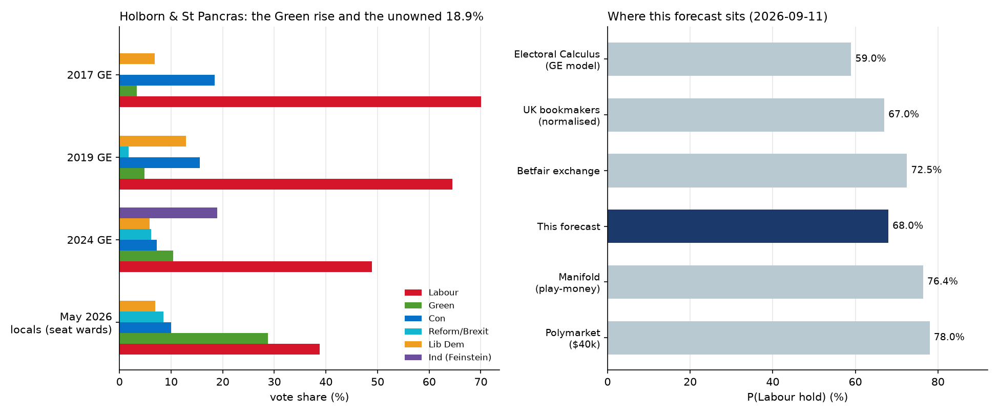

# Which party will win the Holborn and St Pancras by-election?

| | |
|---|---|
| **Source** | Metaculus #45425 — https://www.metaculus.com/questions/45425/ |
| **Type** | multiple choice — 3 options: **Labour Party** · **Green Party** · **Other** |
| **Opened / Closes / Resolves** | — / 2026-10-07 23:00 UTC / **2026-10-09** (declaration; poll is Thursday 2026-10-08) |
| **Status** | open |
| **Current forecast** | **Labour 76.0%, Green 22.5%, Other 1.5%** — IQR on Labour [69.0%, 82.0%] (v2, 2026-09-24) |
| **Community (as of 2026-09-24)** | Labour: CP **79.8%** (n=97) · Pros **85.0%** (n=9) · gold **80.8%** (n=29); Polymarket 84.5% |
| **Next review** | 2026-10-01 |

<!-- Versions below, newest first. APPEND-ONLY: never edit or delete a past version. -->

---

## v2 — Re-analysis — 2026-09-24

**Why re-analysis, not an update**: 12 of the 27 days to resolution (44%) have passed since v1,
and both Polymarket (84.5%) and the Metaculus Pro cohort (85%) now sit more than 10pp above my
68%. The protocol calls for a de-novo pass under both conditions. It is still tied to v1: every
driver below is a change since v1, and the scenario weights are re-derived from scratch.

### Revision table

| Driver | Direction | Effect on P(Labour) |
|---|---|---|
| **Prior (v1, 2026-09-12)** | — | **68.0%**, IQR [61.0%, 75.0%] (Green 29.5, Other 2.5) |
| Statement of Persons Nominated (15 Sep): **George Galloway (Workers Party) is standing** against Polanski for the radical-left and Gaza vote. The Camden People's Alliance did not stand and **endorsed Polanski**, and there is no Your Party candidate. Tripwire 1 fired **in part**, at half its magnitude | up | +3.0 |
| Real-money venues and strong forecasters all moved further toward Labour: **Polymarket 78.0 → 84.5**. Bookmakers' best Labour price shortened **1/4 → 1/8** (Green 7/1 best) *even though 64% of bets still backed the Greens*, which means the large stakes are on Labour. Metaculus **Pros 85%, gold medalists 81%, CP 80%**. My v1 case that the market "was still finding its level" has been tested, and the market kept moving the same way | up | +4.0 |
| The Greens' executive **refused to postpone their 2–4 October Brighton conference** (about 3,000 attendees) in the final week. Ashcroft focus groups (21 Sep) of 2024 Labour voters: **interest in Polanski had "faded"** and most expected Labour to hold. Offset in part by Abdi-Wali skipping the 22 Sep hustings | up | +1.0 |
| **Green national share rebounded in YouGov, 11% → 14%** (20–21 Sep). This is below the 15%-in-two-polls tripwire. Labour is flat at 23%; PollCheck's 7-poll average has Labour at 26.7% | down | −1.0 |
| Time has passed with **no constituency poll** and no campaign shock. The late-collapse scenario (v1 scenario 4) has less time left to happen, and Other falls 2.5 → 1.5 because Galloway sits at 66/1–125/1 and every other candidate at 100/1 or longer | up | +1.0 |
| **New forecast** | | **76.0%**, IQR [69.0%, 82.0%] (Green 22.5, Other 1.5) |

The +4 for the market is the one to watch for herding. What justifies it is not the price level
but the fact that **bookmakers lengthened the Greens from 2/1 to 7/1 while most individual bets
went on them**. Bookmakers only do that when liability-weighted money, or information, points
the other way. It is a likelihood ratio of roughly 1.3 toward Labour, not a reason to adopt the
market's 85%. I stay about 9pp under the Pros and Polymarket for three reasons:

1. There is still **no constituency poll**. The only seat-level quantitative anchor is
   PollCheck's by-election model: **Lab 41.7 / Grn 37.8, a 3.9-point margin, P(Lab) = 70%**.
2. Seat polls this parliament have **missed by 8–12pp** (Gorton & Denton: Greens polled 28–33,
   got 40.7), as a Metaculus commenter (matru, 20 Sep) pointed out.
3. The one Westminster by-election this parliament with a structurally similar Green challenge
   ended in a Green win.

### Tripwire check (v1 list)

| Tripwire | Status | Evidence |
|---|---|---|
| SOPN shows a Your Party, CPA or other left-of-Labour candidate (by 09-16), **+6** | **Partially fired** | Galloway (Workers Party) is on the 15-candidate ballot. The CPA is not standing and endorsed Polanski; there is no Your Party candidate. Galloway got 0.4% in Glasgow this year; the Telegraph (23 Sep) expects "hundreds, if not a few thousands" of votes. Applied at **+3** |
| First constituency poll shows the Greens within 3pp or ahead, **−15** | Not fired | No constituency poll published (PollCheck, Wikipedia, search, 2026-09-24) |
| First constituency poll shows Labour ahead by 10pp+, **+8** | Not fired | same |
| UK-wide Green VI above 15% in 2+ polls (by 10-05), **−6** | Not fired (watch) | YouGov 20–21 Sep: Grn 14% (+3). No other pollster found at 15% or above |
| A Camden ward by-election before polling day | Not fired | none scheduled (Camden Council upcoming elections) |
| General election called or poll postponed, **annul** | Not fired | poll confirmed for 2026-10-08. Labour insiders say a win could embolden Burnham to call a snap election, but only *after* the by-election |

### What resolves YES

unchanged from v1. The ballot is now confirmed: **15 candidates**. Labour: Abdi-Wali. Green:
Polanski. Conservative: Ewan Cameron. Lib Dem: Patrick Stillman. Reform: Peter Newman. Workers
Party: Galloway. Also Restore Britain, UKIP, Rejoin EU, Climate Party, UK Voice, the Communist
League, the Christian Peoples Alliance, the Monster Raving Loony Party and one independent. All
of them except Labour and the Greens resolve as **Other**.

### Outside view

Unchanged from v1. The reference class (Labour held 1 of 3 Westminster defences) is hostile, but
it comes almost entirely from before Burnham.

### Inside view

The structure has not changed since v1. It is a two-horse Labour–Green race, and the baseline is
the May 2026 locals in this seat's own wards: Lab 38.8, Grn 28.8 [7]. Three things are new:

- **The left-of-Labour field is split.** Galloway takes part of the Gaza and radical-left pool
  that Polanski needs from Feinstein's 18.9% [2][3][13]. That pool is worth hundreds to a few
  thousand votes against a 2024 majority of 11,572 [9].
- **The Green campaign is stretched.** The party conference runs 2–4 October, in the final week
  [11], and Ashcroft's 2024-Labour-voter groups found interest in Polanski fading [10].
- **The national picture is roughly stable.** Labour is flat at 23% in YouGov and 26.7% on the
  PollCheck average, with the Greens up to 14% [6][8][15].

For a Green win, Polanski must still consolidate nearly all of Feinstein's vote, now against
Galloway as well, and add a few points of Labour switchers.

### Evidence

- **Ballot** (nominations closed 15 Sep): 15 candidates, including Galloway (Workers). The CPA
  and James Giles endorse Polanski; there is no Your Party candidate [2][3][4].
- **Money**: Polymarket Abdi-Wali 84.5%, Polanski 12.0% [1]. Bookmakers' best Labour price went
  1/4 → 1/8 and the Greens 7/1, while 64% of bets backed the Greens [9]. Moving against the bet
  count implies the stakes are on Labour: a likelihood ratio of about 1.3 toward Labour.
- **Model**: PollCheck by-election model Lab 41.7 / Grn 37.8, P(Lab) 70% [5]. It is the most
  Green-friendly quantitative anchor.
- **Polls**: YouGov Greens 11 → 14 [6][15]. There is still no constituency poll [5].
- **Campaign**: Abdi-Wali skipped the 22 Sep hustings [12] (small pro-Green). The Green
  conference clash [11] and the fading Polanski interest [10] are small pro-Labour.
- **Crowd**: Metaculus CP 79.8, Pros 85.0, gold medalists 80.8 [14].

### Scenarios (re-derived)

| # | Scenario | Weight | Resolves as |
|---|---|---|---|
| 1 | **The Burnham floor holds.** Labour's national lead, the rooted local candidate and the anti-Reform frame carry the May 10-point ward gap through a low turnout | 0.620 | Labour |
| 2 | **Galloway splits the Gaza/radical-left vote.** He takes 2–5%, mostly from Feinstein's 2024 pool, and Labour wins more comfortably | 0.140 | Labour |
| 3 | **Feinstein's 18.9% consolidates behind Polanski.** The leader effect and a 35–40% turnout deliver the five-point swing: the Gorton & Denton mechanism | 0.190 | Green |
| 4 | **Late collapse.** A constituency poll shows the Greens ahead and triggers tactical consolidation, or a national Labour shock lands in the last fortnight | 0.035 | Green |
| 5 | **Other.** Galloway pulls off a Rochdale-style upset, or some other shock | 0.015 | Other |

Labour **0.760**, Green **0.225**, Other **0.015**.

**IQR on Labour: [69.0%, 82.0%]**, narrower than v1 because the nomination list is settled and
one information event (the ballot) has passed. It stays wide because a constituency poll could
still land and move the number 10–15pp.

### Other forecasters (2026-09-24)

| Source | Value | As of | Note |
|---|---|---|---|
| **Metaculus CP** (recency-weighted) | Labour **79.8%** (IQR 76.8–82.8), Green 19.2, Other 1.0 | 2026-09-24 02:00 | n=97 (99 total) |
| **Metaculus Pros** | Labour **85.0%** (IQR 76.0–94.6), Green 14.0, Other 1.0 | 2026-09-24 | n=9 |
| **Metaculus gold medalists** | Labour **80.8%** (IQR 78.1–85.2), Green 18.2, Other 1.0 | 2026-09-24 | n=29 |
| **Polymarket** | Abdi-Wali **84.5%** (bid 0.84 / ask 0.85, last 0.90), Polanski 12.0% (0.11/0.13) | 2026-09-24 | event volume $60.1k (was $39.7k), liquidity $242k |
| Oddschecker best/worst | Labour **1/8 – 1/16**, Green **7/1 – 9/2**, Workers 125/1–66/1, Reform 325/1–100/1 | 2026-09-21 | Labour was 1/4 a week earlier; normalised ≈ Lab 86 / Grn 12 |
| PollCheck by-election model | Lab 41.7 / Grn 37.8 / Ref 7.8; **P(Lab) 70%** | 2026-09-24 | was Lab 39.5 / Grn 27.9 GE-style on 09-11; the new model is Green-friendlier |
| Lord Ashcroft focus groups | qualitative: Polanski interest "faded"; most expect Labour | 2026-09-21 | 2024 Labour voters only |

**Cohort disagreement**: small. The CP (80) and gold medalists (81) agree; the Pros are higher at
85, but on only n=9 and with a very wide IQR of 76–95. **All three cohorts and both money venues
sit 4–9pp above me, and PollCheck's model sits 6pp below.** I weight the Pros and gold
medalists, and I looked for the fact I might have missed. The candidates are Galloway (credited
above) and the bookmakers' contrarian price move (credited above). I found nothing else, such as
a leaked private poll. The remaining gap is my deliberate discount for the lack of a
constituency poll and for by-election polling error this parliament.

### Sensitivity

| Assumption | If instead | Labour becomes |
|---|---|---|
| Galloway takes 2–5%, mostly from the Feinstein pool | He takes under 1% (his Glasgow level) | ≈ 73% |
| No constituency poll before 8 Oct | A poll shows Labour +3 or less | ≈ 55–60% |
| Green national share stays about 11–14% | It hits 15%+ in several polls into October | ≈ 71% |
| Markets are aggregating real information | They reflect Labour-favourite bias and thin liquidity | ≈ 72% |

### What would change my mind (tripwires)

- [ ] A **constituency poll** before 2026-10-08 showing the Greens within 3pp or ahead → **−15pp Labour**.
- [ ] A constituency poll showing Labour ahead by 10pp or more → **+6pp Labour**.
- [ ] UK-wide Green VI above 15% in two or more polls before 2026-10-05 → **−4pp Labour**.
- [ ] Polymarket Abdi-Wali below 70%, or bookmakers' best Green price 3/1 or shorter, sustained for 24h before 2026-10-07 → **−5pp Labour**.
- [ ] Galloway stands down or endorses Polanski before 2026-10-08 → **−3pp Labour**.
- [ ] A general election is called or the poll is postponed → question **annulled**.

### Sources

1. Polymarket, "Holborn and St Pancras By-Election Winner" (gamma-api) — https://polymarket.com/event/holborn-and-st-pancras-by-election-winner (accessed 2026-09-24; `raw/polymarket-holborn-and-st-pancras-by-election-winner-2026-09-24.json`)
2. 2026 Holborn and St Pancras by-election — Wikipedia — https://en.wikipedia.org/wiki/2026_Holborn_and_St_Pancras_by-election (accessed 2026-09-24)
3. Holborn and St Pancras by-election Statement of Persons Nominated and Notice of Poll — Camden Council — https://www.camden.gov.uk/holborn-and-st-pancras-by-election-statement-of-persons-nominated-and-notice-of-poll (accessed 2026-09-24, via search summary)
4. Full list of candidates running in the Holborn and St Pancras by-election — ITV News London, 2026-09-16 — https://www.itv.com/news/london/2026-09-16/candidates-running-in-the-holborn-and-st-pancras-by-election (accessed 2026-09-24)
5. Holborn and St Pancras By-Election: Candidates, Polls & Projection — PollCheck — https://www.pollcheck.co.uk/by-elections/holborn-and-st-pancras (accessed 2026-09-24)
6. Voting intention, 20–21 September 2026: Lab 23%, Con 21%, Ref 21%, Grn 14%, LD 12% — YouGov — https://yougov.com/en-gb/articles/55596-voting-intention-20-21-september-2026-lab-23-con-21-ref-21-grn-14-ld-12 (accessed 2026-09-24)
7. 2026 Camden London Borough Council election — Wikipedia — https://en.wikipedia.org/wiki/2026_Camden_London_Borough_Council_election (accessed 2026-09-11; carried forward from v1 for the ward baseline)
8. UK Opinion Polls 2026, voting-intention tracker — PollCheck — https://www.pollcheck.co.uk/gb-polls (accessed 2026-09-24)
9. Holborn & St Pancras By-election Odds: Labour Odds Shorten — Oddschecker, 2026-09-21 — https://www.oddschecker.com/insight/politics/20260921-holborn-st-pancras-by-election-odds-labour-odds-shorten (accessed 2026-09-24)
10. "There's a lot of hope and positivity, but what are you going to do?" My focus groups in Holborn and St Pancras — Lord Ashcroft Polls, 2026-09-21 — https://lordashcroftpolls.com/2026/09/theres-a-lot-of-hope-and-positivity-but-what-are-you-going-to-do-my-focus-groups-in-holborn-and-st-pancras/ (accessed 2026-09-24)
11. Polanski request to postpone Greens' conference to focus on byelection refused by party — The Guardian via inkl, 2026-09-18 — https://www.inkl.com/news/polanski-request-to-postpone-greens-conference-to-focus-on-byelection-refused-by-party (accessed 2026-09-24)
12. Polanski makes his mark as Labour candidate fails to attend election hustings — Middle East Eye — https://www.middleeasteye.net/news/polanski-makes-mark-labour-candidate-fails-to-attend-hustings (accessed 2026-09-24, via search summary)
13. George Galloway v Zack Polanski: How fight for radical Left vote may gift Holborn by-election win to Labour — The Telegraph via Yahoo News UK, 2026-09-23 — https://uk.news.yahoo.com/george-galloway-v-zack-polanski-053046737.html (accessed 2026-09-24)
14. Metaculus question 45425: three-cohort aggregations and comments — https://www.metaculus.com/questions/45425/ (accessed 2026-09-24; pre-fetched `raw/metaculus-2026-09-24.json`)
15. Voting intention, 13–14 September 2026: Lab 23%, Ref 23%, Con 20%, LD 13%, Grn 11% — YouGov — https://yougov.com/en-gb/articles/55556-voting-intention-13-14-september-2026-lab-23-ref-23-con-20-ld-13-grn-11 (accessed 2026-09-24)

**Date**: 2026-09-24
**Forecast**: Labour 76.0%, Green 22.5%, Other 1.5% — IQR on Labour [69.0%, 82.0%]
**Thesis**: Up 8pp. George Galloway (Workers Party) is on the ballot, splitting the radical-left and Gaza vote that Polanski needs from Feinstein's 2024 18.9%, while the CPA stood aside. Every real-money venue and Metaculus cohort moved further to Labour: Polymarket 84.5%, bookmakers 1/8 even as most bets backed the Greens, Pros 85%, gold medalists 81% [1][9][14]. I stay under them because no constituency poll exists, PollCheck's by-election model gives only a 3.9pp Labour margin (P 70%), and by-election polls this parliament have missed by 8–12pp.

---

## v1 — Initial forecast — 2026-09-12

### What resolves YES

The question resolves as *"the political party of the candidate officially declared elected as
Member of Parliament for the Holborn and St Pancras constituency in the 2026 by-election"*, over
exactly **three options: Other, Labour Party, Green Party**. **Liberal Democrat, Conservative,
Reform UK and any independent all resolve as Other** — which matters, because this seat elected
an independent into *second place* in 2024. A candidate switching party after nominations close
resolves on the party printed in the official result. If the by-election is cancelled by a
general election, constituency abolition or another electoral event, the question is **annulled**
rather than resolved.

**Polling day is Thursday 2026-10-08**; the count declares in the early hours of the 9th and the
question closes the evening before the poll. The vacancy arises because **Sir Keir Starmer**,
already out as Prime Minister since 2026-06-22, announced on 2026-09-01 that he would leave the
Commons and took the Chiltern Hundreds the same day; the writ was moved on 2026-09-07.

One live uncertainty is not yet resolved at the time of writing: **nominations close at 4pm on
2026-09-15**, four days from now. The Conservative and Liberal Democrat candidates are unselected
and Reform UK's participation is unconfirmed.

### Outside view

| Class | n | Base rate | Bearing |
|---|---|---|---|
| Westminster seats defended by **Labour** in this parliament | 3 | **1 hold of 3 (33%)** | against Labour |
| …including the Caerphilly Senedd defence | 4 | 1 of 4 (25%) | against Labour |
| Governing party defending mid-term, long run | many | governments systematically underperform; gains from opposition are rare | against Labour |
| 30pp majorities overturned in a by-election | several | routine — Gorton & Denton 36.7pp, Mid Bedfordshire 24,664 votes, Wellingborough 36pp, Tiverton 25,155 | against Labour |
| By-election turnout, this parliament | 5 | 38.0–58.8%, long-run ~50% | 35–45% plausible here |

The reference class is **hostile to Labour and disagrees sharply with every market**, and that
gap is the whole question. The three Labour defences were Runcorn & Helsby (lost to Reform by
**6 votes**, May 2025), **Gorton & Denton (lost to the Greens on a 26.4pp swing**, February
2026) and Makerfield (held, June 2026). Gorton & Denton is close to a structural analogue:
Labour on 50.8% with a 36.7pp majority in 2024, Greens fourth on 13.2%, and fourteen months
later a Green win on 40.7%.

**The reconciliation is that the class is drawn almost entirely from the pre-Burnham period.**
Starmer resigned the leadership on 2026-06-22; Andy Burnham was acclaimed unopposed on 07-17 and
became Prime Minister on 07-20. The one Labour hold is the only defence under Burnham.

### Inside view

A **two-horse race with no third force**, which makes it unusually tractable. The right baseline
is not the 2024 general election but the **May 2026 local elections within this constituency's
own wards: Labour 38.8, Green 28.8, Conservative 10.0, Reform 8.5, Lib Dem 6.9** — a ten-point
gap. The Greens need a five-point swing from there.

Four forces act on that gap between May and 8 October.

**1. The Burnham recovery (pro-Labour, large).** On YouGov's own consistent series Labour has
gone **18% in late April to 23% on 6–7 September**, while the Greens have gone **15% to 12%**.
Across fourteen September polls Labour sits 22–28 and the Greens 8–14. Polanski's net approval
has fallen from −13.4% in April to −24.3% in September; Burnham's favourability is 46%.

**2. The unowned Feinstein vote (pro-Green, large).** Andrew Feinstein took **18.9% and second
place** here in 2024 as a pro-Gaza independent. He is **not standing**, and he has **endorsed
Polanski**. Electoral Calculus's 59/40 projection still parks ~12% in an "other" bucket that no
longer has a candidate; reallocating it plausibly flips the seat. This is the single largest
pro-Green fact and it is the main reason I sit below Polymarket.

**3. By-election dynamics and a party leader on the ballot (pro-Green).** Turnout of 35–45%
against 54.1% in 2024 amplifies the motivated side. **Zack Polanski is the Green party leader**,
which buys national media and a national activist surge no ordinary challenger gets; the Greens
were canvassing before they had a candidate. Demographically the seat is close to ideal for
them: ~50% aged 18–34, 69% graduates, 24% homeowners against 43% social renters, ~73% Remain,
639th of 650 on Electoral Calculus's cultural-left index.

**4. Recent, specific, local counter-evidence (pro-Labour).** In the **Regent's Park ward
by-election on 2026-07-09 — inside this constituency — Labour gained the seat from the Greens**
(Lab 32%, Grn 27%, Ind 23%) on 21.9% turnout. And in **Makerfield on 2026-06-18 Labour's share
rose 9.6pp on turnout up 6.3pp**, albeit with Burnham personally as the candidate.

**Candidate quality runs Labour's way.** Sagal Abdi-Wali is the leader of Camden Council, a
councillor since 2022, a child refugee from Somalia with 35 years in the area, selected from 96
applications. Polanski faces carpetbagger attacks, a houseboat council-tax apology, a 2015
candidacy as a *Liberal Democrat*, and the fact that he **did not vote in the May 2026 local
elections**; six of Camden's eleven Green councillors nominated his rival.

**What has to be true for a Green win**: essentially all of Feinstein's 18.9%, plus a few points
of 2024 Labour voters, on an activist-skewed low turnout, against a locally rooted Labour
candidate while the Prime Minister is still inside his honeymoon.

### Evidence

The **Zia Yusuf affair** is the clearest recent update and it runs against Reform and for Labour.
On 2–3 September the Reform UK home affairs spokesman posted that Abdi-Wali *"was born in
Somalia. Do you understand what's happening?"* It was condemned across parties **including by
Reform's own Nadine Dorries**. In a seat that is 21.7% Muslim with 45% of residents born abroad,
this hands Labour an anti-Reform mobilisation frame. Commentators on both sides judge it helps
Labour.

**The money and the polling point in opposite directions**, which is the most interesting feature
of the evidence. Oddschecker reported **75% of bets in the 24 hours to 3 September** backing the
Greens, and Gambling.com **64% over the week to 10 September**; the Green price shortened from
3/1 to 2/1. Meanwhile every September poll shows the Greens falling nationally. Betting money in
a low-liquidity political market is a poor guide — it reflects who is enthusiastic, and Green
activists are the enthusiastic party here — so I weight the polling trend above the flow.
Likelihood ratio applied to the money flow: about **1.1 toward the Greens**, little more.

**Expert opinion is genuinely split**, which is itself information. Peter Kellner, former YouGov
president and a resident of the constituency, **expects a Green win**: *"This is just the kind of
seat a Labour government loses."* Professor Jonathan Tonge: *"A Green win would be a surprise."*
Paul Krishnamurty: *"Winning this seat will require at least 40% and it isn't clear the Greens
are capable of that right now."* Polly Toynbee: *"Labour's to lose. But lose it might."*

**Absent evidence, and it matters**: **no constituency poll of Holborn and St Pancras exists.**
Confirmed explicitly by PollCheck and by repeated search. One is likely before 8 October and
would dominate everything above. Kalshi lists vote-share brackets for this seat but the market is
**completely untraded** — no bids, asks, volume or open interest.

**Why Other stays small but non-zero at 2.5%.** Reform took 6.1% here in 2024 and 8.5% in the
May ward results, but its inner-London ceiling is demonstrably low — 5.3% and zero seats in the
Hackney mayoral, 6.14% and zero seats in Islington — and Yusuf has actively anti-mobilised it.
The Lib Dems polled 5.8% (fourth) in 2024 and their Camden gains are in Hampstead & Highgate, not
here. The residual is mostly the possibility that a **Corbyn-aligned "Your Party" or Camden
People's Alliance candidate files by 15 September** and outruns expectations — the CPA won a
Camden seat and 3.2% borough-wide in May, and an independent took 23% in Regent's Park from a
standing start. The likelier effect of such a candidate is not that they win but that they
**split the anti-Labour left and help Labour**.

### Other forecasters

| Source | Value | As of | Note |
|---|---|---|---|
| Metaculus CP | **not yet revealed** | 2026-09-12 | n=6, status `upcoming` |
| Metaculus Pro / gold | none | 2026-09-12 | no aggregation exists yet |
| **Polymarket** (candidate market) | Abdi-Wali (Lab) **78.0%**, Polanski (Grn) 21.5% | 2026-09-11 | $39.7k volume, $319k liquidity, $14.1k in 24h; **opened 2026-09-02 at 0.235**, jumped to 0.64 on 5 Sep and 0.78 on 11 Sep as Labour's selection resolved |
| Betfair exchange | Labour 1.38 (**72.5%**), Green 3.18 (32.1%) | 2026-09-01 | real-money exchange |
| bet365, normalised (overround 109.1%) | Labour ~**67%**, Green ~31%, others ~2% | 2026-09-07 | |
| Oddschecker range | Labour 1/4–3/10, Green 2/1–5/2, Reform 100/1–273/1, LD 50/1–979/1 | 2026-09-11 | |
| **Electoral Calculus** | Lab 34.6, Grn 30.5 → **P(Lab) 59%, P(Grn) 40%** | 2026-09-11 | most Green-friendly; but a *general-election* model, and its 12% "other" bucket is Feinstein's vote with no Feinstein |
| PollCheck seat model | Lab 39.5, Grn 27.9 | 2026-09-11 | |
| Britain Predicts (New Statesman) | Labour +5pp | 2026-09 | |
| May 2026 locals, this seat's wards | Lab 38.8, Grn 28.8 | 2026-05-07 | the empirical baseline |
| Manifold | Labour 76.4%, Green 16.7% | 2026-09-11 | **35 unique bettors** — play-money and thin, heavily discounted |
| Kalshi `KXHOLBORNVOTE` | listed, **untraded** | 2026-09-11 | no bids, asks, volume or open interest |

**Cohort disagreement**: not assessable — no Metaculus cohort exists yet. The *venues* disagree
substantially, from **Electoral Calculus at 59% to Polymarket at 78%** — a 19-point spread, which
is unusual and reflects genuine structural uncertainty rather than noise. I sit at **68%**: below
Polymarket and Manifold, at the bookmakers' level, above Electoral Calculus.

The case for being **10 points under Polymarket** specifically: its market is on *candidates*,
opened only on 2 September, and repriced violently (0.235 → 0.64 → 0.78) as Labour's selection
collapsed the rival Labour names into one line — that is a market still finding its level, not a
settled consensus, and $39.7k of volume is thin next to a UK exchange. Betfair at 72.5% and a
normalised bet365 book at 67% are the better-informed UK venues, and I sit between them.

### Scenarios

| # | Scenario | Weight | Resolves as |
|---|---|---|---|
| 1 | **The Burnham floor holds.** Labour's national recovery plus a rooted local candidate plus the anti-Reform mobilisation frame carries the ten-point May gap through a low turnout. Labour wins on roughly 38–43%. | 0.550 | **Labour** |
| 2 | **A left candidate files by 15 September** and takes 4–8%, splitting the anti-Labour vote. Labour wins more comfortably than the headline suggests. | 0.130 | **Labour** |
| 3 | **Feinstein's 18.9% consolidates behind Polanski.** The leader effect, the Green ground game and a 35–40% turnout deliver the five-point swing; the Greens clear 40%. The Gorton & Denton mechanism, at half the required size. | 0.235 | **Green** |
| 4 | **Late collapse.** A constituency poll showing the Greens ahead triggers tactical consolidation, or a national Labour shock lands inside the final fortnight. | 0.060 | **Green** |
| 5 | **Other.** A left independent or Your Party candidate wins outright, or Reform/Lib Dem defy inner-London precedent. | 0.025 | **Other** |

Labour 0.550 + 0.130 = **0.680**; Green 0.235 + 0.060 = **0.295**; Other **0.025**.

Labour's IQR of **[61.0%, 75.0%]** is wide for a 27-day horizon because the two biggest
information events — the nomination list on 15 September and the first constituency poll — have
not happened yet.

### Sensitivity

| Assumption | If instead | Forecast becomes |
|---|---|---|
| Feinstein's 18.9% splits roughly 60/40 to the Greens | It transfers near-wholesale to Polanski | Labour ≈ 55%, Green ≈ 43% |
| The Burnham recovery holds through late September | Labour slips back below 22% nationally | Labour ≈ 58%, Green ≈ 39% |
| No left-of-Labour candidate on the ballot | Your Party or the CPA stands and takes 5%+ | Labour ≈ 75%, Green ≈ 23% |
| Polymarket's 78% is a young market still repricing | It is correctly aggregating something the UK books miss | Labour ≈ 75% |

### What would change my mind (tripwires)

- [ ] **The Statement of Persons Nominated, published after 4pm on 2026-09-15**: a Your Party, Camden People's Alliance or other left-of-Labour candidate on the ballot → **+6pp Labour**.
- [ ] The first published **constituency poll** before 2026-10-08 showing the Greens within 3pp or ahead → **−15pp Labour**.
- [ ] The same poll showing Labour ahead by 10pp or more → **+8pp Labour**.
- [ ] UK-wide Green voting intention recovers above 15% in two or more polls before 2026-10-05 → **−6pp Labour**.
- [ ] A Camden ward by-election between now and 2026-10-08 → direct local read; **either**, magnitude 0.
- [ ] A general election is called, or the poll is postponed → the question is **annulled**; **either**, magnitude 0.

### Sources

1. Metaculus question 45425 — resolution criteria, fine print, three-option list, comments — https://www.metaculus.com/questions/45425/ (accessed 2026-09-12; snapshot in `raw/metaculus-45425-2026-09-12.json`)
2. 2026 Holborn and St Pancras by-election — Wikipedia — https://en.wikipedia.org/wiki/2026_Holborn_and_St_Pancras_by-election (accessed 2026-09-11)
3. Holborn and St Pancras by-election: candidates, polls and projection — PollCheck — https://www.pollcheck.co.uk/by-elections/holborn-and-st-pancras (accessed 2026-09-11)
4. Keir Starmer announces he is standing down as MP — BBC News — https://www.bbc.co.uk/news/articles/cvgy4258kgyo (accessed 2026-09-11)
5. Holborn and St Pancras (UK Parliament constituency) — Wikipedia, 2017/2019/2024 results — https://en.wikipedia.org/wiki/Holborn_and_St_Pancras_(UK_Parliament_constituency) (accessed 2026-09-11)
6. 2026 Camden London Borough Council election — Wikipedia — https://en.wikipedia.org/wiki/2026_Camden_London_Borough_Council_election (accessed 2026-09-11)
7. 2026 London local elections — Wikipedia — https://en.wikipedia.org/wiki/2026_London_local_elections (accessed 2026-09-11)
8. Polly Toynbee, "The byelection here in Holborn and St Pancras is Labour's to lose. But lose it might" — The Guardian, 2026-09-08 — https://www.theguardian.com/commentisfree/2026/sep/08/byelection-holborn-st-pancras-labour-green-party-defence-rent-north-sea-oil-burnham (accessed 2026-09-11)
9. Megan Kenyon, "Zack Polanski faces a fight in Holborn and St Pancras" — New Statesman, 2026-09-07 — https://www.newstatesman.com/politics/2026/09/zack-polanski-faces-a-fight-in-holborn-and-st-pancras (accessed 2026-09-11)
10. "Who will win the Holborn & St Pancras by-election?" — New Statesman — https://www.newstatesman.com/politics/uk-politics/2026/09/who-will-win-the-holborn-st-pancras-by-election (accessed 2026-09-11)
11. "Andrew Feinstein rules out running again in Holborn and St Pancras" — New Statesman, 2026-09-03 — https://www.newstatesman.com/politics/uk-politics/2026/09/andrew-feinstein-rules-out-running-again-in-holborn-and-st-pancras (accessed 2026-09-11)
12. "Jewish antizionist Andrew Feinstein stands aside and backs Zack Polanski" — The Jewish Chronicle — https://www.thejc.com/news/politics/jewish-antizionist-andrew-feinstein-stands-aside-and-backs-zack-polanski-in-holborn-by-election-imblae34 (accessed 2026-09-11)
13. "Zack Polanski selected as Green Party candidate in Holborn and St Pancras byelection" — Green Party, 2026-09-11 — https://greenparty.org.uk/2026/09/11/zack-polanski-selected-as-green-party-candidate-in-holborn-and-st-pancras-byelection/ (accessed 2026-09-11)
14. "Who is Sagal Abdi-Wali? The council leader named as Labour's candidate" — The Standard, 2026-09-09 — https://www.standard.co.uk/news/politics/sagal-abdiwali-labour-favourite-holborn-byelection-keir-starmer-b1296058.html (accessed 2026-09-11)
15. "Zia Yusuf's post about Camden council leader is 'straightforward racism', says minister" — The Guardian, 2026-09-06 — https://www.theguardian.com/politics/2026/sep/06/zia-yusuf-reform-uk-post-camden-council-leader-sagal-abdi-wali (accessed 2026-09-11)
16. Paul Krishnamurty, "Holborn and St Pancras by-election odds: Labour can burst Polanski's bubble" — Gambling.com, updated 2026-09-10 — https://www.gambling.com/uk/news/holborn-and-st-pancras-by-election-odds (accessed 2026-09-11)
17. Seat details, Holborn and St Pancras — Electoral Calculus — https://www.electoralcalculus.co.uk/fcgi-bin/seatdetails.py?seat=Holborn+and+St+Pancras (accessed 2026-09-11)
18. UK opinion polls 2026, voting-intention tracker — PollCheck — https://www.pollcheck.co.uk/gb-polls (accessed 2026-09-11)
19. YouGov voting intention, 6–7 September 2026 — https://yougov.com/en-gb/articles/55507-voting-intention-6-7-september-2026-lab-23-ref-23-con-20-grn-12-ld-11 (accessed 2026-09-11)
20. Opinion polling for the next UK general election — Wikipedia — https://en.wikipedia.org/wiki/Opinion_polling_for_the_next_United_Kingdom_general_election (accessed 2026-09-11)
21. 2026 Gorton and Denton by-election — Wikipedia — https://en.wikipedia.org/wiki/2026_Gorton_and_Denton_by-election (accessed 2026-09-11)
22. 2026 Makerfield by-election — Wikipedia / PollCheck — https://en.wikipedia.org/wiki/2026_Makerfield_by-election (accessed 2026-09-11)
23. 2025 Runcorn and Helsby by-election — Wikipedia — https://en.wikipedia.org/wiki/2025_Runcorn_and_Helsby_by-election (accessed 2026-09-11)
24. Lewis Baston, "Labour narrowly recaptures seat in Camden by-election" — On London — https://www.onlondon.co.uk/lewis-baston-labour-narrowly-recaptures-seat-in-camden-by-election/ (accessed 2026-09-11)
25. Regent's Park ward 2026 by-election results — Camden Council — https://www.camden.gov.uk/regents-park-2026-by-election-results (accessed 2026-09-11)
26. "Can the Green Party's Polanski take on Labour and win Starmer's old seat?" — Al Jazeera, 2026-09-04 — https://www.aljazeera.com/news/2026/9/4/can-green-leader-polanski-take-on-starmers-old-seat (accessed 2026-09-11)
27. More in Common 2026 London MRP — https://www.moreincommon.org.uk/research/more-in-commons-2026-london-mrp/ (accessed 2026-09-11)
28. Polymarket, "Holborn and St Pancras By-Election Winner" (gamma-api + CLOB history) — https://polymarket.com/event/holborn-and-st-pancras-by-election-winner (accessed 2026-09-11; snapshot in `raw/`)
29. Oddschecker, Holborn & St Pancras by-election odds — https://www.oddschecker.com/politics/british-politics/holborn-st-pancras-by-election (accessed 2026-09-11)
30. Betfair Betting Blog, Holborn and St Pancras by-election 2026 — https://betting.betfair.com/politics/uk-politics/holborn-and-st-pancras-by-election-2026-who-are-the-favourites-and-who-will-win-get-updates-from-bet-010926-205.html (accessed 2026-09-11)
31. Mark Pack, council by-election results scorecard 2026-2027 — https://www.markpack.org.uk/176850/council-by-election-results-scorecard-2026-2027/ (accessed 2026-09-11)
32. Rallings & Thrasher, "How Labour fell to historic defeat" — Local Government Chronicle, 2026-05-13 — https://www.lgcplus.com/politics/governance-and-structure/rallings-thrasher-how-labour-fell-to-historic-defeat-13-05-2026/ (accessed 2026-09-11)
33. Turnout at elections (CBP-8060) — House of Commons Library — https://commonslibrary.parliament.uk/research-briefings/cbp-8060/ (accessed 2026-09-11)
34. Your Party (UK) — Wikipedia — https://en.wikipedia.org/wiki/Your_Party_(UK) (accessed 2026-09-11)
35. 2026 Islington London Borough Council election — Wikipedia (Reform's inner-London ceiling) — https://en.wikipedia.org/wiki/2026_Islington_London_Borough_Council_election (accessed 2026-09-11)

**Date**: 2026-09-12
**Forecast**: Labour 68.0%, Green 29.5%, Other 2.5% — IQR on Labour [61.0%, 75.0%]
**Thesis**: The right baseline is the May 2026 locals in this seat's own wards — Labour 38.8, Green 28.8 — and the Greens need a five-point swing from it. Against them: Labour has gone 18%→23% nationally since Burnham became PM while the Greens fell 15%→12%, Labour gained a Camden ward off the Greens on 9 July, Abdi-Wali is the rooted local candidate against a leader facing carpetbagger attacks, and Reform's Zia Yusuf handed Labour an anti-racist mobilisation frame in a 21.7%-Muslim seat. For them: Feinstein's 18.9% from 2024 is unowned and endorsed to Polanski, a party leader on the ballot at 35–45% turnout, and Gorton & Denton proved a swing twice this size is achievable in this parliament. I sit 10pp under Polymarket because that market is on candidates, opened on 2 September and repriced 0.235→0.64→0.78 as Labour's selection resolved — still finding its level — while Betfair (72.5%) and a normalised bet365 book (67%) bracket me. No constituency poll exists yet; nominations close 15 September.
