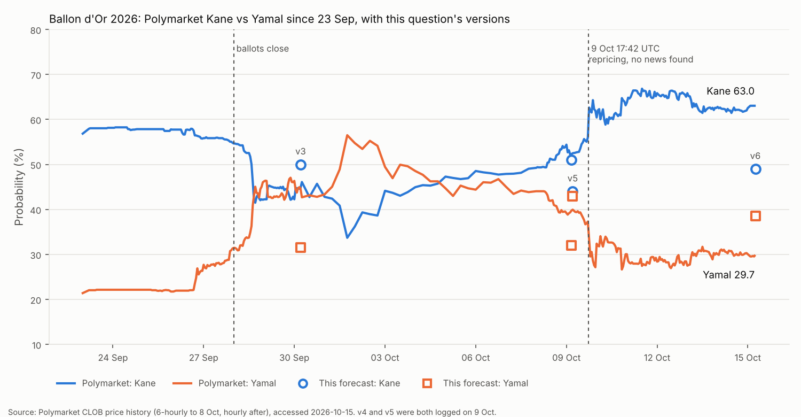
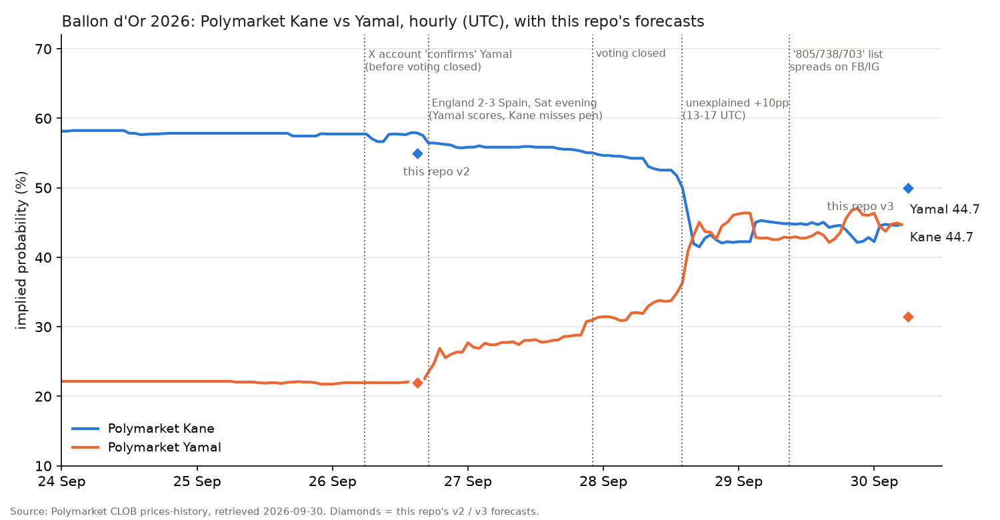
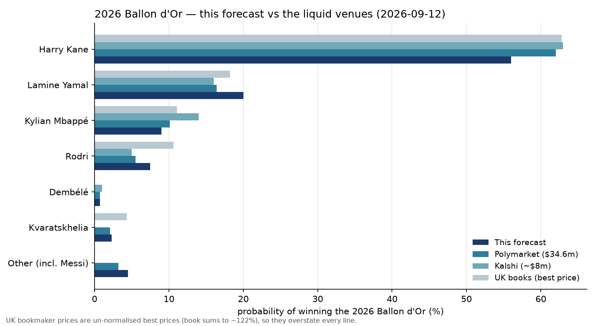

# Who will win the 2026 Ballon d'Or?

| | |
|---|---|
| **Source** | Metaculus #45617 — https://www.metaculus.com/questions/45617/ |
| **Type** | multiple choice — 7 options: Dembélé · **Kane** · Kvaratskhelia · Mbappé · Rodri · Yamal · **Other** |
| **Opened / Closes / Resolves** | — / 2026-10-26 09:00 UTC / **2026-10-26** (ceremony, London) |
| **Status** | open |
| **Current forecast** | **Kane 52.0%, Yamal 39.0%, Mbappé 3.5%, Other 3.0%, Rodri 1.5%, Kvaratskhelia 0.5%, Dembélé 0.5%** — IQR on Kane [44.0%, 60.0%] (v7, 2026-10-15) |
| **Community (as of 2026-10-15 10:55 UTC)** | Metaculus Kane / Yamal: CP 54.4 / 40.2 (n=127; 134 on the question) · Pros 53.8 / 38.2 (n=10) · gold 53.3 / 40.0 (n=30). Polymarket 63.35 / 27.95; Kalshi 64 / 30 (13:17 UTC) |
| **Next review** | 2026-10-19 (T−7d; then T−1d, 2026-10-25) |

<!-- Versions below, newest first. APPEND-ONLY: never edit or delete a past version. -->

---

## v7 — Update — 2026-10-15

**Mode: Update** (incremental from v6, written ~8 hours later the same day). The Metaculus
aggregation script works again: it was Cloudflare-blocked at 05:00 UTC and returned all
three cohorts at 13:15 UTC [1]. That reading is the only new evidence since v6, and it trips
the protocol's "community moved > 5pp" trigger: the CP (community prediction) on Kane rose
from 46.5 on 9 Oct to **54.4**, the Pros from 44.1 to **53.8** and the gold medalists from
45.6 to **53.3**. v6 re-derived everything this morning, so a fresh re-analysis would add
nothing. The two drivers below take the new cohort reading on board.

### Revision table

| Driver | Direction | Effect |
|---|---|---|
| **Prior (v6, 2026-10-15 05:24 UTC)** | — | Kane **49.0%** (IQR [40.0, 57.0]), Yamal 38.5, Other 4.0, Mbappé 4.0, Rodri 2.5, Kvaratskhelia 1.0, Dembélé 1.0 |
| **The tails come down toward the consensus.** Together the five minor options get 7.9 from the Pros, 6.7 from gold and 5.4 from the CP [1]. Polymarket has them at 8.8, Messi 2.6 included [3]. Kalshi's last trades give ~11, but its bid side only ~7 [4]. v6's 12.5 sat above every source. I keep Rodri and Mbappé above the cohorts for v5's reasons (Rodri passes both outside-view screens; Mbappé's raw numbers) but close about half the gap. The 3.5pp freed goes to Kane and Yamal at v6's 56:44 split | tails ↓, Kane ↑, Yamal ↑ | Rodri −1.0, Other −1.0, Mbappé −0.5, Kvaratskhelia −0.5, Dembélé −0.5 → Kane +2.0, Yamal +1.5 |
| **Kane's share of the Kane–Yamal vote moves toward the cohorts.** The Pros give Kane 58.5% of the head-to-head, gold 57.1% and the CP 57.5%; v6 gave 56.0% [1]. Since 9 Oct the cohorts moved Kane +9.7 (Pros), +7.7 (gold) and +7.9 (CP), about 80% of the markets' 9 Oct jump; v6 moved ~30%. Pros and gold have the better track records, and they agree with each other. Their comments name no fact I lack: they cite the market flip and Kane's 2025/26 numbers, and discount the fake leaks [2]. I give the cohorts weight 0.5 against v6 on the split, which gives 57.0%. I add no separate market weight, because the cohorts already absorb the market | Kane ↑, Yamal ↓ | Kane +1.0, Yamal −1.0 |
| **Markets since 05:24 UTC.** Polymarket Kane 63.05 → **63.35** and Yamal 29.7 → **27.95**, on +$0.17M of event volume ($50.25M → $50.42M) [3]. Kalshi Kane 64 → **64** and Yamal 31 → **30** [4] | → | none: v6 already priced this level, and the drift is noise |
| **News, 05:24–13:17 UTC.** No named outlet has reported a result. A viral X image ("Yamal wins, Mbappé 2nd") was flagged as fabricated by readers [5]. A Foot Africa item has Rafael Leão handing Yamal the trophy; it could not be fetched (403) and belongs to the same family as the Messi-presenter rumour that Romano denied [6][7]. Likelihood ratio ≈ 1 | → | none |
| **New forecast (v7)** | | Kane **52.0%** (IQR [44.0, 60.0]), Yamal 39.0, Mbappé 3.5, Other 3.0, Rodri 1.5, Kvaratskhelia 0.5, Dembélé 0.5 |

Kane moves +3.0 and Yamal +0.5. Two-thirds of Kane's gain is the tail trim, which lifts Yamal
too. On the head-to-head alone, Kane's share moves from 56.0% to 57.1%, about half the way to
the Pros and gold medalists.

### Tripwire check (v6 list)

| Tripwire | Status | Evidence |
|---|---|---|
| Credible report of the result, or FF informing a camp (by 10-26) | **Not fired** | Searches at ~13:00 UTC in EN and ES found only a fabricated image [5] and a presenter rumour [6] |
| Attendance/logistics tell for Kane or Yamal (by 10-26) | **Not fired** | nothing new since v6 |
| A named outlet explains the 9 Oct 17:42 UTC repricing (by 10-24) | **Not fired** | no outlet has explained it |
| Polymarket Kane > 0.75 or < 0.52 on ≥ $1M fresh volume (by 10-25) | **Not fired** | 0.6335 on +$0.17M [3] |
| ≥ 10 jurors disclose first-place votes (by 10-25) | **Not fired** | none found |
| Metaculus Pros and gold both > 8pp from the v6 vector on Kane or Yamal (by 10-25) | **Not fired** | Kane +4.8 (Pros) / +4.3 (gold); Yamal −0.3 / +1.5 [1] |
| *(v5's version of the same tripwire, against the v5 vector, by 10-19, unobservable at v6)* | **Fired, checked late** | Kane +9.8 (Pros) / +9.3 (gold) against v5's 44.0. v6 had already moved +5 toward it; v7 takes the remainder through the two drivers above |
| *(protocol)* Metaculus CP moved > 5pp | **Fired** | Kane CP 46.5 → 54.4 (+7.9) since the last reading on 9 Oct [1]. This is the reason for v7 |
| Rodri drew a large share of Spanish-bloc first places (by 10-26) | **Not fired** | no reporting |
| Ceremony postponed past 2026-10-26 | **Not fired** | still 26 Oct, London [8] |

### What resolves YES

Unchanged from v6. The fresh JSON carries the same options and closes 2026-10-26 09:00 UTC
[1].

### Outside view

Unchanged from v6.

### Inside view

Unchanged from v6.

### Evidence

New since v6 (all accessed 2026-10-15, ~13:15 UTC):

- **The cohorts moved most of the way to the market.** Between 9 Oct 05:00 and 15 Oct 10:55
  UTC the Pros went Kane 44.1 → 53.8 and Yamal 45.0 → 38.2 (n=10). Gold went 45.6 → 53.3 and
  45.6 → 40.0 (n=30). The CP went 46.5 → 54.4 and 44.3 → 40.2 (n=127 in the aggregate, 134 on
  the question) [1]. The markets' 9 Oct move was about +11 on Kane, so the cohorts followed
  roughly 80% of it, against v6's ~30%.
- **Comments.** VectorWright (11 Oct, 52/43/5) is taking "Kane a bit above Yamal" and
  discounting a non-MARCA leak, holding back from the market "because of the World Cup
  effect". Vlad25 (11 Oct) has Yamal 50 / Kane 43. tdeeno (12 Oct) says "PM odds are back in
  Kane's favor" [2]. No commenter cites a primary-source fact that v6 lacked.
- **Absent:** a sourced leak, an explanation of 9 Oct, juror disclosures, any attendance tell.

### Other forecasters (2026-10-15, afternoon)

| Source | Kane | Yamal | Mbappé | Rodri | Other | Kvara | Dembélé | Note |
|---|---|---|---|---|---|---|---|---|
| **This (v7)** | **52.0** | **39.0** | **3.5** | **1.5** | **3.0** | **0.5** | **0.5** | |
| Metaculus CP (10:55 UTC) | 54.4 | 40.2 | 2.0 | 1.0 | 1.1 | 0.7 | 0.5 | n=127 (aggregate) / 134 (question) [1] |
| Metaculus Pros (10:55 UTC) | 53.8 | 38.2 | 2.9 | 1.0 | 2.2 | 1.0 | 0.8 | n=10 [1] |
| Metaculus gold (10:55 UTC) | 53.3 | 40.0 | 2.0 | 1.0 | 2.0 | 1.0 | 0.7 | n=30 [1] |
| **Polymarket** (13:17 UTC) | 63.35 | 27.95 | 3.75 | 0.65 | ~3.7 (Messi 2.6) | 0.45 | 0.25 | $50.42M volume, $10.08M liquidity, book 100.1% [3] |
| Kalshi (13:17 UTC) | 64 (63/65) | 30 (29/30) | 5 | 1 | Messi 3 | 1 | 1 | last trade (bid/ask) [4] |
| William Hill / bet365 | 1/2 | 7/4 · 2/1 | 25/1 · 22/1 | — · 40/1 | Messi 25/1 · 22/1 | — | — | 12–14 Oct, unchanged from v6 [9][10] |

**Disagreement.** Pros and gold agree closely (Kane 53.8 / 53.3) and the CP sits with them.
Together they are ~10pp below the real-money markets on Kane (63–64) and ~10pp above them on
Yamal (28–30). That cohort-vs-market gap is the main open signal. Weighted by track record, the
Metaculus elite are treating the 9 Oct repricing as partly informative but not as a leak, as v6
did. I now sit 1.3–1.8pp below Pros and gold on Kane and inside their range on Yamal. The
remaining distance is v5's World-Cup-final screen (6 of 6 winners since 1998), which they see
too but weight a little less.

### Scenarios

Weights follow the new vector. Kane 0.52 (Spain's vote fragments, Kane's numbers carry, or the
9 Oct move was informed) · Yamal 0.39 (the World-Cup-final screen holds) · Mbappé 0.035 ·
off-list, chiefly Messi (Other) 0.03 · Rodri 0.015 · Kvaratskhelia 0.005 · Dembélé 0.005.

### Sensitivity

Unchanged from v6 in structure. Every row shifts by about +3 Kane / +0.5 Yamal. One added row:

| Assumption | If instead | Forecast becomes |
|---|---|---|
| Cohorts get weight 0.5 against v6 on the Kane–Yamal split | Take the Pros/gold split outright | Kane ~52.6, Yamal ~38.4 |

### What would change my mind (tripwires)

- [ ] A credible report of the result (L'Équipe, RMC, *The Athletic*, Marca, AS, *Mundo Deportivo*, *Bild*) or of France Football informing a player's camp, by 2026-10-26 → ±30pp to whoever it names. Scrutinise anything before 26 Oct; FF says it no longer notifies winners.
- [ ] **Attendance/logistics tell**: Bayern, Barcelona, the FA or the RFEF announce or leak that Kane or Yamal will **not** travel to London, or a camp cancels plans, by 2026-10-26 → ±20pp.
- [ ] A named, credible outlet explains the 9 Oct 17:42 UTC repricing, by 2026-10-24 → if a sourced leak, close half the remaining gap to the market (Kane ~+5pp); if a fabrication, Kane −2pp.
- [ ] Polymarket Kane above 0.75 or below 0.52 on ≥ $1M of fresh event volume, by 2026-10-25 → move ~1/3 of the way after checking the cause.
- [ ] ≥ 10 jurors publicly disclose their first-place vote before the ceremony, by 2026-10-25 → re-estimate from the sample.
- [ ] Metaculus Pros and gold both more than **6pp** from the v7 vector on Kane or Yamal, by 2026-10-25 → re-derive before defending. Tightened from 8pp because the cohorts are reachable again and the window is short.
- [ ] The cohort-vs-market gap on Kane (now ~10pp) closes to < 4pp, with Pros/gold moving toward the market, by 2026-10-25 → follow the Pros/gold move at ~0.7 (Kane about +4pp).
- [ ] Credible reporting that Rodri drew a large share of Spanish-bloc first places, by 2026-10-26 → Kane +5pp, Yamal −5pp.
- [ ] The ceremony is postponed past 2026-10-26 or its date changes → re-read the resolution window.

Next reviews: 2026-10-19 (T−7d) and 2026-10-25 (T−1d), unchanged.

### Sources

1. Metaculus three-cohort aggregations (recency-weighted CP, Metaculus Pros, gold medalists), post 45617, as of 2026-10-15 10:55 UTC — https://www.metaculus.com/questions/45617/ (accessed 2026-10-15 13:15 UTC; `raw/metaculus-2026-10-15.json`)
2. Metaculus comments on post 45617 (tdeeno 2026-10-12; Vlad25, Theomachado and VectorWright 2026-10-11) — https://www.metaculus.com/questions/45617/ (accessed 2026-10-15; in `raw/metaculus-2026-10-15.json`)
3. Polymarket gamma API, event "Ballon d'Or Winner 2026" — https://gamma-api.polymarket.com/events?slug=ballon-dor-winner-2026 (accessed 2026-10-15 13:17 UTC; `raw/polymarket-ballon-dor-winner-2026-2026-10-15T1317Z.json`)
4. Kalshi trade API, event KXBALLONDOR-26 — https://api.elections.kalshi.com/trade-api/v2/markets?event_ticker=KXBALLONDOR-26 (accessed 2026-10-15 13:17 UTC; `raw/kalshi-ballondor-2026-10-15T1317Z.json`)
5. FullTime Report on X, "The Ballon D'or winner has been leaked and LAMINE YAMAL is the winner …, Mbappe is second" — https://x.com/FullTimeX_/status/2106301410291716456 (accessed 2026-10-15, via search summary; direct fetch returned 402). Readers flagged the image as fabricated
6. Foot Africa, "Ballon d'Or 2026: Rafael Leão hands the trophy to Lamine Yamal" — https://foot-africa.com/en/news/ballon-dor-2026-rafael-leao-hands-the-trophy-to-lamine-yamal-1387016 (accessed 2026-10-15; title via search only, direct fetch returned 403). Unverified
7. Fabrizio Romano responds to Ballon d'Or leak involving Lionel Messi and Lamine Yamal — Lente Desportiva, 2026-10-14 — https://lentedesportiva.com/fabrizio-romano-responds-to-ballon-dor-leak-involving-lionel-messi-and-lamine-yamal (accessed 2026-10-15; v6 [14])
8. 2026 Ballon d'Or — Wikipedia (ceremony 26 Oct 2026, London Palladium; winner to be announced) — https://en.wikipedia.org/wiki/2026_Ballon_d%27Or (accessed 2026-10-15, via search summary)
9. William Hill News, Ballon d'Or odds (Kane 1/2, Yamal 7/4), updated 2026-10-14 — https://news.williamhill.com/football/ballon-dor-odds-kane-and-yamal-cant-be-separated-at-odds-on/ (accessed 2026-10-15; v6 [7])
10. Ballon d'Or 2026 Winner Odds: Harry Kane Moves Back Ahead Of Lamine Yamal — OLBG, updated 2026-10-14 — https://www.olbg.com/news/ballon-dor-2026-winner-odds-harry-kane-moves-back-ahead-lamine-yamal (accessed 2026-10-15; v6 [8])
11. Cerró la votación del Balón de Oro … quiénes son las dos personas que sabrán quién es el ganador — Infobae (citing *L'Équipe*), 2026-09-29 — https://www.infobae.com/deportes/2026/09/29/cerro-la-votacion-del-balon-de-oro-como-buscaran-blindar-los-resultados-este-ano-y-quienes-son-las-dos-personas-que-sabran-quien-es-el-ganador/ (accessed 2026-10-15; v6 [10])
12. Metaculus three-cohort aggregations, previous reading as of 2026-10-09 05:00 UTC — https://www.metaculus.com/questions/45617/ (accessed 2026-10-09; `raw/metaculus-2026-10-09.json`)
13. Ballon d'Or 2026 search sweep, Spanish ("Balón de Oro 2026 ganador filtración Lamine Yamal Kane"): no leak found; worldsoccertalk, beIN Sports and AllAfrica pieces are pre-ceremony rankings only — https://www.beinsports.com/en-us/soccer/mls/articles/kane-yamal-and-mbappe-headline-30-man-ballon-dor-shortlist-2026-09-08 (accessed 2026-10-15)

**Question**: [Who will win the 2026 Ballon d'Or?](https://www.metaculus.com/questions/45617/)
**Date**: 2026-10-15
**Forecast**: Kane 52.0%, Yamal 39.0%, Mbappé 3.5%, Other 3.0%, Rodri 1.5%, Kvaratskhelia 0.5%, Dembélé 0.5% — IQR on Kane [44.0%, 60.0%]
**Thesis**: The aggregations are reachable again. Since 9 Oct the Metaculus Pros (53.8 / 38.2) and gold medalists (53.3 / 40.0) have followed about 80% of the markets' unexplained 9 Oct move toward Kane, and they put only 7–8% on the minor candidates, against v6's 12.5% [1]. I trim the tails toward that consensus and move Kane's share of the Kane–Yamal vote halfway to the cohorts. I stay ~1.5pp below the cohorts and ~11pp below Polymarket and Kalshi (63–64) [3][4], because the repricing still has no stated cause and every winner in a World Cup year since 1998 played in that World Cup's final, which Kane did not.

---

## v6 — Re-analysis — 2026-10-15

**Mode: Re-analysis.** Six days after v5 and 11 days before the ceremony. Two of the protocol's
de-novo triggers apply. First, more than a third of the remaining time has passed: 6 of the 17
days left at v5. Second, the markets now contradict me by ~18pp on Kane, and I cannot name what
moved them. On 9 Oct, between 17:42 and 18:05 UTC, Polymarket and Kalshi repriced Kane from ~55
to ~63 and Yamal from ~37 to ~29. The UK bookmakers followed by 12–14 Oct. I found no news behind it, and neither
did Polymarket's own traders. v5's own tripwire (Polymarket Yamal < 0.32 on ≥ $1M of fresh
volume) fired. The forecast is re-derived from the anchors below, then checked against that
tripwire's pre-registered "move ~40% of the way" rule.

### Revision table

| Driver | Direction | Effect |
|---|---|---|
| **Prior (v5, 2026-10-09)** | — | Kane **44.0%** (IQR [35.0, 53.0]), Yamal 43.0, Other 4.5, Mbappé 3.5, Rodri 3.0, Kvaratskhelia 1.0, Dembélé 1.0 |
| **The market's new level, read as opinion.** Polymarket Kane 52.25 → **63.05** and Yamal 40.1 → **29.7** (05:09 UTC 9 Oct → 05:24 UTC 15 Oct), on $3.96M of fresh event volume ($46.29M → $50.25M). Of that, $0.81M was in the Kane and Yamal markets themselves [1][2]. Kalshi Kane 52 → **64**, Yamal 42 → **31** [5][6]. William Hill Kane 5/4 → **1/2**, Yamal out to 7/4 [7]; bet365 Kane 1/2, Yamal 2/1 [8]. v5 weighted the markets at ~0.4. That weight is applied here to a noise-filtered shift of ~+6pp, not the full +10pp, because this market has already made one ±15pp round trip on no news since the ballots closed (chart) | Kane ↑, Yamal ↓ | Kane +2.6, Yamal −2.6 |
| **Possible private information: 6% weight on "the 9 Oct move was informed"** (informed branch Kane 85 / Yamal 9). v3 used 10% for the mirror-image 28 Sep move toward Yamal, and v4 cut that to 6% once it reversed. Four reasons to stay at 6% rather than 10%. (a) The cause check found no news trigger. The only explanation offered is Kane's six Nations League goals and Yamal's blank against Croatia in October, both outside the eligibility window [7][9]. (b) France Football says only two people know the result: Vincent García, and the producer, Marc Las, in the final hours. FF has also stopped telling winners in advance: interviews and photo shoots now happen on the night [10]. (c) The repricing took ~$56k of taker flow in four hours. Yamal fell from 0.36 to 0.19 in 20 minutes, and the largest buyer, a single wallet, put ~$17k across both legs [3]. (d) Five days on, no outlet has reported a leak to corroborate it. The move did hit Polymarket and Kalshi in the same 20 minutes and has held for 5½ days. That is why the weight is not lower | Kane ↑, Yamal ↓, tails ↓ | Kane +2.4, Yamal −1.9, Mbappé −0.1, Rodri −0.2, Other −0.2 |
| **Tails toward the venues.** Mbappé rose on both venues: Polymarket 2.25 → 3.85 on $0.54M, Kalshi 5 → 6; bet365 has him at 22/1 [1][5][8]. The press's "Mbappé leads" story is a *L'Équipe readers'* poll, not the jury [15], so the move is followed only partly. Rodri: Polymarket 1.05 → 0.65, Kalshi 1, bet365 40/1 [1][5][8]. I keep him well above the markets because he passes both of v5's screens. Messi (counts under Other): Polymarket 3.15 → 2.65; Romano denies the rumour that Messi will present the trophy [1][13][14] | Mbappé ↑, Rodri ↓, Other ↓ | Mbappé +0.6, Rodri −0.3, Other −0.3 |
| **No information.** A second fake points list (Yamal 670, Messi 546, Mbappé 401, Kane 342), out 9 Oct 16:42 UTC, is arithmetically impossible: it leaves 4,051 of the 6,700 points unallocated [11][12]. The "Juan Jesus" claim that Messi hands Yamal the trophy has been denied [13][14]. Likelihood ratio ≈ 1 | — | 0 |
| **Metaculus.** Forecasters 126 → 134, forecasts 1,823 → 2,005 and comments 13 → 17 (API) [20]. The cohorts cannot be seen today (403), so the direction of that activity is unknown. Not imputed | — | 0 |
| **New forecast (v6)** | | Kane **49.0%** (IQR [40.0, 57.0]), Yamal 38.5, Other 4.0, Mbappé 4.0, Rodri 2.5, Kvaratskhelia 1.0, Dembélé 1.0 |

**De-novo cross-check.** v5's implicit anchor weights were markets ~0.43, Metaculus cohorts
~0.30 and the corrected outside view ~0.27. Applied to today's inputs (markets 62 / 30;
cohorts, stale from 9 Oct, 45 / 45; outside view ~30 / 55), they give Kane ≈ 48 and Yamal ≈ 41
before tails. The pre-registered tripwire rule ("move ~40% of the way") gives Kane 51.2 /
Yamal 37.6. The incremental path above gives 49.0 / 38.5. I keep that path. It moves Kane 28%
and Yamal 33% of the way to the market. That is less than 40% because the cause check came back
empty, and an empty cause check is what the tripwire's "after checking the cause" clause was
written for.

**Why not follow the markets to 63 / 30?** Three venues agree, but they repriced together within
the hour. Kalshi moved in the same hour as Polymarket, plausibly through cross-venue arbitrage
(speculation), and the bookmakers then shortened Kane as money came in for him [7]. The three are
not independent. Their stated reason is out of the eligibility
window, and the people who could actually know the result are two named FF staff [10]. The
outside view also still points the other way. Under the journalist-only electorate, every
World-Cup-cycle winner since 1998 played in that World Cup's final (6 of 6), and Kane did not.
In 2024 the market favourite (Vinícius) lost after weeks of confident pricing, and the only
real information came on the ceremony day (v1, v3).

**IQR on Kane** [35, 53] → [40, 57]. It shifts with the median and narrows slightly. The lower
quartile is the "pure noise" world (~45 or below). The upper quartile is the "the market saw
something" world.

### Tripwire check (v5 list)

| Tripwire | Status | Evidence |
|---|---|---|
| Credible report of the result (L'Équipe, RMC, *The Athletic*, Marca, AS, *Mundo Deportivo*, *Bild*) or France Football informing a camp (by 10-26) | **Not fired** | EN/FR/ES/DE searches (2026-10-15) found none of the named outlets reporting a result. The only "leaks" are a fabricated 670-point list [11][12] and a denied Messi-presenter rumour [13][14]. FF/L'Équipe: winners are no longer told in advance [10] |
| Attendance/logistics tell: Bayern, Barcelona, FA or RFEF on Kane or Yamal travelling to London (by 10-26) | **Not fired** (not yet due) | Nothing on either player since v5. Bundesliga.com (1 Oct) says Kane "will head to the ceremony after his upcoming matches", which predates v5 and says nothing about the result [19]. Because FF now shoots winners on the night [10], a *non*-attendance is the informative direction |
| Polymarket Yamal > 0.55 or < 0.32 on ≥ $1M fresh volume (by 10-24) | **Fired 2026-10-09** | The hourly price fell below 0.32 at 19:00 UTC on 9 Oct (0.2955) and has stayed between 0.27 and 0.34 since. 0.297 at 05:24 UTC today, on $3.96M of fresh event volume [1][2]. Cause checked: no news trigger, no credible leak, an out-of-window narrative, thin flow [3][4][7][9]. Moved ~1/3 of the way (revision table) |
| ≥ 10 jurors publicly disclose their first-place vote (by 10-24) | **Not fired** | No juror disclosures found in EN/FR/ES searches |
| Metaculus Pros and gold both > 8pp from the v5 vector on Kane or Yamal (by 10-19) | **Cannot check** | Aggregations returned 403 today (Cloudflare). Only activity counts are visible [20] |
| Rodri drew a large share of Spanish-bloc first places (by 10-26) | **Not fired** | No reporting found ("Rodri votos periodistas España", 2026-10-15) |
| Ceremony postponed past 2026-10-26 | **Not fired** | Still Monday 26 Oct, London Palladium, 20:00 London time [7][13][24] |

### What resolves YES

Unchanged from v5. The parent session diffed the bot-key API JSON (`raw/metaculus-api-2026-10-15.json`)
against 9 Oct and found the criteria, fine print, options and dates unchanged. The question
closes 2026-10-26 09:00 UTC and resolves on the ceremony that evening. Messi still counts under
Other.

### Outside view

Unchanged from v5. Three rows v5 had flagged as recalled are now re-verified: Zidane 1998,
Ronaldo 2002 and Cannavaro 2006 all won the Ballon d'Or in the year their side played the
World Cup final [23]. The journalist-only "winner played in the final" screen therefore stands
at 6 of 6 on verified rows. One new consideration, a reliability note rather than a class:
since the ballots closed, this market has made two ±10–15pp repricings with no news trigger.
Its post-close moves are weak evidence about closed ballots.

### Inside view

Unchanged from v2 (breadth on a ten-deep, 100-journalist ballot; whether Spain's vote
consolidates), with v5's emphasis: the open question is whether Spain fragments enough to
forfeit a base rate in its favour.

### Evidence

New since v5, all accessed 2026-10-15:

- **The 9 Oct repricing, minute by minute.** Polymarket Kane traded 0.557 at 17:32 UTC, 0.576
  at 17:42, 0.630 at 17:57 and 0.67 at 18:10. Yamal went 0.362 → 0.187 by 18:03. The largest
  buyer took both legs, and five other wallets joined within four minutes [3]. Kalshi's 17:00–18:00
  UTC candle took Kane 0.56 → 0.64 and Yamal 0.40 → 0.23, on ~52k and ~26k contracts [6]. The
  simultaneity points to a common trigger or cross-venue arbitrage. I searched for that
  trigger in EN/FR/ES/DE and found nothing. Polymarket commenters asked "why is yamal dumping"
  (21:04 UTC) and "I refuse to believe there are no leaks" (10 Oct) [4]. The only item in the
  preceding hour is the fabricated 670-point list (16:42 UTC), which names *Yamal* first [11].
  It cannot explain a move against him.
- **Explanations on offer.** William Hill's Lee Phelps credits Kane's "six goals in four Nations
  League games" [7]. World Soccer Talk points to Kane's brace against Czechia on 6 Oct and
  Yamal's blank against Croatia [9][25]. Both are outside the eligibility window, which closed
  2026-07-19, and cannot change ballots cast by 28 Sep. This is the same salience channel as
  the 26 Sep Wembley match in v3.
- **Who can know.** *L'Équipe*, via Infobae: only Vincent García (FF editor-in-chief) and, in
  the final hours, the producer Marc Las know the result. Ballots go through a digital platform,
  and winners are no longer called days or weeks ahead; interviews and photo shoots happen on the
  night. Las: "this year, whoever says they know it is lying" [10].
- **Persistence.** Since 9 Oct 19:00 UTC, Yamal has traded 0.27–0.34 and Kane 0.59–0.67
  (hourly) [2]. The bookmakers followed by 12–14 Oct [7][8]. TV Azteca read Polymarket at
  65.1 / 28.4 on 12 Oct and gave no cause [16]. Coinspeaker's pre-move snapshot (7 Oct) was
  48 / 43.5 [17].
- **Absent:** no credible-outlet result report, no juror disclosures, no attendance or
  logistics tell, no Spanish-bloc reporting on Rodri.

### Other forecasters (2026-10-15)

| Source | Kane | Yamal | Mbappé | Rodri | Other | Kvara | Dembélé | Note |
|---|---|---|---|---|---|---|---|---|
| **This (v6)** | **49.0** | **38.5** | **4.0** | **2.5** | **4.0** | **1.0** | **1.0** | |
| Metaculus CP (**stale, 2026-10-09**) | 46.5 | 44.3 | 3.1 | 2.0 | 2.3 | 1.0 | 0.7 | n=123 then; n=134 on 2026-10-15 (API) [20][21]. Not visible today (403) |
| Metaculus Pros (**stale, 2026-10-09**) | 44.1 | 45.0 | 3.6 | 2.0 | 3.0 | 1.3 | 1.0 | n=10 then [21] |
| Metaculus gold (**stale, 2026-10-09**) | 45.6 | 45.6 | 3.0 | 2.0 | 2.0 | 1.0 | 0.7 | n=31 then [21] |
| **Polymarket** (05:24 UTC) | 63.05 | 29.7 | 3.85 | 0.65 | ~3.75 (Messi 2.65) | 0.45 | 0.25 | $50.25M volume, $9.94M liquidity; book sums to 101.7% [1] |
| Kalshi (05:25 UTC) | 64 | 31 | 6 | 1 | Messi 4 | 1 | 1 | last trade; Kane bid/ask 64/65 [5] |
| William Hill (2026-10-12, updated 10-14) | 1/2 | 7/4 | 25/1 | — | Messi 25/1 | — | — | Kane in from 5/4 [7] |
| bet365 (2026-10-14) | 1/2 | 2/1 | 22/1 | 40/1 | Messi 22/1, Olise 40/1 | — | — | via OLBG [8] |
| Manifold | — | — | — | — | — | — | — | no 2026 market found [22] |

**Disagreement.** Every live venue moved ~10pp toward Kane on 9 Oct, so the real-money
consensus is now Kane ~62–64 / Yamal ~30–34. The last Metaculus cohort reading (Pros and gold
~45 / 45) predates that move and is stale; it cannot be counted as agreeing or disagreeing with
today's markets. I sit 13–15pp below the markets on Kane and 5–9pp above them on Yamal, for the
reasons in the revision table. I remain above every venue on Rodri, the one candidate who
passes both outside-view screens.

### Scenarios

Weights follow the new vector. Spain's vote fragments or Kane's numbers carry, including the
world where the 9 Oct move was informed (Kane) 0.49 · the World-Cup-final screen holds and
Yamal converts (Yamal) 0.385 · off-list, chiefly Messi (Other) 0.04 · raw numbers carry
Mbappé 0.04 · the Golden Ball template (Rodri) 0.025 · Kvaratskhelia 0.01 · Dembélé repeats 0.01.

### Sensitivity

| Assumption | If instead | Forecast becomes |
|---|---|---|
| 6% weight that the 9 Oct move was informed | 0%: pure noise | Kane ~46.5, Yamal ~40.5 |
| Same | 25% | Kane ~56, Yamal ~33 |
| Markets get ~0.4 weight on a noise-filtered shift | Follow the markets fully | Kane ~62, Yamal ~30 |
| The 9 Oct level holds | It round-trips to Kane ≤ 0.52 with no news, as the 1 Oct Yamal spike did | Kane ~45, Yamal ~42 |
| Rodri splits Spain's vote only modestly | Rodri took a large share of Spanish first places | Kane +5, Yamal −5 |

### What would change my mind (tripwires)

- [ ] A credible report of the result (L'Équipe, RMC, *The Athletic*, Marca, AS, *Mundo Deportivo*, *Bild*) or of France Football informing a player's camp, by 2026-10-26 → ±30pp to whoever it names. Scrutinise anything before 26 Oct, since FF says it no longer notifies winners in advance.
- [ ] **Attendance/logistics tell**: Bayern, Barcelona, the FA or the RFEF announce or leak that Kane or Yamal will **not** travel to London, or a camp cancels plans (the 2024 Real Madrid template), by 2026-10-26 → ±20pp.
- [ ] A named, credible outlet explains the 9 Oct 17:42 UTC repricing, by 2026-10-24 → if a sourced leak, close half the remaining gap to the market (Kane ~+6pp); if a fabrication, Kane −2pp.
- [ ] Polymarket Kane above 0.75 or below 0.52 (its pre-9-Oct level) on ≥ $1M of fresh event volume, by 2026-10-25 → move ~1/3 of the way after checking the cause.
- [ ] ≥ 10 jurors publicly disclose their first-place vote before the ceremony, by 2026-10-25 → re-estimate from the sample.
- [ ] Metaculus Pros and gold both more than 8pp from this vector on Kane or Yamal once aggregations are reachable, by 2026-10-25 → re-derive before defending.
- [ ] Credible reporting that Rodri drew a large share of Spanish-bloc first places, by 2026-10-26 → Kane +5pp, Yamal −5pp.
- [ ] The ceremony is postponed past 2026-10-26 or its date changes → re-read the resolution window.

Next reviews: 2026-10-19 (T−7d) and 2026-10-25 (T−1d). With ballots closed, the outcome
depends on a single scheduled event, so the review is anchored to the ceremony rather than to
the 2-day default.

### Sources

1. Polymarket gamma API, event "Ballon d'Or Winner 2026" — https://gamma-api.polymarket.com/events?slug=ballon-dor-winner-2026 (page: https://polymarket.com/event/ballon-dor-winner-2026) (accessed 2026-10-15 05:24 UTC; `raw/polymarket-ballon-dor-winner-2026-2026-10-15.json`)
2. Polymarket CLOB price history, Kane and Yamal tokens, hourly since 2026-10-08 — https://clob.polymarket.com/prices-history (accessed 2026-10-15; `raw/polymarket-history-{kane,yamal}-2026-10-15.json`)
3. Polymarket data API, taker trades in the Kane and Yamal markets, 2026-10-09 16:00–20:00 UTC — https://data-api.polymarket.com/trades (accessed 2026-10-15; `raw/polymarket-trades-kane-yamal-2026-10-15.json`)
4. Polymarket event comments (szabitcoin 2026-10-09 21:04 UTC; rentableourien and GoldenLilies 2026-10-10; milkthedip 2026-10-01: "You can move yamal 5% both directions with 2-3k") — https://gamma-api.polymarket.com/comments?parent_entity_type=Event&parent_entity_id=48361 (accessed 2026-10-15)
5. Kalshi trade API, series KXBALLONDOR — https://api.elections.kalshi.com/trade-api/v2/markets?series_ticker=KXBALLONDOR (accessed 2026-10-15 05:25 UTC; `raw/kalshi-ballondor-2026-10-15.json`)
6. Kalshi hourly candlesticks, KXBALLONDOR-26-HKAN and -LYAM — https://api.elections.kalshi.com/trade-api/v2/series/KXBALLONDOR/markets/KXBALLONDOR-26-HKAN/candlesticks (accessed 2026-10-15; `raw/kalshi-candles-{HKAN,LYAM}-2026-10-15.json`)
7. William Hill News, Ballon d'Or odds (Kane 1/2 from 5/4, Yamal 7/4; Lee Phelps quotes), published 2026-10-12 16:41 BST, updated 2026-10-14 — https://news.williamhill.com/football/ballon-dor-odds-kane-and-yamal-cant-be-separated-at-odds-on/ (accessed 2026-10-15)
8. Ballon d'Or 2026 Winner Odds: Harry Kane Moves Back Ahead Of Lamine Yamal — OLBG, updated 2026-10-14 — https://www.olbg.com/news/ballon-dor-2026-winner-odds-harry-kane-moves-back-ahead-lamine-yamal (accessed 2026-10-15)
9. Lamine Yamal's 2026 Ballon d'Or hopes take major hit as new favorite takes over — World Soccer Talk, updated 2026-10-10 — https://worldsoccertalk.com/news/lamine-yamals-2026-ballon-dor-hopes-take-major-hit-as-new-favorite-takes-over/ (accessed 2026-10-15)
10. Cerró la votación del Balón de Oro: cómo buscarán blindar los resultados este año y quiénes son las dos personas que sabrán quién es el ganador — Infobae (citing *L'Équipe*), 2026-09-29 — https://www.infobae.com/deportes/2026/09/29/cerro-la-votacion-del-balon-de-oro-como-buscaran-blindar-los-resultados-este-ano-y-quienes-son-las-dos-personas-que-sabran-quien-es-el-ganador/ (accessed 2026-10-15)
11. Se filtró una lista con el ganador del Balón de Oro 2026 — Yahoo Noticias / Vermouth Deportivo, updated 2026-10-09 16:42 UTC — https://es-us.noticias.yahoo.com/deportes/filtr%C3%B3-lista-ganador-bal%C3%B3n-oro-164200131.html (accessed 2026-10-15)
12. Aparece la presunta lista con los votos del Balón de Oro con Lamine Yamal como ganador con 670 puntos y resulta ser una estafa — Defensa Central, 2026-10-10 — https://defensacentral.com/actualidad/aparece-presunta-lista-con-votos-balon-oro-con-lamine-yamal-como-ganador-con-670-puntos-resulta-ser-estafa-porque-faltarian-por-repartir-4051_344726_102.html (accessed 2026-10-15)
13. At the London ceremony: will Messi present the Ballon d'Or to the winner? — Goal, 2026-10-13 — https://www.goal.com/en/news/at-the-london-ceremony-will-messi-present-the-ballon-d-or-to-the-winner/blt1454cdf62fffb101 (accessed 2026-10-15)
14. Fabrizio Romano responds to Ballon d'Or leak involving Lionel Messi and Lamine Yamal — Lente Desportiva, 2026-10-14 — https://lentedesportiva.com/fabrizio-romano-responds-to-ballon-dor-leak-involving-lionel-messi-and-lamine-yamal/ (accessed 2026-10-15). Its claim that UK books have Yamal at 10/11 contradicts William Hill and bet365 that week [7][8] and is treated as recycled
15. Kylian Mbappé encabeza los votos en la encuesta de L'Equipe para el Balón de Oro — COPE, 2026-10-12 — https://www.cope.es/programas/tiempo-de-juego/noticias/kylian-mbappe-encabeza-votos-encuesta-l-equipe-balon-oro-lamine-yamal-no-podio-20261012_3454079.html (accessed 2026-10-15, via search summary; a readers' poll: Mbappé 34.2%, Kvaratskhelia 24.3%, Kane 8.6%)
16. ¡Kane toma ventaja por el Balón de Oro 2026! Polymarket lo coloca por encima de Lamine Yamal — TV Azteca Quintana Roo, 2026-10-12 — https://www.aztecaquintanaroo.com/deportes/kane-toma-ventaja-por-el-balon-de-oro-2026-lo-colocan-muy-por-encima-de-lamine-yamal/ (accessed 2026-10-15)
17. Ballon d'Or Polymarket Odds: Kane Leads Yamal — Coinspeaker, 2026-10-07 — https://www.coinspeaker.com/polymarket-ballon-dor-odds-kane-yamal (accessed 2026-10-15)
18. 2026 Ballon d'Or betting: Harry Kane out to 6-4 after big gamble on Lamine Yamal — Racing Post, 2026-10-01 — https://www.racingpost.com/sport/football-tips/2026-ballon-dor-betting-harry-kane-out-to-6-4-after-big-gamble-on-lamine-yamal-apYB73d5z9Mi/ (accessed 2026-10-15): the opposite-direction swing a week earlier, attributed to unsourced "exit polls"
19. Bayern Munich's Harry Kane thanks club for support as he awaits 2026 Ballon d'Or awards ceremony — Bundesliga.com, 2026-10-01 — https://www.bundesliga.com/en/bundesliga/news/harry-kane-bayern-munich-england-ballon-dor-michael-owen-39397 (accessed 2026-10-15)
20. Metaculus API (bot key), post 45617: open, 134 forecasters, 2,005 forecasts, 17 comments — https://www.metaculus.com/questions/45617/ (fetched by the parent session 2026-10-15; `raw/metaculus-api-2026-10-15.json`, accessed 2026-10-15). The aggregations returned 403 (Cloudflare) on the browser path
21. Metaculus three-cohort aggregations, last reading — https://www.metaculus.com/questions/45617/ (accessed 2026-10-09; `raw/metaculus-2026-10-09.json`). **Stale**
22. Manifold API search, "Ballon d'Or 2026" — https://api.manifold.markets/v0/search-markets?term=Ballon%20d%27Or%202026 (accessed 2026-10-15): only a 2027 market (11 bettors)
23. Cannavaro wins Ballon d'Or — The Daily Star, 2006-11-29 — https://archive.thedailystar.net/2006/11/29/d61129041546.htm; and the France Football winners list — Ahram Online — https://english.ahram.org.eg/News/31328.aspx (both accessed 2026-10-15, via search summary): 1998 Zidane, 2002 Ronaldo, 2006 Cannavaro
24. Ballon d'Or 2026 : regarder à la TV en Belgique — « Lundi 26 octobre à 21 h, en direct de Londres » — Callmepower.be — https://callmepower.be/fr/telecom/actualites/ballon-d-or-2026-regarder-tv-belgique (accessed 2026-10-15, via search summary)
25. England vs Czech Republic (3-0), 2026-27 Nations League, Kane 40' and 57' — Vavel, 2026-10-06 — https://www.vavel.com/en-us/soccer/2026/10/06/1274118-england-vs-czech-republic-live-score-nations-league.html (accessed 2026-10-15, via search summary). Outside the eligibility window

**Question**: [Who will win the 2026 Ballon d'Or?](https://www.metaculus.com/questions/45617/)
**Date**: 2026-10-15
**Forecast**: Kane 49.0%, Yamal 38.5%, Other 4.0%, Mbappé 4.0%, Rodri 2.5%, Kvaratskhelia 1.0%, Dembélé 1.0% — IQR on Kane [40.0%, 57.0%]
**Thesis**: Polymarket and Kalshi repriced Kane from ~52% to 62–64% (Yamal 40% → ~30%) within an hour on 9 Oct, and the UK books followed. I found no news behind it, and the move ran on ~$56k of Polymarket taker flow [1][3][5][7]. The only stated reason, Kane's October Nations League goals, falls outside the eligibility window, and France Football says only two of its staff know the result [9][10]. So I read the move mainly as opinion, with a 6% chance it reflects private information, and move about a third of the way. I stay well below the markets because every World-Cup-cycle winner since 1998 played in that World Cup's final, and Kane did not (v5, [23]).

---

## v5 — Re-analysis — 2026-10-09

**Mode: Re-analysis** of the outside view; the inside view is carried from v2. Same day as
v4. The trigger: fresh Metaculus aggregations, which v4 could not see because of a Cloudflare
block. Since the 30 Sep snapshot, Pros moved Kane 49.0 → 44.1 / Yamal 37.0 → 45.0, and gold
medalists moved 55.7 → 45.6 / 30.4 → 45.6 [1]. Both cohorts now sit ~13pp above v4 on Yamal.
They agree with each other and disagree with me, so per AGENTS.md §4 I went looking for the
fact I had missed before defending v4. **I found it in my own v1 outside view.** That counts as
a structural change to the analysis, so this is a re-analysis, not an incremental update.

**The missed fact: v1's World-Cup-year reference class used the wrong cycle.** v1 scored
"Ballon d'Or goes to a player of the World-Cup-winning nation" as **0 of 4 (2010, 2014, 2018,
2022)** and concluded that "a WC win alone has never been enough". But the 2022 Ballon d'Or
(Benzema) covered the 2021–22 season, which ended before the Qatar World Cup. The Qatar World
Cup (Nov–Dec 2022) fell inside the **2023** award's 1 Aug 2022 – 31 Jul 2023 window, and
**Messi won it**: World Cup winner and Golden Ball, 462 points to Haaland's 357, with 65
first-place votes, after Haaland's record-scoring treble season [7][8]. The corrected classes:

| Class | v1 said | Corrected | Note |
|---|---|---|---|
| Winner is from the World-Cup-winning nation, in World Cup cycles since 2010 | 0 of 4 | **1 of 4** (2023 Messi) | 2010 and 2014 were decided by the merged FIFA ballot, with national-team coaches and captains voting alongside journalists |
| World Cup Golden Ball winner takes the Ballon d'Or in the same cycle | 1 of 4 | **2 of 4** (Modrić 2018, Messi 2023) | helps Rodri, not Yamal |
| **Journalist-only electorate: the winner played in that World Cup's final** | not computed | **6 of 6** (1998 Zidane, 2002 Ronaldo, 2006 Cannavaro, 2010 Sneijder on the journalists' sub-vote, 2018 Modrić, 2023 Messi) | Kane fails this screen (England finished 3rd); Yamal and Rodri pass. Zidane, Ronaldo and Cannavaro are recalled, not re-verified this session, and match the table in @sai_39's comment [1]. The 2010 journalists' sub-vote is from [9][10]. 2014's journalist split is unknown |
| Journalist-only electorate: winner is from the World-Cup-winning nation | not computed | **4 of 6** | the misses are 2010 (Sneijder, Netherlands, finalist) and 2018 (Modrić, Croatia, finalist) |

The closest analogue is **2023: Haaland vs Messi**, a record scoring season and a treble against
a World Cup winner, and the World Cup won comfortably. 2023 differs in two ways. Messi also
took the Golden Ball, which in 2026 went to Rodri, not Yamal. And Haaland's treble included the
Champions League, which Kane's season did not. The **2010 journalists' sub-vote** is the
precedent for v1's "Spain's vote fragments" thesis: Iniesta (226) and Xavi (229) together
out-polled Sneijder (293), yet he won [10]. That precedent still needs a finalist to come
through the middle, not a semi-finalist.

So the outside view, corrected, **favours a Spanish winner, chiefly Yamal**. v1 had it pointing
the other way, and every later version inherited that.

### Revision table

| Driver | Direction | Effect |
|---|---|---|
| **Prior (v4, 2026-10-09)** | — | Kane **51.0%** (IQR [42.0, 58.0]), Yamal 32.0, Mbappé 5.5, Other 5.5, Rodri 3.5, Kvaratskhelia 1.5, Dembélé 1.0 |
| **Reference-class correction (v1 error).** The "0 of 4" World-Cup-year class was wrong: 2023 Messi belongs in it. The journalist-only "winner played in the final" screen is 6 of 6, and Kane fails it [7][8][9][10]. Small n, and the eligibility window is new: it closes on the day of the final. That is why I move only part of the way. Likelihood ratio Yamal:Kane ≈ 1.4. Mbappé also fails the screen, since Real Madrid went out in the quarter-final | Kane ↓, Yamal ↑, Mbappé ↓ | Kane −5.0, Yamal +6.0, Mbappé −1.0 |
| **Metaculus Pros and gold medalists are level at ~45/45** [1], with tight cohort IQRs (Pros: Kane [44.1, 46.5], Yamal [43.7, 45.1]). That puts them ~5pp more pro-Yamal than the real-money markets. At least one Pro forecast was updated on 8 Oct, after the market fell back. Part of the cohort move is market-following: @sai_39 (2 Oct) cites Polymarket at 58, and @Russell-viper (8 Oct) "had to agree with overall market's consensus" [1]. So half weight; the other half is the same evidence counted twice | Kane ↓, Yamal ↑ | Kane −2.0, Yamal +3.0, Other −1.0 |
| **Tails toward the cohorts and markets.** Mbappé: CP 3.1, Pros 3.6, gold 3.0, Polymarket 2.25, Kalshi 5. Rodri: 2.0 / 2.0 / 2.0 / 1.05 / ≤1. Kvaratskhelia: ~1.0 / 1.3 / 1.0 / 0.45 [1][2][3]. Rodri is trimmed less than the anchors suggest because he passes both corrected screens. The freed mass goes to Yamal, where both the cohorts and the markets put it | Mbappé ↓, Rodri ↓, Kvara ↓, Yamal ↑ | Mbappé −1.0, Rodri −0.5, Kvara −0.5, Yamal +2.0 |
| **Markets unchanged since v4 (re-fetched 05:09 UTC).** Polymarket Kane 52.25 / Yamal 40.1 on $46.3M of volume; Kalshi 52 / 42 [2][3]. A $46M book still has Kane ahead and knows the same base rates. It is the main reason I stop at a near-tie and do not follow the corrected outside view further | — | 0 (holds Kane up) |
| **"Leaks" since 30 Sep: no information.** *The Touchline* "confirms" only that Yamal and Kane are the top two, with no order; a Canal+ journalist (Garétier) calls that "plausible" on the strength of betting odds [5]. A viral FullTime X post ("Yamal 1st, Mbappé 2nd") was flagged as a fabricated image with inconsistent rankings [6]. Likelihood ratio ≈ 1 | — | 0 |
| **New forecast (v5)** | | Kane **44.0%** (IQR [35.0, 53.0]), Yamal 43.0, Other 4.5, Mbappé 3.5, Rodri 3.0, Kvaratskhelia 1.0, Dembélé 1.0 |

**Why not go all the way to the corrected outside view?** Taken alone, a 6-of-6 screen would put
Kane near 25%. But n is six, and the eligibility window is new: in 2023, Qatar sat mid-season,
whereas in 2026 the window *ends* on the day of the final. Kane's 61-goal, Golden Shoe season
has no precedent among the losers in that class. And the $46M market and the Metaculus cohorts
can see the same history I can, yet still have Kane level with or ahead of Yamal. Pros and gold
hold Kane at 44–46. I land in the middle of my three anchors (markets 52, cohorts 45, corrected
outside view ~25–35), weighted toward the anchors.

**IQR on Kane** [42, 58] → [35, 53]. It widens because my own error shows the model was less
reliable than its stated width implied.

### Tripwire check (v4 list)

| Tripwire | Status | Evidence |
|---|---|---|
| Credible report of the result (L'Équipe, RMC, *The Athletic*, Marca, AS, *Mundo Deportivo*, *Bild*) or France Football informing a camp (by 10-26) | **Not fired** | *The Touchline* gives the top two with no order; FullTime's image was fabricated; FF says the result stays secret until 26 Oct [5][6] |
| Attendance/logistics tell (by 10-26) | **Not fired** (not yet due) | Nothing found |
| Polymarket Yamal > 0.62 or < 0.30 on ≥ $1M fresh volume (by 10-24) | **Not fired** | 0.401 at 05:09 UTC; 0.4405 at 00:00 UTC on 8 Oct [2][4] |
| ≥ 10 jurors disclose a first-place vote (by 10-24) | **Not fired** | None found |
| Metaculus Pro and gold both > 8pp from the v4 vector on Kane (by 10-19) | **Partially fired** | On Kane: Pros −6.9, gold −5.4 (under the 8pp bar). On Yamal: Pros +13.0, gold +13.6 (both over it). Re-derivation done: it is what found the reference-class error |
| Ceremony postponed past 2026-10-26 | **Not fired** | Still 26 Oct, London [11] |

### What resolves YES

Unchanged from v3: ballots closed 27–28 Sep, the result is fixed, and the question resolves on
the 26 Oct ceremony. Messi still counts under Other.

### Outside view

**Re-derived; see the table at the top of this version.** It replaces v1's World-Cup-year rows.
v1's other classes stand: the 12-of-12 Champions-League-semi-final screen (Kane passes,
Mbappé fails), the trophy class, and the discarded Polymarket class. The two surviving screens
now point in opposite directions: the CL-semi-final screen favours Kane, the World-Cup-final
screen favours Yamal and Rodri. The World Cup screen is the more relevant one in a World Cup
year, but it rests on n = 6.

### Inside view

Unchanged from v2: breadth on a ten-deep ballot from 100 journalists, and whether Spain's vote
consolidates. One change of emphasis. The question is no longer whether Spain consolidates
*enough to overcome a base rate against it*, but whether it fragments *enough to forfeit a base
rate in its favour*. Rodri's Golden Ball is the main fragmentation risk; @DeRuina makes the same
point [1].

### Evidence

Unchanged from v4. New today: the corrected reference class [7][8][9][10], the fresh
Metaculus cohorts and comments [1], the re-fetched markets [2][3], and two non-informative
"leak" items [5][6].

### Scenarios

Weights follow the new vector. Spain fragments or Kane's numbers carry (Kane) 0.44 · the World
Cup screen holds and Yamal converts (Yamal) 0.43 · off-list, chiefly Messi (Other) 0.045 · raw
numbers carry Mbappé 0.035 · the Golden Ball template (Rodri) 0.03 · Kvaratskhelia 0.01 ·
Dembélé repeats 0.01.

### Sensitivity

| Assumption | If instead | Forecast becomes |
|---|---|---|
| Corrected outside view gets ~1/3 weight against the markets and cohorts | Full weight (6 of 6 taken at face value) | Kane ~30, Yamal ~55 |
| Same | No weight (follow the markets) | Kane ~52, Yamal ~41 |
| Cohort move is half market-following | Cohorts are fully independent judgement | Kane ~42, Yamal ~45 |
| Rodri splits Spain's vote only modestly | Rodri took a large share of Spanish first places | Kane +5, Yamal −5 |

### Other forecasters (2026-10-09)

| Source | Kane | Yamal | Mbappé | Rodri | Other | Kvara | Dembélé | Note |
|---|---|---|---|---|---|---|---|---|
| **This (v5)** | **44.0** | **43.0** | **3.5** | **3.0** | **4.5** | **1.0** | **1.0** | |
| Metaculus CP | 46.5 | 44.3 | 3.1 | 2.0 | 2.3 | 1.0 | 0.7 | n=123; as of 2026-10-09 02:48 UTC [1] |
| Metaculus Pros | 44.1 | 45.0 | 3.6 | 2.0 | 3.0 | 1.3 | 1.0 | n=10 [1] |
| Metaculus gold | 45.6 | 45.6 | 3.0 | 2.0 | 2.0 | 1.0 | 0.7 | n=31 [1] |
| **Polymarket** (05:09 UTC) | 52.25 | 40.1 | 2.25 | 1.05 | ~5.3 (Messi 3.15, Olise 0.45) | 0.45 | 0.35 | $46.3M volume, $9.4M liquidity; book sums to 100.8% [2] |
| Kalshi (05:09 UTC) | 52 | 42 | 5 | ≤1 | Messi 4 | ≤1 | ≤1 | last trade; Kane bid/ask 50/52 [3] |

**Cohort vs market disagreement.** The three Metaculus cohorts now agree with one another,
with all three within 2.4pp on both leaders. Together they sit 6–8pp more pro-Yamal than the
real-money markets, which have not moved since v4. I sit between the two groups on Kane and
just below the cohorts on Yamal. On the tails I am above both groups, mainly on Other (Messi)
and Rodri.

### What would change my mind (tripwires)

- [ ] A credible report of the result (L'Équipe, RMC, *The Athletic*, Marca, AS, *Mundo Deportivo*, *Bild*) or of France Football informing a player's camp, by 2026-10-26 → ±30pp to whoever it names.
- [ ] **Attendance/logistics tell**: Bayern, Barcelona, the FA or the RFEF announce or leak that Kane or Yamal will or will not travel to London, by 2026-10-26 → ±20pp.
- [ ] Polymarket Yamal above 0.55 or below 0.32 on ≥ $1M fresh volume, by 2026-10-24 → move ~40% of the way, after checking the cause.
- [ ] ≥ 10 jurors publicly disclose their first-place vote before the ceremony, by 2026-10-24 → re-estimate from the sample.
- [ ] Metaculus Pros and gold both move more than 8pp from this vector on either Kane or Yamal, by 2026-10-19 → re-derive before defending.
- [ ] Credible reporting that Rodri drew a large share of Spanish-bloc first places (juror disclosures, a 2024-style leak), by 2026-10-26 → Kane +5pp, Yamal −5pp.
- [ ] The ceremony is postponed past 2026-10-26 → re-read the resolution window.

### Sources

1. Metaculus question 45617: three-cohort aggregations and eight comments (@tdeeno, @Russell-viper 2026-10-08; @sai_39 2026-10-02; @DeRuina, @exmateriae 2026-10-01; @DeRuina 2026-09-30; @Theomachado, @MaxA 2026-09-29) — https://www.metaculus.com/questions/45617/ (accessed 2026-10-09; `raw/metaculus-2026-10-09.json`)
2. Polymarket, "Ballon d'Or Winner 2026" (gamma API) — https://polymarket.com/event/ballon-dor-winner-2026 (accessed 2026-10-09 05:09 UTC; `raw/polymarket-ballon-dor-winner-2026-2026-10-09T0509Z.json`)
3. Kalshi trade API, series KXBALLONDOR — https://api.elections.kalshi.com/trade-api/v2/markets?series_ticker=KXBALLONDOR (accessed 2026-10-09 05:09 UTC; `raw/kalshi-ballondor-2026-10-09T0509Z.json`)
4. Polymarket CLOB price history, Yamal token — https://clob.polymarket.com/prices-history (accessed 2026-10-09; `raw/polymarket-history-yamal-2026-10-09.json`)
5. Ballon d'Or 2026: Leaks are confirmed, the identity of the first two revealed — French Football Weekly, 2026-10-09 — https://frenchfootballweekly.com/2026/10/09/ballon-dor-2026-leaks-are-confirmed-the-identity-of-the-first-two-revealed/ (accessed 2026-10-09). The headline overstates the body: *The Touchline* names the top two with no order
6. FullTime Report on X, "Ballon d'Or winner has been leaked … Lamine Yamal" — https://x.com/FullTimeX_/status/2106301410291716456 (accessed 2026-10-09, via search summary, which reports fact-checkers calling the image fabricated)
7. 2023 Ballon d'Or — Wikipedia — https://en.wikipedia.org/wiki/2023_Ballon_d%27Or (accessed 2026-10-09, via search summary): the 1 Aug 2022 – 31 Jul 2023 window includes the Qatar World Cup; Messi won with 462 points to Haaland's 357
8. Ballon d'Or 2023 results released in full — 90min — https://www.90min.com/posts/ballon-dor-2023-results-released-in-full (accessed 2026-10-09, via search summary): Messi received 65 first-place votes, Haaland 20
9. Ballon d'Or 2010: Sneijder would have won under the old formula — Maxifoot, January 2011 — https://m.maxifoot.fr/breve-130595_10/01.htm (accessed 2026-10-09, via search summary): journalists' share Sneijder 7.70%, Iniesta 7.53%, Xavi 5.96%, Messi 4.38%
10. Remembering Lionel Messi's controversial 2010 Ballon d'Or win — 90min — https://www.90min.com/posts/lionel-messi-controversial-2010-ballon-dor-win (accessed 2026-10-09, via search summary): journalists' points Sneijder 293, Xavi 229, Iniesta 226, Messi 175
11. Foot : la cérémonie du Ballon d'Or 2026 organisée à Londres le 26 octobre — Radio Algérie — https://news.radioalgerie.dz/fr/node/87107 (accessed 2026-10-09, via search summary)
12. v1 Outside view table (this file, 2026-09-12): the row "0 of 4 (2010, 2014, 2018, 2022)" corrected above. The v1 text is left unedited, per rule 8

**Date**: 2026-10-09
**Forecast**: Kane 44.0%, Yamal 43.0%, Other 4.5%, Mbappé 3.5%, Rodri 3.0%, Kvaratskhelia 1.0%, Dembélé 1.0% — IQR on Kane [35.0%, 53.0%]
**Thesis**: The fact I had missed was my own error. v1's "World Cup winners never take it (0 of 4)" class put the Qatar World Cup in the 2022 cycle, but it belongs to 2023, which Messi won over Haaland's record season. On the journalist-only electorate, every World Cup-cycle winner since 1998 played in the final (6 of 6), and Kane did not [7][8][9][10]. Correcting this, and giving half weight to Pros and gold now level at ~45/45 [1], makes it a near coin-flip. Kane stays narrowly ahead only because a $46M Polymarket book and Kalshi still price him at 52 [2][3].

---

## v4 — Update — 2026-10-09

**Mode: Update** (incremental). Nine days after v3, 17 days before the ceremony. Re-analysis
considered and rejected: the markets now sit ~8–10pp above me on Yamal, but that is the same
named gap as in v3 (the post-deadline repricing whose informational content I discount), not a
new unexplained contradiction, and it has *narrowed* (13pp at v3). No structural change. v2 → v3
both moved Kane down (−1, −5); this version moves it up 1, so no same-direction drift.

### Revision table

| Driver | Direction | Effect |
|---|---|---|
| **Prior (v3, 2026-09-30)** | — | Kane **50.0%** (IQR [40.0, 57.0]), Yamal 31.5, Mbappé 6.5, Rodri 4.5, Other 5.0, Kvaratskhelia 1.5, Dembélé 1.0 |
| **The markets round-tripped with no news.** Polymarket Yamal 42.8 (30 Sep) → hourly peak **60.3** (1 Oct, 21:00 UTC) → 44 (5–7 Oct) → **39.8** (9 Oct); Kane 45.7 → 33.7 → **52.3**, on ~$5.1M fresh volume ($41.2M → $46.3M) [1][2]. Kalshi Kane 52 / Yamal 42 (9 Oct) [3]. UK books flipped the other way and back: Yamal 4/7–4/9 on 1 Oct, 10/11 fav on 5 Oct; William Hill level at 5/6 each by 7 Oct [4][5]. I found no leak, report or logistics tell behind any leg; the one press explanation offered is Kane's international-break goals [5], which are out of window and cannot affect closed ballots. A price that swings ±15pp and back on no information is noise-driven, and the 28 Sep move now looks like the first leg of that same noise. Evidence against v3's "informed move" branch: an insider who knew Yamal had won would not let Kane retake favouritism at 52. Mixture weight 10% → ~6% | Kane ↑, Yamal ↓ small | Kane +2.0, Yamal −2.0 (≈ 0.94 × non-informed + 0.06 × informed branch) |
| **But the market's post-deadline Yamal floor has held** (~40–44 on Polymarket, 40–42 on Kalshi, ~45–52 in UK books) for 11 days across two venues and the bookmakers. Part of what I called "noise" is a stable consensus re-reading of how 100 journalists weigh a World Cup winner [4][6]. I give that persistence some weight against my inside view | Yamal ↑ | Yamal +2.5, Kane −1.0 |
| **Tails toward the anchors.** Mbappé: Polymarket 2.25, Kalshi 4, books 22/1 (~4.3%) [1][3][4]. Rodri: Polymarket 1.05, Kalshi ≤1, books 40/1 [1][3][4]. Messi (counts under Other): Polymarket 3.05, Kalshi 6, books 25/1 [1][3][4]; Olise 0.45 and the rest of the field ~1.5 more on Polymarket. Moved ~40% of the way on Mbappé/Rodri, Other up slightly given Kalshi's 6 on Messi | Mbappé ↓, Rodri ↓, Other ↑ | Mbappé −1.0, Rodri −1.0, Other +0.5 |
| **Hanouna's W9 "ranking"** (Yamal, Kane, Rodri, Kvaratskhelia, Dembélé, Mbappé) and The Touchline's "it's between them alone" (Kane, Yamal) [6][7]: a TV host's personal list and an aggregator restating the market. No source. Likelihood ratio ≈ 1 | — | 0 |
| **Metaculus**: forecasters 109 → 126 (API, 2026-10-09) [8]; aggregations not visible today, so no cohort update | — | 0 |
| **New forecast (v4)** | | Kane **51.0%** (IQR [42.0, 58.0]), Yamal 32.0, Mbappé 5.5, Other 5.5, Rodri 3.5, Kvaratskhelia 1.5, Dembélé 1.0 |

**IQR** [40, 57] → [42, 58]: the downside tail that came from the "someone knows" branch is
thinner; the remaining width is my genuine uncertainty over how jurors weigh Kane's 73 goals
and Golden Shoe against a 19-year-old World Cup winner, which no public data can settle before
26 October.

### Tripwire check (v3 list)

| Tripwire | Status | Evidence |
|---|---|---|
| Credible report of the result (L'Équipe, RMC, *The Athletic*, Marca, AS, *Mundo Deportivo*, *Bild*) or France Football informing a camp (by 10-26) | **Not fired** | Searches in EN/ES/FR (2026-10-09) find only the debunked 29 Sep list, Hanouna's personal ranking and The Touchline restating odds [6][7] |
| Attendance/logistics tell — Bayern, Barcelona, FA or RFEF on Kane/Yamal travel (by 10-26) | **Not fired** (not yet due; the 2024 tell came on the day) | Nothing found |
| Polymarket Yamal > 0.62 or < 0.30 on ≥ $1M fresh volume (by 10-24) | **Not fired — near miss** | Hourly peak 0.603 at 2026-10-01 21:00 UTC; low since v3 0.39 [2] |
| ≥ 10 jurors publicly disclose first-place vote (by 10-24) | **Not fired** | No juror disclosures found |
| Metaculus Pro and gold both > 8pp from this vector on Kane (by 10-19) | **Cannot check** | Aggregations unavailable 2026-10-09 (Cloudflare block). On cached 30 Sep values: Pros −2.0, gold +4.7 vs 51.0 |
| Ceremony postponed past 2026-10-26 | **Not fired** | Still 26 Oct, London Palladium [4][7] |

### What resolves YES

Unchanged from v3. The question has not resolved; ballots closed 27–28 Sep and the result is
fixed but unpublished.

### Outside view

Unchanged from v3.

### Inside view

Unchanged from v2.

### Scenarios

Weights follow the new vector: Spain's vote fragments / Kane's numbers carry (Kane) 0.51 ·
Yamal's World-Cup depth converts (Yamal) 0.32 · Mbappé 0.055 · off-list, chiefly Messi (Other)
0.055 · Rodri 0.035 · Kvaratskhelia 0.015 · Dembélé 0.01.

### Evidence

Unchanged from v3, plus the market path in the revision table.

### Sensitivity

Same structure as v3: the forecast is still dominated by the probability that the 28 Sep move
was informed, now weighted ~6% instead of 10% (revision table). v3's grid still describes the
response to that parameter; the post-deadline Yamal floor adjustment sits on top of it.

### Other forecasters (2026-10-09)

| Source | Kane | Yamal | Mbappé | Rodri | Other | Kvara | Dembélé | Note |
|---|---|---|---|---|---|---|---|---|
| **This (v4)** | **51.0** | **32.0** | **5.5** | **3.5** | **5.5** | **1.5** | **1.0** | |
| Metaculus CP (**stale, 2026-09-30**) | 53.0 | 33.0 | 5.0 | 3.0 | 4.0 | 1.0 | 1.0 | fresh CP unavailable 2026-10-09 (Cloudflare block); n=126 on 2026-10-09 [8] |
| Metaculus Pros (**stale, 2026-09-30**) | 49.0 | 37.0 | 4.0 | 3.0 | 4.9 | 1.0 | 1.0 | n=10 then |
| Metaculus gold (**stale, 2026-09-30**) | 55.7 | 30.4 | 4.1 | 3.0 | 4.8 | 1.0 | 1.0 | n=29 then |
| **Polymarket** (2026-10-09) | 52.3 | 39.8 | 2.25 | 1.05 | ~5.4 (Messi 3.05, Olise 0.45) | 0.45 | 0.35 | $46.3M volume, $9.4M liquidity; book sums to 100.5% [1] |
| Kalshi (2026-10-09) | 52 | 42 | 4 | 1 | Messi 6 | 1 | ≤1 | last trade; Kane bid/ask 51/52 [3] |
| UK books (Oddschecker, 2026-10-05) | 6/5 best (~45) | 10/11 best (~52) | 22/1 | 40/1 | Messi 25/1 | 80/1 | 150/1 | best prices, overround not removed [4] |
| William Hill (2026-10-07) | 5/6 | 5/6 | — | — | — | — | — | via Lente Desportiva [5] |

**Venue disagreement**: the prediction markets have Kane ahead by 10pp; the UK books had Yamal
ahead as late as 5 Oct and level on 7 Oct. Both moved on no news. I sit ~1pp from the markets
on Kane and 8–10pp below them on Yamal, the gap mainly in the tails (I hold Mbappé, Rodri and
Kvaratskhelia higher than the markets, where longshot money has drained into the top two).

### What would change my mind (tripwires)

- [ ] A credible report of the result (L'Équipe, RMC, *The Athletic*, Marca, AS, *Mundo Deportivo*, *Bild*) or of France Football informing a player's camp, by 2026-10-26 → ±30pp to whoever it names.
- [ ] **Attendance/logistics tell**: Bayern, Barcelona, the FA or the RFEF announce or leak that Kane or Yamal will or will not travel to London, by 2026-10-26 → ±20pp.
- [ ] Polymarket Yamal above 0.62 or below 0.30 on ≥ $1M fresh volume, by 2026-10-24 → move ~40% of the way, after checking the cause.
- [ ] ≥ 10 jurors publicly disclose their first-place vote before the ceremony, by 2026-10-24 → re-estimate from the sample.
- [ ] Metaculus Pro and gold both more than 8pp from this vector on Kane, by 2026-10-19 (check once aggregations are reachable) → re-derive before defending.
- [ ] The ceremony is postponed past 2026-10-26 → re-read the resolution window.

### Sources

1. Polymarket, "Ballon d'Or Winner 2026" (gamma API) — https://polymarket.com/event/ballon-dor-winner-2026 (accessed 2026-10-09; `raw/polymarket-ballon-dor-winner-2026-2026-10-09.json`)
2. Polymarket CLOB price history, Kane and Yamal tokens, 6-hourly and hourly — https://clob.polymarket.com/prices-history (accessed 2026-10-09; `raw/polymarket-history-{kane,yamal}-2026-10-09.json`)
3. Kalshi trade API, series KXBALLONDOR — https://api.elections.kalshi.com/trade-api/v2/markets?series_ticker=KXBALLONDOR (accessed 2026-10-09; `raw/kalshi-ballondor-2026-10-09.json`)
4. Ballon d'Or 2026 Odds: Yamal Favourite Ahead Of Kane — Oddschecker, 2026-10-05 — https://www.oddschecker.com/insight/football/20261005-ballon-dor-2026-odds-yamal-favourite-ahead-of-kane (accessed 2026-10-09)
5. Harry Kane and Lamine Yamal neck-and-neck for Ballon d'Or as odds shift — Lente Desportiva, 2026-10-08 — https://lentedesportiva.com/harry-kane-and-lamine-yamal-neck-and-neck-for-ballon-dor-as-odds-shift/ (accessed 2026-10-09, via search summary)
6. Ballon d'Or: We know the first two — French Football Weekly, 2026-10-07 — https://frenchfootballweekly.com/2026/10/07/ballon-dor-we-know-the-first-two/ (accessed 2026-10-09)
7. Ballon d'Or 2026 : Hanouna annonce Yamal vainqueur et Mbappé seulement 5e — https://www.titrespresse.com/24253772603/w9-hanouna-yamal ; Foot Africa — https://foot-africa.com/en/news/ballon-dor-2026-cyril-hanouna-names-lamine-yamal-as-winner-1378718/ (accessed 2026-10-09, via search summary; Foot Africa returned 403)
8. Metaculus API post 45617 (bot key; metadata, status open, nr_forecasters 126; aggregations hidden) — https://www.metaculus.com/questions/45617/ (accessed 2026-10-09; `raw/metaculus-api-2026-10-09.json`). Cohort numbers are carried from `raw/metaculus-2026-09-30.json`
9. Yamal Reaches 52% in Ballon d'Or 2026 Markets — prediction.com, 2026-10-02, updated 2026-10-07 — https://prediction.com/news/yamal-hits-52-for-ballon-d-or-2026-after-world-oct-02-2026 (accessed 2026-10-09). Attributes the 1 Oct move to the World Cup narrative; cites no leak
10. Metaculus question 45617, three-cohort aggregations and comments — https://www.metaculus.com/questions/45617/ (accessed 2026-09-30; `raw/metaculus-2026-09-30.json`) — carried forward from v3 [5], still relied on (stale cohort rows)
11. ¿Filtran lista de los supuestos ganadores al Balón de Oro 2026? Esto se sabe — TuNota, 2026-09-29 — https://www.tunota.com/deportes/filtran-lista-de-los-supuestos-ganadores-al-balon-de-oro-2026-esto-se-sabe-2026-09-29 (accessed 2026-09-30) — carried forward from v3 [14], still relied on (the debunked 29 Sep list)

Sources from v3 carried forward unchanged where referenced.

**Date**: 2026-10-09
**Forecast**: Kane 51.0%, Yamal 32.0%, Mbappé 5.5%, Other 5.5%, Rodri 3.5%, Kvaratskhelia 1.5%, Dembélé 1.0% — IQR on Kane [42.0%, 58.0%]
**Thesis**: No leak, juror disclosure or logistics tell since v3. Polymarket swung Yamal 43 → 60 → 40 and Kane back to 52 on ~$5M with no news [1][2], and Kalshi now matches (52/42) [3], which weakens the "informed money" reading of the 28 Sep move. The persistent ~40% Yamal floor across venues still earns some weight, so Kane edges up only 1pp, and the tails are trimmed toward the markets.

---

## v3 — Update — 2026-09-30

**Mode: Update** (incremental). Four days after v2. The market now contradicts me by ~22pp on
Yamal, which is more than 10pp, so a re-analysis was considered. It was rejected because the
cause of the gap can be named (below): part of it is an out-of-window match, part is a
recycled fake leak, and one 10pp jump is unexplained. The question's structure has not changed.
v1 → v2 moved Kane down by 1pp, a negligible drift. The trigger is the operator's report of a
Facebook leak naming Yamal after voting closed. That report reproduces a Metaculus comment by
@Theomachado (2026-09-29) [5].

### Revision table

| Driver | Direction | Effect |
|---|---|---|
| **Prior (v2, 2026-09-26)** | — | Kane **55.0%** (IQR [47.0, 62.0]), Yamal 22.0, Mbappé 8.5, Rodri 6.5, Other 5.0, Kvaratskhelia 2.0, Dembélé 1.0 |
| **The "leak" itself carries ~no information (likelihood ratio ≈ 1.0).** The circulating list gives Yamal 805, Kane 738 and Mbappé 703 points [14][15]. Three independent reasons to reject it. (a) **The numbers are recycled.** "Yamal 805" is the headline of the *2025* fake list (Yamal 805, Dembélé 800), which France Football's Vincent García publicly dismissed. Dembélé then won 1,380–1,059 [16][17]. And 703 is Vitinha's real 2025 third-place total [17]. (b) **The source "confirmed" Yamal before the ballots closed.** The X account @MadeInArsenal6, which Spanish media credit as the leaker [18], posted "I can CONFIRM that Lamine Yamal has won" at **2026-09-26 05:44 UTC**. That time is decoded from the post ID [19]. Voting closed on the night of 27 September [20][21]. The account's claimed 2025 hit was posted on 2025-09-07 for Dembélé, then a ~79% Polymarket favourite, which is no evidence of access [19]. (c) **The totals are implausible.** Under the 15-12-10-…-1 scale with 100 jurors, the last two winners scored 1,170 (Rodri 2024) and 1,380 (Dembélé 2025) [16][22]. A winner on 805 means the leader averaged a 4th–5th-place vote. That needs a fragmentation of the whole field never seen under this system | — | 0 |
| **England 2–3 Spain at Wembley (Sat 26 Sep).** Yamal scored in the 2nd minute; Kane hit the bar with a penalty at 2–1 [23]. The match is **outside the eligibility window** (it closed 2026-07-19). Polymarket Yamal went 22 → 27 during the match. That is salience, not evidence about the ballots. The one real channel is jurors who had not yet voted, with the deadline ~30 hours away. That is plausibly a minority of the 100, and a single Nations League game shifts few ranked ballots | Yamal ↑ small | Yamal +1.0, Kane −1.0 |
| **Unexplained market move: Polymarket Yamal 33.8 → 45.1 between 13:00 and 17:00 UTC on Mon 28 Sep**, after voting closed, on part of ~$2.3M of fresh volume across the event ($38.9M → $41.2M) [1][24]. Kalshi touched Yamal 51, an all-time high, the same day [25]. I found no news item at that hour. The Facebook/Instagram list spread on the 29th and did **not** move Polymarket further [14][24]. A real result leak a month before the ceremony has no precedent I could find. Known leaks come days or hours out: Rodri 2024, on the day [26]. But Polymarket has priced genuine award leaks before (the 2025 Nobel Peace Prize spike, hours before the announcement; *from memory, not re-verified this session*). Modelled as a **10% mixture weight on "the move is informed"**, where the informed branch is Yamal 85 / Kane 9. The 90% branch is the v2 vector plus the match row | Yamal ↑, Kane ↓ | Kane −4.5, Yamal +6.2, Mbappé −0.55, Rodri −0.55, Other −0.35, Kvara −0.17, Dembélé −0.08 (0.9 × [54, 23, 8.5, 6.5, 5, 2, 1] + 0.1 × [9, 85, 3, 1, 1.5, 0.3, 0.2] = Kane 49.5, Yamal 29.2, Mbappé 7.95, Rodri 5.95, Other 4.65, Kvara 1.83, Dembélé 0.92) |
| **Tails trimmed toward every anchor.** Mbappé: Pros 4.0, gold 4.1, CP 5.0, Polymarket 3.65. Rodri: 3.0 / 3.0 / 3.0 / 1.75. Kvaratskhelia: 1.0 / 1.0 / 1.0 / 0.85. No new evidence against these players. Their market prices fell because money flowed into Yamal. I move about 40% of the way. Other goes back to 5.0 (Polymarket 4.95, mostly Messi). The freed ~2.8pp is split Kane +0.5 / Yamal +2.3, a **judgement call**: the tail losses in the market went to Yamal, not Kane | Mbappé ↓, Rodri ↓, Kvara ↓ | Mbappé −1.45, Rodri −1.45, Kvara −0.33, Other +0.35, Dembélé +0.08; Kane +0.5, Yamal +2.3 |
| **Metaculus cohorts moved with the market**: Pros Kane 58.3 → **49.0** / Yamal 19.8 → **37.0**; gold 59.0 → 55.7 / 19.5 → 30.4; CP 60.1 → 53.0 / 20.0 → 33.0 [5]. None cites information beyond the market and the leak. The comments say the move rests "on nothing but speculation" (@MaxA) and "I doubt it actually leaked a month early" (@Theomachado) [5]. That makes this the same evidence counted a second time, not an independent signal | — | 0 |
| **New forecast (v3)** | | Kane **50.0%** (IQR [40.0, 57.0]), Yamal 31.5, Mbappé 6.5, Rodri 4.5, Other 5.0, Kvaratskhelia 1.5, Dembélé 1.0 |

**Why not follow the market to 45/45?** In a thin information environment the market
is a better aggregator than I am. But the public evidence behind this move is weak: an
irrelevant match, a list with recycled numbers, and an account that "confirmed" a result before
it existed. The price is only strong evidence if someone trades on private information. The 10%
mixture weight is my estimate of that. It is a judgement call, flagged as **speculative**: I
cannot observe who bought. Cross-check: v2's pre-registered tripwire said "Polymarket Kane
below 0.48 on ≥ $500k fresh volume → move ~40% of the way, after checking for a leak". Forty
percent of the way would give Kane 50.9 / Yamal 31.1. The mixture model lands within 1pp of that.

**Why the IQR widens on the downside** ([47, 62] → [40, 57]): if the unexplained move turns out
to be informed, Kane collapses. If it is noise, the v2 case stands. My uncertainty about my own
number is now mainly uncertainty about which world this is.

### Tripwire check (v2 list)

| Tripwire | Status | Evidence |
|---|---|---|
| Credible France Football result leak or juror straw poll reported by L'Équipe, RMC or *The Athletic* (by 10-26) | **Not fired** | The only "leak" is a social-media list from Instagram (DeportesRPC), Facebook and X. No credible outlet carries it. *tunota* and *Sport Aragón* explicitly say it is unconfirmed [14][15]. France Football's 2025 line is that only Vincent García knows the result [16] |
| Polymarket Kane below 0.48 or above 0.68 on ≥ $500k fresh volume (by 10-24) → move ~40% of the way after checking for a leak | **Fired** | Kane 0.447, Yamal 0.447, on ~$2.3M of fresh volume [1]. Leak check done: the public leak is fabricated (see revision table). Moved Kane −5.0 and Yamal +9.5, close to the pre-registered 40% |
| Three or more of SI, *The Athletic*, ESPN, Goal, L'Équipe name the same Spaniard first in October previews (by 10-19) | Not yet due | No October previews yet. This tripwire lost most of its value once the ballots closed; replaced below |
| Metaculus Pro and gold both more than 8pp from this vector on Kane (by 10-19) | **Not fired** | Pros 49.0 (−1.0 from my 50.0), gold 55.7 (+5.7) [5]. Against v2's 55.0, Pros were −6.0 and gold +0.7 |
| Ceremony postponed past 2026-10-26 | Not fired | Still 26 Oct, London Palladium, 20:00 UK time [20][21] |

### What resolves YES

Unchanged from v1. One addition: voting has now closed (27–28 Sep; the reports differ on
midnight Sunday vs Monday) [20][21]. The outcome is fixed. Everything from here is about
learning a result that already exists, not about influencing it.

### Outside view

Unchanged from v1. One new reference class: **social-media Ballon d'Or "leaks" published
weeks before the ceremony.** The 2025 list (Yamal 805 / Dembélé 800) was wrong about the
winner [16]. I found no case of a genuine leak more than a few days before a ceremony. Small n,
and not systematically searched, so I give it little weight beyond the specific forensic
problems of this list.

### Inside view

Unchanged from v2.

### Scenarios

Scenario weights follow the new vector: Spain's vote fragments (Kane) 0.50 · Yamal's depth
converts, or the market knows something (Yamal) 0.315 · raw numbers carry Mbappé 0.065 · Modrić
template (Rodri) 0.045 · off-list, chiefly Messi (Other) 0.05 · Kvaratskhelia 0.015 · Dembélé
repeats 0.01.

### Evidence

Unchanged from v1 and v2, plus the forensic reading of the leak in the revision table. The
decisive observable is now leakage in the final week before 26 October. In 2024 the tell was
logistical: Real Madrid learned Vinícius had not won and cancelled travel on the day [26].

### Other forecasters (2026-09-30)

| Source | Kane | Yamal | Mbappé | Rodri | Other | Kvara | Dembélé | Note |
|---|---|---|---|---|---|---|---|---|
| **This (v3)** | **50.0** | **31.5** | **6.5** | **4.5** | **5.0** | **1.5** | **1.0** | |
| Metaculus CP | 53.0 | 33.0 | 5.0 | 3.0 | 4.0 | 1.0 | 1.0 | n=109 [5] |
| Metaculus Pros | 49.0 | 37.0 | 4.0 | 3.0 | 4.9 | 1.0 | 1.0 | n=10 |
| Metaculus gold | 55.7 | 30.4 | 4.1 | 3.0 | 4.8 | 1.0 | 1.0 | n=29 |
| **Polymarket** | 44.7 | 44.7 | 3.65 | 1.75 | 4.95 (Messi 4.05) | 0.85 | 0.55 | $41.2M volume, $8.6M liquidity; book sums to 101.2% [1] |
| Kalshi | ~40–42 | 48.5–51 | — | — | — | — | — | peak on 28 Sep via Prediction News; later level via VenueGap; not API-verified [25] |

**Cohort disagreement: material, and new.** Pros (Kane 49 / Yamal 37) and gold medalists
(55.7 / 30.4) are 6.7pp apart on Kane and 6.6pp apart on Yamal. On 26 Sep they were within
1pp. The Pros followed the market; gold held back. I sit between the two cohorts on both
options, and ~13pp from Polymarket on Yamal.

### Sensitivity

The forecast is dominated by one parameter: the probability that the 28 Sep move was informed.
At 0% → Kane ~54 / Yamal ~23 (before the tail trim). At 10% (used) → 50 / 31.5. At 25% → ~43 / 39.
Matching the market's 45 / 45 needs ~30%. So the market price implies roughly a one-in-three
chance that someone knows the result. I think that is too high for a month-early leak with no credible reporting, but not by
an order of magnitude.

### What would change my mind (tripwires)

- [ ] A credible report of the result (L'Équipe, RMC, *The Athletic*, Marca, AS, *Mundo Deportivo*, *Bild*) or of France Football informing a player's camp, by 2026-10-26 → ±30pp to whoever it names.
- [ ] **Attendance/logistics tell** in the final week: Bayern, Barcelona, the FA or the RFEF announce or leak that Kane or Yamal will or will not travel to London (the 2024 template), by 2026-10-26 → ±20pp.
- [ ] Polymarket Yamal above 0.62 or below 0.30 on ≥ $1M fresh volume, by 2026-10-24 → move ~40% of the way, after checking the cause.
- [ ] ≥ 10 jurors publicly disclose their first-place vote before the ceremony, by 2026-10-24 → re-estimate from the sample (a 7:3 split either way in a sample of 10 is worth ~±8pp).
- [ ] Metaculus Pro and gold both more than 8pp from this vector on Kane, by 2026-10-19 → re-derive before defending.
- [ ] The ceremony is postponed past 2026-10-26 → re-read the resolution window.

### Sources

1. Polymarket, "Ballon d'Or Winner 2026" (gamma API) — https://polymarket.com/event/ballon-dor-winner-2026 (accessed 2026-09-30; `raw/polymarket-ballon-dor-winner-2026-2026-09-30.json`)
5. Metaculus question 45617, three-cohort aggregations and comments — https://www.metaculus.com/questions/45617/ (accessed 2026-09-30; `raw/metaculus-2026-09-30.json`)
14. ¿Filtran lista de los supuestos ganadores al Balón de Oro 2026? Esto se sabe — TuNota, 2026-09-29 — https://www.tunota.com/deportes/filtran-lista-de-los-supuestos-ganadores-al-balon-de-oro-2026-esto-se-sabe-2026-09-29 (accessed 2026-09-30)
15. La increíble remontada de Lamine Yamal en el Balón de Oro — Sport Aragón, 2026-09-29 — https://www.sportaragon.com/articulo/futbol-aragon/increible-remontada-lamine-yamal-balon-oro-asi-ha-cambiado-todo-horas/20260929091049160220.html (accessed 2026-09-30)
16. Leaked Ballon d'Or list sparks controversy before being denied by organizers — World Soccer Talk, 2025-09-22 — https://worldsoccertalk.com/news/leaked-ballon-dor-list-sparks-controversy-before-being-denied-by-organizers/ (accessed 2026-09-30)
17. 2025 Ballon d'Or — Wikipedia — https://en.wikipedia.org/wiki/2025_Ballon_d%27Or ; Final Ballon d'Or scores revealed — Yahoo Sports — https://sports.yahoo.com/article/final-ballon-dor-scores-revealed-172100100.html (both accessed 2026-09-30)
18. Predicen que Lamine Yamal sería el próximo ganador del Balón de Oro — Deportes TVC, **2026-09-27** (before voting closed) — https://www.deportestvc.com/futbol-internacional/predicen-que-lamine-yamal-seria-el-proximo-ganador-del-balon-de-oro-2026-09-27 (accessed 2026-09-30). It names @MadeInArsenal6 and credits the account with an "impeccable record" (Messi 2023, Rodri 2024, Dembélé 2025). The article gives no point totals; those come from [14]
19. @MadeInArsenal6 on X — https://x.com/MadeInArsenal6/status/2103722372188541258 (2026 Yamal claim) and https://x.com/MadeInArsenal6/status/1964641055317582072 (2025 Dembélé claim) (accessed 2026-09-30, via search listing). Post times decoded from the snowflake IDs: 2026-09-26 05:44 UTC and 2025-09-07 10:45 UTC
20. Ballon d'Or 2026: voting officially closed — Foot Africa, 2026-09-27 — https://foot-africa.com/en/news/ballon-dor-2026-voting-officially-closed-1368023/ (accessed 2026-09-30)
21. "OFFICIAL: Ballon d'Or 2026 voting has closed" — @TouchlineX, posted 2026-09-27 22:04 UTC (snowflake ID) — https://x.com/TouchlineX/status/2104331297099321723 ; Balón de Oro 2026: Lamine Yamal incendia Wembley y la votación se cierra — que.es, 2026-09-28 — https://www.que.es/2026/09/28/balon-de-oro-2026-lamine-yamal/ (accessed 2026-09-30)
22. 2024 Ballon d'Or — Wikipedia — https://en.wikipedia.org/wiki/2024_Ballon_d%27Or (accessed 2026-09-30)
23. Yamal nets in Spain's 3-2 comeback win against England in Nations League — Al Jazeera, 2026-09-26 — https://www.aljazeera.com/sports/2026/9/26/yamal-nets-in-spains-3-2-comeback-win-against-england-in-nations-league (accessed 2026-09-30, via search summary)
24. Polymarket CLOB price history, hourly, Kane and Yamal tokens — https://clob.polymarket.com/prices-history (accessed 2026-09-30; `raw/polymarket-history-{kane,yamal}-2026-09-30.json`)
25. Kalshi shifts Ballon d'Or odds sharply, Yamal surges to 51% — Prediction News — https://predictionnews.com/story/kalshi-fc-posts-ballon-dor-odds-on-x ; Ballon d'Or 2026 odds: Kalshi vs Polymarket — VenueGap — https://venuegap.com/m/ballondor/ballon-d-or-winner-2026 (accessed 2026-09-30, via search summary; the pages returned 403)
26. Ballon d'Or results leaked on eve of award ceremony — Goal — https://www.goal.com/en/lists/ballon-dor-results-leaked-eve-award-ceremony-apparent-votes-vinicius-jr-rodri-revealed/bltde6d1672ff02afdd (accessed 2026-09-30, via search result listing)
27. Exclusive: Lamine Yamal has won the 2026 Ballon d'Or — ZonalSports, 2026-09-29 — https://www.zonalsports.com/players/lamine-yamal-wins-2026-ballon-dor-zonalsports-exclusive (accessed 2026-09-30). Unsourced "exclusive" that cites nobody. Recorded as part of the rumour cascade and given no weight

Sources 2–4 and 6–13 are carried forward from v2 unchanged.

**Date**: 2026-09-30
**Forecast**: Kane 50.0%, Yamal 31.5%, Mbappé 6.5%, Rodri 4.5%, Other 5.0%, Kvaratskhelia 1.5%, Dembélé 1.0% — IQR on Kane [40.0%, 57.0%]
**Thesis**: The "leak" naming Yamal is almost certainly fabricated. It reuses the 805-point figure from the debunked 2025 list [16], and its X source "confirmed" Yamal before voting closed [19]. So it moves nothing. But Polymarket repriced Yamal from 22% to 45% on ~$2.3M [1][24]. Part of that is an out-of-window Spain win at Wembley [23]. One 10pp jump on 28 Sep has no public explanation. I give it a 10% chance of being informed, which moves Kane 55 → 50 and Yamal 22 → 31.5, in line with v2's pre-registered 40%-of-the-way rule.

---

## v2 — Update — 2026-09-26

**Mode: Update** (incremental). 14 days since v1, just under a third of the time that was left
to the ceremony at v1. No venue is more than 10pp from me on any option. The question's structure
has not changed, and there is no earlier update to have drifted from. The Metaculus cohorts,
unavailable at v1, are now visible and are used below. The operator also asked for the full
option vector in the ledger's new `distribution` field. This version supplies it.

### Revision table

| Driver | Direction | Effect |
|---|---|---|
| **Prior (v1, 2026-09-12)** | — | Kane **56.0%** (IQR [48.0, 63.0]), Yamal 20.0, Mbappé 9.0, Rodri 7.5, Other 4.5, Kvaratskhelia 2.3, Dembélé 0.7 |
| **The money re-rated Yamal: Polymarket 16.4 → 25.5, Kane 62.0 → 56.25**, on ~$4.3M of fresh volume ($34.6M → $38.9M) [1]. Kalshi Kane 60 / Yamal 24 / Mbappé 9 [2]. Coral's best Kane price is 4/6 (59.9%) [2]. The market has moved to, and past, v1's ballot-depth argument for Yamal. The news in the window is campaigning, not results: Yamal said "I think I deserve this award this year"; Flick backed him publicly; Kane stayed quiet [3]. Campaigning is weak evidence about 100 jurors, who told *Le Parisien* and Goal the campaigns do not move them [4]. So I move only part of the way | Yamal ↑, Kane ↓ | Yamal +2.0, Kane −1.0, Mbappé −0.5 (Polymarket 10.1 → 7.25), Rodri −0.5 (5.5 → 4.5) |
| **Messi drifted up on Polymarket, 2.9 → 4.2** [1]. Messi is not an option, so his probability counts under Other. The Metaculus cohorts put Other at 4.0–5.2 | Other ↑ | Other +0.5 |
| **Tail options brought toward all anchors.** Rodri: cohorts 5.0–6.4, Polymarket 4.5 → a further −0.5. Kvaratskhelia: cohorts 1.9–2.1, Polymarket 1.25 → −0.3. Dembélé: cohorts 1.0, Polymarket 0.9 → +0.3 | mixed | Rodri −0.5, Kvaratskhelia −0.3, Dembélé +0.3 |
| **Metaculus cohorts revealed**: CP Kane 60.1 / Yamal 20.0; Pros 58.3 / 19.8; gold 59.0 / 19.5 [5]. All within 3pp of my Kane number and at my v1 Yamal number. That argues against following the market further on Yamal | — | 0 |
| **New forecast (v2)** | | Kane **55.0%** (IQR [47.0, 62.0]), Yamal 22.0, Mbappé 8.5, Rodri 6.5, Other 5.0, Kvaratskhelia 2.0, Dembélé 1.0 |

**Timing matters.** The juror voting deadline is reported as **28 September** [6]. After that,
nothing that happens on the pitch can change the outcome. The only remaining information is
leakage: jurors' straw polls, France Football's own previews, or a 2024-style leak in the final
days. That is why the IQR stays wide on the downside.

### Tripwire check (v1 list)

| Tripwire | Status | Evidence |
|---|---|---|
| Credible France Football result leak or juror straw poll (L'Équipe, RMC, The Athletic) | Not fired | *Le Parisien* contacted jurors, and none would go on record. Goal (24 Sep) quotes jurors from Algeria and Sweden on the campaigns but not on their votes [4] |
| Kane absent from Bayern's XI on the ankle injury (by 10-12), **−4** | Not fired (no evidence found) | Searches return only the April 2026 ankle episode. No September absence was found |
| Three or more of SI, The Athletic, ESPN, Goal, L'Équipe name the same Spaniard first (by 10-19), **−8** | Not fired | The odds pieces and previews found (Sky, Goal, Covers, Oddspedia) all lead with Kane [2] |
| Polymarket Kane outside 0.50–0.72 on ≥ $250k fresh volume | **Not fired** (inside band) | 0.5625 on ~$4.3M fresh volume. The volume condition is met but the price is inside the band [1] |
| Metaculus reachable and Pro + gold > 10pp from this vector on the leading option | Not fired | Pro 58.3, gold 59.0 against my 55.0 [5] |
| Ceremony postponed past 2026-10-26 | Not fired | 26 Oct at the London Palladium [2] |

### What resolves YES

Unchanged from v1.

### Outside view

Unchanged from v1.

### Inside view

Unchanged from v1.

### Scenarios

Unchanged from v1, except the scenario weights, which follow the new vector: Spain's vote
fragments (Kane) 0.55 · Yamal's depth converts 0.22 · raw numbers carry Mbappé 0.085 ·
the Modrić template (Rodri) 0.065 · off-list, chiefly Messi (Other) 0.05 · Kvaratskhelia 0.02 ·
Dembélé repeats 0.01. The ledger uses Metaculus's exact labels: `Ousmane Dembélé`,
`Harry Kane`, `Khvicha Kvaratskhelia`, `Kylian Mbappé`, `Rodri`, `Lamine Yamal`, `Other`.

### Evidence

Unchanged from v1.

### Other forecasters (2026-09-26)

| Source | Kane | Yamal | Mbappé | Rodri | Other | Kvara | Dembélé | Note |
|---|---|---|---|---|---|---|---|---|
| **This (v2)** | **55.0** | **22.0** | **8.5** | **6.5** | **5.0** | **2.0** | **1.0** | |
| Metaculus CP | 60.1 | 20.0 | 8.0 | 5.0 | 4.0 | 1.9 | 1.0 | n=103 [5] |
| Metaculus Pros | 58.3 | 19.8 | 8.3 | 5.2 | 5.2 | 2.1 | 1.0 | n=9 |
| Metaculus gold | 59.0 | 19.5 | 7.8 | 6.4 | 4.4 | 2.0 | 1.0 | n=27 |
| **Polymarket** | 56.25 | 25.5 | 7.25 | 4.5 | ~5.7 (Messi 4.2) | 1.25 | 0.9 | $38.9M volume; book sums to 101.3% [1] |
| Kalshi | 60 | 24 | 9 | — | — | — | — | via Covers [2] |
| Coral (best Kane) | 59.9 | — | — | — | — | — | — | 4/6, 24 Sep [2] |

**Cohort disagreement**: none. The three Metaculus cohorts are within 1.8pp on Kane and 0.5pp
on Yamal. **The interesting split is between Metaculus (Yamal ~20) and the money (Yamal
24–25.5).** I sit between them.

### Sensitivity

Unchanged from v1.

### What would change my mind (tripwires)

- [ ] A credible France Football result leak or juror straw poll reported by L'Équipe, RMC or *The Athletic* before 2026-10-26 → resolves most of the uncertainty (±30pp on whoever it names); logged as direction either, magnitude 0.
- [ ] Polymarket Kane below 0.48 or above 0.68 on ≥ $500k of fresh volume, by 2026-10-24 → move ~40% of the way; check for a leak first.
- [ ] Three or more of SI, *The Athletic*, ESPN, Goal, L'Équipe name the same Spaniard first in their October previews, by 2026-10-19 → **−6pp** Kane, to that player.
- [ ] Metaculus Pro + gold both more than 8pp from this vector on Kane, by 2026-10-19 → re-derive before defending.
- [ ] The ceremony is postponed past 2026-10-26 → re-read the resolution window.

### Sources

1. Polymarket, "Ballon d'Or Winner 2026" (gamma API) — https://polymarket.com/event/ballon-dor-winner-2026 (accessed 2026-09-26; `raw/polymarket-ballon-dor-winner-2026-2026-09-26.json`)
2. Ballon d'Or odds: Kane, Yamal, Messi, Mbappé and Rodri in race — Sky Sports — https://www.skysports.com/football/news/13565197/ ; 2026 Ballon d'Or Odds: Kane Leads Prediction Market — Covers — https://www.covers.com/soccer/2026-ballon-dor-odds-prediction-markets (both accessed 2026-09-26, via search summary)
3. Ballon d'Or 2026: Yamal, Mbappé and Kane Are on the Campaign Trail — MSport, 2026-09-22 — https://blog-ng.msport.com/index.php/all-news/sports-stories/ballon-dor-2026-campaign-trail-yamal-mbappe-kane (accessed 2026-09-26)
4. "Clear manipulation": explosive confessions from some members of the Ballon d'Or jury — Goal, 2026-09-24 — https://www.goal.com/en/news/clear-manipulation-explosive-confessions-from-some-members-of-the-ballon-d-or-jury/blt5c73c43d72c2984a (accessed 2026-09-26)
5. Metaculus question 45617, three-cohort aggregations and comments — https://www.metaculus.com/questions/45617/ (accessed 2026-09-26; `raw/metaculus-2026-09-26.json`)
6. Ballon d'Or 2026: Voting Deadline Date Emerges as Race Heats Up — Yen.com.gh — https://yen.com.gh/sports/football/312159-ballon-d-2026-voting-deadline-date-emerges-race-heats-up/ (accessed 2026-09-26, via search summary)
7. 2026 Ballon d'Or — Wikipedia — https://en.wikipedia.org/wiki/2026_Ballon_d%27Or (accessed 2026-09-11) — carried forward from v1 [1], still relied on
8. Ballon d'Or 2026 regulations: how the winners will be decided — Pulse — https://www.pulse.com.gh/story/ballon-dor-2026-regulations-how-the-winners-will-be-decided-2026090715413570044 (accessed 2026-09-11) — carried forward from v1 [2], still relied on
9. Breaking down Harry Kane's brilliant 2025/26 numbers — Bundesliga.com — https://www.bundesliga.com/en/bundesliga/news/harry-kane-2025-26-numbers-england-bauern-munich-goals-records-messi-38301 (accessed 2026-09-11) — carried forward from v1 [5], still relied on
10. Rodri wins World Cup Golden Ball as Spain dominate awards — ESPN — https://www.espn.com/soccer/story/_/id/49404995/2026-world-cup-golden-ball-spain-unai-simon-pau-cubarsi (accessed 2026-09-11) — carried forward from v1 [7], still relied on
11. Bayern knock Real Madrid out of the Champions League in a quarter-final classic — Al Jazeera — https://www.aljazeera.com/sports/2026/4/15/bayern-edge-real-madrid-4-3-in-classic-to-reach-champions-league-semifinals (accessed 2026-09-11) — carried forward from v1 [9], still relied on
12. Lamine Yamal injury: Barcelona star to miss rest of season — CBS Sports — https://www.cbssports.com/soccer/news/lamine-yamal-injury-world-cup-barcelona-out-for-season-expected-to-return/ (accessed 2026-09-11) — carried forward from v1 [10], still relied on
13. Ballon d'Or 2026 odds: is Kalshi's Kane price too high? — OddsShopper 8-model ensemble — https://www.oddsshopper.com/articles/prediction-markets/ballon-dor-2026-model-verdict (accessed 2026-09-11) — carried forward from v1 [18], still relied on

**Date**: 2026-09-26
**Forecast**: Kane 55.0%, Yamal 22.0%, Mbappé 8.5%, Rodri 6.5%, Other 5.0%, Kvaratskhelia 2.0%, Dembélé 1.0% — IQR on Kane [47.0%, 62.0%]
**Thesis**: Kane is still the favourite: a 73-goal season and a Champions League semi-final clear every modern winner's screen, and Spain's World Cup credit is spread across five or six players. Polymarket has since re-rated Yamal from 16% to 25.5% on $4.3M of new money [1], the direction v1 argued. But the news behind it is campaigning, not results, and all three Metaculus cohorts hold Yamal at ~20% [5], so I move only 2pp toward him. Juror ballots close on 28 Sep [6]. Only a leak can move this much after that.

---

## v1 — Initial forecast — 2026-09-12

### What resolves YES

Metaculus resolves this as **the winner of the men's 2026 Ballon d'Or, expected to be awarded
on 2026-10-26**, from a **seven-option list**: Ousmane Dembélé, Harry Kane, Khvicha
Kvaratskhelia, Kylian Mbappé, Rodri, Lamine Yamal, and **Other**. The fine print is decisive
in two places: *"if the winner is not one of the listed options, the question will resolve as
Other"*, and *"if the Ballon d'Or is not awarded for any reason before January 1, 2027, this
question will be annulled."*

**Lionel Messi is not an option.** He is the sixth-priced name on Polymarket at 2.9%, and every
point of his probability belongs in **Other** — as do Fabián Ruiz, Michael Olise, Vitinha and
the rest of the 30-man shortlist. That makes Other the third-largest option here, not a
rounding term, and it is the most common way a forecaster transcribing market prices onto this
question gets it wrong.

The award itself is given by **France Football** at the **70th ceremony on 2026-10-26 in
London**. The award covers a fixed eligibility window of **2025-08-03 to
2026-07-19** — the window closes *on the day of the World Cup final*, so the entire 2026 World
Cup is inside it and the 2026-27 club season is explicitly outside it. The winner is decided by
**100 journalists, one per country from the top 100 of the FIFA Men's World Ranking** (the list
published 2026-09-08); each ranks **ten** players from the 30-man shortlist published
2026-09-08, scoring 15 / 12 / 10 / … / 1, with ties broken on the count of first-place votes.
Stated criteria, in order: individual performance and decisive impact; collective performance
and trophies; class and fair play.

One further mechanical note: a player is listed under the club he played for *in the window*:
Rodri appears as Manchester City despite an August 2026 move to Barcelona. That affects nothing.

### Outside view

Five reference classes, all of which were computed or sourced rather than recalled:

| Class | n | Base rate | Bearing |
|---|---|---|---|
| Ballon d'Or goes to a player of the World-Cup-winning nation, in WC years | 4 (2010, 2014, 2018, 2022) | **0 of 4** | against Spain's candidates |
| WC Golden Ball winner takes the Ballon d'Or the same cycle | 4 | **1 of 4** (Modrić 2018 — who also won the Champions League) | Rodri's ceiling |
| Winner won the Champions League or reached its semi-final | 12 (2012–2025) | **12 of 12** | Kane passes (Bayern SF); **Mbappé fails** (Real out in the QF) |
| Non-Messi winner with no major trophy | 19 | ~1 of 19 | weak — Kane won the Bundesliga, and the stat's definition of "major" is unverified |
| Polymarket favourite at T−45 days | 2 (2024, 2025) | 1 of 2 | **explicitly given no weight** — see below |

The last class is a trap I walked into and then discarded, and it is recorded because it is the
kind of error that looks like insight. Polymarket had Vinícius at **0.625** 45 days before the
2024 ceremony and he lost to Rodri; it had Dembélé at **0.790** in 2025 and he won. Kane today
sits at 0.620 — almost exactly the 2024 losing price. But one hit in two draws at prices of
0.625 and 0.790 (expectation 1.42) is *entirely consistent with calibration*. Reading it as
evidence that 62% is too high is a base-rate error, not a signal, so it moved nothing.

The classes that do bite point in opposite directions: the CL-semi-final screen strongly
supports Kane and rules against Mbappé; the World-Cup-year classes say a WC win alone has never
been enough, which caps Yamal and Rodri.

### Inside view

Under a 100-juror, ten-deep ranked ballot, the award goes to breadth, not to a peak. The
structural question for 2026 is whether the World-Cup bloc consolidates behind one Spaniard or
fragments.

**Kane's case.** 73 goals and 8 assists in 65 games across the window — the second-best scoring
season by anyone since 2000, behind only Messi's 82 in 2011-12. European Golden Shoe; a third
consecutive Bundesliga Torjägerkanone; Bundesliga, DFB-Pokal and Supercup; Bayern to the
Champions League semi-final; and 6 goals as England finished **third**, their best World Cup
since 1966. He will appear on nearly every one of the 100 ballots. He wins if Spain splits.

**Spain splits, and this is the mechanism.** Spain won the World Cup **defensively** — one goal
conceded in the whole tournament, Golden Glove to Unai Simón — so there is no single dominant
attacking story to rally behind. The credit is spread across Rodri (Golden Ball), Yamal, Ferran
Torres (who scored the final's only goal), Cubarsí (Best Young Player), Fabián Ruiz (the only
man in the window to win both the Champions League and the World Cup) and Cucurella. Six
plausible recipients of the same collective achievement is a vote-splitting machine.

**Yamal** has the strongest single package after Kane — World Cup, La Liga, LaLiga Player of the
Season, age 19, the new-era coronation France Football has historically enjoyed — but a
hamstring tear announced 2026-04-23 cost him the entire club run-in, and his World Cup itself
was thin: **1 goal and 1 assist in 8 games**.

**Rodri** is running the Modrić-2018 template: World Cup Golden Ball in the first cycle where
the final closes the window. Modrić paired his with a Champions League; Rodri was sidelined
five separate times finishing his ACL rehabilitation, and City won only the two domestic cups.

**Mbappé** has the best raw numbers after Kane — Pichichi (25), Champions League top scorer
(15 in 11), World Cup Golden Boot (10) and Bronze Ball — and **no trophies at all**. Real Madrid
won nothing and went out in the quarter-final, which would make him the first winner in thirteen
years to fail the CL-semi-final screen.

### Evidence

The dominant evidence is that **three independent liquid venues agree within two points**:
Polymarket at 62.0% on $34.6m of volume with a book summing to 100.5%, Kalshi at 63¢ on roughly
$8m, and the UK bookmakers at 4/7–8/13 (61.9–63.6%). Media rankings are unanimous on the
ordering — Kane first and Yamal second in all four usable rankings (SI, PlanetFootball, Goal,
Football365). When markets, bookmakers and the specialist press all converge, the prior that
they are right is strong.

**The one quantified dissent** is an OddsShopper "8-model ensemble" published 2026-07-29 and
updated 2026-08-30, which puts Yamal 24.5%, Rodri 24.3% and **Kane 18.0%** — a 44-point
disagreement with the markets. Likelihood ratio applied: about **1.15 against Kane**, i.e. almost
nothing. The ensemble is undocumented, unbacktested, published by a betting affiliate as content,
and predates the shortlist. A 44-point edge over three liquid venues is far more likely to be a
weak model than a real one, and the methodology's own warning applies in reverse: most of the
time the market is right.

**The price path is itself informative.** Kane traded 0.223 on 17 March, 0.268 on 14 June, and
only **0.291 on 14 July — mid-World-Cup**. He re-rated to 0.593 by 13 August and 0.670 by
5 September. So the market did *not* price him up during the tournament; it priced him up
afterwards, once the full-window comparison and then the shortlist were in view. That is the
behaviour of a market absorbing information rather than chasing a narrative, and it raises my
confidence in the 62% rather than lowering it. He has since given back 5 points to 0.620.

**Evidence I looked for and did not find**, which matters: no result leak or juror straw poll
for 2026. The 2024 upset was preceded by exactly such a leak in the final days, and Real Madrid
boycotted the ceremony when it emerged. Its absence seven weeks out is mildly stabilising, but
the 2024 leak arrived at roughly T−3 days, so absence now is weak evidence of absence later.

**The ballot-mechanics argument, which is what moved me off the market.** A Metaculus comment on
this question (@Theomachado, 2026-09-11) supplies the vote distributions, and they change how the
race should be modelled. The ballot is 15-12-10-8-7-5-4-3-2-1 over ten places, so the winner is
decided by **depth, not by first-place votes**. Two documented cases:

- **2024: Rodri beat Vinícius 1,170–1,129** despite Vinícius being the odds-on favourite. 49
  countries placed Rodri first against 35 for Vinícius, and **Vinícius was missing from three
  top-tens entirely**. The favourite lost because his support was intense but shallow.
- **2025: Yamal scored 1,059 points on just 11 first-place votes**, against Dembélé's 73 firsts.
  Yamal finished second on breadth alone, without winning almost any ballot outright.

Both cut in the same direction for 2026. Yamal is a demonstrated universal-ballot player who now
adds a World Cup winner's medal in a World Cup year, on an electorate of one journalist per
nation (~43 UEFA, 22 CAF, 14 AFC, 10 CONMEBOL, 10 CONCACAF) for whom the World Cup is the one
competition everybody watched. And the CAF bloc, which broke decisively for Dembélé in 2025,
fragments this time: its natural pick is the Champions League winner's star, Kvaratskhelia, who
has no World Cup because Georgia did not qualify. Likelihood ratio applied: roughly **1.3 in
Yamal's favour**, which is what takes him from the market's 16.4% to 20.0% and Kane from 62% to
56%. This is the one place where I think a market of football traders is pricing a popularity
contest rather than a points race.

**Rejected evidence**, recorded so it is not re-litigated: Oddschecker's US moneyline board
(Kane 38%) has a ~144% overround and is the lone outlier against four other boards — stale.
GiveMeSport's power ranking includes five players who are not on the shortlist — excluded
outright. A "Kane 7/4" search snippet is irreconcilable with 4/7 on the same date — garbled.

### Other forecasters

| Source | Value | As of | Note |
|---|---|---|---|
| Metaculus CP (recency-weighted) | **unavailable** | — | Cloudflare 403 on every path; option list also unverified |
| Metaculus Pro | **unavailable** | — | as above |
| Metaculus gold medalists | **unavailable** | — | as above |
| **Polymarket** | Kane 62.0, Yamal 16.4, Mbappé 10.1, Rodri 5.5, Messi 2.9, Kvara 2.1 | 2026-09-11 | **$34.6m volume**, $7.7m liquidity, book sums to 100.5% — the best signal available |
| **Kalshi** | Kane 63, Yamal 16, Mbappé ~14, Rodri 5, Messi 4 | 2026-09-09 | ~$8m volume; via Covers/Yahoo, not API-verified (the API exposes only a different Ballon d'Or series) |
| UK bookmakers (best price) | Kane 8/13 (61.9), Yamal 9/2 (18.2), Mbappé 8/1 (11.1), Rodri 9/1 (10.0) | 2026-09-08/11 | book sums to ~122%, so every figure is inflated |
| Manifold | Kane 60, Yamal 17, Mbappé 12, Rodri 4 | 2026-09-11 | Ṁ4,400, 42 holders — play-money, **discounted**; prices Barcola (not a nominee) at 1% |
| OddsShopper 8-model ensemble | Yamal 24.5, Rodri 24.3, **Kane 18.0** | 2026-08-30 | the lone dissent; see Evidence for why it is down-weighted |
| Sentinel Team / Mantic / GJOpen / INFER | no matching question | 2026-09-11 | searched, absent |

**Cohort disagreement**: not assessable — the question is still `upcoming` with **n=10** and the
CP not yet revealed, and no Pro or gold-medalist aggregation exists. That is the single biggest
weakness of this version and the reason `next_review` is set inside a month. Among the venues
that *are* readable there is no material disagreement: Polymarket, Kalshi and the UK books sit
within 1.7 points of each other on Kane. I sit **6.0 points below** Polymarket on Kane and
**3.6 above** on Yamal — inside the 10-point band that would demand a written defence, and the
reason is the ballot-depth argument set out under Evidence.

### Scenarios

| # | Scenario | Weight | Resolves as |
|---|---|---|---|
| 1 | **Spain's vote fragments.** Rodri, Yamal, Ferran Torres, Cubarsí and Fabián Ruiz each take first-place votes; Kane's near-universal ballot presence converts 73 goals into the win on perhaps 30–35 firsts. | 0.560 | **Kane** |
| 2 | **Yamal's depth converts.** He scored **1,059 points on only 11 first-place votes** in 2025 — a player ranked high on almost every ballot. Add a World Cup winner's medal in a World Cup year and the same breadth beats Kane's. | 0.200 | **Yamal** |
| 3 | **Raw-numbers voters pick Mbappé.** Pichichi, CL top scorer and the Golden Boot outweigh Real Madrid's empty cabinet for enough jurors — the first winner in 13 years without a CL semi-final. | 0.090 | **Mbappé** |
| 4 | **The Modrić template repeats.** The World Cup Golden Ball is treated as decisive on a nation-based panel, as it was in 2018 — and Rodri has already beaten a shorter-priced favourite on exactly this electorate, in 2024. | 0.075 | **Rodri** |
| 5 | **Kvaratskhelia** — UEFA Men's Player of the Season, 10 Champions League goals, first player ever to score or assist in seven successive CL knockout games. | 0.023 | **Kvaratskhelia** |
| 6 | **Dembélé repeats.** Only Messi and Ronaldo have successfully defended since Van Basten. | 0.007 | **Dembélé** |
| 7 | **Anyone off the option list** — chiefly **Messi** (2.5), then Fabián Ruiz (0.8, the only man to win both the CL and the WC in the window), Olise (0.4), and the remaining shortlist (0.7). | 0.045 | **Other** |

Kane's IQR of **[48.0%, 63.0%]** is deliberately wider on the downside than the upside: the
realistic news between now and 26 October is a leak or a consolidation, and both of those cut
against the favourite far more readily than they reinforce him.

### Sensitivity

| Assumption | If instead | Forecast becomes |
|---|---|---|
| Spain's World Cup credit stays split across five or six names | It consolidates on one (a leak, or October previews settling on Yamal) | Kane ≈ 45%, Yamal ≈ 30% |
| The markets are right that 2025-26 club output dominates | The nation-based panel weights the World Cup more than the market assumes | Kane ≈ 48%, Rodri ≈ 14%, Yamal ≈ 22% |
| No result leak before the ceremony | A credible leak emerges, as in 2024 | collapses toward 90/10 on whoever it names |
| The OddsShopper ensemble is content, not signal | It reflects a real trophy-weighted model with a track record | Kane ≈ 40%, Yamal ≈ 24%, Rodri ≈ 18% |

### What would change my mind (tripwires)

- [ ] A credible France Football result leak or juror straw poll reported by L'Équipe, RMC or *The Athletic* before 2026-10-26 → resolves most of the uncertainty; **±30pp** on whoever it names.
- [ ] Kane's ankle keeps him out of Bayern's XI into October (Bundesliga or Champions League matchday absences reported by 2026-10-12) → out of window for eligibility but in window for voter salience; **−4pp** Kane.
- [ ] An October preview consensus forms behind a single Spaniard — three or more of SI, *The Athletic*, ESPN, Goal, L'Équipe naming the same Spaniard first by 2026-10-19 → **−8pp** Kane, to that player.
- [ ] Polymarket's Kane price moves outside 0.50–0.72 on ≥$250k of fresh volume by 2026-10-19 → re-anchor; **either**, magnitude 0.
- [ ] Metaculus becomes reachable and the Pro + gold cohorts sit more than 10pp from this vector on the leading option → re-derive before defending; **either**, magnitude 0.
- [ ] The ceremony is postponed past 2026-10-26 or the date is officially changed → re-read the question's resolution window; **either**, magnitude 0.

### Sources

1. 2026 Ballon d'Or — Wikipedia — https://en.wikipedia.org/wiki/2026_Ballon_d%27Or (accessed 2026-09-11)
2. Ballon d'Or 2026 regulations: how the winners will be decided — Pulse — https://www.pulse.com.gh/story/ballon-dor-2026-regulations-how-the-winners-will-be-decided-2026090715413570044 (accessed 2026-09-11)
3. Ballon d'Or Winner 2026 — Polymarket (gamma-api; snapshot in `raw/`) — https://polymarket.com/event/ballon-dor-winner-2026 (accessed 2026-09-11)
4. Polymarket CLOB price history, 2024/2025/2026 Ballon d'Or markets — https://clob.polymarket.com/prices-history (accessed 2026-09-11)
5. Breaking down Harry Kane's brilliant 2025/26 numbers — Bundesliga.com — https://www.bundesliga.com/en/bundesliga/news/harry-kane-2025-26-numbers-england-bauern-munich-goals-records-messi-38301 (accessed 2026-09-11)
6. Mbappé takes home second Golden Boot, Spain sweeps World Cup awards — Al Jazeera — https://www.aljazeera.com/sports/2026/7/20/mbappe-takes-home-second-golden-boot-spain-sweeps-world-cup-awards (accessed 2026-09-11)
7. Rodri wins World Cup Golden Ball as Spain dominate awards — ESPN — https://www.espn.com/soccer/story/_/id/49404995/2026-world-cup-golden-ball-spain-unai-simon-pau-cubarsi (accessed 2026-09-11)
8. 2025–26 UEFA Champions League — Wikipedia — https://en.wikipedia.org/wiki/2025%E2%80%9326_UEFA_Champions_League (accessed 2026-09-11)
9. Bayern knock Real Madrid out of the Champions League in a quarter-final classic — Al Jazeera — https://www.aljazeera.com/sports/2026/4/15/bayern-edge-real-madrid-4-3-in-classic-to-reach-champions-league-semifinals (accessed 2026-09-11)
10. Lamine Yamal injury: Barcelona star to miss rest of season — CBS Sports — https://www.cbssports.com/soccer/news/lamine-yamal-injury-world-cup-barcelona-out-for-season-expected-to-return/ (accessed 2026-09-11)
11. Lamine Yamal, 2025/26 LaLiga Player of the Season — FC Barcelona — https://www.fcbarcelona.com/en/football/first-team/news/4514485/lamine-yamal-202526-laliga-player-of-the-season (accessed 2026-09-11)
12. 2026 Ballon d'Or: ranking the favorites to win, latest odds — Sports Illustrated — https://www.si.com/soccer/ranking-2026-ballon-dor-favorites (accessed 2026-09-11)
13. 2026 Ballon d'Or: how Harry Kane's campaign compares to Rodri, Lamine Yamal — Sports Illustrated — https://www.si.com/soccer/2026-ballon-dor-how-harry-kane-campaign-compares-rodri-lamine-yamal (accessed 2026-09-11)
14. 2026 Ballon d'Or power rankings after the shortlist — PlanetFootball — https://www.planetfootball.com/lists-and-rankings/2026-ballon-dor-power-rankings-mbappe-yamal-kane-or-dembele-again (accessed 2026-09-11)
15. Ballon d'Or odds: who is favourite to win? — Oddschecker (UK board, 2026-09-08) — https://www.oddschecker.com/insight/football/ballon-dor-odds-who-is-favourite-to-win-the-prestigious-trophy (accessed 2026-09-11)
16. Ballon d'Or winner betting odds UK (2026) — Betting Lounge — https://bettinglounge.co.uk/odds/football/ballon-dor-winner/ (accessed 2026-09-11)
17. 2026 Ballon d'Or odds: Kane leads after shortlist goes live — Covers.com (Kalshi prices) — https://www.covers.com/soccer/2026-ballon-dor-odds-prediction-markets (accessed 2026-09-11)
18. Ballon d'Or 2026 odds: is Kalshi's Kane price too high? — OddsShopper 8-model ensemble — https://www.oddsshopper.com/articles/prediction-markets/ballon-dor-2026-model-verdict (accessed 2026-09-11)
19. Ballon d'Or odds 2024: Vinícius or Rodri? — Oddschecker, 2024-10-28 — https://www.oddschecker.com/insight/football/20241028-ballon-dor-odds-2024-who-is-the-favourite-to-win-tonight-vinicius-or-rodri (accessed 2026-09-11)
20. Every player to win the Ballon d'Or and World Cup in the same year — Sports Illustrated — https://www.si.com/soccer/every-player-win-ballon-dor-world-cup-same-year (accessed 2026-09-11)
21. Ballon d'Or odds: Kane, Yamal, Messi, Mbappé and Rodri in the race — Sky Sports, 2026-07-20 — https://www.skysports.com/football/news/11095/13565197/ballon-dor-odds-harry-kane-lamine-yamal-lionel-messi-kylian-mbappe-and-rodri-all-in-race-to-be-named-worlds-best-in-2026 (accessed 2026-09-11)
22. Who will win the 2026 Ballon d'Or? — Football365, 2026-09-09 — https://www.football365.com/news/who-will-win-the-2026-ballon-dor-yamal-the-runaway-early-favourite (accessed 2026-09-11)
23. Kane injury: will Bayern and England's star recover for Atalanta? — Yahoo Sports — https://sports.yahoo.com/articles/kane-injury-bayern-munich-england-145000385.html (accessed 2026-09-11)
24. Who will win the Ballon d'Or 2026? — Manifold Markets (play-money) — https://manifold.markets/LCBOB/who-will-win-the-ballon-dor-2026-RphSOtnz06 (accessed 2026-09-11)
25. Champions League top scorer: Kylian Mbappé — UEFA.com — https://www.uefa.com/uefachampionsleague/news/029d-1ec1670159ea-2d1882e6a430-1000--champions-league-top-scorer-kylian-mbappe/ (accessed 2026-09-11)
26. England beats France to earn third place — Fox Sports, 2026-07-18 — https://www.foxnews.com/sports/england-wins-thriller-ages-france-claim-third-2026-fifa-world-cup (accessed 2026-09-11)

27. Metaculus question 45617, resolution criteria, fine print, option list and comments, via the repaired `metaculus-aggregations` skill — https://www.metaculus.com/questions/45617/ (accessed 2026-09-12; snapshot in `raw/metaculus-45617-2026-09-12.json`)

**Date**: 2026-09-12
**Forecast**: Kane 56.0%, Yamal 20.0%, Mbappé 9.0%, Rodri 7.5%, Other 4.5%, Kvaratskhelia 2.3%, Dembélé 0.7% — IQR on Kane [48.0%, 63.0%]
**Thesis**: Kane's 73-goal season, European Golden Shoe and a Bayern Champions League semi-final clear the one screen every winner of the last twelve years passed, while Spain's defensive World Cup spreads its credit across Rodri, Yamal, Ferran Torres, Cubarsí and Fabián Ruiz — and a fragmented bloc is what lets a near-universally-ranked scorer win a 100-juror ballot. I sit 4pp under a $34.6m Polymarket book that Kalshi and the UK bookmakers independently corroborate, because the historical World-Cup-year classes (0 of 4) have never been tested in a cycle where the final closes the eligibility window; the Metaculus CP is not yet revealed (n=10), so there is no community anchor to reconcile against. Note that Messi (2.9% on Polymarket) is not a listed option and sits inside Other, which is therefore the third-largest option at 4.5%.
