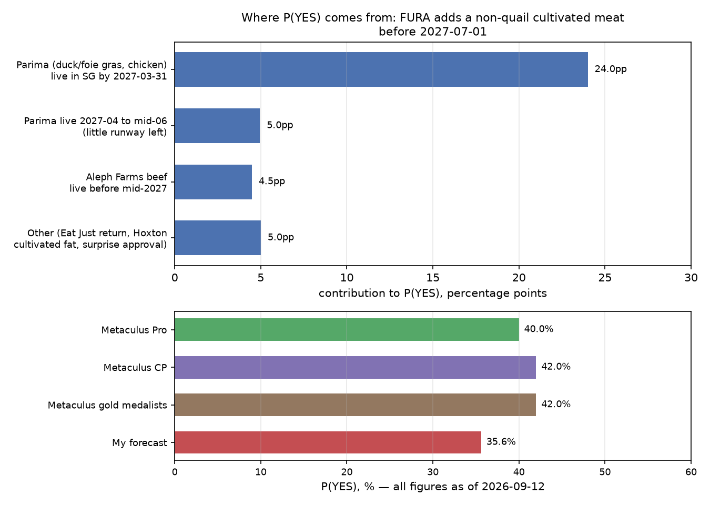

# Will FURA introduce another cultivated meat dish on its menu before July 2027?

| | |
|---|---|
| **Source** | Metaculus #43281 — https://www.metaculus.com/questions/43281/will-fura-add-a-new-cultivated-meat-dish-before-july-2027/ |
| **Type** | binary |
| **Opened / Closes / Resolves** | 2026-06-12 / 2027-06-30 / on observation, any time before 2027-07-01 |
| **Status** | open |
| **Current forecast** | **Median 38.0%, IQR [27.0%, 50.0%]** (v3, 2026-10-14) |
| **Community (as of 2026-10-13)** | CP 38.0% IQR [28.0%, 42.0%] (n=30, 50 forecasters total) · Pro 40.0% (n=3) · Gold 44.0% (n=13) |
| **Next review** | 2026-11-14 |

<!-- Versions below, newest first. APPEND-ONLY: never edit or delete a past version. -->

---

## v3 — Update — 2026-10-14

Mode: **Update** (model revision, same day as v2). Triggered by the operator's red-team
review of v2, which found two mechanisms neither v1 nor v2 modelled and one production fact v1
had underweighted. No new news since v2. The Metaculus snapshot is the same one fetched for v2
(`raw/metaculus-2026-10-14.json`), not re-fetched. This version corrects model structure. It
does not react to new events.

### Revision
| Driver | Direction | Effect |
|---|---|---|
| Prior (v2, 2026-10-14) | — | Median 33.5%, IQR [26.0%, 43.0%] |
| **Vow ↔ Parima link.** Parima's 2026 tonne-scale duck run was made on **Vow's** 22,000 L line in Sydney; the CEO calls Vow one of "the best manufacturing partners" [1]. Vow is FURA's existing cultivated-meat supplier. FURA's supplier relationship and Parima's manufacturing now overlap. Not modelled before. Caveat: SFA approval is specific to product and process, so Vow-made duck may need an amended dossier before Singapore sale [1][3]. P(FURA lists \| Parima live early) 0.60 → 0.66 | ↑ | +2.3 pp |
| **Event and pop-up menus count.** "At least one item on its menu" at any time, and it stays YES even if the item is removed. A launch-event dish, collaboration night or guest shift would plausibly count. Singapore cultivated launches have been venue events (Eat Just at 1880, Vow at Mandala Club, Vital Meat's tasting at Hue) [2]. This bypasses FURA's roughly annual menu cadence, which mattered most for late arrivals. Late Parima 0.33 → 0.42; Aleph 0.16 → 0.18 | ↑ | +2.0 pp |
| **Production underweighted in v1.** v1 cited a 2,000 L pilot plant. Parima has since shown multi-tonne runs at ~99% lower cost [1][4], which removes the cost and volume excuse that sank earlier Singapore approvals. Still no launch signal after 12 months, so the shift is small: P(Parima live by 2027-03-31) 0.36 → 0.38 | ↑ | +0.6 pp |
| Remaining-window hazard and "other" path: unchanged from v2 (no new time elapsed) | → | 0 pp |
| Cohort pooling: **not applied.** Both new mechanisms are plausible explanations of the cohort gap. Pooling on top would count the same information twice. The model now lands within 0–6 pp of all three cohorts | → | 0 pp |
| **New forecast** (model output 38.2%, rounded) | | **Median 38.0%, IQR [27.0%, 50.0%]** |

### Tripwire check
Unchanged from v2: all v2 tripwires checked on 2026-10-14, none fired. No new search since.

### What resolves YES
Unchanged from v1, with one added reading. A dish on a special-event, collaboration or
guest-shift menu at FURA is "an item on its menu" and should count. A strict resolver
might count only the standing menu; I put about 25% on that reading, priced into the
event-path effect above (not its full value).

### Outside view
v1 classes unchanged. Added rival class (red-team): *approved companies with tonne-scale,
low-cost production and stated near-term Singapore intent*. n≈1 (Parima), so it gets no
standalone base rate. It argues that v1's "2 of 6 approvals reached sale" class
overstates the supply constraint for Parima, because the failures were cost- and
funding-driven.

### Inside view
| Path | P(supply) | P(FURA lists in time) | Contribution |
|---|---|---|---|
| Parima live by 2027-03-31 | 0.38 (v2 0.36) | 0.66 (v2 0.60) | 25.1pp |
| Parima live 2027-04-01 … 06-15 | 0.16 | 0.42 (v2 0.33) | 6.7pp |
| Aleph Farms Thin-Cut Steak live before 2027-06-15 | 0.28 | 0.18 (v2 0.16) | 5.0pp |
| Other (Hoxton fat, Eat Just, event with any supplier, surprise) | 1.00 | 0.05 (v2 0.047) | 5.0pp |
| **P(YES), raw** | | | **37.0%** |
| **P(YES \| not annulled)** (closure risk 5%) | | | **38.2%** |

Inputs are tempered, not the red-team's full case. Taking every lever at its
suggested value (0.40 / 0.68 / 0.45 / 0.20) gives 40.6%. I take about two-thirds of that
move because neither mechanism has a concrete FURA–Parima signal behind it yet.

### Evidence
v2 table unchanged. Additions:

| Evidence | Direction | Likelihood ratio (approx.) |
|---|---|---|
| Parima–Vow manufacturing collaboration, Sydney, 22,000 L line (2026-07-02) [1] | ↑ | ~1.10 on the FURA-adoption leg |
| Launch-event pattern for Singapore cultivated products; event menus count [2] | ↑ | ~1.25 on late paths |
| Tonne-scale production at ~99% lower cost [1][4] | ↑ | ~1.05 on Parima supply |
| Parima still awaiting FSANZ (Australia/NZ) approval; timeline slipped [1] | → | ~1.0 (Singapore approval is separate) |

### Other forecasters
Unchanged from v2 (same snapshot): CP 38.0%, Pro 40.0% (n=3), gold 44.0% (n=13, IQR [40%, 82%]).
Gap now: CP 0 pp, Pro 2 pp, gold 6 pp. **No material disagreement.**

### Scenarios
| # | Scenario | Weight | Implies |
|---|---|---|---|
| 1 | Parima launches in Singapore by March 2027; FURA is a launch venue or standing-menu adopter (possibly via Vow) | 0.25 | YES |
| 2 | Parima launches late or narrowly; FURA gets it only via an event, or not at all | 0.16 | ~40% YES |
| 3 | Aleph launches at steakhouses; FURA an unlikely partner | 0.10 | ~18% YES |
| 4 | Nothing non-quail reaches a Singapore plate before July 2027 | 0.44 | NO |
| 5 | FURA ceases operations | 0.05 | ANNULLED |

### Sensitivity
| Assumption | If instead | Forecast becomes |
|---|---|---|
| Event-menu items count | Resolver counts the standing menu only | ≈ 35% |
| Vow-made Parima duck can be sold in Singapore under the existing approval | Needs a new dossier (12+ months) | ≈ 36% (link reverts to a soft relationship benefit) |
| P(Parima live early) = 0.38 | 0.20 (another quiet quarter) | ≈ 27% |
| Close date 2027-06-30 | Re-dated to 2027-01-01 | ≈ 10% |

### What would change my mind (tripwires)
- [ ] **Parima/Gourmey announces a commercial Singapore launch** (named distributor, date or venue) by 2027-02-28 → **up, +15pp** (up to +30pp if FURA is named).
- [ ] **No Parima Singapore launch announcement by 2027-01-31** → **down, −12pp** (the event and Vow paths also depend on Parima supply).
- [ ] **FURA hosts a cultivated-meat event, collaboration or guest shift** with any non-quail supplier, announced by 2027-05-31 → **up, +10pp**, or resolves YES if served.
- [ ] **Vow–Parima commercial or distribution deal for Asia, or SFA clearance for Vow-manufactured Parima product**, by 2027-03-31 → **up, +6pp**.
- [ ] **Parima funding round closes** by 2027-03-31 → **up, +6pp**.
- [ ] **Parima layoffs or distress reported** by 2027-03-31 → **down, −6pp**.
- [ ] **Aleph Farms confirms its Cell Agritech Singapore line is operational and names restaurant partners** by 2027-03-31 → **up, +6pp**; slippage to H2 2027 → **down, −4pp**.
- [ ] **FURA publishes Journal of Future Food Volume Three** before 2027-04-30 without a non-quail cultivated item → **down, −8pp**.
- [ ] **Hoxton Farms cultivated pork fat receives SFA approval** by 2027-02-28 → **up, +3pp**.
- [ ] **Question author re-dates the close to 2027-01-01** → **down, to ≈10%**; re-analyse.
- [ ] **FURA announces closure, sale or change of concept** → annulment risk, re-analyse.

### Sources
1. Green Queen, "Parima Validates Commercial-Scale Cultivated Meat Production with Vow" (2026-07-02, updated 2026-07-09) — https://www.greenqueen.com.hk/parima-gourmey-vital-meat-lab-grown-cultivated-production-vow/ (accessed 2026-10-14)
2. Green Queen, "Ahead of Singapore Approval, French Startup Gives Diners A Taste of Cultivated Chicken" (Vital Meat tasting at Hue) — https://www.greenqueen.com.hk/vital-meat-lab-grown-chicken-cultivated-meat-singapore-tasting-approval/ (search snippet, accessed 2026-10-14)
3. Singapore Food Agency, "Overview of Pre-Market Approval Framework for Novel Food" — https://www.sfa.gov.sg/regulatory-standards-frameworks-guidelines/novel-food-framework/overview-of-pre-market-approval-framework-for-novel-food (carried from v1; accessed 2026-09-12)
4. Protein Production Technology, "PARIMA and Vow's 22,000L breakthrough signals cultivated meat's next commercial chapter" — https://www.proteinproductiontechnology.com/post/parima-and-vows-22-000l-breakthrough-signals-cultivated-meats-next-commercial-chapter (search snippet, accessed 2026-10-14)
5. PARIMA, news — https://parima.bio/news (accessed 2026-10-14; latest item 2026-07-02)
6. FURA, menu — https://www.fura.space/menu (accessed 2026-10-14)
7. Green Queen, "BREAKING: Eat Just Makes First-Ever Commercial Sale Of Cultured Meat In Singapore" (1880, 2020) — https://www.greenqueen.com.hk/eat-just-makes-first-ever-commercial-sale-of-cultured-meat-in-singapore/ (search snippet, accessed 2026-10-14)
8. Green Queen, "Vow Earns Singapore Greenlight for Cultivated Quail, Debuts at Mandala Club" (2024-04) — https://www.greenqueen.com.hk/vow-food-singapore-regulatory-approval-cultivated-quail-forged-parfait/ (carried from v1; accessed 2026-09-12)
9. Food Business MEA, "Parima secures second cultivated meat approval in Singapore for duck product" — https://www.foodbusinessmea.com/parima-secures-second-cultivated-meat-approval-in-singapore-for-duck-product/ (search snippet, accessed 2026-10-14)
10. World's 50 Best Bars, FURA — https://www.theworlds50best.com/bars/asia/the-list/fura.html (search snippet, accessed 2026-10-14)
11. Metaculus #43281 aggregation snapshot — raw/metaculus-2026-10-14.json (accessed 2026-10-14)

**Question**: [Will FURA introduce another cultivated meat dish on its menu before July 2027?](https://www.metaculus.com/questions/43281/will-fura-add-a-new-cultivated-meat-dish-before-july-2027/)
**Date**: 2026-10-14
**Forecast**: Median 38.0%, IQR [27.0%, 50.0%]
**Thesis**: Model revision after a red-team review, with no new news. Parima's tonne-scale duck is made on the line of Vow, FURA's existing cultivated-meat supplier [1]. Launch-event and collaboration menus count, which bypasses FURA's menu cadence [2]. Together they raise P(FURA lists it | supply). The binding constraint is still Parima: 12 months with no Singapore launch signal [5]. The forecast now sits with the Metaculus cohorts (CP 38%, Pro 40%, gold 44%) [11].

---

## v2 — Update — 2026-10-14

Mode: **Update** (incremental). 32 of 292 days of the window have passed since v1 (11%, well
under 1/3). No question-structure change. The Metaculus cohorts sit 4.5–10.5 pp above me;
the gap is the same one named in v1 (I discount Parima's execution harder) and I re-searched
for a missed fact before holding it (see *Other forecasters*).

### Revision
| Driver | Direction | Effect |
|---|---|---|
| Prior (v1, 2026-09-12) | — | Median 35.6%, IQR [28.0%, 45.0%] |
| Elapsed quiet time on the main path: one month of the 6.6-month "Parima live by 2027-03-31" sub-window is gone with no launch announcement, no named distributor or partner, and no new item on Parima's news page since 2026-07-02 [2][3]. Remaining-window hazard: P(Parima live early) 0.40 → 0.36; late-Parima sub-window renormalised 0.15 → 0.16 | ↓ | −1.8 pp |
| Aleph Farms: no change to the H1 2027 Singapore line target (Cell Agritech), no restaurant partners named [4] | → | 0 pp |
| "Other" path (Hoxton cultivated fat, Eat Just return, surprise): Hoxton still awaiting SFA decision ("late 2026 to early 2027") [5]; time decay 0.050 → 0.047 | ↓ | −0.3 pp |
| FURA menu re-checked 2026-10-14: still exactly two cultivated items, both cultured Japanese quail; no Volume Three [1] | → | 0 pp (confirms not yet resolved) |
| Metaculus cohorts: CP 42% → 38%, Pro 40% → 40% (n=3), gold 42% → 44% (n=13, IQR widened to [40%, 82%]) [6]. Net movement ≈ 0 and no comments with new facts (one comment total, on the close date) | → | 0 pp |
| **New forecast** (model output 33.5%) | | **Median 33.5%, IQR [26.0%, 43.0%]** |

### Tripwire check
| Tripwire from v1 | By | Fired? | Note |
|---|---|---|---|
| Parima/Gourmey announces a commercial Singapore launch (distributor, date or venue) | 2027-02-28 | **Not fired** | Parima news page: latest item 2026-07-02 (multi-tonne production with Vow); Gourmey news page unchanged; no trade-press coverage found [2][3] |
| No Parima Singapore launch announcement at all | 2027-01-31 | Not yet due | Running toward firing: 12 months since the chicken approval, 6 since the duck approval |
| Aleph Farms confirms Cell Agritech Singapore line operational and names restaurant partners | 2027-03-31 | **Not fired** | Latest coverage still the August approval: "first half of 2027", "select restaurant partners" [4] |
| FURA publishes Journal of Future Food Volume Three with no non-quail cultivated item | 2027-04-30 | **Not fired** | Live menu still Volume Two-era; no Volume Three announced [1] |
| Hoxton Farms cultivated pork fat receives SFA approval | 2027-02-28 | **Not fired** | No approval reported; company guidance late 2026 – early 2027 [5] |
| FURA closure, sale or change of concept | 2027-07-01 | **Not fired** | Menu live; no closure news |

### What resolves YES
Unchanged from v1. The 2026-07-28 comment asking whether the close date should be 2027-01-01
is still unanswered; the API still shows scheduled close 2027-06-30T20:00Z [6].

### Outside view
Unchanged from v1.

### Inside view
Path table re-run (`scripts/model.py` structure, updated inputs):

| Path | P(supply) | P(FURA lists in time) | Contribution |
|---|---|---|---|
| Parima live by 2027-03-31 | 0.36 (was 0.40) | 0.60 | 21.6pp |
| Parima live 2027-04-01 … 06-15 | 0.16 (was 0.15) | 0.33 | 5.3pp |
| Aleph Farms Thin-Cut Steak live before 2027-06-15 | 0.28 | 0.16 | 4.5pp |
| Other (Hoxton fat, Eat Just, surprise) | 1.00 | 0.047 (was 0.05) | 4.7pp |
| **P(YES), raw** | | | **32.4%** |
| **P(YES \| not annulled)** (closure risk 5%) | | | **33.5%** |

The Parima-early renormalisation assumes v1's 0.40 was spread evenly over 2026-09-12 …
2027-03-31: P(launch in the remaining 5.6 months | none in the first) = (0.40 × 5.6/6.6) /
(1 − 0.40 × 1/6.6) ≈ 0.36. A launch announcement can still come with no visible run-up
(Vow's 2024 launch went from announcement to plate in the same month), so the decay is
mechanical, not a judgement that Parima has failed.

### Evidence
v1 table unchanged. Additions:

| Evidence | Direction | Likelihood ratio (approx.) |
|---|---|---|
| A further month with no Parima Singapore launch signal [2][3] | ↓ | ~0.93 on the Parima-early leg |
| Aleph Farms: still H1 2027, no partners named [4] | → | 1.0 |
| Hoxton Farms: no SFA decision yet [5] | → | 1.0 |
| FURA menu unchanged, two quail items only [1] | → | 1.0 |

### Other forecasters
| Source | Value | As of | Note |
|---|---|---|---|
| Metaculus CP (recency-weighted) | 38.0%, IQR [28.0%, 42.0%] (n=30; 50 forecasters on the post) | 2026-10-13 | Down from 42% on 2026-09-12; 38–40% since 2026-10-04 [6] |
| Metaculus Pro | 40.0%, IQR [40.0%, 42.0%] (n=3) | 2026-10-13 | Unchanged; tiny n |
| Metaculus gold medalists | 44.0%, IQR [40.0%, 82.0%] (n=13) | 2026-10-13 | Up 2 pp; upper quartile jumped to 82% (mean 51%) |
| Kalshi / Polymarket / Manifold | none | 2026-10-14 | No comparable market |

**Cohort disagreement flag.** The cohorts now spread (CP 38%, Pro 40%, gold 44% with a fat
upper tail). Gold sits 10.5 pp above me, at the re-search threshold. The 82% upper quartile
suggests at least a few gold medalists believe something qualifying is imminent or already
happened. I re-checked the live menu (two quail items only), Parima's and Gourmey's news
pages, Aleph and Hoxton coverage, and FURA news since July: nothing. With n=13 and no
explanatory comments, I read the tail as a few high forecasts rather than a fact I missed.
The CP, the larger cohort, moved *toward* me (42% → 38%). I hold my number and do not herd.

### Scenarios
| # | Scenario | Weight | Implies |
|---|---|---|---|
| 1 | Parima launches in Singapore by March 2027; FURA among the first venues | 0.22 | YES |
| 2 | Parima launches late or narrowly; FURA misses or is not chosen | 0.18 | mostly NO |
| 3 | Aleph hits H1 2027 at steakhouses; FURA an unlikely early partner | 0.10 | mostly NO (≈4.5pp of YES) |
| 4 | Nothing non-quail reaches a Singapore plate before July 2027 | 0.45 | NO |
| 5 | FURA ceases operations | 0.05 | ANNULLED |

### Sensitivity
Unchanged from v1. Each further quiet month on Parima removes ~2 pp until the 2027-01-31
"no announcement" tripwire, which removes ~10 pp at once.

### What would change my mind (tripwires)
- [ ] **Parima/Gourmey announces a commercial Singapore launch** (named distributor, date or venue) by 2027-02-28 → **up, +15pp** (up to +30pp if FURA is named; resolves YES if on the menu).
- [ ] **No Parima Singapore launch announcement by 2027-01-31** → **down, −10pp**.
- [ ] **Aleph Farms confirms its Cell Agritech Singapore line is operational and names restaurant partners** by 2027-03-31 → **up, +6pp**; slippage to H2 2027 announced → **down, −4pp**.
- [ ] **FURA publishes Journal of Future Food Volume Three** before 2027-04-30 without a non-quail cultivated item → **down, −8pp**. With one → resolves YES.
- [ ] **Hoxton Farms cultivated pork fat receives SFA approval** by 2027-02-28 → **up, +3pp**; re-check whether cultivated fat counts as "a cultured meat".
- [ ] **Question author re-dates the close to 2027-01-01** (answering the open comment) → **down, to ≈9%**; re-analyse.
- [ ] **FURA announces closure, sale or change of concept** before 2027-07-01 → annulment risk, re-analyse.

### Sources
1. FURA, menu — https://www.fura.space/menu (accessed 2026-10-14)
2. PARIMA, news — https://parima.bio/news (accessed 2026-10-14; latest item 2026-07-02)
3. Gourmey, news index — https://gourmey.com/news (search snippet, accessed 2026-10-14)
4. AgFunderNews, "Aleph Farms plans 2027 cultivated beef launch in Singapore after securing green light from regulators" — https://agfundernews.com/aleph-farms-plans-2027-cultivated-beef-launch-in-singapore-after-securing-green-light-from-regulators (search snippet, accessed 2026-10-14)
5. Green Queen, "Exclusive: Hoxton Farms Files for Singapore Approval of Cultivated Pork Fat" — https://www.greenqueen.com.hk/hoxton-farms-lab-grown-meat-cultivated-pork-fat-singapore-approval/ (search snippet, accessed 2026-10-14)
6. Metaculus #43281 aggregation snapshot (CP, Pro, gold, history, comments) — raw/metaculus-2026-10-14.json (fetched 2026-10-14)
7. Time Out, "Singapore's Fura Named World's Best Bar at Spirited Awards 2026" — https://www.timeout.com/singapore/news/singapores-fura-is-officially-the-worlds-best-bar-according-to-the-spirited-awards-072726 (accessed 2026-10-14)
8. Protein Production Technology, "PARIMA and Vow's 22,000L breakthrough signals cultivated meat's next commercial chapter" (2026-07) — https://www.proteinproductiontechnology.com/post/parima-and-vows-22-000l-breakthrough-signals-cultivated-meats-next-commercial-chapter (search snippet, accessed 2026-10-14)
9. Food Ingredients First, "Parima secures regulatory clearance to sell cultivated duck in Singapore" — https://www.foodingredientsfirst.com/news/parima-secures-regulatory-clearance-to-sell-cultivated-duck-in-singapore.html (search snippet, accessed 2026-10-14)
10. Green Queen, "Aleph Farms Earns Singapore Approval for Lab-Grown Beef, Targets 2027 Launch" (2026-08-04) — https://www.greenqueen.com.hk/aleph-farms-lab-grown-meat-cultivated-beef-singapore-approval-launch/ (search snippet, accessed 2026-10-14)
11. GFI APAC, "Why Singapore's World-First Cultivated Beef and Duck Approvals Matter" — https://gfi-apac.org/why-singapores-world-first-cultivated-beef-and-duck-approvals-matter/ (search snippet, accessed 2026-10-14)
12. The Star, "Singapore restaurants Bricolage and Fura are building the menus of the future" (2026-04-11) — https://www.thestar.com.my/lifestyle/living/2026/04/11/singapore-restaurants-bricolage-and-fura-are-building-the-menus-of-the-future (search snippet, accessed 2026-10-14)

**Question**: [Will FURA introduce another cultivated meat dish on its menu before July 2027?](https://www.metaculus.com/questions/43281/will-fura-add-a-new-cultivated-meat-dish-before-july-2027/)
**Date**: 2026-10-14
**Forecast**: Median 33.5%, IQR [26.0%, 43.0%]
**Thesis**: A quiet month. FURA's menu still lists only cultured quail [1], and no non-quail supplier moved: Parima has announced nothing about a Singapore launch since July [2], Aleph still targets H1 2027 [4], Hoxton awaits approval [5]. Time decay on the Parima path takes ~2 pp off. The cohorts (CP 38%, Pro 40%, gold 44%) sit above me for the same reason as in v1: I discount Parima's execution harder [6].

---

## v1 — Initial forecast — 2026-09-12

### What resolves YES

FURA — a cocktail bar and small-plates venue at 74A Amoy Street, Singapore, which serves its
food and drinks as a "Journal of Future Food" — must have, at any moment before 2027-07-01,
at least one item on its menu containing **a cultured meat other than Japanese quail**. The
resolution source is FURA's own menu as observed by the resolver; there is no scheduled data
release, so YES can trigger at any time and is not reversible: the fine print states the
question resolves YES even if the dish is later removed. Removing or modifying the existing
cultured-quail dishes is explicitly irrelevant. If FURA ceases operations before 2027-07-01
without the question having resolved, it is **annulled**.

The exclusion is at **species** level, not supplier level: a new Vow/"Forged" *quail* format
would not count, while any non-quail cultivated animal-cell product would. Three edge cases
matter. (i) FURA already serves **cell-cultured milk** — not meat, does not count. (ii) The
quail-fat "butter candle" on the bread service is a quail by-product — excluded. (iii) If
Hoxton Farms' **cultivated pork fat** (SFA dossier filed 2025-11-04, approval expected late
2026 – early 2027) reached FURA, it is genuinely ambiguous whether cultivated *fat* is "a
cultured meat"; I assume a resolver would most likely count it, and the weight is small
either way. A separate administrative risk: a commenter (dendron, 2026-07-28) asked the
author whether the close date should have been 2027-01-01; the author has not replied, and
the API still shows 2027-06-30. I forecast the question as written.

As of 2026-09-12 the live menu (https://www.fura.space/menu) carries exactly two cultivated
items, both cultured Japanese quail: "A QUAIL WALKS INTO A BAR" (S$20) and "A QUAIL WALKS
INTO A MARTINI" (S$25). The question has **not** resolved.

### Outside view

Four reference classes, deliberately built before reconciling with the community prediction.
They disagree in an informative way (full table in `research.md`).

1. **SFA-approved cultivated products that reached actual commercial sale in Singapore:**
   6 approvals 2020–2026, of which 2 ever reached sale and **exactly 1 is on sale today**
   (Vow's quail — the one this question excludes). This is the dominant constraint, and it
   is a six-year track record, not a snapshot.
2. **Approval → first Singapore sale lag, for those that did launch:** ~0 months in both
   cases (Eat Just at 1880 in the approval month, December 2020; Vow at Mandala Club in the
   approval month, April 2024). When a launch happens at all it is fast and venue-led — so
   the distribution is bimodal: immediate, or never.
3. **FURA's own rate of adding a new cultivated meat:** 1 in 35 months since opening
   (October 2023). As a hazard rate, λ ≈ 0.34/yr over the 9.6-month window gives
   **P ≈ 24%**. This is the naive status-quo anchor.
4. **FURA's lag from supply existing → menu placement:** ~3 months (Vow approved and
   launched April 2024; FURA's dish documented 2024-07-06). FURA is a fast adopter.

Classes 3 and 4 say FURA is willing and quick; classes 1 and 2 say the supply almost never
arrives. Scaling class 3 up for the genuinely improved 2026 supply picture, and class 1 down
for FURA's unusual position, both land in the low-to-mid 30s.

### Inside view

Because FURA's willingness is close to a given, **this is a forecast about Parima and Aleph
Farms, not about FURA.** Decomposition (runnable: `scripts/model.py`), each path
`P(supply commercially live in Singapore in the window) × P(FURA lists it before 2027-07-01)`,
combined with the independence complement `P(YES) = 1 − Π(1 − pᵢ)`:

| Path | P(supply) | P(FURA lists in time) | Contribution |
|---|---|---|---|
| Parima (Gourmey duck/foie gras, Vital Meat chicken) live by 2027-03-31 | 0.40 | 0.60 | 24.0pp |
| Parima live 2027-04-01 … 2027-06-15 (little runway left) | 0.15 | 0.33 | 5.0pp |
| Aleph Farms Thin-Cut Steak live before 2027-06-15 | 0.28 | 0.16 | 4.5pp |
| Other: Eat Just return, Hoxton cultivated fat approved *and* launched, surprise | 1.00 | 0.05 | 5.0pp |
| **P(YES), raw** | | | **34.4%** |
| **P(YES \| not annulled)** — closure risk 5%, and closure worlds are almost all NO worlds | | | **35.6%** |

The two load-bearing numbers:

- **P(Parima live by 2027-03-31) = 0.40.** For: two SFA approvals in hand (chicken
  2025-10, duck 2026-04-15 — the first company approved across two species anywhere);
  CEO Nicolas Morin-Forest saying they are "entering a new phase focused on commercial
  launch across both products", starting with Singapore premium gastronomy; a public
  tasting already run at Hue in Singapore; foie gras is a tiny-volume luxury item a
  2,000 L pilot plant can supply; and a commercial proof point is exactly what a
  cultivated-meat company needs to raise money in this climate. Against: eleven months
  of silence since the chicken approval, no named partner, no date, refusal to answer
  launch-plan questions, production in France with APAC "decentralized manufacturing with
  partners" still notional, and a 2025/26 merger that reads as consolidation under stress.
- **P(FURA lists it | Parima live with runway) = 0.60.** For: FURA won **World's Best Bar**
  at the 20th Spirited Awards on 2026-07-27 and is the single most obvious showcase venue in
  Singapore for exactly this product; its whole identity is future food; it adopted Vow's
  quail within ~3 months. Against: FURA's menu volumes have so far added *new categories*
  (beanless coffee, jellyfish, corn) rather than a second entry in a category it already
  covers; Parima's culinary advisory board and its one Singapore event point at Michelin
  fine-dining rather than a bar; and menu volumes turn over roughly annually, so the timing
  has to line up.

Conjunction check: my story needs supply **and** a FURA placement **and** both inside 9.6
months. 35.6% is below the least likely single link only if you count "supply from anyone"
(≈ 0.6) — it is comfortably below that, as it should be.

### Evidence

The pivotal find, and the one that should dominate: the August 2026 coverage of the Aleph
Farms approval states plainly that **Vow's cultivated quail is the only cultivated meat
currently available at restaurants in Singapore** [5]. Singapore has more authorised
cultivated products than any other jurisdiction — six — and one of them is on a plate.
Starting from the naive "four non-quail products are approved, surely one reaches FURA"
reading, this is a likelihood ratio of roughly 1:3 against, and it is what took me from
an initial ~55% intuition to the mid-30s.

Updating in the other direction: FURA becoming World's Best Bar in July 2026 [13] is a real
YES driver — it converts FURA from "a good showcase venue" into "the showcase venue", raises
the value of a placement to any supplier, and removes most of the near-term closure/annulment
risk. Call it LR ≈ 1.3 on the FURA-adoption leg.

**Absence of expected evidence.** If a qualifying dish were imminent, I would expect at least
one of: a Parima/Gourmey Singapore launch announcement, a named distributor, a teaser from
FURA, or a supplier naming launch partners. Gourmey's own news page [8] stops at the April
2026 approval; the August 2026 industry round-up [12] contains no Singapore launch; several
phrasings pairing FURA with Gourmey/Parima/Aleph return nothing. That absence is real
evidence, but only mild: Vow's 2024 launch went from announcement to plate in the same month,
so a 9.6-month window does not require a visible run-up today.

Two frictions I found and did not initially expect. First, FURA's manager Mulia Rahman says
they needed a licence to serve cultivated meat plus SFA authorisation and "had to wait six
months" [3] — a per-venue delay stacked on top of supplier availability. The SFA framework
page [14] shows approval is granted per product and per manufacturing method with no separate
published restaurant regime, so the six months was most likely the first-time/format
approval rather than a recurring tax; I treat it as a partial, not full, repeat cost, which
is why the late-arrival paths get a low 0.33 and 0.16. Second, the supplier ecosystem is
under stress: Vow cut ~30% of staff and changed CEO [9]; Believer, Meatable, SciFi Foods and
Cultimate have all ceased operations [10][12].

Ruled out entirely (see `research.md`): a second Vow species (quail-only commercially, no
non-quail dossier), cultivated seafood (no human-food approval in Singapore; Umami Bioworks'
clearances are pet food, Avant wound down its Singapore research arm), and Eat Just as a
serious path (Singapore operations paused, Asia strategy under review).

### Other forecasters

| Source | Value | As of | Note |
|---|---|---|---|
| Metaculus CP (recency-weighted) | 42.0%, IQR [31.0%, 47.7%] (n=27) | 2026-09-12 | 43 forecasters on the post |
| Metaculus Pro | 40.0%, IQR [31.0%, 40.0%] (n=5) | 2026-09-12 | marginally below CP |
| Metaculus gold medalists | 42.0%, IQR [31.0%, 44.0%] (n=15) | 2026-09-12 | matches CP |
| Kalshi | none | 2026-09-12 | no comparable market |
| Polymarket | none | 2026-09-12 | no comparable market |
| Manifold | none found | 2026-09-12 | — |
| Sentinel / Mantic / GJOpen / INFER | none | 2026-09-12 | out of scope for these venues |

**Cohort agreement, not disagreement:** all three sit in a 2pp band (40–42%) with an
essentially identical lower quartile of 31%. There is no cohort signal to exploit here. The
CP opened at 60% on 2026-06-12, fell to ~41% within a week, and has been flat at 42–45% ever
since — consistent with the crowd finding the same supply constraint I did, early, and then
receiving no new information for three months.

I sit **6.4pp below** the CP and gold medalists and 4.4pp below Pro — inside the 10pp
tolerance, so no forced re-search, but worth naming the disagreement precisely. My model
reproduces their number almost exactly at `P(FURA lists | Parima live early) = 0.78` instead
of my 0.60, or at `P(Parima live by 2027-03-31) = 0.52` instead of 0.40. So the gap is not
structural; it is that I discount Parima's execution a little harder, on the evidence of
eleven months of post-approval silence on the chicken and a refusal to answer launch-plan
questions. I hold the difference loosely and would not defend it past 8pp.

### Scenarios

| # | Scenario | Weight | Implies |
|---|---|---|---|
| 1 | Parima launches in Singapore in H1 FY27 with a splashy multi-venue rollout; FURA is among the first, as it was for Vow | 0.24 | YES |
| 2 | Parima launches late (Q2 2027) or narrowly (one fine-dining partner); FURA misses the window or is not chosen | 0.17 | mostly NO |
| 3 | Aleph Farms hits its H1 2027 target; a thin-cut steak lands at steakhouses, and FURA — a bar — is an unlikely first partner | 0.10 | mostly NO (≈4.5pp of YES) |
| 4 | Nothing non-quail reaches any Singapore plate before July 2027; approvals keep accumulating unused, as they have since 2020 | 0.44 | NO |
| 5 | FURA ceases operations before resolution | 0.05 | ANNULLED |

### Sensitivity

| Assumption | If instead | Forecast becomes |
|---|---|---|
| P(Parima commercially live in SG by 2027-03-31) = 0.40 | 0.60 — they name a launch date and a distributor | ≈ 46% |
| P(Parima commercially live in SG by 2027-03-31) = 0.40 | 0.20 — another two quiet quarters, or a funding stumble | ≈ 25% |
| P(FURA lists it \| supply live early) = 0.60 | 0.80 — FURA announces Volume Three built around a new cultivated protein | ≈ 43% |
| P(FURA lists it \| supply live early) = 0.60 | 0.40 — FURA signals it is staying exclusive with Vow/Forged | ≈ 29% |
| Question closes 2027-06-30 as written | Re-dated to 2027-01-01 per the open comment | ≈ 9% |

### What would change my mind (tripwires)

- [ ] **Parima/Gourmey announces a commercial Singapore launch** — a named distributor,
      date or venue — by 2027-02-28 → **up, +15pp** (and up to +30pp if FURA is the named
      venue, which resolves it).
- [ ] **No Parima Singapore launch announcement by 2027-01-31** (i.e. 15 months after the
      chicken approval, 9 after the duck) → **down, −10pp**.
- [ ] **Aleph Farms confirms its Cell Agritech Singapore line is operational and names
      restaurant partners** by 2027-03-31 → **up, +6pp**; slippage of that line to H2 2027
      announced by 2027-03-31 → **down, −4pp**.
- [ ] **FURA publishes "Journal of Future Food, Volume Three"** before 2027-04-30 without a
      non-quail cultivated item → **down, −8pp** (the most likely single moment for a YES
      passes unused). With one → resolves YES.
- [ ] **Hoxton Farms' cultivated pork fat receives SFA approval** by 2027-02-28 → **up,
      +3pp**, and re-check whether the resolver treats cultivated fat as "a cultured meat".
- [ ] **FURA announces closure, sale or a change of concept** before 2027-07-01 →
      annulment risk, re-analyse (`either`, magnitude 0).

### Sources

1. Metaculus #43281, "Will FURA introduce another cultivated meat dish on its menu before July 2027?" — https://www.metaculus.com/questions/43281/will-fura-add-a-new-cultivated-meat-dish-before-july-2027/ (accessed 2026-09-12; snapshot in `raw/metaculus-2026-09-12.json`)
2. FURA, menu — https://www.fura.space/menu (accessed 2026-09-12)
3. "Singapore restaurants Bricolage and Fura are building the menus of the future", The Star, 2026-04-11 — https://www.thestar.com.my/lifestyle/living/2026/04/11/singapore-restaurants-bricolage-and-fura-are-building-the-menus-of-the-future (accessed 2026-09-12)
4. "Singapore Food Agency Publishes List of Approved Novel Foods", Green Queen, updated 2026-04-20 — https://www.greenqueen.com.hk/singapore-food-agency-sfa-list-of-approved-novel-foods/ (accessed 2026-09-12)
5. "Aleph Farms Secures Singapore Approval for Cultivated Beef, Targets 2027 Restaurant Launch", Green Queen, 2026-08-04 — https://www.greenqueen.com.hk/aleph-farms-lab-grown-meat-cultivated-beef-singapore-approval-launch/ (accessed 2026-09-12)
6. "Parima Gets Singapore Approval to Sell Lab-Grown Duck Under Gourmey Brand", Green Queen, 2026-04-15 — https://www.greenqueen.com.hk/parima-lab-grown-meat-cultivated-duck-gourmey-singapore-approval/ (accessed 2026-09-12)
7. "Parima gets regulatory approval for cultivated foie gras", FoodNavigator, 2026-04-15 — https://www.foodnavigator.com/Article/2026/04/15/parima-gets-regulatory-approval-for-cultivated-foie-gras/ (accessed 2026-09-12)
8. Gourmey, news index — https://gourmey.com/news (accessed 2026-09-12)
9. "Australia's Vow Appoints New CEO Amid Expansion Beyond Cultivated Meat", Green Queen, 2026-06-23 — https://www.greenqueen.com.hk/vow-australia-ceo-layoffs-lab-grown-cultivated-meat-startup-cultured-quail/ (accessed 2026-09-12)
10. "Big players in cultivated meat: Who are the survivors?", FoodNavigator, 2026-05-14 — https://www.foodnavigator.com/Article/2026/05/14/cultivated-meat-who-are-the-survivors/ (accessed 2026-09-12)
11. "Hoxton Farms Files for Singapore Approval of Lab-Grown Meat Fat", Green Queen (filing dated 2025-11-04) — https://www.greenqueen.com.hk/hoxton-farms-lab-grown-meat-cultivated-pork-fat-singapore-approval/ (accessed 2026-09-12)
12. "The Month In Cultivated Meat: August", Cultivated Bites, 2026-09 — https://cultivatedbites.substack.com/p/the-month-in-cultivated-meat-august-523 (accessed 2026-09-12)
13. "Singapore bar Fura crowned World's Best Bar", Time Out, 2026-07-27 — https://www.timeout.com/news/singapore-bar-fura-crowned-best-bar-2026-072726 (accessed 2026-09-12)
14. Singapore Food Agency, "Overview of Pre-Market Approval Framework for Novel Food" — https://www.sfa.gov.sg/regulatory-standards-frameworks-guidelines/novel-food-framework/overview-of-pre-market-approval-framework-for-novel-food (accessed 2026-09-12)
15. "Forged by Fura", Forged by Vow, 2024-07-06 — https://www.forgedbyvow.com/the-feed/forged-by-fura (accessed 2026-09-12)
16. "This Singapore Bar Shows Diners What Food Will Look Like in the Future", Green Queen, 2025-05-05 — https://www.greenqueen.com.hk/fura-singapore-journal-of-future-food-menu-asias-50-best-bars/ (accessed 2026-09-12)
17. "Eat Just Pauses Singapore Operations – But Set to Return to Huber's Bistro Soon", Green Queen — https://www.greenqueen.com.hk/eat-just-good-meat-cultivated-chicken-singapore-operations/ (accessed 2026-09-12)
18. "Parima Earns Singapore Approval for Vital Meat's Lab-Grown Chicken", Green Queen, 2025-10-28 — https://www.greenqueen.com.hk/parima-vital-meat-gourmey-lab-grown-meat-cultivated-chicken-singapore-approval/ (accessed 2026-09-12)
19. "Vow eyes APAC growth with cultured quail candles and cocktails", FoodNavigator-Asia, 2025-08-14 — https://www.foodnavigator-asia.com/Article/2025/08/14/vow-eyes-apac-growth-with-cultured-quail/ (accessed 2026-09-12)
20. "Vow Earns Singapore Greenlight for Cultivated Quail, Debuts at Mandala Club", Green Queen, 2024-04 — https://www.greenqueen.com.hk/vow-food-singapore-regulatory-approval-cultivated-quail-forged-parfait/ (accessed 2026-09-12)
21. "Cultivated Fish Startup Avant Shuts Singapore Operations, But Continues to Eye Approval", Green Queen, 2026-02 — https://www.greenqueen.com.hk/avant-meats-cultivated-fish-lab-grown-proteins-singapore-approval/ (accessed 2026-09-12)

**Date**: 2026-09-12
**Forecast**: Median 35.6%, IQR [28.0%, 45.0%]
**Thesis**: Singapore has authorised six cultivated meat products but only Vow's quail — the
one this question excludes — is actually on sale there [5], so the forecast is about Parima's
and Aleph Farms' execution, not about FURA's willingness. FURA is a fast, high-profile adopter
(World's Best Bar 2026 [13]; it put Vow's quail on the menu ~3 months after launch [15]), but
Parima has been silent for eleven months since its first Singapore approval [18] and Aleph's
Singapore production line is only targeted for H1 2027 [5], leaving a narrow window.
