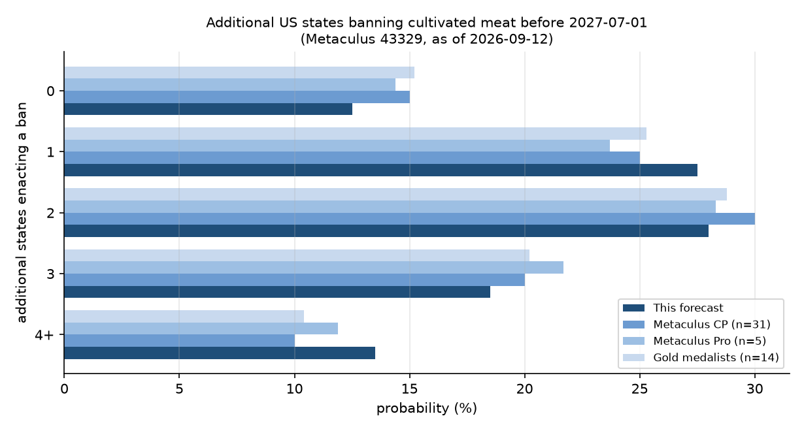

# How many additional US states will enact bans on cultivated meat before July 2027?

| | |
|---|---|
| **Source** | Metaculus #43329 — https://www.metaculus.com/questions/43329/how-many-more-us-states-will-ban-cultivated-meat-before-july-2027/ |
| **Type** | multiple_choice (0 / 1 / 2 / 3 / 4+) |
| **Opened / Closes / Resolves** | 2026-06-12 / 2027-07-01 / 2027-07-01 |
| **Status** | open |
| **Current forecast** | **0: 12.5% · 1: 27.5% · 2: 28.0% · 3: 18.5% · 4+: 13.5%** — leading option **2, IQR [24.0%, 32.0%]** (v2, 2026-09-26) |
| **Community (as of 2026-09-26)** | CP 0=16.1 / 1=28.6 / 2=26.5 / 3=18.0 / 4+=10.7 (n=34) · Pro 15.1/28.1/27.1/17.1/12.7 (n=5) · Gold 14.9/27.2/27.7/18.3/11.9 (n=14) |
| **Next review** | 2026-12-15 |

<!-- Versions below, newest first. APPEND-ONLY: never edit or delete a past version. -->

---

## v2 — Update (no change) — 2026-09-26

**Mode: Update** (incremental). 14 days since v1, 5% of the time to resolution. This version
exists to record v1's forecast as a full option vector in the ledger's new `distribution`
field. v1 was logged before that field existed. The Metaculus cohorts were re-fetched and the
v1 tripwires re-checked. **No change** is correct. The window is essentially the January–June
2027 legislative sessions, and nearly every state legislature is out of session until then. So
two quiet weeks in September use up almost none of the window's hazard: the "quiet time lowers
P" argument has almost nothing to act on yet.

### Revision table

| Driver | Direction | Effect |
|---|---|---|
| **Prior (v1, 2026-09-12)** | — | 0: 12.5 · 1: 27.5 · **2: 28.0** · 3: 18.5 · 4+: 13.5 (leading option `2`, IQR [24.0, 32.0]) |
| **Elapsed time.** 12 Sep – 26 Sep is outside every relevant session. Full-time legislatures such as Ohio and Pennsylvania could in principle act, but no cultivated-meat ban movement was found [2][3] | — | 0 |
| **Metaculus cohorts barely moved.** CP 16.1 / 28.6 / 26.5 / 18.0 / 10.7 (n=34). Pros 15.1 / 28.1 / 27.1 / 17.1 / 12.7 (n=5). Gold 14.9 / 27.2 / 27.7 / 18.3 / 11.9 (n=14) [1]. Every cohort is still within ~4pp of me on every option, which is v1's convergence. There is no new information to herd on | — | 0 |
| **No Louisiana clarification.** The question has no comments at all, and no admin ruling on whether the contingent Act 742 counts [1] | — | 0 |
| **v2 (2026-09-26)** | | 0: 12.5 · 1: 27.5 · **2: 28.0** · 3: 18.5 · 4+: 13.5, unchanged |

### Tripwire check (v1 list)

| Tripwire | Status | Note |
|---|---|---|
| < 3 states introduce a full sale ban for 2027 (by 2027-01-15) | Not due | pre-filing mostly opens in Nov–Dec |
| ≥ 5 states introduce full sale bans for 2027 (by 2027-01-15) | Not due | — |
| West Virginia Senate passes a ban (by 2027-03-15) | Not due | — |
| South Carolina H.5096-equivalent clears Senate Agriculture (by 2027-04-15) | Not due | — |
| A cultivated-meat product goes on US retail or chain-restaurant sale (by 2027-06-30) | Not fired | No US launch found. Federal approval exists, but no product is on sale [3] |
| Admin clarifies whether Louisiana Act 742 counts | Not fired | No comments on the question [1] |

All other sections are unchanged from v1. The ledger vector uses Metaculus's exact option labels
`0`, `1`, `2`, `3`, `4+`. The distribution is recorded as `probabilities` because this is a
multiple-choice question: its options are count bins, not a numeric scale.

### What resolves YES

Unchanged from v1.

### Outside view

Unchanged from v1.

### Inside view

Unchanged from v1.

### Evidence

Unchanged from v1.

### Other forecasters

Unchanged from v1.

### Scenarios

Unchanged from v1.

### Sensitivity

Unchanged from v1.

### What would change my mind

Unchanged from v1.

### Sources

1. Metaculus question 43329, three-cohort aggregations and comments — https://www.metaculus.com/questions/43329/ (accessed 2026-09-26; `raw/metaculus-2026-09-26.json`)
2. Cell-Cultured Meat Updates: state bans, labeling requirements, and regulatory clarifications — National Agricultural Law Center — https://nationalaglawcenter.org/cell-cultured-meat-updates-state-bans-labeling-requirements-and-regulatory-clarifications/ (accessed 2026-09-26, via search summary)
3. Cultivated Meat: Latest News 2026 — vegconomist — https://vegconomist.com/category/cultivated-cell-cultured-biotechnology/cultivated-meat/ (accessed 2026-09-26, via search summary)
4. CSG Midwest, "Cell-cultured meat remains focus of new laws and legislation across the Midwest",
   2026-05-04 — https://csgmidwest.org/2026/05/04/though-not-yet-on-grocery-shelves-lab-grown-meat-is-focus-of-new-laws-and-legislation/ (accessed 2026-09-12) — carried forward from v1 [2], still relied on
5. National Agricultural Law Center, "Food Law in the States: 2026 Update Part 2", 2026-07-21 —
   https://nationalaglawcenter.org/food-law-in-the-states-2026-update-part-2/ (accessed 2026-09-12) — carried forward from v1 [3], still relied on
6. Regulatory Oversight (Troutman Pepper), "Eleventh Circuit Upholds Florida's Lab-Grown Meat Ban
   Against Preemption Challenge", March 2026 — https://www.regulatoryoversight.com/2026/03/eleventh-circuit-upholds-floridas-lab-grown-meat-ban-against-preemption-challenge/ (accessed 2026-09-12) — carried forward from v1 [5], still relied on
7. Louisiana Legislature, SB 152 (2026 RS) bill info and Senate floor amendments —
   https://www.legis.la.gov/legis/BillInfo.aspx?s=26RS&b=SB152&sbi=y and
   https://www.legis.la.gov/legis/ViewDocument.aspx?d=1463872 (accessed 2026-09-12) — carried forward from v1 [8], still relied on
8. South Carolina Legislature Online, H.5096 (2025–2026), full action history —
    https://www.scstatehouse.gov/sess126_2025-2026/bills/5096.htm (accessed 2026-09-12) — carried forward from v1 [10], still relied on
9. West Virginia Legislature, HB 4462 (2026 RS) bill status —
    https://www.wvlegislature.gov/bill_status/bills_history.cfm?INPUT=4462&year=2026&sessiontype=RS (accessed 2026-09-12) — carried forward from v1 [11], still relied on
10. Oklahoma Voice, "Oklahoma panel passes measure to ban lab-grown meat", 2026-02-09 —
    https://oklahomavoice.com/2026/02/09/oklahoma-panel-passes-measure-to-ban-lab-grown-meat/ (accessed 2026-09-12) — carried forward from v1 [12], still relied on

**Date**: 2026-09-26
**Forecast**: 0: 12.5%, 1: 27.5%, 2: 28.0%, 3: 18.5%, 4+: 13.5% (leading option **2**, IQR [24.0%, 32.0%]; mean ≈ 1.97 states)
**Thesis**: Unchanged from v1. This version only records the full vector in the ledger. The window is essentially the 2027 legislative sessions, so two quiet September weeks use up almost none of the hazard. The Metaculus cohorts are still within ~4pp of me on every option [1]. The load-bearing uncertainties are unchanged: three states that enter 2027 with a ban already through one chamber, and whether Louisiana's contingent Act 742 counts.

---

## v1 — Initial forecast — 2026-09-12

### What resolves YES

The question counts **additional US states that enact a law prohibiting the sale of cultivated
meat before 2027-07-01**, where "cultivated meat" means genuine animal meat — including seafood
and organs — grown from cells in bioreactors. Eight states are explicitly excluded from the
count: Alabama, Florida, Indiana, Mississippi, Montana, Nebraska, South Dakota, Texas. The
resolution trigger is the **signing** of the ban, not its implementation date, so a law signed in
May 2027 with a 2028 effective date still counts, and a sunsetting law (Indiana's) or one later
enjoined (as was attempted against Florida's) still counts. What does *not* count: labeling and
disclosure statutes (the fine print names Iowa's SF 2391), procurement bans (schools, state
agencies), partial bans such as an under-21 sales restriction, and bans covering only cultivated
*dairy*. There is no scheduled data release — resolution is an event count decided by state
legislative calendars, which makes the calendar itself the dominant structural fact (below).

**The load-bearing ambiguity is Louisiana**, and it is worth flagging before anything else.
Louisiana Act 742 (SB 152, Sen. Fesi), the "Cell Cultured Food Products Act", was signed
2026-06-01 — eleven days *before* this question opened — with a nominal effective date of
2026-08-01. On its face it is a complete prohibition on manufacturing, distributing, selling or
offering for sale any cell-cultured food product for human consumption. But a Senate floor
amendment made the Part inoperative: *"The provisions of this Part shall become effective only
upon a final ruling by the United States Supreme Court holding that prohibitions on cell
cultured food products do not violate the United States Constitution."* Louisiana is **not** on
the exclusion list, and the background text ("As of April 2026 …") plainly predates the signing.
So the resolver will have to decide whether a signed-but-dormant ban counts. I put **33%** that
it does — see *Sensitivity*; this is the single largest lever in the forecast, larger than any
individual state's legislative odds, and it should be put to the admin.

### Outside view

**Reference class: full-ban enactments per legislative session-year.**

| Session-year | Enactments | States |
|---|---|---|
| 2023 | 0 | — |
| 2024 | 2 | FL (2024-05-01), AL (2024-05-07) |
| 2025 | 5 | MS, IN, MT, NE, TX |
| 2026 | 1 clean (+1 contingent) | SD (2026-03-12); LA contingent (2026-06-01) |

Three-year mean 2.7/yr, but the mean is the wrong summary: 0 → 2 → 5 → 1 is a policy-diffusion
wave that **peaked in 2025 and is in its declining tail**. The states with the strongest
livestock lobbies and the least friction have already acted, and 2026 produced one clean
enactment out of roughly a dozen attempts.

**Scaling to the window.** The window 2026-09-12 → 2027-07-01 is almost exactly *one* legislative
session-year, slightly truncated. Nearly every legislature is adjourned until January; 2027 then
opens regular sessions in all 50 states, including the odd-year-only bodies (North Dakota,
Nevada; Texas and Montana are excluded anyway). The ban-enacting states adjourn March–May, so
roughly 90–95% of a session-year's output falls before July 1. Crucially, 2027 is **year 1 of a
new biennium** almost everywhere: every 2026 bill is dead and must be reintroduced from scratch.

A second reference class governs the pipeline states: **"passed one chamber, then died" → enacted
at the next opportunity.** Observed cases: Arizona HB 2121 passed the House in 2024 and has not
been enacted in the two sessions since; Oklahoma HB 2829 passed the House in 2025 and Oklahoma
failed again in 2026; South Dakota failed in the Senate in 2025, had a ban vetoed with a failed
override in 2026, and only then passed a compromise. That is roughly **1 success in 4 follow-up
attempts, ≈ 25–30% per state-session** — a useful corrective to the intuition that near-unanimous
one-chamber passage means the thing is nearly done.

Blending the three views — bottom-up pipeline 1.74 (50%), decaying wave 1.2 (35%), first-year-of-
biennium rebound 2.5 (15%) — gives **λ ≈ 1.6** new states over the window.

### Inside view

Bottom-up hazard per state for a *genuine, unconditional* full sale ban signed between
2026-09-12 and 2027-07-01. Poisson-binomial over independent-ish states; Σp = **1.59**,
matching the blended outside view.

**Tier 1 — a full ban already cleared one chamber and was blocked in the other:**

| State | p | Basis |
|---|---|---|
| West Virginia | 0.30 | HB 4462 passed the House 2026-02-13, died in Senate Agriculture when the 60-day session ended 2026-03-14. R trifecta; Gov. Morrisey would sign. 2027 session Jan–Mar. |
| South Carolina | 0.26 | H.5096 passed the House **110–0** on 2026-02-19; referred to Senate Agriculture 2026-02-24 and never acted on. R trifecta. Discounted because 2027 is year 1 of the 127th GA and SC bills carry over to 2028 — which *reduces* the urgency to finish in year 1. |
| Oklahoma | 0.18 | HB 2829 passed the House in March 2025 and died; SB 2121 cleared Senate Agriculture 9–3 in February 2026 and then died in chamber. Two consecutive failures point at leadership resistance, not merely a crowded calendar. |

**Tier 2 — introduced and died, R trifecta, livestock-heavy:** Georgia 0.10 (SB 415 introduced
2026-01-26, never reached Crossover Day 2026-03-06; Georgia legislated labeling instead),
Wyoming 0.08, North Dakota 0.08, Missouri 0.07, Tennessee 0.06, Idaho 0.05, Arkansas 0.05,
Utah 0.04, Iowa 0.04, Ohio 0.04, Wisconsin 0.04, Kentucky 0.03 (2027 is a 30-day short session
under a Democratic governor), Kansas 0.03.

**Tail:** all remaining states combined 0.10; any lame-duck or special session acting between
2026-09-12 and 2026-12-31, 0.04.

**Actors and incentives.** The sponsors are livestock-district Republicans; the beneficiaries are
cattle and poultry associations; the cost of voting yes is near zero because **no cultivated meat
is sold anywhere in the United States**, so no constituent loses access and no in-state employer
is harmed. That is why these bills pass chambers so lopsidedly (SC House 110–0). The brake is not
public opposition but *chamber-level triage*: senate agriculture committees keep declining to
spend floor time on a hypothetical product, and free-market Republicans plus the Institute for
Justice supply just enough friction. Democratic governors are a hard stop in a handful of states
(Wisconsin's Evers vetoed the weaker AB 554 in March 2026; Kansas, Kentucky, Arizona similar,
though override maths differ).

### Evidence

**Pro-ban, since the 2026 sessions closed:**

- *Legal risk has largely evaporated.* On 2026-03-23 the Eleventh Circuit held in *Upside Foods
  v. Simpson* that the Poultry Products Inspection Act does not preempt Florida's outright ban,
  because a product ban does not regulate facilities, operations or ingredients [5][6]. In Texas,
  Judge Albright let the dormant-Commerce-Clause claim proceed in January 2026 but **denied** a
  preliminary injunction, so the Texas ban stands during discovery [7]. A 2027 legislator can now
  point to an appellate court and say the statute will survive. Likelihood ratio on "another state
  acts": ≈ 1.3 in favour.
- *A banked pipeline.* Three states enter 2027 with a full ban already passed by one chamber
  (SC, WV, OK) — a materially better starting position than 2026 offered.
- *Nine states' worth of precedent* and settled model language lower the drafting cost to ~zero.

**Anti-ban, and I weight this more:**

- *The 2026 collapse.* One clean enactment from roughly a dozen attempts, against five in 2025.
  Most recent, most relevant. LR ≈ 0.55 against a high count.
- *The industry has stopped being a threat.* As of August 2026 **no cultivated meat product is on
  sale to US consumers** — Upside and Wildtype ran tastings at a San Francisco charity event only,
  and Upside withdrew its $50m offer for Believer Meats' North Carolina plant [9]. Sector funding
  and headcount are contracting. Legislative urgency follows salience, and the salience trigger
  (a product appearing on a shelf or a restaurant menu) is receding rather than approaching.
- *Revealed preference for labeling over bans.* Ohio (HB 10, 2025-12-19), Arizona (HB 2762,
  2026-06-19), Virginia, Idaho and Louisiana's HB 717 all chose disclosure rules; 21–23 states now
  have alternative-protein labeling laws and **no** sale ban [4]. Several of my Tier 2 candidates
  have already taken the cheaper option and may consider the matter closed.
- *Bans are hard even where they are popular.* South Dakota needed three sessions, a failed Senate
  vote, a governor's veto and a failed override before a five-year moratorium passed.

**Absence of expected evidence.** If a coordinated 2027 push existed — an ALEC-style model bill, a
multi-state announcement, a cattlemen's-association campaign — it would normally be visible in
trade press by September. I searched and found none. No 2027 cultivated-meat bills are prefiled
yet either, though that is expected: prefiling generally opens November–December. Weak evidence
against the 4+ tail; the December prefiling window is the natural first tripwire.

### Other forecasters

| Source | Value | As of | Note |
|---|---|---|---|
| Metaculus CP (recency-weighted) | 0=15.0% · 1=25.0% · 2=30.0% · 3=20.0% · 4+=10.0% (n=31) | 2026-09-12 | mean ≈ 1.88 |
| Metaculus Pro | 0=14.4% · 1=23.7% · 2=28.3% · 3=21.7% · 4+=11.9% (n=5) | 2026-09-12 | mean ≈ 1.95 |
| Metaculus gold medalists | 0=15.2% · 1=25.3% · 2=28.8% · 3=20.2% · 4+=10.4% (n=14) | 2026-09-12 | mean ≈ 1.89 |
| Kalshi `KXCMEATBAN` | no open contract | 2026-09-12 | series exists but only "Before 2025" and "Before 2026" events, both expired (checked via trade API) |
| Polymarket | none found | 2026-09-12 | |
| Manifold | no comparable market | 2026-09-12 | one 2028-horizon market already resolved YES; one on a presidential candidate promising a national ban at 54.7% on ~$1.5k volume — not informative, and play-money anyway |
| Sentinel Team / Mantic / GJOpen / INFER | no matching question | 2026-09-12 | |

**Cohort agreement is unusually tight** — community, Pro and gold medalists sit within ~2pp of
each other on every option, and P(0) has held in a 12–22% band since the question opened on
2026-06-12 with no structural break around Louisiana's 2026-06-01 signing. That last point is
informative: if the crowd treated Louisiana as a locked-in +1, P(0) would sit near 2%, not 15%.
Either they have not priced it, or they price it at roughly the weight I do.

I land within 3.5pp of the community on every option and I built the decomposition before
reconciling, so the agreement is convergent rather than herded. Where I differ: I am **2.5pp
lower on 0** and **3.5pp higher on 4+**, i.e. slightly more spread out. My P(0) is lower only
because of the Louisiana overlay — stripping it out I would be at 19% on 0 versus their 15%,
meaning I am modestly *more* pessimistic than the crowd about genuinely new states, on the
strength of the 2026 collapse and the industry's commercial retreat. The fatter 4+ tail reflects
correlated-salience risk: these enactments cluster within a single session when a national trigger
appears, which is exactly what 2025 looked like.

### Scenarios

| # | Scenario | Weight | Implies |
|---|---|---|---|
| 1 | **Wave over.** Salience keeps falling with no US product on sale; SC/WV/OK senates decline again; 2027 states that act choose labeling. | 22% | 0 new states |
| 2 | **One breaks through.** Exactly one of the banked-pipeline states (most likely WV or SC) finishes the job; everything else stalls. | 32% | 1 new state |
| 3 | **Pipeline converts.** Two of {WV, SC, OK} enact, or one plus a Tier 2 surprise (GA, WY, ND). The modal continuation of the 2026 pipeline. | 27% | 2 new states |
| 4 | **Renewed wave.** A national trigger — a US retail/restaurant launch, a federal fight, a high-profile MAHA push — re-ignites the issue and 3+ states move in one session, as in 2025. | 19% | 3 or 4+ new states |

Scenario weights are over *genuinely new* states. The Louisiana overlay (33%) then shifts one unit
of mass upward across the whole distribution, producing the final vector.

**Final vector: 0 → 12.5% · 1 → 27.5% · 2 → 28.0% · 3 → 18.5% · 4+ → 13.5%.**
Mean ≈ 1.97. Median count **2**; count-IQR **[1, 3]**.

### Sensitivity

| Assumption | If instead | Forecast becomes |
|---|---|---|
| Louisiana's dormant Act 742 counts with p = 0.33 | It clearly does **not** count (admin clarifies) | 0: 19.0 · 1: 31.5 · 2: 26.5 · 3: 14.5 · 4+: 8.5 — mean 1.65 |
| Louisiana's dormant Act 742 counts with p = 0.33 | It clearly **does** count (admin clarifies) | 0: 0.0 · 1: 19.0 · 2: 31.5 · 3: 26.5 · 4+: 23.0 — mean 2.62 |
| λ ≈ 1.6 new states (2026-like rate, modest rebound) | 2027 repeats 2025 (λ ≈ 3.0) | 0: 2.9 · 1: 10.5 · 2: 18.9 · 3: 22.4 · 4+: 45.4 |
| λ ≈ 1.6 | The wave is fully over (λ ≈ 0.8) | 0: 29.1 · 1: 38.7 · 2: 22.1 · 3: 7.7 · 4+: 2.3 |
| SC and WV each ~0.28 given one-chamber passage | One-chamber passage is worth 0.45 each (λ = 1.93) | 0: 8.1 · 1: 22.0 · 2: 28.1 · 3: 22.2 · 4+: 19.5 |

**Calibration checks.** No option below 10% or above 35% — appropriate for a five-way split with
one full legislative session still ahead and an unresolved definitional question. Scope test: halve
the window to ~5 months and it would cut the 2027 session off almost entirely, collapsing to
P(0) ≈ 85% — the forecast is properly scope-sensitive, because essentially all the probability
lives in Jan–Jun 2027. Conjunction test: the modal path (2 new states) needs two independent
legislative successes, and I price it at 28%, below either single success — consistent. Would I
take the other side at these prices? Yes on 0 and on 4+ at the community's numbers; that is where
my disagreement is, and it is small.

### What would change my mind (tripwires)

- [ ] **By 2027-01-15**: fewer than three states have prefiled or introduced a *full sale ban*
      (not labeling) for their 2027 session → down, shift ≈ 8pp of mass from {2,3,4+} to {0,1}.
- [ ] **By 2027-01-15**: five or more states have introduced full sale bans → up, shift ≈ 7pp
      from {0,1} to {2,3,4+}.
- [ ] **By 2027-03-15**: West Virginia HB-equivalent passes the **Senate** (the 2027 session ends
      mid-March, so this is nearly decisive for WV) → up ≈ 10pp onto {2,3,4+}.
- [ ] **By 2027-04-15**: South Carolina's reintroduced H.5096-equivalent clears Senate Agriculture
      → up ≈ 8pp onto {2,3,4+}; still in committee at that date → down ≈ 6pp.
- [ ] **By 2027-06-30**: a cultivated-meat product goes on sale at US retail or in a restaurant
      chain (Upside, Wildtype, Mission Barns, Believer) → up ≈ 6pp; this is the salience trigger
      whose absence is currently the strongest brake.
- [ ] **Any date**: the Metaculus admin clarifies whether Louisiana's contingent Act 742 counts →
      either direction, ≈ 19pp on option 0 alone (see the sensitivity table). Ask explicitly.

### Sources

1. Metaculus #43329, resolution criteria, fine print, background and all three cohort
   aggregations — https://www.metaculus.com/questions/43329/ (accessed 2026-09-12; snapshot in
   `raw/metaculus-2026-09-12.json`)
2. CSG Midwest, "Cell-cultured meat remains focus of new laws and legislation across the Midwest",
   2026-05-04 — https://csgmidwest.org/2026/05/04/though-not-yet-on-grocery-shelves-lab-grown-meat-is-focus-of-new-laws-and-legislation/ (accessed 2026-09-12)
3. National Agricultural Law Center, "Food Law in the States: 2026 Update Part 2", 2026-07-21 —
   https://nationalaglawcenter.org/food-law-in-the-states-2026-update-part-2/ (accessed 2026-09-12)
4. National Agricultural Law Center, "Alternative Protein Laws State Compilation", updated
   2026-04-07 — https://nationalaglawcenter.org/state-compilations/alternative-protein-laws-state-compilation/ (accessed 2026-09-12)
5. Regulatory Oversight (Troutman Pepper), "Eleventh Circuit Upholds Florida's Lab-Grown Meat Ban
   Against Preemption Challenge", March 2026 — https://www.regulatoryoversight.com/2026/03/eleventh-circuit-upholds-floridas-lab-grown-meat-ban-against-preemption-challenge/ (accessed 2026-09-12)
6. Duane Morris Animal Law Developments, "Lab-Grown Meat Meets the Supremacy Clause: 11th Circuit
   Weighs In on Federal Pre-Emption", 2026-03-25 — https://blogs.duanemorris.com/animallawdevelopments/2026/03/25/lab-grown-meat-meets-the-supremacy-clause-11th-circuit-weighs-in-on-federal-pre-emption/ (accessed 2026-09-12)
7. Institute for Justice, "Federal Judge Grants Early Win in Challenge to Texas Ban on Cultivated
   Meat" and case page — https://ij.org/case/texas-cultivate-meat/ (accessed 2026-09-12)
8. Louisiana Legislature, SB 152 (2026 RS) bill info and Senate floor amendments —
   https://www.legis.la.gov/legis/BillInfo.aspx?s=26RS&b=SB152&sbi=y and
   https://www.legis.la.gov/legis/ViewDocument.aspx?d=1463872 (accessed 2026-09-12)
9. Cultivated Bites, "The Month in Cultivated Meat: August [2026]" —
   https://cultivatedbites.substack.com/p/the-month-in-cultivated-meat-august-523 (accessed 2026-09-12)
10. South Carolina Legislature Online, H.5096 (2025–2026), full action history —
    https://www.scstatehouse.gov/sess126_2025-2026/bills/5096.htm (accessed 2026-09-12)
11. West Virginia Legislature, HB 4462 (2026 RS) bill status —
    https://www.wvlegislature.gov/bill_status/bills_history.cfm?INPUT=4462&year=2026&sessiontype=RS (accessed 2026-09-12)
12. Oklahoma Voice, "Oklahoma panel passes measure to ban lab-grown meat", 2026-02-09 —
    https://oklahomavoice.com/2026/02/09/oklahoma-panel-passes-measure-to-ban-lab-grown-meat/ (accessed 2026-09-12)
13. South Dakota Searchlight, "Governor signs lab-grown meat moratorium…", 2026-03-11 —
    https://southdakotasearchlight.com/2026/03/11/governor-signs-lab-grown-meat-moratorium-property-protections-crypto-national-security-bills/ (accessed 2026-09-12)
14. Georgia Senate Press Office, "Sen. Jason T. Dickerson Introduces Legislation to Ban Lab-Grown
    Meat" (SB 415, January 2026) — https://senatepress.net/sen-jason-t-dickerson-introduces-legislation-to-ban-lab-grown-meat.html (accessed 2026-09-12)
15. Green Queen, "Wisconsin Governor Vetoes Bill Attempting to Ban Lab-Grown Meat" (AB 554, veto
    2026-03-27) — https://www.greenqueen.com.hk/wisconsin-lab-grown-cultivated-meat-ban-bill-governor-veto/ (accessed 2026-09-12)
16. National Agricultural Law Center, "Food Law in the States – 2026 Update", 2026-05-05 —
    https://nationalaglawcenter.org/food-law-in-the-states-2026-update/ (accessed 2026-09-12)
17. The Daily Intake (Keller and Heckman), "Louisiana enacts law imposing labeling requirements on
    cell-cultured food products", June 2026 — https://www.dailyintakeblog.com/2026/06/louisiana-enacts-law-imposing-labeling-requirements-on-cell-cultured-food-products/ (accessed 2026-09-12)
18. Kalshi trade API, series `KXCMEATBAN` (events "Before 2025" / "Before 2026", both expired;
    no open market) — https://api.elections.kalshi.com/trade-api/v2/events?series_ticker=KXCMEATBAN (accessed 2026-09-12)
19. Dayton Daily News, "Ohio bill targets JUST Egg, lab-grown meats and other imitation products"
    (HB 10) — https://www.daytondailynews.com/local/ohio-bill-targets-just-egg-lab-grown-meats-and-other-imitation-products/4Q5B6JDBKBGKLHYEI7YQS32UNA/ (accessed 2026-09-12)
20. Texas Policy Research, "Texas' Cultivated Meat Ban Under Constitutional Scrutiny" (SB 261
    sunset 2027-09-01) — https://www.texaspolicyresearch.com/texas-cultivated-meat-ban-under-constitutional-scrutiny/ (accessed 2026-09-12)

**Date**: 2026-09-12
**Forecast**: 0: 12.5%, 1: 27.5%, 2: 28.0%, 3: 18.5%, 4+: 13.5% (leading option **2**, IQR [24.0%, 32.0%]; mean ≈ 1.97 states, median 2, count-IQR [1, 3])
**Thesis**: The window is essentially one legislative session-year (Jan–Jun 2027), and the ban wave peaked in 2025 (5 enactments) then collapsed to one in 2026, with no cultivated meat on sale anywhere in the US to keep the issue salient — but three states (WV, SC 110–0, OK) enter 2027 with a full ban already through one chamber and the Eleventh Circuit's March 2026 *Upside Foods v. Simpson* ruling has removed most of the legal risk, giving λ ≈ 1.6 new states. A 33% chance that Louisiana's signed-but-dormant Act 742 — operative only on a future Supreme Court ruling — is counted by the resolver shifts the whole distribution up by roughly one-third of a state and is the largest single lever here.
