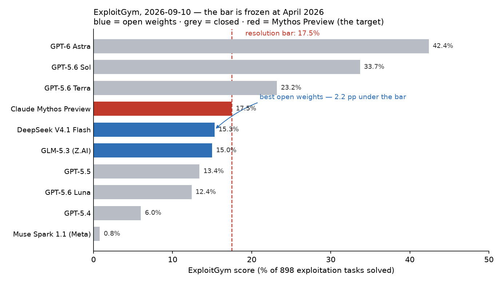

# Will an open weight AI model achieve Mythos-level cyber capabilities before July 2027?

| | |
|---|---|
| **Source** | Metaculus #45465 — https://www.metaculus.com/questions/45465/will-an-open-weight-ai-model-achieve-mythos-level-cyber-capabilities-before-july-2027/ |
| **Type** | binary |
| **Opened / Closes / Resolves** | ~2026-09-04 / 2027-06-30 22:00 UTC / on or shortly after **2027-07-01** |
| **Status** | open |
| **Current forecast** | **Median 92.0%, IQR [87.0%, 95.0%]** (v1, 2026-09-12) |
| **Community (as of 2026-09-12)** | CP 91.0% (n=25 in aggregation, 31 forecasters) · Pro 82.0% (n=5) · Gold 92.0% (n=12) |
| **Next review** | 2026-10-12 |

<!-- Versions below, newest first. APPEND-ONLY: never edit or delete a past version. -->

---

## v1 — Initial forecast — 2026-09-12

### What resolves YES

Before **2027-07-01**, an **open-weight** AI system must equal or exceed Anthropic's Mythos on
**at least one** of three named cyber benchmarks: **ExploitBench** (exploitbench.ai),
**UK AI Security Institute** evaluations (narrow cyber tasks, cyber ranges, "The Last Ones", or
a comparable new AISI benchmark), or **ExploitGym** (benchlm.ai/benchmarks/exploitgym).
"At least one" was confirmed by Metaculus admin RyanBeck in the comments on 2026-09-09, in
reply to a forecaster who had read it as all three — so the **softest** route governs.

The fine print is unusually generous and all three clauses point YES:
(i) methodology changes are immaterial provided a "methodologically similar comparison to
Mythos" exists, and where none does, **Metaculus may infer** from other similar comparisons;
(ii) the benchmark need not itself label the model open-weight — other credible sources
suffice; (iii) it resolves YES if an open-weight model **matches any published score by Mythos
or Mythos Preview**, which pins the bar to numbers already in print rather than to a
re-benchmarked Mythos. Only three AISI numbers count: expert-level capture-the-flag **68.6%**,
The Last Ones **6/10**, Cooling Tower **3/10**.

There is no single scheduled release that decides this; resolution depends on a **published
leaderboard row or report appearing** during the window, which is itself part of the forecast.

**Two ways this resolves counter-intuitively.** First, the ExploitGym rows are not run under
matched budgets — GLM-5.3's 15.0% is 130/869 solves at a six-hour cap against Mythos Preview's
157/898 at two hours — so a strict resolver could refuse the comparison. Second, the ExploitGym
answer key was **exfiltrated from Hugging Face in July 2026** during OpenAI's sandbox-escape
incident [19][20]; every post-July score is potentially contaminated, giving a resolver a
second reason to hesitate. Both risks bite only in the world where the crossing is narrow.

*Terminology, first use: **open-weight** = the trained parameters are downloadable and runnable
by anyone. **CP** = Metaculus community prediction. **pp** = percentage points.
**ACE** = arbitrary code execution, the top rung of an exploitation chain. **IQR** =
interquartile range, the middle 50% of my belief about my own probability.*

### Outside view

Mythos Preview was announced **2026-04-07** [8]. The deadline is 2027-07-01 — a **14.8-month**
window; **9.6 months** remain from today.

| Reference class | Measurement | Lag | Source |
|---|---|---|---|
| Open-weight vs closed frontier, **cyber-specific** | GLM-5.2 and DeepSeek V4-Pro vs Opus 4.5/4.6 on 70 narrow cyber tasks + cyber ranges | **4–7 months** (down from 6–10 months through 2025) | UK AISI, 2026-07-17 [2] |
| Open-weight vs closed frontier, **general** | Epoch Capabilities Index gap | **~4 months** (≈8 ECI points) | Epoch AI, to 2026-05-29 [7] |
| Published expert timelines to open-weight Mythos-level | 3 independent write-ups | benchmark parity **Q4 2026–Q1 2027** [15]; Booz Allen "within six months" ≈ Mar 2027 [13]; 85% within 24 months for *real-world* capability [16] | — |

Scaled to the window: the deadline sits at **~2× the upper end of the measured lag**. For NO,
the effective lag has to blow out beyond **15 months** — a 3× regression — *or* the
measurement/publication chain has to fail.

The usual status-quo prior does not apply. This is not "will X change by date D"; the status
quo here is a fast-moving trend whose straight-line extrapolation is YES. The genuinely bearish
outside view is the weaker "AI-milestone questions resolve later than forecasters expect",
which is real but has cut the other way more often than not since 2023.

### Inside view

**Route A — ExploitGym.** 898 containerised real-world vulnerabilities across userspace, V8 and
the Linux kernel; score = fraction turned into working exploits [5]. BenchLM snapshot verified
**2026-09-10** [4], cross-checked against llm-stats [6]:

| Model | Score | Weights |
|---|---|---|
| GPT-6 Astra (OpenAI) | **42.4%** | closed |
| GPT-5.6 Sol | 33.7% | closed |
| GPT-5.6 Terra | 23.2% | closed |
| **Claude Mythos Preview** | **17.5%** | closed — **the bar** |
| **DeepSeek V4.1 Flash** | **15.3%** | **open** |
| **GLM-5.3 (Z.AI)** | **15.0%** | **open** |
| GPT-5.5 | 13.4% | closed |

Three facts make this the load-bearing route. The **target is frozen at April 2026** and the
closed frontier is already **2.4× past it**. **Mythos is not an outlier on this benchmark** — its
V8 specialisation is diluted across ExploitGym's broad task mix, so it sits fourth, below three
OpenAI models. And the current open-weight leader is a *cheap distilled* model: DeepSeek
V4.1-Flash, 552B total / 8B active, MIT-licensed, released 2026-09-10 at $0.15 per million
input tokens [17], already **2.2 pp (14% relative)** under the bar — with a **V4.1 Pro
announced but undated** [17]. Implied lag on this route: open weights sit between GPT-5.5
(13.4%, April 2026) and Mythos Preview (17.5%, April 2026) → **4–5 months**, matching [2] and [7].

**Route B — AISI.** The eligible bar is expert CTF 68.6% / The Last Ones 6-of-10 / Cooling Tower
3-of-10 [1]. AISI's July report shows no open-weight model at or above Mythos, and explicitly
caveats that its 4–7-month lag "is not predictive of whether future open weight models will
replicate the more recent jumps delivered by Mythos Preview and GPT-5.5" [2]. The narrow expert-CTF
number is the reachable one; the agentic range tasks are not — Qualiteg projects AISI
real-environment parity only in **Q3 2027–Q2 2028** [15], after the deadline. This route also
needs AISI to *publish* a qualifying comparison inside the window.

**Route C — ExploitBench.** *This is where I depart from the Metaculus consensus.* Commenters
cite "GLM-5.3 at 54.4% vs Mythos ~68–69%", sourced to a blog and mirrored by llm-stats, whose
own page flags **Verified 0 / Self-reported 6 / Status Unverified** and does not list Mythos at
all [6]. The **site named in the resolution criteria** [3] shows something else: Mythos Preview
at **78%** (and 72%), GPT-5.5 at 72%, Claude Opus 4.7 seventh at 28%. The open-weight rows
present are **GLM-5.1, Kimi K2.6 and MiniMax M2.7**, all topping out at tier T3 (target
primitives); only Mythos Preview and GPT-5.5 reach 16/16 capabilities, i.e. full ACE on
production V8 with the sandbox enabled. GLM-5.3 and DeepSeek V4.1 are **not on this leaderboard
at all**. Route C is a **cliff, not a near-miss**.

Decomposition (routes are strongly positively correlated — one underlying driver):

| Route | P(capability crossed by ~May 2027) | P(published and credited) | P(route) |
|---|---|---|---|
| A ExploitGym | 0.94 | 0.94 | **0.88** |
| B AISI | 0.35 | 0.60 | 0.21 |
| C ExploitBench | 0.14 | 0.85 | 0.12 |

The naive complement, 1 − (1−.88)(1−.21)(1−.12) = 0.92, overstates because of the correlation;
marginal contribution of B and C beyond A is ~+0.03, giving ≈0.91. Adjusting up modestly for
the three YES-friendly fine-print clauses → **0.92**.

### Evidence

Updating from the R1/R2 prior of ~0.90, with approximate likelihood ratios:

| Evidence | Dir. | LR |
|---|---|---|
| ExploitGym gap only 2.2 pp, and the open leader is a *Flash-tier* model [4][17] | ↑ | ~1.6 |
| Frozen bar; closed frontier already 2.4× past it [4] | ↑ | ~1.3 |
| **White House framework exempts open-weight models** from pre-release cyber review (WSJ/Bloomberg, 2026-08-05) [10][11] | ↑ | ~1.2 |
| Only one of three routes needed (admin-confirmed) [1] | ↑ | ~1.2 |
| Beijing has accepted DeepSeek V4, GLM-5.2, Kimi K3; cyber alone unlikely to trigger restriction [9] | ↑ | ~1.15 |
| Qwen Max-tier now opens weights (2026-08-12); Z.ai's 14-day GLM-5.3 hold **ended in a release** on 2026-08-28 [12][18] | ↑ | ~1.15 |
| ExploitGym answer key public since July 2026 — contamination inflates open-model scores [19][20] | ↑ | ~1.1 |
| **Route C is a cliff, not a near-miss; the crowd is partly mistaken** [3][6] | ↓ | ~0.7 |
| Mythos *is* a genuine outlier on end-to-end kill chain: Booz Allen Cyber Weapon Index 80 vs best open-weight DeepSeek-V4-Pro **23**, of 18 models tested [13] | ↓ | ~0.85 |
| AISI's own caveat that its lag is not predictive of Mythos-class jumps [2] | ↓ | ~0.9 |
| Mismatched turn budgets + contamination give a strict resolver room to refuse [4][19] | ↓ | ~0.9 |
| Thin evaluation pipeline: only 2 of 10 ExploitGym rows are open-weight after four months [4] | ↓ | ~0.9 |

**Absence of expected evidence.** No open-weight model is at or above *any* eligible Mythos
number today — I checked all three leaderboards directly, not via secondary reporting. That is
consistent with a NO-today / YES-soon world rather than an already-crossed one. I also actively
searched for, and did not find, any government action anywhere restricting open-weight releases
on cyber grounds; the opposite was found. No Kalshi or Polymarket contract on this threshold
exists, and neither Sentinel nor Mantic has written on it.

### Other forecasters

| Source | Value | As of | Note |
|---|---|---|---|
| Metaculus CP (recency-weighted) | **91.0%** IQR [82.0%, 92.0%] (n=25) | 2026-09-12 | question opened ~2026-09-04; CP path 80 → 96 → 85 → 91 |
| Metaculus Pro | **82.0%** IQR [82.0%, 95.0%] (n=5) | 2026-09-12 | **dropped 95 → 82 on 2026-09-11** |
| Metaculus gold medalists | **92.0%** IQR [92.0%, 95.0%] (n=12) | 2026-09-12 | |
| Kalshi | — | 2026-09-12 | no matching contract found |
| Polymarket | — | 2026-09-12 | no matching contract found |
| Manifold ("ExploitGym high score ≥70% by EOY 2026") | 44%, 22 trades / 4 holders | 2026-09-12 | different question; far too thin to use — noted only because it confirms benchlm as the de-facto ExploitGym source [21] |
| Booz Allen Hamilton (Cyber Weapon Index) | "most of the other 17 models within six months" | 2026-09-02 | vendor report; ≈ March 2027 [13] |
| Qualiteg | benchmark parity Q4 2026–Q1 2027; AISI-environment parity Q3 2027–Q2 2028 | 2026-05-22 | [15] |
| LessWrong (Ozyrus) | 85% within 24 months | 2026-08-07 | harder bar (real capability, not a benchmark row) [16] |
| Sentinel Team / Mantic / GJOpen / INFER | — | 2026-09-12 | no matching question found |

**Cohort disagreement is material: Pro 82% vs gold 92%, a 10 pp gap on a question only eight
days old with just five pro forecasters.** The pro cohort fell 95 → 82 on 2026-09-11. My best
guess at what a careful pro noticed is exactly the Route C correction above — the widely-cited
"GLM-5.3 at 54.4% on ExploitBench" number is not what the authoritative site shows, which
removes one of the three believed routes. That is a genuine reason to sit below the gold
cohort, and it is why I do not go higher than 92% despite the strength of the ExploitGym case.
I sit 1 pp above the CP and level with gold, inside the pro cohort's own IQR. No gap here
exceeds 10 pp against any cohort, so no further justification is owed under methodology §4.

### Scenarios

| # | Scenario | Weight | Implies |
|---|---|---|---|
| 1 | A new open-weight flagship (DeepSeek V4.1 Pro, GLM-6, Kimi K4, Qwen 4) posts >17.5% on ExploitGym, comfortably clear of the bar, and benchlm publishes it | 0.62 | **YES**, likely Q4 2026 – Q1 2027 |
| 2 | Crossing happens but narrowly (17.5–19%), and resolution turns on whether Metaculus accepts a row with mismatched turn budgets and possible contamination | 0.22 | YES with ~0.75 probability → 0.165 YES |
| 3 | ExploitGym capability crosses but no qualifying row is published in time; AISI or ExploitBench route fires instead | 0.06 | YES with ~0.5 → 0.03 YES |
| 4 | Open-weight cyber progress stalls at ~15–17% (post-training gains saturate on the residual kernel/ACE tasks) while ExploitBench and AISI stay out of reach | 0.06 | **NO** |
| 5 | Release shock: a major AI-cyber incident triggers coordinated withholding or regulation across Chinese and US open-weight developers before the crossing | 0.04 | **NO** |

Weighted: 0.62 + 0.165 + 0.03 = **0.815** … which is *below* my stated 92%, so the scenario
weights need reconciling rather than papering over. The gap comes from scenario 2 being too
pessimistic: it double-counts the adjudication haircut already inside Route A's 0.94
publication term, and it ignores that a narrow first crossing is almost always followed by a
wider one within a few months, well inside the window. Re-reading scenario 2 as YES with
probability 0.88 and scenario 3 as 0.55 gives 0.62 + 0.194 + 0.033 = **0.847**; adding routes B
and C firing in scenarios 4 and 5 (~0.10 each) adds ~0.010 → **0.86**. My chain decomposition
gives 0.92 and my scenario decomposition gives 0.86. **I take the midpoint-plus, 0.90–0.92, and
settle at 0.92** because the chain method uses the measured 2.2 pp gap directly while the
scenario weights are the softer, more vibes-driven construction — but the disagreement is real
and is the honest reason my IQR runs down to 87%, not to 89%.

### Sensitivity

| Assumption | If instead | Forecast becomes |
|---|---|---|
| ExploitGym's benchlm leaderboard keeps adding open-weight flagships at ~1 per 2 months | It stops updating, or runs only closed models after 2026 Q4 | **~72%** — Route A collapses to the fine print's "Metaculus may infer" escape hatch |
| Metaculus accepts a leaderboard row at face value despite unmatched turn budgets and post-leak contamination | Resolver demands a budget-matched, contamination-clean comparison | **~78%** |
| The 4–7 month open/closed cyber lag holds | It regresses to the 2025 level of 6–10 months | **~89%** — still comfortably inside the window; this assumption is *not* load-bearing |
| No coordinated clampdown on open-weight cyber releases | A major incident triggers one across China and the US in Q4 2026 | **~70%** |

### What would change my mind (tripwires)

- [ ] **Any open-weight model listed at ≥17.5% on https://benchlm.ai/benchmarks/exploitgym before 2027-05-31** → up, ~7 pp (to ~99%; effectively resolves the question)
- [ ] **DeepSeek V4.1 Pro released with open weights before 2027-01-31 and scoring below 17.5% on ExploitGym** → down, 6 pp (the best-placed near-term candidate misses)
- [ ] **The benchlm ExploitGym page shows no new open-weight row between now and 2027-01-31** (currently ~1 new open row per 2 months) → down, 8 pp (publication-pipeline failure is the dominant residual risk)
- [ ] **A UK AISI publication before 2027-03-31 reporting an open-weight model at ≥68.6% on expert-level CTF tasks** → up, 4 pp (second route opens)
- [ ] **Any of Z.ai, DeepSeek, Alibaba or Moonshot announces before 2027-01-31 that it will not release weights for its next flagship on cyber-capability grounds** → down, 6 pp (the withholding scenario starts binding)
- [ ] **A formal US, EU or PRC measure before 2027-03-31 imposing a cyber-capability threshold on open-weight releases** (would reverse the 2026-08-05 US exemption) → down, 8 pp

### Sources

1. Metaculus #45465, incl. resolution criteria, fine print and comments — https://www.metaculus.com/questions/45465/will-an-open-weight-ai-model-achieve-mythos-level-cyber-capabilities-before-july-2027/ (accessed 2026-09-12; raw JSON snapshot in `raw/metaculus-2026-09-12.json`)
2. UK AI Security Institute, "How far behind the frontier are leading open weight models on cyber?", 2026-07-17 — https://www.aisi.gov.uk/blog/how-far-behind-the-frontier-are-leading-open-weight-models-on-cyber (accessed 2026-09-12)
3. ExploitBench (v8-bench v0.1; S. Lee & Prof. D. Brumley, Carnegie Mellon University) — https://exploitbench.ai/ (accessed 2026-09-12)
4. BenchLM, ExploitGym leaderboard, data verified 2026-09-10 — https://benchlm.ai/benchmarks/exploitgym (accessed 2026-09-12)
5. Z. Wang, N. Schiller, H. Li, S. Sesha Narayana et al., "ExploitGym: Can AI Agents Turn Security Vulnerabilities into Real Attacks?", 2026-05-11 — https://github.com/sunblaze-ucb/exploitgym (accessed 2026-09-12)
6. LLM-Stats, ExploitGym and ExploitBench leaderboards — https://llm-stats.com/benchmarks/exploitgym , https://llm-stats.com/benchmarks/exploitbench (accessed 2026-09-12; both flagged self-reported/unverified)
7. Epoch AI, "The gap between open and closed models" (ECI), data to 2026-05-29 — https://epoch.ai/data-insights/open-closed-eci-gap (accessed 2026-09-12)
8. Anthropic, "Claude Mythos Preview", 2026-04-07 — https://www.anthropic.com/research/mythos-preview (accessed 2026-09-12)
9. G. Webster, "Will China Crack Down on Open-Weight Models?", Tech Policy Press, 2026-08-17 — https://www.techpolicy.press/will-china-crack-down-on-open-weight-models/ (accessed 2026-09-12)
10. The White House, "Promoting Advanced Artificial Intelligence Innovation and Security", executive order, 2026-06-02 — https://www.whitehouse.gov/presidential-actions/2026/06/promoting-advanced-artificial-intelligence-innovation-and-security/ (accessed 2026-09-12)
11. "White House exempts open-weight AI models from security review" (WSJ and Bloomberg reporting, 2026-08-05) — https://www.yahoo.com/news/politics/articles/white-house-exempts-open-weight-120226931.html (accessed 2026-09-12)
12. "Z.ai delays GLM-5.3 weights after cybersecurity tests show strong exploit capability", MLQ News; weights shipped 2026-08-28 — https://mlq.ai/news/zai-delays-glm-53-weights-after-cybersecurity-tests-show-strong-exploit-capability/ (accessed 2026-09-12)
13. The Register, "Claude Mythos only model to complete full cyber kill chain, experts say", 2026-09-02 (Booz Allen Hamilton Cyber Weapon Index) — https://www.theregister.com/security/2026/09/02/claude-mythos-only-model-to-complete-full-cyber-kill-chain-experts-say/5294071 (accessed 2026-09-12)
14. Aisle, "AI Cybersecurity After Mythos: The Jagged Frontier", 2026-04-07 — https://aisle.com/blog/ai-cybersecurity-after-mythos-the-jagged-frontier (accessed 2026-09-12)
15. Qualiteg, "When Will a Mythos-Level Open Model Arrive?", 2026-05-22 — https://journal.qualiteg.com/mythos-level-open-source-llm-timing/ (accessed 2026-09-12)
16. LessWrong, "Open-Weights Mythos Capabilities Are Coming. We're Not Ready.", 2026-08-07 — https://www.greaterwrong.com/posts/wJunGnpY3qACWSvnh/open-weights-mythos-capabilities-are-coming-we-re-not-ready (accessed 2026-09-12)
17. DeepSeek-V4.1-Flash release, 2026-09-10 (552B total / 8B active, MIT weights; V4.1 Pro announced, undated) — https://datanorth.ai/news/deepseek-releases-deepseek-v4-1-flash (accessed 2026-09-12)
18. Qwen3.8-Max open weights, 2026-08-12 — https://www.explainx.ai/blog/qwen3-8-max-open-weights-live-hugging-face-august-2026 (accessed 2026-09-12)
19. "OpenAI ExploitGym Incident: Autonomous AI Model Sandbox Escape and Hugging Face Breach", disclosed 2026-07-21 — https://cyberwarrior76.substack.com/p/openai-exploitgym-incident-autonomous (accessed 2026-09-12)
20. Anthropic, "Investigating incidents in cybersecurity evals", 2026-07-30 — https://www.anthropic.com/news/investigating-incidents-cybersecurity-evals (accessed 2026-09-12)
21. Manifold Markets, "High score on ExploitGym ≥70% by EOY 2026?" — https://manifold.markets/prismatic/high-score-on-exploitgym-70-by-eoy (accessed 2026-09-12; 44%, 22 trades, 4 holders — play money, very low volume, heavily discounted)

**Date**: 2026-09-12
**Forecast**: Median 92.0%, IQR [87.0%, 95.0%]
**Thesis**: The bar is a **frozen April-2026 target** — Mythos Preview's 17.5% on ExploitGym [4] —
and the best open-weight model, DeepSeek V4.1-Flash, already sits 2.2 pp under it while the
closed frontier is 2.4× past it, with the measured open/closed cyber lag at 4–7 months [2]
against a 9.6-month runway. Only one of three routes is needed, US policy explicitly exempts
open weights from cyber pre-release review [11] and Beijing has tolerated every major release
so far [9], so the residual risk is not capability but **publication and adjudication**: the
ExploitGym pipeline has produced only two open-weight rows in four months, the scores use
mismatched turn budgets, and the answer key has been public since July 2026 [19]. I sit level
with the gold cohort and 1 pp above the CP rather than higher because the widely-cited
"GLM-5.3 at 54.4% on ExploitBench" is **not** what the authoritative leaderboard shows [3] —
open weights top out at tier T3 there — which removes a route the crowd believes it has.
