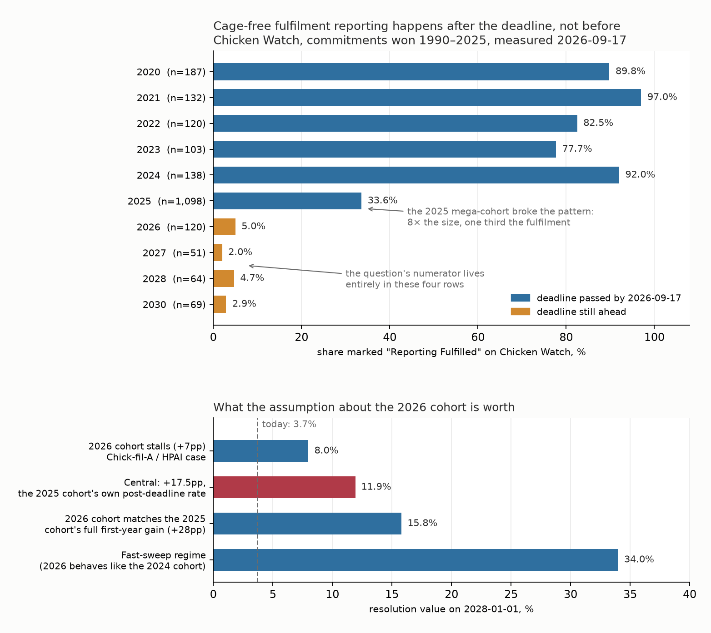

# What percentage of companies globally will fulfill their pre-2026 cage-free commitments in 2026 and 2027?

| | |
|---|---|
| **Source** | Metaculus #43277 — https://www.metaculus.com/questions/43277/ |
| **Type** | discrete (percent, range 3.56–30.19, closed below, **open above**) |
| **Opened / Closes / Resolves** | not yet open (CP reveal 2026-09-20) / 2027-06-30 / 2028-01-01 |
| **Status** | open |
| **Current forecast** | **Median 11.9%, IQR [9.6%, 15.3%]** (v1, 2026-09-17) |
| **Community (as of 2026-09-17)** | **none — question unopened**; 2 forecasters, 0 comments, all three cohorts empty |
| **Next review** | 2026-11-15 |

<!-- Versions below, newest first. APPEND-ONLY: never edit or delete a past version. -->

---

## v1 — Initial forecast — 2026-09-17

### What resolves YES

This is a **discrete numeric** question, not a binary. On **2028-01-01** Metaculus reads the
[Chicken Watch progress tracker](https://chickenwatch.org/progress-tracker) with three
filters — Issue = **Cage-Free**, Victory Date **1990–2025**, Timeline **2026 and after** —
and that row count is the **denominator**. It then additionally selects status **"Reporting
Fulfilled"**; that count is the **numerator**. The question resolves to numerator ÷
denominator, in percent.

Read literally, this is *not* "how many companies keep their promises". It is: **of the
commitments won before 2026 whose own deadline falls in 2026 or later, what share has Chicken
Watch marked as fully fulfilled by New Year's Day 2028?** Three consequences that are easy to
miss:

- The denominator is dominated by commitments **whose deadline has not yet passed** on the
  read date. Only the 2026 cohort (and, on the day itself, the 2027 cohort) is past due. The
  2028, 2030, 2032 and 2035 cohorts are all in the denominator and have almost no chance of
  being marked fulfilled.
- "Reporting Fulfilled" is a **reporting** status, not a welfare outcome. A company that is
  genuinely 100% cage-free but publishes nothing counts as a miss; Chicken Watch's own
  taxonomy is Fulfilled / Reporting (partial) / Not Reporting [6].
- **Both** terms move. The numerator only grows, but the denominator drifts as Chicken Watch
  back-fills commitments — it went 323 → 326 in the weeks between the question being written
  and today.

Edge case, explicit in the fine print: if Chicken Watch **ceases reporting or materially
changes its criteria**, the question is **annulled**, not resolved. Chicken Watch is run by
The Humane League / the Open Wing Alliance, the same organisation whose campaign data it
carries, so this is a live rather than theoretical risk.

**I verified my reading of the filter against Metaculus's own numbers.** The question's
`nominal_min` is 3.71517028, which is exactly **12/323**, and its `nominal_max` is
30.030959735, exactly **97/323**. Running the filter myself gives **12/326 = 3.681%** today.
Same numerator, denominator three rows larger. The range is therefore just "no change" to "97
fulfilled", and my reconstruction of the resolver's query is confirmed.

### Outside view

**Reference class: previous deadline-year cohorts in the same tracker.** Chicken Watch's data
is a public Google Sheet behind an AwesomeTable view, so the whole population is available
rather than sampled (see `research.md` for the endpoint; snapshot in `raw/`). Every cohort,
measured 2026-09-17:

| Deadline | n | Fulfilled | Reporting (partial) | Not Reporting |
|---|---|---|---|---|
| 2020 | 187 | 89.8% | | |
| 2021 | 132 | 97.0% | | |
| 2022 | 120 | 82.5% | 5.8% | |
| 2023 | 103 | 77.7% | 4.9% | 17.5% |
| 2024 | 138 | 92.0% | 4.3% | 3.6% |
| **2025** | **1,098** | **33.6%** | 21.6% | 44.8% |
| **2026** | **120** | **5.0%** | 40.8% | 54.2% |
| **2027** | **51** | **2.0%** | 41.2% | 56.9% |
| **2028** | **64** | **4.7%** | 31.2% | 64.1% |
| **2030** | **69** | **2.9%** | 52.2% | 44.9% |

Two base rates fall out, and they disagree — so I keep both:

- **Mature-cohort base rate: 78–97%.** Every cohort of 103–187 commitments whose deadline has
  passed sits in this band. If the 2026 cohort (n=120) joins it, the question resolves above
  30%.
- **Most-recent-cohort base rate: 33.6% at deadline+8.5 months.** The 2025 cohort is 8× larger
  than any predecessor and sits at a third of their level.

The time-scaling that matters is the **per-cohort post-deadline velocity**, which I backed out
rather than assumed. Chicken Watch's published aggregates were 64% for deadlines ≤2025 and 93%
for ≤2024 in Feb 2026 [4]; my direct computation today gives 67.5% and 94.0%. Subtracting the
older pool from the newer gives the 2025-only cohort at **≈26.8% at deadline+1.5 months**,
against **33.6%** today at deadline+8.5 months — i.e. **≈ +1pp per month, decelerating, or
about +12 to +13pp over a cohort's first 12 post-deadline months.** That velocity, applied to
the 2026 cohort's 5.0% starting stock, is the backbone of the forecast.

The other outside-view fact, and it is the one most forecasters will skip: **there is no
pre-deadline ramp at all.** Cohorts 3, 15, 27 and 51 months away from their deadline all read
2–5%. Nothing happens until the deadline passes.

### Inside view

The numerator is a sum over four cohorts, each at a different point on the same curve. On
2028-01-01:

| Cohort | n today | Fulfilled today | Position at read date | p(fulfilled) I assume |
|---|---|---|---|---|
| Timeline 2026 | 120 | 6 (5.0%) | deadline **+12 months**, one OWA sweep done | **~22.5%** |
| Timeline 2027 | 51 | 1 (2.0%) | deadline **+0 months** | ~6.5% |
| Timeline 2028 | 64 | 3 (4.7%) | deadline −12 months | ~6.7% |
| Timeline 2029+ | 91 | 2 (2.2%) | deadline −24 to −96 months | ~4.0% |

Central arithmetic: 120(0.225) + 51(0.065) + 64(0.067) + 91(0.040) ≈ **40 fulfilled**, over a
denominator of ≈ 338 → **11.8%**. Essentially all of the movement from today's 3.7% comes from
one cohort.

**Why +17.5pp for the 2026 cohort.** Two estimators bracket it. (a) The measured 2025-cohort
velocity gives +12 to +13pp over twelve post-deadline months, plus ~1–2pp in the three months
before the deadline. (b) A throughput argument gives more: the tracker added ~105 fulfilment
marks in 7.5 months (~14/month), the 2026 cohort is the marquee deadline year for the Oct-2027
report, and 41% of it is *already* publishing partial progress — a live feeder pool, since the
2025 cohort's own Reporting share drained into Fulfilled as its deadline passed. I sit above
(a) because of a timing asymmetry: **OWA's annual report only ever covers "deadlines of the
prior year or earlier"** [6][7], so the 2025-cohort velocity I measured was earned *without* a
dedicated sweep, whereas the 2026 cohort gets one in ~Oct 2027, two to three months before the
read.

**Who the actors are.** Chicken Watch is not a neutral registry; it is the Open Wing
Alliance's campaign instrument. OWA's incentive is to mark fulfilment promptly when a company
complies (it is the reward in the campaign loop — see it pausing the Best Western campaign to
acknowledge progress) and to leave laggards visible. That biases the tracker toward *recording*
genuine fulfilment quickly, but it is capacity-bound: 1,098 unswept 2025 commitments are
queued ahead of the 2026 cohort in the same report cycle.

### Evidence

Starting from the outside view of ~+13pp for the 2026 cohort, the updates:

| Evidence | Direction | LR / effect |
|---|---|---|
| OWA report scope is always "prior year or earlier"; the 2026 cohort gets a dedicated sweep inside the window, the measured 2025 velocity did not | ↑ | ~1.4× on the gain → +13pp to +17.5pp |
| 2026 cohort already 40.8% "Reporting" — larger feeder pool than the 2025 cohort had | ↑ | modest, folded into the above |
| CIWF EggTrack 2026, an **independent** tracker: only 198/415 (48%) of commitments due by 2025 fulfilled, on a sample biased toward large reporting companies [10][11] | ↓ | ~0.7× — corroborates that the 2025 wave stalled, and it is not a Chicken Watch artefact |
| EggTrack counts active retreat: 61 deadlines pushed back, 29 removed, **50 pledges withdrawn** out of 852 [10][11] | ↓ | ~0.85× |
| Chick-fil-A (2016 pledge, in the 2026 cohort) says on 2026-04-08 that 2026 is "uncertain", citing bird flu [12][13] | ↓ | ~0.9×, and it is a named member of the exact cohort |
| Unilever withdrew its global cage-free pledge at 68% worldwide, citing emerging-market supply [18][19] | ↓ | ~0.9× on the tail; signals that retreat is now survivable reputationally |
| US state cage-free law rolling back: Nevada suspension, Arizona slipping 2025→2034, Michigan repeal bills [14][15][16] | ↓ | ~0.9× on the North-American third of the cohort |
| Peer-reviewed (Animal Welfare 35:e39, 2026): China has 106 commitments, 16 fulfilled; 20–25% cost premium, traceability limits, no state support [23] | ↓ | confirms the emerging-market floor is structural, not a reporting lag |
| US cage-free supply still expanding — 147.3M cage-free layers May 2026, ~44% of the flock Apr 2025 [20]; EggTrack global transition 85%, up from 75% in 2023 | ↑ | supply is not the binding constraint in the West; ~1.1× |

**Evidence I expected to find and did not**, which matters: no OWA or Chicken Watch
publication anywhere gives a fulfilment figure for a *current* deadline year. If a big
2026-cohort surge were already visible to the organisation running the campaign, its January
2026 naming-and-shaming release [8] was the natural place to trail it; instead that release
flagged GoTo Foods, Panda Express, Darden, JDE Peets and Papa John's as *behind* on later
deadlines. Absence of expected good news is mild evidence against the fast-sweep scenario.

**A hypothesis I formed and then killed** (recorded because it would otherwise look like I
never considered it): I first assumed the 2026 cohort was compositionally weaker than the 2025
cohort — more North America, less Europe. It is not. The 2026 cohort is 55.0%
Europe+NA+Oceania against the 2025 cohort's 58.5%, and reweighting the 2025 cohort's
fulfilment rate onto the 2026 cohort's continent mix moves it only 33.6% → 31.2% (industry mix:
→ 33.1%). Nor does Western share explain the cohort ranking — the 2024 cohort is the least
Western of the mature cohorts and the most fulfilled. **Composition is not the driver; time
since deadline and cohort size are.**

### Other forecasters

| Source | Value | As of | Note |
|---|---|---|---|
| Metaculus CP (recency-weighted) | **none** | 2026-09-17 | question `upcoming`; CP reveal 2026-09-20 |
| Metaculus Pro | **none** | 2026-09-17 | 0 history points |
| Metaculus gold medalists | **none** | 2026-09-17 | 0 history points |
| Metaculus forecaster count | 2 | 2026-09-17 | 0 comments |
| Kalshi / Polymarket / Manifold | no market found | 2026-09-17 | no corporate-cage-free-fulfilment contract exists |
| Good Judgment Open / INFER | no matching question | 2026-09-17 | |
| Sentinel Team / Mantic | not covered | 2026-09-17 | neither covers corporate animal-welfare accountability |
| CIWF EggTrack 2026 (not a forecast, the nearest independent measurement) | 48% of ≤2025 deadlines fulfilled | 2026-07-09 | different denominator; corroborates the stall |

**There is no crowd anchor of any kind.** Every cohort is empty and no market exists, so the
usual discipline — "if you differ from Pro + gold by >10pp, go find the fact you missed" —
cannot be applied. That is precisely why I reconstructed the resolution source from raw data
instead of reasoning qualitatively, and it is the main reason to re-check this question soon
after 2026-09-20: the first CP print is the only external check available, and if it lands far
from 11.9% I should treat that as information rather than noise.

### Scenarios

| # | Scenario | Weight | Implies |
|---|---|---|---|
| 1 | **Stall.** HPAI, US policy retreat and the Chick-fil-A precedent hold the 2026 cohort near +7pp; the 2025 backlog eats OWA's capacity. | 0.22 | ~7–9% |
| 2 | **Central — the 2025 cohort's own velocity, plus the sweep.** 2026 cohort reaches ~20–25%; smaller cohorts barely move. | 0.44 | ~10–14% |
| 3 | **Strong first year.** The 40.8% partial-reporting pool converts hard; 2026 cohort matches the 2025 cohort's full first-year gain (+28pp) and the tail cohorts drift up. | 0.22 | ~15–18% |
| 4 | **Fast sweep.** The 2026 cohort behaves like the small 2020–24 cohorts (60–90%) because size, not era, was what broke 2025. | 0.12 | ~28–38% |

Weights sum to 1.00. Scenarios 1–3 are a continuum handled as a lognormal in the model;
scenario 4 is a genuinely distinct regime and is modelled as an explicit mixture component,
which is what puts the fat right tail (p90 21.6%, p95 28.3%) on the distribution.

Monte Carlo (`scripts/model.py`, 400k draws): p05 7.1% · p10 8.0% · **p25 9.6% · p50 11.9% ·
p75 15.3%** · p90 21.6% · p95 28.3%. P(resolves above the stated range top of 30.0%) ≈ 4%.
P(no net change, ≤3.7%) ≈ 0 — 133 commitments in the pool are already publishing partial
progress, so some conversion is near-certain.

I have widened nothing by hand; the reported IQR is the model's. The honest caveat is that the
*structure* (per-cohort gains with a shared sweep factor) carries more uncertainty than the
parameters within it, and the 12% weight on scenario 4 is the single most arguable number here.

### Sensitivity

| Assumption | If instead | Forecast becomes |
|---|---|---|
| 2026 cohort gains +17.5pp over the window | +7pp (Chick-fil-A / HPAI stall) | median **8.0%** |
| 2026 cohort gains +17.5pp | +28pp (matches the 2025 cohort's full first-year gain) | median **15.8%** |
| Fast-sweep regime carries 12% weight | 0% weight (pure continuum) | median ~11.6%, **p95 falls 28.3% → ~17%** |
| Denominator drifts 326 → ~338 | Chicken Watch re-dates ~45 missed 2025 deadlines into 2027–28 | median falls ~1.3pp |
| Chicken Watch keeps reporting | ceases or changes criteria | **annulled** — not a low resolution |

Calibration checks run: the forecast scales sensibly with the window (a 12-month-shorter window
would strip the 2026 cohort's post-deadline year and collapse it toward 5–6%); the conjunction
is respected (the median is below the least likely link only if the 2026 cohort surge is
treated as required — it is not, the tail cohorts contribute ~11 fulfilments on their own); and
I would take either side of a bet at 11.9%.

### What would change my mind (tripwires)

- [ ] **OWA's 2026 fulfilment report (expected ~Oct 2026) lands and the Chicken Watch 2025-only
  cohort jumps above 55%** (from 33.6%) by 2027-01-31 → the fast-sweep regime is real,
  **+8pp**. This is the highest-value tripwire in the set: it tests the load-bearing question
  — whether a dedicated sweep resets a cohort to the mature 78–97% band — one full year before
  it applies to the 2026 cohort. Re-run `scripts/model.py` after re-pulling the sheet.
- [ ] **The same 2025-only cohort is still below 45% on 2027-01-31** → the mega-cohort stall is
  structural, **−2.5pp**.
- [ ] **Chick-fil-A publicly confirms it has missed, or formally extends, its 2026 deadline
  before 2027-06-30** → a named cohort member converting to a public miss, and a licence for
  peers to follow, **−1.5pp**.
- [ ] **The 2026-deadline cohort on Chicken Watch reaches ≥15% "Reporting Fulfilled" by
  2027-06-30** (from 5.0% today) → the post-deadline conversion is running early and hot,
  **+4pp**.
- [ ] **Chicken Watch's denominator (Cage-Free, Victory 1990–2025, Timeline ≥2026) exceeds 370
  rows at any check before 2027-12-31** → systematic re-dating of missed deadlines is diluting
  the ratio, **−2pp**.
- [ ] **Chicken Watch announces a methodology change, a tracker migration, or stops updating,
  before 2028-01-01** → annulment risk, not a value change: `direction: either`, re-analyse.

### Sources

1. Metaculus, "What percentage of companies globally will fulfill their pre-2026 cage-free commitments in 2026 and 2027?" (#43277) — https://www.metaculus.com/questions/43277/ (accessed 2026-09-17)
2. Chicken Watch, Progress Tracker — https://chickenwatch.org/progress-tracker (accessed 2026-09-17; the backing Google Sheet — `docs.google.com/spreadsheets/d/1GcOfjaHy0xTPluZKUkxyNH8u0_qE7T6tdUpeUg7GEyI`, sheet `Cleaned` — snapshotted to `raw/chickenwatch-cleaned-2026-09-17.csv.gz`)
3. Chicken Watch, Cage-Free — https://chickenwatch.org/cage-free (accessed 2026-09-17)
4. Faunalytics, "Tactics In Practice: The Data Behind Corporate Outreach" (2026-03-25) — https://faunalytics.org/tactics-in-practice-the-data-behind-corporate-outreach/ (accessed 2026-09-17)
5. The Humane League, "Global Cage-Free Egg Fulfillment Rate Jumps to 92%" — https://thehumaneleague.org/article/2025-cage-free-fulfillment-report (accessed 2026-09-17)
6. Open Wing Alliance, "2025 Cage-Free Egg Fulfillment Report" (July 2025, PDF) — https://downloads.ctfassets.net/ww1ie0z745y7/3SwZZ35xGnAFJzbLNER7DW/537b8c84d7ed2cb6ec55182a787dda8a/25-owa-cage-free-egg-fulfillment-report-final-v2.pdf (accessed 2026-09-17)
7. Open Wing Alliance, "Fair and Fowl — 2025 Cage-Free Egg Report" (October 2025, PDF) — https://assets.ctfassets.net/ww1ie0z745y7/03X1OUgLGgDhTv0302DmZ/577c76365e4498538238a1f8dc3af945/25-owa-global-fair-and-fowl-report-final-r1-logo-updates-v2.pdf (accessed 2026-09-17)
8. Open Wing Alliance, "The Open Wing Alliance Names Global Restaurant Giants For Missing Cage-Free Deadlines" (2026-01-13) — https://www.einpresswire.com/article/882544308/the-open-wing-alliance-names-global-restaurant-giants-for-missing-cage-free-deadlines (accessed 2026-09-17)
9. Sustainable Food Business, "Majority of companies meet 2025 cage-free egg commitments, report finds" (2025-10-16) — https://sustainablefoodbusiness.com/open-wing-alliance-cage-free-egg-2025-report/ (accessed 2026-09-17)
10. Poultry News, "CIWF reports on corporate cage-free commitments" (EggTrack 2026, 2026-07-09) — https://www.poultrynews.co.uk/news/ciwf-reports-on-corporate-cage-free-commitments.html (accessed 2026-09-17)
11. Poultry Network, "EggTrack 2026: UK commitments it monitors average 97% cage-free transition" — https://poultry.network/eggtrack-2026-uk-commitments-it-monitors-average-97-cage-free-transition/ (accessed 2026-09-17)
12. Fox News, "Chick-fil-A says it may miss its 2026 cage-free egg promise, citing bird flu" (2026-04-08) — https://www.foxnews.com/food-drink/chick-fil-a-retreats-decade-old-egg-pledge-bird-flu-hits-supply (accessed 2026-09-17)
13. Feedstuffs, "Chick-fil-A may miss cage-free egg deadline" — https://www.feedstuffs.com/agribusiness-news/chick-fil-a-may-miss-cage-free-egg-deadline (accessed 2026-09-17)
14. Feedstuffs, "Some states back off cage-free mandates during bird flu crisis" — https://www.feedstuffs.com/agribusiness-news/some-states-back-off-cage-free-mandates-during-bird-flu-crisis (accessed 2026-09-17)
15. Animal Welfare Institute, "Cage-Free Laws in the Crosshairs" (AWI Quarterly, Spring 2025) — https://awionline.org/awi-quarterly/spring-2025/cage-free-laws-crosshairs (accessed 2026-09-17)
16. Nevada Department of Agriculture, "Nevada shifts back to cage-free regulations as egg prices drop" — https://agri.nv.gov/News/2025/Nevada_shifts_back_to_cage-free_regulations_as_egg_prices_drop (accessed 2026-09-17)
17. Animal Agriculture Alliance, "States rolling back legislation on cage-free eggs" — https://animalagalliance.org/egg-prices-cage-free-mandates-legislation/ (accessed 2026-09-17)
18. Poultry News, "Unilever steps away from global cage-free commitments citing supply chain challenges" — https://www.poultrynews.co.uk/business-politics/unilever-steps-away-from-global-cage-free-commitments-citing-supply-chain-challenges.html (accessed 2026-09-17)
19. Open Wing Alliance, "The Open Wing Alliance Calls on Unilever to Reinstate Its Global Cage-Free Egg Commitment" — https://www.prnewswire.com/news-releases/the-open-wing-alliance-calls-on-unilever-to-reinstate-its-global-cage-free-egg-commitment-302677165.html (accessed 2026-09-17)
20. USDA Economic Research Service, "Growing share of egg-laying hens are cage-free" — https://www.ers.usda.gov/data-products/charts-of-note/chart-detail?chartId=107564 (accessed 2026-09-17)
21. The Humane League, "The 2026 Eggsposé" — https://thehumaneleague.org/2026-cage-free-eggspose (accessed 2026-09-17)
22. Rethink Priorities, "Will companies meet their animal welfare commitments?" (2019) — https://rethinkpriorities.org/research-area/will-companies-meet-their-animal-welfare-commitments/ (accessed 2026-09-17)
23. *Animal Welfare* 35:e39 (2026), "Implementing cage-free egg commitments in China: an explorative qualitative interview study" — https://pmc.ncbi.nlm.nih.gov/articles/PMC13372731/ (accessed 2026-09-17)

**Date**: 2026-09-17
**Forecast**: Median 11.9%, IQR [9.6%, 15.3%]
**Thesis**: Chicken Watch's tracker is a public Google Sheet, so the resolution metric can be computed exactly — it is 12/326 = 3.7% today, and Metaculus's own range bounds decode to 12/323 and 97/323, confirming the filter. Almost all movement must come from the 120-strong 2026-deadline cohort, which sits at 5.0% and whose predecessor cohort gained only ~1pp/month after its own deadline (33.6% at +8.5 months, corroborated independently by EggTrack's 48%), so I centre on ~40 of ~338 fulfilled; the fat right tail is the 12% chance that the small 2026 cohort snaps to the 78–97% band the 2020–24 cohorts occupy once the Open Wing Alliance's October 2027 report sweeps it.
