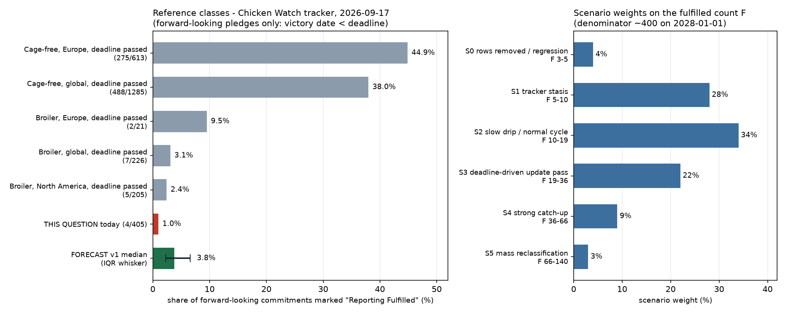

# What percentage of companies globally will fulfill their pre-2026 broiler commitments in 2026 and 2027?

| | |
|---|---|
| **Source** | Metaculus #43278 — https://www.metaculus.com/questions/43278/what-percentage-of-companies-globally-will-fulfill-their-pre-2026-broiler-commitments-in-2026-and-2027 |
| **Type** | discrete (percentage, 57 buckets, closed below at 0.86%, open above 14.90%) |
| **Opened / Closes / Resolves** | — / 2026-11-30 / 2028-01-01 |
| **Status** | open |
| **Current forecast** | **Median 3.8%, IQR [2.3%, 6.6%]** (v1, 2026-09-17) |
| **Community (as of 2026-09-17)** | no CP — question `upcoming`, 1 forecaster, no Pro/gold, 0 comments |
| **Next review** | 2026-11-20 |

<!-- Versions below, newest first. APPEND-ONLY: never edit or delete a past version. -->

---

## v1 — Initial forecast — 2026-09-17

### What resolves YES

This resolves to a **percentage read off the [Chicken Watch progress tracker](https://chickenwatch.org/progress-tracker)
by Metaculus on 2028-01-01**. The fine print pins the filter exactly: Issue = `Broiler`,
Victory Date `1990–2025`, Timeline `2026 and after` gives the denominator; adding status
`Reporting Fulfilled` gives the numerator. Chicken Watch is a live Google Sheet maintained ad
hoc by The Humane League / Open Wing Alliance — **there is no scheduled data release and no
audit**, so this question is as much about one NGO's data-maintenance behaviour as about
corporate behaviour. If Chicken Watch stops reporting or changes its criteria incomparably,
the question is **annulled**.

Three edge cases matter. (i) The filter admits **only forward-looking pledges** — a Victory
Date ≤ 2025 with a deadline ≥ 2026 forces Victory Date < Timeline — so the 15 broiler rows
Chicken Watch logged as *already met on the day they were recorded* (14/15 fulfilled) are
excluded by construction. Any headline "broiler fulfilment rate" that includes them is not
this question. (ii) A **deadline extension does not shrink the denominator** (2026 → 2030 is
still "2026 and after"); only row deletion does. (iii) A company can enter the numerator by
**dropping chicken entirely** — Bastard Burgers is marked fulfilled with the note "Chicken is
no longer served."

**I reproduced the filter directly.** The tracker is an Awesome Table view over a public
Google Sheet; `raw/chickenwatch_pull.py` captures the `gviz` payload off the wire and
snapshots the 650-row broiler slice, and `raw/base_rates.py` re-applies the filter offline
from that snapshot. Today, 2026-09-17: **4 / 405 = 0.988%**.

The question's own scaling confirms this reading is exact. Metaculus set
`nominal_min = 0.98522167…` = **4/406**, `nominal_max = 14.77832512…` = **60/406**, range
bounds at 3.5/406 and 60.5/406, and `inbound_outcome_count = 57` = 60 − 4 + 1. So the buckets
are integer fulfilled counts **4, 5, …, 60**, open above. The question is: *how many of ~400
commitments will read "Reporting Fulfilled" fifteen months from now?* It was 4 at question
creation (2026-06-20, denominator 406) and is 4 today (denominator 405).

### Outside view

Rates below are Chicken Watch's own `Reporting Fulfilled` share, restricted to forward-looking
pledges whose deadline has already passed — the only class matching this question's
construction (pull: 2026-09-17).

| Reference class | n | Fulfilled | Rate |
|---|---|---|---|
| **Broiler, global, deadline passed** | 226 | 7 | **3.10%** |
| Broiler, North America, deadline passed | 205 | 5 | 2.44% |
| Broiler, Europe, deadline passed | 21 | 2 | 9.52% |
| Broiler, US BCC 2024 cohort (21 months post-deadline) | 193 | 5 | 2.59% |
| Cage-free, global, deadline passed | 1285 | 488 | 37.98% |
| Cage-free, Europe, deadline passed | 613 | 275 | 44.86% |
| *(excluded by the filter)* broiler pledges logged as already met | 15 | 14 | 93.3% |

Two things fall out. First, **the cage-free/broiler gap is ~12×**. Cage-free egg switching is a
procurement change over a supply chain that exists; Better/European Chicken Commitment (BCC/ECC)
compliance requires a slower-growing breed the European industry says is not available at
scale. Nothing in this dataset supports importing cage-free fulfilment rates. Second, **a
passing deadline does not by itself produce a fulfilment wave here**: the US BCC cohort whose
deadline was 31 Dec 2024 stands at 5/193 twenty-one months later, with 27 still merely
"Reporting".

Time-scaling matters and cuts downward. The dominant sub-cohort here (353 of 405 rows) is due
31 Dec 2026 and is read **twelve months** after its deadline — shorter than the lags at which
the 3.1% base rate was measured. Straight extrapolation of the US cohort's logging rate
(≈0.14 rows/month on 195 rows) onto 405 rows over ~15 months gives ≈ 4 + 3.5 ≈ **8 rows ≈ 1.9%**.

The upward adjustment is regional. 360 of 405 rows are the Europe/UK (ECC) policy version, and
Europe's forward-looking past-deadline rate is 9.5% — but that rests on **two events out of
21**, so I shrink it hard toward the global 3.1% rather than treating it as a second anchor.
Prior quiet time is also informative: mean lead time in this set is 5.57 years, and almost
nothing has happened.

**Outside-view landing zone: ~2–4.5%.**

### Inside view

Composition of the 405-row denominator: 353 due 2026, 5 due 2027, 47 due 2028+ (which cannot
realistically contribute); 360 ECC / 34 US-Canada v2 / 11 other; status 4 fulfilled, 193
Reporting, 208 Not Reporting; France 78, UK 65, Sweden 54, Germany 52, US 29.

Each new row in the numerator needs a three-step conjunction:

`P(reaches 100% of its pledged scope) × P(publicly reports it) × P(Chicken Watch logs it)`

**Step 1 is hard and measured.** ChickenTrack 2025 (Compassion in World Farming, published
March 2026, covering 2025) assessed the 107 most influential European signatories: 76 reported,
and **3 were at 100% overall** — Waitrose, REMA 1000 Norge, Norsk Kylling. On breed, 36 were
below 10% transition and 17 at exactly 0%. The year before (93 companies) it was 2 at 100%.
So among the majors the real full-compliance count is moving 2 → 3 per year, not 2 → 30. The
peer-reviewed stakeholder work puts the cost of the breed switch at +25–32%/kg across EU
member states and ~+37.5%/kg in the UK and concludes the 2026 deadline is "highly unlikely";
EU "premium concept" chicken was ~8% of the market in 2019 heading for 15–20% by 2025.

**Step 3 is the step almost everyone will miss, and it is where I differ from a naive read.**
Norsk Kylling has been 100% ECC-compliant since **August 2022** — the most documented BCC
achievement in the world — and Chicken Watch still lists it as `Not Reporting`. So do REMA 1000
and Waitrose, both certified at 100% by ChickenTrack 2025. Marks & Spencer, at 100% on fresh
chicken, sits at `Reporting`. The likeliest explanation is that Chicken Watch scores against
the **full pledged scope** (Waitrose's row covers "all private label fresh and frozen chicken
and chicken meat ingredients", not just fresh) and only flips a row when the company itself
publishes ECC-format per-criterion reporting at 100%. Either way — strict scope or plain
logging lag — the resolution source **structurally undercounts real fulfilment**, and it will
keep doing so through 2027.

**Step 2 is the one genuine upward signal.** Disclosure in this cohort is far better than in
any past one: 193/405 (48%) are already `Reporting`, against 27/205 (13%) in the US 2024
cohort. Among rows that ever engaged, the US cohort converted 5/36 ≈ 14% to fulfilled; applying
that conversion to the ~191 currently engaged here gives ≈ 27 rows ≈ 6.6% as an optimistic
bottom-up ceiling. OWA's newly accepted certification equivalences (Beter Leven 1★ in the
Netherlands, Deutscher Tierschutzbund in Germany, Red Tractor Enhanced Welfare in the UK) give
a cheap documentable route to a compliance claim that the US 2024 cohort never had, and
France (24% slower-growing supply) and Germany hold 130 of the rows, 89 of them already
reporting.

Bottom-up range: **~12–25 rows ≈ 3–6%**, conditional on a Chicken Watch update pass happening
at all. That brackets the outside view rather than contradicting it.

### Evidence

Ordered by how much each moved me. Likelihood ratios are on the odds of "high outcome
(≳7%)" versus "low outcome (≲3%)".

1. **OWA retired the blanket 2026 deadline.** The *ECC Progress Report 2025* states: "Previously,
   the ECC had a blanket deadline of 2026. With the deadline approaching quickly, we made the
   decision to take a more flexible approach — working with companies on a case-by-case basis
   to set ambitious and achievable deadlines for ECC implementation." The campaigning
   organisation that owns the tracker has removed the forcing event that would have produced a
   mass fulfilment-or-failure reckoning in 2027. Companies get renegotiated roadmaps and report
   partial progress instead. **LR ≈ 0.4 against the high outcome.**
2. **The tracker demonstrably lags reality by years** (Norsk Kylling since 2022; REMA 1000;
   Waitrose since Sept 2025 — all `Not Reporting`). **LR ≈ 0.45.**
3. **The US BCC 2024 deadline produced almost nothing** (5/193 at 21 months). Direct evidence on
   how this exact dataset behaves when a broiler deadline passes. **LR ≈ 0.5.**
4. **ChickenTrack's 100%-compliant count is 2 → 3 per year** among the majors. **LR ≈ 0.6.**
5. **48% of the cohort is already disclosing**, roughly 3.7× the US 2024 cohort's rate, and the
   certification-equivalence route is new. **LR ≈ 2.0 in favour of the high outcome.**
6. **~400 rows include many small single-SKU European operators.** All four current fulfilments
   (Evermore, Yorma's, Franco Manca, Bastard Burgers) are exactly that profile, as are the six
   fulfilled 2025-deadline rows. Small operators can go to 100% of a small volume. **LR ≈ 1.5.**
7. **Eighteen UK brands quit the BCC in February 2026** (Yum!/KFC UK, BKUK, Nando's, Wagamama,
   The Big Table, Popeyes UK, Wingstop UK, Loungers) for a "Sustainable Chicken Forum",
   explicitly refusing the breed switch. Bad for real compliance, but mostly *already priced*:
   Nando's, Big Table, The Restaurant Group, Wagamama, Pizza Hut, Greene King, Whitbread and
   Mitchells & Butlers are absent from the entire 650-row broiler sheet. **LR ≈ 0.9.**

**Evidence I looked for and did not find**, which counts against the high scenarios: no
announcement of an OWA "broiler fulfilled" audit or report for 2027; no ECC Progress Report
published in 2026; no company outside the known three claiming 100% ECC compliance during 2026.

### Other forecasters

| Source | Value | As of | Note |
|---|---|---|---|
| Metaculus CP (recency-weighted) | **none** | 2026-09-17 | status `upcoming`, CP not revealed |
| Metaculus Pro | none | 2026-09-17 | no Pro forecasters on the question |
| Metaculus gold medalists | none | 2026-09-17 | no gold medalists on the question |
| Metaculus forecaster count | 1 | 2026-09-17 | confirmed via aggregations API *and* page scraper |
| Metaculus comments | 0 | 2026-09-17 | |
| Kalshi / Polymarket / Manifold | no market | 2026-09-17 | no market on corporate welfare-pledge fulfilment |
| Good Judgment Open / INFER | no question | 2026-09-17 | |
| Sentinel Team / Mantic | not covered | 2026-09-17 | out of domain |
| *Implied by question design* | 4–60 / 406 (1.0–14.8%) | 2026-06-20 | the creator's bucket range is the only "crowd" signal available |
| Founders Pledge (via Rethink Priorities) | 30% broiler follow-through | 2019 est. | measures *real* compliance over an open horizon, not tracker status by 2028 — not comparable |
| Rethink Priorities | 1–94% broiler; 48–84% cage-free | — | too wide to constrain |

**There is no cohort disagreement to flag, because there are no cohorts.** That is unusual and
it cuts both ways: no herding risk, but also no crowd correction if I have misread something.
It raises the weight I put on the reproduced tracker data, which is at least primary and
verifiable, and it argues for a wider IQR than I would otherwise carry.

The only quasi-community signal is the question creator's own bucket range, 4–60 out of 406.
My median of 15 sits in the lower third of it — consistent with a creator who anchored the
floor on the then-current value and picked a generous ceiling.

### Scenarios

Weights on the fulfilled count **F** at 2028-01-01, against a denominator modelled at ~400
(observed drift 406 → 405 in three months, with a 10% chance OWA purges withdrawn rows).

| # | Scenario | Weight | Implies F | Implies |
|---|---|---|---|---|
| S0 | Rows removed / reclassified; numerator regresses | 4% | 3–5 | ≤1.25% (floors at the 0.86% bucket) |
| S1 | Tracker stasis — no broiler catch-up pass; a few small operators logged | 28% | 5–10 | 1.25–2.5% |
| S2 | **Slow drip** — normal 2027 reporting cycle, no special effort | 34% | 10–19 | 2.5–4.7% |
| S3 | Deadline-driven update pass; known compliers finally logged + small-operator wave | 22% | 19–36 | 4.7–9.0% |
| S4 | Strong catch-up; OWA runs a broiler analogue of the cage-free fulfilled report | 9% | 36–66 | 9.0–16.5% |
| S5 | Mass reclassification / looser "fulfilled" bar / denominator purge | 3% | 66–140 | >16.5% |

Monte-Carlo over that mixture (`raw/model.py`, 600k draws):

| Quantile | p5 | p10 | **p25** | p40 | **p50** | p60 | **p75** | p90 | p95 |
|---|---|---|---|---|---|---|---|---|---|
| Value | 1.3% | 1.5% | **2.3%** | 3.0% | **3.8%** | 4.5% | **6.6%** | 10.9% | 15.2% |
| Implied F | 5 | 6 | 9 | 12 | 15 | 18 | 26 | 43 | 60 |

Derived probabilities: P(≤2.5%) ≈ 31%, P(≤5%) ≈ 67%, P(>10%) ≈ 11%, P(above the open upper
bound, >14.9%) ≈ 5%, P(at the 0.86% floor, F ≤ 4) ≈ 3%.

**Calibration checks.** The distribution is right-skewed, as it should be when the outcome
hinges on a discrete regime switch (does OWA run an update pass?) rather than on a continuous
process. The conjunction check passes: the median requires ~11 new rows out of 405 candidates,
≈2.8% per candidate, below the least likely link in the three-step chain. The scope check
passes: pushing resolution to 2029 would keep raising F, matching how the cage-free cohorts
accumulate over 2–3 post-deadline years. The IQR [2.3%, 6.6%] contains the global (3.1%) and
North American (2.4%) broiler base rates but not the thin European one (9.5%) — deliberate,
since that rests on two events.

### Sensitivity

| Assumption | If instead | Forecast becomes |
|---|---|---|
| Chicken Watch runs a broiler status pass in 2027 (weighted ~34% across S3–S5) | It runs one, and logs the known compliers (Norsk Kylling, REMA 1000, Waitrose, M&S) plus the 2026-deadline reporters | Median ≈ 6.5%, IQR [4.5%, 10.5%] |
| Same | It runs none, as with the US 2024 cohort | Median ≈ 2.0%, IQR [1.4%, 2.8%] |
| Europe's forward-looking rate is genuinely ~9.5%, not a 2-event artefact | Take it at face value and apply to the 360 ECC rows | Median ≈ 7.5%, IQR [5%, 12%] |
| Denominator stays ≈ 400 | OWA purges lapsed/withdrawn rows down to ~300 | Median ≈ 5.0% at the same F; adds ~1.2pp across the board |
| "Reporting Fulfilled" is scored against full pledged scope | Chicken Watch relaxes to "compliant on the main product line" | Median ≈ 9%, and the annulment clause comes into play |

### What would change my mind (tripwires)

- [ ] **A fresh tracker pull on 2027-01-31** (one month after the ECC deadline) showing the
      fulfilled count at 4–6 out of ~400 → S1 confirmed, **down ~1.5pp** (median toward 2.3%).
- [ ] **Same pull on 2027-01-31 showing ≥ 15 fulfilled** → a post-deadline pass is under way,
      **up ~3pp** (median toward 7%).
- [ ] **Norsk Kylling, REMA 1000 or Waitrose flips from `Not Reporting` to `Reporting Fulfilled`
      by 2027-06-30** → the logging-lag thesis is wrong, **up ~2pp**.
- [ ] **ChickenTrack 2026 (expected ~2027-03-31, covering 2026) reports ≥ 10 of its ~107
      signatories at 100% BCC compliance** (vs 3 in the 2025 edition) → **up ~2pp**;
      **≤ 5** → **down ~1pp**.
- [ ] **OWA publishes an ECC/BCC "fulfilled" report or audit naming a fulfilled count, before
      2027-12-31** → re-analyse; direction depends on the number, so treat as a trigger
      (**either**, magnitude 0).
- [ ] **The denominator moves outside 370–420 on any pull before 2027-12-31** (mass purge or
      mass addition) → re-analyse; the percentage moves without any company doing anything
      (**either**, magnitude 0).

### Sources

1. Open Wing Alliance — *European Chicken Commitment (ECC) Progress Report 2025* (PDF) — https://assets.ctfassets.net/ww1ie0z745y7/5Q1UMbrl3UYSu1sVqAvVRR/31454d01a1569b477471547e62439a13/25-owa-campaigns-ecc-report-v3.pdf (accessed 2026-09-17)
2. *ChickenTrack 2025 Shows Steady Progress on Broiler Welfare — But Calls for Continued Industry Commitment*, Food and Beverage Business Europe — https://www.fdbusiness.com/chickentrack-2025-shows-steady-progress-on-broiler-welfare-but-calls-for-continued-industry-commitment/ (accessed 2026-09-17)
3. *Better Chicken Commitment reveals limited progress ahead of 2026 deadline* (ChickenTrack 2024), Poultry World / Food & Agribusiness — https://www.foodagribusiness.world/poultry/better-chicken-commitment-reveals-limited-progress-ahead-of-2026-deadline (accessed 2026-09-17)
4. *UK hospitality businesses launch Sustainable Chicken Forum*, WATTPoultry — https://www.wattagnet.com/sustainability/news/15817771/uk-hospitality-businesses-launch-sustainable-chicken-forum (accessed 2026-09-17)
5. *Bad news for chickens as companies drop Better Chicken Commitment*, World Animal Protection UK — https://www.worldanimalprotection.org.uk/latest/blogs/better-chicken-commitment-dropped/ (accessed 2026-09-17)
6. Rethink Priorities — *Will companies meet their animal welfare commitments?* — https://rethinkpriorities.org/research-area/will-companies-meet-their-animal-welfare-commitments/ (accessed 2026-09-17)
7. *Cost-effectiveness of corporate campaigns for chicken welfare*, EA Forum / Rethink Priorities — https://forum.effectivealtruism.org/posts/8FqWSqv9AeLowgajn/cost-effectiveness-of-corporate-campaigns-for-chicken (accessed 2026-09-17)
8. *Stakeholder views on shifting UK chicken meat production to slower-growing broilers*, Frontiers in Animal Science (2025), doi:10.3389/fanim.2025.1534108 — https://www.frontiersin.org/journals/animal-science/articles/10.3389/fanim.2025.1534108/full (accessed 2026-09-17)
9. *BroilerNet and the future of slow-growing broilers in Europe*, Zootecnica International — https://zootecnicainternational.com/featured/broilernet-and-the-future-of-slow-growing-broilers-in-europe-animal-welfare-sustainability-and-economic-challenges/ (accessed 2026-09-17)
10. *Slower growing broilers coming in 2026*, WATTPoultry — https://www.wattagnet.com/broilers-turkeys/article/15534969/slower-growing-broilers-coming-in-2026 (accessed 2026-09-17)
11. *Forecasting the Future of Animals: $3400 in prizes*, Metaculus notebook 43978 — https://www.metaculus.com/notebooks/43978/forecasting-the-future-of-animals-3400-in-prizes/ (accessed 2026-09-17)
12. *Animal Futures Forecasting Tournament*, EA Forum — https://forum.effectivealtruism.org/posts/GPXSCvWMxpo5jiWKi/animal-futures-forecasting-tournament (accessed 2026-09-17)
13. *Waitrose, REMA 1000 Norge Achieve Better Chicken Commitment Goals Ahead Of Deadline*, ESM Magazine — https://www.esmmagazine.com/supply-chain/waitrose-rema-1000-norge-achieve-better-chicken-commitment-goals-ahead-of-deadline-307820 (accessed 2026-09-17)
14. *World's first with new animal welfare standard* (Norsk Kylling, 100% ECC since Aug 2022), Reitan Retail — https://www.reitanretail.no/en/pressemeldinger/17935158 (accessed 2026-09-17)
15. *Hospitality brands launch "Sustainable Chicken Forum" as 18 brands step away from Better Chicken Commitment*, Poultry Network — https://poultry.network/hospitality-brands-launch-sustainable-chicken-forum-as-18-brands-step-away-from-better-chicken-commitment/ (accessed 2026-09-17)
16. *UK food businesses 'unlikely' to meet 2026 chicken welfare deadline*, The Grocer — https://www.thegrocer.co.uk/news/uk-food-businesses-unlikely-to-meet-2026-chicken-welfare-deadline/702371.article (accessed 2026-09-17)
17. Compassion in World Farming — *ChickenTrack* programme page — https://www.ciwf.com/food-business/chickentrack/ (accessed 2026-09-17)
18. Chicken Watch progress tracker (resolution source) — https://chickenwatch.org/progress-tracker?filterK=Broiler — full sheet pulled and snapshotted to `raw/chickenwatch-broiler-2026-09-17.csv` (accessed 2026-09-17)
19. Metaculus post 43278 aggregations API — snapshotted to `raw/metaculus-2026-09-17.json` (accessed 2026-09-17)

**Date**: 2026-09-17
**Forecast**: Median 3.8%, IQR [2.3%, 6.6%]
**Thesis**: The question is really "how many of ~400 rows on one NGO-maintained spreadsheet will read *Reporting Fulfilled* on 2028-01-01", and it reads 4 today; the matching base rate for forward-looking broiler pledges past their deadline is 3.1% (226 cases, Chicken Watch's own data), the US BCC 2024 cohort shows a passing deadline produces almost nothing (5/193 after 21 months), and OWA has explicitly replaced the blanket 2026 ECC deadline with case-by-case renegotiated timelines. Offsetting that, 48% of this cohort already discloses and Europe has real compliant supply — but the tracker still lists Norsk Kylling (100% compliant since 2022), REMA 1000 and Waitrose as *Not Reporting*, so the resolution source undercounts reality and the mass is concentrated low with a long right tail.
