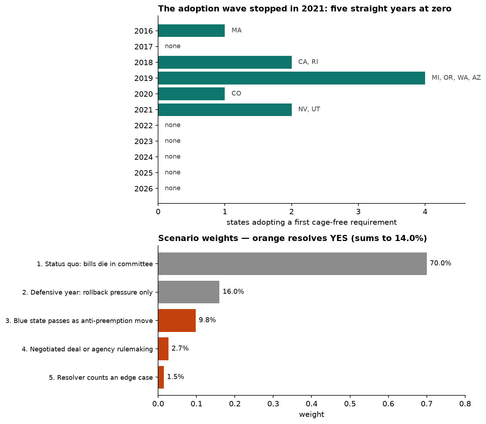

# Will at least one additional U.S. state enact a cage-free egg requirement before July 2027?

| | |
|---|---|
| **Source** | Metaculus #45421 — https://www.metaculus.com/questions/45421/ |
| **Type** | binary |
| **Opened / Closes / Resolves** | — / 2026-12-18 / 2027-07-01 |
| **Status** | open |
| **Current forecast** | **Median 13.0%, IQR [9.5%, 17.5%]** (v3, 2026-09-24) |
| **Community (as of 2026-09-23)** | CP 12.0% · Pro 8.0% (n=2) · Gold 12.0% (n=7); n=14 |
| **Next review** | 2026-11-06 |

<!-- Versions below, newest first. APPEND-ONLY: never edit or delete a past version. -->

---

## v3 — Update — 2026-09-24

Scheduled review (3 days overdue), first version after the Metaculus CP reveal on 2026-09-20.
Mode is **Update**: one week elapsed, no structural change to the question, the market sits 2 pp
from v2 (inside the 10 pp re-analysis threshold), and v1→v2 was a single coherence correction, not
a drift.

### Revision

| Driver | Direction | Effect |
|---|---|---|
| Prior (v2, 2026-09-17) | — | Median 14.0%, IQR [10.0%, 19.0%] |
| Metaculus cohorts revealed: CP 12% (n=14), gold medalists 12% (n=7), Pro 8% (n=2) — all below v2; gold IQR [8%, 13%]. Gold medalists are the better-calibrated cohort and n=7 is informative, so partial shrink toward them (Pro n=2 and volatile, 38% → 8% within three days: discounted) | ↓ | **−1.0 pp** |
| Senate Agriculture Committee reported the Farm Bill **12–11 on 2026-09-16** (after failing 10–11 on 2026-08-06); Save Our Bacon excluded again and Ernst's Prop 12 push failed, but Hoeven pointed it to the floor. P(Farm Bill enacted in 119th) ≈ 0.22 → ~0.30, so the "threat visibly dead by January" world weight falls 0.62 → ~0.56; chill factor 0.92 → ~0.91 | ↓ | **−0.1 pp** |
| Elapsed quiet week: Sept–Dec is almost no legislative hazard (most candidate legislatures out of session); remaining-window hazard essentially unchanged | ↓ | **−0.1 pp** |
| No new cage-free bill, committee action, ballot measure or rulemaking found in any of the ~11 candidate states; DOJ v. Michigan still pending on a motion to dismiss; retail eggs $2.27/dozen (Aug 2026 BLS) | → | none |
| Rounding | | +0.2 pp |
| **New forecast** | | **Median 13.0%, IQR [9.5%, 17.5%]** |

### Tripwire check

| Tripwire from v2 | Fired? | Note |
|---|---|---|
| CP reveals >10 pp from 14% with n ≥ 20, by 2026-09-20 | **no — expired** | revealed at 14% on 2026-09-20; 12% on 2026-09-23 with n=14 (2 pp off, n < 20). Retired; replaced by a cohort tripwire below |
| 119th Congress adjourns with no Farm Bill enacted, by 2027-01-03 | not yet | *less* likely to fire now: Senate committee reported the bill 2026-09-16. Carried forward |
| Cage-free bill reported out of an agriculture committee in a non-excluded state, by 2027-02-28 | not fired | no action found; carried forward |
| Such a bill passes one chamber / reaches a floor calendar in NY, CT, ME, NJ, MD or NM, by 2027-03-31 | not fired | NY S950/A652 still in committee; carried forward |
| Retail eggs ≥ $4.00/dozen, by 2027-02-28 | not fired | BLS APU0000708111 Aug 2026 = **$2.272** (Jul $2.189); HPAI back in 12 states but prices far from trigger. Carried forward |
| ≥ 8 of 11 candidate legislatures adjourn with no chamber passage, by 2027-05-31 | not fired | not due; carried forward |

### What resolves YES

unchanged from v1

### Outside view

unchanged from v1

### Inside view

Unchanged from v2 except the federal-threat world weights. The Senate committee vote moves mass
from "threat visibly dead" (Farm Bill died in the 119th × House flips) to "muddled" and "live in a
lame-duck package":

| World at Jan 2027 | v2 weight | v3 weight | P(YES \| world) |
|---|---|---|---|
| Threat visibly dead | 0.62 | 0.56 | ~0.15–0.18 |
| Muddled (Farm Bill passed without SOB, or GOP holds House) | 0.25 | 0.29 | ~0.11 |
| Threat live in a lame-duck package | 0.10 | 0.12 | ~0.06 |
| Save Our Bacon enacted | 0.03 | 0.03 | ~0.03 |

Chill factor 0.56 + 0.29 × 0.9 + 0.12 × 0.7 + 0.03 × 0.3 ≈ **0.91** (v2: 0.92) — a rounding-level
move. The Senate text still omits SOB, Ernst could not get a committee vote, and the 32-senator
letter still blocks a 60-vote floor amendment; the vehicle is likelier, the preemption rider in it
is not much likelier.

The larger driver is the crowd. v2 was built with no cohort data at all. The gold-medalist cohort
(n=7) now sits at 12%, IQR [8%, 13%] — tighter and lower than v2. v2's +2 pp came from a
cross-question argument (the Save Our Bacon forecast) that these forecasters may not have priced,
so the right move is a partial shrink, not full convergence: 14.0% → 13.0%.

### Evidence

v1 and v2 evidence stands. New this version:

| Finding | Direction | Effect here |
|---|---|---|
| Senate Ag Committee reports Farm Bill 12–11, 2026-09-16, with McConnell returning to vote; SOB excluded; Ernst push failed; Hoeven: Prop 12 fight belongs "on the Senate floor" [29][30] | ↓ small | vehicle likelier; preemption rider still blocked |
| Democrats condition floor support on a two-year SNAP cost-share delay; Hyde-Smith: enactment this year "difficult, but not impossible" [30] | ↑ small | 60-vote floor passage remains uncertain |
| BLS average retail price, Grade A large, Aug 2026: $2.272/dozen (Jul $2.189) [31] | → | egg-price tripwire far from firing |
| DOJ v. Michigan (EPIA preemption) still at motion-to-dismiss stage; no ruling found [32] | → | Channel C unchanged |
| No 2026-27 cage-free bill movement found in NY, NJ, CT, ME, MD, NM or other candidates; NY S950/A652 still in committee [4] | → | confirms status-quo scenario |

### Other forecasters

| Source | Value | As of | Note |
|---|---|---|---|
| Metaculus CP (recency-weighted) | **12.0%**, IQR [8.0%, 13.0%] | 2026-09-23 | n=14 (15 total); revealed at 14% 2026-09-20, dipped to 10% on 2026-09-22 |
| Metaculus Pro | **8.0%**, IQR [8.0%, 8.0%] | 2026-09-23 | n=2; was 38% at reveal — one-forecaster noise, discounted |
| Metaculus gold medalists | **12.0%**, IQR [8.0%, 13.0%] | 2026-09-23 | n=7; was 38% at reveal (one forecaster), 10% on 2026-09-22 |
| Polymarket / Kalshi / Manifold | none | 2026-09-24 | no matching market |
| Metaculus #43616 (Save Our Bacon enacted) | CP 5.0% · Pro 3.0% · Gold 3.0% | 2026-09-04 | cross-question anchor, not re-fetched this version |

Cohorts agree with each other (CP = gold = 12%) and sit 2 pp below v2. Not material disagreement,
but it is one-directional; v3 closes half the gap.

### Scenarios

| # | Scenario | Weight | Implies |
|---|---|---|---|
| 1 | Status quo: 2027 sessions come and go with cage-free bills stuck in agriculture committees | 0.705 | NO |
| 2 | Defensive year: attention on rollback fights and DOJ litigation in the ten existing states | 0.165 | NO |
| 3 | A blue state (NY, CT, ME, NJ, MD or NM) passes a cage-free bill, plausibly production-only, partly as an anti-preemption statement | 0.090 | **YES** |
| 4 | Negotiated industry deal (Utah-2021 model) or state agriculture-department rulemaking | 0.025 | **YES** |
| 5 | Resolver counts an edge case (partial measure, or a state not on the exclusion list) | 0.015 | **YES** |

YES = 0.090 + 0.025 + 0.015 = **0.130**.

### Sensitivity

unchanged from v2, except the Farm Bill row: weight on "Farm Bill dies in the 119th and the House
flips" is now ~0.56, not ~0.62.

### What would change my mind (tripwires)

- [ ] **By 2026-12-18** (question close) — Metaculus gold-medalist median moves more than 6 pp away
      from 13% with ≥ 5 forecasters in the cohort → re-examine for a missed fact (direction unknown).
- [ ] **By 2027-01-03** — the 119th Congress adjourns sine die with no Farm Bill enacted → **up 3 pp**.
- [ ] **By 2027-01-03** — the Senate adopts a Prop 12 / Save Our Bacon floor amendment to the Farm
      Bill, or a lame-duck package carrying Prop 12 preemption passes either chamber → **down 3 pp**.
- [ ] **By 2027-02-28** — any cage-free bill in a state outside the ten excluded is reported
      favourably out of an agriculture committee → **up 12 pp**.
- [ ] **By 2027-03-31** — any such bill passes one full chamber, or is placed on a floor calendar in
      NY, CT, ME, NJ, MD or NM → **up 20 pp**.
- [ ] **By 2027-02-28** — BLS/USDA average retail price of Grade A large eggs reaches $4.00/dozen or
      higher → **down 4 pp**.
- [ ] **By 2027-05-31** — at least 8 of the 11 candidate legislatures adjourn sine die with no
      cage-free bill having passed a chamber → **down 8 pp**.

### Sources

Numbering continues from v2. Sources 2, 3, 4, 14, 20, 24 and 27 are carried forward from v1/v2
because this version rests on them; 2 and 4 were re-checked today, 20 re-surfaced in today's search,
the others keep their original access date. 29–34 are new.

2. ASPCA, *Farm Animal Confinement Bans by State* —
   https://www.aspca.org/improving-laws-animals/public-policy/farm-animal-confinement-bans
   (still lists exactly the ten excluded states; accessed 2026-09-24)

3. Animal Welfare Institute, *Farmed Animal Anti-Confinement Legislation* —
   https://awionline.org/policy-efforts/farmed-animal-anti-confinement-legislation/ (accessed 2026-09-17)

4. New York State Senate, *Bill S950 (2025–2026)* —
   https://www.nysenate.gov/legislation/bills/2025/S950 (still in Agriculture Committee, last action
   2025-01-08; accessed 2026-09-24)

14. Humane World Action Fund, *Animal protection triumphs in the Senate: 'Save Our Bacon Act'
    abandoned as Farm Bill stalls ahead of summer recess* (2026-08) —
    https://humaneaction.org/press-release/2026/08/senate-farm-bill-save-our-bacon-act-august-update (accessed 2026-09-17)

20. Tech Times, *Bird Flu Returns to 12 States: Egg Prices That Finally Fell Could Rise Again*
    (2026-06-30) —
    https://www.techtimes.com/articles/319400/20260630/bird-flu-returns-12-states-egg-prices-that-finally-fell-could-rise-again.htm (accessed 2026-09-24)

24. This repository, `questions/2026-09-05-mc43616-save-our-bacon-act-enacted-into-law/forecast.md`
    v1 (2026-09-05) — Save Our Bacon enactment forecast, 3.0%; basis of the world weights (accessed 2026-09-17)

27. Metaculus #43616, *Will the Save Our Bacon Act be enacted into law before July 2027?* —
    https://www.metaculus.com/questions/43616/ (cohort values as of 2026-09-04; accessed 2026-09-17)

29. The New Lede, *Farm Bill advances without controversial "Save Our Bacon Act"* (2026-09) —
    https://www.thenewlede.org/2026/09/farm-bill-advances-without-controversial-save-our-bacon-act/ (accessed 2026-09-24)

30. DTN Progressive Farmer, *Senate Farm Bill Reported Out of Committee, Ready for Floor Vote*
    (2026-09-17) — https://www.dtnpf.com/agriculture/web/ag/columns/washington-insider/article/2026/09/17/senate-farm-bill-reported-committee (accessed 2026-09-24)

31. FRED / BLS, *Average Price: Eggs, Grade A, Large (Cost per Dozen) in U.S. City Average*
    (APU0000708111) — https://fred.stlouisfed.org/series/APU0000708111 (snapshot
    `raw/fred-eggs-2026-09-24.csv`, accessed 2026-09-24)

32. The Daily Intake, *Michigan Argues for Dismissal of DOJ Lawsuit Challenging Cage-Free Egg Law*
    (2026-04) — https://www.dailyintakeblog.com/2026/04/michigan-argues-for-dismissal-of-doj-lawsuit-challenging-cage-free-egg-law/ (accessed 2026-09-24)

33. Spectrum News, *Pork producers plead for Prop. 12 'fix' as lawmakers make progress on Farm Bill*
    (2026-09-21) — https://spectrumlocalnews.com/us/snplus/politics/2026/09/21/pork-producers-plead-for-prop--12--fix--as-lawmakers-make-progress-on-farm-bill (accessed 2026-09-24)

34. Metaculus #45421, cohort aggregations — https://www.metaculus.com/questions/45421/ (snapshot
    `raw/metaculus-2026-09-24.json`; accessed 2026-09-24)

**Date**: 2026-09-24
**Forecast**: Median 13.0%, IQR [9.5%, 17.5%]
**Thesis**: Core unchanged — ten states adopted cage-free requirements in 2016–2021 and none since,
against a low resolution bar and one full 2027 session for ~11 plausible states, with no bill in any
of them moving. Trimmed 1 pp toward the newly revealed Metaculus crowd (CP and gold medalists both
12%) and a hair further because the Senate Ag Committee's 12–11 Farm Bill vote (2026-09-16) makes
the federal-preemption threat slightly less likely to be visibly dead when the 2027 sessions open.

---

## v2 — Update — 2026-09-17

Coherence revision, not new news: prompted by cross-checking this question against
`questions/2026-09-05-mc43616-save-our-bacon-act-enacted-into-law/` (v1, 3.0%), which contains
federal-preemption facts that v1 of *this* forecast did not have. Mode is **Update** — the
question structure, the evidence base and the scenario skeleton are unchanged; one likelihood
ratio was mis-weighted.

### Revision

| Driver | Direction | Effect |
|---|---|---|
| Prior (v1, 2026-09-17) | — | Median 12.0%, IQR [8.5%, 17.0%] |
| Federal-preemption chill re-weighted across the window: the threat is ~62% likely to be **visibly dead before the decisive Jan–Jun 2027 sessions open**, not a drag throughout (LR 0.70 → 0.92) | ↑ | **+2.5 pp** |
| "Wait for Congress" deterrence weaker than priced — the actors who drive state cage-free bills are the same Humane World lobbyists who organised the 32-senator letter, and they know the count | ↑ | **+0.5 pp** |
| Corporate cage-free pledge collapse corroborated by this repo's own forecasts (11.9% fulfilment, mc43277; 3.8% broiler, mc43278) — strengthens "the wave's engine is gone" | ↓ | **−0.5 pp** |
| DOJ EPIA litigation, egg-price path, legislative-calendar structure, candidate-state set | → | none |
| Metaculus: still `upcoming`, n 4 → 5, all three cohorts null, no comments | → | none |
| **New forecast** | | **Median 14.0%, IQR [10.0%, 19.0%]** |

### Tripwire check

| Tripwire from v1 | Fired? | Note |
|---|---|---|
| CP reveals >10 pp from 12% with n ≥ 20, by 2026-09-20 | **not yet** | reveal date not reached; carried forward, restated against 14% |
| Farm Bill conference report includes §12006, by 2026-12-31 | **no — mis-specified, retired** | at P(Farm Bill enacted in the 119th) ≈ 0.22 there most likely *is no conference report*; a tripwire that cannot fire is not a tripwire. Replaced below |
| Cage-free bill reported out of an agriculture committee, by 2027-02-28 | not fired | carried forward unchanged |
| Such a bill passes one chamber / reaches a floor calendar, by 2027-03-31 | not fired | carried forward unchanged |
| Retail eggs ≥ $4.00/dozen, by 2027-02-28 | not fired | carried forward unchanged |
| ≥ 8 of 11 candidate legislatures adjourn with no chamber passage, by 2027-05-31 | not fired | carried forward unchanged |

### What resolves YES

unchanged from v1

### Outside view

unchanged from v1

### Inside view

Route structure unchanged from v1. What changed is the **conditioning variable**. v1 treated
federal preemption as a single pending threat exerting steady downward pressure. That is the wrong
decomposition: conditioning on *enactment* is nearly worthless here, because enactment is so
unlikely that it barely moves the unconditional number —

`P(YES | Save Our Bacon enacted) ≈ 0.03`, and with `P(enacted) = 0.03`,
`P(YES | not enacted) = (0.12 − 0.03 × 0.03) / 0.97 ≈ 12.3%`. A 0.1 pp difference.

The variable that actually matters is **the state of the federal threat when the 2027 state
sessions convene in January**:

| World at Jan 2027 | Weight | P(YES \| world) |
|---|---|---|
| Threat visibly dead — Farm Bill died in the 119th (~0.78) *and* House flipped Democratic (~0.80) | 0.62 | ~0.15–0.18 |
| Farm Bill passed without SOB, or Republicans hold the House — muddled | 0.25 | ~0.11 |
| Threat still live in a lame-duck package carrying Prop 12 language | 0.10 | ~0.06 |
| Save Our Bacon enacted | 0.03 | ~0.03 |

Weighted chill factor = 0.62 × 1.0 + 0.25 × 0.9 + 0.10 × 0.7 + 0.03 × 0.3 ≈ **0.92**, against the
0.70 applied in v1. Odds ×1.32 takes 12.0% to ~15.2%. Reconstructing the scenario weights instead
returns ~12.4%, but that path re-imports v1's own anchor and is the less trustworthy of the two.
Splitting the difference and taking the −0.5 pp from the pledge-collapse corroboration gives
**14.0%**.

The two channels that v1 bundled together must be separated, because they scale with different
things:

- **Channel A — "why pass a law Congress will void?"** Scales with *perceived* enactment
  probability, which the best-sourced estimate puts at 3% (CP 5%, Pro 3%, Gold 3%). The
  organisations that draft and push state cage-free bills are the ones that counted the Senate
  votes. This channel is much weaker than v1 priced it.
- **Channel B — capacity diversion.** Independent of the outcome. Humane World fought a six-front
  war in 2026 (House floor, Rules Committee, Senate markup, two DOJ suits, state rollbacks), and
  that consumed the offensive capacity regardless of how the Farm Bill ends. **Unchanged, and it
  is why this revision is +2 pp rather than +6 pp.**

Channel C, the anti-preemption gesture behind Scenario 3, is unaffected: DOJ's EPIA suits, not the
Farm Bill, are the live irritant, and they continue whatever happens to H.R. 7567.

### Evidence

v1's evidence stands. Added from the sibling forecast (mc43616 v1, 2026-09-05, and its sources):

| Finding | Direction | Effect here |
|---|---|---|
| Senate Farm Bill **failed in committee 10–11 on 2026-08-06**; chairman Boozman called pre-midterm passage "a miracle"; P(Farm Bill enacted by 2027-01-03) ≈ 0.22 | ↑ | the vehicle for preemption most likely never arrives |
| 32 senators on record against S. 1326 "in the next Farm Bill **or in any other legislation**"; Boozman conceding no Democrat will support it | ↑ | closes the rider path too |
| No Prop 12 / SOB amendment offered among 48 amendments voted at the August markup | ↑ | revealed preference: its own backers did not force the count |
| Federal preemption of state farm-animal law: 6 attempts since 2006, **0 enacted**; House-passed language the Senate omits is **0 for 2** (2014 stripped in conference, 2018 defeated in final negotiations) | ↑ | strong base rate that the threat dies |
| Repo forecasts on corporate pledges: **11.9%** cage-free fulfilment (mc43277), **3.8%** broiler (mc43278) | ↓ | the 2019–21 negotiating dynamic is comprehensively dead — v1 understated this |

**Correction to the record, not to this forecast**: `mc43616` v1 dates the DOJ suit against
California to 2026-07-09, in both its fine-print section and its evidence table. That cannot be
right — the docket number it cites is **2:25-cv-06230** (filed 2025) and the dismissal was
2026-03-18, which cannot precede the filing. The correct date is July **2025**, as recorded in v1
of this file. It does not change that question's 3% (the suit is cited there only as atmospheric
evidence that the White House would sign), but it should be fixed there at its next update.

### Other forecasters

| Source | Value | As of | Note |
|---|---|---|---|
| Metaculus CP (recency-weighted) | **no data** | 2026-09-17 | still `upcoming`; CP reveals 2026-09-20 |
| Metaculus Pro | **no data** | 2026-09-17 | cohort `latest: null` |
| Metaculus gold medalists | **no data** | 2026-09-17 | cohort `latest: null` |
| Metaculus forecaster count | 5 (was 4) | 2026-09-17 | re-fetched; `raw/metaculus-2026-09-17b.json` |
| Polymarket / Kalshi / Manifold | none | 2026-09-17 | no matching market |
| **Metaculus #43616 (Save Our Bacon enacted)** | CP 5.0% · Pro 3.0% · Gold 3.0% (n=61) | 2026-09-04 | **the relevant cross-question anchor**; this repo forecasts 3.0% |

Still no cohort data on this question itself. The nearest thing to an external check is the
Save Our Bacon question, where Pro and gold agree at 3% against a CP of 5% — and that agreement is
what drives this revision.

### Scenarios

| # | Scenario | Weight | Implies |
|---|---|---|---|
| 1 | Status quo: 2027 sessions come and go with cage-free bills stuck in agriculture committees | 0.700 | NO |
| 2 | Defensive year: attention stays on rollback fights and DOJ litigation in the ten existing states | 0.160 | NO |
| 3 | A blue state (NY, CT, ME, NJ, MD or NM) passes a cage-free bill — plausibly production-only — partly as an anti-preemption statement, in a January 2027 landscape where the federal threat has visibly collapsed | 0.098 | **YES** |
| 4 | Negotiated industry deal on the Utah-2021 model, or a state agriculture department rulemaking | 0.027 | **YES** |
| 5 | Resolver counts an edge case: a partial measure, or action by a state not on the exclusion list (e.g. Ohio) | 0.015 | **YES** |

YES = 0.098 + 0.027 + 0.015 = **0.140**.

### Sensitivity

| Assumption | If instead | Forecast becomes |
|---|---|---|
| The 2022–2026 drought is a real regime break (weight 0.80) | The 2016–2021 wave rate still applies and five zero-years were luck | **~47%** |
| No candidate state has a bill positioned to move in 2027 | A cage-free bill is found already reported favourably out of committee in a Democratic-trifecta state | **~27%** |
| Farm Bill dies in the 119th and the House flips (weight ~0.62 jointly) | A lame-duck package carries live Prop 12 language into January 2027 | **~7%** |
| Retail eggs stay near $2/dozen | HPAI drives retail eggs back above $4/dozen by February 2027 | **~9%** |

Note the replaced row: v1's sensitivity conditioned on Save Our Bacon being *enacted*, an event the
repo prices at 3%. Conditioning a sensitivity table on a 3% event wastes the row. The informative
counterfactual is whether the Farm Bill survives the 119th at all.

### What would change my mind (tripwires)

- [ ] **2026-09-20** — Metaculus CP reveals more than 10 pp away from 14.0% with n ≥ 20 →
      re-analyse from scratch rather than nudge (direction unknown).
- [ ] **By 2027-01-03** — the 119th Congress adjourns sine die with no Farm Bill enacted (and
      therefore no §12006 vehicle) → **up 3 pp**. Replaces v1's conference-report tripwire, which
      presupposed a conference that probably never convenes.
- [ ] **By 2027-02-28** — any cage-free bill in a state outside the ten excluded is reported
      favourably out of an agriculture committee → **up 12 pp**.
- [ ] **By 2027-03-31** — any such bill passes one full chamber, or is placed on a floor calendar in
      NY, CT, ME, NJ, MD or NM → **up 20 pp**.
- [ ] **By 2027-02-28** — BLS/USDA average retail price of Grade A large eggs reaches $4.00/dozen or
      higher → **down 4 pp**.
- [ ] **By 2027-05-31** — at least 8 of the 11 candidate legislatures adjourn sine die with no
      cage-free bill having passed a chamber → **down 8 pp**.

### Sources

Sources 1–23 are carried unchanged from v1 and reproduced here so this version stands
alone; 24–28 are new to this update.

1. Metaculus #45421, *Will at least one additional U.S. state enact a cage-free egg requirement
   before July 2027?* — https://www.metaculus.com/questions/45421/ (aggregation API snapshot in
   `raw/metaculus-2026-09-17.json`, accessed 2026-09-17)

2. ASPCA, *Farm Animal Confinement Bans by State* —
   https://www.aspca.org/improving-laws-animals/public-policy/farm-animal-confinement-bans
   (accessed 2026-09-17)

3. Animal Welfare Institute, *Farmed Animal Anti-Confinement Legislation* —
   https://awionline.org/policy-efforts/farmed-animal-anti-confinement-legislation/ (page content
   current to Feb 2026; accessed 2026-09-17)

4. New York State Senate, *Bill S950 (2025–2026)* —
   https://www.nysenate.gov/legislation/bills/2025/S950 (accessed 2026-09-17)

5. Animal Agriculture Alliance, *States rolling back legislation on cage-free eggs* —
   https://animalagalliance.org/egg-prices-cage-free-mandates-legislation/ (published 2025-04-01;
   accessed 2026-09-17)

6. USDA Economic Research Service, *Number of States with restrictions on egg-laying hen
   confinement is small but growing* — https://www.ers.usda.gov/data-products/charts-of-note/106005
   (published 2023-03-10; accessed 2026-09-17)

7. Civil Eats, *Trump DOJ Sues Michigan to Overturn Cage-Free Egg Law* (2026-01-28) —
   https://civileats.com/2026/01/28/trump-doj-sues-michigan-to-overturn-cage-free-egg-law/ (accessed 2026-09-17)

8. National Law Review, *DOJ Files Suit Against Michigan Over Cage-Free Egg Law* —
   https://natlawreview.com/article/doj-sues-michigan-over-cage-free-egg-law (accessed 2026-09-17)

9. National Law Review, *District Court Rules that DOJ Has No Standing to Challenge California's
   Egg Standards on Preemption Grounds* (2026-04) —
   https://natlawreview.com/article/district-court-rules-doj-has-no-standing-challenge-californias-egg-standards (accessed 2026-09-17)

10. Courthouse News Service, *Judge fries Trump's challenge to California egg laws* —
    https://www.courthousenews.com/judge-fries-trumps-challenge-to-california-egg-laws/ (accessed 2026-09-17)

11. Civil Rights Litigation Clearinghouse, *United States v. California*, 2:25-cv-06230 (C.D. Cal.)
    — https://clearinghouse.net/case/46779/ (accessed 2026-09-17)

12. Congress.gov, *H.R. 7567 — Farm, Food, and National Security Act of 2026* —
    https://www.congress.gov/bill/119th-congress/house-bill/7567 (accessed 2026-09-17)

13. Congress.gov, *S.1326 — Food Security and Farm Protection Act* —
    https://www.congress.gov/bill/119th-congress/senate-bill/1326 (accessed 2026-09-17)

14. Humane World Action Fund, *Animal protection triumphs in the Senate: 'Save Our Bacon Act'
    abandoned as Farm Bill stalls ahead of summer recess* (2026-08) —
    https://humaneaction.org/press-release/2026/08/senate-farm-bill-save-our-bacon-act-august-update (accessed 2026-09-17)

15. Humane World Action Fund, *Animal welfare laws threatened as Farm Bill passes U.S. House in
    largely party-line vote* (2026-04) —
    https://humaneaction.org/press-release/2026/04/animal-welfare-laws-threatened-farm-bill-passes-us-house-largely-party-line (accessed 2026-09-17)

16. Animal Welfare Institute, *Cage-Free Laws in the Crosshairs*, AWI Quarterly Spring 2025 —
    https://awionline.org/awi-quarterly/spring-2025/cage-free-laws-crosshairs (accessed 2026-09-17)

17. KJZZ, *Arizona will require cage-free eggs in 2026. This bill would overturn that rule*
    (2025-03-04) —
    https://www.kjzz.org/politics/2025-03-04/arizona-will-require-cage-free-eggs-in-2026-this-bill-would-overturn-that-rule (accessed 2026-09-17)

18. Michigan Senate Republicans, *Theis introduces legislation to repeal cage-free egg mandates*
    (2025-01) — https://www.misenategop.com/theis-introduces-legislation-to-repeal-cage-free-egg-mandates-and-provide-relief-to-farmers-and-consumers/ (accessed 2026-09-17)

19. Congressional Research Service IF12949, *U.S. Egg Production and Retail Prices* —
    https://www.congress.gov/crs_external_products/IF/HTML/IF12949.html (accessed 2026-09-17)

20. Tech Times, *Bird Flu Returns to 12 States: Egg Prices That Finally Fell Could Rise Again*
    (2026-06-30) —
    https://www.techtimes.com/articles/319400/20260630/bird-flu-returns-12-states-egg-prices-that-finally-fell-could-rise-again.htm (accessed 2026-09-17)

21. Ballotpedia, *2026 ballot measures* and *Potential 2026 ballot measures* —
    https://ballotpedia.org/2026_ballot_measures (accessed 2026-09-17)

22. Metaculus, *Forecasting the Future of Animals* (Animal Futures Tournament notebook) —
    https://www.metaculus.com/notebooks/43978/ (accessed 2026-09-17)

23. East Coast Egg Farmers, *NJ & NY Cage-Free Egg Laws Explained for 2026* —
    https://eastcoasteggfarmers.com/egg-hub/nj-ny-cage-free-egg-laws-2026 — asserts New Jersey and
    New York have enacted cage-free requirements. Contradicted by ASPCA, AWI and the NY Senate bill
    record. Do not re-use. (accessed 2026-09-17)

24. This repository, `questions/2026-09-05-mc43616-save-our-bacon-act-enacted-into-law/forecast.md`
    v1 (2026-09-05) — Save Our Bacon Act enactment forecast, 3.0%, and its path decomposition
    (accessed 2026-09-17)

25. This repository, `questions/2026-09-17-mc43277-percentage-companies-globally-fulfill-their-pre-2026/forecast.md`
    v1 — global cage-free corporate pledge fulfilment, 11.9% (accessed 2026-09-17)

26. This repository, `questions/2026-09-17-mc43278-percentage-companies-globally-fulfill-their-pre-2026/forecast.md`
    v1 — global broiler pledge fulfilment, 3.8% (accessed 2026-09-17)

27. Metaculus #43616, *Will the Save Our Bacon Act be enacted into law before July 2027?* —
    https://www.metaculus.com/questions/43616/ (cohort values as of 2026-09-04; accessed 2026-09-17)

28. Metaculus #45421 re-fetch — `raw/metaculus-2026-09-17b.json` (accessed 2026-09-17)

**Date**: 2026-09-17
**Forecast**: Median 14.0%, IQR [10.0%, 19.0%]
**Thesis**: Unchanged core — ten states adopted cage-free requirements in 2016–2021 and none since,
with a nameable mechanism behind the stop (industry deals dried up, DOJ EPIA suits, advocacy
capacity fully on defense), against an unusually low resolution bar and one full 2027 session for
~11 plausible states. Revised up 2 pp because v1 mis-weighted the federal-preemption chill: this
repo's own Save Our Bacon forecast (3.0%, Pro and gold both 3%) implies the Senate Farm Bill is
likely dead in the 119th and the threat is ~62% likely to have visibly collapsed *before* the
decisive Jan–Jun 2027 sessions open, removing the "wait for Congress" excuse exactly when it would
have bitten.

---

## v1 — Initial forecast — 2026-09-17

### What resolves YES

Before 2027-07-01, a U.S. state that did **not** already have a cage-free law in effect as of
2026-09-01 must enact a new cage-free requirement — defined as a law or rule that either bans
cages for in-state hens **or** bans the sale of eggs from non-cage-free hens. Four clauses do most
of the work. (1) The ten excluded states are named: AZ, CA, CO, MA, MI, NV, OR, RI, UT, WA — so the
entire 2025–26 rollback story inside those ten states is **irrelevant to resolution**. (2) Passage
by the **legislature alone suffices, "regardless of the action or inaction of the state's
governor"** — a vetoed bill still resolves YES. (3) Three routes count: legislature, ballot
measure, or state administrative action. (4) The requirement **need not take effect** before 2027 —
a 2035 phase-in counts. A production-only ban counts too (the Utah 2021 and Rhode Island 2018
model), which makes a low-cost symbolic vote in a state with no egg industry a live path. There is
no mechanical resolution source and no scheduled data release: this is decided by legislative
events and adjudicated by Metaculus admins against the public record. Residual ambiguity sits in
whether a *partial* measure (a cage-space upgrade short of cage-free, or an institutional
procurement rule) would be counted; I give that ~1.5%.

### Outside view

Reference class: a state adopting, for the first time, a genuine cage-free requirement. Earlier
"enriched cage" space laws (CA 2008, MI 2009, OR 2011, WA 2011) are excluded — they permitted
colony cages, and each of those states later passed a separate true cage-free law.

**2016:** MA · **2018:** CA, RI · **2019:** MI, OR, WA, AZ · **2020:** CO · **2021:** NV, UT ·
**2022–2026: none.** (Animal Welfare Institute anti-confinement tracker, page current to Feb 2026;
cross-checked against ASPCA's confinement-ban table. AWI records no new farm-animal confinement
enactment of any kind since New Jersey 2023, and that one covers crates, not hens.)

Ten states in six years, then five consecutive years at zero.

| Class | Rate | Scaled to the 0.786-yr window |
|---|---|---|
| Full era 2016–2026 (10 in 11 yr) | λ = 0.91/yr | P(≥1) = 51% |
| Wave only 2016–2021 (10 in 6 yr) | λ = 1.67/yr | P(≥1) = 73% |
| **Post-wave 2022–2026 (0 in 5 yr)** | Jeffreys λ ≈ 0.10/yr | **P(≥1) = 7.6%** |
| **Per-state-session, post-wave (0 of ~60)** | p ≈ 0.83%/session | **11 sessions → 8.8%** |
| Per-state-session, wave era (10 of ~84) | p ≈ 11.9%/session | 11 sessions → 75% |

The classes disagree by a factor of nine. **The whole forecast is a bet on whether the 2022–2026
drought is a regime break or a run of bad luck.** Rule of three on five zero-years caps the annual
rate at λ < 0.60/yr (95%), i.e. P(≥1) < 38% even under the most charitable reading of the data
alone. Blending 0.80 (break is real) × 8% + 0.15 (temporary pause) × 30% + 0.05 (noise) × 60%
gives ≈ 13.9% as the outside-view starting point. The status-quo prior for a
"will-X-change-by-D" question over 9.4 months pulls the same direction.

### Inside view

`P(YES) = 1 − Π(1 − p_i)` over four routes.

**Route 1 — a legislature passes a bill in the Jan–Jun 2027 session (≈13%).** Nearly all of the
probability. The window captures one essentially complete regular-session cycle for every plausible
state. Candidates, each with a session adjourning before or near 2027-07-01: NY 3.0% · NJ 2.5% ·
CT 2.0% · ME 2.0% · MD 1.5% · NM 1.5% · IL 1.5% · MN 1.0% · DE/HI/VT/VA combined 3.0% · any other
state (including a red-state United Egg Producers-brokered deal on the Utah-2021 model) 1.5%. Taken
as independent that is 17.9%; they are not independent — all eleven face the same national
headwinds — so I discount to ~13%.

**Route 2 — ballot measure (≈0.5%).** Effectively closed. Nothing cage-free was certified for the
November 2026 ballot, and the next odd-year opportunities (Maine, Ohio) fall in November 2027,
after the deadline.

**Route 3 — state administrative action (≈1.5%).** Precedent exists (Arizona's 2019–22
rulemaking), but Arizona itself has retreated and its rule is under a separation-of-powers attack,
which makes other agencies less likely to try, not more.

**Route 4 — resolver counts an edge case (≈2.0%).** A partial measure, or incremental action by a
state not on the exclusion list (Ohio's Livestock Care Standards Board is the interesting one,
since Ohio is *not* excluded despite having 2010 confinement rules).

Combined: `1 − (0.87 × 0.995 × 0.985 × 0.98) ≈ 16.4%`, shaded down because the Route-1 per-state
numbers are generous against a record of zero observed committee movement anywhere.

**What has to be true for YES**: a candidate state prioritises the bill → it survives its
agriculture committee → it clears both chambers before 2027-07-01. Not one of those three steps has
been observed in any unlisted state in four years.

### Evidence

Everything found in this sweep points the same way, which is itself a warning — so I searched
explicitly for the opposite and record the failure to find it.

**Against YES (the drivers):**

- **The flagship bill is inert.** New York S950 / A652 — the most-cited candidate — sits in the
  Senate Agriculture Committee; its complete 2025–26 action history is "referred 2025-01-08" and
  "re-referred 2026-01-07". Versions have been introduced since 2019 and none has reached a floor.
  LR ≈ 0.4 against the main YES path.
- **Federal executive hostility.** DOJ sued California (2025-07) and Michigan (2026-01-22),
  arguing the Egg Products Inspection Act preempts state cage-free sales bans. A state enacting
  now buys litigation. LR ≈ 0.6.
- **Pending federal preemption.** The House passed H.R. 7567 (Farm, Food and National Security Act
  of 2026) 224–200 on 2026-04-30 including §12006, the Save Our Bacon Act, which would nullify
  Prop 12-style laws. Senate Agriculture excluded it from its draft, and conference is unresolved.
  Pendency alone gives a legislator a free reason to wait. LR ≈ 0.7.
- **Advocacy capacity is fully committed to defense.** Humane World for Animals' and ASPCA's entire
  2026 farm-animal output is Farm Bill defense and rollback defense; the state wins they publicise
  are cockfighting (MD) and pet abandonment (FL). The organisations that manufactured the
  2016–2021 wave are not currently running an offensive state campaign. LR ≈ 0.5.
- **The wave's engine is gone.** Colorado 2020, Utah 2021 and the Arizona rule were negotiated
  deals struck because corporate cage-free pledges targeting 2025 made the transition look
  inevitable. Those pledges stalled; United Egg Producers and the Farm Bureaus are now on offense
  for repeal.

**For YES (and why it does not carry further):**

- **The bar is genuinely low.** Legislative passage alone suffices, the governor is irrelevant,
  administrative action counts, and a production-only ban counts. A blue state with no egg industry
  could do this in an afternoon as a states'-rights gesture. This is the main reason I do not go
  below 10%.
- **The price argument has weakened.** Retail eggs peaked at $6.23/dozen in March 2025 and were
  $2.19 in May 2026 (−35% YoY), with wholesale below $1 in early 2026. The core 2025 talking point
  against mandates is much less available. LR ≈ 1.3.
- **States' authority survived its first federal test.** *United States v. California* was
  dismissed for lack of standing on 2026-03-18 (Judge Scarsi, C.D. Cal.), who warned against "a
  campaign of preemption suits under the aegis of its sovereignty." Save Our Bacon was kept out of
  the Senate draft (Aug 2026). LR ≈ 1.2.
- **A backlash channel exists.** DOJ suits plus attempted federal preemption could galvanise a blue
  legislature into passing a cage-free law precisely as a sovereignty statement. This is
  **speculative** — I found no instance of a legislator proposing it — but it is the most plausible
  story under which this question resolves YES, and it carries most of Scenario 3.

**Evidence I expected to see under YES and did not find** (absence of expected evidence is evidence
of absence here): no pre-filed 2027 cage-free bill in any candidate state; no 2025 or 2026 committee
hearing, favourable report, or one-chamber passage in any unlisted state; no advocacy organisation
naming a target state for 2027; no certified 2026 ballot measure. A bill positioned to pass in
spring 2027 would normally have left at least one of these traces by September 2026.

**Counter-weight against my own sweep:** HPAI returned to commercial flocks in 12 states by June
2026. A renewed price spike into the 2027 session would remove the one favourable trend.

### Other forecasters

| Source | Value | As of | Note |
|---|---|---|---|
| Metaculus CP (recency-weighted) | **no data** | 2026-09-17 | question `upcoming`; CP reveals 2026-09-20 |
| Metaculus Pro | **no data** | 2026-09-17 | cohort returns `latest: null` |
| Metaculus gold medalists | **no data** | 2026-09-17 | cohort returns `latest: null` |
| Metaculus forecaster count | 4 | 2026-09-17 | Animal Futures Tournament, newly opened |
| Polymarket | none | 2026-09-17 | no matching market found |
| Kalshi | none | 2026-09-17 | no matching market found |
| Manifold | none | 2026-09-17 | no matching market found |
| Sentinel Team / Mantic / GJOpen / INFER | none | 2026-09-17 | no matching question found |

**No cohort disagreement to flag, because no cohort has data.** This forecast is fully unanchored:
nothing constrains it toward or away from a crowd. That cuts both ways — no herding risk, but also
no correction if I have misread the legislative landscape. It is the main reason the IQR below is
wider than the evidence quality alone would justify, and the reason the CP reveal on 2026-09-20 is
a tripwire rather than a routine check.

### Scenarios

| # | Scenario | Weight | Implies |
|---|---|---|---|
| 1 | Status quo: 2027 sessions come and go with cage-free bills stuck in agriculture committees; the Farm Bill preemption fight dominates the issue space | 0.720 | NO |
| 2 | Defensive year: attention goes to rollback fights and DOJ litigation in the ten existing states; no new state acts | 0.160 | NO |
| 3 | A blue state (NY, CT, ME, NJ, MD or NM) passes a cage-free bill — plausibly production-only — before 2027-07-01, at least partly as an anti-preemption statement | 0.080 | **YES** |
| 4 | Negotiated industry deal on the Utah-2021 model, or a state agriculture department rulemaking | 0.025 | **YES** |
| 5 | Resolver counts an edge case: a partial measure, or incremental action by a state not on the exclusion list (e.g. Ohio) | 0.015 | **YES** |

YES = 0.080 + 0.025 + 0.015 = **0.120**.

### Sensitivity

| Assumption | If instead | Forecast becomes |
|---|---|---|
| The 2022–2026 drought is a real regime break (weight 0.80) | The 2016–2021 wave rate still applies and five zero-years were luck | **~45%** |
| No candidate state has a bill positioned to move in 2027 | A cage-free bill is found already reported favourably out of committee in a Democratic-trifecta state | **~25%** |
| Federal preemption stays pending but unenacted | Save Our Bacon (§12006) is enacted in the final Farm Bill before the 2027 sessions open | **~5%** |
| Retail eggs stay near $2/dozen | HPAI drives retail eggs back above $4/dozen by February 2027 | **~7%** |

Calibration checks: conjunction holds (three sequential hurdles, none observed); scope behaves
(doubling the window to two session cycles gives 1 − 0.88² ≈ 23%, which is the right shape); the
number is not a round anchor; and at 12.0% I am close to indifferent between the two sides, would
sell at 20% and buy at 7%.

### What would change my mind (tripwires)

- [ ] **2026-09-20** — Metaculus CP reveals more than 10 pp away from 12.0% with n ≥ 20 → re-analyse
      from scratch rather than nudge (direction unknown).
- [ ] **By 2026-12-31** — Farm Bill conference report includes §12006 / Save Our Bacon preemption
      language → **down 6 pp**. (If it is stripped in conference → up 2 pp.)
- [ ] **By 2027-02-28** — any cage-free bill in a state outside the ten excluded is reported
      favourably out of an agriculture committee → **up 12 pp**.
- [ ] **By 2027-03-31** — any such bill passes one full chamber, or is placed on a floor calendar in
      NY, CT, ME, NJ, MD or NM → **up 20 pp**.
- [ ] **By 2027-02-28** — BLS/USDA average retail price of Grade A large eggs reaches $4.00/dozen or
      higher → **down 4 pp**.
- [ ] **By 2027-05-31** — at least 8 of the 11 candidate legislatures adjourn sine die with no
      cage-free bill having passed a chamber → **down 8 pp** (mechanical: the remaining window
      shrinks to almost nothing).

### Sources

Directly fetched (full page read):

1. Metaculus #45421, *Will at least one additional U.S. state enact a cage-free egg requirement
   before July 2027?* — https://www.metaculus.com/questions/45421/ (aggregation API snapshot in
   `raw/metaculus-2026-09-17.json`, accessed 2026-09-17)
2. ASPCA, *Farm Animal Confinement Bans by State* —
   https://www.aspca.org/improving-laws-animals/public-policy/farm-animal-confinement-bans
   (accessed 2026-09-17)
3. Animal Welfare Institute, *Farmed Animal Anti-Confinement Legislation* —
   https://awionline.org/policy-efforts/farmed-animal-anti-confinement-legislation/ (page content
   current to Feb 2026; accessed 2026-09-17)
4. New York State Senate, *Bill S950 (2025–2026)* —
   https://www.nysenate.gov/legislation/bills/2025/S950 (accessed 2026-09-17)
5. Animal Agriculture Alliance, *States rolling back legislation on cage-free eggs* —
   https://animalagalliance.org/egg-prices-cage-free-mandates-legislation/ (published 2025-04-01;
   accessed 2026-09-17)
6. USDA Economic Research Service, *Number of States with restrictions on egg-laying hen
   confinement is small but growing* — https://www.ers.usda.gov/data-products/charts-of-note/106005
   (published 2023-03-10; accessed 2026-09-17)

Consulted via search results (headline and summary only, not fully fetched — treat the detail as
second-hand):

7. Civil Eats, *Trump DOJ Sues Michigan to Overturn Cage-Free Egg Law* (2026-01-28) —
   https://civileats.com/2026/01/28/trump-doj-sues-michigan-to-overturn-cage-free-egg-law/ (accessed 2026-09-17)
8. National Law Review, *DOJ Files Suit Against Michigan Over Cage-Free Egg Law* —
   https://natlawreview.com/article/doj-sues-michigan-over-cage-free-egg-law (accessed 2026-09-17)
9. National Law Review, *District Court Rules that DOJ Has No Standing to Challenge California's
   Egg Standards on Preemption Grounds* (2026-04) —
   https://natlawreview.com/article/district-court-rules-doj-has-no-standing-challenge-californias-egg-standards (accessed 2026-09-17)
10. Courthouse News Service, *Judge fries Trump's challenge to California egg laws* —
    https://www.courthousenews.com/judge-fries-trumps-challenge-to-california-egg-laws/ (accessed 2026-09-17)
11. Civil Rights Litigation Clearinghouse, *United States v. California*, 2:25-cv-06230 (C.D. Cal.)
    — https://clearinghouse.net/case/46779/ (accessed 2026-09-17)
12. Congress.gov, *H.R. 7567 — Farm, Food, and National Security Act of 2026* —
    https://www.congress.gov/bill/119th-congress/house-bill/7567 (accessed 2026-09-17)
13. Congress.gov, *S.1326 — Food Security and Farm Protection Act* —
    https://www.congress.gov/bill/119th-congress/senate-bill/1326 (accessed 2026-09-17)
14. Humane World Action Fund, *Animal protection triumphs in the Senate: 'Save Our Bacon Act'
    abandoned as Farm Bill stalls ahead of summer recess* (2026-08) —
    https://humaneaction.org/press-release/2026/08/senate-farm-bill-save-our-bacon-act-august-update (accessed 2026-09-17)
15. Humane World Action Fund, *Animal welfare laws threatened as Farm Bill passes U.S. House in
    largely party-line vote* (2026-04) —
    https://humaneaction.org/press-release/2026/04/animal-welfare-laws-threatened-farm-bill-passes-us-house-largely-party-line (accessed 2026-09-17)
16. Animal Welfare Institute, *Cage-Free Laws in the Crosshairs*, AWI Quarterly Spring 2025 —
    https://awionline.org/awi-quarterly/spring-2025/cage-free-laws-crosshairs (accessed 2026-09-17)
17. KJZZ, *Arizona will require cage-free eggs in 2026. This bill would overturn that rule*
    (2025-03-04) —
    https://www.kjzz.org/politics/2025-03-04/arizona-will-require-cage-free-eggs-in-2026-this-bill-would-overturn-that-rule (accessed 2026-09-17)
18. Michigan Senate Republicans, *Theis introduces legislation to repeal cage-free egg mandates*
    (2025-01) — https://www.misenategop.com/theis-introduces-legislation-to-repeal-cage-free-egg-mandates-and-provide-relief-to-farmers-and-consumers/ (accessed 2026-09-17)
19. Congressional Research Service IF12949, *U.S. Egg Production and Retail Prices* —
    https://www.congress.gov/crs_external_products/IF/HTML/IF12949.html (accessed 2026-09-17)
20. Tech Times, *Bird Flu Returns to 12 States: Egg Prices That Finally Fell Could Rise Again*
    (2026-06-30) —
    https://www.techtimes.com/articles/319400/20260630/bird-flu-returns-12-states-egg-prices-that-finally-fell-could-rise-again.htm (accessed 2026-09-17)
21. Ballotpedia, *2026 ballot measures* and *Potential 2026 ballot measures* —
    https://ballotpedia.org/2026_ballot_measures (accessed 2026-09-17)
22. Metaculus, *Forecasting the Future of Animals* (Animal Futures Tournament notebook) —
    https://www.metaculus.com/notebooks/43978/ (accessed 2026-09-17)

Rejected as unreliable:

23. East Coast Egg Farmers, *NJ & NY Cage-Free Egg Laws Explained for 2026* —
    https://eastcoasteggfarmers.com/egg-hub/nj-ny-cage-free-egg-laws-2026 — asserts New Jersey and
    New York have enacted cage-free requirements. Contradicted by ASPCA, AWI and the NY Senate bill
    record. Do not re-use. (accessed 2026-09-17)

**Date**: 2026-09-17
**Forecast**: Median 12.0%, IQR [8.5%, 17.0%]
**Thesis**: Ten states adopted cage-free requirements in 2016–2021 and none has since, and the
mechanism behind that stop is nameable — negotiated industry deals dried up, DOJ is suing
California and Michigan on Egg Products Inspection Act preemption, House-passed H.R. 7567 §12006
would nullify such laws, and the advocacy groups that built the wave are spending 2026 entirely on
defense (AWI tracker, ASPCA, Humane World). Against that, the resolution bar is unusually low —
legislative passage alone suffices regardless of the governor, administrative action counts, and a
production-only ban counts — and the Jan–Jun 2027 window covers one full session for roughly eleven
plausible states, of which none has moved a bill out of committee in four years (NY S950 is still in
Agriculture Committee as of 2026-01-07).
