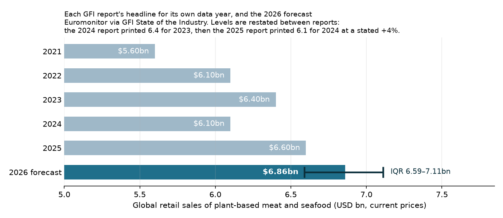

# What will be the total retail sales of plant-based meat and seafood in 2026?

| | |
|---|---|
| **Source** | Metaculus #45422 — https://www.metaculus.com/questions/45422/ |
| **Type** | numeric (USD, global retail sales; question range 5–9 bn, both bounds open) |
| **Opened / Closes / Resolves** | open (CP revealed 2026-09-20) / 2026-12-31 / on GFI's 2027 State of the Industry report, expected ~2027-04, booked as 2027-06-30 |
| **Status** | open |
| **Current forecast** | **Median $6.84 bn, IQR [$6.56 bn, $7.12 bn]** (v3, 2026-09-26 — unchanged from v2) |
| **Community (as of 2026-09-26)** | CP $6.81 bn [6.51, 7.12] (n=17); Pro $6.78 bn [6.51, 7.08] (n=2); gold $6.77 bn [6.44, 7.16] (n=5) |
| **Next review** | 2026-11-15 |

<!-- Versions below, newest first. APPEND-ONLY: never edit or delete a past version. -->

---

## v3 — Update — 2026-09-26

Operator-requested check-in, 2 days after v2. `next_review` was 2026-11-15 — this update runs
well ahead of schedule, so a large move would be suspicious on its own; the honest expectation
going in was "nothing happened yet."

### Revision table

| Driver | Direction | Effect on median | Evidence |
|---|---|---|---|
| **Prior (v2, 2026-09-24)** | — | **$6.84 bn, IQR [$6.56, $7.12] bn** | — |
| Metaculus CP drifted from $6.85 bn (n=15) to $6.81 bn (n=17); two new forecasters pulled the recency-weighted center toward Pro/gold. Pro $6.78 bn (n=2) and gold $6.77 bn (n=5) are unchanged to the dollar | down, but within the CP's own noise band (Δ ≈ 0.5% on 2 new forecasters) | 0 (flagged, not acted on — see below) | [1] |
| EUR/USD: 189 ECB fixings, YTD mean 1.1615 (v2: 1.1618 over 187); spot 1.1403 (v2: 1.1411). Bank Q4 2026 consensus still 1.13–1.20, well above the 1.10 tripwire | none | 0 | [2], [3] |
| No 2026 European (GFI Europe/Circana), US (SPINS/Circana) or Euromonitor category data published since v2; GFI's next scheduled release is the 2027 SOTI (~April 2027), not before | none | 0 | [4]–[6] searches 2026-09-26 |
| Metaculus resolution criteria, fine print, background, close date unchanged (byte-for-byte diff against the 2026-09-24 snapshot); 0 comments both times | none | 0 | [1] |
| Beyond Meat: Phytosphere launch (2026-09-09) and Beyond Steak Filet retail expansion (2026-09-15) already priced into v2; a debt-for-equity exchange this week moved the stock, not category sales | none | 0 | [7] |
| **New forecast (v3)** | | **$6.84 bn, IQR [$6.56, $7.12] bn — unchanged** | |

I am deliberately **not** chasing the CP's $0.04 bn dip. Per the anti-pattern rule ("excessive
volatility: moving on a single data point"), a 0.5% shift produced by two new forecasters
joining a recency-weighted pool over 48 hours, with the Pro and gold cohorts — the ones this
repo is instructed to weight most — completely unchanged, is noise, not a new fact. The v2
rationale for trimming toward Pro/gold already stands; there is nothing new to trim further
toward. If the CP keeps drifting down at the next review and Pro/gold move with it, that is a
real signal and I will act on it then.

### Tripwire check (against the v2 list, by name)

| Tripwire | Status | Note |
|---|---|---|
| European 2026 meat-alternative growth > +4% (by 2027-03-31) | not fired | no 2026 data published |
| European 2026 meat-alternative growth < −3% (by 2027-03-31) | not fired | no 2026 data published |
| EUR/USD FY2026 avg < 1.13 (by 2027-01-15) | not fired; still effectively dead | YTD 1.1615 |
| EUR/USD Q4 2026 avg < 1.10 (by 2027-01-05) | not fired | bank consensus for Q4 is 1.13–1.20 [3]; would need a sharp reversal |
| US FY2026 plant-based meat dollars < −12% (by 2027-03-31) | not fired | no 2026 SPINS/Circana read found |
| GFI provider change / tofu-tempeh folded in (by 2027-04-30) | not fired | resolution criteria byte-identical to v2 |
| CP settles outside $6.5–7.2 bn with n ≥ 30 (by 2026-11-30) | not fired | CP $6.81 bn, n=17 — inside the band, n still well under 30 |
| No GFI 2027 SOTI by 2027-06-30 | not yet testable | GFI's most recent SOTI (covering 2025, printed $6.6 bn) shipped April 2026 as expected; no schedule change announced |

### What resolves YES

Unchanged from v1/v2.

### Outside view

Unchanged from v2.

### Inside view

Unchanged from v2.

### Evidence

Genuinely nothing new. Every source category from the tripwire list was re-searched
(2026-09-26) and returned only material already cited in v1/v2. This is the "no evidence is
itself informative" case from the update protocol — but it points to *no update*, not to decay,
because (as noted in v2) this is a single-release numeric question, not an event question: 2
quiet days do not shrink the probability of anything.

### Other forecasters

| Source | Median | IQR | n | As of | Note |
|---|---|---|---|---|---|
| Metaculus CP (recency-weighted) | $6.81 bn | [$6.51, $7.12] bn | 17 | 2026-09-26 10:36 | down from $6.85 bn (n=15) on 2026-09-24 |
| Metaculus Pro | $6.78 bn | [$6.51, $7.08] bn | 2 | 2026-09-26 10:36 | identical to 2026-09-24 |
| Metaculus gold medalists | $6.77 bn | [$6.44, $7.16] bn | 5 | 2026-09-26 10:36 | identical to 2026-09-24 |
| Kalshi / Polymarket / Manifold | — | — | — | 2026-09-26 | still no market |

**Cohort disagreement is narrowing, not widening.** The CP moved $0.04 bn toward Pro/gold; it
did not move away from them. That is mild corroboration of the v2 lean (trim toward the
informed cohorts), already reflected in the v2 median — it is not a reason to trim further
today, since Pro and gold themselves did not move.

### Scenarios

Unchanged from v2.

### Sensitivity

Unchanged from v2.

### What would change my mind (tripwires)

Unchanged from v2 — see table above for status. Carried forward verbatim into `meta.yaml`.

### Sources

1. Metaculus post 45422 aggregation snapshot (recency_weighted, metaculus_pros, gold_medalists; 36
   history points; 0 comments) — https://www.metaculus.com/questions/45422/ (accessed 2026-09-26;
   cached at `raw/metaculus-2026-09-26.json`; resolution criteria/fine print/background diffed
   byte-for-byte against the 2026-09-24 snapshot, no change)
2. ECB reference rates via Frankfurter API, 2026-01-01 to 2026-09-26 —
   https://api.frankfurter.dev/v1/2026-01-01..2026-09-26?base=EUR&symbols=USD (accessed
   2026-09-26; cached at `raw/ecb-fx-eurusd-cy2026-retrieved-2026-09-26.json`)
3. Aggregated Q4 2026 EUR/USD sell-side forecasts (Goldman Sachs, Scotiabank, J.P. Morgan, ING;
   median ≈1.23 pre-June, revised down toward a 1.13–1.20 consensus range after the ECB's 2026-06-11
   25 bp hike to a 2.25% deposit rate widened the Fed–ECB differential) — search-aggregated via
   Cambridge Currencies "EUR/USD Forecast 2026" and BitMEX "EUR/USD Forecast 2026" (accessed
   2026-09-26; no single primary source, treated as directional context only, not a point estimate)
4. GFI Europe — European plant-based sales data — https://gfieurope.org/european-plant-based-sales-data/
   (accessed 2026-09-26; still 2025 data)
5. Vegconomist / Green Queen coverage of GFI's 2026 State of the Industry reports (the report
   covering calendar-2025 data, published April 2026 — same report already cited as source 7 in
   v1/v2, resurfaced by this search, not a new release) —
   https://vegconomist.com/studies-numbers/gfis-2026-state-of-industry-reports-detail-mixed-year-alternative-proteins-across-three-sectors/
   ; https://www.greenqueen.com.hk/gfi-state-of-the-industry-report-2025-2026-plant-based-sales/
   (accessed 2026-09-26)
6. GFI — Analyzing plant-based meat & seafood sales (US SPINS series; latest is still FY2025 −10%) —
   https://gfi.org/resource/analyzing-plant-based-meat-and-seafood-sales/ (accessed 2026-09-26; no
   change)
7. Beyond Meat press coverage, week of 2026-09-21 to 2026-09-26 (debt-for-equity exchange sold off
   the stock; Phytosphere and Steak Filet launches already known at v2) — Yahoo Finance / Robinhood
   BYND quote pages (accessed 2026-09-26; stock-price move, no category sales data)
8. Good Food Institute — *2026 State of the Industry report: Plant-based meat, seafood, eggs, dairy,
   and ingredients* (the 2025 base of $6.6 bn, Euromonitor scope, "data may differ from previous
   reports") —
   https://gfi.org/wp-content/uploads/2026/04/GFI_State-of-the-Industry-report-Plant-based-meat-seafood-eggs-dairy-and-ingredients.pdf
   (accessed 2026-09-17; carried forward from v1/v2, still the current release)
9. Circana — "Plant-Based Food & Drink Hits €16.3B in Europe — But Only 2.4% of FMCG" (2025 EU6
   category context for the Europe block; the same source also reports EU6 meat-alternative value
   sales −7%, the assumption behind the US/Europe tripwires) —
   https://www.circana.com/post/plant-based-food-and-drink-hits-16-3bn-in-europe-but-still-just-2-4-of-fmcg-sales
   (accessed 2026-09-24; carried forward from v2, no newer edition found)
10. Food Business News — "Plant-based sales in the US continue to slide" (SPINS 2025: −10% dollars
    for plant-based meat) —
    https://www.foodbusinessnews.net/articles/30327-plant-based-sales-in-the-us-continue-to-slide
    (accessed 2026-09-24; carried forward from v2, no 2026 update published)
11. ECB reference rates via Frankfurter API, calendar 2025 (EUR/USD annual average 1.1300, the
    comparison base for the FX line) —
    https://api.frankfurter.dev/v1/2025-01-01..2025-12-31?base=EUR&symbols=USD,GBP,JPY (accessed
    2026-09-17; carried forward, unchanged — 2025 is a closed year)
12. AgFunderNews — "Plant-based meat by numbers: Grim reading for the US retail market, brighter
    spots in foodservice and globally" (2024 global $6.1 bn at +4%, the restatement evidence behind
    the lower tail) —
    https://agfundernews.com/plant-based-meat-by-numbers-grim-reading-for-the-us-retail-market-brighter-spots-in-foodservice-and-globally
    (accessed 2026-09-17; carried forward from v1/v2)

**Date**: 2026-09-26
**Forecast**: Median $6.84 bn, IQR [$6.56 bn, $7.12 bn]
**Thesis**: No material change in two days. Every v2 tripwire re-checked by name: none fired.
FX is flat (EUR/USD YTD 1.1615, essentially identical to 1.1618 two days ago) and Q4 bank
consensus (1.13–1.20) stays well clear of the 1.10 tripwire. No new 2026 European or US category
data exists. The Metaculus CP drifted $0.04 bn toward the Pro/gold cohorts on two new
forecasters, which corroborates last week's trim but is too small and too Pro/gold-independent
to justify moving further — Pro and gold themselves did not move at all. Median held at $6.84 bn.

---

## v2 — Update — 2026-09-24

### Revision table

| Driver | Direction | Effect on median | Evidence |
|---|---|---|---|
| **Prior (v1, 2026-09-17)** | — | **$6.86 bn, IQR [$6.59, $7.11] bn** | — |
| Metaculus cohorts now visible (CP revealed 2026-09-20): gold $6.77 bn (n=5), Pro $6.78 bn (n=2), CP $6.85 bn (n=15). Pros and gold agree with each other and sit ~1.2% below me; their IQRs are wider on the downside | down, and slightly wider | −$0.02 bn; p25 −$0.03 bn, p75 +$0.01 bn | [1]; weighted ~20% as an independent crowd signal unavailable at v1 — not new evidence about sales, so kept small. I searched for a fact I missed and found none (no comments on the question) |
| EUR/USD: 2026 YTD ECB average 1.1618 over 187 fixing days (v1: 1.1620); spot 1.1411 on 2026-09-23. At ~1.14 for Q4 the full-year average lands ≈1.156, +2.3% on 2025 instead of +2.8% | marginally down | ≈ −$0.004 bn (rounds to zero) | [2] |
| No 2026 European (GFI Europe / Circana), US (SPINS / Circana) or Euromonitor category data published since v1 | none | 0 | [3]–[5] searches 2026-09-24 |
| Beyond Meat: product launches (Beyond Steak Filet at Erewhon/Wegmans/H-E-B, "Phytosphere" protein portfolio) and a small convertible-note exchange; no revenue news | none | 0 | [6] |
| **New forecast (v2)** | | **$6.84 bn, IQR [$6.56, $7.12] bn** | |

### Tripwire check

| Tripwire (from v1) | Status | Note |
|---|---|---|
| European 2026 meat-alternative growth > +4% (by 2027-03-31) | not fired | no 2026 data published |
| European 2026 meat-alternative growth < −3% (by 2027-03-31) | not fired | no 2026 data published |
| EUR/USD 2026 FY average < 1.13 (by 2027-01-15) | not fired; **effectively dead** | would need the remaining ~66 fixings to average ≈1.04 against spot 1.14. Replaced below by a Q4-weakness tripwire |
| US FY2026 plant-based meat dollars < −12% (by 2027-03-31) | not fired | no 2026 SPINS/Circana read found |
| GFI provider change / tofu-tempeh folded in (by 2027-04-30) | not fired | |
| CP settles outside $6.5–7.2 bn with n ≥ 30 (by 2026-11-30) | not fired | CP $6.85 bn, n=15 — inside the band |
| No GFI 2027 SOTI by 2027-06-30 | not yet testable | |

### What resolves YES

Unchanged from v1. Resolution criteria and fine print re-read in today's snapshot [1]; text identical.

### Outside view

Unchanged from v1 (reference class B, headline-to-headline change, mean +4.3%, sd 6.4 pp).

### Inside view

Unchanged from v1 except the FX line: the EUR tailwind on annual averages is now ≈+2.3% (was
+2.84% YTD at v1), trimming the FX translation term from ≈+1.2 pp to ≈+1.0 pp. Effect on the
median is below rounding.

### Evidence

Only one piece of information is new: the crowd. That aside, the week added nothing. Every tripwire
source was searched and nothing had been published. Quiet time does not decay this forecast
the way it would an event question, because the number is fixed by a single release in ≈April 2027.

### Other forecasters

| Source | Median | IQR | n | As of | Note |
|---|---|---|---|---|---|
| Metaculus CP (recency-weighted) | $6.85 bn | [$6.54, $7.13] bn | 15 | 2026-09-23 22:06 | revealed at $6.80 bn on 2026-09-20, drifted up |
| Metaculus Pro | $6.78 bn | [$6.51, $7.08] bn | 2 | 2026-09-23 | tiny cohort |
| Metaculus gold medalists | $6.77 bn | [$6.44, $7.16] bn | 5 | 2026-09-23 | stable since reveal ($6.79 → $6.77 bn) |
| Kalshi / Polymarket / Manifold | — | — | — | 2026-09-24 | still no market |

**Cohort disagreement: small but directional.** Pro and gold sit ~$0.07 bn below the CP and
~$0.08 bn below my v1 median, with a fatter lower tail (gold p25 $6.44 bn). This fits my own
view that restatement risk is under-priced by a naive "+6% on $6.6 bn" reading. It is a gap of about
1 pp of growth on n = 2 and 5, so I give it partial weight and do not adopt it.

### Scenarios

Unchanged from v1. The lower-tail widening comes from the cohort blend, not from re-weighting
scenario 4.

### Sensitivity

Unchanged from v1.

### What would change my mind (tripwires)

- [ ] **GFI Europe or Circana publishes 2026 European value-weighted meat-alternative growth above +4%
      (FR/DE/IT/NL/ES/UK)**, by 2027-03-31 → **up, $0.15 bn**
- [ ] **The same data shows below −3%**, by 2027-03-31 → **down, $0.20 bn**
- [ ] **EUR/USD Q4 2026 average (ECB, Oct–Dec) below 1.10**, so the full-year average falls to ≈1.145 or
      lower and the tailwind is under +1.5%, by 2027-01-05 → **down, $0.04 bn** (replaces the dead
      FY < 1.13 tripwire)
- [ ] **US FY2026 plant-based meat dollar sales (SPINS or Circana) fall more than 12%**, by 2027-03-31 →
      **down, $0.06 bn**
- [ ] **GFI announces a data-provider change away from Euromonitor, or folds tofu/tempeh in**, by
      2027-04-30 → **re-analyse from scratch**
- [ ] **Metaculus CP settles outside $6.5–7.2 bn with n ≥ 30, or gold medalists move below $6.6 bn**,
      by 2026-11-30 → **re-check, do not nudge**
- [ ] **No GFI 2027 State of the Industry report by 2027-06-30** → **re-assess annulment risk**

### Sources

1. Metaculus post 45422 aggregation snapshot (recency_weighted, metaculus_pros, gold_medalists; 32
   history points; 0 comments) — https://www.metaculus.com/questions/45422/ (accessed 2026-09-24;
   cached at `raw/metaculus-2026-09-24.json`)
2. ECB reference rates via Frankfurter API, 2026-01-01 to 2026-09-23 —
   https://api.frankfurter.dev/v1/2026-01-01..2026-09-24?base=EUR&symbols=USD,GBP,JPY (accessed
   2026-09-24; cached at `raw/ecb-fx-eurusd-cy2026-retrieved-2026-09-24.json`)
3. GFI Europe — European plant-based sales data — https://gfieurope.org/european-plant-based-sales-data/
   (accessed 2026-09-24; still 2025 data)
4. FoodNavigator — "What's driving Europe's alternative protein sector in 2026?" (2026-07-16) —
   https://www.foodnavigator.com/Article/2026/07/16/whats-powering-europes-alternative-protein-sector/
   (accessed 2026-09-24; search result only, no 2026 category figures surfaced)
5. GFI — Analyzing plant-based meat & seafood sales (US SPINS series; latest is FY2025 −10%) —
   https://gfi.org/resource/analyzing-plant-based-meat-and-seafood-sales/ (accessed 2026-09-24)
6. Beyond Meat press releases via GlobeNewswire, 2026-09-09 and 2026-09-15 —
   https://www.globenewswire.com/news-release/2026/09/15/3362152/0/en/beyond-meat-announces-availability-of-beyond-steak-filet-at-erewhon.html
   (accessed 2026-09-24)
7. Good Food Institute — *2026 State of the Industry report: Plant-based meat, seafood, eggs, dairy,
   and ingredients* (the 2025 base of $6.6 bn, Euromonitor scope, "data may differ from previous
   reports") —
   https://gfi.org/wp-content/uploads/2026/04/GFI_State-of-the-Industry-report-Plant-based-meat-seafood-eggs-dairy-and-ingredients.pdf
   (accessed 2026-09-17; carried forward from v1)
8. AgFunderNews — "Plant-based meat by numbers: Grim reading for the US retail market, brighter
   spots in foodservice and globally" (2024 global $6.1 bn at +4%, which is the restatement evidence behind the lower
   tail) —
   https://agfundernews.com/plant-based-meat-by-numbers-grim-reading-for-the-us-retail-market-brighter-spots-in-foodservice-and-globally
   (accessed 2026-09-17; carried forward from v1)
9. AgFunderNews — "Plant-based by numbers: USA continued declines for alt-meat, more positive news
   for alt-dairy" (2023 global $6.4 bn as first printed) —
   https://agfundernews.com/plant-based-by-numbers-usa-continued-declines-for-alt-meat-more-positive-news-for-alt-dairy-gfi
   (accessed 2026-09-17; carried forward from v1)
10. ECB reference rates via Frankfurter API, calendar 2025 (EUR/USD annual average 1.1300, the
    comparison base for the FX line) —
    https://api.frankfurter.dev/v1/2025-01-01..2025-12-31?base=EUR&symbols=USD,GBP,JPY (accessed
    2026-09-17; cached at `raw/ecb-fx-eurusd-cy2025-retrieved-2026-09-17.json`; carried forward)
11. Circana — "Plant-Based Food & Drink Hits €16.3B in Europe — But Only 2.4% of FMCG" (2025 EU6
    category context for the Europe block) —
    https://www.circana.com/post/plant-based-food-and-drink-hits-16-3bn-in-europe-but-still-just-2-4-of-fmcg-sales
    (accessed 2026-09-24)
12. Food Business News — "Plant-based sales in the US continue to slide" (SPINS 2025: −10% dollars
    for plant-based meat) —
    https://www.foodbusinessnews.net/articles/30327-plant-based-sales-in-the-us-continue-to-slide
    (accessed 2026-09-24)

**Date**: 2026-09-24
**Forecast**: Median $6.84 bn, IQR [$6.56 bn, $7.12 bn]
**Thesis**: No new sales data since v1: no 2026 European, US or Euromonitor read has been published, and the FX tailwind is essentially unchanged (EUR/USD YTD 1.162, ECB). The v1 case holds: about +4% on the $6.6 bn 2025 base, with restatement risk widening the band. The only new input is the revealed Metaculus crowd (gold $6.77 bn n=5, Pro $6.78 bn n=2, CP $6.85 bn n=15). The Pros and gold medalists sit slightly lower and are more worried about the downside, so I trim the median by $0.02 bn and widen the lower quartile.

---

## v1 — Initial forecast — 2026-09-17

### What resolves YES

This is a numeric question, so nothing "resolves YES" — it resolves at **the single dollar
figure the Good Food Institute (GFI) prints for global retail sales of plant-based meat and
seafood in calendar 2026**, in its 2027 State of the Industry (SOTI) report. Four things about
that sentence do the work:

1. **It is a global figure, not a US one.** The question background quotes "$2.2 billion in
   2015 → $6.6 billion in 2025", which is GFI's global series. GFI's *US* series is a separate
   SPINS-commissioned dataset that printed **$1.0 bn** for 2025. Anyone reading "$6.6 bn" as a
   US number, or "$1.0 bn" as the thing being forecast, is forecasting the wrong quantity.
2. **GFI does not measure it — Euromonitor does.** GFI licenses the category "meat and seafood
   substitutes" (chilled, frozen, shelf-stable), Retail Value RSP, current prices (i.e.
   including inflation). Euromonitor builds it from desk research, store checks, trade surveys
   and top-down company analysis — a *modelled estimate*, not a census. **Tofu, tempeh, seitan
   and inherently plant-based foods are excluded.**
3. **The level is restated between reports.** GFI states outright: "Data may differ from
   previous reports." The 2024 report printed **$6.4 bn for 2023**; the 2025 report printed
   **$6.1 bn for 2024 and called it +4%**. Both cannot be true of one series: the 2023 base was
   quietly cut ~8%. So the target is *the number printed in 2027*, not $6.6 bn × (1 + true growth).
4. **Release schedule and annulment.** The plant-based SOTI has landed in April (2025 report
   published 2025-04-29; 2026 report April 2026), so the 2027 edition is expected ≈ April 2027.
   The fine print annuls if nothing appears before 2028 — low risk, though GFI ran a 2024
   operating deficit. A reporting-structure change is handled by the fine print ("first official
   estimate for the year 2026 made during 2027"), but a *provider* change or a category
   redefinition would move the level far more than any demand story.

**Misconception in the question's own background, flagged per house rules.** It says retail
sales "have been steadily increasing". They have not been steady: the reported headline fell
from $6.4 bn (2023 report) to $6.1 bn (2024 report), and the US block — a quarter of the number
— has declined every year since 2021. The decade-long rise is real; the "steadily" is advocacy
framing inherited from the source.

### Outside view

Reference class, deliberately built **before** looking at any community signal (there was none
to look at — see *Other forecasters*).

| Data year | Headline as printed by that year's report | Growth GFI stated |
|---|---|---|
| 2021 | $5.6 bn | +17% |
| 2022 | $6.1 bn | +8% ($), +5% (weight) |
| 2023 | $6.4 bn | ≈ +5% |
| 2024 | $6.1 bn | +4% |
| 2025 | **$6.6 bn** | +8% ($), +4% real, +3% volume |

Two different base rates fall out, and the gap between them is the finding:

- **Class A — stated YoY growth, 2022–2025**: +8%, +5%, +4%, +8% → **mean +6.3%**, sd ≈ 2 pp.
  This is growth measured *after* restatement, i.e. on a base the reader never sees.
- **Class B — headline-to-headline ratio, which is literally what resolves**: +8.9%, +4.9%,
  **−4.7%**, +8.2% → **mean +4.3%**, median +6.6%, **sd 6.4 pp**. Applied to $6.6 bn that is a
  central $6.89 bn.

The ~2 pp wedge between A and B **is the average restatement drag**, and it is the single most
under-appreciated feature of this question. Class B is kept as primary; its 6.4 pp spread is
what the final band is calibrated to.

Cross-check: post-boom CAGR 2021→2025 is **+4.2%/yr**. The full-decade CAGR (+11.6%/yr,
$2.2 bn → $6.6 bn) is rejected — it is dominated by the 2017–2021 boom that demonstrably ended.
Commercial market-research CAGRs (IMARC, Mordor, MarketsandMarkets, market.us: +9% to +19%/yr
on levels from $1.7 bn to $21 bn) are rejected outright: mutually inconsistent by an order of
magnitude and scope-incompatible with Euromonitor's $6.6 bn.

### Inside view

Euromonitor weights implied by the 2026 report (Europe + US = 78% of dollar sales; Europe +
North America > 80%): **Europe $3.6 bn / 54.5%**, **US ≈$1.55 bn / 23.5%**, **rest of world
≈$1.45 bn / 22%**.

| Block | Weight | 2026 central (local currency) | Basis |
|---|---|---|---|
| Europe | 54.5% | **+3%** | 2025 value-weighted meat-alternative growth across the Circana six-market panel was **−0.7%** (FR +13.5%, DE +0.2%, IT +2.0%, ES −6.3%, UK −7.3%, NL −10.5%), but the panel excludes Lidl/Aldi, whose share is rising; price gap to conventional meat is narrowing, and France showed +16.8% volume on −2.8% price |
| US | 23.5% | **−7%** | SPINS 2025: −10% dollars, −11% units, distribution −8%. Beyond Meat FY2025 revenue −15.6%; Q2 2026 −8.2%. Euromonitor's US series historically falls more gently than SPINS |
| Rest of world | 22.0% | **+8%** | APAC/LatAm/MEA growing off a low base, plus local food inflation |
| FX translation | — | **+1.2 pp** | ECB reference rates: EUR/USD annual average 1.0824 → 1.1300 (2025, **+4.40%**) → 1.1620 (2026 YTD, **+2.84%**); GBP/USD +2.06%; JPY −5.6%. The 2025 tailwind (~+2.3 pp) roughly **halves** |

Weighted: **≈ +2.6%**.

**And that construction is wrong, in a known direction.** Run it on 2025 (Europe ≈ +2%, US −6
to −10%, RoW +10%, FX +2.3 pp) and it produces **+4.2%** against GFI's reported **+8%** — a
~4 pp miss. The most likely explanation is coverage: Euromonitor sees discounters, more
countries and more channels than any panel available to me, and GFI names Europe as the source
of the 2025 growth. I therefore carry a **discounted, highly uncertain +2.5 pp wedge** forward
rather than pretending either the bottom-up or the reported number is the truth, giving central
reported growth **≈ +4.6%**. The residual disagreement is priced as variance, not resolved by
picking a side. This is the load-bearing judgement in the forecast, and it is stated as such.

### Evidence

What moved the number, with rough likelihood ratios against a naive "repeat +8%" prior:

- **Restatement is documented, not hypothesised** (GFI: "Data may differ from previous
  reports"; $6.4 bn → $6.1 bn at a stated +4%). LR strongly favours a lower and wider
  distribution than class A alone: this alone pulls the centre from ≈$7.1 bn to ≈$6.9 bn and
  roughly triples the variance. **The biggest single update.**
- **FX tailwind halves** (hard ECB data, +4.40% → +2.84% EUR appreciation on annual averages).
  Worth ≈ −1 pp of reported growth. Modest but clean, and it is the reason I sit below the
  four-year growth mean.
- **US deterioration is confirmed and continuing** but decelerating at the margin: Beyond Meat
  FY2025 −15.6% → Q2 2026 −8.2%. The US is only 23.5% of the number.
- **Europe is the swing block and it is not collapsing**: EU6 plant-based food and drink
  +5.1% in 2025 (Circana), Germany +7.2% value / +4.2% volume, price gap narrowing. Meat
  alternatives specifically are the weak sub-category, and three of six markets fell.
- **Evidence I expected and did not find** (absence as evidence): no H1 2026 European or US
  category read had been published as of 2026-09-17, and **no prediction market anywhere
  quotes this or any adjacent alt-protein quantity**. There is no independent cross-check.
- **Disconfirming the bear case I started with.** I expected GLP-1 drugs to be a clear drag.
  *Food Policy* ("GLP-1 use and protein demand") finds effects "consistent for animal proteins
  but inconsistent or absent for plant-based options"; JAMA Network Open (Sørensen et al.,
  2026) finds a shift from ultra-processed to unprocessed in a Danish cohort but does not break
  out plant-based meat. Net: a real but small headwind, downgraded from my prior.
- **EU labelling turned out softer than feared.** The 5 March 2026 trilogue banned 31 animal
  terms (chicken, beef, pork, breast, thigh) but **spared "burger", "sausage", "nuggets"**, and
  such rules carry multi-year transitions. Essentially no 2026 sales impact.
- **US policy backdrop worsened**: the 2026 Dietary Guidelines are the first to explicitly
  discourage ultra-processed foods and they dropped the advisory committee's "prioritise plant
  protein" language. Second-order — it hits the block that is already falling.
- **No mechanism for a step-change exists.** Sun, Caputo & Taylor (*Choices*, Q3 2025) document
  a persistent 2–4× price premium ($8.61–10.46/lb vs $2.25–5.32/lb) and weak repeat purchase
  (45% of households buy chicken alternatives on <20% of trips). This caps the upside tail more
  than it moves the median.

### Other forecasters

| Source | Value | As of | Note |
|---|---|---|---|
| Metaculus CP (recency-weighted) | **none** | 2026-09-17 | question status `upcoming`; CP reveal 2026-09-20T20:55Z; aggregation returns 0 history points |
| Metaculus Pro | **none** | 2026-09-17 | empty cohort |
| Metaculus gold medalists | **none** | 2026-09-17 | empty cohort |
| Metaculus forecaster count | 3 | 2026-09-17 | |
| Kalshi | — | 2026-09-17 | no market on this or any adjacent alt-protein quantity |
| Polymarket | — | 2026-09-17 | no market |
| Manifold | — | 2026-09-17 | no market |
| Sentinel Team / Mantic / GJOpen / INFER | — | 2026-09-17 | out of domain; no matching question |
| Commercial research houses (IMARC, Mordor, MarketsandMarkets) | $11–21 bn for 2026 | 2026-09-17 | **not comparable** — different scope, mutually inconsistent, promotional. Excluded, not discounted |

**Cohort disagreement: not assessable.** All three Metaculus cohorts are empty, so the usual
"weight Pro and gold above CP, flag the gap" step cannot run. This forecast is genuinely
unanchored — which raises its independent value and also removes my usual error check. The
only crowd signal available is the question author's chosen range, 5–9 bn centred on $7.0 bn,
implying they expected roughly +6% on the $6.6 bn base. I sit ~2 pp below that, on the FX and
restatement arguments above. **This is the first thing to re-check after 2026-09-20.**

### Scenarios

| # | Scenario | Weight | Implies |
|---|---|---|---|
| 1 | **Europe-led grind higher.** Europe +3–5% local, US −7%, RoW +8%, FX +1.2 pp, base not restated | 0.40 | $6.85–7.05 bn |
| 2 | **Broad stall.** Europe flat, US −10%, RoW +5%, FX tailwind mostly absent (fixed-rate reporting) | 0.25 | $6.55–6.75 bn |
| 3 | **2025 repeats.** Euromonitor's wider coverage again prints +8%+; emerging markets surprise up | 0.18 | $7.10–7.40 bn |
| 4 | **Downward level break.** The 2027 report re-bases the series as the 2025 report did (~−8%) | 0.13 | $6.05–6.35 bn |
| 5 | **Scope or provider change** (Euromonitor dropped, tofu/tempeh folded in), or non-publication and annulment | 0.04 | far outside 5–9 bn, or annulled |

Weights sum to 1.00. Turned into a distribution by Monte Carlo over the four component growth
rates, the FX basis (30% chance Euromonitor reports at fixed rates, making FX neutral), the
coverage wedge, a 20%/10% down/up level-break mixture and a 4% scope break:

| Percentile | Value | vs 2025 |
|---|---|---|
| p5 | $5.96 bn | −9.7% |
| p10 | $6.24 bn | −5.5% |
| **p25** | **$6.59 bn** | −0.2% |
| **p50** | **$6.86 bn** | **+3.9%** |
| **p75** | **$7.11 bn** | +7.7% |
| p90 | $7.36 bn | +11.5% |
| p95 | $7.57 bn | +14.7% |

P(print at or below 2025's $6.6 bn) = **26%**. P(below $6.0 bn) = 5.6%. P(above $7.5 bn) = 6.2%.

**Calibration hygiene.** The total multiplicative sd is 6.6 pp, matched deliberately to
reference class B's 6.4 pp — an IQR built from my point estimates alone came out at
[$6.70, $7.07] and would have captured only one of four historical steps, so it was widened.
The band's implied growth range is [−0.2%, +7.7%], which still sits below two of the four
historical steps (+8.2%, +8.9%); that is intentional and rests on the halved FX tailwind, and
it is the way this forecast is most likely to be wrong. Would I take the other side at
$6.86 bn? Yes in either direction, which is the point.

### Sensitivity

| Assumption | If instead | Forecast becomes |
|---|---|---|
| Euromonitor reports at year-on-year exchange rates (70% weight, +1.2 pp FX) | Fixed exchange rates — FX neutral | Median **$6.80 bn**, IQR [6.54, 7.05] |
| | Certainly year-on-year rates | Median **$6.88 bn**, IQR [6.61, 7.13] |
| Europe grows +3% in local currency | Europe flat (0%) | Median **$6.75 bn**, IQR [6.48, 7.00] |
| | Europe +6% | Median **$6.97 bn**, IQR [6.69, 7.22] |
| The +2.5 pp coverage wedge carries into 2026 | Wedge is zero (bottom-up is right) | Median **$6.73 bn**, IQR [6.46, 6.98] |
| Level-break risk 20% down / 10% up | Break risk doubled (40% down) | Median **$6.75 bn**, IQR [**6.40**, 7.03] |
| | No break risk at all | Median **$6.90 bn**, IQR [6.70, 7.10] |
| US falls 7% | US falls 12% | Median **$6.78 bn** |
| Rest of world grows 8% | Rest of world grows 3% | Median **$6.79 bn** |

The median is robust: no single assumption moves it more than ±$0.13 bn. **The IQR is not** —
doubling the level-break probability drops p25 by $0.19 bn on its own. The uncertainty in this
question lives in Euromonitor's bookkeeping, not in plant-based meat demand.

### What would change my mind (tripwires)

- [ ] **GFI Europe or Circana publishes 2026 European retail data showing value-weighted
      meat-alternative growth above +4% across FR/DE/IT/NL/ES/UK**, by 2027-03-31 →
      **up, $0.15 bn** (Europe is 54.5% of the number)
- [ ] **The same data shows value-weighted growth below −3%**, by 2027-03-31 →
      **down, $0.20 bn**
- [ ] **EUR/USD 2026 full-year average (computable from ECB reference rates on 2027-01-02)
      comes in below 1.13**, i.e. at or under the 2025 average — the FX tailwind vanished, by
      2027-01-15 → **down, $0.08 bn**
- [ ] **US full-year 2026 plant-based meat dollar sales (SPINS or Circana) fall more than 12%**,
      versus the −7% assumed, by 2027-03-31 → **down, $0.06 bn**
- [ ] **GFI announces a data-provider change away from Euromonitor, or folds tofu/tempeh into
      the category**, by 2027-04-30 → **re-analyse from scratch** (direction unknowable;
      tofu/tempeh inclusion alone would roughly double the level)
- [ ] **After CP reveal on 2026-09-20, the Metaculus community prediction settles outside
      $6.5–7.2 bn with n ≥ 30**, by 2026-11-30 → **re-check, do not nudge** — with no Pro or
      gold cohort to weigh, a large CP gap means going looking for the fact I missed
- [ ] **No GFI 2027 State of the Industry report published by 2027-06-30** → **re-assess
      annulment risk**, currently priced at well under half of the 4% scope-break weight

### Sources

1. Metaculus — "What will be the total retail sales of plant-based meat and seafood in 2026?"
   (post 45422, question 45611) — https://www.metaculus.com/questions/45422/ (accessed
   2026-09-17; aggregation snapshot cached at `raw/metaculus-2026-09-17.json`)
2. Good Food Institute — *2026 State of the Industry report: Plant-based meat, seafood, eggs,
   dairy, and ingredients* (72 pp PDF; global figures pp. 4, 9, 16–17; data-collection notes
   pp. 28–29) —
   https://gfi.org/wp-content/uploads/2026/04/GFI_State-of-the-Industry-report-Plant-based-meat-seafood-eggs-dairy-and-ingredients.pdf
   (accessed 2026-09-17)
3. Good Food Institute — State of the Industry downloads —
   https://gfi.org/resource/state-of-the-industry-downloads/ (accessed 2026-09-17)
4. Good Food Institute — "Analyzing plant-based meat & seafood sales" (regional split, US SPINS
   series, category inclusions/exclusions) —
   https://gfi.org/resource/analyzing-plant-based-meat-and-seafood-sales/ (accessed 2026-09-17)
5. GFI Europe — "European plant-based sales data" (2025 country-level meat-alternative value and
   volume, Circana six markets) — https://gfieurope.org/european-plant-based-sales-data/
   (accessed 2026-09-17)
6. GFI Europe — "Europe's plant-based food retail market grows as prices become more
   competitive, but good taste remains key" —
   https://gfieurope.org/blog/europes-plant-based-food-retail-market-grows-as-prices-become-more-competitive-but-good-taste-remains-key/
   (accessed 2026-09-17)
7. Circana — "Plant-Based Food & Drink Hits €16.3B in Europe — But Only 2.4% of FMCG"
   (published 2026-04-10) —
   https://www.circana.com/post/plant-based-food-and-drink-hits-16-3bn-in-europe-but-still-just-2-4-of-fmcg-sales
   (accessed 2026-09-17)
8. Green Queen — "Global Plant-Based Food Sales Grew by 3% in 2025: GFI Report" —
   https://www.greenqueen.com.hk/gfi-state-of-the-industry-report-2025-2026-plant-based-sales/
   (accessed 2026-09-17)
9. AgFunderNews — "Plant-based meat by numbers: Grim reading for the US retail market, brighter
   spots in foodservice and globally" (2024 data: global $6.1 bn, +4%) —
   https://agfundernews.com/plant-based-meat-by-numbers-grim-reading-for-the-us-retail-market-brighter-spots-in-foodservice-and-globally
   (accessed 2026-09-17)
10. Green Queen — "Global Plant-Based Sales Up By 5% in 2024 Despite US Setback: GFI Report"
    (GFI report published 2025-04-29; 2024 global PB meat $6.1 bn) —
    https://www.greenqueen.com.hk/gfi-state-of-the-industry-report-2024/ (accessed 2026-09-17)
11. AgFunderNews — "Plant-based by numbers: USA continued declines for alt-meat, more positive
    news for alt-dairy" (2023 data) —
    https://agfundernews.com/plant-based-by-numbers-usa-continued-declines-for-alt-meat-more-positive-news-for-alt-dairy-gfi
    (accessed 2026-09-17)
12. Food Business News — "Plant-based sales in the US continue to slide" —
    https://www.foodbusinessnews.net/articles/30327-plant-based-sales-in-the-us-continue-to-slide
    (accessed 2026-09-17)
13. Beyond Meat, Inc. — Form 8-K/A exhibit 99.1, FY2025 and Q4 2025 results (filed 2026-04-09;
    FY2025 net revenue $275.5 M, −15.6%; volume −15.9%), SEC EDGAR —
    https://www.sec.gov/Archives/edgar/data/1655210/000165521026000027/ex991pressrelease-q4andful.htm
    (accessed 2026-09-17)
14. Beyond Meat, Inc. — Q1 2026 financial results (investor relations page returned HTTP 503
    from this environment on 2026-09-17; Q2 2026 figures of −8.2% revenue / −9.5% volume taken
    from secondary coverage, flagged as second-hand) —
    https://investors.beyondmeat.com/news-releases/news-release-details/beyond-meatr-reports-first-quarter-2026-financial-results
    (accessed 2026-09-17)
15. Green Queen — "EU Bans 31 Meat Names on Plant-Based Products, But 'Veggie Burger' Saved"
    (trilogue agreement 2026-03-05) —
    https://www.greenqueen.com.hk/eu-veggie-burger-ban-plant-based-meat-names-vegan-labelling/
    (accessed 2026-09-17)
16. just-food — "'Veggie burger' survives but EU bodies agree wide ban on plant-based names" —
    https://www.just-food.com/news/eu-ban-plant-based-names/ (accessed 2026-09-17)
17. Sun, J., Caputo, V. & Taylor, H. — "What Explains the Recent Slowing Growth of the
    Plant-Based Meat Alternatives Market?", *Choices*, Q3 2025 —
    https://www.choicesmagazine.org/choices-magazine/submitted-articles/what-explains-the-recent-slowing-growth-of-the-plant-based-meat-alternatives-market
    (accessed 2026-09-17)
18. Sørensen, K.K., Møller, F.T., Yazdanfard, P.D.W. et al. — "Consumer Food Purchases After
    Glucagon-Like Peptide-1 Receptor Agonist Initiation", *JAMA Network Open*, 2026 (published
    2026-01-26) — https://pmc.ncbi.nlm.nih.gov/articles/PMC12836129/ (accessed 2026-09-17)
19. "GLP-1 use and protein demand", *Food Policy* —
    https://www.sciencedirect.com/science/article/pii/S0306919225002313 (HTTP 403 from this
    environment; finding taken from the search index and flagged as second-hand; accessed
    2026-09-17)
20. STAT News — "Dietary guidelines declare war on processed foods and sugar, encourage more
    protein and dairy" (published 2026-01-07) —
    https://www.statnews.com/2026/01/07/dietary-guidelines-revised-more-protein-less-sugar-highly-processed-foods/
    (accessed 2026-09-17)
21. European Central Bank daily reference rates, 2024-01-02 to 2026-09-17, via the Frankfurter
    API (EUR/USD annual averages 1.0824 / 1.1300 / 1.1620 YTD) —
    https://api.frankfurter.dev/v1/2026-01-01..2026-12-31?base=EUR&symbols=USD,GBP,JPY
    (accessed 2026-09-17; snapshots in `raw/`)
22. Trading Economics — EUR/USD spot, 1.14754 on 2026-09-17 —
    https://tradingeconomics.com/euro-area/currency (accessed 2026-09-17)

**Date**: 2026-09-17
**Forecast**: Median $6.86 bn, IQR [$6.59 bn, $7.11 bn]
**Thesis**: The resolver is a Euromonitor estimate GFI reprints, and its *level* is restated between reports — the 2024 report printed $6.4 bn for 2023, the 2025 report $6.1 bn for 2024 at a stated +4% — so the right reference class is headline-to-headline change (+8.9%, +4.9%, −4.7%, +8.2%; mean +4.3%), not the stated growth rate. Off the 2025 base of $6.6 bn I take ≈ +4%: Europe (54.5% of the number) is stabilising as its price gap narrows, the US (23.5%) keeps falling ~7% under a hostile 2026 policy backdrop, and the FX tailwind that helped 2025's +8% roughly halves as EUR/USD annual-average appreciation goes 4.40% → 2.84% (ECB rates). No Metaculus cohort, market or peer forecast exists to check this against — the CP reveals 2026-09-20.
