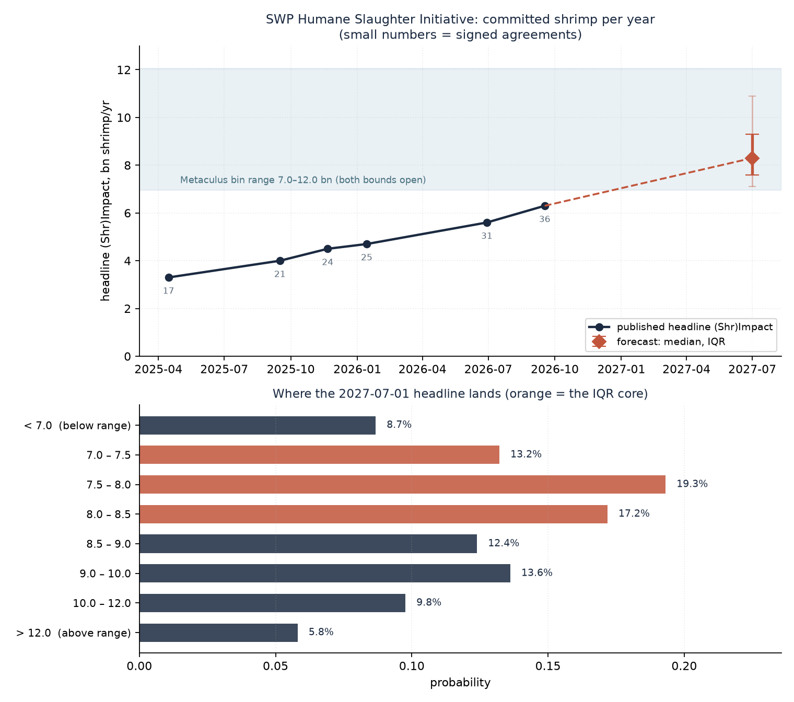

# How many shrimp per year will be covered by SWP's Humane Slaughter Initiative agreements on July 1, 2027?

| | |
|---|---|
| **Source** | Metaculus #45706 — https://www.metaculus.com/questions/45706/ |
| **Type** | discrete (51 bins × 100 M, nominal range 7.0–12.0 bn, **both bounds open**) |
| **Opened / Closes / Resolves** | not yet open (status `upcoming`, CP reveal 2026-09-20) / 2027-06-01 / on or soon after 2027-07-01 |
| **Status** | open |
| **Current forecast** | **Median 8.3 bn, IQR [7.6 bn, 9.3 bn]** (v1, 2026-09-17) |
| **Community (as of 2026-09-17)** | **none — CP not yet revealed** (n=3 forecasters; no Pro, no gold, no comments) |
| **Next review** | 2026-12-17 |

<!-- Versions below, newest first. APPEND-ONLY: never edit or delete a past version. -->

---

## v1 — Initial forecast — 2026-09-17

### What resolves YES

This resolves to whatever number sits in the "Shrimps helped (in Expectation each year)"
box on <https://www.shrimpwelfareproject.org/shrimpact> when Metaculus looks on or soon
after **2027-07-01**, rounded to the nearest 100 million. It is not a statistical release:
it is a charity's own page, carrying **no "last updated" date**, refreshed whenever SWP
chooses. The fine print takes the **headline** figure and ignores the published range
(today 4.3–8.7 bn); only if SWP stopped giving a headline would the range midpoint be used.

The headline is a **commitment** measure, and SWP's FAQ says so explicitly: it is the annual
volume covered by *all signed producer agreements*, including stunners still being built or
shipped. It is not installed capacity (a separate, smaller figure — 3.6 bn today) and not
verified use. Retailer policies are explicitly excluded. So: **good news about installation
or verification does not move this number; only new signatures, bigger commitments, or a
methodology change do.** The main counter-intuitive path to a *low* resolution is therefore
not a worse world but a re-based metric — SWP's own FAQ flags that it is "progressively
strengthening" the verified-use category, and its most prominent external critic
(Vetted Causes) attacks exactly the unverified-commitment framing.

On 2026-09-17 the page reads **6.3 bn**, from **36 corporate agreements** across 9 countries,
covering **86,875 MT/year**, of which **20 stunners are installed** (54,175 MT ≈ 3.6 bn).

### Outside view

I reverse-engineered the metric before forecasting it. The Guesstimate model SWP links from
the page (`getguesstimate.com/models/22982`, rendered 2026-09-17) is a 35-row table of
(producer's annual volume) × (share committed to stunning), summing to 86,624 MT — within
0.3% of SWP's published 86,875 MT — divided by a **14 g/shrimp** scalar (range 10–20 g,
which is exactly what generates the published 8.7 / 4.3 bn bounds). So:

> **headline = committed tonnage × 71,429 shrimp per MT.**

The question is therefore not "how well is SWP doing" but "how many more MOUs get signed,
and does the conversion change".

Reference class: **SWP's own signing rate.** Six observations:

| Date | Agreements | Headline (bn) | Source |
|---|---|---|---|
| ~2025-04 | 17 | 3.3 | EA Forum 2030-vision post; ACE review |
| 2025-09-16 | 21 | 4.0 | SWP press release (21st MOU) |
| 2025-11-21 | 24 | 4.5 | EA Forum marginal-funding post |
| 2026-01-14 | 25 | ~4.7 | SWP press release (25th MOU) |
| 2026-06-29 | 31 | ~5.6 | Aqua Culture Asia Pacific |
| 2026-09-17 | 36 | **6.3** | Shrimpact page, retrieved today |

Signing rate: **1.12/month** over the full 17 months, **1.25/month** over 12 months,
**1.36/month** over 8 months, **1.92/month** over the last 2.6 months. Mildly accelerating in
absolute terms; decelerating in percentage terms, since the base tripled.

Marginal size per agreement: (6.3 − 4.0) / 15 = **0.153 bn**, below the 0.175 bn average —
as expected, because the early deals were the big ones (5,000–6,000 MT rows in the model)
while the published eligibility floor is now **1,800–2,000 MT** and "current funding allows
for one unit per producer only".

Scaled to the 9.43-month window: **+1.8 bn on the 12-month rate**, giving **≈ 8.1 bn**.

A competing class — SWP's claim that "the number of corporate partnerships has essentially
doubled each year since 2022" — sounds much more bullish but is not, over a window this
short: ×1.57/yr on the *count* over 9.43 months is 36 → ~50 agreements, i.e. +14 × 0.153 =
**+2.1 bn → ≈ 8.4 bn**. Applying ×1.57 to the *headline value* instead gives 9.0 bn, but
that double-counts by assuming marginal deals are as large as historical average ones. I
discard it. The growth-model choice is not load-bearing here; the **rate** is.

### Inside view

```
headline(2027-07-01) = 6.3
                     + new agreements × 0.155 bn        (core)
                     + committed-share widening          (small, positive)
                     ± step change (HSI 2.0 / big funder)
                     ± methodology revision (g/shrimp, or re-basing)
                     ± page not refreshed
```

**Core.** Rate ~ lognormal, median 1.35 agreements/month, 10–90 band 0.73–2.51. Funding is
not the binding constraint: 1.35/month × $55k ≈ $0.9 M/yr against ACE's assessed $3.6 M/yr
capacity and ~90% of budget going to HSI. Corporate-engagement deal-flow is. Nor does the
~6-month stunner lead time gate the headline — signing, not installing, is what counts,
which is precisely why the installed count sat at "over 20" in June and exactly 20 in
September while agreements went 31 → 36.

**Demand pull is strengthening inside the window.** Retailer policies on the page went 11
(Jan 2026) → 17 (Sep 2026), now including Lidl GB, Auchan, REWE and both ALDI groups. Lidl
GB's own commitment is electrical stunning by **end of 2026**; several others bite in 2027.
Retailers that need stunned supply are the mechanism that makes producers sign.

**Committed-share widening.** Partners' *total* production in the model is 410,546 MT, of
which only 21.1% is committed. Seajoy has publicly said it goes from 70% to 100% stunned by
end-2027. This channel is real but capped by the one-stunner-per-producer rule, so I model
it as small (Gamma, mean ≈ +0.14 bn).

**Step change.** SWP has been publicly describing "HSI 2.0" — a country-scale programme —
since November 2025, and says $5–10 M would let it "20x" impact toward 100 bn by 2030.
Nothing visible has landed in the ten months since. I give 10% to a headline-visible jump in
this window, lognormal with median +3.5 bn.

**Deceleration risks, taken seriously.** (i) SWP itself wrote in Nov 2025 that research,
implementation and measurement "is possibly our biggest focus in 2026 (i.e. we may need to
slow down to speed up)". It did not bite — Jan–Sep 2026 was the fastest absolute stretch yet
— but 2027 is a different budget year. (ii) SWP's Director of Programme Implementation said
in June 2026: *"There is no capacity for all the welfare commitments as it stands today.
There need to be more supply chains coming online."* That is an equipment-supply constraint,
and a charity that cannot deliver a stunner has a reason not to sign for one. (iii) <10% of
SWP's revenue is recurring (ACE), so 2027 funding is not locked.

**Methodology.** 10% chance the 14 g/shrimp conversion is revised (a pure multiplier on
resolution, modelled as ×N(1.0, 0.17)); 4% chance the headline is re-based onto installed or
verified volume (today's installed/committed ratio is 0.62); 3% chance the page is simply
not refreshed at all.

400,000 draws, `model.py` in this folder, seed 20260917.

### Evidence

| Finding | Direction | Likelihood-ratio judgement |
|---|---|---|
| Guesstimate model reproduces the published 86,875 MT and the 4.3/6.3/8.7 triple exactly | — | Converts a soft "charity number" into arithmetic; **collapses my IQR** by roughly a third versus forecasting the headline directly |
| 31 agreements on 2026-06-29 → 36 on 2026-09-17 | ↑ | Recent rate 1.92/mo vs 1.25/mo trailing-12m. Small n (2.6 months); I let it pull the median up ~0.2 bn, not all the way to 9.1 |
| SWP stopped press-releasing MOUs after 2026-01-14 while signing 11 more | → | No signal about the rate itself, but it means **press releases are dead as a tripwire** |
| "Slow down to speed up" (SWP, Nov 2025) | ↓ | Stated, then falsified by nine months of faster signing. LR ≈ 1.2 against the low scenario, not the 2–3 it would have deserved a year ago |
| Equipment-supply constraint (SWP, Jun 2026) | ↓ | Genuine and recent; the main reason my p10 is only 7.1 rather than 7.6 |
| Retailer policies 11 → 17 in 8 months, several 2026/2027 deadlines | ↑ | Sustains deal-flow through the window |
| One stunner per producer; floor 1,800–2,000 MT | ↓ | Caps the marginal deal at ~0.14 bn; a real ceiling on the "existing partners expand" story |
| **Absent evidence I looked for and did not find**: any announced country-scale deal, any new mega-grant, any 2026 SWP annual report, any target number for 2027 | ↓ | Ten months of silence on "HSI 2.0" is weak evidence against a step change landing by mid-2027 |

### Other forecasters

| Source | Value | As of | Note |
|---|---|---|---|
| Metaculus CP (recency-weighted) | **not revealed** | 2026-09-17 | question status `upcoming`; reveal 2026-09-20; n=3 |
| Metaculus Pro | not revealed | 2026-09-17 | no Pro forecasts recorded |
| Metaculus gold medalists | not revealed | 2026-09-17 | no gold forecasts recorded |
| Metaculus comments | none | 2026-09-17 | |
| Polymarket / Kalshi / Manifold | **no market exists** | 2026-09-17 | searched all three; Manifold has only an SWP *charity donation* page |
| Good Judgment Open / INFER | no matching question | 2026-09-17 | |
| Sentinel Team / Mantic | not covered | 2026-09-17 | neither tracks animal-welfare metrics |

**There is no cohort to agree or disagree with.** That is unusual and worth stating plainly:
the normal check — "if Pro and gold agree against me, go find the fact I missed" — is not
available, so the error bars here rest entirely on my own decomposition. The one weak signal
of other people's beliefs is the question writer's choice of bin range: **7.0–12.0 bn**,
implying they expect growth (the floor is above today's 6.3) and centring the grid near
9.5 bn. My median sits at the 25th percentile of their grid. I think that is right rather
than contrarian: 9.5 bn needs ~21 new agreements in 9.4 months (2.2/month), above any rate
SWP has ever sustained, and bin grids are routinely drawn wide and a bit optimistic. But I
note it as the most likely place I am wrong, and the open bounds mean the writer was not
committing to the range containing the answer.

### Scenarios

| # | Scenario | Weight | Implies |
|---|---|---|---|
| 1 | **Trend holds.** ~11–14 new agreements at the 12-month rate; no methodology change; page refreshed in Q2 2027 | 0.45 | 7.9 – 8.7 bn |
| 2 | **Recent pace persists or demand-pull accelerates it.** ~16–22 new agreements as 2027 retailer deadlines bite | 0.22 | 8.8 – 10.2 bn |
| 3 | **Deal-flow slows** — equipment supply, a 2027 funding pinch, or the stated MEL pivot finally bites; ~4–9 new agreements | 0.18 | 6.9 – 7.8 bn |
| 4 | **Step change** — HSI 2.0 country-scale deal or a large new funder lands and is reflected on the page | 0.10 | 11 – 20+ bn |
| 5 | **Metric breaks** — headline re-based onto installed/verified volume, or the page is never refreshed | 0.05 | 4.5 – 7.0 bn |

Weights ≈ the Monte Carlo's mass; the simulation, not the table, generates the quantiles.

Resulting distribution (bn shrimp/yr): p10 7.1 · **p25 7.6** · **p50 8.3** · **p75 9.3** ·
p90 10.9 · p95 12.4. P(below the 7.0 bin floor) = 8.7%; P(above the 12.0 ceiling) = 5.8%.



### Sensitivity

| Assumption | If instead | Forecast becomes |
|---|---|---|
| Signing rate median 1.35 agreements/month | the last 2.6 months (1.92/mo) is the true current rate | median ≈ **9.1 bn**, IQR ≈ [8.2, 10.4] |
| Signing rate median 1.35 agreements/month | reverts to the 17-month average, 1.12/mo | median ≈ **8.0 bn** |
| Marginal agreement = 0.155 bn (≈2,170 MT) | marginal deals sit at the 1,800 MT floor (0.129 bn) | median ≈ **8.0 bn** (−0.3) |
| 14 g/shrimp conversion is stable | SWP re-estimates at 12 g (a plausible refinement toward smaller vannamei) | median ≈ **9.7 bn**; this single scalar is worth more than a year of signings |
| Headline stays a *committed*-volume measure | SWP re-bases onto installed volume (ratio 0.62 today) | median ≈ **5.1 bn**, below the question's open lower bound |

The g/shrimp scalar is the most dangerous assumption in the whole forecast: it is one cell
in a Guesstimate model, nobody audits it, and a revision from 14 g to 12 g moves resolution
by +17% — more than the entire expected year of deal-making.

### What would change my mind (tripwires)

- [ ] **Shrimpact page shows ≥ 42 agreements (or ≥ 7.3 bn) by 2026-12-31** → up, 0.6 bn
      (confirms the ~1.9/month pace rather than 1.35)
- [ ] **Shrimpact page still shows ≤ 38 agreements (or ≤ 6.7 bn) on 2027-01-31** → down, 0.9 bn
      (a signing freeze; would move me to the low scenario)
- [ ] **SWP announces an "HSI 2.0" country-scale programme or a single grant ≥ $3 M, by 2027-04-30**
      → up, 2.5 bn
- [ ] **The Shrimpact headline is re-labelled to installed or verified volume, or the "shrimps
      helped" box is replaced by a range, by 2027-06-30** → either (re-analyse), 0
- [ ] **The Guesstimate model's g/shrimp cell changes from 14, by 2027-06-30** → either
      (re-analyse; ±1.5 bn per 2 g), 0
- [ ] **SWP publicly states 2027 funding is short, or ACE/Navigation Fund funding is not renewed
      for 2027, by 2027-03-31** → down, 0.8 bn

### Sources

1. Metaculus #45706, "How many shrimp per year will be covered by SWP's Humane Slaughter Initiative agreements on July 1, 2027?" — https://www.metaculus.com/questions/45706/ (accessed 2026-09-17; raw JSON in `raw/metaculus-2026-09-17.json`)
2. Shrimp Welfare Project, "(Shr)Impact" — https://www.shrimpwelfareproject.org/shrimpact (accessed 2026-09-17; full text in `raw/shrimpact-page-2026-09-17.txt`)
3. Shrimp Welfare Project impact model, Guesstimate #22982 — https://www.getguesstimate.com/models/22982 (accessed 2026-09-17; transcribed in `raw/guesstimate-22982-2026-09-17.txt`)
4. Shrimp Welfare Project, "Humane Slaughter Initiative" — https://www.shrimpwelfareproject.org/humane-slaughter-initiative (accessed 2026-09-17)
5. Shrimp Welfare Project, blog index and press-release index — https://www.shrimpwelfareproject.org/blog · https://www.shrimpwelfareproject.org/press-releases (accessed 2026-09-17)
6. Aaron Boddy, "Shrimp Welfare Project's path to helping 100 billion shrimps per year", EA Forum, 2025-11-21 — https://forum.effectivealtruism.org/posts/PHgbyFu4ikJRKPqx9/shrimp-welfare-project-s-path-to-helping-100-billion-shrimps (accessed 2026-09-17)
7. Shrimp Welfare Project, "SWP's 2030 Vision & Absorbency Plans", EA Forum, 2025-05-02 — https://forum.effectivealtruism.org/posts/Ztqzt4BWMPZW5ECfP/shrimp-welfare-project-s-2030-vision-and-absorbency-plans (accessed 2026-09-17)
8. Animal Charity Evaluators, "Shrimp Welfare Project Review — 2025 Recommended Charity" — https://animalcharityevaluators.org/charity-review/shrimp-welfare-project/ (accessed 2026-09-17)
9. Aqua Culture Asia Pacific, "Improving shrimp welfare with electrical stunners in Southeast Asia", 2026-06-29 — https://aquaasiapac.com/2026/06/29/improving-shrimp-welfare-with-electrical-stunners-in-southeast-asia/ (accessed 2026-09-17)
10. Shrimp Welfare Project, "Major Milestone for Humane Slaughter … 4 Billion Shrimps Annually; New MOU with CAMIMEX, Seafood Connection", 2025-09-16 — https://www.shrimpwelfareproject.org/blog/major-milestone-for-humane-slaughter-shrimp-welfare-project-expected-to-help-4-billion-shrimps-annually-new-mou-with-camimex-seafood-connection (accessed 2026-09-17)
11. Shrimp Welfare Project, "Trangs Group, Trang Corporation and Dary Foods Join Humane Slaughter Partnership", 2026-01-14 — https://www.shrimpwelfareproject.org/blog/trangs-group-trang-corporation-dary-foods-join-humane-slaughter-partnership-with-shrimp-welfare-project (accessed 2026-09-17)
12. Undercurrent News, "Aldi Sud joins other major UK supermarkets with shrimp stunning commitment", 2026-04-09 — https://www.undercurrentnews.com/2026/04/09/aldi-sud-joins-other-major-uk-supermarkets-with-shrimp-stunning-commitment/ (accessed 2026-09-17)
13. Responsible Seafood Advocate (Global Seafood Alliance), "With Aldi Süd pledge, all 11 major UK supermarkets have set shrimp welfare targets" — https://www.globalseafood.org/advocate/with-aldi-sud-pledge-all-11-major-uk-supermarkets-have-set-shrimp-welfare-targets/ (accessed 2026-09-17)
14. Vetted Causes, "Shrimp Welfare Project" review, 2025-04-27 — https://www.vettedcauses.com/reviews/shrimp-welfare-project (accessed 2026-09-17)
15. Fish Farming Expert, "Shrimp welfare initiative wins another convert" — https://www.fishfarmingexpert.com/humane-slaughter-seafood-industry-shrimp-welfare/shrimp-welfare-initiative-wins-another-convert/2054844 (accessed 2026-09-17)
16. SeafoodSource, "Ecuador, India, Vietnam shrimp industries facing higher US countervailing duties" — https://www.seafoodsource.com/news/supply-trade/ecuador-india-and-vietnam-shrimp-industry-to-be-hit-with-new-countervailing-duties-from-us (accessed 2026-09-17)
17. S&P Global Commodity Insights, "CNA estimates US tariffs cost Ecuadorian shrimp producers $20 million a month", 2026-08-18 — https://www.spglobal.com/commodity-insights/en/news-research/latest-news/agriculture/081825-cna-estimates-us-tariffs-cost-ecuadorian-shrimp-producers-20-million-a-month (accessed 2026-09-17)
18. Charity Entrepreneurship, "Shrimp Welfare Project" — https://www.charityentrepreneurship.com/shrimp-welfare-project (accessed 2026-09-17)
19. Wild Animal Initiative, "Update on the wild animal welfare funding landscape", EA Forum, 2024-10-02 — https://forum.effectivealtruism.org/posts/BL7ennvpCZKXJbbYH/update-on-the-wild-animal-welfare-funding-landscape (accessed 2026-09-17; checked and found **not** to concern SWP)

**Date**: 2026-09-17
**Forecast**: Median 8.3 bn, IQR [7.6 bn, 9.3 bn]
**Thesis**: The resolution number is arithmetic, not judgement — SWP's Guesstimate model
(source 3) shows the headline is committed tonnage ÷ 14 g/shrimp, so the forecast is just
"how many more MOUs get signed by mid-2027". SWP has signed 1.1–1.9 agreements/month for
seventeen straight months at ~0.153 bn each (sources 2, 6, 7, 9), and 9.4 months of that
takes 6.3 bn to roughly 8.3 bn; the wide right tail is the 10% chance a country-scale
"HSI 2.0" deal lands, and the left tail is the 4% chance SWP re-bases the headline onto
installed rather than committed volume.
