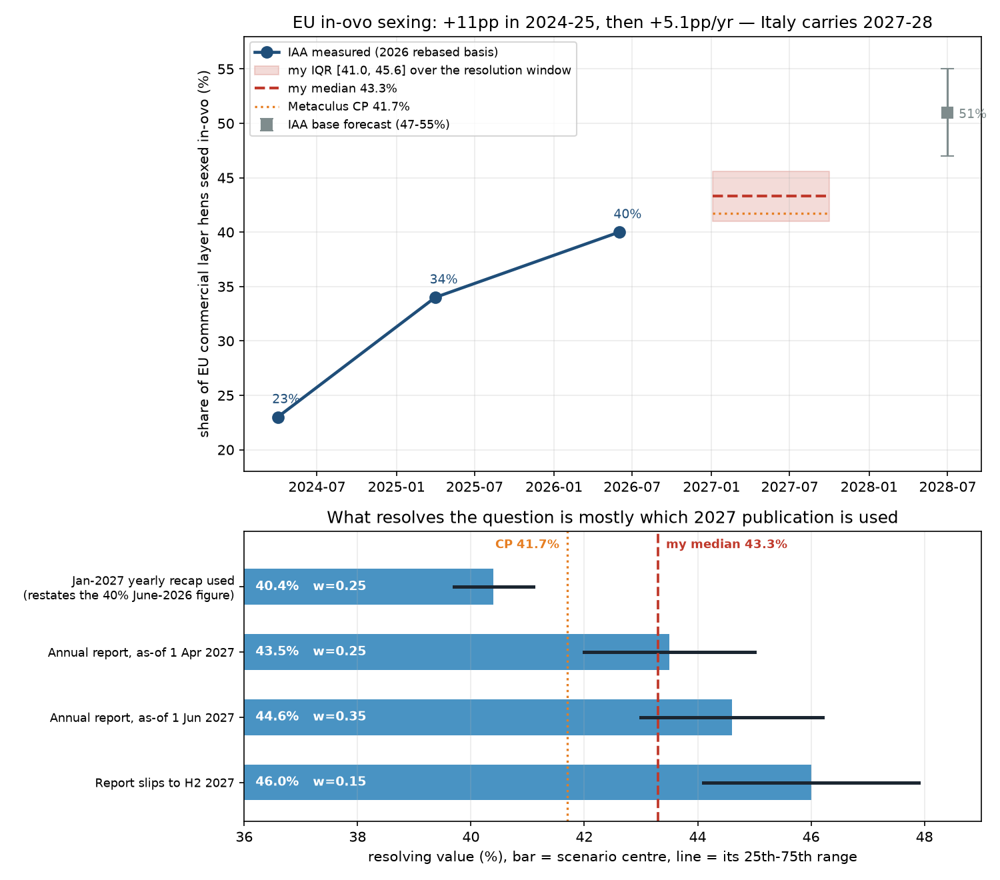

# What percentage of the EU hen flock will be sexed with in-ovo sexing technology in Q1 2027?

| | |
|---|---|
| **Source** | Metaculus #43279 — https://www.metaculus.com/questions/43279/ |
| **Type** | numeric (%, range 20–50, both bounds open) |
| **Opened / Closes / Resolves** | — / 2026-12-31 / during 2027 (first Innovate Animal Ag publication) |
| **Status** | open |
| **Current forecast** | **Median 43.3%, IQR [41.0%, 45.6%]** (v1, 2026-09-19) |
| **Community (as of 2026-09-19)** | CP 41.7% (n=47 total, 29 in the aggregate) · Pro 41.4% (n=6) · Gold 41.4% (n=15) |
| **Next review** | 2026-12-15 |

<!-- Versions below, newest first. APPEND-ONLY: never edit or delete a past version. -->

---

## v1 — Initial forecast — 2026-09-19

### What resolves YES

This is a numeric question, so nothing "resolves YES" — it resolves to a number. Read the
criteria carefully, because the resolution *source and timing* carry more of the variance
than EU hatchery behaviour does.

The question resolves to **the percentage of the EU's commercial layer hen flock that was
sexed with in-ovo technology, per the first non-preliminary such number published by
Innovate Animal Ag (IAA) during calendar 2027**. IAA is a US non-profit think tank that
surveys the in-ovo sexing technology vendors directly and divides their hen volumes by an
EU flock estimate; there is no official statistical series behind this. If IAA publishes no
such number in 2027, or changes its criteria so that prior reporting is not comparable, the
question may be resolved from another comparable source, otherwise **annulled**.

Three admin clarifications (question author `skmmcj`, 2026-07-30, responding to `tejvn`)
narrow the reading and are load-bearing:

1. IAA's revision of its April-2025 figure from 28% to 34% is **not** a criteria change —
   it was a refined flock-size denominator, so previous reporting stays comparable. Another
   such revision therefore does not annul; it just moves the printed number.
2. The metric is **"Share of EU Commercial Layer Hens Sexed In-Ovo"** (40% in the 2026
   report), **not** the newly introduced backyard-inclusive metric (35%).
3. The criteria were **edited** away from "as of Q1 2027" to "the first such number
   published in 2027", explicitly because IAA moved its report from April (2024, 2025) to
   July (2026). The title still says "in Q1 2027" and was not updated.

Edge case that the wording leaves open, and that I treat as the single largest driver:
IAA's **"Yearly Recap"** blog post, published 4 January 2026 for 2025, restated the then-current
April-2025 figure rather than measuring anything new. A 2026 Yearly Recap appearing around
4 January 2027 that restates the June-2026 **40%** would, on a literal reading, be "the first
such non-preliminary number published by IAA in 2027". I do not think that is the author's
intent — the title says Q1 2027 and the edit was made to accommodate a *later* report, not
an earlier restatement — but the text permits it, and I weight it accordingly.

### Outside view

There is no clean reference class of "EU-wide agricultural technology penetration in a
specific future quarter", so the outside view here is the **measured series itself**, on
IAA's current (2026-rebased, commercial-layers-only) denominator:

| As of | EU commercial-layer penetration | Increment |
|---|---|---|
| 2024-04-01 | 23% | — |
| 2025-04-01 | 34% | +11 pp in 12 months |
| 2026-06-01 | 40% (≈130 M of ~340 M hens) | +6 pp in 14 months = **+5.1 pp/yr** |

Two things matter. First, the series is **rebased**: the 2025 report said 28% of a 393 M
flock; the 2026 report says the same moment was 34%, because the denominator was narrowed to
commercial layers (~340 M, with ~42 M backyard hens excluded). 20% × 389/340 = 22.9% ≈ the
restated 23% for April 2024, so the rebasing is internally consistent and the series above is
comparable end to end.

Second, the pace is **decelerating in percentage-point terms**, even though IAA's headline
framing ("compounded at 147% over four years, outpacing LED lighting, iPhones, colour TV")
invites the opposite inference. That is the arithmetic of saturation: Germany (ban since
2022, ~70% by early 2024), France (ban since 2023) and the Dutch hatcheries that supply
Germany carry most of the installed base, and each is close to its own ceiling. The residual
EU — Spain, Poland, Romania, Portugal, Greece — has neither a ban nor strong retailer
pressure.

Scaled to the question window: from 40% at 2026-06-01, a continuation of +5.1 pp/yr gives
**~44.2%** at 2027-04-01 and **~45.1%** at 2027-06-01. IAA's own base case — ~51% by July 2028
with a 47–55% range — implies +5.3 pp/yr, i.e. they expect the current pace to hold rather
than to re-accelerate.

### Inside view

Penetration is measured on the **standing flock**, not on chicks hatched. IAA is explicit
about this when discussing Italy: because commercial layer flocks run on roughly an 18-month
cycle, a hatchery-level mandate produces "a progressive increase in penetration rather than
a single step". That lag is what makes the 2027 number much more predictable than the 2028
one — most of the hens that will be counted in mid-2027 have already been hatched or placed.

Decomposition of the 2026-06 → 2027-06 increment:

| Driver | Mechanism | Contribution |
|---|---|---|
| **Italy** | Culling ban effective 2027-01-01 (guidelines published Oct 2025; sexing required by incubation day 14). ~40 M layers ≈ **11.8%** of the EU commercial flock. Chicks hatched from Jan 2027 enter lay ~May 2027, so by 2027-06-01 only ~1–4 months of in-ovo-sexed placements are in the flock: ~10–20% of Italy's flock. | **+1.2 to +2.4 pp** |
| **Germany / France / NL** | Near saturation. France retains a legal **exemption for white-feathered layers** (~10%+ of French male chicks) on grounds of technological immaturity; Germany's residual gap is imported pullets. | **+0.5 to +1.5 pp** |
| **Spain, Poland, Belgium, Nordics** | Retailer-led, no mandate. Slow. | **+0.5 to +1.5 pp** |
| **Anticipatory investment** | Commission's Livestock Strategy (7 July 2026) promises an EU-wide proposal ending systematic male-chick killing by end-2026. A *proposal* changes no flock before 2027, but pulls hatchery capex forward. | **+0 to +0.5 pp** |

Sum: **+2.5 to +5.5 pp** over twelve months, centred ~+4.5 pp → **~44.5% at 2027-06-01**,
**~43.5% at 2027-04-01**. Note this is slightly *below* naive linear extrapolation because
Italy's contribution is back-loaded: it is small by mid-2027 and large by mid-2028, which is
exactly the shape IAA's own 51%-by-July-2028 path requires.

Capacity is **not** the binding constraint in the EU. A single AAT Cheggy runs 20,000–25,000
eggs/hour, an Omegga Plus up to 50,000/hour, a HatchTech/Seleggt line ~33 M eggs/year; the
EU needs on the order of 400–450 M hatching eggs scanned per year for full coverage. The
binding constraints are willingness to pay (~1 eurocent/egg) and regulation.

### Evidence

What moved me, with rough likelihood ratios against a naive "continue the trend" prior:

- **IAA 2026 report, 40% at 2026-06-01, published July 2026** (source 3). This is the anchor
  and the last measured point. Strong evidence; sets the level.
- **The admin's 2026-07-30 clarification** (source 1) that "the first number published in
  2027 counts". This is the dominant source of variance and the reason my distribution is
  bimodal rather than a tight band around 44. LR ≈ 3:1 in favour of putting real weight on a
  ~40% resolution relative to reading the title alone.
- **IAA's publication cadence** (source 8): Yearly Recap 2026-01-04, quarterly roundups
  2026-03-31 and 2026-07-01, annual report July 2026. The recap restates rather than
  measures; the quarterly roundups (I read Q2 2026, source 9) carry installation news but
  **no penetration percentages**. So the realistic candidates for the resolving number are
  (a) a January recap restatement and (b) the 2027 annual report.
- **Italy's ban is real and dated** (sources 12–14): guidelines published October 2025, in
  force 1 January 2027, day-14 deadline. Contrary to the "Italy makes slow progress" framing
  of early 2025, this now looks like a committed date. Moves me up, but the 18-month flock
  cycle caps how much of it lands before mid-2027.
- **Disconfirming evidence I went looking for and found**: (i) the deceleration from +11 pp
  to +5.1 pp/yr is visible in IAA's *own* restated series and is not something they
  emphasise; (ii) France's white-layer exemption is still in place, so "banned" ≠ "100%";
  (iii) the Dutch phase-out covers only table eggs *sold in the Netherlands* — 6–7 M hens,
  and Dutch hatcheries already run in-ovo sexing for the German market, so its incremental
  contribution is near zero; (iv) no EU-wide law exists yet, only a promised proposal.
- **Disconfirming evidence I looked for and did *not* find**: any Spanish or Polish retailer
  or government commitment with a 2027 date; any announced EU capacity shortfall or hatchery
  backlog. Absence of the first is mild evidence against re-acceleration.
- **Peer-reviewed check**: Chen et al. 2026 (Front. Bioeng. Biotechnol., via PubMed,
  [DOI 10.3389/fbioe.2026.1785893](https://doi.org/10.3389/fbioe.2026.1785893)) states that
  existing in-ovo sexing strategies are either strain-limited or rely on exogenous DNA and
  "none meet commercial requirements" in the fully general case — their own gene-edited
  candidate is research-stage. Consistent with incremental, not step-change, diffusion.

### Other forecasters

| Source | Value | As of | Note |
|---|---|---|---|
| Metaculus CP (recency-weighted) | 41.69%, IQR [38.25, 45.08] | 2026-09-19 | 29 forecasters in the aggregate, 47 on the question |
| Metaculus Pro | 41.35%, IQR [38.10, 45.05] | 2026-09-19 | n=6 |
| Metaculus gold medalists | 41.36%, IQR [37.94, 45.08] | 2026-09-19 | n=15 |
| Innovate Animal Ag (the resolver's own forecast) | ~51% by July 2028, range 47–55% | 2026-07 | implies ~+5.3 pp/yr |
| Kalshi / Polymarket / Manifold | no market found | 2026-09-19 | searched; nothing on in-ovo sexing |
| Sentinel, Mantic, GJOpen, INFER | no matching question | 2026-09-19 | |

**Cohort disagreement: there is none.** CP, Pro and gold sit within 0.35 pp of each other
(41.35–41.69) with near-identical IQRs. That is an unusually tight consensus and deserves
weight. The CP history shows the crowd opened near 33.9 on 2026-06-12 — when the last
published number was the 34% restatement — and re-anchored to ~41.7 after the July 2026
report printed 40%. The shape of that move (to "40% plus a little") suggests the crowd is
largely pricing *the last published number plus a small increment*, which is what you get if
you put heavy weight on an early-2027 restatement.

**Where I sit and why.** I am **+1.6 pp above the CP**, well inside the 10 pp threshold that
would demand a rewrite, but the direction needs a reason. Mine: (a) the arithmetic — any
measurement dated after ~February 2027 lands at 42%+ on IAA's own trend and on IAA's own
2028 forecast, so the crowd's 41.7 implicitly needs ~60% weight on a stale-number
resolution, which I think is too much given the question title says Q1 2027; (b) Italy's
1 January 2027 ban is a dated, committed impulse; (c) IAA is an advocacy-adjacent think tank
with a strong incentive to publish a fresh, higher number around the Italy milestone. The
crowd's lower quartile at 38.25 — *below* the already-published 40% — tells me they are
pricing denominator-revision risk too, which I have also included but weighted less heavily.

### Scenarios

| # | Scenario | Weight | Implies |
|---|---|---|---|
| 1 | IAA's ~4 Jan 2027 Yearly Recap is taken as the resolver — either restating the 40% June-2026 figure or giving a lightly-updated end-2026 number | 0.25 | 40.4% (sd 1.0) |
| 2 | 2027 annual report published ~April, as-of 2027-04-01 | 0.25 | 43.5% (sd 2.2) |
| 3 | 2027 annual report published ~July, as-of 2027-06-01 (2026's timing repeated) | 0.35 | 44.6% (sd 2.4) |
| 4 | Report slips to H2 2027, as-of Aug–Oct 2027 | 0.15 | 46.0% (sd 2.9) |

Plus, applied to scenarios 2–4 only (a restated 2026 figure cannot be re-based), a **15%
chance of another denominator revision** of ±3 pp, as happened between the 2025 and 2026
reports. Sampling this mixture (2 M draws; `scripts/model.py` reproduces every number in this
section and in the sensitivity table below):

**p5 39.2 · p25 41.0 · median 43.3 · p75 45.6 · p95 48.8**

### Sensitivity

| Assumption | If instead | Forecast becomes |
|---|---|---|
| A January-2027 restatement does not resolve the question (weight 0.25 on scenario 1) | The admin confirms only a *new* measurement counts (weight → 0.05) | Median 44.3%, IQR [42.3, 46.2] |
| …or the opposite: a literal reading prevails (weight → 0.50) | The recap is used | Median 41.5%, IQR [40.3, 44.4] |
| Adoption continues at +5.1 pp/yr | Italy slips or is enforced loosely; pace falls to +2.5 pp/yr | Median 41.6%, IQR [40.1, 43.6] |
| Adoption continues at +5.1 pp/yr | Re-acceleration to +9 pp/yr (EU proposal + Italy + Iberian retailers) | Median 47.6%, IQR [42.5, 50.0] |
| Denominator stable | A further rebasing narrows the flock again (as 393 M → 340 M did) | +2 to +4 pp on the printed number |

The first row is the point: **this question is more about IAA's publication calendar than
about European hatcheries.** If you resolve the timing ambiguity, the band collapses by
roughly half.

### What would change my mind (tripwires)

- [ ] **IAA publishes a "2026 Yearly Recap" on or about 2027-01-04 containing a penetration
      percentage, and the question is not immediately resolved on it** (by 2027-01-31) →
      scenario 1 largely dies, **up ~1.5%** (median → ~44.5).
- [ ] **The same recap appears and the admin signals it counts, or the question resolves on
      it** (by 2027-01-31) → **down ~3%** (median → ~40.5). Conversely, if the recap contains
      no number at all, treat as the first tripwire firing.
- [ ] **Admin clarification on 43279 stating whether a restated prior-period figure counts**
      (by 2027-03-31) → direction depends on the answer; re-analyse, magnitude up to ~3%.
- [ ] **Italian enforcement news: a decree delaying the 1 Jan 2027 ban, a transition period,
      or a documented failure of Italian hatcheries to install by Q1 2027** (by 2027-03-31)
      → **down ~1.5%**.
- [ ] **IAA publishes an interim EU figure at or above 43% at any point before 2027-06-30**
      (e.g. in a quarterly roundup) → **up ~2%**, and resolves most of the timing ambiguity.
- [ ] **IAA announces a methodology or denominator change for the 2027 report** (by
      2027-06-30) → re-analyse; a repeat of the 2026 rebasing is worth ±3%.

### Sources

1. Metaculus #43279, *What percentage of the EU hen flock will be sexed with in-ovo sexing technology in Q1 2027?* — https://www.metaculus.com/questions/43279/ (aggregations, resolution criteria, fine print and comments cached in `raw/metaculus-2026-09-19.json`; accessed 2026-09-19)
2. Metaculus #43280, the paired US question — https://www.metaculus.com/questions/43280/ (accessed 2026-09-19)
3. Innovate Animal Ag, *In-Ovo Sexing: Market Penetration and Forecast* (2026 report; 40% at 2026-06-01, 34% at 2025-04-01, 23% at 2024-04-01, ~51% base case by July 2028 with 47–55% range) — https://innovateanimalag.org/market-penetration-forecast (accessed 2026-09-19)
4. Innovate Animal Ag, *In-Ovo Sexing Market Penetration Report* (2024 edition; 20% of 389 M at 2024-04-01, ~15% at 2023-09) — https://innovateanimalag.org/in-ovo-sexing-market-penetration-report (accessed 2026-09-19)
5. Innovate Animal Ag, *In-Ovo Sexing Overview* (technology list and throughputs) — https://innovateanimalag.org/egg-sexing (accessed 2026-09-19)
6. Innovate Animal Ag, *2025 In-Ovo Sexing Yearly Recap*, published 2026-01-04 (restates the Q1-2025 figure; Germany ~70% at start of 2024; ~175 M male embryos separated since 2022) — https://innovateanimalag.org/blog/in-ovo-sexing-2025-review (accessed 2026-09-19)
7. Innovate Animal Ag, *2025 In-Ovo Sexing Market Penetration and Forecast Report* (28% of 393 M at end-Q1 2025; US <1% of 310 M) — https://innovateanimalag.org/blog/2025-in-ovo-sexing-market-penetration-and-forecast-report (accessed 2026-09-19)
8. Innovate Animal Ag, blog index (publication cadence: Yearly Recap 2026-01-04; quarterly roundups 2026-03-31, 2026-07-01) — https://innovateanimalag.org/blog (accessed 2026-09-19)
9. Innovate Animal Ag, *In-Ovo Sexing Quarterly Roundup: Q2 2026*, published 2026-07-01 — https://innovateanimalag.org/blog/in-ovo-sexing-quarterly-roundup-q2-2026 (accessed 2026-09-19)
10. AgFunderNews, *In ovo sexing hits 40% penetration in the EU. What will it take to crack the US?*, 2026-09-09 (Switzerland 85%, Norway 52%; Cheggy 20,000 eggs/h; Omegga Plus 50,000/h; HatchTech/Seleggt 33 M eggs/yr) — https://agfundernews.com/in-ovo-sexing-hits-40-penetration-in-the-eu-what-will-it-take-to-crack-the-us (accessed 2026-09-19)
11. AgFunderNews, *Orbem begins US rollout of MRI-based in-ovo sexing tech*, 2026-07-27 — https://agfundernews.com/orbem-begins-us-rollout-of-mri-based-in-ovo-sexing-tech (accessed 2026-09-19)
12. Eurogroup for Animals, *Italy to end killing of male chicks in the egg industry by end of 2026* — https://www.eurogroupforanimals.org/news/italy-end-killing-male-chicks-egg-industry-end-2026 (accessed 2026-09-19)
13. Animal Equality UK, *Guidelines published to stop the killing of male chicks in Italian egg industry*, 2025-11-04 (day-14 sexing requirement; ~34 M chicks/yr) — https://animalequality.org.uk/news/2025/11/04/guidelines-published-to-stop-the-killing-of-male-chicks-in-italian-egg-industry/ (accessed 2026-09-19)
14. FoodTimes, *Killing of male chicks, banned in Italy only starting from 2027* — https://www.foodtimes.eu/food-system/killing-of-male-chicks-banned-in-italy-only-starting-from-2027/ (accessed 2026-09-19)
15. Animal Equality UK, *The European Commission includes plans to phase out cages and end the killing of male chicks in its Livestock Strategy*, 2026-07-08 — https://animalequality.org.uk/news/2026/07/08/the-european-commission-includes-plans-to-phase-out-cages-and-end-the-killing-of-male-chicks-in-its-livestock-strategy/ (accessed 2026-09-19)
16. European Commission, *Revision of EU animal-welfare legislation* — https://food.ec.europa.eu/animals/animal-welfare/evaluations-and-impact-assessment/revision-eu-animal-welfare-legislation_en (accessed 2026-09-19)
17. France 24 / AFP, *France fails to end culling of male chicks* (white-layer exemption) — https://www.france24.com/en/live-news/20230102-france-fails-to-end-culling-of-male-chicks (accessed 2026-09-19)
18. Innovate Animal Ag, *Dutch Government Announces Roadmap to End Chick Culling by 2026* — https://innovateanimalag.org/blog/dutch-government-announces-roadmap-to-end-chick-culling-by-2026 (accessed 2026-09-19)
19. WATTPoultry, *Netherlands to end culling of male layer chicks by 2026* (voluntary; 6–7 M hens; €0.009/egg cost) — https://www.wattagnet.com/regions/europe/news/15737218/netherlands-to-end-culling-of-male-layer-chicks-by-2026 (accessed 2026-09-19)
20. Our World in Data, *Which countries have banned chick culling?* — https://ourworldindata.org/grapher/banning-of-chick-culling (accessed 2026-09-19)
21. Chen Y-C, Hsu S-W, Shimokita E, Takemoto T., *Eye pigmentation-based in-ovo chicken sexing via precision breeding*, Front. Bioeng. Biotechnol. 14:1785893 (2026), via PubMed — https://doi.org/10.3389/fbioe.2026.1785893 (accessed 2026-09-19)
22. Agri Advanced Technologies, *AAT and SBA announce market launch of Cheggy in Australia*, 2026-05-06 — https://www.agri-at.com/en/2026/05/06/aat-and-sba-announce-market-launch-of-cheggy-in-ovo-sexing-technology-in-australia/ (accessed 2026-09-19)

**Date**: 2026-09-19
**Forecast**: Median 43.3%, IQR [41.0%, 45.6%]
**Thesis**: Innovate Animal Ag measured 40% of the EU commercial layer flock at 2026-06-01 and its own base case (~51% by July 2028) implies the pace holds at ~+5 pp/yr, which puts any measurement dated after early 2027 in the 43–46% band; I sit 1.6 pp above a tightly-agreed community (CP 41.7 / Pro 41.4 / gold 41.4) because their number implicitly requires heavy weight on IAA's January Yearly Recap restating the stale 40% figure, and I give that reading only 25%. Italy's 1 January 2027 culling ban is the real driver but is back-loaded by the 18-month flock cycle, so it adds only ~1–2 pp by mid-2027 and most of its ~12 pp lands in 2028.
