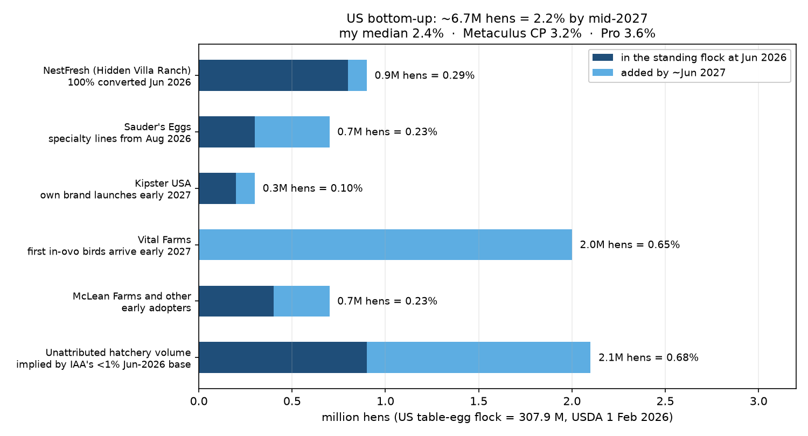

# What percentage of the US hen flock will be sexed with in-ovo sexing technology in Q1 2027?

| | |
|---|---|
| **Source** | Metaculus #43280 — https://www.metaculus.com/questions/43280/ |
| **Type** | numeric (%, range 0–20, lower bound closed at 0, upper bound open) |
| **Opened / Closes / Resolves** | — / 2026-12-31 / 2027 (Q1-2027 Innovate Animal Ag reporting, by July 2027) |
| **Status** | open |
| **Current forecast** | **Median 2.4%, IQR [1.7%, 3.2%]** (v1, 2026-09-19) |
| **Community (as of 2026-09-19)** | CP 3.23% (n=52 total, 30 in the aggregate) · Pro 3.63% (n=6) · Gold 3.35% (n=15) |
| **Next review** | 2026-12-15 |

<!-- Versions below, newest first. APPEND-ONLY: never edit or delete a past version. -->

---

## v1 — Initial forecast — 2026-09-19

### What resolves YES

Numeric question. It resolves to **the percentage of the US hen flock that was sexed with
in-ovo technology according to official Innovate Animal Ag (IAA) reporting as of Q1 2027**.
IAA is a US non-profit think tank that surveys in-ovo sexing vendors directly and divides
their hen volumes by a flock estimate; there is no government series behind this number.
Fine print: **if Q1-2027 reporting is not released before July 2027**, or if IAA changes its
criteria so prior reporting is not comparable, the question may be resolved from another
comparable source — otherwise **annulled**.

Two things to note before forming a view.

**First, this is a stock measure, not a flow.** IAA counts *hens in the standing flock* whose
eggs were sexed in-ovo, not chicks hatched. They say so explicitly when discussing Italy: a
hatchery mandate produces "a progressive increase in penetration rather than a single step"
because commercial layer flocks run on ~18-month cycles. This is the single most important
fact for the US question, because it means that **every producer commitment announced from
mid-2026 onwards contributes almost nothing to a Q1-2027 measurement.** The hens that will be
counted in Q1 2027 have largely already been hatched.

**Second, the paired EU question (#43279) had its criteria edited on 2026-07-30 to read "the
first such number published in 2027"; this one was not edited** and still says "as of Q1
2027" with the July-2027 backstop. IAA moved its annual report from April (2024, 2025) to
July (2026, with a 1 June as-of date), and its quarterly roundups — I read Q2 2026 — carry
installation news but no penetration percentages. So there is a live risk that no
Q1-2027-dated US figure exists before July 2027. Annulment does not cost me anything in the
ledger, so I forecast conditional on the question resolving, and spread weight over the
plausible as-of dates.

### Outside view

There is no US time series to extrapolate — IAA has published essentially one US data point,
"**less than 1% of the US' ~310 million head commercial layer flock**", and it has printed
that same sub-1% figure in both the 2025 and the 2026 reports. So the outside view has to be
borrowed.

| Reference class | n | Window | Base rate | Source | Kept? |
|---|---|---|---|---|---|
| EU in-ovo sexing from its own sub-1% start (2020–21) to 2024 | 1 | 4 yrs | ~2% → 23%, i.e. ~5 pp/yr once past ~2% | IAA rebased series | Partly — but EU growth was *regulation-driven*, and the US has no mandate |
| EU country launches without a mandate (Norway, Switzerland) | 2 | 1.5–4 yrs | Norway 22% at 18 months, >50% by 2026; Switzerland 85–100% | IAA, AgFunderNews | Discounted — both are small, concentrated, retailer-driven markets with one or two dominant hatcheries |
| Prior US industry pledge to end culling | 1 | 2016–2020 | UEP pledged in June 2016 (negotiated with The Humane League) to end culling by 2020 *or as soon as the technology was "commercially available and economically feasible"*; **it did not happen** | CSMonitor 2016-06-12; UEP statement | Kept — the single most relevant US precedent, and it is negative |
| US flock turnover ceiling | — | — | ~180 M pullets placed/yr against a 307.9 M-hen flock ⇒ ~1.7 yr to replace the flock | USDA NASS | Kept as a hard cap |

The turnover cap is the one that binds: even a producer that flips 100% of its hatchery
input on 1 January 2027 has converted only ~15% of its own standing flock by mid-2027.

Status-quo prior: the US has printed <1% for two consecutive annual reports. A question
asking "how much higher, nine months later" should start close to the status quo and be
dragged up only by identified, dated commitments.

### Inside view

Bottom-up build of the US standing flock that will have been sexed in-ovo, against USDA's
**307.9 M** table-egg layer flock (1 February 2026):

| Producer | Status | Hens at Jun 2026 | Added by ~Jun 2027 | Total share |
|---|---|---|---|---|
| NestFresh (Hidden Villa Ranch) | **100% of its laying flock in-ovo sexed as of June 2026**; >800,000 chicks sexed cumulatively since 2025 | 0.8 M | 0.1 M | 0.29% |
| Sauder's Eggs | Committed only for *new* Free Range / Organic / Pasture Raised flocks packed after August 2026, "provided their source can meet demand" | 0.3 M | 0.4 M | 0.23% |
| Kipster USA | Own brand launches early 2027 | 0.2 M | 0.1 M | 0.10% |
| Vital Farms | >10 M-hen network; in-ovo birds "scheduled to **arrive at its network of farms in early 2027**" via Hy-Line North America's Cheggy machines | 0.0 M | 2.0 M | 0.65% |
| McLean Farms and other early adopters | scattered | 0.4 M | 0.3 M | 0.23% |
| Unattributed hatchery volume implied by IAA's sub-1% June-2026 base | — | 0.9 M | 1.2 M | 0.68% |
| **Total** | | **2.6 M** | **4.1 M** | **≈ 2.2%** |

The NestFresh figure is the decisive calibration check. NestFresh is the US leader — first to
hatch, first to retail, 100% converted — and it has sexed **800,000 chicks in total**. That
puts its whole laying flock at well under 1 M hens, i.e. ~0.3% of the US. If the US leader is
0.3%, getting the national number to 3.2% by Q1 2027 requires roughly 10 M hens, which means
Vital Farms would already have to be converted — and Vital Farms' first in-ovo birds only
*arrive* in early 2027.

Why the US is structurally slower than the EU, in order of importance:

1. **No mandate.** The EU's 40% is almost entirely German, French and Dutch regulation. The
   US has Walmart naming in-ovo sexing as a "focus area" in its supplier guidelines (February
   2025, no deadline, no share) and a UEP "Hatch Check" certification programme (June 2025) —
   a labelling scheme, not a commitment. UEP's own position is that it is "fully committed to
   the future adoption … **when it is economically and operationally feasible**".
2. **White eggs.** ~90% of the US market is white-shelled. AAT's Cheggy — the workhorse of
   European adoption, 20,000–25,000 eggs/hour — is hyperspectral feather-colour imaging and
   works only on brown layers. White-capable technology is Respeggt (endocrinological),
   Orbem (MRI, 2 US machines with a third in 2027, ~24,000 eggs/h or ~1 M females/yr per
   module) and the MatrixSpec/SANOVO HyperEye (day-4, white and brown), whose global
   commercial launch is planned for **late 2026 or early 2027** — too late to affect a Q1-2027
   *stock*.
3. **Cost pass-through.** ~1 US cent per egg. UEP's spokesperson: "producers certainly want
   this forward … but are consumers willing to pay more? That is far from proven out."
4. **HPAI churn.** ~12.4 M layers depopulated in 2026 to date. That cuts both ways — forced
   repopulation could in principle accelerate conversion, but only if the replacement chicks
   are in-ovo sexed, and there is no evidence that they are.

Capacity is **not** the constraint. Two Cheggy machines at Hy-Line North America hatcheries
could scan ~200–300 M eggs/year at high utilisation, which is most of the ~400 M hatching
eggs the entire US flock needs annually. Orbem puts full national coverage at 12–15 large
hatcheries plus "approximately two years to replace the country's laying flock". The gating
factor is who pays, not who can scan.

### Evidence

- **IAA 2026 report: US still "<1%" at 2026-06-01** (source 3). The anchor. Also: "producers
  representing over 4% of the commercial layer flock have already announced a full
  transition", and IAA "opted not to make a numerical forecast for the US market" given the
  uncertainties. That refusal is itself informative — the resolver does not think the US is
  forecastable, which is a mild argument for a wide band.
- **Vital Farms' birds arrive "early 2027"** (source 4, AgFunderNews 2026-09-09). This is the
  strongest single constraint on the upside: the largest committed producer contributes
  ~nothing to a Q1-2027 stock and only ~0.6 pp by mid-2027. LR ≈ 3:1 against the CP's 3.2%.
- **NestFresh: 800,000 chicks cumulative, 100% converted** (source 6, IAA Q2 2026 roundup).
  Sizes the specialty segment. LR ≈ 2:1 against high numbers.
- **Disconfirming evidence I hunted for and did *not* find**: any 2026 in-ovo sexing
  commitment from Cal-Maine, Rose Acre, Versova, Hillandale or Michael Foods — the five
  producers that actually move the national number. I searched for each by name. Nothing.
  Absence of expected evidence here *is* evidence of absence: a commodity producer converting
  in time to show up in Q1 2027 would have had to announce by roughly mid-2026.
- **Disconfirming evidence for my low number**: (i) Orbem's Volz, July 2026 — "We expect an
  announcement from one of the big retailers very soon"; (ii) Hy-Line North America is a
  *breeder-hatchery* serving many customers, so its Cheggy capacity could convert the entire
  US brown-layer segment (~10% of the flock) quickly if anyone pays for it; (iii) IAA's sub-1%
  figure is 3.5 months stale. These are why I keep a 10% scenario at ~5%.
- **Peer-reviewed check**: Chen et al. 2026 (Front. Bioeng. Biotechnol., via PubMed,
  [DOI 10.3389/fbioe.2026.1785893](https://doi.org/10.3389/fbioe.2026.1785893)) — existing
  in-ovo sexing strategies are strain-limited or require exogenous DNA and "none meet
  commercial requirements" in the fully general case. Consistent with white-egg technology
  still being the bottleneck.

### Other forecasters

| Source | Value | As of | Note |
|---|---|---|---|
| Metaculus CP (recency-weighted) | 3.23%, IQR [1.72, 5.48] | 2026-09-19 | 30 forecasters in the aggregate, 52 on the question |
| Metaculus Pro | 3.63%, IQR [1.94, 6.15] | 2026-09-19 | n=6, the highest of the three |
| Metaculus gold medalists | 3.35%, IQR [1.82, 5.64] | 2026-09-19 | n=15 |
| Innovate Animal Ag (the resolver) | explicitly **declines** to forecast the US | 2026-07 | "Given the uncertainties here, we opted not to make a numerical forecast for the US market" |
| Kalshi / Polymarket / Manifold | no market found | 2026-09-19 | |
| Sentinel, Mantic, GJOpen, INFER | no matching question | 2026-09-19 | |

**Cohort disagreement: minor.** Pro (3.63) sits 0.4 pp above CP (3.23) with gold in between
(3.35) — the Pro cohort is the most bullish, which is the one cohort I would normally weight
up. All three have long right tails (75th percentiles at 5.5–6.2).

**Where I sit and why.** My median of 2.4% is **0.8 pp below CP and 1.2 pp below Pro** — a
small absolute gap but a large relative one (~25–35%), so it needs a reason. Mine is
arithmetic, not sentiment: the named committed producers sum to ~2.2% by *mid*-2027, and the
Q1-2027 date the criteria actually name is earlier than that. To reach 3.6% the market needs
either a producer I could not find, or a resolution dated well into H2 2027. I have put
weight on both (scenarios 3 and 4 below) and I still land at 2.4. I am also deliberately
*not* narrowing the right tail as much as my bottom-up would suggest: my p95 is 5.3%, close
to the crowd's 75th percentile, because a single large integrator or a basis change would
move this number a long way and I cannot rule it out.

One misconception worth flagging, because it is embedded in the question's own background
text: IAA's line that "EU adoption has compounded at 147% over the last four years,
outpacing the early scale-up curves of LED lighting, iPhones, colour TV, internet, AC, and
home electricity" invites a technology-diffusion S-curve intuition. It does not transfer to
the US. The EU curve was produced by three national bans, not by consumer pull; the US has
no mandate, a white-egg technology gap, and a documented precedent of a voluntary industry
pledge — UEP's June 2016 commitment to end culling by 2020 — lapsing on exactly the
feasibility escape clause UEP still cites today.

### Scenarios

| # | Scenario | Weight | Implies |
|---|---|---|---|
| 1 | Strict reading: a genuinely Q1-2027-dated figure is used | 0.20 | 1.6% (sd 0.5) |
| 2 | Resolution on the 2027 annual report, as-of ~April–June 2027 (2026's timing repeated) | 0.45 | 2.3% (sd 0.8) |
| 3 | Resolution on a mid/late-2027 figure, Vital Farms ramp further along | 0.25 | 3.0% (sd 1.1) |
| 4 | A commodity integrator converts, a large retailer deadline lands, or IAA restates on a chicks-hatched (flow) basis | 0.10 | 5.0% (sd 2.0) |

Truncated at 0 (closed lower bound). Sampling 2 M draws with `scripts/model.py`:

**p5 0.95 · p25 1.70 · median 2.35 · p75 3.19 · p95 5.25**

### Sensitivity

| Assumption | If instead | Forecast becomes |
|---|---|---|
| Weights split across as-of dates as above | The "as of Q1 2027" wording is enforced strictly (scenario 1 → 0.50) | Median 1.9%, IQR [1.5, 2.6] |
| " | A late-2027 figure is used (scenario 3 → 0.50) | Median 2.8%, IQR [2.0, 3.7] |
| Vital Farms adds ~2 M hens by mid-2027 | Vital Farms converts twice as fast (all placements in-ovo from Jan 2027, ~4 M hens) | Median 3.0%, IQR [2.2, 4.0] |
| 10% chance of a commodity-scale surprise | No big adopter at all (scenario 4 → 0.02) | Median 2.3%, IQR [1.7, 3.0] |

The load-bearing assumption is the **as-of date**, not the adoption rate. Over the plausible
range of resolution dates the answer moves by ~1 pp; over the plausible range of adoption
speeds it moves by ~0.7 pp.

### What would change my mind (tripwires)

- [ ] **A top-10 US egg producer by flock size (Cal-Maine, Rose Acre, Versova, Hillandale,
      Michael Foods, Daybreak, Opal/Prairie Star, Hickman's, MPS, Weaver) announces a dated,
      flock-wide in-ovo sexing transition** (by 2027-03-31) → **up ~1.5%**, more if the date
      is 2027.
- [ ] **Walmart converts its "focus area" language into a supplier deadline with a share
      target** (by 2027-03-31) → **up ~1%**.
- [ ] **Vital Farms states in an SEC filing or earnings call what share of its network is
      in-ovo sexed** (by 2027-06-30) → direction depends on the number; re-analyse, worth up
      to ~1%.
- [ ] **MatrixSpec/SANOVO HyperEye or Respeggt announces a US white-layer installation at a
      commodity hatchery** (by 2027-06-30) → **up ~0.8%** for this question, much more for
      2028.
- [ ] **IAA publishes any US figure at or below 1.5% during 2027** (by 2027-07-31) → **down
      ~0.8%**.
- [ ] **No Q1-2027 US figure exists by 2027-07-01** (by 2027-07-01) → annulment risk
      materialises; re-analyse rather than re-price.

### Sources

1. Metaculus #43280, *What percentage of the US hen flock will be sexed with in-ovo sexing technology in Q1 2027?* — https://www.metaculus.com/questions/43280/ (aggregations, criteria, fine print and comments cached in `raw/metaculus-2026-09-19.json`; accessed 2026-09-19)
2. Metaculus #43279, the paired EU question, whose 2026-07-30 admin clarification explains IAA's changed report timing — https://www.metaculus.com/questions/43279/ (accessed 2026-09-19)
3. Innovate Animal Ag, *In-Ovo Sexing: Market Penetration and Forecast* (2026 report; US <1%, ">4% of the commercial layer flock" committed, no US numerical forecast) — https://innovateanimalag.org/market-penetration-forecast (accessed 2026-09-19)
4. AgFunderNews, *In ovo sexing hits 40% penetration in the EU. What will it take to crack the US?*, 2026-09-09 (Vital Farms birds arrive early 2027; Kipster USA brand early 2027; Cheggy brown-only; 90% of US market white; UEP quote) — https://agfundernews.com/in-ovo-sexing-hits-40-penetration-in-the-eu-what-will-it-take-to-crack-the-us (accessed 2026-09-19)
5. AgFunderNews, *Orbem begins US rollout of MRI-based in-ovo sexing tech*, 2026-07-27 (2 US systems, 3rd in 2027; ~24,000 eggs/h or ~1 M females/yr; 12–15 hatcheries for national coverage; ~1 cent/egg) — https://agfundernews.com/orbem-begins-us-rollout-of-mri-based-in-ovo-sexing-tech (accessed 2026-09-19)
6. Innovate Animal Ag, *In-Ovo Sexing Quarterly Roundup: Q2 2026*, 2026-07-01 (NestFresh 100% converted, >800,000 chicks cumulative; Omegga €10 M seed; MatrixSpec–SANOVO partnership) — https://innovateanimalag.org/blog/in-ovo-sexing-quarterly-roundup-q2-2026 (accessed 2026-09-19)
7. Innovate Animal Ag, *2025 In-Ovo Sexing Yearly Recap*, 2026-01-04 (Vital Farms network >10 M hens; Walmart supply chain >30 M hens; Hy-Line/Hendrix US installations) — https://innovateanimalag.org/blog/in-ovo-sexing-2025-review (accessed 2026-09-19)
8. USDA NASS, *Chickens and Eggs 2025 Summary*, released 2026-02-17 — https://esmis.nal.usda.gov/sites/default/release-files/795778/ckegan26.pdf (accessed 2026-09-19)
9. WATTPoultry, *What factors are defining the US egg market in 2026?* (307.9 M table-egg layers at 1 Feb 2026, +2.9% y/y; 12.4 M depopulated in 2026 to date) — https://www.wattagnet.com/egg/article/15819259/what-factors-are-defining-the-us-egg-market-in-2026 (accessed 2026-09-19)
10. WATTPoultry, *UEP launches in-ovo sexing certification program* (Hatch Check, June 2025; sexing by day 15; traceability audit) — https://www.wattagnet.com/egg/news/15749598/uep-launches-inovo-sexing-certification-program (accessed 2026-09-19)
11. United Egg Producers, *What is In-Ovo Sexing?* — https://uepcertified.com/what-is-in-ovo-sexing/ (accessed 2026-09-19)
12. The Humane League, *Walmart commits to stop culling male chicks in egg supply chain*, 2025-02-20 (supplier guidelines name in-ovo sexing; **no deadline, no share**) — https://thehumaneleague.org/article/retailer-progress-for-male-chicks (accessed 2026-09-19)
13. Sauder's Eggs, *In-Ovo Sexing* (commitment scope: new Free Range / Organic / Pasture Raised flocks packed after August 2026) — https://saudereggs.com/our-nest/in-ovo-sexing/ (accessed 2026-09-19)
14. PRNewswire, *NestFresh welcomes the first in-ovo sexed flock in the U.S.* — https://www.prnewswire.com/news-releases/nestfresh-welcomes-the-first-in-ovo-sexed-flock-in-the-us-marking-a-historic-milestone-in-animal-welfare-302333328.html (accessed 2026-09-19)
15. Feedstuffs, *NestFresh transitions egg portfolio to Humanely Hatched* (Hidden Villa Ranch = 24th largest US producer, ~4 M layers) — https://www.feedstuffs.com/agribusiness-news/nestfresh-transitions-egg-portfolio-to-humanely-hatched (accessed 2026-09-19)
16. The Poultry Site, *IPPE: First in-ovo sexing machine from AAT installed in US-based NestFresh* — https://www.thepoultrysite.com/articles/ippe-first-in-ovo-sexing-machine-from-aat-and-nest-fresh-installed-in-us-hatchery (accessed 2026-09-19)
17. The Poultry Site, *Canadian firms launch world's earliest in-ovo egg sexing system*, July 2026 (MatrixSpec/SANOVO HyperEye, day-4, white and brown) — https://www.thepoultrysite.com/news/2026/07/canadian-firms-launch-worlds-earliest-in-ovo-egg-sexing-system (accessed 2026-09-19)
18. Chen Y-C, Hsu S-W, Shimokita E, Takemoto T., *Eye pigmentation-based in-ovo chicken sexing via precision breeding*, Front. Bioeng. Biotechnol. 14:1785893 (2026), via PubMed — https://doi.org/10.3389/fbioe.2026.1785893 (accessed 2026-09-19)
19. Innovate Animal Ag, *In-Ovo Sexing Overview* — https://innovateanimalag.org/egg-sexing (accessed 2026-09-19)
20. Christian Science Monitor, *Egg producers pledge to stop killing newborn male chicks*, 2016-06-12 (the UEP pledge, its 2020 date and its "commercially available / economically feasible" escape clause) — https://www.csmonitor.com/Environment/2016/0612/Egg-producers-pledge-to-stop-killing-newborn-male-chicks (accessed 2026-09-19)
21. United Egg Producers, *Updated statement on male chicks* — https://unitedegg.com/united-egg-producers-updated-statement-on-male-chicks-2/ (accessed 2026-09-19)

**Date**: 2026-09-19
**Forecast**: Median 2.4%, IQR [1.7%, 3.2%]
**Thesis**: Innovate Animal Ag still printed "<1% of the US commercial layer flock" at 2026-06-01, and because the metric counts the standing flock rather than chicks hatched, the ~18-month turnover cycle caps how much of the announced ~4% can be realised by Q1 2027 — Vital Farms' in-ovo birds only *arrive* at its farms in early 2027, and NestFresh, the converted US leader, is only ~0.3% of the flock on 800,000 cumulative chicks. I sit ~0.8 pp below a tightly-agreed community (CP 3.23 / Pro 3.63 / gold 3.35) because my bottom-up of every named committed producer reaches only ~2.2% by *mid*-2027, while keeping a fat right tail (p95 5.3%) for an unannounced commodity integrator or a change of measurement basis.
