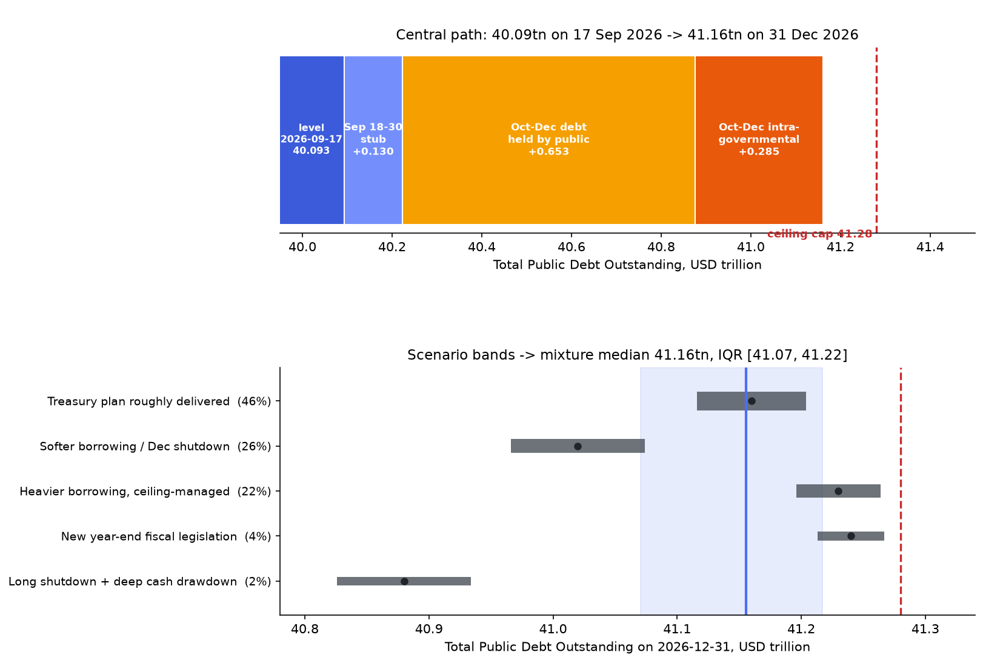

# What will be the US national debt on December 31, 2026?

| | |
|---|---|
| **Source** | Metaculus #45219 — https://www.metaculus.com/questions/45219/what-will-be-the-us-national-debt-on-december-31-2026 |
| **Type** | numeric (USD, Total Public Debt Outstanding) |
| **Opened / Closes / Resolves** | — / 2026-11-30 / 2027-01-04 (first Debt-to-the-Penny publication of the 2026-12-31 record) |
| **Status** | open |
| **Current forecast** | **Median $40.92T, IQR [$40.86T, $40.98T]** (v2, 2026-10-09) |
| **Community (as of 2026-10-09)** | unavailable — aggregations hidden from bot key, browser path Cloudflare-blocked; 107 forecasters. Polymarket $41T-before-2027 55.5% (thin) |
| **Next review** | 2026-11-03 |

<!-- Versions below, newest first. APPEND-ONLY: never edit or delete a past version. -->

---

## v2 — Re-analysis — 2026-10-09

Mode: **Re-analysis** (rebuilt bottom-up from the 2026-10-07 actual rather than nudged).
The v1 mechanism I leaned on hardest, the start-of-year intragovernmental jump, has
already printed and came in at well under half its assumed size. When a key input turns
out that wrong, the model has to be rebuilt from the new data.

### Revision

| Driver | Direction | Effect |
|---|---|---|
| Prior (v1, 2026-09-20) | — | Median $41.16T, IQR [$41.07T, $41.22T] |
| 18–30 Sep stub came in at +$78.5bn (TPDO $40.1718T on 2026-09-30) vs +$130bn assumed | ↓ | −$51bn |
| 1 October intragovernmental jump only **+$80bn** (Sep 30 → Oct 1), +$98bn by Oct 7, vs +$199–266bn in 2022–25. v1 assumed +$285bn for the whole of Oct–Dec | ↓ | −$150bn (Q4 intragov now ≈ +$135bn: $98bn already printed + ≈$35bn Oct 7→Dec 31 seasonal) |
| End-September TGA $984bn vs Treasury's $950bn assumption, so Oct–Dec borrowing to reach an $850bn end-December cash target is ≈$34bn lower | ↓ | −$30bn |
| ~30% chance the missing intragov credit is a timing shift, not a structural drop (the 2016–21 jumps were also only $73–97bn, so a regime change is plausible) | ↑ (tail) | +$15bn on the median; fattens the right side |
| Debt subject to limit now $40.087T vs a $41.104T limit, ≈$1.02tn of headroom against ≈$0.63tn of remaining need, so the ceiling is irrelevant at year-end | → | right-tail cap now non-binding in practice |
| **New forecast** | | **Median $40.92T, IQR [$40.86T, $40.98T]** |

The move is −$240bn. That is large against the v1 IQR, and roughly 80% of it comes from
two Treasury prints rather than from judgement.

### Tripwire check

| Tripwire from v1 | Fired? | Note |
|---|---|---|
| 2026-11-02 refunding revises Oct–Dec borrowing by > $50bn | not yet due | the Aug-03 estimate ($628bn, $850bn end-Dec cash) still stands as of 2026-10-09 |
| DTTP 2026-10-31 > $40.82T / < $40.62T | not yet due, **re-centred** | Oct 7 = $40.284T. The v1 central path for Oct 31 ($40.72T) is no longer central; the new path is ≈$40.57T (see new tripwires) |
| DTTP 2026-11-30 outside $40.88–41.08T | not yet due, **re-centred** | the v1 band is now itself off-centre; superseded |
| CR lapse 2026-12-11 with shutdown still running 2026-12-20 | not yet due | no news of a new shutdown fight either way |
| TGA < $750bn or > $950bn on 2026-12-15 | not yet due | TGA $885.8bn on 2026-10-07 |
| Debt subject to limit within $150bn of the limit | not fired | headroom ≈ $1,017bn |
| 2026-09-25 CP reveal: Pro/gold > $150bn from $41.16T | **unobservable** | aggregations hidden from the bot key; browser path blocked by Cloudflare on 2026-10-09 |
| *(implicit v1 assumption)* Oct–Dec intragovernmental ≈ +$285bn | **fired (down)** | +$98bn through Oct 7; historically Oct 7 → Dec 31 adds only −$46bn to +$80bn (2016–2025 excluding 2021) |

### What resolves YES

Unchanged from v1: TPDO for record date 2026-12-31 in Debt to the Penny. The question closes
2026-11-30, and 107 forecasters had joined by 2026-10-09 (API).

### Outside view (re-based on 2026-10-07)

Reference class: **the Oct 7 → Dec 31 TPDO change**, using recent normal (non-ceiling) years.

| Year | Oct 7 → Dec 31 | % | of which public | of which intragov |
|---|---|---|---|---|
| 2022 | +$271bn | +0.87% | +$228bn | +$42bn |
| 2023 | +$491bn | +1.46% | +$536bn | −$46bn |
| 2024 | +$536bn | +1.50% | +$515bn | +$21bn |
| 2025 | +$624bn | +1.65% | +$544bn | +$80bn |

The 2023–25 mean of +1.54% applied to $40.284T gives **$40.90T**. Scaling by the dollar
trend instead (+$50–90bn a year) gives $40.95–40.98T. The outside view centres on
**$40.90–40.95T**.

### Inside view

`TPDO(Dec 31) = TPDO(Oct 7) + Δpublic(Oct 7→Dec 31) + Δintragov(Oct 7→Dec 31)`

| Component | $bn | Basis |
|---|---|---|
| TPDO 2026-10-07 (actual) | 40,284.0 | Debt to the Penny, retrieved 2026-10-09 |
| + Δ public, Oct 7 → Dec 31 | +600 | Treasury's $628bn Oct–Dec privately-held estimate, −$34bn for the higher starting cash ($984bn vs $950bn), −$20bn for Treasury's habit of over-estimating, +$45bn SOMA/nonmarketable wedge = $619bn for the quarter; less the +$14bn already done by Oct 7 (public $32,425.0bn on Sep 30 → $32,439.3bn) |
| + Δ intragov, Oct 7 → Dec 31 | +35 | median of 2016–2025 Oct 7 → Dec 31 intragov changes, excluding the 2021 debt-limit year |
| **= TPDO 2026-12-31** | **≈40,920** | |

**Why the intragov jump matters, and what is still unexplained.** Gross Government Account
Series issues on 2026-10-01 were $836.9bn against $756.5bn of redemptions (net +$80bn). On
2025-10-01 the figures were $865.8bn and $635.6bn (net +$230bn), per DTS Table IIIA. I could
not find a public explanation. The 2016–21 Oct-1 jumps ($73–97bn) look like 2026's, so the
2022–25 jumps ($199–266bn) may have been the anomaly. Possible reasons: a payment schedule
changed for a retirement fund, or the Social Security/Medicare funds now redeem more than
they are credited (CRFB notes CBO projects intragov holdings flat at about $7.8tn for a
decade). *Speculation:* if a credit that normally lands on Oct 1 was deferred rather than
dropped, up to ≈$100–150bn could still arrive before Dec 31. I give that about a 15–30%
chance and carry it as scenario 3.

**Deficit cross-check (bearish).** FY2026 Q1 (Oct–Dec 2025) deficit was $602bn. If FY2027
Q1 runs about $620–660bn and the TGA falls from $984bn to about $850bn, then Δpublic is
≈ deficit − $134bn + $45bn wedge ≈ $530–570bn for the quarter. That points to ≈$40.85–40.88T.
Treasury's own $628bn estimate implies a larger Q1 deficit (≈$700bn+). I average the two
paths with Treasury favoured, which gives the median a slight upward lean over the
deficit-based path.

### Evidence

The evidence behind this version is the Treasury data already itemised in the revision and
tripwire tables above:

- TPDO $40.1718T on 2026-09-30 and $40.284T on 2026-10-07; the 18–30 Sep stub came in at
  +$78.5bn against +$130bn assumed [26].
- The 1 October intragovernmental jump was +$80bn (+$98bn by Oct 7), against +$199–266bn in
  2022–25 and $73–97bn in 2016–21 [26][29].
- End-September TGA $984bn vs Treasury's $950bn assumption; $885.8bn on 2026-10-07 [28][33].
- Debt subject to limit $40.087T against a $41.104T limit, ≈$1.02tn of headroom [27].
- Treasury's 2026-08-03 Oct–Dec privately-held borrowing estimate of $628bn with $850bn
  end-December cash is still the latest [33].

### Scenarios

| # | Scenario | Weight | Centre (σ) |
|---|---|---|---|
| 1 | Treasury's August plan holds, adjusted for the higher starting cash; intragov follows its normal post-Oct-7 seasonal | 0.52 | $40.92T ($65bn) |
| 2 | Softer Q1 deficit (~29% share of the fiscal year) and/or TGA ends December nearer $800bn | 0.27 | $40.85T ($70bn) |
| 3 | The missing intragov credit was a timing shift and lands in Q4 (+$100bn) | 0.15 | $41.01T ($70bn) |
| 4 | Heavier borrowing: refund catch-up, receipts miss, and/or Treasury pre-funds the 2027 ceiling episode with ≥$950bn of cash | 0.04 | $41.08T ($60bn) |
| 5 | CR lapses 2026-12-11 plus a deep TGA drawdown | 0.02 | $40.78T ($70bn) |

Mixture: p05 $40.77T, p10 $40.80T, **p25 $40.86T, p50 $40.92T, p75 $40.98T**, p90 $41.04T,
p95 $41.08T. P(TPDO > $41.0T on Dec 31) ≈ 18%.

### Other forecasters

| Source | Value | As of | Note |
|---|---|---|---|
| Metaculus CP / Pro / gold | **unavailable** | latest cached: none (v1 snapshot 2026-09-20 predates `cp_reveal_time` 2026-09-25) | fresh CP unavailable 2026-10-09 (Cloudflare block); the bot-key API hides aggregations. The API's `my_forecasts` field is this bot's own submitted v1 forecast (centre ≈$41.16T), **not** the CP |
| Metaculus forecaster count | 107 | 2026-10-09 (API) | up from 6 on 2026-09-20 |
| Polymarket "Will the U.S. national debt hit $41 trillion before 2027?" | 55.5% Yes | 2026-10-09 | volume ≈$683, so very thin. It is a *peak-before-2027* question, so it is ≥ P(Dec 31 > $41T). My mixture gives ≈18–20% |
| Polymarket "…hit $42 trillion before 2027?" | 4.2% Yes | 2026-10-09 | ≈$10k volume; consistent with my ~0% |
| Manifold "Will US gross federal debt reach $41 trillion before 2027?" | 81% | 2026-10-09 | play money, $164 volume, 8 traders. Discount heavily |
| Kalshi `KXTRUFPDEBT` | no open markets | 2026-10-09 | |

**Disagreement to flag.** Both thin markets put $41T-by-year-end at 55–81%. My new number
puts it at ~18%. Before defending it I looked for what I might be missing. The markets look
anchored on the calendar-2026 pace (~$6bn/day), and their prices may not yet reflect the
weak Oct-1 intragov print. Their volume is negligible. My v1 forecast itself implied ≈87%.
The risk that I am the one who is wrong is concentrated in scenario 3 (deferred intragov
credit), and that is why it carries 15%.

### Sensitivity

| Assumption | If instead | Median becomes |
|---|---|---|
| Δpublic Oct 7 → Dec 31 = +$600bn | +$540bn (deficit-share path) | $40.86T |
| Same | +$680bn (Nov refunding raises the estimate by $80bn) | $41.00T |
| Δintragov Oct 7 → Dec 31 = +$35bn | Deferred Oct-1 credit lands (+$135bn) | $41.02T |
| Same | 2023-style −$46bn | $40.84T |
| End-Dec TGA $850bn | $950bn | $41.02T |

### What would change my mind (tripwires)

- [ ] **Intragov catch-up**: Debt to the Penny intragovernmental holdings above **$7.93T** on
      any day before 2026-11-30 (now $7.845T; normal seasonal leaves it ≈$7.85–7.88T)
      → **+$70bn**, and scenario 3 becomes the base case.
- [ ] **2026-10-31 month-end TPDO** above **$40.65T** → **+$50bn**; below **$40.50T** →
      **−$40bn**. (New central path ≈$40.57T.)
- [ ] **2026-11-02 refunding**: Oct–Dec privately-held borrowing estimate revised away from
      $628bn by > $50bn, or the end-December cash assumption moved from $850bn by > $50bn
      → move the median by ~the net revision.
- [ ] **2026-11-30 month-end TPDO** outside **$40.70–40.88T** (central ≈$40.79T) → move
      by ~70% of the miss.
- [ ] **CR lapse**: shutdown from 2026-12-12 still running on 2026-12-20 → **−$25bn**.
- [ ] **TGA**: DTS closing balance below $750bn on any day 2026-12-01 to 12-15 → **−$70bn**;
      above $950bn on 2026-12-15 → **+$70bn**.
- [ ] **Metaculus Pro/gold** (if the aggregation path reopens): both more than $150bn from
      $40.92T → re-analyse before defending.

### Sources

New in this version (all accessed 2026-10-09):

26. U.S. Treasury Fiscal Data, *Debt to the Penny*, daily 2026-09-01 … 2026-10-07 — https://api.fiscaldata.treasury.gov/services/api/fiscal_service/v2/accounting/od/debt_to_penny (snapshot `raw/debt-to-penny-2026-10-09.json`). Sep 15–Dec 31 windows for 2016–2025 were pulled from the same API for the reference class (accessed 2026-10-09).
27. U.S. Treasury Fiscal Data, *DTS — Debt Subject to Limit*, 2026-09-25 … 10-07 — https://fiscaldata.treasury.gov/datasets/daily-treasury-statement/ (snapshot `raw/dts-debt-subject-to-limit-2026-10-09.json`) (accessed 2026-10-09)
28. U.S. Treasury Fiscal Data, *DTS — Operating Cash Balance*, 2026-09-15 … 10-07 (snapshot `raw/dts-operating-cash-2026-10-09.json`) (accessed 2026-10-09)
29. U.S. Treasury Fiscal Data, *DTS — Public Debt Transactions* (Table IIIA), 2025-10-01 and 2026-10-01 — https://api.fiscaldata.treasury.gov/services/api/fiscal_service/v1/accounting/dts/public_debt_transactions (accessed 2026-10-09)
30. Metaculus API, post 45219 (bot key; metadata and forecaster count only) — cached `raw/metaculus-api-2026-10-09.json` (accessed 2026-10-09)
31. Polymarket, "Peak US National Debt before 2027?" — https://polymarket.com/event/peak-us-national-debt-before-2027 (gamma API) (accessed 2026-10-09)
32. Manifold, "Will US gross federal debt reach $41 trillion before 2027?" — https://manifold.markets/prismatic/will-us-gross-federal-debt-reach-41 (accessed 2026-10-09)
33. U.S. Treasury, "Treasury Announces Marketable Borrowing Estimates" (2026-08-03; still the latest) — https://home.treasury.gov/news/press-releases/sb0584 (accessed 2026-10-09)
34. CRFB, "Q&A: Gross Debt Versus Debt Held by the Public" (March 2026) — https://www.crfb.org/papers/qa-gross-debt-versus-debt-held-public-March2026 (accessed 2026-10-09)
35. Fox/KTVU, "Federal budget deficit hits $2T in first 11 months of fiscal year 2026, CBO reports" — https://www.ktvu.com/news/federal-budget-deficit-hits-2t-cbo (accessed 2026-10-09)

Sources 1–25: see v1.

**Date**: 2026-10-09
**Forecast**: Median $40.92T, IQR [$40.86T, $40.98T]
**Thesis**: Debt to the Penny shows TPDO at $40.284T on 2026-10-07, about $200bn behind the
v1 path. The late-September stub was weak, and the 1 October trust-fund jump was only +$80bn
against +$199–266bn in 2022–25. With Treasury's Oct–Dec borrowing estimate adjusted for a
higher starting cash balance (≈+$600bn of public debt still to come) and the normal small
post-Oct-7 intragovernmental drift (+$35bn), year-end lands near $40.92T. The upside risk is
that the missing trust-fund credit was deferred rather than dropped. The debt ceiling no
longer matters by Dec 31.

---

## v1 — Initial forecast — 2026-09-20

### What resolves YES

This resolves to the **"Total Public Debt Outstanding" (TPDO)** figure for record date
**2026-12-31** in Treasury's *Debt to the Penny* dataset — the sum of debt held by the
public and intragovernmental holdings. It is a settled accounting number, published each
business day with roughly a one-business-day lag; 2026-12-31 is a Thursday and a Treasury
business day, so a genuine 31 December record will exist and should post on Monday
2027-01-04. There is no fine print and there are no comments on the question.

Two things a careless reading gets wrong:

1. **TPDO is not "debt subject to limit."** On 2026-09-17 TPDO was $40.0933T while debt
   subject to the statutory limit was $39.9033T — a $190bn gap (unamortized discount
   $186.0bn, Federal Financing Bank $3.6bn, other $0.5bn). The $41.104T ceiling binds the
   *smaller* series, so the arithmetic cap on this question's answer is ≈$41.30T, not
   $41.1T.
2. **Metaculus's bounds are open** (range 40.5T–42.5T, 200 × $10bn buckets), so tail mass
   outside the range is allowed and the question cannot resolve "out of range".

The question **closes 2026-11-30**, a month before the event and a month before the CR
deadline — so a forecast must be committed before the two biggest remaining information
events land (see tripwires).

### Outside view

Reference class: **the 17 September → 31 December change in TPDO**, 2012–2025 (n = 14),
from the Debt to the Penny daily series.

| Cut | n | Mean | Median | Range | Implies from $40.0933T |
|---|---|---|---|---|---|
| All years 2012–2025 | 14 | +2.75% | +2.65% | +1.68% … +4.25% | $41.16T (median) |
| Excl. debt-ceiling / COVID years (2015, 2017, 2020, 2021, 2022) | 9 | +2.64% (sd 0.44pp) | +2.65% | +2.12% … +3.67% | **$41.15T** |
| Last three years (2023 +2.89%, 2024 +2.45%, 2025 +2.72%) | 3 | +2.69% | +2.72% | — | $41.17T |

A dollar-denominated class is *worse* here: the last three Sep→Dec increments were $957bn,
$868bn and $1,021bn, but the debt stock has grown 20% since 2023, so the percentage form is
the right scaling. The clean-year standard deviation of 0.44pp ≈ **$176bn** is my honest
outside-view dispersion before conditioning on anything I know about 2026.

An independent outside-view cross-check: the ratio of the Q4 daily borrowing rate to the
Jan–Sep daily rate was 1.46× (2023), 1.59× (2024), 1.98× (2025), mean 1.68×. 2026 has run
at $6.07bn/day through 17 September; 1.68 × 6.07 × 105 days = **+$1,071bn → $41.16T**.
(The reason a *naive* constant-rate extrapolation lands far too low, at $40.73T, is that
October–December is structurally the heaviest borrowing quarter of the year.)

### Inside view

Identity: `ΔTPDO = Δ(debt held by public) + Δ(intragovernmental holdings)`, with
`Δpublic ≈ unified deficit + ΔTGA + other means of financing`. Verified on Oct–Dec 2025:
deficit $602.4bn − TGA drawdown $17.8bn − other $15.6bn = Δpublic $569.0bn; Δintragov
+$307.5bn; total +$876.5bn. ✓

| Component | $bn | Basis |
|---|---|---|
| TPDO 2026-09-17 (actual) | 40,093.3 | Debt to the Penny |
| + 18–30 Sep stub | +130 | Stubs were +0.37%/+0.32%/+0.39% of the 17-Sep level in 2023/24/25 (→ +$144bn); shaded down because the TGA already sits at $972.7bn vs Treasury's $950bn end-September assumption |
| + Oct–Dec Δ debt held by public | +653 | Treasury's 2026-08-03 estimate of **$628bn** privately-held net marketable borrowing; −$20bn for Treasury's recent tendency to over-estimate; +$45bn measured wedge |
| + Oct–Dec Δ intragovernmental | +285 | 2022–25 actuals $272 / $226 / $224 / $308bn, scaled for a 5.4% larger intragov stock |
| **= TPDO 2026-12-31** | **41,161** | |

Two mechanisms carry the forecast, and both are easy to miss:

**(a) The October intragovernmental jump.** Over 1 Jan → 17 Sep 2026 intragovernmental
holdings rose just **+$33bn** while debt held by the public rose +$1,546bn. But *every*
October–December quarter adds $224–308bn of intragovernmental debt, because the federal
retirement trust funds (Civil Service Retirement and Disability Fund, Military Retirement
Fund) and the social-insurance trust funds take their large start-of-fiscal-year credits on
1 October and invest them in Government Account Series securities. These are
intragovernmental transfers that net to zero in the unified deficit yet still create debt.
Anyone forecasting this question off the deficit alone will be ~$285bn light.

**(b) The borrowing→debt wedge is positive again.** Treasury's headline "privately-held net
marketable borrowing" excludes SOMA auction add-ons and excludes nonmarketable issuance
(savings bonds, State and Local Government Series). Measured on 2026 quarters, Δpublic
exceeded the privately-held figure by +$19bn (FY26 Q1), ≈+$50bn (Q2) and +$60bn (Q3). This
wedge was *negative* during quantitative tightening, when SOMA redemptions forced Treasury
to raise cash from private investors without adding debt; the FOMC stopped runoff on
2025-12-18 and is now making reserve-management purchases (SOMA Treasuries +$353bn
year-on-year as of 2026-09-16), so the sign has flipped. I use +$45bn.

**The debt ceiling is the shape constraint, not the answer.** The statutory limit is
$41,103,996mn (Daily Treasury Statement, 2026-09-17), set by the One Big Beautiful Bill Act
on 2025-07-04 (+$5.0tn from $36.104tn). Debt subject to limit was $39,903,258mn, leaving
**$1,200.7bn** of headroom. My central path consumes roughly $1,060bn of it, leaving ~$140bn
at year-end — consistent with BPC's June 2026 projection that the limit is reached "between
late winter and mid-summer 2027". So the ceiling does not determine the median, but it does
hard-truncate the right tail at ≈$41.28–41.30T.

### Evidence

Prior from the outside view: **$41.15T, σ ≈ $176bn**.

| Evidence | Direction | Effect |
|---|---|---|
| Treasury's own 2026-08-03 borrowing estimate for Oct–Dec ($628bn privately held, $850bn end-December cash), confirmed in the FY2026 Q3 TBAC presentation | Confirms the outside view almost exactly | median unchanged at $41.16T; **σ cut from $176bn to ≈$125bn** — this is the dominant update, because Treasury's operational projection already prices the tariff-revenue loss and refund outflows |
| Oct–Dec intragovernmental seasonal, +$224–308bn for four straight years | ↑ vs a deficit-only model | +$285bn is in the central path; narrow (±$45bn) |
| FOMC ended runoff 2025-12-18, now buying short Treasuries | ↑ slightly | wedge +$45bn rather than −$100bn+ |
| CBO raised the FY2026 deficit to ~$2.1tn (from $1.9tn in February), "mostly" because customs duties came in ~$250bn below projection after the Supreme Court struck down the IEEPA tariffs 6–3 on 2026-02-20 | ↑ on level, already realised | explains why debt crossed $40T on 2026-08-18 "months earlier than expected"; the *flow* effect is in Treasury's estimate |
| Residual IEEPA refunds: ~$166bn collected, up to ~$175bn refundable; $104.3bn authorised and $71.1bn paid by 2026-06-29 | ↑ small | ~$20–40bn of Q4 outflow; mostly already in Treasury's number; supports the right-hand scenario |
| CR (H.R. 6500 / P.L. 119-103, signed 2026-09-02) funds government only **through 2026-12-11** | ↓ small | a lapse defers ~$25–40bn of outlays past 31 Dec; the 43-day Oct–Nov 2025 shutdown barely dented debt growth ($402bn in Oct, $357bn in Nov), so this is a modest left-tail driver, not a large one |
| Treasury over-estimated borrowing in two of its last three quarters (FY26 Q1 est $569bn → actual $550bn; Q2 est $574bn → actual ≈$534bn; Q3 est $189bn → actual $190bn) | ↓ | −$20bn applied to the central path |
| Deficit-share cross-check: Q1 was 28.7% of the fiscal-year deficit in both FY2025 and FY2026; 28.7% × ~$2,050bn FY2027 → $588bn, implying only ≈$41.06T | ↓ | the strongest disconfirming line of evidence; it disagrees with Treasury's own estimate by ~$140bn, so I carry it as the 26%-weight "softer borrowing" scenario rather than moving the median |
| "$2,000 tariff dividend" cheques | ↑ negligible | not enacted; no bill has passed either chamber; Section 122 authority expired 2026-07-24; could not be disbursed by 31 Dec even on a November enactment |

**Expected evidence that is absent.** If the ceiling were already shaping issuance I would
expect the TGA to be drifting down and net bill issuance to be shrinking. Neither is
happening: the TGA closed at $972.7bn on 2026-09-17, *above* Treasury's $950bn assumption,
and Treasury's implied Q1 FY2027 bill change is +$317bn. Treasury is behaving as if it has
room, which it does.

### Other forecasters

| Source | Value | As of | Note |
|---|---|---|---|
| Metaculus CP (recency-weighted) | **not revealed** | 2026-09-20 | `cp_reveal_time` = 2026-09-25T17:00Z; question status `upcoming` |
| Metaculus Pro | not revealed | 2026-09-20 | no Pro forecasts recorded |
| Metaculus gold medalists | not revealed | 2026-09-20 | no gold forecasts recorded |
| Metaculus forecaster count | 6 | 2026-09-20 | |
| Metaculus question range (writer's implied prior) | 40.5T–42.5T, midpoint 41.5T | 2026-09-20 | open bounds; a midpoint at $41.5T is well above any defensible path — the writer appears to have scaled from the raw 2026 calendar-year pace without the ceiling or the seasonal split |
| Kalshi `KXTRUFPDEBT` ("Total Public Debt on <date>") | no open December-2026 strike | 2026-09-20 | only finalized 2026-07-31 strikes ($39.24T–$39.94T ladder) remain listed |
| Kalshi `KXDEBTGROWTH` | $40 / $42.5 / $45 / $47.5 / $52.5T "during the Trump Administration" | 2026-09-20 | closes 2029-03-31; no posted prices; wrong horizon |
| Polymarket | no matching market | 2026-09-20 | gamma API search returns nothing on US national debt |
| Manifold | no matching market | 2026-09-20 | only "When will U.S. debt pass $50tn?", volume 65, play money — discount entirely |
| Kalshi Citizen Debt Forecast | qualitative only | 2026-09-20 | described as "slightly more optimistic than the CBO forecast"; no year-end-2026 figure published |
| BPC debt-limit projection | limit reached "late winter to mid-summer 2027" | June 2026 | implies year-end-2026 debt subject to limit is $250bn–$1.2tn below $41.104T; my path sits at the tight end of that, ~$140bn below |
| Primary dealers (median, July 2026, via TBAC) | FY2027 deficit $2,008bn; FY2027 privately-held borrowing $2,105bn | 2026-08-04 | 25th–75th $1,960–2,114bn |

**Material disagreement to flag:** there is none to flag between cohorts, because **no
Metaculus cohort exists yet** — the CP is hidden until 2026-09-25 and only six forecasters
have participated. This forecast is therefore unusually un-anchored: it is built entirely
from Treasury primary data plus Treasury's own published borrowing estimate, with no crowd
to reconcile against and no liquid market anywhere. That is a reason to treat the *median*
as reasonably solid (the mechanics are accounting, not opinion) and the *band* as the part
most likely to be wrong. The one quasi-anchor available — the Metaculus range midpoint of
$41.5T — I reject explicitly: reaching $41.5T would require a Sep→Dec increment of $1.41tn
(+3.51%), which exceeds every clean year on record and would breach the statutory debt
ceiling by roughly $200bn.

### Scenarios

Weights and centres feed the mixture in `charts/distribution.py` (five truncated normals,
hard-capped at $41.28T). Mixture output: p05 $40.93T, p10 $40.98T, **p25 $41.07T,
p50 $41.16T, p75 $41.22T**, p90 $41.26T, p95 $41.28T.

| # | Scenario | Weight | Implies |
|---|---|---|---|
| 1 | **Treasury's plan roughly delivered.** Oct–Dec privately-held borrowing near $628bn, end-December TGA near $850bn, no CR lapse or a brief one, intragov +$270–300bn. | 0.46 | centre $41.16T (σ $65bn) |
| 2 | **Softer borrowing / bigger cash drawdown / December shutdown.** Q1 FY2027 deficit behaves like a normal 28.7% share (~$590bn) rather than Treasury's implied ~$730bn; and/or Treasury lets the TGA run to $750–800bn as bill demand softens; and/or the CR lapses on 11 December and defers $25–40bn of outlays into January. | 0.26 | centre $41.02T (σ $80bn) |
| 3 | **Heavier borrowing, ceiling-managed.** Residual IEEPA refunds land in the quarter, receipts disappoint, and/or Treasury deliberately ends December with $900bn–$1.0tn of cash to pre-fund the 2027 debt-limit episode — but stops short of the ceiling. | 0.22 | centre $41.23T (σ $50bn) |
| 4 | **New year-end fiscal legislation.** A December package (health-subsidy extension, disaster supplemental, rebate cheques) adds borrowing; cash actually out the door by 31 December is small and the ceiling caps the rest. | 0.04 | centre $41.24T (σ $40bn) |
| 5 | **Long shutdown plus deep cash drawdown.** CR lapses 11 December and runs through year-end while Treasury simultaneously runs the TGA toward $700bn. | 0.02 | centre $40.88T (σ $80bn) |

P(TPDO < $41.0T) ≈ 13%. P(TPDO > $41.28T, i.e. at or through the practical ceiling) ≈ 6%.

### Sensitivity

| Assumption | If instead | Forecast becomes |
|---|---|---|
| Oct–Dec Δ debt held by public = +$653bn (Treasury's $628bn estimate ± adjustments) | Treasury's November revision moves the estimate to $550bn (as the FY26 Q1 actual undershot) | median ≈ **$41.08T** |
| Same | Revision to $720bn (deficit overshoot + refund catch-up) | median ≈ **$41.25T**, right tail pinned on the ceiling |
| Oct–Dec Δ intragovernmental = +$285bn | Repeat of the low years (+$224bn) | median ≈ **$41.10T** |
| Same | Repeat of 2025 (+$308bn) | median ≈ **$41.18T** |
| End-December TGA = $850bn as Treasury assumes | Treasury pre-funds the 2027 ceiling episode and ends at $1.0tn | median ≈ **$41.31T** → truncated to ≈$41.28T by the limit |
| Same | Bill demand softens; TGA ends at $725bn | median ≈ **$41.04T** |
| No CR lapse after 2026-12-11 | Shutdown from 12 December through year-end | median ≈ **$41.13T** (−$30bn) |

The load-bearing assumption is the first one: everything else is second-order next to
whether Treasury's own borrowing estimate holds. That is why the 2 November refunding is the
dominant tripwire.

### What would change my mind (tripwires)

- [ ] **2026-11-02 quarterly refunding**: Treasury revises Oct–Dec privately-held net
      marketable borrowing away from $628bn by more than $50bn → move the median by roughly
      the revision, in the same direction (re-analyse; direction not callable in advance).
- [ ] **2026-10-31 Debt to the Penny month-end** above $40.82T → **+$70bn**; below $40.62T
      → **−$70bn**. (Central path puts 31 October at ≈$40.72T.)
- [ ] **2026-11-30 Debt to the Penny month-end** above $41.08T → **+$60bn**; below
      $40.88T → **−$60bn**. (Central path ≈$40.98T.)
- [ ] **CR lapse**: no FY2027 appropriations or further CR enacted by 2026-12-11 and a
      shutdown still running on 2026-12-20 → **−$30bn**.
- [ ] **Cash-balance signal**: Daily Treasury Statement TGA closing balance below $750bn on
      any day in the first half of December 2026 → **−$80bn**; above $950bn on 2026-12-15 →
      **+$80bn**.
- [ ] **Ceiling management begins**: debt subject to limit comes within $150bn of
      $41,103,996mn before 2026-12-15, or Treasury announces bill-issuance cuts citing the
      limit → **−$50bn** and the right tail collapses onto ≈$41.28T.
- [ ] **2026-09-25 CP reveal**: Metaculus Pro and gold-medalist aggregations both land more
      than $150bn away from $41.16T → re-analyse before defending the number.

### Sources

1. Metaculus #45219, "What will be the US national debt on December 31, 2026?" — https://www.metaculus.com/questions/45219/what-will-be-the-us-national-debt-on-december-31-2026 (accessed 2026-09-20; raw JSON in `raw/metaculus-2026-09-20.json`)
2. U.S. Treasury Fiscal Data, *Debt to the Penny* — https://fiscaldata.treasury.gov/datasets/debt-to-the-penny/debt-to-the-penny (daily series 2012-01-03 … 2026-09-17 pulled via API, accessed 2026-09-20; snapshot in `raw/debt-to-penny-recent-2026-09-20.json`)
3. U.S. Treasury Fiscal Data, *Daily Treasury Statement — Debt Subject to Limit* — https://fiscaldata.treasury.gov/datasets/daily-treasury-statement/debt-subject-to-limit (accessed 2026-09-20; snapshot in `raw/dts-debt-subject-to-limit-2026-09-20.json`)
4. U.S. Treasury Fiscal Data, *Daily Treasury Statement — Operating Cash Balance* — https://fiscaldata.treasury.gov/datasets/daily-treasury-statement/operating-cash-balance (accessed 2026-09-20)
5. U.S. Treasury Fiscal Data, *Monthly Treasury Statement*, Table 1 — https://fiscaldata.treasury.gov/datasets/monthly-treasury-statement/ (FY2024–FY2026 monthly deficits, accessed 2026-09-20)
6. U.S. Treasury, "Treasury Announces Marketable Borrowing Estimates", 2026-08-03 — https://home.treasury.gov/news/press-releases/sb0584 (accessed 2026-09-20)
7. U.S. Treasury, *Treasury Presentation to TBAC, Office of Debt Management Fiscal Year 2026 Q3 Report* — https://home.treasury.gov/system/files/221/TreasuryPresentationToTBACQ32026.pdf (accessed 2026-09-20)
8. U.S. Treasury, "Minutes of the Meeting of the Treasury Borrowing Advisory Committee, August 4, 2026" — https://home.treasury.gov/news/press-releases/sb0592 (accessed 2026-09-20)
9. Congressional Budget Office, *Monthly Budget Review: August 2026* — https://www.cbo.gov/system/files/2026-09/61984-MBR.pdf (accessed 2026-09-20)
10. CRFB, "CBO Estimates $2.0 Trillion Deficit for First 11 Months of FY 2026" — https://www.crfb.org/press-releases/cbo-estimates-20-trillion-deficit-first-11-months-fy-2026 (accessed 2026-09-20)
11. The Hill, "CBO raises fiscal 2026 deficit projection by $200B" — https://thehill.com/business/6022755-cbo-fiscal-2026-deficit-200-billion-more/ (accessed 2026-09-20)
12. Bipartisan Policy Center, "When Will We Reach the Debt Limit (Again)?" (June 2026) — https://bipartisanpolicy.org/article/when-will-we-reach-the-debt-limit-again/ (accessed 2026-09-20 via search summary; page returns 403 to automated fetch)
13. Congressional Research Service, *The Debt Limit*, IF10292, updated 2025-12-05 — https://www.congress.gov/crs_external_products/IF/PDF/IF10292/IF10292.20.pdf (accessed 2026-09-20)
14. Penn Wharton Budget Model, "Supreme Court Tariff Ruling: IEEPA Revenue and Potential Refunds", 2026-02-20 — https://budgetmodel.wharton.upenn.edu/p/2026-02-20-supreme-court-tariff-ruling/ (accessed 2026-09-20)
15. Holland & Knight, "Supreme Court Strikes Down IEEPA Tariffs: What Importers Need to Know Now" (Feb 2026) — https://www.hklaw.com/en/insights/publications/2026/02/supreme-court-strikes-down-ieepa-tariffs (accessed 2026-09-20)
16. Cato Institute, "IEEPA Tariff Refunds Update: Good Progress, but Still a Ways to Go" — https://www.cato.org/blog/ieepa-refunds-update-good-progress-still-ways-go (accessed 2026-09-20)
17. Skadden, "Tariff Refund Mechanism Takes Shape After Supreme Court's IEEPA Ruling" (March 2026) — https://www.skadden.com/insights/publications/2026/03/tariff-refund-mechanism-takes-shape (accessed 2026-09-20)
18. SpacePolicyOnline, "House Clears FY2027 CR, Now to the President" (H.R. 6500 / P.L. 119-103, signed 2026-09-02, funding through 2026-12-11) — https://spacepolicyonline.com/news/house-clears-fy2027-cr-now-to-the-president/ (accessed 2026-09-20)
19. Congress.gov, H.R.6500 — Continuing Appropriations and Extensions Act, 2027 — https://www.congress.gov/bill/119th-congress/house-bill/6500 (accessed 2026-09-20)
20. Federal Reserve, *H.4.1 Factors Affecting Reserve Balances*, 2026-09-17 — https://www.federalreserve.gov/releases/h41/current/ (accessed 2026-09-20)
21. Federal Reserve, *Balance Sheet Developments* (runoff stopped 2025-12-18; reserve-management purchases) — https://www.federalreserve.gov/monetarypolicy/May-2026-Federal-Reserve-Balance-Sheet-Developments.htm (accessed 2026-09-20)
22. Kalshi public API, series `KXTRUFPDEBT`, `KXDEBTLEVEL`, `KXDEBTGROWTH`, `KXDEBTGROWTH26`, `KXUSDEBTMON` — https://api.elections.kalshi.com/trade-api/v2/ (accessed 2026-09-20; no open December-2026 debt-level market)
23. Marginal Revolution, "The Kalshi Citizen Debt Forecast (CDF)" (Sept 2026) — https://marginalrevolution.com/marginalrevolution/2026/09/the-kalshi-citizen-debt-forecast-cdf.html (accessed 2026-09-20)
24. Roll Call, "'Unsustainable' fiscal path, debt limit fight awaits Congress", 2026-09-09 — https://rollcall.com/2026/09/09/unsustainable-fiscal-path-debt-limit-fight-awaits-congress/ (accessed 2026-09-20)
25. Manifold Markets and Polymarket public APIs — https://api.manifold.markets/v0/ and https://gamma-api.polymarket.com/ (accessed 2026-09-20; no matching market on year-end-2026 US national debt)

**Date**: 2026-09-20
**Forecast**: Median $41.16T, IQR [$41.07T, $41.22T]
**Thesis**: Starting from an audited $40.0933T on 2026-09-17 (Debt to the Penny), Treasury's
own 3 August borrowing estimate ($628bn privately-held net marketable borrowing for
October–December, $850bn end-December cash) plus the reliable $225–308bn October
intragovernmental trust-fund seasonal and a now-positive SOMA/nonmarketable wedge gives
≈+$1.07tn over 105 days — the same answer as the 2012–2025 seasonal base rate (+2.65%
median) and as a seasonally-adjusted daily-rate extrapolation. The $41.104T statutory limit
does not bind by year-end (headroom is $1.20tn against ~$1.06tn of need) but hard-truncates
the right tail at ≈$41.28T, and the main downside is that the Q1 FY2027 deficit reverts to
its normal ~29% share of the fiscal year rather than Treasury's implied ~$730bn.
