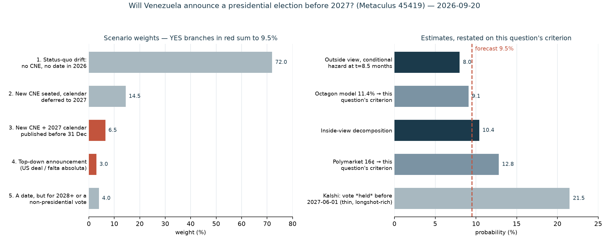

# Will Venezuela announce a presidential election before 2027?

| | |
|---|---|
| **Source** | Metaculus #45419 — https://www.metaculus.com/questions/45419/will-venezuela-announce-a-presidential-election-before-2027 |
| **Type** | binary |
| **Opened / Closes / Resolves** | 2026-09-21 / 2026-12-31 / 2027-01-01 |
| **Status** | open |
| **Current forecast** | **Median 6.0%, IQR [4.0%, 9.0%]** (v2, 2026-10-09) |
| **Community (as of 2026-10-09)** | fresh CP unavailable 2026-10-09 (Cloudflare block); no cached aggregation exists; n=120 forecasters (API, 2026-10-09) |
| **Next review** | 2026-10-23 |

---

## v2 — Update — 2026-10-09

Mode: **Update** (incremental). 19 of 102 days elapsed (~19% of the window); no market
contradicts the prior by >10pp; question structure unchanged.

### Revision table

| Driver | Direction | Effect |
|---|---|---|
| Prior (v1, 2026-09-20) | — | Median 9.5%, IQR [6.5%, 14.0%] |
| Rodríguez at UNGA (2026-09-23) promised elections with **no date, month or year**; Trump–Rodríguez meeting (2026-09-22) produced no public timetable [26][27][28] | ↓ | −1.0pp (the main near-term upside catalyst came and went empty) |
| Reuters (2026-09-25): five sources say the vote may be **a year or more** away; two say unlikely before end-2027; CNE install + register update "up to a year" [29] | ↓ | −1.0pp (cuts A2 and A3) |
| US posture: Rubio says institutions and economy first; administration sources point to a **summer/fall 2028** vote, 2027 "up in the air"; Sen. Moreno's 24 Jul 2027 called premature [28][30] | ↓ | −1.0pp (A3 0.80 → 0.65: a 2028 date is now the visible default) |
| Sequencing made explicit: AN's TSJ timetable — nominations closed 2026-10-09, committee selection from 10-15, magistrates targeted for **November**, CNE rectors **December** (Dinorah Figuera, 2026-09-30) [31][32][33] | ↓ | −0.5pp (A1 ≈ 0.30; even on schedule a new CNE has only days in 2026 to publish a *cronograma*) |
| Dialogue alive: round 2 closed 2026-09-25 with TSJ-renewal deal; round 3 set for mid-October, agenda on prisoners, exiles, disqualifications — still not electoral [31][34] | ↑/— | +0.0pp (keeps Path A breathing; no electoral item) |
| Markets moved down in step: Polymarket Dec-31 leg 16.0% → 10.5%; Kalshi "held before 2027" 5.9¢ → 2.3¢; Manifold 14.8% → 8.1% (all 2026-10-09) | ↓ | −0.5pp (independent confirmation, partly the same news) |
| Hazard decay: 19 quiet days of 102 elapsed | ↓ | absorbed in rows above |
| **New forecast** | | **Median 6.0%, IQR [4.0%, 9.0%]** |

### Tripwire check

| Tripwire (v1) | Deadline | Status 2026-10-09 |
|---|---|---|
| TSJ declares Maduro's *falta absoluta* (Art. 233) → up 25pp | 2026-12-15 | **Not fired.** TSJ is being replaced, not ruling; no sign of a re-qualification |
| Dialogue communiqué commits to a presidential date / dated calendar → up 12pp | 2026-11-15 | **Not fired.** Round 2 communiqué: TSJ renewal + candidate-credentials jurist committee only; round 3 mid-October |
| New CNE rectors designated and sworn → up 8pp | 2026-11-30 | **Not fired.** Opposition target is now December, after TSJ (November) |
| Trump/Rubio/State names a target year or quarter → up 6pp | 2026-10-15 | **Not fired.** Trump: "there must be elections", no date; a senior official called a date "an artificial deadline". Sen. Moreno's 2027-07-24 is a legislator's suggestion, not the administration's — does not count |
| No new CNE by 2026-12-05 → down 5pp | 2026-12-05 | pending (now more likely: December is the stated *target*) |
| Talks suspended / Machado faction repudiates → down 4pp | 2026-11-30 | **Not fired.** Machado still excluded and in exile; her supporters rallied (late Sept) for a 2027 timetable, but no formal repudiation |

### What resolves YES

unchanged from v1.

### Outside view

unchanged from v1, with the window now 83 days instead of 102: the slow-branch conditional
hazard scales to ≈ 6.5% over the remaining window.

### Inside view (re-weighted)

| Step | v1 | v2 | Why |
|---|---|---|---|
| A1: new CNE seated by ~2026-12-20 | 0.40 | 0.30 | Opposition's own schedule puts it in December, after a November TSJ; these targets have slipped every round so far (TSJ-law reform was planned for late August, passed 1 Sept/mid-Sept) |
| A2 \| A1: names a presidential date before 2027 | 0.21 | 0.15 | Reuters sources: after installing a CNE the authorities still must update rolls and settle manual vs electronic voting — "up to a year"; a CNE seated in mid-December has days, not weeks |
| A3 \| A2: date before 2028 | 0.80 | 0.65 | US planning reportedly centres on 2028; a 2028 date is the natural stalling compromise |

Path A: 0.30 × 0.15 × 0.65 ≈ **2.9%**. Path B (top-down bargain, legal shock, regime split):
0.04 → **0.03** — the UNGA bargain window passed without a date, but Axios reported Trump
pressing Rodríguez privately to call elections, so the tail is not dead.
Combined: 1 − (0.971)(0.97) ≈ **5.8%** → median **6.0%**.

### Evidence

New since v1 (detail in the revision table and `research.md`):

- Rodríguez at UNGA (2026-09-23) promised elections with no date, month or year; the Trump–Rodríguez meeting (2026-09-22) produced no public timetable [26][27][28].
- Reuters (2026-09-25): five sources say the vote may be a year or more away; CNE installation plus register update could take up to a year [29].
- US posture: Rubio puts institutions and economy first; administration sources reportedly point to a 2028 vote [28][30].
- National Assembly sequencing: TSJ magistrates targeted for November, CNE rectors for December [31][32][33].
- Dialogue round 2 closed 2026-09-25 with a TSJ-renewal deal; round 3 set for mid-October, agenda not electoral [31][34].
- Polymarket, Kalshi and Manifold all moved down since 2026-09-20 [35][36][37].

### Other forecasters

| Source | Value | As of | Note |
|---|---|---|---|
| Metaculus CP / Pro / gold | **no cached aggregation** — last cached snapshot (`raw/metaculus-2026-09-20.json`) predates the 2026-09-23 CP reveal and has no history | 2026-09-20 | **fresh CP unavailable 2026-10-09 (Cloudflare block)**; official API (bot key) shows status `open`, **120 forecasters, 748 forecasts** (`raw/metaculus-api-2026-10-09.json`, 2026-10-09); aggregations hidden from bot keys. No cohort disagreement can be assessed |
| Polymarket "Venezuela election scheduled by Dec 31, 2026?" | **10.5%** (bid 10 / ask 11) | 2026-10-09 | was 16.0% on 2026-09-20; $144k leg volume, $636k event. Looser criterion (any date before 2030). × P(date < 2028) ≈ 0.65 → **≈ 6.8%** on this question's criterion |
| Kalshi KXELECTVENEZUELA-27JAN01 (election *held* before 2027) | last 2.3¢, bid 2.3 / ask 5.0 | 2026-10-09 | was 5.9¢ |
| Kalshi KXELECTVENEZUELA-27JUN01 (*held* before 2027-06-01) | last 22¢, bid 23 / ask 28 | 2026-10-09 | thin, ~$20k volume; longshot-inflated; essentially unchanged |
| Manifold "Presidential Election in Venezuela by EOY 2026?" | 8.1% | 2026-10-09 | 42 traders, play money — discounted (was 14.8%) |
| Manifold "Free & Fair Presidential Election by EOY 2026?" | 8.4% | 2026-10-09 | 22 traders — discounted |

Where I sit: 6.0% vs the criterion-adjusted Polymarket ≈ 6.8% — within 1pp. The Kalshi
Jun-2027 leg at ~22–25% remains the one outlier I read as inflated: a vote held by June 2027
would need a date announced within weeks of a December CNE and a <6-month run-up, against
Machado's own 9–10-month estimate.

### Scenarios

| # | Scenario | Weight | Implies |
|---|---|---|---|
| 1 | Status-quo drift: TSJ renewal runs into Nov/Dec, CNE designation slips into 2027 | 77.0% | NO |
| 2 | New CNE seated in December; registry audit / calendar deferred to 2027 | 14.0% | NO |
| 3 | New CNE seated *and* publishes a *cronograma* with a 2027 presidential date before 2026-12-31 | 3.0% | **YES** |
| 4 | Top-down announcement (Trump–Rodríguez bargain, legal shock, regime crisis) naming a pre-2028 date | 3.0% | **YES** |
| 5 | A date is announced but for 2028+, or only for regional/legislative elections | 3.0% | NO |

YES = 3.0 + 3.0 = **6.0%**. IQR [4.0%, 9.0%]: still skewed up because the remaining news
is lumpy (round 3 in mid-October, TSJ designation in November) while the downside is mere
silence.

### Sensitivity

| Assumption | If instead | Forecast becomes |
|---|---|---|
| A1 = 0.30 | 0.55 — TSJ and CNE packaged together in November | ~8% |
| A2 = 0.15 | 0.40 — CNE designation comes bundled with a calendar as the deal's headline | ~10% |
| A3 = 0.65 | 0.85 — US pushes for 2027 after debt talks | ~6.8% |
| Path B = 0.03 | 0.08 — Trump publicly demands a 2027 date | ~11% |

### What would change my mind (tripwires)

- [ ] **Round-3 (or later) dialogue communiqué commits to a presidential election date or a dated electoral calendar**, by 2026-11-15 → **up, 10pp**
- [ ] **New TSJ magistrates designated by the AN** by 2026-11-30 → **up, 2pp** (on-schedule precursor); not by then → **down, 2pp**
- [ ] **New CNE rectors designated and sworn**, by 2026-12-10 → **up, 6pp**
- [ ] **Trump, Rubio or the State Department publicly names a target year/quarter for the vote** (2027 → up 5pp; 2028 → down 2pp), by 2026-11-30
- [ ] **TSJ declares *falta absoluta* under Art. 233**, by 2026-12-15 → **up, 25pp**
- [ ] **No new CNE designated by 2026-12-10** → **down, 3pp** (Path A effectively dead; only Path B remains)
- [ ] **Talks suspended or collapse, or Machado's faction formally repudiates the process**, by 2026-11-30 → **down, 2pp**

### Sources

Sources 1–25 as in v1; new in v2:

26. MercoPress, "Delcy Rodríguez tells the UN there will be elections in Venezuela, without setting a date", 2026-09-24 — https://en.mercopress.com/2026/09/24/delcy-rodriguez-tells-the-un-there-will-be-elections-in-venezuela-without-setting-a-date (accessed 2026-10-09)
27. US News / Reuters, "Venezuela's Rodriguez Promises Elections in Transition to 'Full Democracy'", 2026-09-23 — https://www.usnews.com/news/world/articles/2026-09-23/venezuelas-rodriguez-promises-elections (accessed 2026-10-09)
28. CubaHeadlines, "Trump Discusses Venezuelan Elections with Delcy Rodríguez: Surprise Lies in Proposed Dates", 2026-09-24 — https://www.cubaheadlines.com/articles/341069 (accessed 2026-10-09; secondary reporting of administration sources — treat as indicative)
29. Reuters via The Star, "Venezuela's promised elections face long delays, sources say", 2026-09-25/26 — https://www.thestar.com.my/news/world/2026/09/26/venezuela039s-promised-elections-face-long-delays-sources-say (accessed 2026-10-09)
30. Moncloa.com, "Diálogo Venezuela presos políticos…" (Rubio: institutions and economy first), 2026-09-27 — https://www.moncloa.com/2026/09/27/dialogo-venezuela-presos-politicos-3438512/ (accessed 2026-10-09)
31. eldiario.com, "Diputado Jorge Millán: Exigencias y retos para la democracia en Venezuela", 2026-10-08 — https://eldiario.com/2026/10/08/diputado-millan-negociacion-venezuela/ (accessed 2026-10-09)
32. eldiario.com, "La Asamblea Nacional fijó un cronograma de trabajo para proceso de renovación del TSJ", 2026-09-30 — https://eldiario.com/2026/09/30/renovacion-tsj/ (accessed 2026-10-09)
33. eldiario.com, "Dinorah Figuera prevé designación de nuevos magistrados del TSJ para noviembre", 2026-09-30 — https://eldiario.com/2026/09/30/dinorah-figuera-renovacion-tsj-noviembre/ (accessed 2026-10-09)
34. Noticias SIN / EFE, "Gobierno venezolano y oposición retomarán diálogo en octubre", 2026-09-26 — https://noticiassin.com/mundo/venezuela/2026/09/26/gobierno-venezolano-y-oposicion-retomaran-dialogo-en-octubre-2128626 (accessed 2026-10-09)
35. Polymarket gamma API, event `venezuela-presidential-election-scheduled-by` (`raw/polymarket-2026-10-09.json`) (accessed 2026-10-09)
36. Kalshi trade API, KXELECTVENEZUELA-27JAN01 / -27JUN01 market endpoints (accessed 2026-10-09)
37. Manifold search API, "Venezuela presidential election" (accessed 2026-10-09)
38. Metaculus official API, post 45419 (`raw/metaculus-api-2026-10-09.json`, bot key, aggregations hidden) (accessed 2026-10-09)

**Date**: 2026-10-09
**Forecast**: Median 6.0%, IQR [4.0%, 9.0%]
**Thesis**: The UNGA week passed without a date — Rodríguez promised elections with no year (2026-09-23), Trump set no timetable, and Reuters' sources (2026-09-25) put the vote a year or more out with US planning reportedly leaning to 2028. The reform sequence is TSJ in November then CNE in December (Figuera, 2026-09-30), leaving a new CNE days, not weeks, to publish a pre-2028 date; Polymarket's fall from 16% to 10.5% (≈6.8% on this question's stricter criterion) agrees.

---

## v1 — Initial forecast — 2026-09-20

### What resolves YES

Three conditions must **all** hold. Before 2027-01-01, (i) an official announcement of a
new Venezuelan presidential election must be made, (ii) by a person or entity with the
**legal authority** to do so, (iii) naming a **specific election date**, and (iv) that date
must fall **before 2028-01-01**. There is no fine print.

The resolution source is the Venezuelan state itself: under the 1999 constitution and the
Ley Orgánica de Procesos Electorales, the **CNE** (Consejo Nacional Electoral — National
Electoral Council) convokes elections and fixes the date; the Supreme Court (TSJ) or the
National Assembly (AN) could also force a dated convocation by declaring the president's
*falta absoluta* (absolute absence), which Art. 233 answers with an election within 30
consecutive days. There is no scheduled release that decides this — it is a political act
that can land on any day, or not at all.

Edge cases that would trip up a careless reading:

- **A roadmap without a date is not enough.** "Elections in 2027", "an electoral calendar
  by Q1", a committee, or a signed dialogue communiqué all resolve NO. A day must be named.
- **A date beyond 2027 resolves NO.** An announcement in December 2026 setting a vote for
  2028 — a plausible stalling concession — fails condition (iv). So does re-affirming the
  ordinary constitutional date of 2030.
- **Non-presidential elections do not count**, even if a full calendar is published for
  regional or legislative votes first (which is what several analysts expect).
- **Announcements by people without authority do not count** — Machado, the opposition
  delegation, the US State Department or Trump naming a date is not the CNE convoking one.
- The **sitting** (chavista) CNE has legal authority. A new CNE is the expected route but
  not a necessary one.

### Outside view

**Class A — irregular removals of an incumbent autocrat since 1990 (n ≈ 20).** Announced a
specific presidential election date within 12 months: ~8 (Peru 2000, Turkmenistan 2006,
Uzbekistan 2016, Algeria 2019, Kyrgyzstan 2020, Bolivia 2019, Zimbabwe 2017, Egypt 2013)
against ~12 that did not (Tunisia 2011, Egypt 2011, Madagascar 2009, Sudan 2019, Mali 2020,
Guinea 2021, Chad 2021, Burkina Faso 2022, Niger 2023, Gabon 2023, Syria 2024,
Bangladesh 2024). Raw 12-month base rate ≈ **40%**.

That number is the wrong one to use, because the distribution is **bimodal**: where the
answer was yes it was almost always within *weeks*, driven by a ruling apparatus that
wanted a fast legitimating vote. Maduro was removed on 2026-01-03; we are 8.5 months in
with nothing announced, which selects hard into the slow branch. Of the ~12 slow cases,
roughly **0–1 announced a dated presidential election in their months 8.5–12**. Conditional
hazard over this question's 3.4-month window ≈ **8%**. A hazard-rate check,
`P = 1 − exp(−λt)` with λ from the slow branch, gives ~9%. Source for the case list:
standard election chronologies; the Venezuelan timeline is in `research.md` §1 with
per-event citations.

**Class B — Venezuelan dialogue processes (n = 4):** Vatican 2014, Dominican Republic
2016–17, Oslo/Barbados 2019, Mexico/Barbados 2021–23. **One of four** produced a
presidential election. In that one, the lag from the enabling agreement (2023-10-17) to the
CNE's dated convocation (2024-03-05) was **≈ 4.5 months** — and the enabling agreement here
(a reconstituted CNE) does not yet exist.

**Class C — status quo.** A 3.4-month window, no legal deadline, and the actor who controls
the outcome saying publicly that it will not happen yet. Status quo wins by default.

All three classes land at or below 10%.

### Inside view

**Path A — the institutional sequence.** Renewed TSJ → new CNE seated → CNE publishes a
*cronograma electoral* naming a presidential election date.

| Step | P | Why |
|---|---|---|
| A1: new CNE designated and sworn by ~2026-12-20 | 0.40 | For: both delegations say "this year"; Machado (2026-09-14) cites State-Department conversations; TSJ-law reform passed first reading 2026-08-27; the AN expanded the judicial nominations committee in September. Against: the **TSJ is sequenced first and is not done**; round 2 (Sept 17–23) never reached the CNE; negotiated-transition deadlines slip as a rule |
| A2 \| A1: that body names a specific presidential date before 2027 | 0.21 | A newly seated CNE audits the REP (electoral register, degraded by ~8m emigrants) before convoking; the political decision is explicitly *not* taken — opposition negotiator Ramón López, 2026-08-19: a presidential election "has not been formally discussed" and "el cronograma electoral será facultad del nuevo CNE" |
| A3 \| A2: the named date falls before 2028 | 0.80 | Machado's own estimate is 7–9 months (~40 weeks) of preparation, which from a December announcement lands mid/late 2027. But a government buying time could name a 2028 date and still call it a concession |

0.40 × 0.21 × 0.80 = **6.7%**.

**Path B — top-down or legal shock (P ≈ 0.04).** Path A is sufficient, not necessary: the
sitting CNE retains legal authority. Triggers: a Trump–Delcy Rodríguez bargain (a UNGA
pull-aside is set for ~2026-09-22) producing a public date; a TSJ declaration of *falta
absoluta*, legally overdue since 2026-07-02, forcing an Art. 233 convocation within 30 days;
a split in chavismo or mass mobilisation. Each is individually unlikely, and the entire
legal architecture erected on 2026-01-05 — calling the absence *temporary* under Art. 234 —
exists precisely to avoid the second.

Combined: 1 − (1 − 0.067)(1 − 0.04) = **10.4%**.

**Conjunction check** (methodology §7): YES needs a seated new CNE *and* a political
decision to vote within ~12 months *and* a published date, inside 102 days. The forecast is
below the least likely link (0.21), as it must be.

**Actors and incentives.** Chavismo loses a free vote badly — the 2024 opposition tally
sheets had González ~67% to Maduro ~30%, and 2026 polling puts Machado at 72% favourable /
14% unfavourable. Delcy Rodríguez, Diosdado Cabello (still interior minister) and the
military face existential downside and no binding deadline. The United States has already
banked its prize — the late-August oil agreement giving Washington majority control of
about a fifth of Venezuela's reserves — and Trump then said on 2026-09-02 that Venezuela is
"not ready yet." The external forcing function is largely spent. Meanwhile the opposition
faction at the table (Dinorah Figuera, Ramón López) is the weaker one; **Machado, who wants
speed, is excluded from the talks and still cannot return to the country**.

### Evidence

Starting from the outside-view prior of ~8%, the material updates:

| Evidence (dated) | Direction | Likelihood ratio | Effect |
|---|---|---|---|
| US-backed dialogue is real and delivering: round 1 (2026-08-06/12) agreed a TSJ-renewal process; AN first reading 2026-08-27; round 2 opened 2026-09-17, extended to 09-23, lifted digital-media blocks | ↑ | ~1.6 | The only serious YES machinery. But its published outputs are judicial and civil-liberties items, not electoral |
| Both delegations, and Machado (2026-09-14), expect a new CNE before year-end | ↑ | ~1.4 | Advocacy from interested parties, not a commitment by the body that appoints it; and a CNE is a precursor, not the announcement |
| Trump, 2026-09-02: "I don't think they're ready yet… Delcy wants it, but they are not ready yet." No timetable | ↓ | ~0.55 | The single most load-bearing fact. The patron who could force a date has declined to |
| Delcy Rodríguez, 2026-09-02: elections "without a doubt" when ready — "I don't set the date" | ↓ | ~0.7 | Explicit refusal to name one |
| Jorge Rodríguez (2026-02-10) ruled out a near-term presidential election; López (2026-08-19) says it is not on the table | ↓ | ~0.7 | |
| TSJ has let both the 90-day (2026-04-03) and 180-day (2026-07-02) limits on a *falta temporal* pass without re-qualifying | ↓ | ~0.8 | 2.5 months of demonstrated willingness to sit outside the constitution rather than trigger Art. 233 |
| June 2026 earthquakes (>5,000 dead) | ↓ | ~0.85 | A sympathetic, internationally acceptable reason to defer, plus a real drain on state capacity |
| Polymarket's own trend on the looser contract: 23% (08-04) → 16% (08-18) → 16% (09-20) | ↓ | ~0.8 | Money has been moving away from YES all quarter |

**Absence of expected evidence.** If a 2026 announcement were coming, by now I would expect
to see a draft *cronograma* leaked or trailed, a government statement naming at least a
year, CNE rectors designated, or the electoral question on a published dialogue agenda.
None of the four is present, and round 2's published outcomes (2026-09-19) contain nothing
electoral. That absence is evidence of absence here, because these are things that *would*
be visible.

The updates roughly cancel in direction but not in weight; net they hold me near the
outside view, and the inside-view decomposition adds ~2pp for the live Path-B tail.

### Other forecasters

| Source | Value | As of | Note |
|---|---|---|---|
| Metaculus CP (recency-weighted) | **none** | 2026-09-20 | question status `upcoming`; all three cohorts return 0 history points |
| Metaculus Pro | **none** | 2026-09-20 | CP reveal 2026-09-23; n = 6 forecasters |
| Metaculus gold medalists | **none** | 2026-09-20 | |
| Polymarket "Venezuela election scheduled by 2026-12-31?" | **16.0%** (bid 15 / ask 17) | 2026-09-20 | $130k volume this leg, $623k event, liquidity $11.2k. **Looser criterion**: vote need only be before 2030 |
| Polymarket, same leg, path | 23% → 16% → 16% | 08-04 / 08-18 / 09-20 | Jan-31 and Mar-31 2026 legs both resolved NO |
| Octagon AI model | **11.4%** (market then 15%) | 2026-08-18 | independent model on the Polymarket criterion |
| Kalshi KXELECTVENEZUELA-27JAN01 (election *held* before 2027) | last 5.9¢, bid 2.9 / ask 6.8 | 2026-09-20 | |
| Kalshi KXELECTVENEZUELA-27JUN01 (*held* before 2027-06-01) | last 20¢, bid 21 / ask 22 | 2026-09-20 | very thin — 6-lot trades |
| Manifold "Presidential Election in Venezuela by EOY 2026?" | 14.8% | 2026-09-20 | 37 traders, play money — discounted |
| Manifold "Free & Fair Presidential Election by EOY 2026?" | 8.4% | 2026-09-20 | 22 traders — discounted |
| Sentinel Team | no matching item | 2026-09-20 | searched, dead end |

**No Metaculus cohort disagreement to flag — there are no cohorts yet.** That removes the
usual anchor and also removes the usual check on me; it is a reason to widen the band, not
to be more confident.

**Where I sit versus the markets.** Polymarket's 16% is on a *looser* contract than this
question: it accepts any announced date before 2030, while Metaculus requires the vote
itself before 2028. Restating it at P(date < 2028 | a date is announced in 2026) ≈ 0.80
gives ≈ **12.8%**; the same operation on Octagon's model gives ≈ **9.1%**. My 9.5% is
3.3pp below the market-derived figure — inside the 10pp threshold that would demand a
written defence, and in the direction the longshot correction points anyway.

Kalshi's 5.9¢ on "election *held* before 2027-01-01" is the useful tell: with no date
announced, no reconstituted CNE and 102 days left, that event is worth ~1%, not ~6%. These
thin Venezuela contracts carry roughly 3–5× longshot inflation at the low end, which is
why I read the Jun-2027 leg (21.5%) as inflated rather than as a floor on my number.

### Scenarios

| # | Scenario | Weight | Implies |
|---|---|---|---|
| 1 | Status-quo drift: TSJ renewal consumes the autumn, CNE designation slips past 2026-12-31, dialogue continues on civil liberties and prisoners | 72.0% | NO |
| 2 | New CNE is seated in Nov/Dec but issues only a registry-audit plan; the calendar is explicitly deferred to 2027 | 14.5% | NO |
| 3 | Breakthrough: new CNE seated *and* publishes a *cronograma* naming a 2027 presidential election date before 2026-12-31 | 6.5% | **YES** |
| 4 | Top-down announcement — a Trump–Rodríguez bargain, a TSJ *falta absoluta* ruling, or a regime crisis — producing a specific pre-2028 date | 3.0% | **YES** |
| 5 | A date *is* announced, but for 2028 or later, or only for regional/legislative elections | 4.0% | NO |

YES = 6.5 + 3.0 = **9.5%**.

The IQR is asymmetric upward because the near-term catalysts are one-sided: the UNGA
pull-aside (~2026-09-22) and the close of round 2 (2026-09-23) can produce a commitment
that moves me up several points in a week, whereas the downside news is simply more
silence, worth a point or two. Hence **[6.5%, 14.0%]**.

### Sensitivity

| Assumption | If instead | Forecast becomes |
|---|---|---|
| P(new CNE seated by ~2026-12-20) = 0.40 | 0.65 — the dialogue hits the opposition's stated November target | ~14% |
| P(new CNE seated by ~2026-12-20) = 0.40 | 0.20 — TSJ renewal alone eats the rest of 2026 | ~7% |
| P(a seated CNE names a date before 2027) = 0.21 | 0.45 — the CNE's designation is packaged *with* a calendar as the deal's headline deliverable | ~16% |
| P(named date < 2028) = 0.80 | 0.55 — a 2028 date is the natural stalling compromise | ~7% |
| US posture stays "not ready" (Trump, 2026-09-02) | Trump names a 2027 target after the UNGA meeting | ~18–22% |

### What would change my mind (tripwires)

- [ ] **TSJ (sitting or renewed) declares Maduro's *falta absoluta* under Art. 233** by 2026-12-15 → **up, 25pp** (it mandates an election within 30 days, so a dated convocation follows almost mechanically)
- [ ] **A dialogue communiqué (round 3 or later) commits to a presidential election date or a dated electoral calendar**, by 2026-11-15 → **up, 12pp**
- [ ] **New CNE rectors designated and sworn by the National Assembly** by 2026-11-30 → **up, 8pp** (the necessary precursor, on the opposition's own stated schedule)
- [ ] **Trump, Rubio or the State Department publicly names a target year or quarter** for the Venezuelan presidential vote (watch the ~2026-09-22 UNGA pull-aside), by 2026-10-15 → **up, 6pp**
- [ ] **No new CNE designated by 2026-12-05** → **down, 5pp** (leaves under four weeks for the whole remaining chain; Path A is effectively dead)
- [ ] **Talks suspended or collapse, or Machado's faction formally repudiates the process**, by 2026-11-30 → **down, 4pp**

### Sources

1. Metaculus #45419, aggregations + metadata (`raw/metaculus-2026-09-20.json`) — https://www.metaculus.com/questions/45419/will-venezuela-announce-a-presidential-election-before-2027 (accessed 2026-09-20)
2. Polymarket, "Venezuela presidential election scheduled by…?", gamma API (`raw/polymarket-2026-09-20.json`) — https://polymarket.com/event/venezuela-presidential-election-scheduled-by (accessed 2026-09-20)
3. Kalshi trade API, KXELECTVENEZUELA-27JAN01 / -27JUN01 trades and orderbooks — https://api.elections.kalshi.com/trade-api/v2/ (accessed 2026-09-20)
4. Manifold Markets search API, Venezuela election markets — https://api.manifold.markets/v0/search-markets?term=Venezuela%20election (accessed 2026-09-20)
5. Octagon AI, "Venezuela presidential election scheduled by… Odds" (model 11.4% vs market 15%, as of 2026-08-18) — https://www.octagonai.co/markets/geopolitics/world/venezuela-presidential-election-scheduled-by (accessed 2026-09-20)
6. Congressional Research Service, R49186, *Venezuela's Post-Maduro Political Transition and U.S. Policy*, 2026-08-13 — https://www.everycrsreport.com/reports/R49186.html (accessed 2026-09-20)
7. GIS Reports, "Venezuela's uneven transition from Maduro", 2026-08-05 — https://www.gisreportsonline.com/r/venezuela-transition-maduro/ (accessed 2026-09-20)
8. Venezuelanalysis, "Venezuela: Gov't and Opposition Open US-Backed Talks to Overhaul Electoral, Judicial Authorities", 2026-08-07 — https://venezuelanalysis.com/news/venezuela-govt-and-opposition-open-us-backed-talks-to-overhaul-electoral-judicial-authorities/ (accessed 2026-09-20)
9. El Universal, "Representante opositor en el diálogo cree que se nombrará nuevo CNE este año" (Ramón López), 2026-08-19 — https://www.eluniversal.com/politica/239606/ (accessed 2026-09-20)
10. Bloomberg, "Rodríguez Vows Elections Will Happen When Venezuela 'Is Ready'", 2026-09-02 — https://www.bloomberg.com/news/articles/2026-09-02/rodriguez-vows-elections-will-happen-when-venezuela-is-ready (accessed 2026-09-20)
11. MercoPress, "Trump says Venezuela is 'not ready' to hold elections and sets no timetable", 2026-09-02 — https://en.mercopress.com/2026/09/02/trump-says-venezuela-is-not-ready-to-hold-elections-and-sets-no-timetable (accessed 2026-09-20)
12. Al Jazeera, "Venezuela's National Assembly chief rules out new presidential election", 2026-02-10 — https://www.aljazeera.com/news/2026/2/10/venezuelas-national-assembly-chief-rules-out-new-presidential-election (accessed 2026-09-20)
13. Al Jazeera, "Venezuela government and opposition to hold talks aimed at path to election", 2026-07-31 — https://www.aljazeera.com/news/2026/7/31/venezuela-govt-and-opposition-to-hold-talks-aimed-at-path-to-elections (accessed 2026-09-20)
14. Infobae, "El chavismo y la oposición en Venezuela extendieron la segunda ronda de diálogo…", 2026-09-19 — https://www.infobae.com/venezuela/2026/09/19/el-chavismo-y-la-oposicion-en-venezuela-extendieron-la-segunda-ronda-de-dialogo-para-revisar-la-libertad-de-expresion/ (accessed 2026-09-20)
15. Infobae, "Una nueva alianza opositora venezolana exige elecciones presidenciales con María Corina Machado como candidata", 2026-09-14 — https://www.infobae.com/venezuela/2026/09/14/una-nueva-alianza-opositora-venezolana-exige-elecciones-presidenciales-con-maria-corina-machado-como-candidata/ (accessed 2026-09-20)
16. Reporte Confidencial, "Machado: Conversaciones con EE. UU. 'dan razones para creer que habrá nuevo CNE antes de fin de año'", 2026-09-14 — https://reporteconfidencial.info/2026/09/14/machado-nuevo-cne/ (accessed 2026-09-20)
17. eldiario.com, "Terminaron los 180 días de ausencia temporal del presidente en Venezuela: ¿qué indica la Constitución?", 2026-07-03 — https://eldiario.com/2026/07/03/ausencia-presidente-venezuela/ (accessed 2026-09-20)
18. Acceso a la Justicia, "A 3 meses de la ausencia presidencial en Venezuela: ¿falta temporal o absoluta?" — https://accesoalajusticia.org/a-3-meses-ausencia-presidencial-venezuela-falta-temporal-o-absoluta/ (accessed 2026-09-20)
19. Wikipedia, "Next Venezuelan presidential election" — https://en.wikipedia.org/wiki/Next_Venezuelan_presidential_election (accessed 2026-09-20)
20. PBS NewsHour, "Venezuelan opposition leader Machado says she will run again… and return from exile by late 2026", 2026-05-23 — https://www.pbs.org/newshour/world/venezuelan-opposition-leader-machado-says-she-will-run-again-for-presidency-and-return-from-exile-by-late-2026 (accessed 2026-09-20)
21. ABC News, "Trump to meet with Venezuela's interim president… during UN General Assembly", 2026-09-18 — https://abcnews.com/Politics/trump-meet-venezuelas-interim-president-leaders-general-assembly/story?id=136575782 (accessed 2026-09-20)
22. CNN Español, "El chavismo y parte de la oposición inician otra ronda de diálogo…", 2026-09-15 — https://cnnespanol.cnn.com/2026/09/15/venezuela/dialogo-chavismo-oposicion-segunda-ronda-orix (accessed 2026-09-20)
23. JURIST, "Venezuela National Assembly expands judicial nominations committee in step toward Supreme Court overhaul", 2026-09 — https://www.jurist.org/news/2026/09/venezuela-national-assembly-expands-judicial-nominations-committee-in-step-toward-supreme-court-overhaul/ (accessed 2026-09-20)
24. Chatham House, "Democratic elections in Venezuela won't happen overnight — here's the groundwork that's needed first", 2026-04 — https://www.chathamhouse.org/2026/04/democratic-elections-venezuela-wont-happen-overnight-heres-groundwork-thats-needed-first-4 (accessed 2026-09-20)
25. Human Rights Watch, *World Report 2026: Venezuela* — https://www.hrw.org/world-report/2026/country-chapters/venezuela (accessed 2026-09-20)

**Date**: 2026-09-20
**Forecast**: Median 9.5%, IQR [6.5%, 14.0%]
**Thesis**: Venezuela's US-brokered transition talks are real but are sequenced judiciary-first, and the electoral step has not been reached: the CNE is unreformed, Trump said on 2026-09-02 that Venezuela is "not ready yet" with no timetable, and Delcy Rodríguez says "I don't set the date." With no constitutional deadline binding (the TSJ has let the 180-day *falta temporal* limit lapse since 2026-07-02 rather than trigger Art. 233), YES requires a new CNE seated *and* a political decision to vote within 12 months *and* a published date, all inside 102 days — a conjunction the post-autocrat base rate (~8% conditional hazard at t = 8.5 months) and Polymarket's criterion-adjusted 12.8% bracket at roughly 9–10%.
