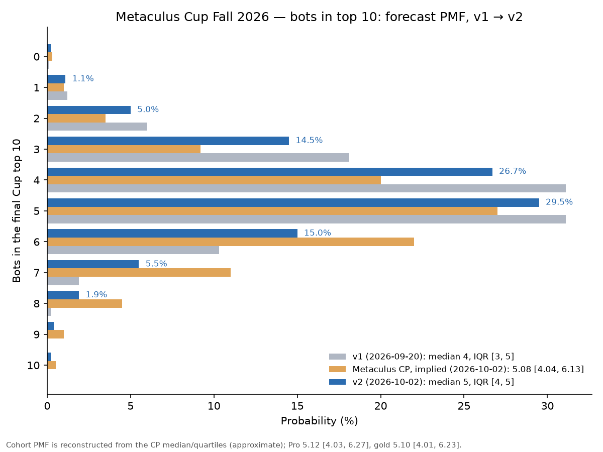
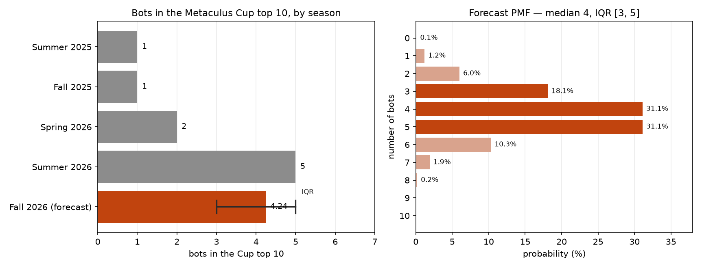

# How many bots will finish in the top 10 of the Metaculus Cup Fall 2026?

| | |
|---|---|
| **Source** | Metaculus #45619 — https://www.metaculus.com/questions/45619/how-many-bots-will-finish-in-the-top-10-of-the-metaculus-cup-fall-2026 |
| **Type** | discrete (0–10, integer, both bounds closed) |
| **Opened / Closes / Resolves** | open (CP revealed 2026-09-26) / 2026-12-15 / after the Cup closes 2027-01-01 |
| **Status** | open |
| **Current forecast** | **Median 5, IQR [4, 5]** (mean 4.6) (v2, 2026-10-02) |
| **Community (as of 2026-10-02)** | CP 5.08, IQR [4.04, 6.13] (n=102) · Pro 5.12 [4.03, 6.27] (n=10) · Gold 5.10 [4.01, 6.23] (n=31) |
| **Next review** | 2026-10-16 |

<!-- Versions below, newest first. APPEND-ONLY: never edit or delete a past version. -->

---

## v2 — Update — 2026-10-02

### Revision

Effects are on the mean of the forecast distribution (median and IQR in the last row).

| Driver | Direction | Effect |
|---|---|---|
| Prior (v1, 2026-09-20) | — | Median 4, IQR [3, 5] (mean 4.24) |
| CP reveal: all three Metaculus cohorts sit at ~5.1 with upper quartile ~6.2 (CP 5.08 [4.04, 6.13], n=102; Pro 5.12 [4.03, 6.27], n=10; gold 5.10 [4.01, 6.23], n=31) [S1]; pre-registered tripwire fired. Blended at 40% weight against my v1 PMF | ↑ | +0.34 mean; P(≥6) 12% → 23%; median 4 → 5 (P(≤4) 56.5% → 47.5%) |
| More bot entrants wired to the Fall Cup: Metaculus's own bot template now targets `metaculus-cup-fall-2026` [S23]; an independent bot added a Cup step on 2026-10-01 [S24]; two forecasters on this question report running new bots (self-assessed ~30th) [S1] | ↑ (tail only) | no separate move — it is why the crowd gets 40% rather than 30% weight (≈ +0.08 of the +0.34) |
| Score-noise argument (tejvn [S1]: 1σ of season-total peer score ≈ the gap between 1st and 12th in Summer) | ↓ | keeps P(≤3) at 21% (crowd ~14%); argues against weighting the crowd ≥ 50% (which would give mean 4.67, IQR [4, 6]) |
| Live Fall 2026 Cup leaderboard still unavailable; no incumbent withdrawal or rule change found | → | none |
| **New forecast** | | **Median 5, IQR [4, 5]** (mean 4.58) |

### Tripwire check

| Tripwire from v1 | Fired? | Note |
|---|---|---|
| CP reveal: community median ≥ 5 with Pro and gold agreeing, by 2026-09-27 → up 1 | **Fired** | At 2026-09-27 13:33 UTC: CP 5.02, Pro 5.58, gold 5.50; at 2026-10-02 13:19: CP 5.08, Pro 5.12, gold 5.10 (`raw/metaculus-2026-10-02.json`). Applied as a 40%-weight blend rather than a mechanical +1 — the result moves the median to 5 (as the tripwire said) but only +0.34 on the mean. |
| Elite incumbent absent or covering < half the Cup questions, by 2026-10-15 → down 1 per bot | Not fired (unobservable) | The Fall 2026 Cup has no public live leaderboard; a commenter expects the live leaderboard "in early November" [S1]. Per this session's brief I did not scrape Metaculus profiles or leaderboards. No news of any of the five withdrawing; Mantic continues to be profiled on its Cup result (IBM, 2026-09-28 [S25]). |
| Sixth bot inside the interim Cup top 15, by 2026-10-31 → up 1 | Not fired (pending; unobservable) | No interim leaderboard. Partial pressure upward: more bots are entering (see revision table), but self-reported strength ~30th. |
| Admins rule on `symbiosis` / unflagged bots, by 2026-11-15 → down 1 | Not fired | No admin reply among the eight latest comments. DeRuina asserts Metaculus's in-house `metac-*` bots count as bots — consistent with the criteria, not a ruling; they placed 23rd–37th historically, so it barely matters. |
| ≥ 2 of the elite five outside the Fall FutureEval top 10, by 2026-11-30 → down 1 | Not fired (too early) | Fall 2026 FutureEval launched ~2026-09-28 with a $58k pool [S26]; no standings worth reading yet. |
| Metaculus Cup rule change on bot eligibility / top-10 construction (any date) | Not fired | None found. The opposite signal: Metaculus updated its official bot template to point at the Fall Cup [S23]. |

### What resolves YES

unchanged from v1. Re-read in the 2026-10-02 snapshot: resolution criteria, fine print
(top 10 = prize-eligible users + bots; admins and other excluded humans struck) and
background (5 of 10 in Summer 2026) are identical to v1.

### Outside view

unchanged from v1 (persistence ≈ 4.8; last value 5). One addition from the comments: ACX
reported that only 2 of the 10 humans in the Spring 2026 top 10 repeated in Summer, while
both leading bots held their places [S6, S1]. Bot seats are stickier than human seats, which
supports the persistence anchor over regression-to-the-mean — but it was already implicit in
the v1 roll-call probabilities (0.85–0.93 per incumbent), so it is not counted again.

### Inside view

unchanged from v1 in structure (roll-call over five incumbents + challenger pool + marginal
seat cost). The v1 Monte Carlo is not re-run: no new incumbent-level data exists. The update
is a linear opinion pool of the v1 PMF (weight 0.6) and a PMF reconstructed from the CP
median and quartiles (weight 0.4):

| Bots | 0 | 1 | 2 | 3 | 4 | 5 | 6 | 7 | 8+ |
|---|---|---|---|---|---|---|---|---|---|
| v1 | 0.1% | 1.2% | 6.0% | 18.1% | 31.1% | 31.1% | 10.3% | 1.9% | 0.2% |
| Cohort-implied (approx.) | 0.3% | 1.0% | 3.5% | 9.2% | 20.0% | 27.0% | 22.0% | 11.0% | 6.0% |
| **v2** | 0.2% | 1.1% | 5.0% | 14.5% | **26.7%** | **29.5%** | 15.0% | 5.5% | 2.5% |

The cohort PMF is my reconstruction (the discrete question's continuous-scale quartiles 4.04 /
5.08 / 6.13 imply bin masses of roughly 20% / 27% / 22% on 4 / 5 / 6), not a published vector.
Cumulative v2: P(≤3) 20.8%, P(≤4) 47.5%, P(≤5) 77.0%. The median sits just over the 4|5
boundary — it is a near coin-flip between 4 and 5, and should be read that way.

### Evidence

New since v1:

- **Cohort reveal** (the main driver). 102 forecasters; 10 Pros and 31 gold medalists, all
  three cohorts within 0.04 of each other at the median and with upper quartiles of 6.13–6.27.
  The cohorts have been stable since the reveal (CP range 4.6–5.1, Pro 4.7–5.6, gold
  4.6–5.5 over 2026-09-21 → 10-02). **LR** on "the true centre is 5 rather than 4" ≈ 1.6.
  Discounted because (a) the crowd sees the same public anchor (background says "5 of the
  top 10"), so much of its mass on 5 is the same status-quo prior I already hold, and (b) none
  of it can be informed by a live Fall leaderboard, which does not yet exist publicly.
- **Barrier to bot entry fell.** Metaculus's template PR #114 points `--mode metaculus_cup` at
  the Fall 2026 Cup and adds a callout to higher-ranked open-source bots [S23]; a fork added
  an automatic Cup-forecasting step on 2026-10-01 [S24]. Commenters Capital and Theomachado
  both report running new bots in the Fall Cup, Capital estimating ~30th [S1]. This raises
  the number of bot *entrants*, not obviously the number of *contenders*: a template bot that
  started a month late is structurally out of contention under coverage scoring. Small ↑ on
  the ≥ 6 tail only.
- **Score-noise argument** (tejvn [S1]). Using the Spring 2026 FutureEval analysis's
  ~8.5-point 95% CI on 300 questions, per-question sd ≈ 37.6; with sd 30 over 55 questions the
  season-total 1σ ≈ 220 peer-score points — about the Summer gap between 1st and 12th. Fair
  as far as it goes; the rebuttal (exmateriae, a top human) is that the Summer bot lead was
  "massive" and the top-10 reshuffle is mostly human participation churn. My v1 model already
  carried idiosyncratic noise sd 1.6 on a 10th-human-normalised scale; I treat the comment as
  a reason not to compress the low tail to the crowd's ~14%.
- **No live leaderboard.** Still the binding gap. Per the brief I did not attempt to scrape
  Metaculus; a commenter expects it in early November.

Absent evidence: no announcement of an incumbent bot (laertes, manticAI, futuresearch,
cassi, preseen) skipping the Fall Cup; no Metaculus rule change; no admin ruling on unflagged
bots. Searched directly for each.

### Other forecasters

| Source | Value | As of | Note |
|---|---|---|---|
| Metaculus CP (recency-weighted) | 5.08, IQR [4.04, 6.13] (n=102) | 2026-10-02 | first visible value 4.72 on 2026-09-21 |
| Metaculus Pro | 5.12, IQR [4.03, 6.27] (n=10) | 2026-10-02 | peaked 5.58 on 2026-09-27 |
| Metaculus gold medalists | 5.10, IQR [4.01, 6.23] (n=31) | 2026-10-02 | |
| Kalshi / Polymarket / Manifold | no market | 2026-10-02 | searched again; none |
| Sentinel Team, Mantic blog, GJOpen, INFER | no matching question | 2026-10-02 | |

**Cohort disagreement: none material** — the three cohorts agree to within 0.04 at the median.
**Where I sit**: same median bin (5), lower mean (4.58 vs ~5.1), narrower and lower-shifted
IQR ([4, 5] vs ~[4, 6]). The disagreement is concentrated in the ≥ 6 tail (mine 23%, crowd
~37%). I keep it because the v1 marginal-seat argument has not been answered: a sixth seat
needs the sixth-best bot (~38th in Summer) to beat the fifth-best human, and no new evidence
shows a challenger closing that gap. Pros and gold agreeing against me is exactly the case
where AGENTS.md says to look for the missed fact; the candidate facts (more entrants, in-house
bots counting, human churn) are named above and each is weak.

### Scenarios

| # | Scenario | Weight | Implies |
|---|---|---|---|
| 1 | Roll-call holds, no challenger breaks in | 30% | 5 |
| 2 | Roll-call minus one | 27% | 4 |
| 3 | Roll-call minus two, or stronger human top end | 14% | 3 |
| 4 | Expansion: a challenger (or second Preseen account) beats the 5th-best human | 22% | 6–7+ |
| 5 | Contraction: several operators skip or start late | 7% | 0–2 |

vs v1: weight moved from scenarios 2, 3 and 5 into scenario 4.

### Sensitivity

| Assumption | If instead | Forecast becomes |
|---|---|---|
| Crowd weight 0.4 | 0.3 | mean 4.50, median 5 only just (P(≤4) 49.8%), IQR [4, 5] |
| same | 0.5 | mean 4.67, median 5, IQR [4, 6] (P(≤5) 74.3%) |
| same | 1.0 (adopt the crowd) | mean 5.1, median 5, IQR [4, 6] |
| Cohort PMF reconstruction | crowd puts 25% (not 20%) on 4 and correspondingly less on 6–7 | mean 4.53, median 5 holds only barely (P(≤4) 49.5%) |

The median is fragile at the 4|5 boundary: any weight below ~0.29 returns it to 4. The IQR
[4, 5] is robust across weights 0.3–0.45.

### What would change my mind (tripwires)

- [ ] **By 2026-10-15 — an elite incumbent confirmed absent** or forecasting on fewer than
      half the open Cup questions (via the live leaderboard once published, or a bot operator's
      own statement) → **down 1 per bot**. All five confirmed active with full coverage →
      **up 0.3** on the mean (IQR to [4, 6]).
- [ ] **By 2026-11-10 — first public interim Cup leaderboard** (expected early November):
      ≤ 3 bots in the interim top 10 → **down 1**; ≥ 6 → **up 1**.
- [ ] **By 2026-11-15 — a sixth bot inside the interim Cup top 15** (acm_bot, GreeneiBot2,
      future-perfect-hindsight, mmBot, ana, Preseen-Chestnut, a template bot or a newcomer)
      → **up 1** on the ≥ 6 tail (shift mass from 4 to 6).
- [ ] **By 2026-11-15 — admins answer the `symbiosis` / unflagged-bot question.** Not counted
      as bots → **down 1**; struck from the list → **up 0.5**.
- [ ] **By 2026-11-15 — Pro and gold medians both move below 4.5 or above 5.6** (they share
      my information set, so only a move without a public trigger is informative) →
      **0.5 toward them**.
- [ ] **By 2026-11-30 — Fall 2026 FutureEval interim standings**: ≥ 2 of the elite five
      outside the top 10 → **down 1**; all five in the top 5 → **up 0.3**.
- [ ] **Any date — Metaculus Cup rule change** on bot eligibility or top-10 construction →
      re-analyse (`either`).

### Sources

Sources 1–22 as in v1, with [S1] re-accessed 2026-10-02 (`raw/metaculus-2026-10-02.json`:
aggregations, history and the eight latest comments — exmateriae, tejvn, DeRuina, Capital,
Theomachado). Carried forward from v1 (1–22), then new (23–28):

1. Metaculus #45619, "How many bots will finish in the top 10 of the Metaculus Cup Fall 2026?" — resolution criteria, fine print, background and comments (incl. Theomachado's reference-class table and PMF, MaxA's `symbiosis` query) — https://www.metaculus.com/questions/45619/how-many-bots-will-finish-in-the-top-10-of-the-metaculus-cup-fall-2026 (accessed 2026-09-20; raw JSON in `raw/metaculus-2026-09-20.json`)
2. The Economist, "Artificial intelligence now beats some of the best human forecasters", 2026-09-16 — https://www.economist.com/science-and-technology/2026/09/16/artificial-intelligence-now-beats-some-of-the-best-human-forecasters (paywalled — **not** accessed 2026-09-20: the body is behind the paywall and archive.is is unreachable from this container, so its content here is taken from [S3], [S9], [S18] and [S20], which agree)
3. explainx.ai, "AI Wins Metaculus Cup: Humans Still Lead Head-to-Head" — https://www.explainx.ai/blog/ai-beats-forecasters-metaculus-cup-coverage-2026 (accessed 2026-09-20)
4. Time, "AI Is Learning to Predict the Future—And Beating Humans at It", 2025-09-18 — https://time.com/7318577/ai-model-forecasting-predict-future-metaculus/ (accessed 2026-09-20)
5. Metaculus Cup Fall 2026 tournament page (dates, schedule, question count, prize pool) — https://www.metaculus.com/tournament/metaculus-cup-fall-2026/ (accessed 2026-09-20)
6. Scott Alexander, "The AI Superforecasters Are Here", Astral Codex Ten — https://www.astralcodexten.com/p/the-ai-superforecasters-are-here (accessed 2026-09-20)
7. Metaculus Cup Summer 2026 tournament page (58 questions; closed 2026-09-02, winners 2026-09-05) — https://www.metaculus.com/tournament/metaculus-cup-summer-2026/ (accessed 2026-09-20)
8. "AI Forecasting in 2026: What 11 Analyses Say", EA Forum — https://forum.effectivealtruism.org/posts/Spyz3wESZu2eeqhDj/ai-forecasting-in-2026-what-11-analyses-say (accessed 2026-09-20)
9. The Neuron, "AI Forecasting Is Becoming Infrastructure" — https://www.theneuron.ai/news/when-ai-predicts-better-than-people-who-sets-the-rules/ (accessed 2026-09-20)
10. "Q2 AI Benchmark Results: Pros Maintain Clear Lead", EA Forum — https://forum.effectivealtruism.org/posts/F2stjK9wHSy3HPEC9/q2-ai-benchmark-results-pros-maintain-clear-lead (accessed 2026-09-20)
11. Metaculus FutureEval — https://www.metaculus.com/futureeval/ and the Spring 2026 FutureEval analysis notebook https://www.metaculus.com/notebooks/45373/spring-2026-futureeval-analysis/ (accessed 2026-09-20)
12. Metaculus Tournament Rules (bots ineligible for prizes; humans may use AI assistance) — https://www.metaculus.com/tournament-rules/ (accessed 2026-09-20)
13. Metaculus Scores FAQ (peer score, coverage, tournament ranking) — https://www.metaculus.com/help/scores-faq/ (accessed 2026-09-20)
14. Metaculus Medals FAQ (ranking by summed peer score over summed coverage) — https://www.metaculus.com/help/medals-faq/ (accessed 2026-09-20)
15. hraness.com reading notes on the Economist piece (laertes = Jeffrey Liang's bot; ~150 h and ~$2k compute; leads a separate AI-only Metaculus contest) — https://hraness.com/reading/artificial-intelligence-now-beats-some-of-the-best-human-forecasters (accessed 2026-09-20)
16. Tech Startups, "British AI startup Mantic raises $25M… after Metaculus win", 2026-09-18 — https://techstartups.com/2026/09/18/british-ai-startup-mantic-raises-25m-to-build-superhuman-ai-forecasting-after-metaculus-win/ (accessed 2026-09-20)
17. XtremeSavage/forecasting-bot (new Fall 2026 entrant, started 2026-09-10) — https://github.com/XtremeSavage/forecasting-bot (accessed 2026-09-20)
18. Reuters via NewsBreak, "AI startup Mantic raises $25 million for superhuman forecasting" — https://www.newsbreak.com/reuters-555486/4893565522260-ai-startup-mantic-raises-25-million-for-superhuman-forecasting (accessed 2026-09-20)
19. Preseen — https://preseen.com/ (accessed 2026-09-20)
20. Hacker News discussion of the Economist piece (confirms 58 questions; critiques of the coverage metric) — https://news.ycombinator.com/item?id=49742021 (accessed 2026-09-20)
21. Summer 2026 FutureEval Bot Tournament — https://www.metaculus.com/tournament/summer-futureeval-2026/ (accessed 2026-09-20)
22. Winners of the Summer 2025 Metaculus Cup — https://www.metaculus.com/notebooks/39990/winners-of-the-summer-2025-metaculus-cup/ (accessed 2026-09-20)

23. Metaculus/metac-bot-template PR #114, "README: point to open-source bots; Metaculus Cup fall 2026" (template `--mode metaculus_cup` now targets `metaculus-cup-fall-2026`, tournament ID 33108) — https://github.com/Metaculus/metac-bot-template/pull/114 (accessed 2026-10-02)
24. BySergiMM/metac-bot-template PR #11, "forecast new Metaculus Cup questions after every scheduled run" (opened and merged 2026-10-01) — https://github.com/BySergiMM/metac-bot-template/pull/11 (accessed 2026-10-02)
25. IBM Think, "AI forecasters are catching up to humans. It's a new opportunity for businesses—if they hire the humans too", 2026-09-28 — https://www.ibm.com/think/news/ai-forecasters-new-opportunity-business-hire-humans-too (accessed 2026-10-02)
26. Metaculus/metaculus PR #5205, "feat(futureeval): add Fall 2026 tournament and Spring 2026 pros-vs-bots results" ($58k Fall FutureEval; Spring 2026 Pro lead 1.25, 95% CI [−2.37, 4.87]) — https://github.com/Metaculus/metaculus/pull/5205 (accessed 2026-10-02)
27. Tapen, "Metaculus Competition Shows the Future *IS* AI", 2026-09-27 (no Fall 2026 data; confirms Summer 1st/2nd/5th) — https://tapen.substack.com/p/metaculus-competition-shows-the-future (accessed 2026-10-02)
28. Exobrain, "AI wins at forecasting", 2026-09-18 (no Fall 2026 data) — https://www.exobrain.co.uk/insights/ai-wins-at-forecasting (accessed 2026-10-02)

**Date**: 2026-10-02
**Forecast**: Median 5, IQR [4, 5] (mean 4.6; P(≤3) = 21%, P(4) = 27%, P(5) = 30%, P(≥6) = 23%)
**Thesis**: The CP reveal put all three Metaculus cohorts (CP, Pro, gold; n=102) at ~5.1 with
an upper quartile near 6 [S1], firing my pre-registered up-tripwire; blending it at 40%
weight moves my median from 4 to 5 — barely, P(≤4) = 47.5% — on top of a v1 roll-call of
five incumbent bots that still holds [S1, S6, S16]. I stay below the crowd on the ≥ 6 tail
because a sixth seat must beat the fifth-best human with a bot that was ~38th last season, and
the new entrants (Metaculus's template now targets the Fall Cup [S23, S24]) look like
~30th-place bots; the live Fall leaderboard, the single most informative fact, is still not
public.

---

## v1 — Initial forecast — 2026-09-20

### What resolves YES

This resolves to an integer 0–10: **the number of accounts in the final top 10 of the
Metaculus Cup Fall 2026 leaderboard that are registered as bot accounts on Metaculus**, read
after every other question in the Cup has resolved. The Cup runs 2026-08-28 → 2027-01-01
(first questions opened Monday 2026-09-07, 4–5 new ones every Friday, $5,000 prize pool,
guest forecaster Kiko Llaneras); this question itself closes 2026-12-15 and is excluded from
its own resolution. Crucially, the fine print says the top-10 list is built **only from
prize-eligible users plus bots** — admins and other excluded human accounts are struck from
the ranking first, which *frees slots that bots can occupy*. Two edge cases matter. First,
"registered as a bot" is an account flag, not a judgement: in Summer 2026 six top performers
were prize-ineligible but only five carried the robot marker (`symbiosis` did not), and the
admins had not answered the question about it as of 2026-09-20 — an unflagged bot would not
count. Second, bots are **not prize-eligible** in the Cup, so their participation is
voluntary benchmarking; a bot that skips the season, or starts late, is structurally out of
contention, because Cup scoring is coverage-weighted from the moment each question opens.
Resolution source is the leaderboard itself, so there is no data-revision risk — only
classification risk.

### Outside view

**Reference class: bots in the Metaculus Cup top 10, one observation per season.** The Cup
series began Summer 2025 and runs three times a year.

| Cup | Questions | Entrants (bots) | **Bots in top 10** | Elite-bot ranks |
|---|---|---|---|---|
| Summer 2025 | 57 | 593 (42) | **1** | manticAI 8 |
| Fall 2025 | 56 | 599 (58) | **1** | manticAI 4 |
| Spring 2026 | 43 | 1,211 (95) | **2** | Preseen 3, manticAI 9 |
| Summer 2026 | 58 | 790 (113) | **5** | laertes 1, manticAI 2, futuresearch 5, cassi 6, preseen 10 |

Sources: the question's own background states the Summer 2026 figure of 5-of-10 [S1];
Summer 2025 (Mantic 8th of ~549, the first bot ever in a Cup top 10) is confirmed
independently by Time [S4]; Spring 2026 (top two human, Preseen 3rd) by Scott Alexander [S6];
the Economist's "first, second and fifth" for Summer 2026 by four secondary reports
[S2, S3, S9, S18]. The per-season table, entrant counts and the Fall 2025 figure are from
forecaster **Theomachado**'s comment on the question [S1] — see the anchoring caveat below.

The unweighted mean of the four seasons is 2.25, but the series trends hard and the
generating process visibly changed, so that number is not usable. Two better summaries:

- **Persistence.** Of the 4 bot-seasons where a bot held a top-10 slot, 4 repeated the
  following season (Laplace: 5/6 ≈ 83%). New *entries* per season: 0, 1, 3.
  5 × 0.83 + ~0.7 new ≈ **4.8**.
- **Last value persists** (status-quo prior, appropriate for a roll-call of named incumbents):
  **5**.

**A reference class I explicitly rejected**, because it is the natural trap here: the widely
cited series "best bot placed 37th / 23rd / 33rd" [S8] refers to *Metaculus's own baseline
bots* (`metac-gemini-2-5-pro+asknews`, `metac-claude-4-5-sonnet…`), single-scaffold reference
implementations — not the competitive third-party bots. Anchoring on it gives ~0–1 and is
badly wrong.

### Inside view

Under Cup scoring — sum of peer scores weighted by **coverage**: how early you forecast, how
many questions you cover, how often you update [S13, S14] — the count is not a smooth function
of average bot quality. It is a **roll-call over a short list of named bots**, and there is a
visible tier gap: in Summer 2026 the five elite bots took ranks 1, 2, 5, 6 and 10, and the
*sixth*-best bot was ranked ~38th.

The mechanical brake matters: if *k* bots make the top 10, only 10−*k* humans do, so the
*k*-th bot must beat the **(11−k)-th** best human. Each extra seat costs more than the last.
That is why extrapolating 1→1→2→5 linearly (→ 6–7) is wrong.

**Incumbent roll-call**, with P(top 10 in Fall 2026):

| Bot | Cup rank history | P | Reasoning |
|---|---|---|---|
| laertes | 47 → 12 → **1** | 0.90 | won outright; steep improvement; hobby-scale cost (~150 h, ~$2k compute [S15]) so cheap to repeat; reported to lead the Fall FutureEval bot tournament |
| manticAI | 8 → 4 → 9 → **2** | 0.93 | the only bot in the top 10 of all four Cups; **$25M seed raised 2026-09-18** explicitly on this result [S16] |
| futuresearch | 61 → **5** | 0.85 | the 61st was a *coverage* failure (51 of 297 Spring FutureEval questions), which is both fixable and fatal under Cup scoring |
| cassi | 19 → 60 → **6** | 0.85 | most volatile of the five |
| preseen (Atlas) | 3 → **10** | 0.88 | commercial operator marketing these results [S19]; but held the marginal seat |

These probabilities price *participation and coverage failure*, not forecasting error — error
is carried by the score-noise term below.

**Challenger pool**: acm_bot, GreeneiBot2, future-perfect-hindsight, mmBot, ana (all top-10 in
the Summer 2026 FutureEval bot tournament), Preseen-Chestnut, plus newcomers such as
XtremeSavageForecast (started 2026-09-10 [S17]). Their binding constraint is not model quality
but whether they run a **continuous-update loop on Cup questions**. Modelled as 7 candidates,
each ~30% likely to run such a loop, drawn from a distribution centred below the 10th human.

**Monte Carlo.** 200,000 draws on a "per-question peer score relative to the 10th-best human
of Summer 2026" scale. The human ladder shape was calibrated until the model reproduces the
*observed* Summer 2026 interleaving exactly — bot, bot, human, human, bot, bot, human, human,
human, bot. A common season factor (drift +0.7, sd 1.2) couples the bots; an idiosyncratic
term (sd 1.6) covers rebuilds and question-mix luck; the human field strength is itself
uncertain (sd 0.7). Baseline output: **mean 4.35, median 4, IQR [4, 5]**. Mixing over nine
parameterisations (see Sensitivity) widens it to **mean 4.24, median 4, IQR [3, 5]**:

| Bots | 0 | 1 | 2 | 3 | 4 | 5 | 6 | 7 | 8+ |
|---|---|---|---|---|---|---|---|---|---|
| P | 0.1% | 1.2% | 6.0% | 18.1% | **31.1%** | **31.1%** | 10.3% | 1.9% | 0.2% |

### Evidence

**What updated me upward:**

- *Metaculus's own background confirms 5 of 10 in Summer 2026* [S1]. This is the resolver
  stating the prior season's value — the strongest possible version of the anchor. Odds on
  "the elite bot tier is real and large" went from roughly even to ~9:1. **LR ≈ 8.**
- *Mantic's $25M seed, 2026-09-18, raised explicitly on the Cup win* [S16], plus Economist
  [S2] and Time [S4] coverage. The reputational payoff to competing just rose sharply, which
  is exactly the variable that governs voluntary participation. **LR ≈ 2** on "incumbents show
  up". Preseen is likewise a commercial product marketing its Metaculus results [S19].
- *Structural, not accidental, advantage.* Coverage and update frequency are rewarded by the
  Cup metric independently of skill [S9, S12]. That means the Cup count runs **ahead** of
  accuracy parity, so the count does not need bots to be better forecasters — only relentless.
- *Fall 2026 has more questions* (4–5/week vs Summer's 3–4; ~70 vs 58). More questions means
  less luck, which favours the systematically-advantaged side. Small, **LR ≈ 1.2**.
- *The Fall window straddles the projected parity crossing.* ACX puts bots at ~0.9 Metaculus
  Elo/month with parity ~6 months from July 2026 [S6]; ForecastBench projects Nov 2026
  [S8]. (FutureEval's own extrapolation says Jun 2027 — the disagreement is why the drift term
  is modest rather than aggressive.)

**What updated me downward:**

- *Marginal-seat cost.* Going 5 → 6 requires beating the **5th**-best human with the
  **6th**-best bot, and the 6th-best bot was ~38th in Summer. **LR ≈ 0.4** on the ≥6 branch.
- *Two of the five incumbents were outside the top 50 one season earlier* (futuresearch 61st,
  cassi 60th). Season-to-season rank volatility among non-Mantic bots is large.
- *Regression after an outlier.* 5 is the high end of 1, 1, 2, 5 on a 4-point series; some of
  it is real capability, some is a good draw in a 58-question tournament.
- *Humans use AI assistance too* [S12, S8] — the human ceiling is not static.
- *Pros still beat bots on matched questions.* FutureEval Spring 2026: 10 pros edged the 10
  best bots by 1.25 points/question over 99 shared questions (not statistically significant;
  9 of 10 individual pros ahead of every individual bot) [S10, S11]. The Cup is not that
  metric, but it caps how far ahead bots can really be.

**Evidence I looked for and did not find** (absence of expected evidence):

- No announced Metaculus rule change excluding bots from the Cup leaderboard. Searched
  directly; the question's own fine print in fact *includes* them. Cuts the P(0) tail to ~0.1%.
- No announcement of any elite bot withdrawing from competition post-funding. Searched
  directly for Mantic. Supports the high participation probabilities.
- **No live Fall 2026 leaderboard.** The Fall 2026 tournament page shows no leaderboard tab
  at all, and repeated render attempts tripped Metaculus's IP rate limit. So the single most
  decision-relevant fact — *which bots are actually forecasting the Fall Cup right now* — is
  unavailable. A forecaster on the question (MaxA, 2026-09-19) asked the admins the same
  thing and had no answer. This is a real gap and it is why the IQR is [3, 5] rather than
  [4, 5]; it is the first thing to retry on 2026-09-27.

### Other forecasters

| Source | Value | As of | Note |
|---|---|---|---|
| Metaculus CP (recency-weighted) | **not revealed** | 2026-09-20 | question status *upcoming*; CP reveal 2026-09-26; n=7 forecasters |
| Metaculus Pro | **none** | 2026-09-20 | aggregation empty |
| Metaculus gold medalists | **none** | 2026-09-20 | aggregation empty |
| Individual comment — Theomachado | mean 4.5, mode 4–5 (PMF: 3→20%, 4→29%, 5→27.5%, 6→10%) | 2026-09-20 | the only visible numeric forecast; heavily researched |
| Kalshi / Polymarket / Manifold | **no market** | 2026-09-20 | searched; none exists for this question |
| Sentinel Team, Mantic blog, GJOpen, INFER | no matching question | 2026-09-20 | |

**Cohort disagreement: not assessable.** All three Metaculus aggregations are empty because
the question has not opened. This forecast is therefore **unanchored** — unusual, and a reason
for humility rather than confidence. It also means the usual "> 10pp from an agreeing Pro +
gold cohort" check cannot be run.

**Where I sit versus the one visible forecast**: Theomachado's mean 4.5 vs my 4.24; his P(3)
= 20% vs my 18.1%, his P(6) = 10% vs my 10.3%. Close — but **this agreement is much weaker
evidence than it looks**, because I read his comment before building my decomposition and the
per-season bot deltas in my Monte Carlo are his numbers, not independently recomputed (the
underlying leaderboards would not render). What is independent: the marginal-seat-cost
structure, the participation-risk weighting, and the model-averaging that widened the band.

### Scenarios

| # | Scenario | Weight | Implies |
|---|---|---|---|
| 1 | **Roll-call holds, no challenger breaks in.** All five incumbents run full-coverage loops and stay above the human line; the tier gap persists. | 30% | 5 |
| 2 | **Roll-call minus one.** One incumbent (most likely cassi, futuresearch or preseen) misses through a rebuild regression, a coverage lapse, or simply not entering. | 31% | 4 |
| 3 | **Roll-call minus two**, or a genuinely stronger human top end this season. | 18% | 3 |
| 4 | **Expansion.** A challenger from the FutureEval pool runs a continuous-update Cup loop and beats the 5th-best human, or Preseen fields two viable accounts. | 12% | 6–7 |
| 5 | **Contraction.** Several bot operators skip the Cup (benchmark value already banked, or attention moved to the $50k FutureEval tournament), or the Cup started before they wired up. | 9% | 0–2 |

→ **Median 4, IQR [3, 5], mean 4.2.**

### Sensitivity

| Assumption | If instead | Forecast becomes |
|---|---|---|
| Capability drift +0.7/season (from manticAI's own four-season delta series) | no drift at all | mean 3.98, median 4, IQR [3, 5]; P(≥6) falls 13%→7.5% |
| same | drift doubled (+1.4) | mean 4.69, median **5**, IQR [4, 5]; P(≥6) rises to 21% |
| Theomachado's incumbent deltas are right | they overstate bot margins by 1.0 point | mean 3.98, median 4; P(≤3) rises 21%→34% |
| Participation risk 7–15% per incumbent | doubled (14–30%) | mean 3.92, median 4, IQR [3, 5]; P(≤3) → 36% |
| Challengers run a Cup loop with p = 0.30 | p = 0.50 | mean 4.59, median **5**; P(≥6) → 21% |
| Human top end unchanged | +0.8 stronger (post-Economist motivation, more AI-assisted humans) | mean 3.92, median 4; P(≥6) → 6.8% |
| Rebuild noise sd 1.6 | sd 2.5 | mean 4.13, median 4, IQR [3, 5] |

The forecast is **robust**: median 4 or 5 and mean 3.9–4.7 across every perturbation. The two
assumptions doing the most work are (a) whether all five incumbents actually run full-coverage
loops on the Fall Cup — unobservable right now — and (b) whether any challenger makes the
jump, which is a question about engineering effort, not model capability.

### What would change my mind (tripwires)

- [ ] **2026-09-26/27 — CP reveal.** If the revealed community median is ≥ 5 while Pro and
      gold cohorts agree, → **up 1** (to median 5). If it is ≤ 3, re-analyse from scratch:
      seven early forecasters knowing something I do not is a real possibility given I could
      not see the live Fall leaderboard.
- [ ] **By 2026-10-15 — live Fall 2026 Cup leaderboard published, or bot profile activity
      checked** (laertes #277919, manticAI #191026, and the futuresearch / cassi / preseen
      accounts). Each elite incumbent *confirmed absent or forecasting on fewer than half the
      open Cup questions* → **down 1 per bot**. All five confirmed active with full coverage
      → **up 1** (to median 5) and narrow the IQR to [4, 5].
- [ ] **By 2026-10-31 — a sixth bot inside the Cup top 15 on the interim leaderboard**
      (any of acm_bot, GreeneiBot2, future-perfect-hindsight, mmBot, ana, Preseen-Chestnut,
      or a newcomer) → **up 1**, and shift mass from 4 to 6.
- [ ] **By 2026-11-15 — admins answer the `symbiosis` / unflagged-bot question.** A ruling
      that strong non-prize-eligible accounts are *not* counted as bots → **down 1**;
      a ruling that they are struck from the list entirely → **up 0.5** (frees slots).
- [ ] **By 2026-11-30 — Fall 2026 FutureEval interim standings.** The elite five holding the
      FutureEval top 5 → **up 0.3** (confirms no rebuild regression). Two or more of them
      outside the FutureEval top 10 → **down 1**.
- [ ] **Any date — Metaculus announces a Cup rule change on bot eligibility or leaderboard
      construction** → re-analyse; direction unknown (`either`).

### Sources

1. Metaculus #45619, "How many bots will finish in the top 10 of the Metaculus Cup Fall 2026?" — resolution criteria, fine print, background and comments (incl. Theomachado's reference-class table and PMF, MaxA's `symbiosis` query) — https://www.metaculus.com/questions/45619/how-many-bots-will-finish-in-the-top-10-of-the-metaculus-cup-fall-2026 (accessed 2026-09-20; raw JSON in `raw/metaculus-2026-09-20.json`)
2. The Economist, "Artificial intelligence now beats some of the best human forecasters", 2026-09-16 — https://www.economist.com/science-and-technology/2026/09/16/artificial-intelligence-now-beats-some-of-the-best-human-forecasters (paywalled — **not** accessed 2026-09-20: the body is behind the paywall and archive.is is unreachable from this container, so its content here is taken from [S3], [S9], [S18] and [S20], which agree)
3. explainx.ai, "AI Wins Metaculus Cup: Humans Still Lead Head-to-Head" — https://www.explainx.ai/blog/ai-beats-forecasters-metaculus-cup-coverage-2026 (accessed 2026-09-20)
4. Time, "AI Is Learning to Predict the Future—And Beating Humans at It", 2025-09-18 — https://time.com/7318577/ai-model-forecasting-predict-future-metaculus/ (accessed 2026-09-20)
5. Metaculus Cup Fall 2026 tournament page (dates, schedule, question count, prize pool) — https://www.metaculus.com/tournament/metaculus-cup-fall-2026/ (accessed 2026-09-20)
6. Scott Alexander, "The AI Superforecasters Are Here", Astral Codex Ten — https://www.astralcodexten.com/p/the-ai-superforecasters-are-here (accessed 2026-09-20)
7. Metaculus Cup Summer 2026 tournament page (58 questions; closed 2026-09-02, winners 2026-09-05) — https://www.metaculus.com/tournament/metaculus-cup-summer-2026/ (accessed 2026-09-20)
8. "AI Forecasting in 2026: What 11 Analyses Say", EA Forum — https://forum.effectivealtruism.org/posts/Spyz3wESZu2eeqhDj/ai-forecasting-in-2026-what-11-analyses-say (accessed 2026-09-20)
9. The Neuron, "AI Forecasting Is Becoming Infrastructure" — https://www.theneuron.ai/news/when-ai-predicts-better-than-people-who-sets-the-rules/ (accessed 2026-09-20)
10. "Q2 AI Benchmark Results: Pros Maintain Clear Lead", EA Forum — https://forum.effectivealtruism.org/posts/F2stjK9wHSy3HPEC9/q2-ai-benchmark-results-pros-maintain-clear-lead (accessed 2026-09-20)
11. Metaculus FutureEval — https://www.metaculus.com/futureeval/ and the Spring 2026 FutureEval analysis notebook https://www.metaculus.com/notebooks/45373/spring-2026-futureeval-analysis/ (accessed 2026-09-20)
12. Metaculus Tournament Rules (bots ineligible for prizes; humans may use AI assistance) — https://www.metaculus.com/tournament-rules/ (accessed 2026-09-20)
13. Metaculus Scores FAQ (peer score, coverage, tournament ranking) — https://www.metaculus.com/help/scores-faq/ (accessed 2026-09-20)
14. Metaculus Medals FAQ (ranking by summed peer score over summed coverage) — https://www.metaculus.com/help/medals-faq/ (accessed 2026-09-20)
15. hraness.com reading notes on the Economist piece (laertes = Jeffrey Liang's bot; ~150 h and ~$2k compute; leads a separate AI-only Metaculus contest) — https://hraness.com/reading/artificial-intelligence-now-beats-some-of-the-best-human-forecasters (accessed 2026-09-20)
16. Tech Startups, "British AI startup Mantic raises $25M… after Metaculus win", 2026-09-18 — https://techstartups.com/2026/09/18/british-ai-startup-mantic-raises-25m-to-build-superhuman-ai-forecasting-after-metaculus-win/ (accessed 2026-09-20)
17. XtremeSavage/forecasting-bot (new Fall 2026 entrant, started 2026-09-10) — https://github.com/XtremeSavage/forecasting-bot (accessed 2026-09-20)
18. Reuters via NewsBreak, "AI startup Mantic raises $25 million for superhuman forecasting" — https://www.newsbreak.com/reuters-555486/4893565522260-ai-startup-mantic-raises-25-million-for-superhuman-forecasting (accessed 2026-09-20)
19. Preseen — https://preseen.com/ (accessed 2026-09-20)
20. Hacker News discussion of the Economist piece (confirms 58 questions; critiques of the coverage metric) — https://news.ycombinator.com/item?id=49742021 (accessed 2026-09-20)
21. Summer 2026 FutureEval Bot Tournament — https://www.metaculus.com/tournament/summer-futureeval-2026/ (accessed 2026-09-20)
22. Winners of the Summer 2025 Metaculus Cup — https://www.metaculus.com/notebooks/39990/winners-of-the-summer-2025-metaculus-cup/ (accessed 2026-09-20)

**Date**: 2026-09-20
**Forecast**: Median 4, IQR [3, 5] (mean 4.2; P(4 or 5) = 62%, P(≥6) = 12%, P(≤2) = 7%)
**Thesis**: The Cup's coverage-weighted scoring turned bots' relentlessness into leaderboard
position before they reached accuracy parity, and Metaculus's own background confirms five
bots in the Summer 2026 top 10 [S1]; the count is now a roll-call over five named incumbents
whose operators have never had more reason to compete (Mantic's $25M raise, Economist and Time
coverage) [S16, S2, S4]. I sit just below simple persistence because each additional bot seat
must beat a *better* human — the sixth-best bot was ~38th last season — and because two of the
five were outside the top 50 one season earlier; the band is [3, 5] rather than [4, 5] chiefly
because the Fall 2026 leaderboard is not published, so which bots are actually running a
full-coverage loop right now is unobservable.
