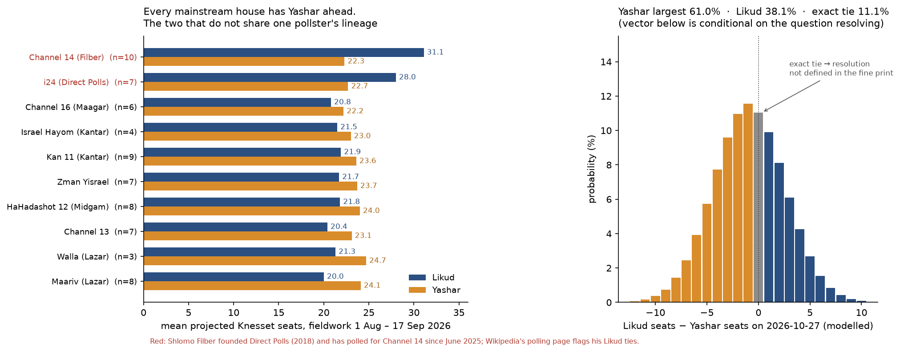

# Which party will win the most seats in the 2026 Israeli election?

| | |
|---|---|
| **Source** | Metaculus #45670 — https://www.metaculus.com/questions/45670/which-party-will-win-the-most-seats-in-the-2026-israeli-election/ |
| **Type** | multiple_choice (Likud / Yashar / Other) |
| **Opened / Closes / Resolves** | ~2026-09-17 / 2026-10-27 / scheduled 2026-10-28 (annulled if no result before 2027-01-01) |
| **Status** | open |
| **Current forecast** | **Likud 50.9%, Yashar 48.5%, Other 0.6%** — IQR on Likud (leading option) [43.4%, 58.4%] ≡ Yashar [41.0%, 56.0%] (v3, 2026-10-09) |
| **Community** | Yashar: CP 57.0% · Pros 57.9% · gold 57.9% **as of 2026-09-26 (stale; fresh CP unavailable 2026-10-09, Cloudflare block)**; 111 forecasters (API, 2026-10-09); Polymarket Yashar 48.5% / Likud 52.5% (2026-10-09) |
| **Next review** | 2026-10-16 |

<!-- Versions below, newest first. APPEND-ONLY: never edit or delete a past version. -->

---

## v3 — Update — 2026-10-09

**Mode: Update** (incremental). Thirteen days since v2, 18 days to the 27 Oct vote. A de-novo
rebuild is not needed: the gap model is unchanged in structure, and the 13pp move in
Polymarket has a nameable cause, which is the polls below. The model is re-run with today's
inputs (`raw/gap-model-2026-10-09.py`). Fresh Metaculus aggregations are **not available
today**: the browser path is blocked by Cloudflare for this container. The official API post
JSON (bot key) confirms the question is open, has 111 forecasters, has options
`Likud / Yashar / Other`, and closes 2026-10-27 06:00 UTC [1].

### Revision table

| Driver | Direction | Effect on P(Yashar) |
|---|---|---|
| **Prior (v2, 2026-09-26)** | — | **61.5%**, IQR [55.5%, 67.5%] (Likud 37.6, Other 0.9) |
| **The mainstream gap closed from −3.4 to −1.3 seats.** Latest poll per house: Kantar/Israel Hayom 21–22 (7–8 Oct), Channel 13 **20–20** (7 Oct), Midgam/Ch12 21–23 (5 Oct), Kantar/Kan 21–23 (4 Oct), Zman Yisrael **21–21** (30 Sep–1 Oct), Maariv 19–21 (30 Sep–1 Oct), Maagar Mochot 19–21 (29 Sep) [2][3][4]. The right-leaning houses held steady: Channel 14 +8 (31–23, 7 Oct) and i24/Direct Polls +6 (28–22, 1 Oct). With v1's 10% weight on those two, gap₀ moves from about −2.1 to **−0.46**. At v2's drift and variance, this alone takes Yashar to 41.9 | ↓ | **−19.6** |
| **Shorter horizon.** About +2.1 of the expected +1.2-seat late drift toward Likud has already shown up in the past fortnight, so I keep only half of it (+0.6) for the last 18 days. Drift sd falls from 3.2 to 2.5. Other trimmed 0.9 → 0.6, in line with Polymarket's 0.4% on B'Yachad | ↑ | **+6.5** |
| **Tie split 0.55 → 0.50.** P(exact tie) is now **14.1%**. The tie-breaker is "party of the next PM". The sister question's model (40966 v3) puts P(Eisenkot takes the first mandate) at 0.49, so the tie branch is now set equal to that number | ↓ | **−0.7** |
| **Unmodelled, small.** Avi Gil's Channel 12 interview on 8 Oct alleges that Netanyahu's office tampered with October-7 phone records. Only the Kantar 7–8 Oct poll may partly capture it [5]. Amcha Yisrael is now below threshold in 3 of the 7 latest mainstream polls. Its voters are Likud's main recapture pool, and the Kantar and Midgam polls already show that effect, so the drift term would double-count it. Net: a small lean back toward the polls | ↑ | **+0.8** |
| **New forecast (v3)** | | **48.5%**, IQR [41.0%, 56.0%] (Likud 50.9, IQR [43.4%, 58.4%]; Other 0.6) |

Polymarket moved from Yashar 58.5 / Likud 41.5 to 48.5 / 52.5, mostly in one jump on 2 Oct
(Likud 0.445 → 0.58 intraday). That was the day the High Court reinstated Ra'am and the Joint
List and the 30 Sep–1 Oct poll batch came out [3][6]. Polymarket's move is the same direction
and similar size as mine. I do **not** add a separate market row, because the market is
reacting to the same polls.

### Tripwire check (v2 list)

| # | Tripwire | Status | Evidence |
|---|---|---|---|
| 1 | By 10-13: mainstream average has Likud level with or ahead of Yashar → −12pp | **Not fired, two-thirds of the way** | Average −1.3. Two of seven houses are exactly level (Ch13 20–20, Zman Yisrael 21–21), and none has Likud ahead [2]. The model charges the move at its actual size (−19.6 before the horizon offset) rather than waiting for the threshold |
| 2 | By 10-13: mainstream gap ≥ 4.5 to Yashar → +6pp | Not fired (moved the other way) | −3.4 → −1.3 |
| 3 | By 10-23: Amcha Yisrael below 3.25% in a majority of final-week polls → −4pp | Not due; trending toward firing | Below in Kantar ×2 (2.9% on 7–8 Oct) and Midgam. 4–5 seats in Ch13, Maariv, Zman Yisrael and Maagar Mochot [2]. Polymarket gives Amcha a 53.5% chance of winning a seat [6] |
| 4 | By 10-20: Herzog pardon or AG plea deal | Not fired | No movement reported since Herzog deferred the pardon in favour of plea-deal mediation |
| 5 | By 10-20: Pros and gold both move ≥ 8pp from my Yashar number | **Cannot check** | Cohort data unavailable on 2026-10-09 (Cloudflare block). My own number moved 13pp, so the comparison will need to be redone once data returns |

### What resolves YES

Unchanged from v2. Ties go to the party of the next PM, failing that to the sole tied party in
government, failing that to the most votes. Options are `Likud`, `Yashar`, `Other`. The API
schedule now shows close 2026-10-27 06:00 UTC and scheduled resolve 2026-10-28 [1].

### Outside view

Unchanged from v1.

### Inside view

The structure is unchanged: everything still reduces to the sign of `G = Likud − Yashar`.

```
G = gap₀ (−0.46)  +  remaining drift N(+0.6, 2.5)  +  house error N(0, 1.3)
E[G] = +0.14 seats,  sd[G] = 2.82 seats
P(Yashar outright) 41.6% · P(tie) 14.1% · P(Likud outright) 44.4%
→ Yashar 47.7, Likud 51.7, Other 0.6 (model); posted 48.5 / 50.9 / 0.6
```

On the expected value the race is now a coin flip with a slight lean to Likud. The scale of
uncertainty is still set by the final 72 hours, which no poll covers.

### Evidence

New since v2 (detail in the revision table and `research.md`):

- Mainstream polls: the Likud–Yashar gap closed from −3.4 to −1.3 seats; Channel 13 (7 Oct) and Zman Yisrael (30 Sep–1 Oct) show exact ties, none shows Likud ahead [2][3][4][5].
- Right-leaning houses unchanged: Channel 14 +8 Likud (7 Oct), i24/Direct Polls +6 (1 Oct) [2].
- High Court let Ra'am, the Joint List and Cassif run (2 Oct) [7].
- Amcha Yisrael below the 3.25% threshold in 3 of the 7 latest mainstream polls [2].
- Avi Gil's Channel 12 interview (8 Oct) alleging tampering with October-7 phone records; effect not yet polled [5].
- Polymarket moved from Yashar 58.5 / Likud 41.5 to 48.5 / 52.5, mostly on 2 Oct [6].

### Scenarios

| # | Scenario | Weight | Resolves |
|---|---|---|---|
| A | Yashar outright largest | 0.416 | Yashar |
| B | Exact tie, non-Netanyahu PM | 0.070 | Yashar |
| C | Exact tie, Netanyahu stays PM (or Likud forms) | 0.070 | Likud |
| D | Likud outright largest | 0.438 | Likud |
| E | A third list is largest (B'Yachad) | 0.006 | Other |

### Sensitivity

| Assumption | If instead | P(Yashar) becomes |
|---|---|---|
| Remaining drift +0.6 | 0.0 (no late consolidation) | 56.0% |
| same | +1.2 (full v1 drift still to come) | 39.5% |
| Filber-house weight 10% | 0% (mainstream only) | 59.1% |
| same | 25% | 31.2% |

The house weight is still the most load-bearing judgement. Polymarket's Likud-seats market
(median ~24 seats, P(Likud ≥ 25) = 43%) [6] implies traders put far more weight on Channel 14
and i24 than I do, or expect a large late swing. If either turns out right, I am too high on
Yashar.

### Other forecasters (2026-10-09)

| Source | Yashar | Likud | Other | As of | Note |
|---|---|---|---|---|---|
| **This (v3)** | **48.5** | **50.9** | **0.6** | 2026-10-09 | |
| Metaculus CP | 57.0 | 42.0 | 1.0 | **2026-09-26 (stale)** | n=80 then; 111 forecasters now [1]. **Fresh CP unavailable 2026-10-09 (Cloudflare block)** |
| Metaculus Pros | 57.9 | 40.9 | 1.2 | **2026-09-26 (stale)** | fresh value unavailable 2026-10-09 (Cloudflare block) |
| Metaculus gold | 57.9 | 40.9 | 1.2 | **2026-09-26 (stale)** | fresh value unavailable 2026-10-09 (Cloudflare block) |
| Polymarket, largest party | 48.5 (0.48/0.49) | 52.5 (0.52/0.53) | 0.4 (Together) | 2026-10-09 | $619k event volume (was $401k). Ties broken on votes [6] |
| Polymarket, Likud seats | — | <20: 15.6 · 20–24: 35 · 25–29: 27.5 · 30–34: 13.5 · 35+: 2 | — | 2026-10-09 | $436k [6] |
| Manifold, "Will the Likud win the next Israeli election" | — | 30.2 | — | 2026-10-09 | Play money, ambiguous wording (could mean forming the government). Discounted |

**Cohort disagreement**: cannot be assessed today. **Me vs Polymarket**: 1.6pp less
Likud than the market (50.9 vs 52.5), and level on Yashar (48.5). That is closer than at v2,
and the gap comes from the same polls.

### What would change my mind (tripwires)

- [ ] **By 2026-10-23 (last polls before the blackout): the mainstream-house average has Likud ahead by ≥ 1 seat** → **down 8pp** on P(Yashar).
- [ ] **By 2026-10-23: the mainstream gap returns to ≥ 3 seats in Yashar's favour** → **up 10pp**.
- [ ] **By 2026-10-23: Amcha Yisrael below 3.25% in a majority of final-week polls** while the Likud–Yashar gap holds → **down 3pp** (late recapture beyond what is already in the polls).
- [ ] **By 2026-10-20: the election is formally postponed** (a Knesset vote needs 80 MKs; Polymarket's on-schedule price is 91.9%) → re-analyse (date and annulment risk).
- [ ] **When cohort data returns: Metaculus Pros and gold both sit ≥ 8pp from 48.5 in the same direction** → re-derive before defending.

### Sources

1. Metaculus question 45670, official API post JSON (bot key; aggregations hidden) — https://www.metaculus.com/questions/45670/ (accessed 2026-10-09; `raw/metaculus-api-2026-10-09.json`). Cohort values carried forward from `raw/metaculus-2026-09-26.json`
2. Opinion polling for the 2026 Israeli legislative election — Wikipedia (raw wikitext) — https://en.wikipedia.org/wiki/Opinion_polling_for_the_2026_Israeli_legislative_election (accessed 2026-10-09; `raw/wikipedia-polling-wikitext-2026-10-09.txt`, parsed with `raw/parse_polls.py` pointed at the new file)
3. "Opposition Bloc's Boycott of Arab Parties Hands Netanyahu's Bloc Edge, New Poll Shows" — Haaretz, 2026-10-01 (Ch13: Likud 19, Yashar 21) — https://www.haaretz.com/israel-news/elections/2026-10-01/ty-article/new-poll-boycott-of-arab-parties-hands-netanyahus-bloc-edge-over-opponents/000001a0-f628-da3f-a7fa-f7ed60d40000 (accessed 2026-10-09)
4. Kan poll, 28 Sep: Yashar 23, Likud 21, blocs tied at 52 — The Jerusalem Post — https://www.jpost.com/israel-election-2026/article-909918 (accessed 2026-10-09)
5. "Oct. 8: After Avi Gil interview, Eisenkot calls for criminal probe against Netanyahu" — The Times of Israel live blog (also the Ch13 8 Oct poll: Likud 20, Yashar 20; and the Zamir Iran/postponement report) — https://www.timesofisrael.com/liveblog-october-08-2026/ (accessed 2026-10-09)
6. Polymarket gamma API and CLOB price history: `israeli-legislative-election-winner`, `israel-election-likud-of-seats`, `which-parties-will-win-a-seat-in-the-2026-knesset-elections`, `will-israel-election-happen-as-scheduled-…` — https://polymarket.com/event/israeli-legislative-election-winner (accessed 2026-10-09; `raw/polymarket-largest-party-2026-10-09.json`, `raw/polymarket-israel-election-likud-of-seats-2026-10-09.json`)
7. "High Court lets Arab parties run" (7–2 on Cassif, unanimous on Ra'am and the Joint List; Abu Shehadeh withdraws) — The Times of Israel live blog, 2026-10-02 — https://www.timesofisrael.com/liveblog-october-02-2026/ (accessed 2026-10-09)
8. Manifold Markets API, "Will the Likud win the next Israeli election" — https://manifold.markets (accessed 2026-10-09)
9. "Gadi Eisenkot still leads in polls, but Benjamin Netanyahu shortens distance" — The Jerusalem Post, 2026-09-17 — https://www.jpost.com/israel-election-2026/article-908921 (accessed 2026-09-20) — carried forward from v2 [6], still relied on for the outside view
10. "Netanyahu's anti-Arab campaign has found Gadi Eisenkot's Achilles' heel" — The Times of Israel, 2026-09-18 — https://www.timesofisrael.com/netanyahus-anti-arab-campaign-has-found-gadi-eisenkots-achilles-heel/ (accessed 2026-09-20) — carried forward from v2 [7], still relied on
11. Opinion polling for the 2015 Israeli legislative election — Wikipedia — https://en.wikipedia.org/wiki/Opinion_polling_for_the_2015_Israeli_legislative_election (accessed 2026-09-20) — carried forward from v2 [8], still relied on
12. April 2019 Israeli legislative election — Wikipedia — https://en.wikipedia.org/wiki/April_2019_Israeli_legislative_election (accessed 2026-09-20) — carried forward from v2 [9], still relied on
13. Shlomo Filber — Wikipedia — https://en.wikipedia.org/wiki/Shlomo_Filber (accessed 2026-09-20) — carried forward from v2 [10], still relied on
14. Lists of Candidates — Central Elections Committee, 2026-09-03 — https://www.gov.il/en/pages/candidates-lists-26 (accessed 2026-09-20) — carried forward from v2 [11], still relied on
15. "Main opposition factions ink surplus-vote deals in bid to maximize Knesset representation" — The Times of Israel, 2026-09-10 — https://www.timesofisrael.com/main-opposition-factions-ink-surplus-vote-deals-in-bid-to-maximize-knesset-representation/ (accessed 2026-09-20) — carried forward from v2 [12], still relied on

**Date**: 2026-10-09
**Forecast**: Yashar 48.5%, Likud 50.9%, Other 0.6% — IQR on Likud (leading option) [43.4%, 58.4%] ≡ Yashar [41.0%, 56.0%]
**Thesis**: The mainstream pollsters' Likud–Yashar gap has closed from −3.4 to −1.3 seats in two weeks. Channel 13 and Zman Yisrael now show a dead heat, and Channel 14 and i24 are unchanged at +8 and +6 [2][5]. That makes the race a coin flip with a slight lean to Likud. Polymarket flipped the same way, to 52.5 Likud [6]. Half the expected late drift toward Likud has already happened, and a 14% exact-tie branch resolves by who becomes PM (~50/50), which keeps Yashar near 48.5 rather than lower. Fresh Metaculus cohort data was unavailable today.

---

## v2 — Update — 2026-09-26

**Mode: Update** (incremental). Six days since v1, 16% of the time to the 27 Oct election.
Polymarket and all three Metaculus cohorts are within 4.5pp of me. This is the first revision.
One structural change fired as a v1 tripwire: Metaculus published a tie-breaker. It is handled
here as a re-mapping of v1's tie branch rather than as a new model. The operator also asked for
the full option vector in the ledger's new `distribution` field. This version supplies it.

### Revision table

| Driver | Direction | Effect on P(Yashar) |
|---|---|---|
| **Prior (v1, 2026-09-20)** | — | **61.0%**, IQR [55.0%, 67.0%] (Likud 38.1, Other 0.9), conditional on the question resolving |
| **Tie-breaker published** (admin johnnycaffeine, 2026-09-21): an exact seat tie goes to **the party of the next prime minister**; failing that, to the sole tied party with at least one other minister in the government; failing that, to the party with the most votes [1]. v1's 11.1% tie branch now resolves rather than annuls. In a tie world the Netanyahu bloc still sits well short of 61 in the mainstream polls (45–49 seats) [2]. The next PM would then come from the opposition: Eisenkot, or Bennett with Yashar in government, both of which resolve Yashar. That holds unless Likud builds a coalition anyway. I put **P(Yashar \| tie) ≈ 0.55**, a little below Yashar's share elsewhere, because a tie means Likud has out-performed. Re-normalising v1's branches: Yashar 60.3, Likud 38.9, Other 0.8 | ↓ | **−0.7** |
| **The mainstream-house gap widened slightly, −3.0 → −3.4 seats.** Latest poll per house, 22–24 Sep: Midgam 20–23, Channel 13 18–22, Maariv 18–22, Zman Yisrael 21–23, Maagar Mochot 19–23. Kantar (20–22, 17 Sep) has not polled since [2]. The right-leaning houses eased too: Channel 14 +11 → +10 (32–22), i24 +6 → +5 (27–22). Neither the level-pegging tripwire nor the ≥ 4-seat tripwire fired. The move is smaller than one house's sampling noise, so it gets partial weight | ↑ | **+1.5** |
| **Six fewer days for a structural shift.** v1's drift term is concentrated in the unmeasured final 72 hours and is unchanged. The pre-blackout variance shrinks slightly, which helps the side that is ahead | ↑ | **+0.2** |
| **Cohorts and market sit a little lower.** Metaculus CP Yashar 57.0 / Likud 42.0; Pros and gold both 57.9 / 40.9 [1]. Polymarket Yashar 61 → 59, Likud 39 → 40.5, on ~$87k of fresh volume [3]. Polymarket tie-breaks on votes, not on the next PM. Pros and gold are 3.1pp from me, well inside the 10pp re-analysis band. I weight them, but they carry no reason I have not already priced | ↓ | **−0.5** |
| **New forecast (v2)** | | **61.5%**, IQR [55.5%, 67.5%] (Likud 37.6, Other 0.9) |

The vector is now **unconditional except for the ~1.5% "no result before 2027-01-01" branch**,
since ties no longer annul.

### Tripwire check (v1 list)

| # | Tripwire | Status | Evidence |
|---|---|---|---|
| 1 | Metaculus reveal (09-24): Pro and gold both ≥ 10pp from Likud 38.1 in the same direction → re-analyse | **Not fired** | Pros and gold both at Likud 40.9 (+2.8). CP 42.0 (n=80) [1] |
| 2 | Admins publish a tie-breaker, or rule a tie ambiguous (by 09-30) | **Fired** (2026-09-21) | Next PM's party → sole tied party in government → most votes [1]. Priced in row 2 |
| 3 | Mainstream average has Likud level with or ahead of Yashar (by 10-13) → −12pp | Not fired | Gap −3.4 [2] |
| 4 | Mainstream gap ≥ 4 seats to Yashar (by 10-13) → +8pp | Not fired | Gap −3.4 [2] |
| 5 | Amcha Yisrael below 3.25% in a majority of final-week polls (by 10-23) → −4pp | Not due | — |
| 6 | Herzog pardons Netanyahu or the AG announces a plea deal (by 10-20) → re-analyse | Not fired | On the eve of Yom Kippur Herzog pardoned the soldier **Elor Azaria**, not Netanyahu. Netanyahu's own request is still deferred in favour of plea-deal mediation [4][5] |

### What resolves YES

Unchanged from v1, except the tie rule (above). Options in Metaculus order: `Likud`, `Yashar`,
`Other`.

### Outside view

Unchanged from v1.

### Inside view

Unchanged from v1.

### Scenarios

Unchanged from v1. Scenario C (exact tie, 0.111) now resolves ~55/45 Yashar/Likud instead of
annulling. The rest of the branch weights stand.

### Evidence

Unchanged from v1.

### Other forecasters (2026-09-26)

| Source | Yashar | Likud | Other | As of | Note |
|---|---|---|---|---|---|
| **This (v2)** | **61.5** | **37.6** | **0.9** | 2026-09-26 | |
| Metaculus CP | 57.0 | 42.0 | 1.0 | 2026-09-26 19:39 | n=80 [1] |
| Metaculus Pros | 57.9 | 40.9 | 1.2 | 2026-09-26 | n=9 |
| Metaculus gold | 57.9 | 40.9 | 1.2 | 2026-09-26 | n=27 |
| Polymarket | 59.0 (0.58/0.60) | 40.5 (0.40/0.41) | 0.5 (Together) | 2026-09-26 | $401k volume (was $314k); tie-break on votes [3] |

**Cohort disagreement**: none; Pros and gold are identical. **Disagreement with me: 3–4.5pp**,
Likud-ward. The Metaculus comment thread's most detailed forecast (Theomachado, 21 Sep:
Yashar 55 / Likud 44) splits the polls into two camps. It weights the right-leaning houses more
than my 10% Filber-house weight does. That is exactly v1's second load-bearing sensitivity, and
it is where the gap comes from.

### Sensitivity

Unchanged from v1 for the two load-bearing assumptions: the drift term (+0.0 → Yashar ~74%,
+2.4 → Yashar ~46%) and the Filber-house weight (0% → Yashar ~73%, 25% → Yashar ~40%). v1's
last row (tie → annulled vs. a popular-vote tie-break) is now moot. The published tie-break
(the next PM's party) is priced in the revision table and moves the vector by less than 1pp.

### What would change my mind (tripwires)

- [ ] **By 2026-10-13 — mainstream-house average (Channel 14 and i24 excluded) has Likud level with or ahead of Yashar** → **down 12pp on P(Yashar)**.
- [ ] **By 2026-10-13 — mainstream-house average gap reaches ≥ 4.5 seats to Yashar** (from −3.4 on 2026-09-24) → **up 6pp**.
- [ ] **By 2026-10-23 — Amcha Yisrael (Ofer Winter) below 3.25% in a majority of the final week's polls** → **down 4pp**.
- [ ] **By 2026-10-20 — Herzog grants Netanyahu a pardon, or the Attorney-General announces a plea deal** → re-analyse (direction either).
- [ ] **By 2026-10-20 — Metaculus Pros and gold both move ≥ 8pp from my Yashar number in the same direction** → re-derive before defending.

### Sources

1. Metaculus question 45670, three-cohort aggregations and comments (admin tie-breaker comment by johnnycaffeine, 2026-09-21) — https://www.metaculus.com/questions/45670/ (accessed 2026-09-26; `raw/metaculus-2026-09-26.json`)
2. Opinion polling for the 2026 Israeli legislative election — Wikipedia (raw wikitext) — https://en.wikipedia.org/wiki/Opinion_polling_for_the_2026_Israeli_legislative_election (accessed 2026-09-26; `raw/wikipedia-polling-wikitext-2026-09-26.txt`, parsed with v1's `raw/parse_polls.py` pointed at the new file)
3. Polymarket, "Israeli Legislative Election Winner" (gamma API) — https://polymarket.com/event/israeli-legislative-election-winner (accessed 2026-09-26; `raw/polymarket-largest-party-2026-09-26.json`)
4. Herzog's Yom Kippur pardon of soldier crystallizes choice for Israeli voters — The Forward — https://forward.com/opinion/851495/herzogs-yom-kippur-pardon-of-soldier-crystallizes-eisenkot-netanyahu-choice (accessed 2026-09-26, via search summary)
5. Rebuffing Netanyahu's pardon request, at least for now, Herzog calls for new plea deal talks — The Times of Israel — https://www.timesofisrael.com/herzog-pushes-for-new-plea-deal-talks-says-he-wont-consider-netanyahu-pardon-request-yet/ (accessed 2026-09-26, via search summary)
6. "Gadi Eisenkot still leads in polls, but Benjamin Netanyahu shortens distance" —
   The Jerusalem Post, 2026-09-17 — https://www.jpost.com/israel-election-2026/article-908921
   (accessed 2026-09-20) — carried forward from v1 [3], still relied on
7. "Netanyahu's anti-Arab campaign has found Gadi Eisenkot's Achilles' heel" —
   The Times of Israel, 2026-09-18 —
   https://www.timesofisrael.com/netanyahus-anti-arab-campaign-has-found-gadi-eisenkots-achilles-heel/
   (accessed 2026-09-20) — carried forward from v1 [5], still relied on
8. Opinion polling for the 2015 Israeli legislative election — Wikipedia —
   https://en.wikipedia.org/wiki/Opinion_polling_for_the_2015_Israeli_legislative_election
   (accessed 2026-09-20) — carried forward from v1 [7], still relied on
9. April 2019 Israeli legislative election — Wikipedia —
   https://en.wikipedia.org/wiki/April_2019_Israeli_legislative_election (accessed 2026-09-20) — carried forward from v1 [9], still relied on
10. Shlomo Filber — Wikipedia — https://en.wikipedia.org/wiki/Shlomo_Filber
    (accessed 2026-09-20) — carried forward from v1 [11], still relied on
11. Lists of Candidates — Central Elections Committee, 2026-09-03 —
    https://www.gov.il/en/pages/candidates-lists-26 (accessed 2026-09-20) — carried forward from v1 [15], still relied on
12. "Main opposition factions ink surplus-vote deals in bid to maximize Knesset
    representation" — The Times of Israel, 2026-09-10 —
    https://www.timesofisrael.com/main-opposition-factions-ink-surplus-vote-deals-in-bid-to-maximize-knesset-representation/
    (accessed 2026-09-20) — carried forward from v1 [19], still relied on

**Date**: 2026-09-26
**Forecast**: Yashar 61.5%, Likud 37.6%, Other 0.9% — IQR on Yashar [55.5%, 67.5%]
**Thesis**: The six mainstream pollsters still put Eisenkot's Yashar 3.4 seats ahead of Likud, slightly wider than at v1 [2]. The Channel 14/i24 gap to them narrowed a little. Metaculus's new tie-breaker, the next PM's party, turns v1's 11% annulment branch into a ~55/45 Yashar split, costing 0.7pp [1]. Metaculus Pros and gold (57.9) and Polymarket (59) sit 2.5–4.5pp Likud-ward of me, because they give the right-leaning houses more weight. The final 72 hours before the vote are unpolled, and that remains the main risk.

---

## v1 — Initial forecast — 2026-09-20

### What resolves YES

Resolves as the party holding **more Knesset seats than any other** after the 2026 Israeli
legislative election of **27 October 2026**, as certified by the Central Elections Committee
(CEC). Options are `Likud`, `Yashar` and `Other`; a plurality for any third list resolves
`Other`; if no result exists before **2027-01-01** the question is **annulled**. Seat
allocation is Bader–Ofer (D'Hondt with surplus-vote pooling) over a single nationwide
district with a **3.25% threshold**; official results are gazetted ~8 days after polling
(2022: voted 1 Nov, certified 9 Nov), so a normal count resolves comfortably inside the
window. Published polling is barred from the end of Friday **2026-10-23** — the final ~72
hours are unmeasured.

**The edge case that matters is an exact tie, and the fine print does not cover it.** The
criteria demand a party with "more seats than any other"; the fine print addresses only a
third-party plurality and postponement. Question commenters raised this on 2026-09-19 and
2026-09-20 and expect ambiguous resolution absent an admin ruling. This is not a theoretical
worry: **April 2019 ended Likud 35 – Blue and White 35**, decided on votes (1,140,370 vs
1,125,881) [9]. I put **P(exact seat tie) = 11.1%**. Polymarket's parallel market explicitly
tie-breaks on valid votes, then alphabetically [10]; Metaculus does not. The vector below is
therefore **conditional on the question resolving at all** — I estimate a **12.4%** chance it
is annulled (11.1% tie + 1.5% no-result-by-2027, less overlap).

Secondary edge case, now moot: Metaculus does not say how a *joint list* containing Likud or
Yashar would map to the options. Lists closed 2026-09-08 with 38 filed; both parties run
alone [14][15]. Likud's list already absorbs New Hope (merged August 2025) [16].

### Outside view

| Reference class | n | Window | Raw rate | Kept |
|---|---|---|---|---|
| Israeli elections where **Likud was the largest single list** | 12 | 1996–2022 | **6/12 outright, 1 tie** | crude anchor ≈ 50% |
| **New centrist party led by an ex-IDF Chief of General Staff** beats Likud | 5 | 2019A–2022 | **1/5** largest, 1/5 tie | the Gantz analogue, but Gantz-era Likud polled 30–36, not 20 |
| **Drift in the Likud-minus-top-rival seat gap, 5 weeks out → result** | 5 | 2015–2022 | +4.5, +4.5, −1.5, +1.7, ≈+1.0 → **mean +2.0, sd 2.5** | **load-bearing** |
| Exact tie for largest party | 25 | 1949–2022 | 1/25 unconditional, **1/6 since 2015** | supports the 11% tie figure in a race this close |

The load-bearing class deserves its full table, because the folk version of it is wrong:

| Election | Rival | Gap 5 wk out | Gap, final polls | Gap, result | Δ final→result | Δ 5wk→result |
|---|---|---|---|---|---|---|
| 2015 | Zionist Union | +1.5 | −3.5 | **+6** (30–24) | **+9.5** | +4.5 |
| 2019 Apr | Blue and White | −4.5 | −0.8 | **0** (35–35) | +0.8 | +4.5 |
| 2019 Sep | Blue and White | +0.5 | −0.6 | **−1** (32–33) | −0.4 | −1.5 |
| 2021 | Yesh Atid | +11.3 | +12.5 | **+13** (30–17) | +0.5 | +1.7 |
| 2022 | Yesh Atid | — | +6.5 | **+8** (32–24) | +0.75 | ≈+1.0 |

**"Israeli polls underestimate Likud" is, on this quantity, almost entirely a 2015 artefact.**
Drop 2015 and the mean final-poll gap error is **+0.4 seats** — noise. What the record does
support is different and weaker: in two of four close races the gap moved 4–5 seats toward
Likud over the final five weeks, and in April 2019 *both* leading parties gained ~6 seats by
consuming their own satellites, leaving the gap almost unchanged. The mechanism is **late
consolidation of large lists**, which is symmetric, not a Likud-specific measurement error.
I therefore shrink the sample mean of +2.0 by ~40% to a **drift of +1.2 seats**, and I
explicitly reject the +4 to +8 correction that the popular version of this claim licenses.

### Inside view

Everything reduces to the sign of one integer, `G = Likud seats − Yashar seats`.

```
G  =  gap₀ (house-weighted polls today)  +  drift (5 weeks → result)  +  house-weighting error
   =  −2.11                              +  N(+1.2, 3.2)              +  N(0, 1.3)
⇒  E[G] = −0.91 seats,   sd[G] = 3.45 seats
```

`raw/gap-model-2026-09-20.py`, 2,000,000 draws with integer seat rounding:
`P(G ≥ 1) = 33.9%`, `P(G = 0) = 11.1%`, `P(G ≤ −1) = 54.3%`, `P(Other) = 0.8%`.

**Setting gap₀ is the entire forecasting problem.** The 2026 polling table [2] parses to 250
rows, 70 of them with usable Likud *and* Yashar figures since 2026-08-01, and they split into
two irreconcilable camps (`raw/parse_polls.py`, `raw/poll_analysis.py`):

| Publisher | n | Likud | Yashar | gap | Likud ahead in |
|---|---|---|---|---|---|
| **Channel 14 (Shlomo Filber / NEXT DATA)** | 10 | **31.1** | 22.3 | **+8.8** | 10/10 |
| **i24 News (Direct Polls)** | 7 | **28.0** | 22.7 | **+5.3** | 7/7 |
| Kan 11 (Kantar) | 9 | 21.9 | 23.6 | −1.7 | 1/9 |
| HaHadashot 12 (Midgam) | 8 | 21.8 | 24.0 | −2.2 | 0/8 |
| Zman Yisrael (Tatika) | 7 | 21.7 | 23.7 | −2.0 | 0/7 |
| Israel Hayom (Kantar) | 4 | 21.5 | 23.0 | −1.5 | 0/4 |
| Walla (Lazar) | 3 | 21.3 | 24.7 | −3.3 | 0/3 |
| Channel 16 (Maagar Mochot) | 6 | 20.8 | 22.2 | −1.3 | 0/6 |
| Channel 13 (Midgam/Madad/Stat-Net) | 7 | 20.4 | 23.1 | −2.7 | 0/7 |
| Maariv (Lazar) | 8 | 20.0 | 24.1 | −4.1 | 0/8 |



The nine mainstream houses' mean Likud figures span just **1.9 seats** (20.0 to 21.9), and
across their 52 polls since 1 August **Yashar leads in 43, ties in 8, and trails in exactly
one** (Kan 11, 2026-08-09, 24–23). The two Filber-lineage houses have Likud ahead in **17 of
17**. Three facts fix their weight at **10%**:

1. **They are one house, not two.** Shlomo Filber *founded* Direct Polls in 2018, ran it
   through the 2022 cycle, and left in June 2025 to poll for Channel 14 independently; i24's
   pollster is still Direct Polls [11]. Counting them as 2 of 12 double-counts a methodology.
2. **The conflict of interest is documented on the data source itself.** Wikipedia's polling
   page carries a standing note that Filber "is affiliated with Likud and its leader Benjamin
   Netanyahu … implicated in Case 4000 on charges of breach of trust; thus it may be
   advisable to approach opinion polls edited by him with caution" [2][12]. Filber was
   Netanyahu's chief of staff 2001–03, ran Likud's 2015 digital voter operation, and was a
   state witness in Netanyahu's trial [11].
3. **The number does not move.** Channel 14 has printed Likud 30–32 continuously since
   mid-August while every other house recorded Likud drifting 23 → 20. And the divergence sits
   *entirely* in Likud's own figure — Channel 14's Yashar (22.3) is only ~1.5 below the
   mainstream. A pollster finding ten extra Likud seats with no matching deficit anywhere on
   the centre-left is surveying a different electorate, not correcting a sampling bias.

Why 10% and not 0%: **Direct Polls has a genuine track record.** Its final 2022 poll had
Likud 31 (actual 32) and Yesh Atid 23 (actual 24) — as good as anyone's [8]. In 2022 Direct
Polls and the mainstream *agreed*; the divergence is new, which is weak evidence that
something changed in the electorate rather than in the pollster, and I price that at 10%.

So gap₀ = 0.90 × (20.0 − 23.2) + 0.10 × (29.3 − 21.6) = **−2.11**, where the mainstream
figures blend the September mean (n=22: Likud 20.36, Yashar 23.32) with the 14–17 September
batch (n=6: 19.67, 23.00), and the Filber figures are their September mean (n=8). For
calibration: mainstream-only is −3.20; JPost's own five-poll average of 17 September, which
takes Channel 14 at equal weight, is −1.0 (Yashar 22.2, Likud 21.2) [3].

**The causal story behind the +1.2 drift.** Likud's decline is *intra-bloc*, and therefore
recoverable. Maariv's pollster Menachem Lazar, 2026-09-13: "the struggles within the bloc,
between Likud and Otzma Yehudit, Religious Zionism and Am Yisrael, are currently not
benefiting Likud" [4]. LFI's tracker counts **~8 seats, ~240,000 pro-Netanyahu votes, at risk
of falling below the 3.25% threshold** across Amcha Yisrael, RZP and Otzma [13]. That is the
reservoir Netanyahu drained in 2015 (Bayit Yehudi 12 → 8, Yachad below threshold, Likud
+8) and in April 2019 (Zehut and the New Right wiped out, Likud +6.5) — and he has already
started, five weeks early, with the anti-Ra'am campaign against Eisenkot [5].

**The causal story against it.** Eisenkot is not running at Likud from the left. Yashar's
40-name slate is ex-officials, reservists and mayors, religious Zionists over-represented,
and it is hunting *ex-Likud* voters explicitly [6]. In 2015 the gevalt appeal worked because
the alternative was Herzog–Livni; a soft-right voter who has moved to Eisenkot is far harder
to scare home. Likud's own opposition-pool (Together 9–16, Democrats 8–10, Yisrael Beiteinu
5–9, Reservists–NEP 0–4) is *larger* than Netanyahu's, so if late consolidation is the
mechanism, Yashar benefits from it too — exactly as Blue and White did in April 2019.

Net: +1.2 seats, sd 3.2 — a genuine but modest tilt, not the 2015 replay.

### Evidence

**What updated me most, and in which direction.**

- **The unanimity of the mainstream houses** — 43 of 52 polls with Yashar ahead, 8 ties, 1
  with Likud ahead; nine houses whose mean Likud figures span 1.9 seats [2]. Against a
  single-house outlier this is close to decisive on gap₀. LR ≈ **2.5** toward Yashar
  relative to an uninformed 50/50.
- **The 2015-is-the-whole-story finding** [7][8] and the April-2019 symmetric-surge finding
  [9]. This was the biggest single correction to my own prior: I came in expecting to apply a
  +3 to +5 pro-Likud correction and the data does not support it. LR ≈ **0.45** on "Likud
  beats its polls by a lot", i.e. toward Yashar.
- **Netanyahu's anti-Ra'am campaign is landing** [5]. Times of Israel, 2026-09-18: Eisenkot
  was forced to release 32 minutes of tape to rebut a Bedouin council head's claim, then to
  add anti-Ra'am coalition conditions; Liberman publicly demanded clarity; "the change bloc is
  losing ground, and shedding seats in several polls". The 2015 endgame playbook is running
  early and Eisenkot is on the defensive. LR ≈ **1.25** toward Likud.
- **Likud's losses are intra-bloc, and ~8 seats of right-wing votes sit below the threshold**
  [4][13]. LR ≈ **1.2** toward Likud.

**What is absent, and what that absence means.**

- **No Metaculus signal whatsoever.** CP, Pro and gold are all empty; `cp_reveal_time` is
  2026-09-24T17:00Z with 8 forecasters [1]. This repo's usual primary anchor does not exist
  today, so the market prices carry the entire external-validation load. It also means my IQR
  should be wider than it would be on a question with a settled CP, and that the 2026-09-24
  reveal is a scheduled, high-information event.
- **No sign the mainstream is converging on Channel 14.** If Filber were measuring a real
  hidden Likud vote, I would expect at least one mainstream house to drift toward him over
  seven weeks. None has; the mainstream gap has instead widened against Likud
  (fortnightly: −1.08 → −2.59 → −2.55 → −3.00). Absence of expected evidence.
- **No pardon decision.** Herzog has deferred Netanyahu's request and is pushing plea-deal
  mediation [17]. A pardon before 27 October is a live wildcard whose *sign is genuinely
  unclear* — it would mobilise both electorates — so it enters as variance, not drift.
- **No Sentinel, Mantic, GJOpen or INFER question** on this outcome. Nothing to triangulate.

### Other forecasters

| Source | Value | As of | Note |
|---|---|---|---|
| **Metaculus CP (recency-weighted)** | **not revealed** | 2026-09-20 | reveals 2026-09-24T17:00Z; n=8 forecasters [1] |
| **Metaculus Pro** | **not revealed** | 2026-09-20 | empty aggregation [1] |
| **Metaculus gold medalists** | **not revealed** | 2026-09-20 | empty aggregation [1] |
| **Polymarket** — *Israeli Legislative Election Winner* | **Yashar 61.0%, Likud 39.0%**, Together 0.6%, Shas/Democrats/Otzma ≈0.1% | 2026-09-20 | $313,940 volume, $150,606 liquidity, 2¢ spread. Explicit tie-break on valid votes [10] |
| Polymarket trend (same market) | Yashar 47.5% (08-30) → 50.5% (09-06) → **61.5% (09-13)** → 61.0% | 2026-09-20 | the 10 pp jump lands on the first post-list-filing polls [10] |
| **Kalshi** `KXISRAELKNESSET-26` | Yashar 50%, Likud 33%, minor options 1% each → **normalised ≈ Yashar 58% / Likud 38%** | 2026-09-20 | book sums to 0.86; ticker list still carries dead options (Yesh Atid, National Unity). Thin — treat as corroboration only [18] |
| Manifold | **no market** | 2026-09-20 | searched; only a Netanyahu-tenure market exists |
| Sentinel Team / Mantic / GJOpen / INFER | no matching question | 2026-09-20 | — |
| JPost five-poll average (incl. Channel 14) | Yashar 22.2 / Likud 21.2 seats | 2026-09-17 | equal-house weighting [3] |
| Mainstream-house average (this forecast) | Yashar 23.1 / Likud 20.1 seats | 2026-09-17 | Channel 14 and i24 excluded [2] |

**Cohort disagreement: not assessable.** With all three Metaculus aggregations hidden, the
repo's normal cross-check (Pro and gold against CP, and against me) cannot be run. This is a
material weakness of v1 and the reason `next_review` is set to the day after the reveal.

**Where I sit.** My Likud 38.1% is **0.9 pp below Polymarket** and ~0.1 pp above Kalshi's
normalised price — effectively on top of both. The agreement is not herding: gap₀, the drift
term and the tie mass were all built before prices were pulled, and both my model and the
markets are making the same single live judgement (how much of the mainstream-vs-Filber gap
to split). Two caveats in opposite directions: mild **longshot bias** would inflate the
trailing side, arguing Likud's true price is a shade under 38%; and neither market prices an
*annulment*, because both define a tie-break, so a Metaculus forecaster faces a slightly
different question than a Polymarket trader.

### Scenarios

Branches of `G`, from the simulation. Mutually exclusive, exhaustive; weights are
unconditional (before dropping the annulment mass).

| # | Scenario | Weight | Implies |
|---|---|---|---|
| A | **Mainstream polls are broadly right and hold.** Late consolidation is symmetric or favours Yashar; Netanyahu's anti-Ra'am push does not move the seat gap. `G ≤ −3` | 0.320 | Yashar |
| B | **Narrow Yashar win.** Some late Likud recovery, not enough. `G ∈ {−2, −1}` | 0.223 | Yashar |
| C | **Exact tie.** `G = 0` | 0.111 | **resolution undefined → likely annulled** |
| D | **Narrow Likud win.** The 2019A pattern: both lists consume satellites, Likud's pool is slightly richer. `G ∈ {1, 2}` | 0.178 | Likud |
| E | **2015 replay.** Gevalt campaign in the unmeasured final 72 hours collapses Amcha Yisrael/RZP/Otzma into Likud. `G ≥ 3` | 0.161 | Likud |
| F | **Third list tops the poll** (realistically B'Yachad) | 0.008 | Other |
| — | Election not held / no result before 2027-01-01 | 0.015 | annulled |

### Sensitivity

| Assumption | If instead | Forecast becomes |
|---|---|---|
| **Drift = +1.2 seats** (shrunk from the +2.0 historical mean) | +0.0 — no late swing at all; 2019B/2021 pattern | **Likud 24.7%, Yashar 74.5%** |
| same | +2.4 — the unshrunk 2015/2019A pattern in full | **Likud 53.2%, Yashar 45.9%** |
| **Filber-house weight = 10%** | 0% — treat Channel 14 and i24 as pure advocacy (gap₀ −3.20) | **Likud 25.8%, Yashar 73.3%** |
| same | 25% — equal weight per house, Filber's series taken at face value (gap₀ −0.47) | **Likud 58.8%, Yashar 40.3%** |
| **sd[G] = 3.45 seats** | 4.5 seats | Likud 40.9%, Yashar 58.2% — **small** |
| **Tie → annulled** | Tie → popular-vote tie-break, as Polymarket does | Likud 39.4%, Yashar 59.8% — **negligible** |

Two assumptions do essentially all the work and they pull the answer across a 33 pp range:
the drift term and the house weight. Both are judgement calls on thin evidence, which is why
the IQR on the leading option is 12 pp wide rather than the 4–6 pp a settled question earns.
Note that the two sensitivities are not independent — a forecaster who both believed Filber
and expected a 2015-style endgame would land near Likud 70%, and that is the coherent bull
case I am rejecting.

Calibration hygiene: the answer is not near 0 or 100; it is not a round number; the 61.0/38.1
split moves less than 3 pp when sd[G] is raised to 4.5; I would take either side of a bet at
61/39 on Yashar with mild reluctance, which is the right feeling for a question whose two
load-bearing inputs are both judgement calls; and the scope check passes — pushing the
election out a further month widens sd and pulls both options toward 50.

### What would change my mind (tripwires)

- [ ] **2026-09-24, 17:00 UTC — Metaculus CP, Pro and gold reveal.** If Pro *and* gold both
      land ≥ 10 pp from my Likud 38.1% in the same direction → **re-analyse before defending**
      (direction either, magnitude 0).
- [ ] **By 2026-09-30 — Metaculus admins publish a tie-breaker** (or rule that a tie is
      ambiguous). Either way the 11.1% annulment mass is resolved and the question becomes
      scorable or not (direction either, magnitude 0).
- [ ] **By 2026-10-13 — mainstream-house average (Channel 14 and i24 excluded) has Likud
      level with or ahead of Yashar.** → **down 12 pp on P(Yashar)**.
- [ ] **By 2026-10-13 — mainstream-house average gap reaches ≥ 4 seats to Yashar** (from
      −3.0 on 2026-09-17). → **up 8 pp on P(Yashar)**.
- [ ] **By 2026-10-23 (last legal polls) — Amcha Yisrael (Ofer Winter) below 3.25% in a
      majority of the final week's polls.** Its ~4 seats of votes are the most recoverable
      pool Likud has. → **down 4 pp on P(Yashar)**.
- [ ] **By 2026-10-20 — Herzog grants Netanyahu a pardon, or the Attorney-General announces a
      plea deal.** Sign genuinely unclear; both electorates mobilise → **re-analyse**
      (direction either, magnitude 0).

### Sources

1. Metaculus question 45670 / question id 45859, aggregations + comments via the
   `metaculus-aggregations` skill — snapshot in `raw/metaculus-2026-09-20.json`
   (accessed 2026-09-20)
2. Opinion polling for the 2026 Israeli legislative election — Wikipedia —
   https://en.wikipedia.org/wiki/Opinion_polling_for_the_2026_Israeli_legislative_election
   (wikitext snapshot in `raw/wikipedia-polling-wikitext-2026-09-20.txt`; 168 rows parsed by
   `raw/parse_polls.py` + `raw/poll_analysis.py`) (accessed 2026-09-20)
3. "Gadi Eisenkot still leads in polls, but Benjamin Netanyahu shortens distance" —
   The Jerusalem Post, 2026-09-17 — https://www.jpost.com/israel-election-2026/article-908921
   (accessed 2026-09-20)
4. "Maariv pollster: Election race, Likud struggles, and threshold battles" —
   The Jerusalem Post, 2026-09-13 — https://www.jpost.com/israel-election-2026/article-908437
   (accessed 2026-09-20)
5. "Netanyahu's anti-Arab campaign has found Gadi Eisenkot's Achilles' heel" —
   The Times of Israel, 2026-09-18 —
   https://www.timesofisrael.com/netanyahus-anti-arab-campaign-has-found-gadi-eisenkots-achilles-heel/
   (accessed 2026-09-20)
6. "As parties lock in, Eisenkot plots path to power through heart of old Likud" —
   The Times of Israel, 2026-09-14 —
   https://www.timesofisrael.com/as-parties-lock-in-eisenkot-plots-path-to-power-through-heart-of-old-likud/
   (accessed 2026-09-20)
7. Opinion polling for the 2015 Israeli legislative election — Wikipedia —
   https://en.wikipedia.org/wiki/Opinion_polling_for_the_2015_Israeli_legislative_election
   (accessed 2026-09-20)
8. Opinion polling for the 2022 Israeli legislative election — Wikipedia —
   https://en.wikipedia.org/wiki/Opinion_polling_for_the_2022_Israeli_legislative_election
   (accessed 2026-09-20)
9. April 2019 Israeli legislative election — Wikipedia —
   https://en.wikipedia.org/wiki/April_2019_Israeli_legislative_election (accessed 2026-09-20)
10. Polymarket, *Israeli Legislative Election Winner* — https://polymarket.com/event/israeli-legislative-election-winner
    (Gamma API + CLOB price history; snapshot in
    `raw/polymarket-largest-party-2026-09-20.json`) (accessed 2026-09-20)
11. Shlomo Filber — Wikipedia — https://en.wikipedia.org/wiki/Shlomo_Filber
    (accessed 2026-09-20)
12. Netael Bandel, "Netanyahu Trial: Witness Changes Story on Key Meeting a Second Time" —
    Haaretz, 2022-06-14 —
    https://www.haaretz.com/israel-news/2022-06-14/ty-article/filber-changes-his-story-a-second-time-on-key-case-4000-meeting/00000181-5e9b-dde4-a187-febf1ebd0000
    (cited via [2]; accessed 2026-09-20)
13. "Israel Elects 2026: Fragmentation on the right risks Bibi's chances" — Labour Friends of
    Israel, ~2026-09-14 —
    https://www.lfi.org.uk/israel-elects-2026-fragmentation-on-the-right-risks-bibis-chances/
    (accessed 2026-09-20)
14. "Israeli parties submit slates for October Knesset elections" — Al Jazeera, 2026-09-09 —
    https://www.aljazeera.com/news/2026/9/9/israeli-parties-submit-slates-for-october-knesset-elections
    (accessed 2026-09-20)
15. Lists of Candidates — Central Elections Committee, 2026-09-03 —
    https://www.gov.il/en/pages/candidates-lists-26 (accessed 2026-09-20)
16. 2026 Israeli legislative election — Wikipedia —
    https://en.wikipedia.org/wiki/2026_Israeli_legislative_election (accessed 2026-09-20)
17. "Rebuffing Netanyahu's pardon request, at least for now, Herzog calls for new plea deal
    talks" — The Times of Israel —
    https://www.timesofisrael.com/herzog-pushes-for-new-plea-deal-talks-says-he-wont-consider-netanyahu-pardon-request-yet/
    (accessed 2026-09-20)
18. Kalshi, `KXISRAELKNESSET-26` —
    https://kalshi.com/markets/kxisraelknesset/israeli-knesset-election/kxisraelknesset-26
    (API returned no book this session; prices via prediction.com's cross-exchange aggregator,
    https://prediction.com/odds/who-will-win-the-next-israeli-legislative-election/11068)
    (accessed 2026-09-20)
19. "Main opposition factions ink surplus-vote deals in bid to maximize Knesset
    representation" — The Times of Israel, 2026-09-10 —
    https://www.timesofisrael.com/main-opposition-factions-ink-surplus-vote-deals-in-bid-to-maximize-knesset-representation/
    (accessed 2026-09-20)
20. Opinion polling for the April 2019 / September 2019 / 2021 Israeli legislative elections —
    Wikipedia — https://en.wikipedia.org/wiki/Opinion_polling_for_the_April_2019_Israeli_legislative_election ,
    https://en.wikipedia.org/wiki/Opinion_polling_for_the_September_2019_Israeli_legislative_election ,
    https://en.wikipedia.org/wiki/Opinion_polling_for_the_2021_Israeli_legislative_election
    (accessed 2026-09-20)
21. "Candidate List Selection Ahead of Israel's 2026 Election" — Israel Democracy Institute —
    https://en.idi.org.il/articles/65619 (accessed 2026-09-20)
22. "The Pollster Scorecard" — Israel Elects Deep Dive —
    https://israelects.substack.com/p/the-pollster-scorecard — **paywalled, not used**;
    recorded because it is the right empirical basis for the house weights this forecast sets
    by judgement (accessed 2026-09-20)

**Date**: 2026-09-20
**Forecast**: Likud 38.1%, Yashar 61.0%, Other 0.9% — IQR on Yashar [55.0%, 67.0%]
**Thesis**: Nine mainstream Israeli pollsters span 1.9 seats on Likud and put Eisenkot's
Yashar ahead in 43 of their 52 polls since August (8 ties, 1 Likud lead); the only houses
showing Likud ahead are Channel 14 and i24, which share one pollster, Shlomo Filber, whose
Likud ties Wikipedia's own polling page flags and whose Likud figure has been frozen at 30–32
while the field moved 3 seats [2][11]. Weighting them 10% gives a −2.1 seat gap, to which I
add +1.2 seats of late drift — the historical 5-weeks-out-to-result mean of +2.0 shrunk hard,
because "Israeli polls underestimate Likud" turns out to be a 2015 artefact (drop 2015 and
the mean gap error is +0.4) and because April 2019's surge was symmetric across both leading
lists [7][9]. Net E[gap] = −0.9 ± 3.45 seats, which is Polymarket's price to within a point.
The live tail risk is not Likud but **an exact tie at 11.1%**, which the fine print does not
cover and which happened in April 2019 (35–35); the vector above is conditional on the
question resolving.
