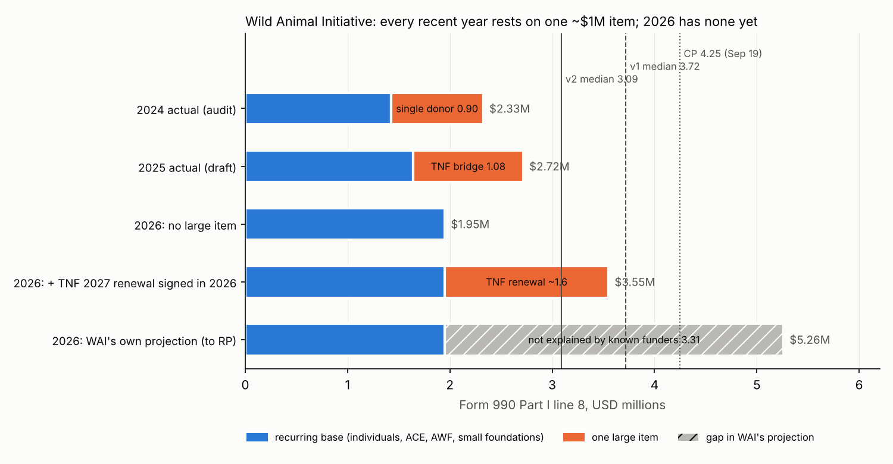
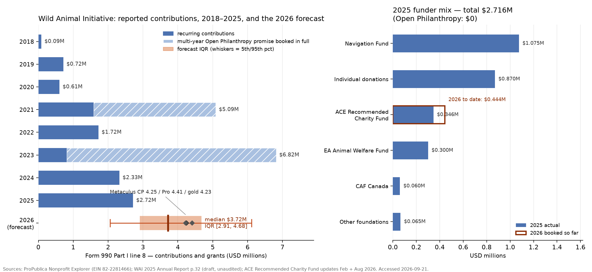

# How much funding will Wild Animal Initiative receive in 2026?

| | |
|---|---|
| **Source** | Metaculus #43169 — https://www.metaculus.com/questions/43169/how-much-funding-will-wild-animal-initiative-receive-in-2026/ |
| **Type** | numeric (USD millions, both bounds open, scale 1–7) |
| **Opened / Closes / Resolves** | — / 2026-12-31 / ~2027-08 to 2027-11 (when the FY2026 Form 990 is filed) |
| **Status** | open |
| **Current forecast** | **Median $3.09M, IQR [$2.16M, $4.09M]** (v2, 2026-10-17) |
| **Community (as of 2026-09-19 — not refreshed; fetch blocked 2026-10-17)** | CP $4.25M IQR [3.31, 5.27] (n=29) · Pro $4.41M (n=5) · Gold $4.23M (n=15) · 48 forecasters total |
| **Next review** | 2026-11-20 |

## v2 — Update — 2026-10-17

### Revision

| Driver | Direction | Effect (median, $M) |
|---|---|---|
| Prior (v1, 2026-09-21) | — | Median $3.72M, IQR [$2.91M, $4.68M] |
| **The Navigation Fund's (TNF) ~$1M grant for July–December 2026 was booked in FY2025, not FY2026** (P ≈ 0.8). TNF said in Oct 2024 it would make WAI *one* ~$1M grant covering 2026-07-01 to 2026-12-31 and "won't be making any more grants in the WAW space at least until 2027" [18]. WAI's 2025 report shows TNF $1,075,000 in 2025 [3]. The FY2024 audit shows no TNF receivable at end-2024 [19]. v1 counted TNF as $1.0–1.5M of *recurring* 2026 money. Under accrual it is already spent on the FY2025 990 | ↓ | −1.00 |
| TNF's **2027 renewal** becomes a 2026 lump only if the letter is signed by 2026-12-31. P(renewal) ≈ 0.55 (WAI in 2024: "more likely than not"); P(signed in 2026 \| renewal) ≈ 0.65 (TNF signed the bridge ~a year ahead; the decision is due "late 2026"). P ≈ 0.36–0.42 overall, size ~$1.6M | ↑ | +0.45 |
| **Lumpy individual major gifts exist.** The FY2024 audit names one donor at $900,000 (39% of support), booked as an *unrestricted contribution*, not a grant [19]. No such gift appears in 2025 [3]. A repeat in 2026 is possible: P(other ≥ ~$1M item) ≈ 0.30 | ↑ | +0.10 |
| **WAI's $5,552,333 projection is less informative than I assumed.** Without TNF, the projection now needs ~$3.3M beyond the known base, not ~$2M. One identified mechanism explains part of the gap: an *operating* budget counts the 2026 release of the TNF bridge (~$1.08M) as 2026 revenue, while the 990 does not. Likelihood ratio (LR) for a high year cut from ~2.5 to ~1.8 | ↓ | −0.15 |
| 26 quiet days: no WAI funding post, no Animal Welfare Fund payout report, the RP sheet is unchanged byte-for-byte. Q4, the signing window, is still mostly ahead | ↓ | −0.03 |
| ACE recommendation risk (v1 tripwire): WAI's November 2025 recommendation is a **two-year** status, so it is not re-evaluated in 2026 [13][20] | → | 0 |
| **New forecast** | | **Median $3.09M, IQR [$2.16M, $4.09M]** |

(The row effects are an approximate attribution of the −0.63 total, read off the Monte Carlo by switching each component on and off one at a time.)

### Tripwire check

| Tripwire from v1 | Fired? | Note |
|---|---|---|
| WAI funding-priorities / Marginal Funding Week post states 2026 revenue ≥ $5M or a secured multi-year commitment (by 2026-12-05) | Not fired (pending) | No post yet. 2025's post was dated 2025-11-18. WAI's EA Forum activity since 2026-09-21: none. The last post, "Phase 3 of field-building" (2026-08-19), says nothing about revenue [21] |
| Same post repeats an unfilled gap against the $4.1–4.28M budget | Not fired (pending) | As above |
| Public announcement of a new institutional grant ≥ $1.5M signed by 2026-12-31 | Not fired | WAI blog: latest post 2026-08-12, none about funding [22]. No TNF, Coefficient Giving or foundation release found |
| FY2025 Form 990 filed; line 8 differs from $2,716,044 by > 10% (by 2026-11-30) | Not fired | Not on ProPublica (latest: FY2024, processed 2026-01-20) and not on WAI's transparency page. The FY2025 audit is also absent. The FY2024 audit was issued 2025-08-12 [16][19] |
| TNF confirms a 2027+ wild-animal-welfare commitment signed in 2026 (by 2027-01-31) | Not fired | TNF's grants page lists no wild-animal-welfare focus area at all [23]. Weak evidence: TNF never listed wild animal welfare (WAW) publicly, even while funding it |
| ACE's November 2026 round drops WAI | **Retired**: cannot fire | WAI holds a two-year recommendation from November 2025 [20] |
| Metaculus CP moves outside [3.6, 4.9] without a news trigger | **Unknown** | The Metaculus fetch failed three times on 2026-10-17: the sandbox proxy refused CONNECT to Cloudflare's challenge host `brunhild.challenges.cloudflare.com`. The fallback scraper failed too. Cohort numbers are **not** refreshed in this version |

### What resolves YES

Unchanged from v1 (Form 990 FY2026, Part I line 8, accrual, interest excluded). One point is now
load-bearing: **accrual timing works in both directions.** In 2021 and 2023 it pulled future
years' money *into* the year of the question. In 2025 it did the same to a grant meant for
2026. That money is no longer available to FY2026.

### Outside view

v1's reference class, the "lump-free years" $1.72M → $2.33M → $2.72M, was wrong. **2024 and
2025 were not lump-free.** Each contained exactly one ~$1M item:

| Year | Line 8 | One large item | Base without it |
|---|---|---|---|
| 2023 | $6.818M | Open Philanthropy $5.62M (present value of $6M) [19] | ~$1.20M |
| 2024 | $2.325M | single donor $0.90M, unrestricted [19] | ~$1.43M |
| 2025 | $2.716M | TNF $1.075M (bridge for H2 2026) [3][18] | ~$1.64M |
| 2026 | ? | none signed as of 2026-10-17 | ~$1.95M (trend + ACE known at $0.444M) |

So there are two reference classes. The base grows steadily: +19%, +15%. And one item of
**≥ $0.9M landed in 4 of the last 5 years** (2021, 2023, 2024, 2025; not 2022). That gives an
outside-view rate of roughly 0.6–0.7 for "some large item lands in 2026". Open Philanthropy's
exit pulls the rate down.

### Inside view

`line 8 (2026) = B + H + R + L`

| Component | Model | Basis |
|---|---|---|
| B: recurring base | lognormal, median $1.95M, σ 0.15 | individuals ~$1.0M (2025: $0.87M); ACE $0.444M (known); EA Animal Welfare Fund (AWF) $0–0.3M (paused new grants mid-2025; no 2026 payout report); CAF Canada + small foundations ~$0.15M; new foundations $0–0.5M |
| H: TNF bridge booked in 2026 after all | P 0.20, ~$1.0M | residual on the main finding (e.g. TNF split the payment, or the 2025 figure was something else) |
| R: TNF 2027 renewal signed in 2026 | P 0.42, lognormal median $1.6M, σ 0.4 | the bridge ran at $2M/yr; WAI expected tapering ("low chance" after 2027) |
| L: other large item (major donor, new foundation, multi-year gift) | P 0.30, lognormal median $1.1M, σ 0.6 | the 2024 $0.9M donor; Foundation Relations Manager hired for 2026; a long right tail stands in for the LJMU / endowed-chair asks |

### Evidence

New since v1, in order of weight:

1. **TNF's own plan, verbatim** [18]: *"TNF is planning to make us a grant of ~$1 million"*
   covering *"the amount of time between the end of our current OP grant on June 30, 2026 and
   the end of the 2026 calendar year"*; *"They won't be making any more grants in the WAW space
   at least until 2027"*; *"In late 2026, TNF will decide whether to support WAI … through
   2027"*. Combined with TNF = $1,075,000 in WAI's 2025 accounts [3], the bridge is in FY2025.
2. **WAI's FY2024 audited statements** [19]. Open Philanthropy's $6M was booked in 2023 and fully
   receivable within one year by end-2024 ($1.5M gross), so no Open Philanthropy money is left
   to book. Long-term grants receivable at end-2024 were **$0**, so no TNF promise was
   outstanding then. The 2024 concentration note shows one donor at $900,000, booked as an
   unrestricted contribution. This confirms that large one-off individual gifts happen at WAI.
3. **The November 2025 "$267,000 short" statement** [8] fits this reading. By November 2025
   WAI counted ~$3.83M of its 2026 budget as covered. Only money it already held or had
   been promised in 2025 (TNF bridge + reserves) can do that.
4. **The RP/ACE sheet is unchanged** (re-downloaded 2026-10-17; identical to the 2026-09-21 snapshot).

**Why WAI's $5.55M projection might still be right.** A 2026 projection made in mid-2026 sits
$3.3M above the known base. Either WAI expected new money, most naturally TNF's 2027 renewal
plus something else, or the figure is an operating-budget number. I can only partly explain
it away. That is why R + L together still carry a ~60% chance of *some* large item, and
P(> $4.28M) stays at 21%.

**What I could not find.** No Metaculus refresh (blocked, see tripwire table). No FY2025 audit
or 990. No AWF 2026 payout reports. No Coefficient Giving WAW grant. No Kalshi or Polymarket
contract (Manifold has only an ACE-recommendations market, which is irrelevant now that WAI's
status is two-year).

### Other forecasters

| Source | Value | As of | Note |
|---|---|---|---|
| Metaculus CP | $4.25M, IQR [3.31, 5.27] (n=29) | 2026-09-19 | **stale**: fetch blocked 2026-10-17 |
| Metaculus Pro | $4.41M (n=5) | 2026-09-19 | stale |
| Metaculus gold medalists | $4.23M (n=15) | 2026-09-19 | stale |
| Markets | none | 2026-10-17 | no WAI-funding contract anywhere |

I now sit **$1.16M (−27%) below the last-seen CP** and $1.3M below the Pros. That is a large gap,
and the rule is to look for the fact I missed. I think the fact runs the other way here. The CP
jumped on 2026-08-14/15 when the $5.55M projection was posted as the question's only
comment, and the question page shows the raw 990 series. Nothing visible on the page shows
that the 2026 TNF money is already on the FY2025 990. That is a specific, checkable claim. If
it is wrong (the FY2025 audit shows TNF as unrestricted 2025 support), I move back up by ~$0.6M.

### Scenarios

| # | Scenario | Weight | Implies (line 8, $M) |
|---|---|---|---|
| 1 | No large item: TNF decides in 2027 or not at all, no major gift | 32% | 1.6 – 2.4 |
| 2 | One ~$1–1.6M item (TNF renewal signed in December, or a repeat major donor) | 37% | 2.4 – 3.8 |
| 3 | One larger item, or two items | 20% | 3.8 – 5.0 |
| 4 | WAI's projection lands or is exceeded (multi-year TNF letter, new foundation) | 11% | > 5.0 |

Monte Carlo (2M draws, components as in the inside view):

| p05 | p10 | **p25** | **p50** | **p75** | p90 | p95 |
|---|---|---|---|---|---|---|
| 1.67 | 1.81 | **2.16** | **3.09** | **4.09** | 5.10 | 5.77 |

P(> $2.716M, i.e. above 2025) = 61%; P(> $4.28M, the 2026 budget) = 21%; P(> $5.26M, WAI's projection) = 8.5%.
The distribution is **bimodal**: one mode near $1.95M (no lump) and a broad shoulder at
$3.3–4.5M. The median sits in the trough between them, so the IQR is the more honest summary.

### Sensitivity

| Assumption | If instead | Forecast becomes |
|---|---|---|
| P(TNF bridge booked in FY2026 after all) 0.20 | 0.40 | median $3.26M, IQR [2.45, 4.33] |
| P(bridge in FY2026) 0.20 | 0 (certain it is in FY2025) | median $2.87M, IQR [2.03, 3.86] |
| P(TNF renewal signed in 2026) 0.42 | 0.25 | median $2.74M, IQR [2.02, 3.66] |
| P(TNF renewal signed in 2026) 0.42 | 0.55 | median $3.38M, IQR [2.41, 4.35] |
| Base B median $1.95M | $2.30M | median $3.45M, IQR [2.54, 4.46] |
| P(other large item) 0.30 | 0.45 | median $3.29M, IQR [2.36, 4.33] |

The load-bearing parameter is now **P(TNF signs a 2027 letter before 2027-01-01)**. It is a date
on one letter, as v1 said, but now it is a *known* letter with a stated decision window.

### What would change my mind (tripwires)

- [ ] **WAI's 2026 giving-season post** (EA Forum, expect ~2026-11-15, by **2026-12-05**) says
      TNF has renewed for 2027, or states 2026 revenue ≥ $4.5M → **up, +1.0 $M**. If it says
      TNF has not yet decided, or decides in 2027, or it repeats a 2026 gap → **down, −0.5 $M**.
- [ ] **A new grant of ≥ $1.5M to WAI is announced**, signed on or before **2026-12-31** → **up, +1.3 $M**.
- [ ] **WAI's FY2025 audit or Form 990** is published by **2026-12-31**. If it shows ≥ $0.9M
      time-restricted net assets or grants receivable at end-2025 (the TNF bridge held for H2
      2026) → **down, −0.25 $M** (confirms the main driver). If it shows < $0.3M time-restricted,
      i.e. TNF's $1.075M was 2025 operating support → **up, +0.6 $M**.
- [ ] **TNF publishes or confirms a 2027+ commitment to WAI with a 2026 signature** by
      **2027-01-31** → **up, +1.2 $M**. Explicit TNF exit → **down, −0.4 $M**.
- [ ] **Coefficient Giving announces any WAW grant to WAI** (Good Ventures or a non-GV partner)
      with a 2026 signature, by **2026-12-31** → **up, +1.0 $M** (carried over from the
      2026-09-23 research addendum).
- [ ] **The Metaculus CP, once re-fetched, sits outside [3.4, 4.9]** with no identifiable news → **either, 0**: re-analyse.

### Sources

Sources 1–17 as in v1. New or re-used in v2:

3. Wild Animal Initiative, *2025 Annual Report*, pp. 30–32 — https://www.wildanimalinitiative.org/s/2025-WildAnimalInitiative-AnnualReport.pdf (accessed 2026-10-17, re-read)
8. "Funding priorities for Wild Animal Initiative in 2026", EA Forum, 2025-11-18 — https://forum.effectivealtruism.org/posts/wJnEm7hbKBvDaAa6p/funding-priorities-for-wild-animal-initiative-in-2026-1 (accessed 2026-10-17, re-read)
18. Wild Animal Initiative (Cameron Meyer Shorb), "Update on the wild animal welfare funding landscape", EA Forum, 2024-10-02 — https://forum.effectivealtruism.org/posts/BL7ennvpCZKXJbbYH/update-on-the-wild-animal-welfare-funding-landscape (accessed 2026-10-17; TNF quotations)
19. Wild Animal Initiative, *Audited financial statements, years ended 2024-12-31 and 2023-12-31* (issued 2025-08-12): Statements of Financial Position and Activities, Notes 3, 6, 7 — https://www.wildanimalinitiative.org/s/Wild-Animal-Inititative-Audit.pdf (accessed 2026-10-17; extract in `raw/wai-audit-fy2024-extract-2026-10-17.csv`)
20. Animal Charity Evaluators, 2025 evaluation cycle (WAI among six charities re-evaluated in 2025 and awarded two-year recommendation status, 2025-11-04) — https://beta.effectivealtruism.org/posts/Fw8AMFZEqGYPLeCsz/announcing-the-animal-charities-under-evaluation-in-2025 (accessed 2026-10-17, via search-index summary; I did not open the full post)
21. Luke Hecht, "WAI is starting Phase 3 of field-building for wild animal welfare science", EA Forum, 2026-08-19 — https://forum.effectivealtruism.org/posts/EZumX6KDGH9YNuYFf/wai-is-starting-phase-3-of-field-building-for-wild-animal (accessed 2026-10-17)
22. Wild Animal Initiative blog index — https://www.wildanimalinitiative.org/blog (accessed 2026-10-17; latest post 2026-08-12)
23. The Navigation Fund, grants page — https://www.navigation.org/grants (accessed 2026-10-17; focus areas: climate, farm animal welfare, criminal justice, open science, nuclear safety)
24. ProPublica Nonprofit Explorer API, WAI filings — https://projects.propublica.org/nonprofits/api/v2/organizations/822281466.json (accessed 2026-10-17; latest filing FY2024)
25. RP/ACE "Financials and future plans" sheet, re-downloaded — snapshot `raw/wai-ace-rp-financials-2026-10-17.csv` (accessed 2026-10-17; identical to 2026-09-21)

**Question**: [How much funding will Wild Animal Initiative receive in 2026?](https://www.metaculus.com/questions/43169/how-much-funding-will-wild-animal-initiative-receive-in-2026/)
**Date**: 2026-10-17
**Forecast**: Median $3.09M, IQR [$2.16M, $4.09M]
**Thesis**: v1 counted The Navigation Fund's ~$1M grant for H2 2026 as 2026 money, but TNF's own
plan (one bridge grant, no other WAW grants before 2027) and WAI's 2025 report (TNF $1,075,000
in 2025) put it on the FY2025 990. That leaves a ~$1.95M recurring base plus whatever large item
is *signed* by 31 December. The most likely candidate is TNF's 2027 renewal, due "late 2026"
(P ≈ 0.42 that it lands in 2026). WAI's $5.55M projection is discounted because part of the gap
is a budget-vs-accrual artefact. I now sit ~27% below a stale (2026-09-19) CP that I could not
re-fetch.

---

## v1 — Initial forecast — 2026-09-21

### What resolves YES

This resolves to the dollar figure on **Part I, line 8 ("Contributions and grants")** of
Wild Animal Initiative Inc's (EIN 82-2281466) **Form 990 for the fiscal year ending December
2026**, as published on ProPublica Nonprofit Explorer. The Metaculus scale runs 1.0–7.0 with
both bounds open; given the resolution text ("in US Dollars") and a history running
$0.086M–$6.82M, the units are **millions of USD**. If WAI ceases to exist or no FY2026 990 is
filed, the question is **annulled**, not resolved NO.

Three things about the metric matter more than anything about the world:

1. **It is accrual, not cash.** Verified against the ProPublica API: for every year,
   `total revenue − line 8 = investment income` exactly, and WAI's financials state accrual
   basis [9]. Under GAAP an *unconditional multi-year promise* is recognised **in full in the
   year the promise is made**. A pledge letter signed 2026-12-20 for 2027–2029 lands entirely
   in this question; the same letter signed 2027-01-05 contributes nothing.
2. **Interest is excluded.** Line 8 ≈ total revenue − investment income. WAI's investment
   income was $141k (2023), $163k (2024), $341k (2025) on ~$6.5M of reserves; I assume
   **~$0.29M for 2026**. Any figure quoted as "total revenue" must be cut by that much.
3. **Resolution is far away and the question closes first.** The 990 will not be public until
   roughly Q3–Q4 2027 (filing lags of 8–11 months are WAI's pattern). Forecasts close
   2026-12-31, i.e. before the calendar year that determines the answer has even ended.

### Outside view

The obvious reference class — WAI's own 990 history — is nearly useless taken raw, and
usefully decisive once decomposed. Raw series (ProPublica, [1]):

| 2018 | 2019 | 2020 | 2021 | 2022 | 2023 | 2024 | 2025 (draft) |
|---|---|---|---|---|---|---|---|
| $0.086M | $0.717M | $0.606M | $5.086M | $1.724M | $6.818M | $2.325M | **$2.716M** |

Standard deviation of log year-on-year change over 2021–24 is **1.42** — a naive lognormal
fit would put an 80% band at roughly $0.4M–$15M, which is absurd. The volatility is not
noise; it is **one funder's grant calendar hitting accrual accounting**:

| Year | Line 8 | Multi-year promise booked that year | Recurring residual |
|---|---|---|---|
| 2021 | $5.086M | Open Philanthropy $3.5M / 2 yrs [6] | ~$1.59M |
| 2022 | $1.724M | — | $1.72M |
| 2023 | $6.818M | Open Philanthropy $6.0M, Jul 2023–Jun 2026 [5][7] | ~$0.8–1.3M |
| 2024 | $2.325M | — | ~$1.9–2.3M |
| 2025 | $2.716M | — | $2.716M |

So the right reference class is the **lump-free years**: $1.72M → $2.33M → $2.72M, i.e.
+35% then +17%. Extrapolating one more year of the same deceleration gives a recurring base
of **~$3.0–3.2M**.

The tempting "spike every other year" pattern (2021, 2023 → 2025?) **already failed**: 2025
was a low year. That is the outside view's most important output. The alternation was never a
cycle; it was Open Philanthropy, and Good Ventures required Open Philanthropy to exit wild
animal welfare entirely [4][5]. There is no scheduled lump left in the calendar.

### Inside view

Build 2026 funder by funder from the 2025 actuals, which WAI itemises to the dollar in its
2025 Annual Report [3] (and which reconcile exactly with the figure it gave Rethink
Priorities: $2,716,044 + $340,622 interest = $3,056,666 ≈ $3,056,665 [9] — a strong
cross-validation of both documents).

| Source | 2025 actual | 2026 estimate | Basis |
|---|---|---|---|
| The Navigation Fund | $1.075M | $1.0–1.5M | "non-binding commitment to sustain funding through end of 2026"; WAI says it cannot rely on TNF past that [4] |
| Individual donations (~3,000 gifts) | $0.870M | $0.9–1.2M | growing; heavy post-Open-Phil appeals [8] |
| ACE Recommended Charity Fund | $0.346M | **$0.444M (already known)** | Feb 2026 $104,433 + Aug 2026 $339,295 [11][12] |
| EA Animal Welfare Fund | $0.300M | $0–0.3M | last grant Apr–Jun 2025, explicitly "for activities in 2024 and 2025" [14] |
| CAF Canada + small foundations | $0.125M | $0.12–0.18M | |
| New institutional funders | — | $0–0.4M | Foundation Relations Manager hired for 2026 [8] |
| **Recurring base** | **$2.716M** | **$2.8–3.5M (central $3.2M)** | |

`P(2026) = recurring base + L`, where `L` is a multi-year or windfall promise booked in 2026.
The whole question is the distribution of `L`.

### Evidence

**The one big piece of evidence pointing up.** WAI told Rethink Priorities that its **2026
total revenue is $5,552,333**, accrual basis, against 2026 expenditure of $4,280,377 [9].
Net of ~$0.29M interest that implies **~$5.26M of line-8 contributions** — a 94% jump on 2025.
I confirmed the number is load-bearing rather than a typo: the RFMF tabs compute 2027 room
for more funding as $6,975,333 − $5,552,333 = $1,423,000, and the first expansion line item
($125,000) sits at "annual total revenue needed $5,677,333" = $5,552,333 + $125,000.

How much should that move me? **Likelihood ratio ≈ 2.5:1 in favour of a high year**, no more:

*For taking it seriously.* The same sheet's 2025 column is correct to the dollar. It states
accrual for both years. The incentives run the wrong way for inflation — RFMF = capacity −
revenue, so reporting higher revenue makes WAI look *less* fundable, and they reported it
anyway. It was compiled mid-2026 with H1 actuals in hand. And WAI claims a $0 reserves gap
against a $6.0M target while budgeting a $4.28M spend, which only works if revenue ≈ or >
spend.

*Against.* The 2026 column is a **budget** column — its expenditure figure plainly is — so
the revenue figure is a plan. ACE's November 2025 review worked from a "projected 2025
revenue" of ~$3.8M [10]; the actual came in at $3.06M (though that $3.8M equals WAI's 2025
*budget* of $3,772,000, so the provenance is ambiguous and I weight it lightly). And there is
**no announcement anywhere** — WAI's blog (11 posts in 2026, none about funding received),
the EA Forum, Coefficient Giving, the Navigation Fund — of any large 2026 commitment.

**Evidence pointing down.** WAI's 2026 *behaviour* is that of an organisation under
constraint: FTE cut 20 → 18 [9]; the June 2026 grants round awarded $727,658 across 13
projects [15] against $1.4M across 17 in 2024 [2]. Open Philanthropy is out permanently and
nothing has replaced it at that scale. The hard 2026 data point I could find — ACE's
Recommended Charity Fund — came in at $0.444M, only **+$98k** on 2025, well below the
several-hundred-thousand I had guessed before checking.

**Where the two reconcile, and why the scarcity evidence is weaker than it looks.** Accrual
revenue is not spendable cash. A pledge signed in late 2026 covering 2027–2029 books entirely
in FY2026 while WAI still runs lean *during* 2026 — which is exactly what 2021 and 2023 look
like. So the FTE cut and the smaller grants round are **not** strong evidence against a large
2026 booking. The work is done by the "it's a budget column" point and by the absence of any
announced commitment.

**Absence-of-evidence check.** If a ~$2M-plus multi-year commitment had already been signed
by September 2026, what would I expect to see? Most likely a WAI blog post (they posted one
for the 2023 Open Philanthropy grant [7]) or an EA Forum note. I see neither. That is real
but not decisive evidence of absence — the natural signing window for a 2027-onward
commitment is Q4, which has not happened yet, and funders often close quietly.

**What I could not find (dead ends, logged for the next update).** No evidence of
Coefficient Giving re-entering the cause area — the exit was a Good Ventures board decision
and CG's 2026 story is diversifying its *donor* base. The LJMU Centre of Excellence, the
endowed professorship and the Conservation X Labs rodent-contraception partnership all appear
only as *aspirational, unfunded* line items in the RFMF sheet and the ACE review. No FY2025
990 or audited 2025 statements yet (due ~Nov 2026), so the $2.716M anchor is WAI's own draft.

### Other forecasters

| Source | Value | As of | Note |
|---|---|---|---|
| Metaculus CP (recency-weighted) | **$4.25M**, IQR [3.31, 5.27] (n=29) | 2026-09-19 | 48 forecasters on the question overall |
| Metaculus Pro | **$4.41M**, IQR [3.47, 5.53] (n=5) | 2026-09-19 | highest of the three; thin cohort |
| Metaculus gold medalists | **$4.23M**, IQR [3.30, 5.29] (n=15) | 2026-09-19 | essentially identical to CP |
| Kalshi / Polymarket / Manifold | none | 2026-09-21 | searched; no contract on WAI funding exists |
| Sentinel Team / Mantic / GJOpen / INFER | none | 2026-09-21 | no matching question |

**No material disagreement between the cohorts** — 4.23 / 4.25 / 4.41 is as tight as this
gets, so there is no cohort gap to mine for signal. That argues for caution about my own
lower number.

The cohort *histories* are informative, though. All three stepped up together on
2026-08-14/15 — CP 3.70 → 4.32, Pro 4.07 → 5.01 (settling 4.41), gold 3.72 → 4.27 — exactly
when the Rethink Priorities report published and the $5,552,333 figure was posted as the
question's only comment. So the crowd's pre-evidence view was ~$3.7M and it put roughly
**(4.25 − 3.70) / (5.26 − 3.70) ≈ 35%** weight on the projection. My weight is 42% —
*higher* than theirs. My whole gap comes from the base: they moved off ~$3.7M, I move off
~$3.2M, because I built the base funder-by-funder from the 2025 annual report and the actual
2026 ACE disbursements rather than from the question's background table (which prominently
displays the $5.09M and $6.82M lump years).

I sit **$0.5M (−12%) below the CP and $0.7M below the Pros**. That is inside everyone's IQR
and I would not defend a larger gap. Two facts I hold that a forecaster working from the
question page alone plausibly does not: (a) 2025 came in at $2.716M with a complete funder
breakdown and zero Open Philanthropy money, and (b) ACE's 2026 disbursements to WAI total
$443,728, up only $97k. Both pull the base down.

### Scenarios

| # | Scenario | Weight | Implies (line 8, $M) |
|---|---|---|---|
| 1 | **Shortfall** — the Navigation Fund does not renew for 2026, or renews well below $1.075M, and individuals + ACE cannot cover the hole | 13% | < 2.5 |
| 2 | **Recurring base, no lump.** TNF renews at roughly 2025 scale, individuals grow ~15%, ACE $0.44M, AWF partial. WAI's $5.55M was a budget plan that did not land | 30% | 2.5 – 3.5 |
| 3 | **Base plus a modest new commitment** — a new foundation, a larger TNF grant, or a single-year restricted gift for the LJMU partnership | 27% | 3.5 – 4.5 |
| 4 | **A multi-year promise is signed and booked in 2026**, roughly validating WAI's projection — the 2021/2023 pattern repeating with a non-Open-Phil funder | 25% | 4.5 – 6.2 |
| 5 | **Large windfall** — endowment gift, bequest, or a multi-year commitment above $3M booked in full | 4% | > 6.2 |

(Weights are read off the simulation below, not assigned independently, so they are internally
consistent with the quantiles.)

Monte Carlo over these (mixture: 42% on a projection-validating branch, lognormal median
$4.75M, σ 0.21; 58% on a recurring-base branch, lognormal median $3.20M, σ 0.24, with a 16%
sub-branch for Navigation Fund non-renewal) gives:

| p05 | p10 | **p25** | **p50** | **p75** | p90 | p95 |
|---|---|---|---|---|---|---|
| 2.06 | 2.35 | **2.91** | **3.72** | **4.68** | 5.56 | 6.11 |

with P(> $2.716M, i.e. above 2025) = 81%, P(> $4.28M, i.e. above the 2026 budget) = 34%,
P(> $5.26M, i.e. WAI's own projection) = 14%.

### Sensitivity

| Assumption | If instead | Forecast becomes |
|---|---|---|
| 42% weight on WAI's $5,552,333 projection | 25% (treat it as a pure budget plan) | median $3.39M, IQR [2.72, 4.25] |
| 42% weight on the projection | 60% (treat it as near-committed) | median $4.12M, IQR [3.22, 5.01] — essentially the CP |
| Recurring base median $3.20M | $2.80M (TNF renews below 2025, AWF gives nothing) | median $3.40M, IQR [2.56, 4.58] |
| Recurring base median $3.20M | $3.70M (new foundations land, individuals +30%) | median $4.06M, IQR [3.31, 4.88] |
| Line 8 is accrual | WAI files FY2026 on a cash basis | any multi-year lump disappears; median $2.97M, IQR [2.46, 3.53]. I rate this ≤3% — the 2021 and 2023 spikes prove accrual |

The load-bearing assumption is plainly the weight on WAI's own projection. Note the
asymmetry: the two plausible weights bracket the CP, so I am not far from the crowd in any
reading — I am one parameter away from it.

### What would change my mind (tripwires)

- [ ] **WAI's annual funding-priorities / Marginal Funding Week post** appears on the EA Forum
      by **2026-12-05** (2025's was 2025-11-18) and states 2026 revenue or a secured
      multi-year commitment. If it names ≥$5M of 2026 revenue → **up, +1.2 $M**; if it
      repeats an unfilled gap against the $4.1–4.28M budget → **down, −0.6 $M**.
- [ ] **A public announcement of a new institutional grant to WAI of ≥$1.5M** (WAI blog,
      EA Forum, Navigation Fund, or any foundation press release) dated on or before
      **2026-12-31** → **up, +1.3 $M**. The *signature date* is what matters, not the payment
      date.
- [ ] **WAI's FY2025 Form 990 is filed** (expect **2026-08-01 to 2026-11-30**) and line 8
      differs from the draft $2,716,044 by more than ±10% → **either, re-derive the base**.
- [ ] **The Navigation Fund publishes or confirms a 2027+ wild-animal-welfare commitment**
      by **2027-01-31**, with a 2026 signature → **up, +1.0 $M**; explicit confirmation that
      TNF is exiting after 2026 → **down, −0.5 $M**.
- [ ] **ACE's November 2026 recommendation round** (expect **2026-11-15 to 2026-12-01**) drops
      WAI from the Recommended Charity list → **down, −0.3 $M** (hits 2027 more than 2026, but
      signals donor flow and would likely depress the year-end individual-giving campaign).
- [ ] **The Metaculus CP moves outside [3.6, 4.9]** by **2026-12-31** without a public news
      trigger I can identify → **either, magnitude 0** — re-analyse rather than update; it
      would mean someone on the question knows something I do not.

### Sources

1. Nonprofit Explorer — Wild Animal Initiative Inc (EIN 82-2281466), incl. API v2 filings data — https://projects.propublica.org/nonprofits/organizations/822281466 (accessed 2026-09-21)
2. Wild Animal Initiative, *2024 Annual Report* (PDF) — https://www.wildanimalinitiative.org/s/2024-WildAnimalInitiative-AnnualReport.pdf (accessed 2026-09-21)
3. Wild Animal Initiative, *2025 Annual Report* (PDF), pp. 30–32: financial health, 2025 expenses, 2025 funding sources — https://www.wildanimalinitiative.org/s/2025-WildAnimalInitiative-AnnualReport.pdf (accessed 2026-09-21)
4. Wild Animal Initiative (Cameron Meyer Shorb), "Update on the wild animal welfare funding landscape", EA Forum, 2024-10-02 — https://forum.effectivealtruism.org/posts/BL7ennvpCZKXJbbYH/update-on-the-wild-animal-welfare-funding-landscape (accessed 2026-09-21)
5. Wild Animal Initiative, "Wild Animal Initiative has urgent need for more funding and more donors", EA Forum, 2024-08-06 — https://forum.effectivealtruism.org/posts/idhTjyNTsyxobijyJ/wild-animal-initiative-has-urgent-need-for-more-funding-and (accessed 2026-09-21)
6. Open Philanthropy (now Coefficient Giving), grant pages "Wild Animal Initiative — Animal Welfare Research" ($3.5M over two years, 2021) and "Wild Animal Initiative — Academic Field Building" — https://www.openphilanthropy.org/grants/wild-animal-initiative-animal-welfare-research/ (accessed 2026-09-21; the domain now 301s to coefficientgiving.org, which 403s automated fetches — figures taken from the search index and corroborated by [5] and [7])
7. Wild Animal Initiative, "Wild Animal Initiative receives $6 million grant" — https://www.wildanimalinitiative.org/blog/2023-op-grant (accessed 2026-09-21)
8. Wild Animal Initiative (Cat Kerr, Cameron Meyer Shorb), "Funding priorities for Wild Animal Initiative in 2026", EA Forum, 2025-11-18 — https://forum.effectivealtruism.org/posts/wJnEm7hbKBvDaAa6p/funding-priorities-for-wild-animal-initiative-in-2026-1 (accessed 2026-09-21)
9. Wild Animal Initiative, "Financials and future plans" spreadsheet (4 tabs) linked from [10a]; 2025/2026 revenue, expenditure, FTE, reserves, 2027 RFMF — https://docs.google.com/spreadsheets/d/1N1UOYBH2Qj5sgQNZbfEUZd5Ok_qFhDF9W3xIhMq5LJE/edit?gid=0#gid=0 (accessed 2026-09-21; snapshot in `raw/wai-ace-rp-financials-2026-09-21.csv`)
10. Animal Charity Evaluators, "Wild Animal Initiative Review — 2025 Recommended Charity" — https://animalcharityevaluators.org/charity-review/wild-animal-initiative/ (accessed 2026-09-21)
10a. Rethink Priorities (Tristan Katz, ed.), "Wild Animal Welfare Donation Opportunities & Room for More Funding", 2026-08-14 — https://rethinkpriorities.org/research-area/wild-animal-welfare-rfmf/ (accessed 2026-09-21); EA Forum version: https://forum.effectivealtruism.org/posts/HDpwbQjes34gkkgKn/five-wild-animal-welfare-organizations-estimate-usd3-8m-in
11. Animal Charity Evaluators, "Recommended Charity Fund: February 2026 Update" — https://animalcharityevaluators.org/blog/recommended-charity-fund-update-february-2026/ (accessed 2026-09-21)
12. Animal Charity Evaluators, "Recommended Charity Fund Update: August 2026" — https://animalcharityevaluators.org/blog/recommended-charity-fund-update-august-2026/ (accessed 2026-09-21)
13. Animal Charity Evaluators, "Top 10 Animal Charities to Donate to in 2026" (November 2025 recommendation round) — https://animalcharityevaluators.org/recommended-charities/ (accessed 2026-09-21)
14. EA Funds, Animal Welfare Fund payout reports — https://funds.effectivealtruism.org/funds/animal-welfare (accessed 2026-09-21)
15. Wild Animal Initiative, "Wild Animal Initiative awards 13 grants for wild animal welfare research" ($727,658, June 2026) — https://www.wildanimalinitiative.org/blog/2026-grants (accessed 2026-09-21)
16. Wild Animal Initiative, Transparency page (990s, audited statements, annual reports) — https://www.wildanimalinitiative.org/transparency (accessed 2026-09-21)
17. Metaculus post 43169, aggregations (recency-weighted / Pro / gold medalists), history and comments — snapshot in `raw/metaculus-2026-09-21.json` (accessed 2026-09-21)

**Date**: 2026-09-21
**Forecast**: Median $3.72M, IQR [$2.91M, $4.68M]
**Thesis**: Open Philanthropy's exit removed the multi-year grants that produced WAI's 2021
and 2023 990 spikes, and the lump-free base is a clean $1.72M → $2.33M → $2.72M trend that
extrapolates to ~$3.2M for 2026 (2025 funder breakdown, WAI 2025 Annual Report p.32; ACE's
2026 disbursements are already known at $443,728, up only $97k). Against that, WAI's own
accrual projection of $5,552,333 total revenue, given to Rethink Priorities in August 2026 —
credible because the incentives in an RFMF exercise run against overstating revenue, but it
is a budget column and no 2026 commitment has been announced anywhere. I put 42% weight on it,
slightly more than the community does, and still land ~12% below the CP because my base is
lower than theirs.
