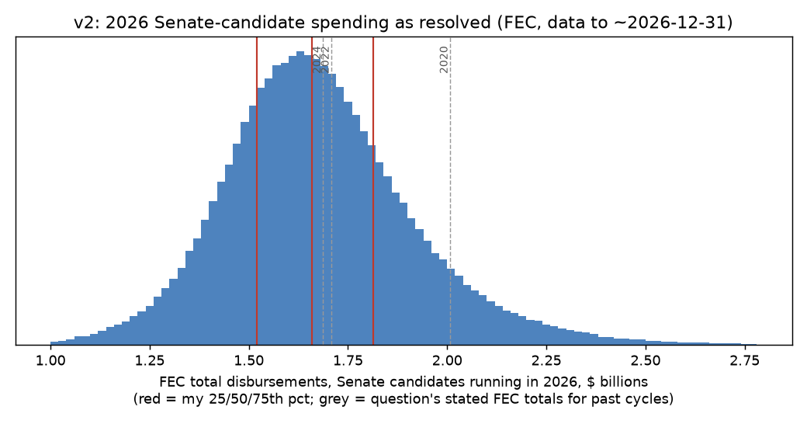
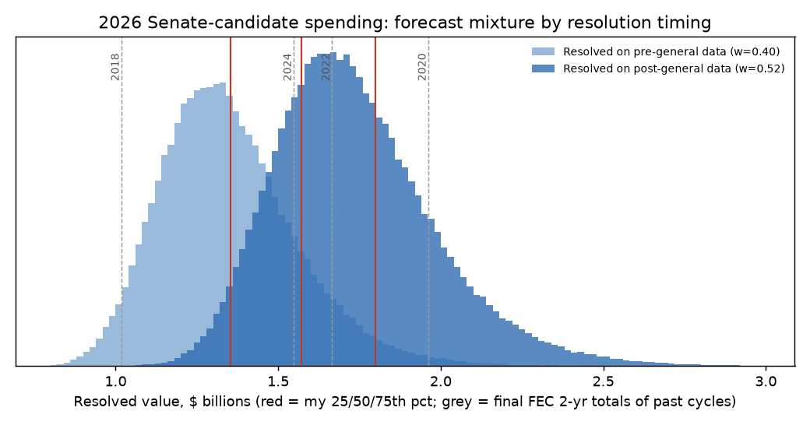

# What will be the total spending by all Senate candidates in the 2026 US election cycle?

| | |
|---|---|
| **Source** | Metaculus #45220 — https://www.metaculus.com/questions/45220/what-will-be-the-total-spending-by-senate-candidates-in-2026-us-election-cycle/ |
| **Type** | numeric (USD; Metaculus range $1.0B–$3.0B, both bounds open) |
| **Opened / Closes / Resolves** | opens 2026-09-28 / 2026-12-02 / 2026-12-02 scheduled, "may wait until 2026-12-31" (fine print); Cup ends 2027-01-04 |
| **Status** | open |
| **Current forecast** | **Median $1.675B, IQR [$1.540B, $1.835B]** (v3, 2026-10-02) |
| **Community (as of 2026-10-02)** | CP $1.694B [$1.497B, $1.950B] (n=65) · Pro $1.816B (n=7) · Gold $1.709B (n=24) |
| **Next review** | 2026-10-17 |

<!-- Versions below, newest first. APPEND-ONLY: never edit or delete a past version. -->

---

## v3 — Update — 2026-10-02

Mode: **Update** (incremental). It is six days since v2, the structure is unchanged, and the
CP is within $35M of my median. The new inputs are the CP/Pro/gold reveal and the
question author's 2026-09-28 clarification. There is no new FEC data: the Q3 reports are
not due until 10-15.

### Revision

| Driver | Direction | Effect |
|---|---|---|
| Prior (v2, 2026-09-26) | — | Median $1.660B, IQR [$1.520B, $1.820B] |
| Question author (DaAdCh, comment 2026-09-28): "any notable reporting lag … should and will be considered when admins determine the final resolution (and exact date)"; "we have almost a month to wait … and so will include post-general reports". Timing mix post / partial / pre-general / diffuse goes from 80/12/5/3 to 87/8/2/3 | ↑ | MC median +$13M ($1.671B); lower quartile +$17M; P(< $1.5B) 22% → 19% |
| CP/Pro/gold reveal (10-02): CP $1.694B (n=65), Pro $1.816B (n=7), gold $1.709B (n=24). All three are above me, and the Pro and CP upper quartiles ($2.09B / $1.95B) are well above mine. Small weight given, since the Pro n is 7 and no new data point explains the gap | ↑ | +$10M median; upper quartile +$15M |
| NRSC v. FEC (ruling 2026, coordinated-spending caps struck): NRSC coordinated spending ~$46M in its latest filing, which is not in candidate totals. Some Republican ad buys may now run through the party rather than the candidate committee | ↓ | −$5M median |
| Disbursement-multiple argument (DeRuina comment, 09-30): 2022 and 2024 finished at ~2.5× June disbursements, and 2026 June disbursements are slightly behind. Already in v1/v2 as a secondary projector; the receipts multiple still dominates because 2026 candidates have spent less of what they raised: mid-year receipts minus disbursements are $237M in 2026 vs $176M in 2024 (2-year class) | → | none (keeps the lower tail fat) |
| FEC data: bulk `weball26` re-downloaded (file modified 2026-10-02 05:37Z). The running-in-2026 class is unchanged at $880.8M receipts / $644.0M disbursements; no Q3 reports are processed yet. FEC API: DEMO_KEY rate-limited | → | none |
| **New forecast** | | **Median $1.675B, IQR [$1.540B, $1.835B]** |

### Tripwire check

| Tripwire from v2 | Fired? | Note |
|---|---|---|
| Q3 filings: receipts through 09-30 above $1.30B / below $1.15B | Pending | October Quarterly due 2026-10-15; bulk file on 10-02 still has June-30 data |
| FEC full-period aggregate after Q3 processing: disbursements above $1.30B / below $1.10B | Pending | check ~10-25; API rate-limited today |
| Metaculus CP/Pro/gold reveal: Pro or gold median > $200M from $1.66B → re-analyse | **Not fired** | Pro $1.816B (+$156M), gold $1.709B (+$49M), CP $1.694B (+$34M) |
| Pre-general filings through 10-14: disbursements above $1.45B / below $1.25B | Pending | due 2026-10-22 |
| Georgia 2026-11-03 result forces a 12-01 runoff | Pending | — |
| FEC aggregate on 12-15 shows post-general reports processed | Pending | — |

### What resolves YES

Unchanged from v2, with one addition. The question author has now stated publicly
(Metaculus comment, 2026-09-28) that reporting lag "should and will be considered" by the
admins, and that the post-general reports will be included. The only stated limit is the
tournament window (it ends 2027-01-04). Year-end reports (due 2027-01-31) remain out of
reach, so the resolved value is still ~96–97% of the final cycle total. The author's comment
is a statement of intent, not a change to the fine print, so I keep a 2% pre-general and an
8% partial-processing branch.

### Outside view

Unchanged from v2.

### Inside view

Same model as v2, `resolved = [(F2 + P) × 0.994] × f + runoff`, with the f-mixture
reweighted to post-general 0.87 / partial 0.08 / pre-general 0.02 / diffuse 0.03. Monte
Carlo (400k draws): 5th $1.35B · 10th $1.42B · 25th $1.54B · 50th $1.67B · 75th $1.82B ·
90th $1.99B · 95th $2.12B. I then applied the crowd (+$10M, upper quartile +$15M) and
NRSC (−$5M) adjustments by hand. The final percentiles are 5th $1.355B · 10th $1.425B ·
**25th $1.540B · 50th $1.675B · 75th $1.835B** · 90th $2.005B · 95th $2.130B. P(> 2022's
$1.708B) ≈ 44%; P(> $2.0B) ≈ 10%; P(< $1.5B) ≈ 19%.

### Evidence

- **No new hard data.**
  - The FEC bulk "all candidates" file was regenerated on 2026-10-02 and is identical to
    the 09-26 extract for Senate candidates: 336 running in 2026; $880.8M receipts;
    $644.0M disbursements; $369.9M cash on hand.
  - 93 candidates have coverage past 06-30 (pre-primary reports), worth $173M of
    disbursements.
  - No campaign has yet announced Q3 totals that I could find.
- **NRSC v. FEC.** The Washington Sun (2026-09-20) reports NRSC coordinated spending of
  "almost $46 million" after the ruling, against under $3M before it: Husted >$10M, Hinson
  >$8M, Whatley ~$8M. The DSCC spent ~$1M. Spending on candidates' behalf that moves to the
  party does not count here. Effect: small and negative.
- **Context, unchanged.** Super PAC money (>$3B projected) and AdImpact's $3.4B Senate ad
  projection are mostly outside candidate committees, so they do not count.

### Other forecasters

| Source | Value | As of | Note |
|---|---|---|---|
| Metaculus CP (recency-weighted) | $1.694B, IQR [$1.497B, $1.950B] (n=65) | 2026-10-02 14:09Z | opened at $1.686B on 09-28; peaked ~$1.75B on 09-30 |
| Metaculus Pro | $1.816B, IQR [$1.591B, $2.088B] (n=7) | 2026-10-02 14:09Z | stable at $1.82B since opening; highest cohort |
| Metaculus gold medalists | $1.709B, IQR [$1.531B, $1.927B] (n=24) | 2026-10-02 14:09Z | drifted down from $1.77B on 09-28 |
| Kalshi / Polymarket / Manifold | no matching market | 2026-10-02 | unchanged |

The cohorts disagree: the Pros sit ~$110–120M above both the CP and gold. I sit $19M below
the CP, $34M below gold and $141M below the Pros. The Pro aggregate rests on 7 forecasters,
and I cannot identify the fact behind it. The likeliest explanations are (a) no haircut for
the year-end reports that miss the resolution date (~3.5%), or (b) growth extrapolated from
record ad spending, most of which is outside money. Gold's downward drift since opening is
consistent with (a)/(b) being corrected. I give the Pro number a little weight; I am not
moving to it.

### Scenarios

| # | Scenario | Weight | Implies (median) |
|---|---|---|---|
| 1 | Post-general data processed by resolution; normal late cycle (multiple ≈ 1.9) | 0.74 | ≈$1.67B |
| 2 | As 1, plus a 2020-style late Democratic surge | 0.13 | ≈$1.95B |
| 3 | Post-general reports only partly processed when resolved | 0.08 | ≈$1.55B |
| 4 | Resolved early on pre-general data | 0.02 | ≈$1.32B |
| 5 | Other / diffuse | 0.03 | ≈$1.7B, wide |

### Sensitivity

Unchanged from v2. The multiple, tested by the Q3 reports on 10-15, is still the
load-bearing assumption.

### What would change my mind (tripwires)

- [ ] Q3 filings (due 2026-10-15): 2-year-class receipts of 2026 Senate candidates through
  09-30 above $1.30B → **up ~$100M**; below $1.15B → **down ~$80M**
- [ ] FEC full-period aggregate (`candidates/totals/aggregates`, office=S, 2026) after Q3
  processing (~2026-10-25): disbursements above $1.30B → **up ~$80M**; below $1.10B →
  **down ~$80M**
- [ ] Pre-general filings (due 2026-10-22): aggregate disbursements through 10-14 above
  $1.45B → **up ~$60M**; below $1.25B → **down ~$60M**
- [ ] An admin or author comment fixing resolution on the 12-02 page (pre-general data
  only) → **down ~$250M, re-analyse**; one confirming a data pull on or after 12-20 →
  **up ~$10M, narrow the lower tail**
- [ ] Georgia 2026-11-03 result forces a 2026-12-01 runoff → **up ~$20M**
- [ ] FEC full-period aggregate on 2026-12-15 shows post-general reports processed
  (disbursements up > $250M vs the pre-general level) → **narrow the IQR**, drop the
  partial-processing branch

### Sources

Carried forward from v2 (1–28), then new (29–35):

1. Metaculus API, post 45220 / question 45413 (metadata, scaling, dates; criteria null) — https://www.metaculus.com/api/posts/45220/ (accessed 2026-09-26); snapshot `raw/metaculus-2026-09-26.json`
2. FEC, Statistical Summary of 24-Month Campaign Activity of the 2023-2024 Election Cycle — https://www.fec.gov/updates/statistical-summary-of-24-month-campaign-activity-of-the-2023-2024-election-cycle/ (accessed 2026-09-26)
3. FEC, 24-Month Summary 2021-2022 — https://www.fec.gov/updates/statistical-summary-of-24-month-campaign-activity-of-the-2021-2022-election-cycle/ (accessed 2026-09-26)
4. FEC, 24-Month Summary 2019-2020 — https://www.fec.gov/updates/statistical-summary-24-month-campaign-activity-2019-2020-election-cycle/ (accessed 2026-09-26)
5. FEC, 18-Month Summary 2023-2024 (incl. 2018–2024 comparison table) — https://www.fec.gov/updates/statistical-summary-of-18-month-campaign-activity-of-the-2023-2024-election-cycle/ (accessed 2026-09-26)
6. FEC, 18-Month Summary 2021-2022 — https://www.fec.gov/updates/statistical-summary-of-18-month-campaign-activity-of-the-2021-2022-election-cycle/ (accessed 2026-09-26)
7. FEC, 18-Month Summary 2019-2020 — https://www.fec.gov/updates/statistical-summary-18-month-campaign-activity-2019-2020-election-cycle/ (accessed 2026-09-26)
8. FEC, 18-Month Summary 2017-2018 — https://www.fec.gov/updates/statistical-summary-18-month-campaign-activity-2017-2018-election-cycle/ (accessed 2026-09-26)
9. FEC, 21-Month Summaries 2017-18, 2019-20, 2021-22, 2023-24 — https://www.fec.gov/updates/statistical-summary-21-month-campaign-activity-2017-2018-election-cycle/ · https://www.fec.gov/updates/statistical-summary-21-month-campaign-activity-2019-2020-election-cycle/ · https://www.fec.gov/updates/statistical-summary-of-21-month-campaign-activity-of-the-2021-2022-election-cycle/ · https://www.fec.gov/updates/statistical-summary-of-21-month-campaign-activity-of-the-2023-2024-election-cycle/ (accessed 2026-09-26)
10. FEC, 15-Month Summaries 2025-26 and 2023-24 — https://www.fec.gov/updates/statistical-summary-of-15-month-campaign-activity-of-the-2025-2026-election-cycle/ · https://www.fec.gov/updates/statistical-summary-of-15-month-campaign-activity-of-the-2023-2024-election-cycle/ (accessed 2026-09-26)
11. FEC bulk data, "All candidates" (weball) and candidate master (cn) files, 2018–2026 — https://www.fec.gov/files/bulk-downloads/2026/weball26.zip etc. (accessed 2026-09-26); derived snapshot `raw/fec-bulk-senate-totals-2026-09-26.csv`
12. FEC API `candidates/totals/aggregates` (office=S) — https://api.open.fec.gov/v1/candidates/totals/aggregates/ (accessed 2026-09-26; 2024 snapshot in `raw/`)
13. AdImpact, "2026 Election Cycle to Reach Record $11.6 Billion in Ad Spending" (2026-06-11) — https://adimpact.com/blogs/adimpact-reveals-2026-election-cycle-to-reach-record-11.6-billion-in-ad-spending (accessed 2026-09-26)
14. Wesleyan Media Project, release 2026-09-17 — https://mediaproject.wesleyan.edu/releases-091726/ (accessed 2026-09-26)
15. Wesleyan Media Project, release 2026-03-05 — https://mediaproject.wesleyan.edu/releases-030526 (accessed 2026-09-26)
16. WSHU, "2026 midterm elections on track for record political ad spending" (2026-09-21) — https://www.wshu.org/connecticut-news/2026-09-21/2026-midterm-elections-political-ad-spending (accessed 2026-09-26)
17. Carolina Public Press, NC Senate race expected to be most expensive ever — https://carolinapublicpress.org/73700/get-ready-for-most-expensive-senate-race-ever/ (accessed 2026-09-26)
18. Roll Call, "Democratic candidates start 2026 with a fundraising bang" (2026-04-16) — https://rollcall.com/2026/04/16/democratic-candidates-start-2026-with-a-fundraising-bang/ (accessed 2026-09-26)
19. Roll Call, "Democratic candidates sustain fundraising pace as GOP strains to keep up" (2026-07-16) — https://rollcall.com/2026/07/16/democratic-candidates-sustain-fundraising-pace-as-gop-strains-to-keep-up/ (accessed 2026-09-26)
20. ABC News, "Democrats dominate fundraising in key Senate races, but Republicans still have ample resources" — https://abcnews.com/Politics/democrats-dominate-fundraising-key-senate-races-republicans-ample/story?id=134829415 (accessed 2026-09-26)
21. Houston Public Media, Talarico record $27M Q1 (2026-04-15) — https://www.houstonpublicmedia.org/articles/news/politics/election-2026/2026/04/15/549140/james-talarico-texas-senate-democrat-fundraising-27-million/ (accessed 2026-09-26)
22. Atlanta News First, YouGov poll Ossoff 51–41 (2026-09-23) — https://www.atlantanewsfirst.com/2026/09/23/new-poll-ossoff-holds-double-digit-lead-over-collins-governors-race-dead-heat/ ; Quantus 49–45 (2026-09-18) — https://www.atlantanewsfirst.com/2026/09/18/poll-ossoff-holds-4-point-lead-over-collins-tight-georgia-senate-race/ (accessed 2026-09-26)
23. Statista (OpenSecrets data), total funds raised by Senate candidates 2021/22 — https://www.statista.com/statistics/1317762/total-funds-raised-running-senate-election-cycle-party (accessed 2026-09-26, via search snippet)
24. CNN, "The 'first prediction-market election'…" (2026-09-24) — https://www.cnn.com/2026/09/24/politics/midterm-elections-prediction-markets-kalshi-polymarket (accessed 2026-09-26)
25. Manifold, "Will the 2026 Texas Senate race be the most expensive Senate race in history" — https://manifold.markets/AutopoieticErgodicity/will-the-2026-texas-senate-race-be (accessed 2026-09-26)
26. Operator-supplied resolution criteria, fine print and background for Metaculus #45220 (pasted 2026-09-26; not yet visible via API) — https://www.metaculus.com/questions/45220/what-will-be-the-total-spending-by-senate-candidates-in-2026-us-election-cycle/ (accessed 2026-09-26)
27. FEC API `candidates/totals/aggregates`, office=S, election_full=true, 2020 / 2024 / 2026 — https://api.open.fec.gov/v1/candidates/totals/aggregates/?office=S&election_year=2026&election_full=true (accessed 2026-09-26); snapshots in `raw/fec-api-senate-aggregate-*-fetched-2026-09-26.json`
28. FEC, 2026 quarterly filers' report dates (October Quarterly 09-30/10-15; Pre-General 10-14/10-22; Post-General 11-23/12-03; Year-End 12-31/2027-01-31) — https://www.fec.gov/help-candidates-and-committees/dates-and-deadlines/2026-reporting-dates/2026-quarterly-filers/ (accessed 2026-09-26)
29. Metaculus post 45220, live aggregations (CP / Pro / gold), comments by DaAdCh (2026-09-28), Theomachado (2026-09-28) and DeRuina (2026-09-30) — https://www.metaculus.com/questions/45220/ (accessed 2026-10-02, pre-fetched); snapshot `raw/metaculus-2026-10-02.json`
30. FEC bulk data, weball26.zip and cn26.zip (file last-modified 2026-10-02 05:37Z) — https://www.fec.gov/files/bulk-downloads/2026/weball26.zip (accessed 2026-10-02); derived snapshot `raw/fec-bulk-senate-totals-2026-10-02.csv`
31. FEC API `candidates/totals/aggregates` office=S, 2026: OVER_RATE_LIMIT (DEMO_KEY) — https://api.open.fec.gov/v1/candidates/totals/aggregates/ (accessed 2026-10-02); `raw/fec-api-senate-aggregate-2026-fetched-2026-10-02.json`
32. The Washington Sun, "The NRSC's Spending Surges for Key Midterm Races" (2026-09-20) — https://www.washingtonsun.com/2026-election/republican-senate-campaign-coordinated-spending-surges (accessed 2026-10-02)
33. USAFacts, "How much are candidates spending for the 2026 midterm?" — https://usafacts.org/answers/how-much-are-candidates-spending-for-the-midterm/country/united-states/ (accessed 2026-10-02, via search snippet: Talarico $47.0M, Ossoff $39.7M spent; matches FEC bulk)
34. FEC, 2026 quarterly filers' reporting dates (October Quarterly due 10-15, Pre-General 10-22, Post-General 12-03) — https://www.fec.gov/help-candidates-and-committees/dates-and-deadlines/2026-reporting-dates/2026-quarterly-filers/ (accessed 2026-10-02)
35. OpenSecrets cost-of-election page — https://www.opensecrets.org/elections-overview/cost-of-election?cycle=2026 (accessed 2026-10-02; HTTP 403, no data)

**Date**: 2026-10-02
**Forecast**: Median 1,675,000,000, IQR [1,540,000,000, 1,835,000,000]
**Thesis**: The model is unchanged: FEC full-period Senate-candidate disbursements, with mid-year receipts (~$880M, level with 2022 and 2024) times a final/midyear multiple of ~1.9, less a ~3.5% haircut for the year-end reports that miss resolution. Two things move it slightly up. The question author has confirmed that post-general reports will be counted, which shrinks the pre-general branch from 5% to 2%. The cohort reveal (CP $1.69B, gold $1.71B, Pro $1.82B) sits above me. No new FEC data exists until the Q3 reports due 10-15.

---

## v2 — Re-analysis — 2026-09-26

Mode: **Re-analysis.** The question's structure changed: the operator supplied the
resolution criteria, fine print and background, which were unpublished (API null) at v1.
The Metaculus API still returned null criteria and a hidden CP on 2026-09-26, so the text
below is taken from the operator's paste.

### Revision

| Driver | Direction | Effect |
|---|---|---|
| Prior (v1, 2026-09-26) | — | Median $1.57B, IQR [$1.35B, $1.80B] |
| Fine print "may wait until December 31, 2026": post-general reports (due 12-03, coverage to 11-23) will be in the data. Early-snapshot branch 40% → 5%; 12% kept for incomplete FEC processing of post-general reports by 12-31 | ↑ | ≈ +$110M on the median; lower quartile +$170M |
| Definition fixed: "total spending by all US Senate candidates running in 2026 according to the FEC". The quoted history matches the FEC API full-election-period aggregate within 0.6%. The 4-way definition mix is replaced by 2-yr class + ~$60–110M prior-period activity, ×0.994 | → | ≈ ±$10M (the v1 mix averaged ×1.06; the identified definition is ×~1.05) |
| Outside-money misreading branch (3%) removed; diffuse branch 5% → 3% | ↓ tail | P(>$2.5B) ~4% → ~1.5%; median −$10M |
| Operator-supplied "mid-August 2026: $666.3M spent (D $393.9M, R $261.0M, other $11.4M)" | → | consistent with my 2026-09-26 API pull ($711.3M, full period); none |
| **New forecast** | | **Median $1.66B, IQR [$1.52B, $1.82B]** |

### Tripwire check

| Tripwire from v1 | Fired? | Note |
|---|---|---|
| Criteria include post-general reports (resolution on/after 12-03, or complete data) → up ~$150M | **Partly fired** | "may wait until Dec 31" = post-general data, but the resolver has discretion and FEC processing may lag; realised ≈ +$110M |
| Criteria fix a snapshot on/before 12-02 or name pre-general/21-month data → down ~$230M | Not fired | residual 5% |
| Criteria define the quantity as candidate + outside spending → re-analyse | Not fired | the criteria say "spending by all US Senate candidates … according to the FEC" |
| Q3 receipts through 09-30 above $1.30B / below $1.15B | Pending | reports due 2026-10-15 |
| Disbursements through 09-30 above $1.20B / below $1.00B | Pending | reports due 2026-10-15 |
| Georgia runoff forced on 11-03 | Pending | — |

### What resolves YES

The question resolves to the FEC's total disbursements by **all Senate candidates running
in 2026**. The background quotes the FEC series:

| Cycle | Stated FEC total | FEC API full-period aggregate (my pull, 2026-09-26) | Ratio |
|---|---|---|---|
| 2024 | $1,687,323,291 | $1,698,423,658 | 0.993 |
| 2022 | $1,708,197,866 | (rate-limited) | — |
| 2020 | $2,007,613,859 (typed as "£") | $2,016.72M | 0.995 |

This identifies the series: the FEC "Spending: by the numbers" / `candidates/totals/aggregates`
figure for office = Senate, election year = 2026, **full 6-year election period**. It is not
the 2-year statistical-summary class, which gave $1.548B / $1.666B / $1.962B. The small
~0.6% gap is probably a filter (e.g. active candidates) or a snapshot date; I carry it as
×0.994. The 2026 value is $666.3M as of mid-August per the question, and $711.3M on
2026-09-26 per my API pull.

Timing: the question closes 2026-12-02, and the fine print lets the resolver wait until
**2026-12-31**. By then the post-general reports (coverage 10-15 → 11-23, due 12-03) are on
file, but year-end reports (coverage to 12-31, due 2027-01-31) are not. **The resolved
figure is therefore not the final cycle total.** It is the total through ~11-23, about 96–97%
of the final.

A like-for-like comparison with the stated 2022/2024 finals ($1.69–1.71B) therefore needs a
~3.5% haircut: a 2026 cycle that ends exactly level with 2024 would resolve near $1.63B.
Residual risks:

- FEC processing of the 12-03 filings may be incomplete on the day the resolver looks. I
  give this 12%, at 85–94% of final.
- An early resolution on pre-general data, which "may wait" permits but doesn't require.
  I give this 5%.
- A Georgia runoff on 2026-12-01. Only its pre-runoff report (to 11-11) lands before 12-31.

### Outside view

Unchanged from v1 (final ÷ 18-month receipts = 1.76 / 2.79 (2.36 ex-runoffs) / 1.77 /
1.81 for 2018–2024), now expressed in the question's series:

| Cycle | Stated FEC total (resolution series) | 2-year class (bulk) | Full-period uplift |
|---|---|---|---|
| 2020 | $2.008B | $1.962B | +2.3% |
| 2022 | $1.708B | $1.666B | +2.5% |
| 2024 | $1.687B | $1.548B | +9.0% |

The last two cycles sit at **$1.69–1.71B**. That is the status-quo anchor for "2026 ≈ recent
cycles".

### Inside view

`resolved = [(F2 + P) × 0.994] × f + runoff`

- **F2:** unchanged from v1. 18-month receipts ≈ $860M × multiple, median 1.90, σ(log)
  0.11, with a 15% chance of a 2020-style surge at ×1.1–1.3. F2 median $1.67B.
- **P:** activity outside the 2-year window by 2026 candidates, $60–110M. It is $67M today
  ($711.3M full-period vs $643.9M 2-year class).
- **f:** share of final spending visible when the resolver looks:

  | Case | f | Weight |
  |---|---|---|
  | Post-general processed | N(0.965, 0.015) | 0.80 |
  | Partially processed | U(0.85, 0.94) | 0.12 |
  | Pre-general only | N(0.76, 0.04) | 0.05 |
  | Diffuse (×lognormal σ 0.25) | — | 0.03 |

- **Runoff:** 15% chance, adding U($0, $60M) in the post-general branch.

Monte Carlo (400k draws): 5th $1.32B · 10th $1.40B · **25th $1.52B · 50th $1.66B · 75th
$1.82B** · 90th $1.99B · 95th $2.11B. P(resolves above 2022's $1.708B) ≈ 41%; P(> $2.0B)
≈ 9%; P(< $1.5B) ≈ 22%.

### Evidence

Unchanged from v1, plus the operator-supplied mid-August figure: $666.3M, of which
Democrats $393.9M (59%), Republicans $261.0M (39%), other $11.4M. The Democratic share is
high and consistent with the Roll Call and ABC reports of Democrats outraising Republicans
~4:1 in Q2. Republican candidate spending remains the soft side of the total. I found no
new public data since v1: Q3 reports are due 10-15.

### Other forecasters

| Source | Value | As of | Note |
|---|---|---|---|
| Metaculus CP (recency-weighted) | hidden (n=8) | 2026-09-26 | reveals 2026-10-01T17:00Z |
| Metaculus Pro / gold | not available | 2026-09-26 | question not yet open |
| Kalshi / Polymarket / Manifold | no matching market | 2026-09-26 | unchanged from v1 |

### Scenarios

| # | Scenario | Weight | Implies (median) |
|---|---|---|---|
| 1 | Post-general data processed by resolution; normal late cycle (multiple ≈ 1.9) | 0.68 | ≈$1.67B |
| 2 | As 1, plus a 2020-style late Democratic surge | 0.12 | ≈$1.95B |
| 3 | Post-general reports only partly processed when resolved | 0.12 | ≈$1.55B |
| 4 | Resolved early on pre-general data | 0.05 | ≈$1.32B |
| 5 | Other / diffuse | 0.03 | ≈$1.7B, wide |

### Sensitivity

| Assumption | If instead | Forecast becomes |
|---|---|---|
| Timing mix 80/12/5 | post-general data certainly complete | Median $1.69B, IQR [$1.56B, $1.83B] |
| Timing mix 80/12/5 | 40% chance of incomplete processing | Median $1.62B, IQR [$1.48B, $1.78B] |
| Multiple 1.90, 15% surge | 2020-style surge certain | Median $1.93B, IQR [$1.77B, $2.11B] |
| Multiple 1.90, 15% surge | multiple 1.78 (2018/22/24 average), no surge | Median $1.53B, IQR [$1.41B, $1.65B] |

The multiple is now the load-bearing assumption. Q3 reports (10-15) are the first hard test
of it.

### What would change my mind (tripwires)

- [ ] Q3 filings (due 2026-10-15): 2-year-class receipts of 2026 Senate candidates through
  09-30 above $1.30B (Q3 > ~$430M; 2024's Q3 ≈ $340M) → **up ~$100M**; below $1.15B →
  **down ~$80M**
- [ ] FEC full-period aggregate (`candidates/totals/aggregates`, office=S, 2026) after Q3
  processing (check ~2026-10-25): disbursements above $1.30B → **up ~$80M**; below
  $1.10B → **down ~$80M**
- [ ] Metaculus CP / Pro / gold reveal 2026-10-01: a Pro or gold median more than $200M
  from $1.66B → **re-analyse** (look for the fact I'm missing)
- [ ] Pre-general filings (due 2026-10-22): aggregate disbursements through 10-14 above
  $1.45B → **up ~$60M**; below $1.25B → **down ~$60M**
- [ ] Georgia 2026-11-03 result forces a 2026-12-01 runoff → **up ~$20M**
- [ ] FEC full-period aggregate on 2026-12-15 shows post-general reports processed
  (disbursements up > $250M vs the pre-general level) → **narrow the IQR**, drop the
  partial-processing branch

### Sources

1. Metaculus API, post 45220 / question 45413 (metadata, scaling, dates; criteria null) — https://www.metaculus.com/api/posts/45220/ (accessed 2026-09-26); snapshot `raw/metaculus-2026-09-26.json`
2. FEC, Statistical Summary of 24-Month Campaign Activity of the 2023-2024 Election Cycle — https://www.fec.gov/updates/statistical-summary-of-24-month-campaign-activity-of-the-2023-2024-election-cycle/ (accessed 2026-09-26)
3. FEC, 24-Month Summary 2021-2022 — https://www.fec.gov/updates/statistical-summary-of-24-month-campaign-activity-of-the-2021-2022-election-cycle/ (accessed 2026-09-26)
4. FEC, 24-Month Summary 2019-2020 — https://www.fec.gov/updates/statistical-summary-24-month-campaign-activity-2019-2020-election-cycle/ (accessed 2026-09-26)
5. FEC, 18-Month Summary 2023-2024 (incl. 2018–2024 comparison table) — https://www.fec.gov/updates/statistical-summary-of-18-month-campaign-activity-of-the-2023-2024-election-cycle/ (accessed 2026-09-26)
6. FEC, 18-Month Summary 2021-2022 — https://www.fec.gov/updates/statistical-summary-of-18-month-campaign-activity-of-the-2021-2022-election-cycle/ (accessed 2026-09-26)
7. FEC, 18-Month Summary 2019-2020 — https://www.fec.gov/updates/statistical-summary-18-month-campaign-activity-2019-2020-election-cycle/ (accessed 2026-09-26)
8. FEC, 18-Month Summary 2017-2018 — https://www.fec.gov/updates/statistical-summary-18-month-campaign-activity-2017-2018-election-cycle/ (accessed 2026-09-26)
9. FEC, 21-Month Summaries 2017-18, 2019-20, 2021-22, 2023-24 — https://www.fec.gov/updates/statistical-summary-21-month-campaign-activity-2017-2018-election-cycle/ · https://www.fec.gov/updates/statistical-summary-21-month-campaign-activity-2019-2020-election-cycle/ · https://www.fec.gov/updates/statistical-summary-of-21-month-campaign-activity-of-the-2021-2022-election-cycle/ · https://www.fec.gov/updates/statistical-summary-of-21-month-campaign-activity-of-the-2023-2024-election-cycle/ (accessed 2026-09-26)
10. FEC, 15-Month Summaries 2025-26 and 2023-24 — https://www.fec.gov/updates/statistical-summary-of-15-month-campaign-activity-of-the-2025-2026-election-cycle/ · https://www.fec.gov/updates/statistical-summary-of-15-month-campaign-activity-of-the-2023-2024-election-cycle/ (accessed 2026-09-26)
11. FEC bulk data, "All candidates" (weball) and candidate master (cn) files, 2018–2026 — https://www.fec.gov/files/bulk-downloads/2026/weball26.zip etc. (accessed 2026-09-26); derived snapshot `raw/fec-bulk-senate-totals-2026-09-26.csv`
12. FEC API `candidates/totals/aggregates` (office=S) — https://api.open.fec.gov/v1/candidates/totals/aggregates/ (accessed 2026-09-26; 2024 snapshot in `raw/`)
13. AdImpact, "2026 Election Cycle to Reach Record $11.6 Billion in Ad Spending" (2026-06-11) — https://adimpact.com/blogs/adimpact-reveals-2026-election-cycle-to-reach-record-11.6-billion-in-ad-spending (accessed 2026-09-26)
14. Wesleyan Media Project, release 2026-09-17 — https://mediaproject.wesleyan.edu/releases-091726/ (accessed 2026-09-26)
15. Wesleyan Media Project, release 2026-03-05 — https://mediaproject.wesleyan.edu/releases-030526 (accessed 2026-09-26)
16. WSHU, "2026 midterm elections on track for record political ad spending" (2026-09-21) — https://www.wshu.org/connecticut-news/2026-09-21/2026-midterm-elections-political-ad-spending (accessed 2026-09-26)
17. Carolina Public Press, NC Senate race expected to be most expensive ever — https://carolinapublicpress.org/73700/get-ready-for-most-expensive-senate-race-ever/ (accessed 2026-09-26)
18. Roll Call, "Democratic candidates start 2026 with a fundraising bang" (2026-04-16) — https://rollcall.com/2026/04/16/democratic-candidates-start-2026-with-a-fundraising-bang/ (accessed 2026-09-26)
19. Roll Call, "Democratic candidates sustain fundraising pace as GOP strains to keep up" (2026-07-16) — https://rollcall.com/2026/07/16/democratic-candidates-sustain-fundraising-pace-as-gop-strains-to-keep-up/ (accessed 2026-09-26)
20. ABC News, "Democrats dominate fundraising in key Senate races, but Republicans still have ample resources" — https://abcnews.com/Politics/democrats-dominate-fundraising-key-senate-races-republicans-ample/story?id=134829415 (accessed 2026-09-26)
21. Houston Public Media, Talarico record $27M Q1 (2026-04-15) — https://www.houstonpublicmedia.org/articles/news/politics/election-2026/2026/04/15/549140/james-talarico-texas-senate-democrat-fundraising-27-million/ (accessed 2026-09-26)
22. Atlanta News First, YouGov poll Ossoff 51–41 (2026-09-23) — https://www.atlantanewsfirst.com/2026/09/23/new-poll-ossoff-holds-double-digit-lead-over-collins-governors-race-dead-heat/ ; Quantus 49–45 (2026-09-18) — https://www.atlantanewsfirst.com/2026/09/18/poll-ossoff-holds-4-point-lead-over-collins-tight-georgia-senate-race/ (accessed 2026-09-26)
23. Statista (OpenSecrets data), total funds raised by Senate candidates 2021/22 — https://www.statista.com/statistics/1317762/total-funds-raised-running-senate-election-cycle-party (accessed 2026-09-26, via search snippet)
24. CNN, "The 'first prediction-market election'…" (2026-09-24) — https://www.cnn.com/2026/09/24/politics/midterm-elections-prediction-markets-kalshi-polymarket (accessed 2026-09-26)
25. Manifold, "Will the 2026 Texas Senate race be the most expensive Senate race in history" — https://manifold.markets/AutopoieticErgodicity/will-the-2026-texas-senate-race-be (accessed 2026-09-26)
26. Operator-supplied resolution criteria, fine print and background for Metaculus #45220 (pasted 2026-09-26; not yet visible via API) — https://www.metaculus.com/questions/45220/what-will-be-the-total-spending-by-senate-candidates-in-2026-us-election-cycle/ (accessed 2026-09-26)
27. FEC API `candidates/totals/aggregates`, office=S, election_full=true, 2020 / 2024 / 2026 — https://api.open.fec.gov/v1/candidates/totals/aggregates/?office=S&election_year=2026&election_full=true (accessed 2026-09-26); snapshots in `raw/fec-api-senate-aggregate-*-fetched-2026-09-26.json`
28. FEC, 2026 quarterly filers' report dates (October Quarterly 09-30/10-15; Pre-General 10-14/10-22; Post-General 11-23/12-03; Year-End 12-31/2027-01-31) — https://www.fec.gov/help-candidates-and-committees/dates-and-deadlines/2026-reporting-dates/2026-quarterly-filers/ (accessed 2026-09-26)

**Date**: 2026-09-26
**Forecast**: Median $1.66B, IQR [$1.52B, $1.82B]
**Thesis**: The criteria fix the series: the FEC full-election-period total for Senate candidates running in 2026 ($1.69B in 2024, $1.71B in 2022; $711M on 2026-09-26), resolved on data as of ~2026-12-31. That data will include post-general reports (to 11-23) but not year-end ones, so it captures ~96–97% of final spending. Mid-year FEC receipts (≈$860M, level with 2022/24) times a final/midyear multiple of ~1.9 put the final near $1.75B in this series, and the ~3.5% timing haircut gives ≈$1.66B. The multiple, tested by the Q3 reports on 10-15, is now the load-bearing uncertainty.

---

## v1 — Initial forecast — 2026-09-26

### What resolves YES

**The resolution criteria, fine print and background are not yet published.** The question
is in Metaculus's "upcoming" state and opens 2026-09-28T17:00Z; the API (queried with the
bot key on 2026-09-26) returns `resolution_criteria: null`, `fine_print: null`,
`description: null`, and there are no comments. What *is* fixed: unit `$`, range
$1.0B–$3.0B in 200 buckets of $10M with **open lower and upper bounds**, close **and**
scheduled resolution 2026-12-02T23:00Z, and membership in the Metaculus Cup Fall 2026,
which stops forecasting on 2027-01-01 and closes on 2027-01-04.

That last fact carries the most weight in this forecast. The question cannot wait for the
FEC's authoritative *24-month statistical summary*, which comes out in spring of the
following year. It must resolve on data visible in **December 2026**. Federal candidates
file a **pre-general report** (covering 2026-10-01 → 10-14, due 10-22) and a
**post-general report** (covering 10-15 → 11-23, due **2026-12-03**, one day *after* the
scheduled resolution). So the resolved number depends on when the resolver pulls the data:

- **On or before 2026-12-02:** the data stops at about 2026-10-14 (or 09-30 if the FEC's
  21-month summary is used). Historically that is only ~70–80% of final spending.
- **Any time 2026-12-03 → 2027-01-04:** the data runs through 2026-11-23, about 96–97% of
  final (Georgia runoff spending aside).

The second ambiguity is the **definition of "Senate candidates"**. The public series
differ by up to ~15%:

- the FEC statistical summary counts candidates *running in the cycle*, activity in the
  2-year window only;
- the FEC "by the numbers" page / API aggregate uses the *full 6-year Senate election
  period*;
- OpenSecrets;
- "every Senate candidate committee active in 2025–26", which includes senators up in 2028
  and 2030.

The title's "*all* Senate candidates" leans toward the broader readings. Counter-intuitive
paths to resolution: (a) the snapshot timing above; (b) a resolver that reads "spending in
Senate races" and adds outside money, which roughly triples the figure to $4B+; (c) a
2026-12-01 Georgia runoff, which adds spending the December data only partly captures.

### Outside view

Reference class: **Senate candidates running in the cycle, 24-month (2-year) disbursements,
last four cycles**. Recomputed from FEC bulk files, which reproduce the FEC's published
summaries to rounding:

| Cycle | Class | Receipts at 18 mo (Jun 30) | Disb. at 18 mo | Disb. at 21 mo (Sep 30) | **Final 2-yr disb.** | Final ÷ 18-mo receipts | Share of final spent by Sep 30 |
|---|---|---|---|---|---|---|---|
| 2018 | I, D-defence, D wave | $579.7M | $353.2M | $649.7M | **$1.018B** | 1.76 | 64% |
| 2020 | II, D-offence, GA runoffs | $702.6M | $413.7M | >$1.0B | **$1.962B** | 2.79 (≈2.36 ex-runoffs) | ~51% (~62% ex-runoffs) |
| 2022 | III, GA runoff | $943.1M | $710.6M | $1.1B | **$1.666B** | 1.77 | 66% |
| 2024 | I, pres. year, CA special | $857.5M | $681.9M | $1.1B | **$1.548B** | 1.81 | ~71% |
| **2026** | II, D-offence | **≈$860–881M** | **≈$644M** | (due Oct 15) | ? | — | — |

The raw base rate for the final 2-year figure is $1.0–2.0B, with a recent-cycle cluster
at **$1.55–1.67B**. The most stable predictor is final ÷ 18-month receipts, at 1.76–1.81
in three of four cycles. Applied to 2026's ≈$860M that gives **$1.51–1.56B**; the 2020
multiple (ex-runoffs 2.36) gives **$2.0B**.

Alternative definitions, 2024 finals:

- FEC API "by the numbers" full-period aggregate: **$1.698B** (×1.10).
- All Senate committees active in the 2-year window: **$1.749B** (×1.13).
- OpenSecrets: for 2022, Senate candidates *raised* $1.78B vs the FEC-class $1.65B
  (×~1.08).

### Inside view

Decomposition: `resolved value = F × m × f`

- **F** = final 2-year disbursements of 2026 Senate candidates, excluding any runoff
  - = 18-month receipts (≈$860M) × multiple.
  - Multiple: median **1.90**, σ(log) 0.11, plus a 15% chance of a 2020-style late surge
    (×1.1–1.3).
  - That sets it above the 1.78 norm, for three reasons:
    1. Democrats are on offence on a Class II map in TX, OH, NC, ME, IA, AK and NE (like
       2020).
    2. Individual Democrats are posting records: Talarico raised a record $27.1M in Q1 and
       $28.3M in Q2 (~$69M cycle), and Ossoff held ~$43M cash on hand on June 30.
    3. Mid-year cash on hand is high: $370M vs $305M (2024) and $383M (2022).
  - Against: Republican *candidates* are weak fundraisers this cycle and self-fund far
    less. Candidate loans are $50M so far vs $187M final in 2024, and 2024 had McCormick,
    Hovde, Sheehy and Scott. The GOP side is being carried by the Senate Leadership Fund,
    NRSC and MAGA Inc., which are outside money and don't count here.
  - → F median **$1.67B**, IQR [$1.54B, $1.82B].
- **m** = definition multiplier:

  | Definition | m | Weight |
  |---|---|---|
  | FEC 2-yr | 1.00 | 0.35 |
  | FEC full-period "by the numbers" | 1.08 | 0.35 |
  | OpenSecrets | 1.06 | 0.15 |
  | All Senate committees | 1.15 | 0.15 |

- **f** = timing share of final spending the resolver can see:

  | Resolver pulls data | f | Weight |
  |---|---|---|
  | On pre-general / Sep-30 data | N(0.75, 0.045) | 0.40 |
  | On post-general data | N(0.965, 0.015) | 0.52 |
  | Misreads to include outside money (≈$4.5B) | — | 0.03 |
  | Other / diffuse (×lognormal σ 0.25) | — | 0.05 |

  - Georgia runoff: Ossoff leads Collins 51–41 (YouGov, Sep 15–18) and 49–45 (Quantus).
    I give it a 15% chance, adding ≤$60M under the post-general branch.

The 0.40 weight on an early snapshot comes from `scheduled_resolve_time = close time =
2026-12-02`, one day before post-general reports are due. It is tempered because many
authors set resolve = close by default, and admins often resolve days later on the freshest
data.

### Evidence

- **2026 is not running ahead of 2022/2024 on candidate money at mid-year.**
  - 18-month disbursements: ≈$644M vs $682M (2024) and $711M (2022).
  - 18-month receipts: ≈$870M vs $858M (2024) and $943M (2022).
  - At 15 months, receipts were $654M vs $611M (2024), disbursements $401M vs $426M.
  - In real terms the 2026 18-month receipts equal 2020's.
  - LR ≈ 1 against "record candidate spending". This is the main anchor.
- **AdImpact (2026-06-11):** Senate ad spending of all sponsors is projected at $3.4B,
  +27% vs 2024 and +48% vs 2022.
  - It is a projection, and most of it is outside money. **Wesleyan Media Project
    (2026-09-17):** Senate ad spending so far is $426M candidate, $945M group, $58M
    coordinated; groups have 69%. Senate broadcast volume is "not record-breaking… higher
    than every cycle but for 2020".
  - Read-through to *candidate* spending: modestly positive. LR ~1.3 for the upper half of
    F, already reflected in the 1.90 multiple.
- **Race-level signals:**
  - NC is projected at $600–800M in total (Carolina Public Press), but that is all
    sponsors.
  - Ohio saw $97M of ads from 08-10 to 09-13; TX $59M, ME $51M, MI $48M, GA $44M.
  - Democrats outraised Republicans ~4:1 in battleground Q2.
- **Absent evidence:** I found no report of an aggregate Senate-candidate Q3 surge (Q3 ends
  09-30; reports are due 10-15). No such signal yet.
- **Disconfirming stream, checked:** Republican candidates' weak hauls and low
  self-funding pull F down relative to 2024. Paxton raised $2.2M in Q2 and Collins held
  $2.1M cash on hand. That is why I don't take AdImpact's +27% at face value.

### Other forecasters

| Source | Value | As of | Note |
|---|---|---|---|
| Metaculus CP (recency-weighted) | hidden (n=8) | 2026-09-26 | reveals 2026-10-01T17:00Z |
| Metaculus Pro | not available | 2026-09-26 | no Pro aggregation on upcoming question |
| Metaculus gold medalists | not available | 2026-09-26 | — |
| Kalshi / Polymarket | no market | 2026-09-26 | they list race-winner and control markets only |
| Manifold | "TX Senate race most expensive in history" 18% | 2026-09-26 | M$323 volume, tangential, discounted |
| Sentinel / Mantic / GJOpen / INFER | no matching question | 2026-09-26 | — |
| Question design | range $1.0–3.0B, centre $2.0B | — | the author's range centre is above my median |

There is nothing to reconcile yet: no cohort numbers exist. The range centre of $2.0B
matches 2020's final figure. If the CP comes in at ~$2B, I should check whether forecasters
assume 2020-style growth, outside money, or a 6-year definition. None of those follows from
the mid-year FEC data.

### Scenarios

| # | Scenario | Weight | Implies (median) |
|---|---|---|---|
| 1 | Resolved on data through ~Oct 14 (or the FEC 21-month summary) | 0.40 | ≈$1.32B |
| 2 | Resolved on post-general data (through Nov 23), normal late cycle | 0.44 | ≈$1.68B |
| 3 | Post-general data + 2020-style Democratic surge | 0.08 | ≈$2.0B |
| 4 | Resolver counts outside money / "Senate race spending" | 0.03 | ≈$4.5B (above range) |
| 5 | Other definitions / diffuse | 0.05 | ≈$1.7B, wide |

Monte Carlo mixture (400k draws): 5th $1.12B · 10th $1.19B · **25th $1.35B · 50th
$1.57B · 75th $1.80B** · 90th $2.05B · 95th $2.33B. P(<$1.0B) ≈ 1%; P(>$3.0B) ≈ 3%.
The distribution is bimodal, driven by timing (chart above).

### Sensitivity

| Assumption | If instead | Forecast becomes |
|---|---|---|
| Timing mix 40/52 | criteria confirm post-general data are used | Median $1.72B, IQR [$1.56B, $1.91B] |
| Timing mix 40/52 | criteria fix a snapshot on/before 2026-12-02 | Median $1.34B, IQR [$1.21B, $1.51B] |
| Multiple 1.90, 15% surge | 2020-style surge certain | Median $1.84B, IQR [$1.58B, $2.10B] |
| Multiple 1.90, 15% surge | multiple = 2018/22/24 average 1.78, no surge | Median $1.44B, IQR [$1.24B, $1.63B] |
| Definition mix | FEC 2-year statistical-summary class only | Median $1.49B, IQR [$1.28B, $1.69B] |

### What would change my mind (tripwires)

- [ ] Criteria published 2026-09-28 name a source/date that includes post-general reports
  (resolution on/after 2026-12-03, or "final/complete" data) → **up ~$150M** (to ≈$1.72B)
- [ ] Criteria published 2026-09-28 fix a snapshot on/before 2026-12-02, or name pre-general
  / 21-month data → **down ~$230M** (to ≈$1.34B)
- [ ] Criteria define the quantity as outside + candidate spending ("spending in Senate
  races") → **either, re-analyse from scratch** (new level ≈ $4B+)
- [ ] Q3 filings (due 2026-10-15): cycle receipts of 2026 Senate candidates through 09-30
  above $1.30B (Q3 > ~$430M; 2024's Q3 ≈ $340M) → **up ~$100M**; below $1.15B → **down
  ~$80M**
- [ ] Cycle-to-date disbursements of 2026 Senate candidates through 09-30 (FEC 21-month
  summary or bulk file) above $1.20B → **up ~$80M**; below $1.00B → **down ~$80M**
- [ ] Georgia 2026-11-03 result forces a 2026-12-01 runoff → **up ~$20M** (only partly
  inside the December data)

### Sources

1. Metaculus API, post 45220 / question 45413 (metadata, scaling, dates; criteria null) — https://www.metaculus.com/api/posts/45220/ (accessed 2026-09-26); snapshot `raw/metaculus-2026-09-26.json`
2. FEC, Statistical Summary of 24-Month Campaign Activity of the 2023-2024 Election Cycle — https://www.fec.gov/updates/statistical-summary-of-24-month-campaign-activity-of-the-2023-2024-election-cycle/ (accessed 2026-09-26)
3. FEC, 24-Month Summary 2021-2022 — https://www.fec.gov/updates/statistical-summary-of-24-month-campaign-activity-of-the-2021-2022-election-cycle/ (accessed 2026-09-26)
4. FEC, 24-Month Summary 2019-2020 — https://www.fec.gov/updates/statistical-summary-24-month-campaign-activity-2019-2020-election-cycle/ (accessed 2026-09-26)
5. FEC, 18-Month Summary 2023-2024 (incl. 2018–2024 comparison table) — https://www.fec.gov/updates/statistical-summary-of-18-month-campaign-activity-of-the-2023-2024-election-cycle/ (accessed 2026-09-26)
6. FEC, 18-Month Summary 2021-2022 — https://www.fec.gov/updates/statistical-summary-of-18-month-campaign-activity-of-the-2021-2022-election-cycle/ (accessed 2026-09-26)
7. FEC, 18-Month Summary 2019-2020 — https://www.fec.gov/updates/statistical-summary-18-month-campaign-activity-2019-2020-election-cycle/ (accessed 2026-09-26)
8. FEC, 18-Month Summary 2017-2018 — https://www.fec.gov/updates/statistical-summary-18-month-campaign-activity-2017-2018-election-cycle/ (accessed 2026-09-26)
9. FEC, 21-Month Summaries 2017-18, 2019-20, 2021-22, 2023-24 — https://www.fec.gov/updates/statistical-summary-21-month-campaign-activity-2017-2018-election-cycle/ · https://www.fec.gov/updates/statistical-summary-21-month-campaign-activity-2019-2020-election-cycle/ · https://www.fec.gov/updates/statistical-summary-of-21-month-campaign-activity-of-the-2021-2022-election-cycle/ · https://www.fec.gov/updates/statistical-summary-of-21-month-campaign-activity-of-the-2023-2024-election-cycle/ (accessed 2026-09-26)
10. FEC, 15-Month Summaries 2025-26 and 2023-24 — https://www.fec.gov/updates/statistical-summary-of-15-month-campaign-activity-of-the-2025-2026-election-cycle/ · https://www.fec.gov/updates/statistical-summary-of-15-month-campaign-activity-of-the-2023-2024-election-cycle/ (accessed 2026-09-26)
11. FEC bulk data, "All candidates" (weball) and candidate master (cn) files, 2018–2026 — https://www.fec.gov/files/bulk-downloads/2026/weball26.zip etc. (accessed 2026-09-26); derived snapshot `raw/fec-bulk-senate-totals-2026-09-26.csv`
12. FEC API `candidates/totals/aggregates` (office=S) — https://api.open.fec.gov/v1/candidates/totals/aggregates/ (accessed 2026-09-26; 2024 snapshot in `raw/`)
13. AdImpact, "2026 Election Cycle to Reach Record $11.6 Billion in Ad Spending" (2026-06-11) — https://adimpact.com/blogs/adimpact-reveals-2026-election-cycle-to-reach-record-11.6-billion-in-ad-spending (accessed 2026-09-26)
14. Wesleyan Media Project, release 2026-09-17 — https://mediaproject.wesleyan.edu/releases-091726/ (accessed 2026-09-26)
15. Wesleyan Media Project, release 2026-03-05 — https://mediaproject.wesleyan.edu/releases-030526 (accessed 2026-09-26)
16. WSHU, "2026 midterm elections on track for record political ad spending" (2026-09-21) — https://www.wshu.org/connecticut-news/2026-09-21/2026-midterm-elections-political-ad-spending (accessed 2026-09-26)
17. Carolina Public Press, NC Senate race expected to be most expensive ever — https://carolinapublicpress.org/73700/get-ready-for-most-expensive-senate-race-ever/ (accessed 2026-09-26)
18. Roll Call, "Democratic candidates start 2026 with a fundraising bang" (2026-04-16) — https://rollcall.com/2026/04/16/democratic-candidates-start-2026-with-a-fundraising-bang/ (accessed 2026-09-26)
19. Roll Call, "Democratic candidates sustain fundraising pace as GOP strains to keep up" (2026-07-16) — https://rollcall.com/2026/07/16/democratic-candidates-sustain-fundraising-pace-as-gop-strains-to-keep-up/ (accessed 2026-09-26)
20. ABC News, "Democrats dominate fundraising in key Senate races, but Republicans still have ample resources" — https://abcnews.com/Politics/democrats-dominate-fundraising-key-senate-races-republicans-ample/story?id=134829415 (accessed 2026-09-26)
21. Houston Public Media, Talarico record $27M Q1 (2026-04-15) — https://www.houstonpublicmedia.org/articles/news/politics/election-2026/2026/04/15/549140/james-talarico-texas-senate-democrat-fundraising-27-million/ (accessed 2026-09-26)
22. Atlanta News First, YouGov poll Ossoff 51–41 (2026-09-23) — https://www.atlantanewsfirst.com/2026/09/23/new-poll-ossoff-holds-double-digit-lead-over-collins-governors-race-dead-heat/ ; Quantus 49–45 (2026-09-18) — https://www.atlantanewsfirst.com/2026/09/18/poll-ossoff-holds-4-point-lead-over-collins-tight-georgia-senate-race/ (accessed 2026-09-26)
23. Statista (OpenSecrets data), total funds raised by Senate candidates 2021/22 — https://www.statista.com/statistics/1317762/total-funds-raised-running-senate-election-cycle-party (accessed 2026-09-26, via search snippet)
24. CNN, "The 'first prediction-market election'…" (2026-09-24) — https://www.cnn.com/2026/09/24/politics/midterm-elections-prediction-markets-kalshi-polymarket (accessed 2026-09-26)
25. Manifold, "Will the 2026 Texas Senate race be the most expensive Senate race in history" — https://manifold.markets/AutopoieticErgodicity/will-the-2026-texas-senate-race-be (accessed 2026-09-26)

**Date**: 2026-09-26
**Forecast**: Median $1.57B, IQR [$1.35B, $1.80B]
**Thesis**: FEC data show 2026 Senate candidates at mid-year roughly level with 2022/2024 (≈$870M raised, ≈$644M spent by June 30). Historical final-to-midyear multiples, nudged up for a Democratic-offence Class II map, put final 2-year spending near $1.67B (Wesleyan and AdImpact show the ad boom is mostly outside money). The median is pulled lower by a 40% chance that the question, which must resolve before the Cup ends on 2027-01-04, is decided on pre-general data that captures only ~75% of spending; the still-unpublished resolution criteria are the dominant uncertainty.
