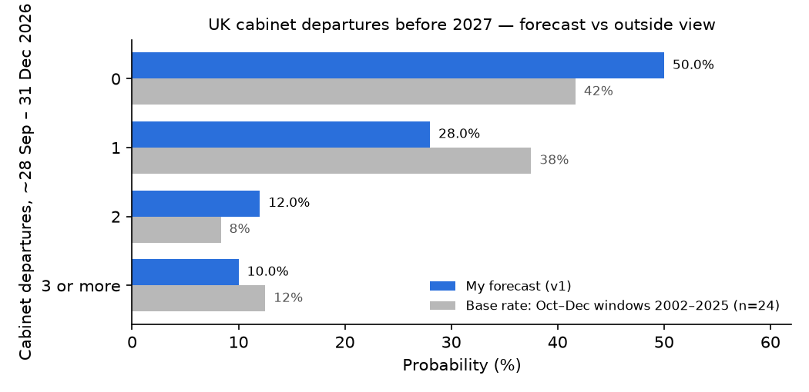

# How many politicians will leave their cabinet positions in the UK government before 2027?

| | |
|---|---|
| **Source** | Metaculus #45250 (question 45442, Metaculus Cup Fall 2026) — https://www.metaculus.com/questions/45250/how-many-politicians-will-leave-cabinet-positions-in-uk-government-before-2027/ |
| **Type** | multiple choice — 4 options: **0** · **1** · **2** · **3 or more** |
| **Opened / Closes / Resolves** | — (Metaculus "upcoming"; opens 2026-09-28 17:00 UTC) / 2026-12-31 23:59 UTC / 2027-01-01 12:30 UTC (scheduled) |
| **Status** | open |
| **Current forecast** | **0: 50.0%, 1: 28.0%, 2: 12.0%, 3+: 10.0%** — IQR on "0" [44.0%, 56.0%] (v1, 2026-09-26) |
| **Community (as of 2026-09-26)** | CP / Pro / gold hidden until 2026-09-30 17:00 UTC (n=7 pre-open forecasters) |
| **Next review** | 2026-10-01 |

<!-- Versions below, newest first. APPEND-ONLY: never edit or delete a past version. -->

---

## v1 — Initial forecast — 2026-09-26

**Caveat up front**: the question is still in "upcoming" state. The Metaculus API (read with the
bot key, 2026-09-26) returns `resolution_criteria`, `fine_print` and `background` as **null**,
and the page itself could not be rendered (proxy TLS error). This forecast is therefore built
against the *most likely* reading of the title and options, with the ambiguity priced in
explicitly (see "What resolves YES" and the scenario table). Re-read the criteria when the
question opens on 2026-09-28 — it is tripwire #1.

### What resolves YES

The question asks for the number of politicians who leave a UK cabinet position between (by
all indications) the question's opening, **2026-09-28**, and **2026-12-31**. The options 0 / 1 /
2 / 3+ only make sense with a window starting around the open date: counted from 1 Jan 2026 the
answer would already be "3 or more" (Streeting 14 May, Healey 11 June, Starmer and ~15 dismissed
ministers on 20 July), so a start date in the past is implausible. The cabinet in question is
Andy Burnham's, formed 20–23 July 2026: 23 full members on GOV.UK (PM included) plus 5
"also attending" (Chief Secretary, Attorney General, Falconer, Narayan, Pennycook) [1][2].
**No member has left since formation** (searches through 2026-09-26; see research.md).

Three readings, weighted by how Metaculus usually writes such questions:

- **R1 (weight 0.55)**: count individuals who *cease to be members of the cabinet* (resignation,
  dismissal, death, PM change), full cabinet only. Most natural reading of "leave their cabinet
  positions" and the one Polymarket uses for its parallel market [3].
- **R1b (0.20)**: same, but "also attending cabinet" ministers count too (~20% more exposure).
- **R2 (0.25)**: any *change of cabinet post* counts, so a minister moved sideways in a
  mini-reshuffle "leaves their position". This mainly turns one departure into 2 or 3+.

Counter-intuitive resolution paths: (a) a sideways move counting under R2; (b) an announcement
in December that takes effect in January (Polymarket counts the announcement; Metaculus might
not); (c) a PM change — Burnham himself is a cabinet member, and a new PM would bring a wave
of exits → 3+.

### Outside view

**Reference class A — Oct–Dec windows, UK cabinet, 2002–2025 (n = 24 years)**, counting people
who ceased to be cabinet members (compiled from the per-ministry Wikipedia pages and my
knowledge of well-documented resignations; the list is in research.md; may miss a minor
"attending cabinet" figure):

| Departures | Years | Share |
|---|---|---|
| 0 | 2003, 2006, 2007, 2009, 2010, 2014, 2015, 2016, 2020, 2025 | 10/24 = 42% |
| 1 | 2002, 2004, 2005, 2011, 2012, 2013, 2019, 2021, 2024 | 9/24 = 38% |
| 2 | 2008, 2018 | 2/24 = 8% |
| 3+ | 2017, 2022, 2023 | 3/24 = 12% |

Mean ≈ 0.95 per window, overdispersed relative to Poisson (the 3+ years are clustered crises
or planned reshuffles: the #MeToo/Patel wave 2017, the Truss collapse 2022, Sunak's Nov-2023
reshuffle).

**Reference class B — first ~6 months after a new PM formed a cabinet (n = 6)**: Brown 2007
→ 0; Cameron 2010 → 0; May 2016 → 0; Johnson 2019 → 1 (Cairns); Truss 2022 → 3+; Starmer
2024 → 1 (Haigh). Split 3/2/0/1 — similar to A, n too small to override it.

Stripping planned reshuffles and PM collapses out of class A leaves an *idiosyncratic*
departure rate (scandal, policy resignation, personal) of ≈ 14 exits / 24 windows ≈ 0.6 per
Oct–Dec window.

### Inside view

Structure: `count = idiosyncratic departures (Poisson) + rare regime event (reshuffle/PM falls)`.

1. **Planned reshuffle before 2027: ≈ 2%.** Burnham completed a sweeping reorganisation only
   two months ago (15 cabinet dismissals, "most since Johnson's first cabinet") [1][4]. No PM in
   the reference class has reshuffled within ~5 months of forming a government except in a
   crisis.
2. **Regime shock (Burnham falls / Truss-style meltdown forcing a Chancellor + wider change):
   ≈ 3%.** Real but small. Gilts are stressed — 30-year yield 5.89% on 1 Sept, highest since
   1998; 10-year ~5.2–5.25% — and the fiscal headroom has roughly halved to ~£13.8bn ahead of
   Healey's first Budget on **28 Oct** [5][6][7]. But Burnham is in a honeymoon: Ipsos 10–15 Sept
   has Labour 4pp ahead of Reform, PM favourability 40% (+8 since July) [8]; he was elected
   unopposed with >90% of MPs [9]; Polymarket "Burnham out as PM by Dec 31" 6.3% on thin volume
   (~$8k; longshot bias → I read ~3%) [10].
3. **Idiosyncratic departures: λ ≈ 0.62 for the ~95-day window** (base 0.6 × ~1.05):
   - Up: a new cabinet has un-stress-tested members (six first-time cabinet ministers; 2024's
     Haigh and 2022's Williamson both went within ~5 months) [1]; the Budget is a natural
     flashpoint (Healey himself is Polymarket's favourite to be first out, 13.5%, across a
     horizon to end-2027) [3]; a live cabinet split on immigration — Rayner publicly condemned
     Mahmood's settlement rules on 26 Sept, while Nandy defended them [11]; ~80 Labour MPs
     wanted Mahmood's reforms watered down [12]; a press row over Fahnbulleh's children at
     private school [13].
   - Down: the honeymoon and party unity after the unopposed election; Burnham has *backed*
     Mahmood rather than overruled her [14], removing the most obvious policy-resignation
     trigger; Rayner's HMRC case closed with no penalty (14 May 2026) [15], removing her
     known scandal tail; no open ministerial-code investigation into a cabinet minister found.

Poisson(0.62) → 0: 53.8%, 1: 33.4%, 2: 10.3%, 3+: 2.5%. Mixing 95% of that with 5% "regime
event" mass (90% of it 3+) gives the R1 row below.

### Evidence

| Evidence | Direction | Rough LR / effect |
|---|---|---|
| No departures in the first ~10 weeks of the Burnham cabinet (to 26 Sept) | ↓ departures | Mild: consistent with the base hazard, confirms no pent-up scandal forced out early |
| Budget 28 Oct into a gilt sell-off (30y 5.89%, headroom ~halved) [5][6][7] | ↑ | +~0.05 on λ; also the main source of the 3% regime tail |
| Labour +4 over Reform, Burnham favourability 40% (Ipsos, 10–15 Sept) [8] | ↓ | Lowers P(PM falls) and P(policy resignations); ~0.8× on crisis mass |
| Rayner vs Mahmood public split on immigration, 26 Sept [11] | ↑ | Small: open disagreement, but no resignation talk; Burnham backs Mahmood [14] |
| Rayner cleared by HMRC [15] | ↓ | Removes a known tail |
| Fahnbulleh private-school "hypocrisy" story [13] | ↑ (tiny) | Not a code breach; hypocrisy stories rarely end careers |
| Burnham ruled out a snap election [16]; petition for one rejected 24 Aug [17] | ↓ | No election-driven turnover before 2027 |

Absent evidence: no reshuffle trailing in the press, no cabinet minister under formal
investigation, no health or retirement announcement found — each would be expected in at
least some of the worlds where "2" or "3+" happens.

### Other forecasters

| Source | Value | As of | Note |
|---|---|---|---|
| Metaculus CP (recency-weighted) | hidden | 2026-09-26 | reveal 2026-09-30 17:00 UTC; n=7 |
| Metaculus Pro | hidden | 2026-09-26 | — |
| Metaculus gold medalists | hidden | 2026-09-26 | — |
| Polymarket "First to leave the Burnham Cabinet?" (to end-2027) | Healey 13.5%, Fahnbulleh 10.4%, H. Alexander 9.2% … Mahmood 2.4% | 2026-09-26 | $114k vol; ranks *who*, not *how many by Dec*; named prices sum to ~108% |
| Polymarket "Andy Burnham out as UK PM by Dec 31" | 6.3% | 2026-09-26 | ~$8k vol; longshot bias → I use ~3% |
| Manifold "Will any UK cabinet ministers resign in … Q4 2026?" | 41% | 2026-09-26 | play money, low volume; *resignations only* (sackings excluded) → implies P(0 resignations) ≈ 59% |
| Manifold "Burnham receives a cabinet minister resignation in 2026" | 40% | 2026-09-26 | 5 bettors; heavily discounted |
| Sentinel, Mantic, GJOpen, INFER, Kalshi | — | 2026-09-26 | no matching question found |

No Metaculus cohort numbers exist yet, so there is nothing to flag between CP / Pro / gold.
Manifold's ~41% "any resignation in Q4" is compatible with my P(≥1 departure of any kind) = 50%
once dismissals and R2 moves are added. I sit slightly above the raw outside view on "0"
(50% vs 42%) because the class-A 3+ years were driven by planned reshuffles/crises that are
unusually unlikely two months into a honeymooning government.

### Scenarios

| # | Scenario (reading × world) | Weight | 0 | 1 | 2 | 3+ |
|---|---|---|---|---|---|---|
| R1 | Exits from full cabinet; Poisson(0.62) + 5% regime tail | 0.55 | 51.1 | 31.7 | 10.3 | 6.9 |
| R1b | As R1 incl. "attending cabinet"; Poisson(0.75) + 5% tail | 0.20 | 44.9 | 33.7 | 13.1 | 8.3 |
| R2 | Any change of cabinet post counts (exit triggers a cascade of moves ~50% of the time) | 0.25 | 51.1 | 15.8 | 15.2 | 17.8 |
| | **Mixture** | 1.00 | **49.9** | **28.1** | **12.1** | **9.9** |

Rounded to 50 / 28 / 12 / 10.

### Sensitivity

| Assumption | If instead | Forecast becomes (0 / 1 / 2 / 3+) |
|---|---|---|
| Idiosyncratic λ = 0.62 | λ = 0.45 (honeymoon suppresses hazard) | 59.5 / 24.4 / 8.4 / 7.7 |
| Idiosyncratic λ = 0.62 | λ = 0.90 (Budget fallout, new-cabinet vetting failures) | 37.4 / 30.4 / 17.4 / 14.8 |
| Regime-event mass 5% | 10% (gilt crisis around the Budget) | 47.3 / 26.6 / 11.9 / 14.2 |
| R2 weight 0.25 | Criteria confirm sideways moves count (R2 = 1.0) | 51.1 / 15.8 / 15.2 / 17.8 |
| R2 weight 0.25 | Criteria confirm only exits count (R2 = 0) | ~49.5 / 32.2 / 11.1 / 7.2 |

The IQR on "0" [44%, 56%] spans the λ = 0.5–0.8 range; resolution-criteria clarity moves the
1-vs-2+ split more than it moves "0".

Calibration checks: "0" at 50% — would I take either side at even money? Yes, roughly
indifferent. Scope: doubling the window to six months would put "0" near 25–30%, which matches
the historical half-year record, so the rate is not scope-insensitive.

### What would change my mind (tripwires)

- [ ] Resolution criteria published at question open (by 2026-09-28): if sideways moves or
      "attending cabinet" ministers count → shift ~5pp from "1" to "2"/"3+"; if only full-cabinet
      exits count → ~4pp back to "1" (either direction; re-analyse).
- [ ] Metaculus CP/Pro/gold revealed 2026-09-30: if Pro + gold agree on "0" > 65% or < 35% →
      search again for the fact I missed before defending 50%.
- [ ] Any cabinet minister referred to the Independent Adviser on Ministerial Standards, or a
      named cabinet minister publicly threatening to resign, by 2026-11-30 → "0" −10pp.
- [ ] 30-year gilt yield closes above 6.25% for 3 consecutive sessions, or the 28 Oct Budget is
      postponed/partially withdrawn, by 2026-11-15 → "0" −8pp, "3+" +4pp.
- [ ] Polymarket "Burnham out as UK PM by Dec 31" ≥ 15% sustained 48h by 2026-12-15 → "3+" +8pp.
- [ ] No cabinet departure announced by 2026-11-30 → "0" +15pp (one month left).
- [ ] Any cabinet departure (first one) at any point → "0" to ~1–2%, re-weight the rest (re-analyse).

### Sources

1. Burnham ministry — Wikipedia — https://en.wikipedia.org/wiki/Burnham_ministry (accessed 2026-09-26)
2. Ministers — GOV.UK — https://www.gov.uk/government/ministers (accessed 2026-09-26)
3. Polymarket, "Who will be the first to leave the Burnham Cabinet?" — https://polymarket.com/event/who-will-be-the-first-to-leave-the-burnham-cabinet-20260803162204 (gamma API snapshot in raw/, accessed 2026-09-26)
4. Institute for Government, "Six things we learned from Andy Burnham's government formation" (29 Jul 2026) — https://www.instituteforgovernment.org.uk/comment/six-things-learned-andy-burnhams-government-formation (accessed 2026-09-26)
5. Options Trading Report, "UK Gilts Near 6%: The Bond Market Is Writing the Budget" (8 Sep 2026) — https://www.optionstradingreport.com/2026/09/uk-gilts-near-6-the-bond-market-is-writing-the-budget/ (accessed 2026-09-26)
6. The Spectator, "Surging gilt yields are making Healey's fiscal headroom even tighter" — https://www.spectator.com.au/2026/09/surging-gilt-yields-are-making-healeys-fiscal-headroom-even-tighter/ (search snippet, accessed 2026-09-26)
7. Professional Pensions, "Government confirms date for Autumn Budget 2026" — https://www.professionalpensions.com/news/4533779/government-confirms-date-autumn-budget-2026 ; LBC — https://www.lbc.co.uk/article/when-budget-date-2026-john-healey-5HjdfPp_2/ (search snippets, accessed 2026-09-26)
8. Ipsos, "Burnham bounce continues…" (fieldwork 10–15 Sep 2026) — https://www.ipsos.com/en-uk/burnham-bounce-continues-public-more-favourable-towards-pm-other-leading-uk-politicians (search snippet, accessed 2026-09-26)
9. 2026 Labour Party leadership crisis — Wikipedia — https://en.wikipedia.org/wiki/2026_Labour_Party_leadership_crisis (accessed 2026-09-26)
10. Polymarket, "Andy Burnham out as UK PM by…?" — gamma API snapshot in raw/ (accessed 2026-09-26)
11. HuffPost UK, "Cabinet Splits Erupt As Angela Rayner Condemns Shabana Mahmood's Immigration Crackdown" (26 Sep 2026) — https://www.huffingtonpost.co.uk/entry/cabinet-split-angela-rayner-shabana-mahmood_uk_6ab77bbde4b07795582c58c5 (accessed 2026-09-26)
12. LBC, "Burnham urged to water down Mahmood's controversial migration reforms" — https://www.lbc.co.uk/article/burnham-water-down-mahmoods-migration-reforms-5HjddQp_2/ (search snippet, accessed 2026-09-26)
13. LBC, "Energy Secretary accused of 'hypocrisy' after sending her children to private school" — https://www.lbc.co.uk/article/energy-secretary-hypocrisy-children-private-school-5Hjdfpj_2/ (search snippet, accessed 2026-09-26)
14. HuffPost UK, "Andy Burnham Backs Shabana Mahmood's Immigration Crackdown Despite Labour Backlash" — https://www.huffingtonpost.co.uk/entry/andy-burnham-backs-shabana-mahmoods-immigration-crackdown-despite-labour-backlash_uk_6a548a87e4b09843d52bb9f8 (search snippet, accessed 2026-09-26)
15. ITV News, "Angela Rayner has been cleared by HMRC after stamp duty row" (14 May 2026) — https://www.itv.com/news/2026-05-14/angela-rayner-says-she-has-been-cleared-by-hmrc-after-stamp-duty-row (search snippet, accessed 2026-09-26)
16. Bloomberg, "Burnham Says Won't Call Early Election If Replaces Starmer" (2 Jun 2026) — https://www.bloomberg.com/news/articles/2026-06-02/burnham-says-he-won-t-call-early-election-if-he-replaces-starmer (search snippet, accessed 2026-09-26)
17. UK Parliament petition 778258, "Call for an immediate snap general election" — https://petition.parliament.uk/petitions/778258 (search snippet, accessed 2026-09-26)
18. Institute for Government, "Ministers resigning from government" (updated 12 Jun 2026) — https://www.instituteforgovernment.org.uk/explainer/ministers-resigning-government (accessed 2026-09-26)
19. Manifold, "Will any UK cabinet ministers resign in Q1, Q2, Q3, or Q4 of 2026?" — https://manifold.markets/leaflitter/will-any-uk-cabinet-ministers-resig ; "Burnham recieves a cabinet minister resignation in 2026" — https://manifold.markets/rodgerisoffline/burnham-recieves-a-cabinet-minister (API, accessed 2026-09-26)
20. Metaculus API, post 45250 (bot key; criteria null, CP hidden) — raw/metaculus-2026-09-26.json (accessed 2026-09-26)

**Date**: 2026-09-26
**Forecast**: 0: 50.0%, 1: 28.0%, 2: 12.0%, 3+: 10.0% — IQR on "0" [44.0%, 56.0%]
**Thesis**: Oct–Dec windows since 2002 had zero UK cabinet departures 42% of the time and ~0.6 idiosyncratic exits on average; Burnham's two-month-old, honeymooning cabinet (Labour +4, Ipsos) makes a planned reshuffle or PM collapse unusually unlikely, but the 28 Oct Budget into a gilt sell-off and an open Rayner–Mahmood split keep ~half the mass on at least one exit. Unpublished resolution criteria (whether sideways moves count) mainly fatten the 2 and 3+ tails.
