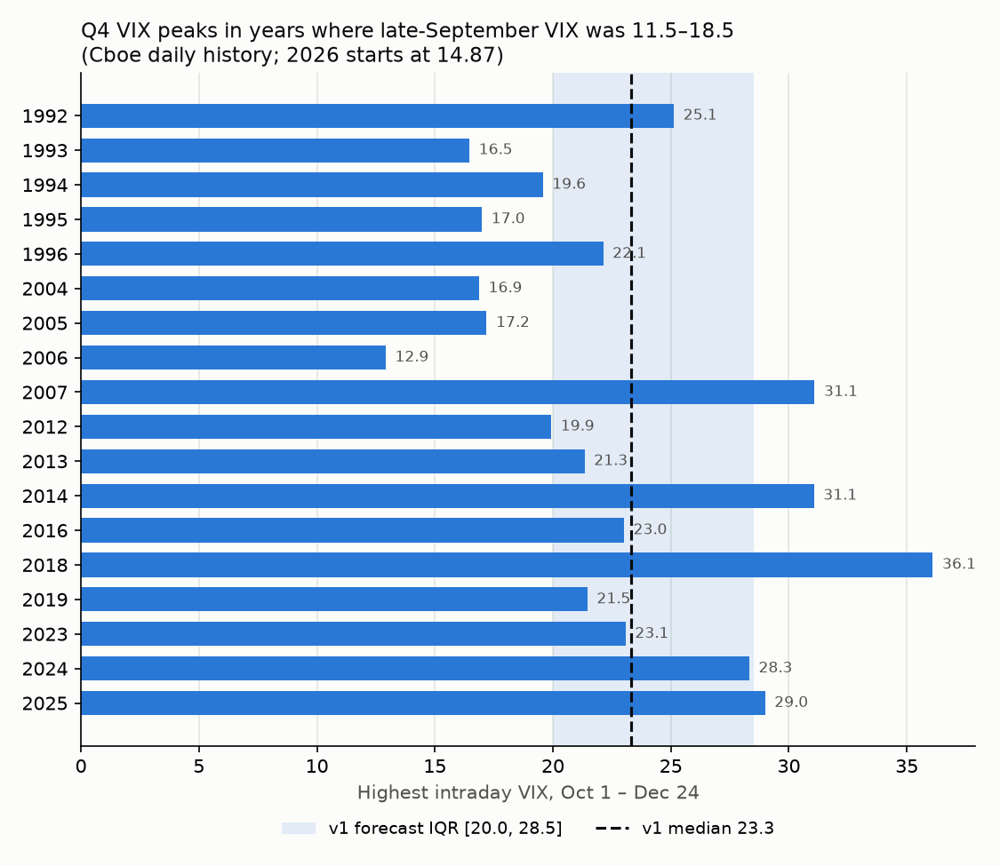

# What will be the highest intraday value of the VIX between October 1 and December 24, 2026?

| | |
|---|---|
| **Source** | Metaculus #45515 — https://www.metaculus.com/questions/45515/what-will-be-the-highest-intraday-value-of-the-vix-between-october-1-and-december-24-2026 |
| **Type** | numeric (VIX points; range 6–40, open bounds) |
| **Opened / Closes / Resolves** | 2026-09-28 / 2026-12-10 / 2026-12-25 |
| **Status** | open |
| **Current forecast** | **Median 23.8, IQR [20.4, 29.0]** (v2, 2026-10-02) |
| **Community (as of 2026-10-02)** | CP 24.3 [21.1, 28.7] (n=68) · Pro 24.4 [21.3, 29.0] (n=7) · Gold 24.3 [21.4, 28.3] (n=26) |
| **Next review** | 2026-10-16 |

<!-- Versions below, newest first. APPEND-ONLY: never edit or delete a past version. -->

---

## v2 — Update — 2026-10-02

### Revision

| Driver | Direction | Effect |
|---|---|---|
| Prior (v1, 2026-09-28) | — | Median 23.3, IQR [20.0, 28.5] |
| Realised floor: Oct 1 intraday high **17.59** (Cboe = Yahoo), 2 of 59 sessions gone | ↑ lower tail only | p5 16.7 → 17.8, p10 17.7 → 18.4; median, quartiles about 0 |
| Resolution source published: Yahoo `^VIX` "High", which matches Cboe's daily HIGH including extended-hours prints | → | none (v1 already assumed extended hours) |
| Starting level higher: spot 15.5–16.4 (was 14.87), VIX3M 18.2–18.6 (was 17.9); re-run base-rate classes for the remaining 57 sessions with the floor | ↑ | +0.2 on median (plain classes 23.1–23.4, about unchanged; contango class 25.3, was 24.8) |
| "Spike earlier in the year, calm September" sub-class (Jan–Sep max > 30, last-Sep close < 19; n=9): median Q4 peak 23.1, median ratio to September close 1.69 vs 1.32 otherwise | ↑ | +0.2 on median, and fattens the 75th percentile. The point was raised in a Metaculus comment; v1 had not tested it |
| Iran: Trump now says the war ends "right after the election… maybe before"; carrier group plus 9,000 troops arrive by end of October; Iranian bill to toll Hormuz | ↑ | +0.2 on median, fattens the right tail |
| Weak September payrolls (+29k against 84k expected, unemployment 4.2%) pull the 10-year from a 5.34% intraday high (Oct 1, highest since 2002) to about 5.18–5.21%; Fed October-hold odds 84% | ↓ | −0.1 (the rate-hike channel cools; the growth-scare channel is a partial offset) |
| VIX option forwards unchanged (Oct-21 17.8, Nov-18 18.4, Dec-16 18.8; Nov-18 risk-neutral P(>25) 8.5%, was 8%) | → | none |
| Metaculus CP, Pro and gold all at 24.3–24.4, about 1 point above v1 | → | none applied directly. The gap is inside the noise and is explained by the spike-year driver above |
| **New forecast** | | **Median 23.8, IQR [20.4, 29.0]** |

### Tripwire check

| Tripwire from v1 | Fired? | Note |
|---|---|---|
| Published criteria name a source other than Cboe's daily HIGH, or exclude extended-hours prints (by 2026-10-01) | **No (technically partial)** | The source is Yahoo Finance `^VIX` "High", with Cboe as the fallback. Yahoo's daily bars match Cboe's `VIX_History.csv` HIGH to the cent for every session in September 2026, including the Labor Day extended-hours row (2026-09-07). Yahoo's 5-minute series puts the 2026-10-02 high of 16.24 at 03:20 ET, an overnight print, against 15.80 in the Cboe regular-session quote. Extended-hours prints therefore count. No effect on the number. |
| CP or Pro median (revealed 2026-09-30) differs from 23.3 by more than 3 points (by 2026-10-02) | **No** | CP 24.31, Pro 24.39, gold 24.33 (2026-10-02 14:45 UTC). The gap is about 1.0. |
| 10-year Treasury yield closes at or above 5.50% (by 2026-11-15) | No | Peak close 5.293% (Sep 30), intraday 5.342% (Oct 1); 5.21% on Oct 2 after payrolls. |
| US resumes strikes on Iran, or Hormuz closed with Brent settling above $120 (by 2026-12-10) | No | No strikes yet; Brent about $100 (Oct 2). The rhetoric moved toward "maybe before the election"; deployments arrive by end of October. |
| VIX intraday high stays below 18.0 in every session from 2026-10-01 through 2026-11-06 | Pending (holding) | Oct 1 17.59, Oct 2 16.24 so far. |
| Continuing resolution lapses 2026-12-11 and shutdown still running 2026-12-15 | Pending | Not testable yet. |

### What resolves YES

**Yahoo Finance `^VIX` daily "High"**, maximum over all dates from 2026-10-01 to
2026-12-24 inclusive. Metaculus's own example: the August 2026 maximum was 18.43 on Aug 5.
The fine print allows Cboe if Yahoo proves unreliable. Data revisions after Dec 24 do not
count. Yahoo's bars are Cboe's daily HIGH, including overnight (Global Trading Hours,
GTH) prints, so a 03:00 ET headline spike counts. Realised so far: Oct 1 **17.59** (10:00 ET),
Oct 2 16.24 (03:20 ET; the session was still open at retrieval, 2026-10-02 ~11:00 ET). **The
outcome cannot be below 17.59.**

### Outside view

Recomputed for the **remaining 57 sessions** with the 17.59 floor, from Cboe history retrieved
2026-10-02 (`analysis/update_2026_10_02.py`):

| Class (start close 14.5–17.5) | Episodes | p10 / p25 / p50 / p75 / p90 | P(>25) / P(>30) / P(>40) |
|---|---|---|---|
| 1992+ | ~33 | 17.7 / 19.8 / 23.1 / 28.8 / 36.6 | 39% / 21% / 6% |
| 2004+ | ~24 | 17.9 / 20.8 / 23.4 / 29.6 / 37.5 | 43% / 25% / 8% |
| plus VIX3M 17.5–19.5 (steep contango, as now) | ~24 | 19.7 / 22.1 / 25.3 / 31.0 / 48.0 | 51% / 25% / 11% |

The plain classes barely moved from v1. The higher start is offset by two fewer sessions.
Spike-year sub-class (calm September after a Jan–Sep peak above 30; n=9): 1991 21.9,
2004 16.9, 2005 17.2, 2007 31.1, 2016 23.0, 2018 36.1, 2023 23.1, 2024 28.3, 2025 29.0. The
median level is 23.1, the same as the other calm-start years, but the median ratio to the
September close is 1.69 (against 1.32). From the Sep 30 close of 16.34 that ratio gives 27.6.
That is n=9 and noisy, so it gets low weight. **Blend: median ≈ 23.5–24, IQR ≈ [20.3, 29].**

### Inside view

Unchanged from v1 in structure. Changes since then:

- **Rates.** The 10-year touched 5.34% intraday on Oct 1, the highest since 2002, then fell
  after a weak payrolls print (+29k). The market now prices an October Fed hold (84%). This
  cools the bond-led channel but adds a small growth-scare channel. The S&P 500 gained 1% on
  Oct 2 to 7,738 [24][25].
- **Iran.** No strikes have resumed. Trump: the war will end "right after the election" and
  "maybe before". The USS Theodore Roosevelt group and the USS Makin Island amphibious group
  (about 9,000 personnel) arrive by end of October. Iran's parliament is advancing a Hormuz
  transit-toll bill [26]. The strike window now plausibly opens in late October, not only
  after Nov 3. The market still prices this lightly: Brent is about $100, down from $106.
- **Term structure.** VIX9D 12.5, VIX 15.5, VIX3M 18.2 and VVIX 89 intraday on Oct 2. The
  steep contango persists, and the October 7 and 14 option forwards (16.6 and 17.3) show no
  near-term stress.

### Evidence

See the revision table. Absent evidence: no inversion of the VIX futures curve, VVIX below
95, no credit-stress headlines.

### Other forecasters

| Source | Value | As of | Note |
|---|---|---|---|
| Metaculus CP (recency-weighted) | 24.3, IQR [21.1, 28.7] (n=67–68) | 2026-10-02 14:45 UTC | Rose from 22.8 at open (09-28) to 23.8 (10-01) to 24.3 |
| Metaculus Pro | 24.4, IQR [21.3, 29.0] (n=7) | 2026-10-02 | Agrees with CP |
| Metaculus gold medalists | 24.3, IQR [21.4, 28.3] (n=26) | 2026-10-02 | Agrees with CP |
| Cboe VIX options (put–call parity forwards) | Oct-21 17.8 / Nov-18 18.4 / Dec-16 18.8 | 2026-10-02 ~11:00 ET | Unchanged from v1. These are expected levels, not the path maximum |
| Cboe VIX options, risk-neutral | Nov-18 P(>25) 8.5%, P(>30) 4.5%; Dec-16 P(>25) 10.5%, P(>30) 6% | 2026-10-02 | Unchanged |
| Kalshi / Polymarket | no matching market | 2026-10-02 | Kalshi has 14,567 series and none on VIX; Polymarket has only "VIX close above 50 by June 30" |
| Metaculus comments | DeRuina: spike years do not produce calm Q4s; watching for VIX below 18 through the Oct 21 expiry. Theomachado: HAR-GARCH blend median 23.3, 26% above 30. lubossaloky: right skew | 2026-09-28/30 | The spike-year point is tested above |

No material cohort disagreement: all three sit at 24.3–24.4. I am now 0.5 below them with
almost the same IQR. Moving all the way would be herding without a new fact. The residual
gap is about the weight given to the contango-conditioned class, and both of us are inside
each other's noise.

### Scenarios

| # | Scenario | Weight | Implies (window max) |
|---|---|---|---|
| 1 | Calm grind; nothing beyond about a 3% dip | 22% | 17.6–20 |
| 2 | Routine wobble (earnings, FOMC Oct 28, election, Iran headline); 4–8% pullback | 49% | 20–28 |
| 3 | Real correction: Iran strikes with an oil spike, a bond-led selloff, or an AI unwind; 8–15% drawdown | 21% | 28–38 |
| 4 | Crisis (credit, Treasury dysfunction, Hormuz escalation) | 8% | 38–65+ |

Quantiles: p5 17.8 · p10 18.4 · **p25 20.4 · p50 23.8 · p75 29.0** · p90 36.0 · p95 43.5.
P(>30) ≈ 23%, P(>40) ≈ 7%, P(<18) ≈ 6%.

### Sensitivity

| Assumption | If instead | Forecast becomes |
|---|---|---|
| The spike-year sub-class carries signal (+0.2) | It is noise (n=9) | Median 23.6 |
| The Iran strike window opens late October | Strikes held until after Dec 24, or a deal | Median about 23.3, IQR [20.2, 28] |
| VIX stays below 18 through the Oct 21 expiry | — | Median about 22.5 at the next review (hazard decay plus calm regime) |
| VIX closes above 20 before Oct 16 | — | Median about 26–27 |

### What would change my mind (tripwires)

- [ ] The 10-year Treasury yield closes at or above 5.50% before 2026-11-15 → median +3.
- [ ] The US resumes strikes on Iran, or Hormuz closes with Brent settling above $120, before
  2026-12-10 → median +3. Strikes before Nov 3 count.
- [ ] The VIX intraday high stays below 18.0 in every session from 2026-10-01 through
  2026-10-21 (October VIX expiry) → median −1.
- [ ] The VIX intraday high stays below 18.0 in every session from 2026-10-01 through
  2026-11-06 → median −4.
- [ ] A VIX close above 20.0 before 2026-10-16 → median +3 (the realised floor jumps).
- [ ] The continuing resolution lapses on 2026-12-11 and a shutdown is still running on
  2026-12-15 → median +1.

### Sources

Sources 1–22 as in v1 (1–3 refreshed, 4–22 carried forward verbatim), then new (23–28):

1. Cboe VIX / VIX9D / VIX3M / VVIX history CSVs (now served from `cdn-api.cboe.com`) — https://cdn.cboe.com/api/global/us_indices/daily_prices/VIX_History.csv (accessed 2026-10-02; `raw/*_History-2026-10-02.csv`)
2. Cboe delayed VIX option chain and index quotes — https://cdn.cboe.com/api/global/delayed_quotes/options/_VIX.json ; https://cdn.cboe.com/api/global/delayed_quotes/quotes/_VIX.json (accessed 2026-10-02 14:58 UTC; `raw/cboe-vix-options-2026-10-02.json`, `raw/cboe-quotes-2026-10-02.json`)
3. Metaculus post 45515: aggregations, criteria and comments (`raw/metaculus-2026-10-02.json`, fetched 2026-10-02 14:45 UTC)

4. CNBC, "The 10-year Treasury yield is at its highest in nearly two decades. How we got here" — https://www.cnbc.com/2026/09/26/10-year-treasury-yield-is-at-its-highest-in-19-years-how-we-got-here.html (accessed 2026-09-28; search snippet, page 403)
5. Bloomberg, "Traders' Game Plan: What 10-Year Yield at 5% Spells for US Stocks" — https://www.bloomberg.com/news/articles/2026-09-15/traders-game-plan-what-10-year-yield-at-5-spells-for-us-stocks (snippet, accessed 2026-09-28)
6. CNBC, "Fed rate decision September 2026: Rates rise to 3.75%-4%" — https://www.cnbc.com/2026/09/16/fed-rate-decision-september-2026.html (snippet, accessed 2026-09-28)
7. TheStreet, "Fed raises rates, signals another 2026 hike could follow" — https://www.thestreet.com/fed/fed-raises-rates-signals-another-hike-2026 (snippet, accessed 2026-09-28)
8. Federal Reserve, FOMC meeting calendars — https://www.federalreserve.gov/monetarypolicy/fomccalendars.htm (accessed 2026-09-28)
9. UPI, "Trump rejects Iran's peace proposal, says war will resume after midterms" — https://www.upi.com/Top_News/US/2026/09/26/trump-rejects-iran-peace-proposal/4531790438333 (accessed 2026-09-28)
10. The Hill, "Donald Trump rejects Iran 7-day proposal, considers renewed military strikes after midterms" — https://thehill.com/homenews/administration/6113000-trump-iran-proposal-ceasefire/ (accessed 2026-09-28)
11. CNBC, "Oil price today: WTI, Brent, Trump, Iran" (2026-09-28) — https://www.cnbc.com/2026/09/28/oil-price-today-wti-brent-trump-iran.html (snippet, accessed 2026-09-28)
12. Breaking Defense, "House passes funding stopgap, averting government shutdown in October" — https://breakingdefense.com/2026/09/house-passes-funding-stopgap-averting-government-shutdown-in-october/ (accessed 2026-09-28)
13. CNBC markets live, 2026-09-24 — https://www.cnbc.com/2026/09/24/stock-market-today-live-updates.html ; Pluang 1-minute report 2026-09-26 — https://pluang.com/en/news-feed/laporan-pasar-1-menit-26-september-2026 (snippets, accessed 2026-09-28)
14. Fortune, "In midterm years, October is usually the best month for stocks" (2026-09-23) — https://fortune.com/2026/09/23/in-midterm-years-october-usually-best-month-for-stocks-gains-78-9-of-the-time/ (accessed 2026-09-28)
15. IndexBox, "Options market shows fragility and fearlessness ahead of US midterms" (2026-09-09) — https://www.indexbox.io/blog/options-market-shows-fragility-and-fearlessness-ahead-of-us-midterms/ (accessed 2026-09-28)
16. Bloomberg, "VIX Soars But Equity Market Remains Orderly After Trump Threatens China Tariffs" (2025-10-10) — https://www.bloomberg.com/news/articles/2025-10-10/spx-volatility-soars-but-options-market-remains-orderly-after-trump-china-salvo (snippet, accessed 2026-09-28)
17. BigGo Finance, "VIX Futures Curve Steepens as Traders Position Early for November Midterm Election Volatility" (2026-08-25) — https://finance.biggo.com/news/d9ce71ef-c8d5-4b39-bc42-57017bc17ab4 (accessed 2026-09-28)
18. thetrading.tools, VIX term structure tracker — https://www.thetrading.tools/vix-term-structure (snippet: 2026-09-22 VIX 14.21 / VIX3M 17.61, accessed 2026-09-28)
19. Kelly, B., Pástor, Ľ. & Veronesi, P. (2016). "The Price of Political Uncertainty: Theory and Evidence from the Option Market." *Journal of Finance* 71(5), 2417–2480 — https://onlinelibrary.wiley.com/doi/abs/10.1111/jofi.12406 (accessed 2026-09-28)
20. CNBC, "These charts offer hints on what's next for market volatility after a stormy March" (2026-04-01) — https://www.cnbc.com/2026/04/01/these-charts-offer-hints-on-whats-next-for-market-volatility-after-a-stormy-march.html (snippet, accessed 2026-09-28)
21. Sentinel, Global Risks Weekly Roundup #31/2026 — https://blog.sentinel-team.org/p/iran-war-widens-openai-and-anthropic (accessed 2026-09-28)
22. Kalshi public API series list — https://api.elections.kalshi.com/trade-api/v2/series ; Polymarket gamma search; Manifold search API (accessed 2026-09-28; no matching markets)

23. Yahoo Finance `^VIX` chart API, daily and 5-minute — https://query1.finance.yahoo.com/v8/finance/chart/%5EVIX (accessed 2026-10-02; `raw/yahoo-vix-chart-2026-10-02.json`, `raw/yahoo-vix-5m-2026-10-02.json`). Also `^TNX`, `BZ=F`, `CL=F` and `^GSPC` closes (accessed 2026-10-02)
24. CNBC, "10-year Treasury yield dives after much weaker-than-expected jobs report" (2026-10-02) — https://www.cnbc.com/2026/10/02/treasury-yields-bonds-nonfarm-payrolls.html (search snippet; page 403; accessed 2026-10-02)
25. TheStreet, "Stock Market Today (Oct. 1, 2026): Stocks finish flat on rising Treasury yields" — https://www.thestreet.com/stock-market-today/stock-market-today-dow-jones-sp-500-nasdaq-updates-oct-01-2026 ; Yahoo Finance live blog 2026-10-02 — https://finance.yahoo.com/markets/live/stock-market-today-friday-october-2-dow-sp-500-nasdaq-september-jobs-report-080623878.html (snippets, accessed 2026-10-02)
26. CBS News, "Live Updates: Trump vows Iran war will end 'right after the election' or sooner, as 9,000 troops head to Mideast" (2026-10-02) — https://www.cbsnews.com/live-updates/trump-iran-war-us-midterm-elections-troops-deployment/ (accessed 2026-10-02)
27. Kalshi series API; Polymarket gamma public-search "VIX" (accessed 2026-10-02; no matching market)
28. CNBC, "Investors seek hedges as midterms and geopolitical risks threaten market calm" (2026-09-10) — https://www.cnbc.com/2026/09/10/fear-gauge-vix-hedges-volatility-stocks.html (snippet, accessed 2026-10-02)

**Date**: 2026-10-02
**Forecast**: Median 23.8, IQR [20.4, 29.0]
**Thesis**: The Oct 1 high of 17.59 (Yahoo = Cboe, overnight prints included) sets a hard floor. Base rates for the remaining 57 sessions from a VIX near 16 in steep contango keep the median at about 23–25 (Cboe history), and option forwards are unchanged (Nov/Dec 18.4/18.8). Small upward nudges come from Trump's "maybe before the election" Iran timeline with forces arriving in late October and from the spike-year Q4 pattern. Cooler rates after the weak September payrolls partly offset them. Metaculus CP, Pro and gold agree at 24.3–24.4.

---

## v1 — Initial forecast — 2026-09-28

### What resolves YES

The question resolves to the single highest **intraday** value of the Cboe Volatility Index
(VIX — the 30-day implied volatility of S&P 500 options, computed by Cboe) on any trading day
from **2026-10-01 to 2026-12-24 inclusive**. This is a max-over-window, not a
closing value. **Caveat: as of 2026-09-28 05:00 UTC Metaculus had not published the
resolution criteria or fine print** (API fields are `null`; the question is "upcoming",
opening 17:00 UTC today). I assume the resolution source is Cboe's daily HIGH (or a mirror
such as Yahoo `^VIX`). Edge cases: (a) since 2022 Cboe computes VIX in extended hours
(its history file has rows for US holidays such as 2026-09-07), so a Cboe-sourced HIGH can
include overnight prints that Yahoo's regular-hours high omits. That's usually a few tenths
and occasionally several points. (b) Opening-print spikes from wide SPX quotes count
(2024-08-05: high 65.73 against a close of 38.57). (c) Dec 24 and Nov 27 are half-days. The
window is about 59 sessions. The range is 6–40 with an open upper bound, so a crash above 40
is still scorable.

### Outside view

All numbers are from Cboe `VIX_History.csv`, retrieved 2026-09-28 (last row 2026-09-25: close
**14.87**).

- **Q4 peaks in calm-start years** (late-September VIX between 11.5 and 18.5, 18 years since
  1992): median **21.8**, p25 ≈ 17.2, p75 ≈ 28.3, range 12.9 (2006) to 36.1 (2018). The nine
  such years since 2012 have a median of **23.1** (19.9, 21.3, 31.1, 23.0, 36.1, 21.5, 23.1,
  28.3, 29.0). The last two, 2024 and 2025, peaked at 28.3 and 29.0 from starts of about 17
  and 15.
- **Rolling 59-session forward max** of intraday HIGH, starting from a close of 13.5–16.5
  (2004+, 1,400 overlapping windows, roughly 25–30 independent ones): p5/p10/p25/p50/p75/p90/p95
  = 16.3 / 17.2 / 20.0 / 23.2 / 29.0 / 37.5 / 53.3. P(>25) 40%, P(>30) 23%, P(>40) 8%.
- **Conditioning on the current steep contango** (VIX3M, the 3-month VIX, at 16.9–18.9 with
  spot VIX at 13.5–16.5; about 20 episodes since 2006): median 24.8, IQR [21.7, 29.6].
- **Ratio method** (Q4 max ÷ last-September close, 36 years): median 1.36, which gives 20.3
  from 14.87. Low weight, because the ratio is compressed by the high-start years.

Outside-view blend: **median ≈ 22.5–23, IQR ≈ [19.5, 28.5]**.

### Inside view

The resolution value is max(drift in the VIX level, largest spike). Spot VIX is low (14.87;
the 9-day VIX9D is 12.76), but the 3-month VIX3M is 17.93. The VIX/VIX3M ratio of 0.83 is a
steep contango, which historically precedes upward mean reversion.

**Market-implied path** (VIX forwards backed out of Cboe option mids by put–call parity,
2026-09-25 close): Oct-21 **17.5**, Nov-18 **18.4**, Dec-16 **18.8**. The November forward is
about 3.5 points above spot, versus a typical 1.5–2.5. That is an election-event premium, in
line with Kelly, Pástor & Veronesi (2016): options that span elections are dearer.

**Option-implied tails** at a single date (risk-neutral, from call spreads, noisy): Nov-18
P(>25) ≈ 8%, P(>30) ≈ 5%. The historical physical base rates at a comparable horizon are 5.2%
and 2.8%. After a normal risk-premium haircut of 1.3–1.6×, the market prices tails at or
slightly above the historical base rate. Historically, the probability that the window's
maximum exceeds a level is 5–9 times the probability of a single-date close above it. The
options therefore map to roughly the rolling-window distribution above, with a slightly
fatter right tail.

**Catalysts inside the window.**

Upward:
- 10-year Treasury yield at 5.23%, the highest since 2007 [4][5].
- The Fed restarted hikes on 2026-09-16 (3.75–4.00%) and its dot plot shows one more
  hike in 2026 [6][7]. FOMC meetings fall on Oct 27–28 and Dec 8–9 [8].
- US midterms on Nov 3.
- Trump rejected Iran's 7-day proposal and expects bombing to **resume after the midterms**,
  i.e. inside the window [9][10].
- Brent at about $106 [11].
- The stopgap funding bill (continuing resolution) expires Dec 11, so a shutdown is possible
  in the last two weeks of the window [12].
- Q3 earnings season and the AI-capex trade meeting a 5% discount rate.

Downward:
- The S&P 500 is 0.7% below its all-time high, with 27 record closes year-to-date [13].
- Markets have become desensitised to Iran headlines: the Sept 7–8 US–Iran strikes, with
  Brent near $109, took VIX only to about 18.9.
- VVIX (the volatility of VIX) is subdued at 87.8.
- VIX usually falls after elections, and December tends to be calm [14].

Net inside-view tilt versus the outside view: **+0.5 to +1 point on the median**, with a
modestly fatter right tail. The macro setup (a hiking cycle, long yields at a 19-year high, an
active war with a stated post-election escalation date) is more fragile than the average
calm-start year. The dampeners are real, though, and a 15-VIX market has already absorbed
all of these facts once.

### Evidence

| Evidence | Likelihood ratio / effect |
|---|---|
| VIX3M 17.9 vs spot 14.9 (steep contango); Nov/Dec forwards 18.4/18.8 | Median +1.0 vs the unconditioned rolling class (the contango-conditioned class has median 24.8, but only about 20 episodes) |
| 10-year yield 5.23%, Fed hiking | +0.5 on the median, fattens the 75th–90th percentiles |
| Trump expects Iran strikes to resume after Nov 3 | +0.3 on the median, fattens the right tail. Priced partly; the market shrugged off September strikes |
| Midterm-year history (S&P down ≥5% in Sep–Oct in 15 of 24 midterm years since 1930) [15] | Small. The calm-start midterm Q4s were 19.6, 12.9, 31.1 and 36.1 (n=4, noise) |
| S&P at record highs, VIX9D 12.8, VVIX 87.8 | −0.5 on the median (the near-term regime is calm) |
| Shutdown risk Dec 11–24 | About +0.1. The Oct–Nov 2025 shutdown peak of 28.99 came from tariff and credit scares, not the shutdown itself [16] |
| Cboe extended-hours HIGH (if Cboe is the source) | About +0.2 |

Absent evidence: the stress indicators that usually precede big spikes (VVIX above 110, VIX
futures inverting, credit spreads widening) are not present as of 2026-09-25. I could not
fetch the credit-spread series itself, because FRED was unreachable.

### Other forecasters

| Source | Value | As of | Note |
|---|---|---|---|
| Metaculus CP (recency-weighted) | hidden (n=8) | 2026-09-28 | CP reveal 2026-09-30 17:00 UTC |
| Metaculus Pro | — | 2026-09-28 | not yet available |
| Metaculus gold medalists | — | 2026-09-28 | not yet available |
| Cboe VIX futures (via option parity) | Oct 17.5 / Nov 18.4 / Dec 18.8 | 2026-09-25 | Expected **level** at expiry, not the path max; includes a risk premium |
| Cboe VIX options, risk-neutral | P(VIX > 25 on Nov 18) ≈ 8%; P(> 30) ≈ 5% | 2026-09-25 | Maps to P(max > 25) ≈ 40% and P(max > 30) ≈ 20–25% |
| Kalshi | no market | 2026-09-28 | no VIX series among 14,399 |
| Polymarket | no market | 2026-09-28 | — |
| Manifold | no matching market | 2026-09-28 | only long-dated VIX questions |
| Sentinel / Mantic / GJOpen / INFER | no matching question | 2026-09-28 | Sentinel used for Iran-war context |

The Metaculus cohorts are unavailable until the reveal, so there is no disagreement to flag
yet. The real-money anchor is the VIX options surface, and my distribution sits on it. That
is the reason for the 2026-10-01 review.

### Scenarios

| # | Scenario | Weight | Implies (window max) |
|---|---|---|---|
| 1 | Calm grind: the election passes smoothly, yields stabilise, no shock bigger than a 3% dip | 25% | 15.5–20 |
| 2 | Routine wobble: an earnings, FOMC, election or Iran headline causes a 4–8% pullback | 49% | 20–28 |
| 3 | Real correction: a bond-led selloff (10-year toward 5.5%), post-midterm Iran strikes with an oil spike, or an AI-trade unwind; 8–15% drawdown | 19% | 28–38 |
| 4 | Crisis: a credit event, Treasury-market dysfunction, Hormuz closure or crash dynamics | 7% | 38–65+ |

Quantiles: p5 16.7 · p10 17.7 · **p25 20.0 · p50 23.3 · p75 28.5** · p90 35.5 · p95 43.0.
P(>30) ≈ 21%, P(>40) ≈ 6.5%, P(<18) ≈ 11%.

Calibration check against the ten low-start years since 2012 (the nine calm-start years plus
2017, which started at 9.6): they fall at about the 25th, 38th, 83rd, 50th, 2nd, 92nd, 40th,
51st, 76th and 79th percentiles of this distribution. That spread is roughly uniform, so the
distribution is neither too narrow nor biased on that sample.

### Sensitivity

| Assumption | If instead | Forecast becomes |
|---|---|---|
| Resolution uses Cboe's daily HIGH, including extended hours | Regular-hours high only (Yahoo) | Median about 23.1 (−0.2) |
| The macro fragility (5.2% 10-year yield, Fed hikes) adds about +1 over the base rate | It is fully priced and irrelevant, like the Sept Iran strikes | Median about 22.3, IQR [19.5, 27.5] |
| Iran strikes resume *after* Nov 3 | Strikes resume in October, or Hormuz closes | Median about 26, IQR [22, 32] |
| A calm-start regime persists through the election | VIX closes above 20 before Oct 16 | Median about 26–27 (the max is then already over 20) |

### What would change my mind (tripwires)

- [ ] The published resolution criteria (expected by 2026-10-01) name a source other than
  Cboe's daily HIGH, or exclude extended-hours prints → re-analyse (direction either).
- [ ] The Metaculus CP or Pro median (revealed 2026-09-30 17:00 UTC) differs from 23.3 by more
  than 3 points → re-analyse. If the Pro cohort is lower, look for the fact I missed.
- [ ] The US 10-year Treasury yield closes at or above 5.50% before 2026-11-15 → median +3.
- [ ] The US resumes strikes on Iran, or Hormuz closes with Brent settling above $120, before
  2026-12-10 → median +3.
- [ ] The VIX intraday high stays below 18.0 in every session from 2026-10-01 through
  2026-11-06 → median −4 (only the quiet post-election stretch would remain).
- [ ] The continuing resolution lapses on 2026-12-11 and a shutdown is still running on
  2026-12-15 → median +1.

### Sources

1. Cboe, VIX / VIX3M / VIX9D / VVIX daily history CSVs — https://cdn.cboe.com/api/global/us_indices/daily_prices/VIX_History.csv (and `VIX3M_`, `VIX9D_`, `VVIX_History.csv`) (accessed 2026-09-28; snapshots in `raw/`)
2. Cboe, delayed VIX option quotes — https://cdn.cboe.com/api/global/delayed_quotes/options/_VIX.json (accessed 2026-09-28; snapshot `raw/cboe-vix-options-2026-09-28.json`)
3. Metaculus API, post 45515 — https://www.metaculus.com/questions/45515/ (accessed 2026-09-28; `raw/metaculus-2026-09-28.json`)
4. CNBC, "The 10-year Treasury yield is at its highest in nearly two decades. How we got here" — https://www.cnbc.com/2026/09/26/10-year-treasury-yield-is-at-its-highest-in-19-years-how-we-got-here.html (accessed 2026-09-28; search snippet, page 403)
5. Bloomberg, "Traders' Game Plan: What 10-Year Yield at 5% Spells for US Stocks" — https://www.bloomberg.com/news/articles/2026-09-15/traders-game-plan-what-10-year-yield-at-5-spells-for-us-stocks (snippet, accessed 2026-09-28)
6. CNBC, "Fed rate decision September 2026: Rates rise to 3.75%-4%" — https://www.cnbc.com/2026/09/16/fed-rate-decision-september-2026.html (snippet, accessed 2026-09-28)
7. TheStreet, "Fed raises rates, signals another 2026 hike could follow" — https://www.thestreet.com/fed/fed-raises-rates-signals-another-hike-2026 (snippet, accessed 2026-09-28)
8. Federal Reserve, FOMC meeting calendars — https://www.federalreserve.gov/monetarypolicy/fomccalendars.htm (accessed 2026-09-28)
9. UPI, "Trump rejects Iran's peace proposal, says war will resume after midterms" — https://www.upi.com/Top_News/US/2026/09/26/trump-rejects-iran-peace-proposal/4531790438333 (accessed 2026-09-28)
10. The Hill, "Donald Trump rejects Iran 7-day proposal, considers renewed military strikes after midterms" — https://thehill.com/homenews/administration/6113000-trump-iran-proposal-ceasefire/ (accessed 2026-09-28)
11. CNBC, "Oil price today: WTI, Brent, Trump, Iran" (2026-09-28) — https://www.cnbc.com/2026/09/28/oil-price-today-wti-brent-trump-iran.html (snippet, accessed 2026-09-28)
12. Breaking Defense, "House passes funding stopgap, averting government shutdown in October" — https://breakingdefense.com/2026/09/house-passes-funding-stopgap-averting-government-shutdown-in-october/ (accessed 2026-09-28)
13. CNBC markets live, 2026-09-24 — https://www.cnbc.com/2026/09/24/stock-market-today-live-updates.html ; Pluang 1-minute report 2026-09-26 — https://pluang.com/en/news-feed/laporan-pasar-1-menit-26-september-2026 (snippets, accessed 2026-09-28)
14. Fortune, "In midterm years, October is usually the best month for stocks" (2026-09-23) — https://fortune.com/2026/09/23/in-midterm-years-october-usually-best-month-for-stocks-gains-78-9-of-the-time/ (accessed 2026-09-28)
15. IndexBox, "Options market shows fragility and fearlessness ahead of US midterms" (2026-09-09) — https://www.indexbox.io/blog/options-market-shows-fragility-and-fearlessness-ahead-of-us-midterms/ (accessed 2026-09-28)
16. Bloomberg, "VIX Soars But Equity Market Remains Orderly After Trump Threatens China Tariffs" (2025-10-10) — https://www.bloomberg.com/news/articles/2025-10-10/spx-volatility-soars-but-options-market-remains-orderly-after-trump-china-salvo (snippet, accessed 2026-09-28)
17. BigGo Finance, "VIX Futures Curve Steepens as Traders Position Early for November Midterm Election Volatility" (2026-08-25) — https://finance.biggo.com/news/d9ce71ef-c8d5-4b39-bc42-57017bc17ab4 (accessed 2026-09-28)
18. thetrading.tools, VIX term structure tracker — https://www.thetrading.tools/vix-term-structure (snippet: 2026-09-22 VIX 14.21 / VIX3M 17.61, accessed 2026-09-28)
19. Kelly, B., Pástor, Ľ. & Veronesi, P. (2016). "The Price of Political Uncertainty: Theory and Evidence from the Option Market." *Journal of Finance* 71(5), 2417–2480 — https://onlinelibrary.wiley.com/doi/abs/10.1111/jofi.12406 (accessed 2026-09-28)
20. CNBC, "These charts offer hints on what's next for market volatility after a stormy March" (2026-04-01) — https://www.cnbc.com/2026/04/01/these-charts-offer-hints-on-whats-next-for-market-volatility-after-a-stormy-march.html (snippet, accessed 2026-09-28)
21. Sentinel, Global Risks Weekly Roundup #31/2026 — https://blog.sentinel-team.org/p/iran-war-widens-openai-and-anthropic (accessed 2026-09-28)
22. Kalshi public API series list — https://api.elections.kalshi.com/trade-api/v2/series ; Polymarket gamma search; Manifold search API (accessed 2026-09-28; no matching markets)

**Date**: 2026-09-28
**Forecast**: Median 23.3, IQR [20.0, 28.5]
**Thesis**: The base rate for the Q4 peak when VIX starts near 15 is a median of about 22–23 with a long right tail (Cboe history since 1992). A steep contango, with November and December VIX forwards at 18.4 and 18.8 against a spot of 14.9, plus a fragile macro backdrop (10-year yield at 5.23%, Fed hiking, Iran strikes expected after the Nov 3 midterms) tilts it up by about 1 point. Near-term calm (VIX9D 12.8, S&P near its record) keeps the lower quartile at about 20.
