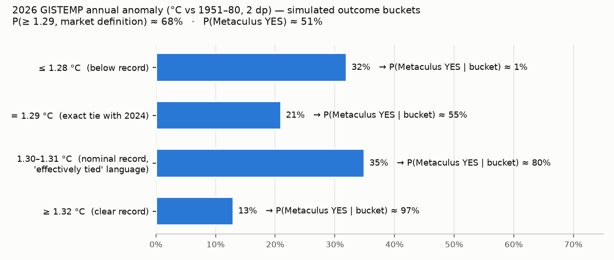

# Will 2026 be the warmest year on record, according to NASA?

| | |
|---|---|
| **Source** | Metaculus #21095 (question group), subquestion id **21098** (label "2026") — https://www.metaculus.com/questions/21095/will-the-following-years-be-the-warmest-year-on-record-according-to-nasa/ |
| **Type** | binary |
| **Opened / Closes / Resolves** | 2024-01-25 / 2027-01-01 / 2027-01-15 (NASA's annual announcement, usually mid-January) |
| **Status** | open |
| **Current forecast** | **Median 51.0%, IQR [43.0%, 60.0%]** (v1, 2026-10-04) |
| **Community (as of 2026-10-04)** | **not retrieved**: the aggregations fetcher got HTTP 403 (Cloudflare) twice and the scraper failed TLS. The API key returns post metadata only: 116 forecasters on the group, aggregations hidden from bot keys |
| **Next review** | 2026-10-16 |

<!-- Versions below, newest first. APPEND-ONLY: never edit or delete a past version. -->

---

## v1 — Initial forecast — 2026-10-04

### What resolves YES

The subquestion resolves YES if **NASA officially reports that 2026 is the hottest year on record to date**, otherwise NO. There is no fine print. The operative data is NASA GISS's GISTEMP v4 Land-Ocean Temperature Index (LOTI). NASA publishes it monthly, around the 10th–15th of the following month, and announces the annual result in mid-January, jointly with NOAA (2025's came on 2026-01-14 [13]). **The bar is 2024 at 1.29 °C** above 1951–1980 in the current table (2-decimal annual values [2]). 2023 = 1.17 and 2025 = 1.19. Edge cases matter more than usual here:

1. **Ties and "effectively tied".** NASA reports annual values to two decimals and labels small margins as ties. In January 2021 a nominally +0.01 °C year was announced as "2020 tied with 2016 for warmest year on record" [14]. In January 2026, 2025 (+0.02 vs 2023) was "effectively tied" [13]. In the current table 2016 and 2020 are both 1.01 [2]. With the 2026 central estimate *right on* 1.29, about 21% of the probability mass is an exact 2-decimal tie and about 35% is a +0.01/+0.02 "effectively tied" margin. How Metaculus resolves "tied for the warmest year" is **not specified**. I assume P(YES | exact tie) ≈ 55% and P(YES | +0.01–0.02) ≈ 80%.
2. **Market definitions differ.** Kalshi resolves YES on LOTI 2026 > 1.28 (so a 1.29 tie counts) [15]. Polymarket counts a tie as rank 1 [16]. Both are therefore *easier* than this question, by roughly 15–17 pp.
3. GISTEMP revises back-months by ±0.01–0.02 as late station data arrive. A revision of 2024 itself, or of Jan–Aug 2026, could flip a tie.
4. Institutional risk: GISS has been under budget and political pressure, and NASA's 2025 release omitted any mention of climate change [13]. A missing or late "official report" is possible but unlikely (≈3%). Metaculus would more likely wait or annul than resolve NO.

### Outside view

- **Record frequency.** In GISTEMP, about 30% of years in 1996–2025 were new records (1997, 1998, 2005, 2010, 2014, 2015, 2016, 2020-tie, 2023, 2024). That is the unconditional prior. It is nearly useless by October, when 8 of 12 months are known.
- **The relevant reference class is "strong El Niño onset years":** how much warmer is Sep–Dec than Jan–Aug in GISTEMP? 2026 needs Sep–Dec to average **≥ 1.41 °C** to reach 1.29 (a tie) and **≥ 1.44 °C** to reach 1.30. That is a jump of **+0.18 / +0.21 °C** over the Jan–Aug mean of 1.224 [1].

| Onset year | RONI JAS | Sep–Dec minus Jan–Aug (GISTEMP) |
|---|---|---|
| 1972 | 1.40 | +0.10 |
| 1982 (El Chichón) | 1.14 | +0.12 |
| 1997 | 1.84 | +0.19 |
| 2015 | 1.54 | +0.21 |
| 2023 | 0.79 | +0.34 |
| **2026** | **1.69** | needs +0.18 (tie) / +0.21 (record) |
| All years 1960–2025 | — | mean −0.01, sd 0.12 |

Of the four clean analogs (excluding the volcanic 1982), 3/4 reach the tie threshold and 2/4 the strict-record threshold. **Outside-view prior ≈ 50–60% for "tie or better", ≈ 40–50% for a strict 2-dp record.**

### Inside view

The arithmetic is closed-form: annual = (Jan–Aug sum 9.79 + Sep + Oct + Nov + Dec) / 12 [1].

- **Jan–Aug 2026 (GISTEMP):** 1.09, 1.25, 1.32, 1.17, 1.13, 1.18, 1.25, **1.40**. August is the warmest August in GISTEMP by 0.10 °C [1][12].
- **September 2026 (not yet published by NASA):** ERA5 (the European ECMWF reanalysis) September mean anomaly is 0.82 °C vs 1991–2020, the 2nd-warmest September after 2023 (0.93) [3][11]. Mapped with a GISTEMP-on-ERA5 regression (n = 320 months, residual sd 0.055, recent offset +0.02), that gives **Sep ≈ 1.40 ± 0.05**.
- **Oct–Dec:** global temperature lags Niño-3.4 by ~3 months, so Oct–Dec responds to the Jul–Sep Pacific state. That state is already observed: ONI (Oceanic Niño Index) JAS = 2.16, the highest JAS on record, and RONI (relative ONI) JAS = 1.69 [4]. Niño-3.4 was ~3.1 °C on 2026-09-21 and is forecast to peak around 4 °C in Nov [5][8]. Two estimates of Oct–Dec:
  - A regression of monthly GISTEMP on a quadratic trend plus RONI lagged 3 months (1980–2025, β = 0.073 °C per RONI unit), plus the persistent recent residual (+0.05 to +0.08), gives Oct/Nov/Dec ≈ 1.40/1.43/1.46, **mean ≈ 1.43**.
  - Anchoring on the Aug–Sep level (1.40) plus the typical strong-El-Niño Oct–Dec rise (1982 +0.16, 1997 +0.15, 2015 +0.28, 2023 +0.04, 1972 0.00) gives **≈ 1.47**.
  - Blend: **Oct–Dec ≈ 1.445 ± 0.065**.
- **Against:** ERA5 fell from ~0.88 in mid-September to 0.68–0.70 on 1–2 October [3], below the 0.86 Oct–Dec average that a record needs in ERA5 terms. Two days carry little weight across a 92-day window, but they argue against the warm (2023-style) branch.
- **Monte Carlo** (400k draws; Sep and Oct–Dec correlated; ±0.005 revision noise): annual 2026 = **1.294 ± 0.019 °C**. Bucket probabilities: ≤1.28: 32% · =1.29: 21% · 1.30–1.31: 35% · ≥1.32: 13%. **P(≥1.29, market definition) = 68%.** Mapping the buckets through the resolution-language assumptions gives **P(Metaculus YES) ≈ 51%**.

### Evidence

| Evidence | LR (likelihood ratio) | Note |
|---|---|---|
| August 2026 GISTEMP 1.40, a record August [1][12] | ~1.5 (up) | Carbon Brief's and Berkeley's July/Aug models expected roughly 1.30 |
| ERA5 September only 2nd-warmest, ~0.11 °C below Sep 2023 [3][11] | ~0.9 | in line with expectation, not a spike |
| ERA5 1–2 Oct dip to 0.68–0.70 [3] | ~0.9 | short-lived dips are common; 2024 started October at 0.70 and averaged 0.80 |
| Historic El Niño: RONI JAS 1.69, Niño-3.4 ~3.1 and rising, CPC >90% very strong [4][5][8] | already in the model | mostly a 2027 effect because of the lag |
| GISTEMP-specific odds from model-based forecasters: Hausfather 65% (data through June) [9], Berkeley Earth 69% for its own dataset (data through July) [10] | — | both count "nominal record". Closest to my 68% market-definition number |

**Absent evidence:** I found no Metaculus admin statement on tie handling (comments could not be fetched). That is the single largest unresolved definitional risk.

### Other forecasters

| Source | Value | As of | Note |
|---|---|---|---|
| Metaculus CP / Pro / gold | **not retrieved** | 2026-10-04 | HTTP 403 ×2; bot API key hides aggregations; 116 forecasters on the group |
| Kalshi KXGTEMP-26 "2026 hottest year" | **63.6–64.0%** (bid/ask) | 2026-10-04 | 378,599 contracts traded; YES if LOTI > 1.28, **tie counts** [15] |
| Kalshi KXGTEMP-27 (mislabelled duplicate of the 2026 market) | 66–68% | 2026-10-04 | 26,728 contracts, thin [15] |
| Polymarket "2026 hottest year on record" | **70.5%** (bid 0.70 / ask 0.71) | 2026-10-04 | $667k volume on this leg, $3.58M on the event; resolves on GISS graph.txt No_Smoothing, **tie = YES** [16] |
| Manifold "Will 2026 be the hottest year on record?" | 77.3% | 2026-10-04 | 113 bettors, play money, resolution source not checked; discounted [17] |
| Hausfather / Carbon Brief, GISTEMP-specific | 65% | 2026-07-24 | data through June, before the August record [6][9] |
| Berkeley Earth (own dataset) | 69% | 2026-08-13 | data through July [10] |

**Reconciliation:** my market-definition probability (68%) sits inside the Kalshi–Polymarket band (64–71%). The 17 pp gap down to my Metaculus number is entirely the **tie and "effectively tied" discount**, not a different climate view. If you think Metaculus will resolve any nominal ≥1.29 as YES, my number becomes ~66%.

### Scenarios

| # | Scenario | Weight | Implies |
|---|---|---|---|
| 1 | Oct–Dec ≤ 1.38 (October dip persists, El Niño's lagged effect arrives late) → 2026 ≤ 1.28 | 32% | NO (~1%) |
| 2 | Oct–Dec ~1.39–1.42 → exact tie at 1.29; NASA says "tied with 2024" | 21% | coin flip on admin reading (~55%) |
| 3 | Oct–Dec ~1.43–1.48 → 1.30–1.31; NASA "slightly warmer than 2024, effectively tied" or "warmest" | 35% | likely YES (~80%) |
| 4 | Oct–Dec ≥ 1.49 (2023-style late surge) → ≥ 1.32, clear record | 12% | YES (~97%) |

Weighted P(YES) = 0.32·0.01 + 0.21·0.55 + 0.35·0.80 + 0.12·0.97 ≈ **0.51**.

### Sensitivity

| Assumption | If instead | Forecast becomes |
|---|---|---|
| Oct–Dec mean 1.445 | 1.43 (pure regression) / 1.50 (2023 analog) | 44% / 73% |
| Sep GISTEMP ≈ 1.40 | 1.36 | 45% |
| P(YES \| tie) 0.55, P(YES \| +0.01–0.02) 0.80 | admins resolve on any nominal ≥ 1.29 (both 1.0) | ~66% |
| Same | NASA's "tied" wording → NO; only ≥ +0.03 counts | ~16% |

Calibration checks: the would-I-take-either-side test holds at 51%. The number is not a round anchor. The IQR [43, 60] reflects that Sep/Oct prints alone can move it ±10 pp, and that resolution-language uncertainty cannot be resolved before January.

### What would change my mind (tripwires)

- [ ] NASA GISTEMP September 2026 (release ~2026-10-14) ≥ 1.45 °C → up 10 pp; ≤ 1.33 °C → down 10 pp
- [ ] Copernicus ERA5 October 2026 monthly anomaly (bulletin ~2026-11-06) ≥ 0.85 °C → up 12 pp; ≤ 0.72 °C → down 12 pp
- [ ] After the GISTEMP October print (~2026-11-15), the Nov–Dec mean needed for a 2-dp 1.30 exceeds 1.55 °C → down ~30 pp
- [ ] Metaculus admin comment, or NASA wording, on how a 2026-vs-2024 tie is treated (by 2027-01-14) → re-analyse; swings of ±15 pp are possible

### Sources

1. NASA GISS, GISTEMP v4 GLB.Ts+dSST monthly table — https://data.giss.nasa.gov/gistemp/tabledata_v4/GLB.Ts+dSST.csv (accessed 2026-10-04; snapshot in `raw/`)
2. NASA GISS, Global Land-Ocean annual means (graph.txt, No_Smoothing) — https://data.giss.nasa.gov/gistemp/graphs/graph_data/Global_Mean_Estimates_based_on_Land_and_Ocean_Data/graph.txt (accessed 2026-10-04; snapshot in `raw/`)
3. Copernicus Climate Pulse, ERA5 daily global 2 m temperature series — https://sites.ecmwf.int/data/climatepulse/data/series/era5_daily_series_2t_global.csv (accessed 2026-10-04; 2023–2026 excerpt in `raw/`)
4. NOAA CPC, RONI and ONI indices — https://www.cpc.ncep.noaa.gov/data/indices/RONI.ascii.txt and https://www.cpc.ncep.noaa.gov/data/indices/oni.ascii.txt (accessed 2026-10-04)
5. NOAA CPC, ENSO Diagnostic Discussion, 2026-09-10 — https://www.cpc.ncep.noaa.gov/products/analysis_monitoring/enso_advisory/ensodisc.shtml (accessed 2026-10-04)
6. Carbon Brief, "State of the climate: Rapidly developing El Niño raises chance of record-warm 2026", 2026-07-24 — https://www.carbonbrief.org/state-of-the-climate-rapidly-developing-el-nino-raises-chance-of-record-warm-2026 (accessed 2026-10-04)
7. Carbon Brief, "State of the climate: Strong El Niño puts 2026 on track for second-warmest year", 2026-04-21 — https://www.carbonbrief.org/state-of-the-climate-strong-el-nino-puts-2026-on-track-for-second-warmest-year/ (accessed 2026-10-04)
8. Carbon Brief, "Analysis: 'Super El Niño' breaks 'remarkable' all-time record", 2026-09-21 — https://www.carbonbrief.org/analysis-super-el-nino-reaches-remarkable-all-time-record (accessed 2026-10-04)
9. Z. Hausfather, "Why Hansen may end up being right about 2026" (Skeptical Science repost of The Climate Brink), 2026-08-03 — https://skepticalscience.com/print.php?n=6585 (accessed 2026-10-04)
10. Berkeley Earth, "July 2026 Temperature Update", 2026-08-13 — https://berkeleyearth.org/?p=9536 (accessed 2026-10-04)
11. Fox Weather, "After the hottest summer on record, where will September rank in the history books?", 2026-09-24 — https://www.foxweather.com/weather-news/after-hottest-summer-record-how-september-rank-history-books-heat (accessed 2026-10-04)
12. Copernicus C3S, August 2026 bulletin (joint-hottest month on record) — https://climate.copernicus.eu/copernicus-august-was-worlds-joint-hottest-month-record-pushing-global-temperatures-back-above (accessed 2026-10-04)
13. NASA, "NASA Releases Global Temperature Data" (2025 annual), 2026-01-14 — https://www.nasa.gov/news-release/nasa-releases-global-temperature-data (accessed 2026-10-04)
14. NASA SVS, "NASA Finds 2020 Tied for Hottest Year on Record" — https://svs.gsfc.nasa.gov/vis/a010000/a013700/a013799/script_30722_00.html (accessed 2026-10-04)
15. Kalshi API, markets KXGTEMP-26-P0 and KXGTEMP-27-P0 — https://api.elections.kalshi.com/trade-api/v2/markets/KXGTEMP-26-P0 (accessed 2026-10-04; snapshot in `raw/`)
16. Polymarket, "Where will 2026 rank among the hottest years on record?" — https://polymarket.com/event/where-will-2026-rank-among-the-hottest-years-on-record (via gamma API, accessed 2026-10-04; snapshot in `raw/`)
17. Manifold, "Will 2026 be the hottest year on record?" — https://manifold.markets/itsTomekK/will-2026-be-the-hottest-year-on-re (accessed 2026-10-04)
18. WMO, Global Annual to Decadal Climate Update 2026–2030, 2026-05-28 — https://wmo.int/media/news/new-report-suggests-more-global-temperature-records-ahead (accessed 2026-10-04)
19. Metaculus API, post 21095 metadata (bot key; no aggregations) — https://www.metaculus.com/questions/21095/ (accessed 2026-10-04; snapshot in `raw/`)

**Date**: 2026-10-04
**Forecast**: Median 51.0%, IQR [43.0%, 60.0%]
**Thesis**: GISTEMP Jan–Aug 2026 averages 1.224 °C. With September ≈ 1.40 (ERA5-mapped) and a lagged historic El Niño pushing Oct–Dec to ≈ 1.445, 2026 lands at 1.294 ± 0.019 °C, right on 2024's 1.29. That is 68% for "≥ 1.29", matching Kalshi (64%) and Polymarket (70.5%), whose rules count ties. About 56% of the mass is a tie or "effectively tied" margin, which NASA has historically announced as "tied" (2020 vs 2016), so the Metaculus-specific probability is about 51%.
