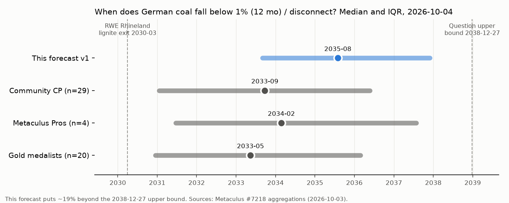

# When will Germany have no coal-fired power plants in its electricity grid?

| | |
|---|---|
| **Source** | Metaculus #7218 — https://www.metaculus.com/questions/7218/date-germany-stops-burning-coal/ |
| **Type** | date (range 2024-12-28 … 2038-12-27, open upper bound) |
| **Opened / Closes / Resolves** | 2021-09-04 / 2038-12-26 / on the event, or ">2038-12-27" |
| **Status** | open |
| **Current forecast** | **Median 2035-08-01, IQR [2033-09-01, 2037-12-01]**; P(>2038-12-27) ≈ 19% (v1, 2026-10-04) |
| **Community (as of 2026-10-03)** | CP 2033-09-24 [2031-01-19, 2036-05-22] (n=29 recent, 46 total) · Pro 2034-02-24 [2031-06-21, 2037-07-28] (n=4) · Gold 2033-05-14 [2030-12-14, 2036-02-28] (n=20) |
| **Next review** | 2026-11-05 |

<!-- Versions below, newest first. APPEND-ONLY: never edit or delete a past version. -->

---

## v1 — Initial forecast — 2026-10-04

### What resolves YES

The question resolves to the **earliest end date** of either (a) a period of at least two weeks
in which **no coal-fired power plant in Germany is connected to the grid**, or (b) a
**12-month period in which coal (lignite + hard coal) supplies < 1% of Germany's domestic
electricity generation**. If neither happens by 2038-12-27 it resolves ">Dec 27, 2038". No
data source is named; the background cites Energy-Charts (Fraunhofer ISE, *public net*
generation, near-real-time), the obvious resolver, while AGEB/Destatis *gross* figures also
count industrial self-supply. Three consequences:

1. **Path (a) is practically closed** while the grid reserve exists: about 8.1 GW of hard
   coal sits in the Netzreserve for winter 2026/27, physically connected [9]. Path (b) decides.
2. **< 1% means close to no coal at all**: 4.5–6 TWh a year (total generation 450–600 TWh),
   which is what a single 1 GW lignite unit produces at a 50% load factor.
3. **The statutory schedule alone resolves above the range**: the last lignite units
   (Boxberg Q/R, Schwarze Pumpe) are due to close on 2038-12-31, so path (a) would close in
   mid-January 2039, after the bound. An in-range answer needs **market forces** (or a policy
   speed-up) to push coal under 1% before then.

The resolver choice matters only at the tail. Gross figures include ~1.5 TWh of industrial
lignite and some industrial hard coal, which could keep "coal" just above 1% for a few extra
months.

### Outside view

There is no clean reference class. Three partial ones:

- **Countries that went from roughly 15–22% coal to under 1%.** UK: 22.6% in 2015, about 1%
  in 2023, last plant shut on 2024-09-30, so about 9 years [17]. Spain: about 15% in 2018,
  0.6% in 2024, so 6–7 years [18]. Applied to Germany's 22.4% in 2025 [2], that gives
  **2032–2034**. Neither country had a large domestic lignite fleet.
- **Lignite countries.** Greece: lignite was 20% in 2019, and the exit date slipped from
  2023 to 2025 to 2028; the last few percent are sticky [19]. This points later.
- **Germany's own statutory anchor**: end of 2038, which means ">2038" here. In Europe, the
  status quo plus official dates has been the right call more often than the sceptics, but
  only once the market had made coal uneconomic.

The models have a poor record. In 2021, analysts said rising CO2 prices could end German
coal "within 5 years" [20]. In 2026 coal still supplies about 22% and is barely falling
(2024→2025 flat; H1 2026 −0.7 percentage points) [2][3].

**Outside-view prior: median about 2034–2035, with at least 15% beyond 2038.**

### Inside view

Remaining coal (public net 2025: lignite 67.2 TWh, hard coal 26.7 TWh, 94 TWh in total [1]),
in blocks:

| Block | ~TWh now | Legal end | Outlook |
|---|---|---|---|
| RWE Rhineland lignite | ~30 | 2030-03-31 (3 units possibly in reserve to 2033) | RWE wants to close in 2030 [6]; decision delayed to spring 2027 [4][5] |
| LEAG Jänschwalde, Boxberg N/P | ~12–15 | end-2028 / end-2029 | on track; idle for long stretches in winter 2025/26 [11] |
| Lippendorf, Schkopau | ~12–14 | 2035 / 2034 | could leave earlier on economics |
| Boxberg Q/R, Schwarze Pumpe (~3.1 GW) | ~15 | 2038-12-31 | LEAG (Jan 2026): "operation per the legal schedule" [10] |
| Hard coal in the market (incl. Datteln 4 → 2038) | ~27 | falls by law to 0 by 2038 | BNetzA needs no forced closures for 2027/2029 [9]; rebounded +7% in the 2026 gas shock [3] |

What has to be true for each period:

- **Before about 2033** coal falls below 1% only if three things all happen: RWE closes on
  schedule, hard coal's market output collapses, and all ~5 GW of eastern lignite runs only
  rarely or closes by about 2031–32. The new gas backup comes no earlier than Nov 2031 [14].
  The government has explicitly tied coal closures to that gas build [12] and to supply
  security "from 2031" [4]. Roughly 0.7 (RWE) × 0.6 (hard coal) × 0.35 (eastern lignite) ≈
  **15% for 2033 or earlier**, plus some extra for correlated upside (high EUA prices hit all
  three blocks at once). That gives **about 25%**.
- **2034–2036.** Lippendorf and Schkopau leave by law in 2034–35. Coal goes below 1% if the
  last ~3.1 GW plus Datteln 4 then run at a load factor under about 20%. That is plausible:
  EUA prices are projected at about €100–150 in the mid-2030s, renewables already supply 62%
  [3], and battery storage is growing fast.
- **2037–2038.** The last units are kept as seasonal backup, or move into reserve, close to
  their closure date.
- **Above 2038.** The last units run at meaningful output until the end of 2038, reserve
  plants are used to dampen prices, or the resolver uses gross figures. A small extra tail
  comes from political delay; east-German states and a CDU-led government are protective of
  lignite [12][13].

Note on the EU ETS (Emissions Trading System, the EU carbon market) and EUAs (EU emission
allowances): the July 2026 reform proposal lowers the annual cap cut (the "linear reduction
factor", LRF) to 3.7% for 2031–35 and 1.7% from 2036. That moves the date the cap hits zero
from about 2039 to about 2048 [7]. The expected price effect is −22% in 2030 but only about
−€7/t by 2035 [7], and one bank still sees €180–270/t by 2040 [8]. Net: it removes the
"cap hits zero in 2039" guarantee of a pre-2038 market exit, but long-run prices stay high.

### Evidence

Likelihood ratios (LR) are applied to the odds of "in range and on or before 2035" versus
"later":

- **Coal stagnating at about 22% (2024→H1 2026)** [2][3]. If an early exit were coming, we
  should already see a steep decline. LR ≈ 0.7 (later).
- **2026 gas shock: US attack on Iran and Hormuz blockade** [15]. Hard coal +7%; industry
  lobbying to return reserve plants to the market; ministry examining it [16]. LR ≈ 0.85.
- **Coal-exit stocktake delayed to 2027; the 2030 RWE decision waits on the gas auctions**
  [4][5]. LR ≈ 0.9.
- **ETS reform softens the 2030s cap** [7]. LR ≈ 0.9; mid-2030s prices barely change.
- **Expert models: market-driven exit by 2031–33 (Öko-Institut, Aurora)** [4][23]. LR ≈ 1.3
  (earlier), discounted for the 2021 miss [20].
- **LEAG fleet idle for long stretches, coal becoming "seasonal"; BNetzA needs no forced
  hard-coal closures** [9][11]. LR ≈ 1.2 (earlier).
- **No evidence** of any plan to extend lignite past 2038; the east-German premiers defend
  2038, not later. This keeps the far tail small.

Net: the evidence moves me about 1 year **later** than the 2034–35 outside view on the
in-range part, and keeps about 19% above the range.

### Other forecasters

| Source | Value | As of | Note |
|---|---|---|---|
| Metaculus CP (recency-weighted) | 2033-09-24, IQR [2031-01-19, 2036-05-22] (n=29 recent; 46 total) | 2026-10-03 | drifted ~1 yr later since Feb 2026 (2032-12 → 2033-09) |
| Metaculus Pro | 2034-02-24, IQR [2031-06-21, 2037-07-28] (n=4) | 2026-10-03 | latest and widest cohort; small n |
| Metaculus gold medalists | 2033-05-14, IQR [2030-12-14, 2036-02-28] (n=20) | 2026-10-03 | earliest cohort |
| Öko-Institut (H. Hermann) | market exit "2031–2032" | 2026-04-21 | model view, not a probability [23] |
| Aurora Energy Research (via CLEW) | last coal plant "could close by 2033" | 2026 | model view [4] |
| Kalshi / Polymarket / Manifold / GJOpen / INFER | no matching market found | 2026-10-04 | — |
| Sentinel / Mantic | no matching forecast found | 2026-10-04 | — |

The three cohorts **agree on the median** (2033-05 to 2034-02); none is a material
outlier. The Pros are about 9 months later than gold and have a fatter upper tail.

**Where I differ: about 1.5–2 years later than all three cohorts.** I searched again for a
fact that would support 2033. The best case for it is the expert market models [4][23],
and I have weighted them. Two points make me think the cohorts' **lower quartile is too
early**:

1. A 12-month window under 1% that ends by **Jan 2031** (the CP's 25th percentile) needs
   almost zero coal from Feb 2030. But RWE's last units run until 2030-03-31, and about 5 GW
   of eastern lignite and Datteln 4 stay legally available. I put that at ≤ 5%, not 25%.
2. The CP has only 29 recent forecasters, and its quantiles go back to 2021, when "exit by
   2030" was the Ampel coalition's stated aim. It has been moving toward my view (+9 months
   in 2026).

Main risk to my view: the expert market models are right, and lignite running hours
collapse once EUA prices pass about €120.

### Scenarios

| # | Scenario | Weight | Implies |
|---|---|---|---|
| 1 | Fast market exit: RWE out 2030, hard coal and eastern lignite mostly idle by 2031–32 | 27% | resolves 2031-06 … 2033-12 |
| 2 | Step-down: Lippendorf/Schkopau close 2034–35; last 3 GW at low load factor or early reserve | 39% | resolves 2034 … 2036 |
| 3 | Late: last units run as seasonal backup, < 1% only in 2037–38 | 15% | resolves 2037 … 2038-12-27 |
| 4 | Statutory or longer: meaningful coal output to end-2038, reserve plants back in the market for prices, or delay | 19% | ">Dec 27, 2038" |

Implied cumulative probability: 2031-12 ≈ 7%, 2032-12 ≈ 15%, 2033-12 ≈ 27%, 2034-12 ≈ 40%,
2035-12 ≈ 55%, 2036-12 ≈ 66%, 2037-12 ≈ 75%, 2038-12-27 ≈ 81%.
Percentiles: 5% 2031-09 · 10% 2032-06 · **25% 2033-09 · 50% 2035-08 · 75% 2037-12** · 80% 2038-12 · above that, beyond the range.

### Sensitivity

| Assumption | If instead | Forecast becomes |
|---|---|---|
| EUA prices reach about €100–150 in the 2030s (Commission reform roughly as proposed) | EUA ≥ €130 by 2030, or the reform is rejected and the cap still hits zero in 2039 | median ≈ 2034-03; P(>2038) ≈ 12% |
| Same | EUA < €90 through 2030 (stronger dilution, price ceiling) | median ≈ 2036-09; P(>2038) ≈ 28% |
| RWE closes in 2030; the 3 units go to pure reserve | reserve units allowed back into the market until 2033 | median +4–6 months |
| Resolver uses Energy-Charts public net | AGEB/Destatis gross (includes industrial coal) | median +3–6 months; P(>2038) +3 percentage points |
| Gas backup online from 2031–32 | StromVKG auctions undersubscribed or delayed by more than 1 year | median +6–9 months |

### What would change my mind (tripwires)

- [ ] First StromVKG auction results (BNetzA, expected **2026-11-03**): < 3 GW of the
  4.5 GW awarded → **later, 3 months**; fully subscribed → earlier, 1 month.
- [ ] Energy-Charts 2026 annual coal public net generation (published by **2027-01-15**):
  < 85 TWh → **earlier, 4 months**; > 95 TWh → later, 3 months.
- [ ] Reserve coal plants legally allowed to return to the market to dampen prices (law or
  ordinance by **2027-03-31**) → **later, 6 months**.
- [ ] KVBG §54/§56 coal-exit stocktake (expected by **2027-07-31**): recommends moving the
  final date to 2035 → **earlier, 12 months**; RWE units into a reserve with market access
  to 2033 or softer eastern dates → later, 4 months.
- [ ] EU ETS reform trilogue (by **2027-12-31**): LRF or MSR weaker than the July 2026
  proposal, or a hard price ceiling below €120 → **later, 9 months**; EUA Dec-27 contract
  > €110 on 2027-06-30 → earlier, 6 months.
- [ ] LEAG/EPH announce early closure or reserve transfer of Boxberg Q/R, Schwarze Pumpe or
  Lippendorf (by **2028-12-31**) → **earlier, 18 months**.

### Sources

1. Fraunhofer ISE — "German public electricity generation in 2025: wind and solar power take the lead" — https://www.ise.fraunhofer.de/en/press-media/press-releases/2026/german-public-electricity-generation-in-2025-wind-and-solar-power-take-the-lead.html (accessed 2026-10-04)
2. Tagesspiegel — "Solarenergie überholt erstmals Braunkohle" (2026-01-02) — https://www.tagesspiegel.de/wirtschaft/wendepunkt-in-der-energiewende-solarenergie-uberholt-erstmals-braunkohle-in-der-deutschen-stromerzeugung-15097454.html (accessed 2026-10-04)
3. Windmesse / Strom-Report — "Strommix 1. Halbjahr 2026" (2026-07-06) — https://w3.windmesse.de/windenergie/pm/49221-strommix-okostrom-erneuerbare-energien-windenergie-solarenergie-erdgas-braunkohle-steinkohle-stromhandel-deutschland-2026 ; coal share 21.7%: https://www.stromauskunft.de/strompreise/strommix-in-deutschland/ (accessed 2026-10-04)
4. Clean Energy Wire — "Government pushes German coal exit stocktake to 2027" (2026-08-11) — https://www.cleanenergywire.org/news/government-pushes-german-coal-exit-stocktake-2027 (accessed 2026-10-04)
5. Antenne NRW — "Kohleausstieg 2030 in NRW: Entscheidung kommt erst im Frühjahr 2027" — https://antenne.nrw/nrw/kohleausstieg-2030-in-nrw-entscheidung-kommt-erst-im-fruehjahr-2027/ ; dpa via finanznachrichten — https://www.finanznachrichten.de/nachrichten-2026-08/69278860-roundup-wirtschaftsministerium-kohleausstiegs-bericht-kommt-spaeter-016.htm (accessed 2026-10-04)
6. cleanthinking — "Braunkohleausstieg: RWE bleibt beim 31. März 2030" — https://www.cleanthinking.de/braunkohleausstieg-rheinisches-revier-rwe/ (accessed 2026-10-04)
7. ClearBlue Markets — "The EU ETS Review Proposal July 2026" — https://www.clearbluemarkets.com/knowledge-base/the-eu-ets-review-proposal-july-2026-relief-for-industry-stability-for-the-market ; ICAP — https://icapcarbonaction.com/en/news/eu-commission-publishes-eu-ets-review-proposal (accessed 2026-10-04)
8. Carbon Pulse — "Bank sees EUAs at €180-270 by 2040 under Commission ETS reform proposal" (2026-09-09, paywalled headline) — https://carbon-pulse.com/548718/ (accessed 2026-10-04)
9. Montel — "BNetzA ordnet keine Kohle-Stilllegung für 2027 an" — https://montelnews.com/de/news/6373b402-8eee-49d2-9175-c54da0b28be4/bnetza-ordnet-keine-kohle-stilllegung-fur-2027-an ; BNetzA Netzreservebedarf — https://www.bundesnetzagentur.de/DE/Fachthemen/ElektrizitaetundGas/Versorgungssicherheit/Netzreserve/DL/Netzreservebedarf_2025.pdf ; techzeitgeist (no ban for 2029, 2026-09-01) — https://www.techzeitgeist.de/kohleausstieg-2026-kein-verbot-netzreserve/ (accessed 2026-10-04)
10. Niederlausitz aktuell — "Generationswechsel: LEAG stellt Weichen für Auslaufbetrieb bis 2038" (2026-01-13) — https://www.niederlausitz-aktuell.de/niederlausitz-aktuell/orte/brandenburg/307837/generationswechsel-leag-stellt-weichen-fuer-auslaufbetrieb-bis-2038.html (accessed 2026-10-04)
11. energiezukunft — "Wenn Kohleblöcke nur noch Reserve spielen – aber Milliarden fließen" (2026-01-07) — https://www.energiezukunft.eu/wirtschaft/wenn-kohlebloecke-nur-noch-reserve-spielen-aber-milliarden-fliessen (accessed 2026-10-04)
12. PwC "Auf ein Watt" — coalition agreement energy measures — https://blogs.pwc.de/de/auf-ein-watt/article/248596/der-koalitionsvertrag-und-seine-massnahmen-fuer-den-energiebereich/ ; cleanthinking — https://www.cleanthinking.de/?p=1063204 (accessed 2026-10-04)
13. Bundesnetzagentur — Versorgungssicherheitsmonitoring (2025-09-03) — https://www.bundesnetzagentur.de/SharedDocs/Pressemitteilungen/DE/2025/20250903_Versorgungsmonitoring.html (accessed 2026-10-04)
14. pv magazine — "Bundestag macht Weg für Ausschreibungen von Gaskraftwerken frei" (2026-07-09) — https://www.pv-magazine.de/2026/07/09/bundestag-macht-weg-fuer-ausschreibungen-von-gaskraftwerken-frei/ ; c-ober — https://www.c-ober.de/blog/stromvkg-kapazitaetsmarkt-ausschreibungen-2026/ (accessed 2026-10-04)
15. Handelsblatt — "Hohe Gaspreise bringen Debatte um Kohleausstieg zurück" (2026-03-19) — https://www.handelsblatt.com/politik/deutschland/energie-hohe-gaspreise-bringen-debatte-um-kohleausstieg-zurueck/100209443.html (accessed 2026-10-04)
16. t-online — "Reiche-Ministerium prüft stärkere Nutzung von Kohlekraftwerken" (2026-08-31) — https://www.t-online.de/nachrichten/deutschland/innenpolitik/id_101413618/katherina-reiche-ministerium-prueft-rueckkehr-zu-mehr-kohlekraft.html (accessed 2026-10-04)
17. UK DUKES 2025 Chapter 2 — https://assets.publishing.service.gov.uk/media/688b5277a509761441437f0e/DUKES_2025_Chapter_2.pdf ; Business Today on the last UK coal plant — https://www.businesstoday.in/amp/industry/energy/story/uk-to-close-its-last-coal-power-plant-this-month-446735-2024-09-20 (accessed 2026-10-04)
18. Red Eléctrica — 2024 year-end press release — https://www.ree.es/en/press-office/press-release/news/press-release/2025/01/renewable-energies-generated-56-per-cent-spains-electricity-mix-2024 (accessed 2026-10-04)
19. Heinrich Böll Stiftung Greece — "Delignitisation and Just Transition" — https://gr.boell.org/en/node/6423 ; pv magazine — "Greece's coal phase-out enters shaky ground" — https://pv-magazine.com/2021/12/31/greeces-coal-phase-out-enters-shaky-ground (accessed 2026-10-04)
20. Clean Energy Wire — "Rising CO2 price could trigger German coal phase-out within 5 years" — https://www.cleanenergywire.org/news/rising-co2-price-could-trigger-german-coal-phase-out-within-5-years (accessed 2026-10-04)
21. Bundesrechnungshof — "Deutscher Kohleausstieg" (2024) — https://www.bundesrechnungshof.de/SharedDocs/Downloads/DE/Berichte/2024/kohleausstieg-volltext.pdf (accessed 2026-10-04)
22. Metaculus #7218 aggregations (CP / Pro / gold, comments) — https://www.metaculus.com/questions/7218/date-germany-stops-burning-coal/ (accessed 2026-10-04; cached in raw/metaculus-2026-10-04.json)
23. Clean Energy Wire — "Germany's coal exit quietly progressing, likely completed by 2032 – researcher" (2026-04-21) — https://www.cleanenergywire.org/news/germanys-coal-exit-quietly-progressing-and-likely-be-completed-2032-researcher (accessed 2026-10-04)

**Date**: 2026-10-04
**Forecast**: Median 2035-08-01, IQR [2033-09-01, 2037-12-01]
**Thesis**: Coal must fall below 1% of generation over 12 months, which means close to no coal. The hard-coal grid reserve rules out the "no plant connected" path, and the legal end date (2038-12-31) falls outside the range. Coal has been flat at ~22% through H1 2026; the gas shock, gas backup arriving only from 2031–32 and the CDU-led government's supply-security policy argue against a pre-2033 exit, while high EUA prices and idling LEAG units point to a market exit in the mid-2030s. About 19% sits beyond 2038-12-27, and I am ~2 years later than the Metaculus cohorts, whose lower quartile (2031) looks infeasible.
