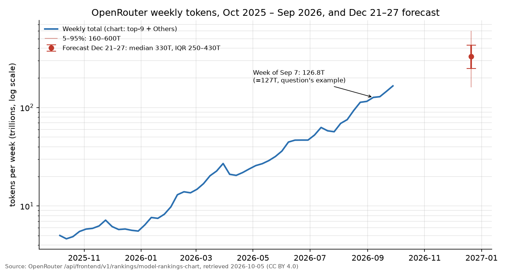

# What will be the total OpenRouter token usage December 21-27, 2026?

| | |
|---|---|
| **Source** | Metaculus #45689 — https://www.metaculus.com/questions/45689/what-will-be-the-total-openrouter-token-usage-december-21-27-2026 |
| **Type** | numeric (tokens; range 100T–700T, open both bounds) |
| **Opened / Closes / Resolves** | 2026-10-06 (scheduled) / 2026-12-01 / 2026-12-29 |
| **Status** | open |
| **Current forecast** | **Median 350T, IQR [270T, 445T]** (v2, 2026-10-13) |
| **Community (as of 2026-10-13)** | CP 340T [268T, 402T] (n=65) · Pro 329T [263T, 404T] (n=7) · gold 351T [283T, 406T] (n=24) |
| **Next review** | 2026-10-27 |

<!-- Versions below, newest first. APPEND-ONLY: never edit or delete a past version. -->

---

## v2 — Update — 2026-10-13

### Revision
| Driver | Direction | Effect |
|---|---|---|
| Prior (v1, 2026-10-05) | — | Median 330T, IQR [250T, 430T] |
| Stealth model `space-bunny-alpha` (38.7T, 23% of the Sep 28 week) left the platform, yet the Oct 5–11 week still **grew** 3.6% to 171.8T [1][2][3]. The ~16T "transient" haircut I took on the base is no longer warranted: base 150T → 172T | ↑ | +40T |
| Week-on-week growth slowed (+13.7% → +3.6%), and near-term markets imply only ~189T/week for Oct 12–25 [4]; horizon recomputed as 11 weeks from the Oct 5 base with a decayed multiple ≈ 2.15× | ↓ | −20T |
| Metaculus cohorts revealed: CP 340T, Pro 329T, gold 351T, IQRs ≈ [265T, 404T] [5]. All three agree with each other and with me; no fact missed. Kept my tails wider (11 weeks of a high-variance series) | → | none |
| **New forecast** | | **Median 350T, IQR [270T, 445T]** |

### Tripwire check
| Tripwire from v1 | Fired? | Note |
|---|---|---|
| Week of Oct 5–11 below 155T (down 30T) | not fired | 171.84T [1] |
| Week of Oct 5–11 above 185T (up 30T) | not fired | 171.84T [1] |
| `space-bunny-alpha` leaves free/stealth status and the weekly total falls > 15% w/w (down 40T) | **partial — precondition met, effect absent** | The model is gone from the chart's top 9 (≤ 4.9T) and from the public `/api/v1/models` list [2]; its listing carried a 2026-10-05 expiry [3]. The total rose 3.6% anyway: DeepSeek V4.1 Flash +15.4T and Others +12.7T absorbed the traffic. This is the update's main signal. |
| Any weekly total ≥ 250T before 2026-11-30 (up 60T) | not yet | max so far 171.8T |
| Chart binning / Others / rounding change (re-analyse) | not fired | Same 9 + Others structure. Minor restatement of an old week (2025-10-13: 4.64T → 3.91T) — irrelevant to the resolution bar. |

### What resolves YES
unchanged from v1 (Dec 21 bar of the "Top Models" weekly chart = top 9 + Others, as displayed).

### Outside view
unchanged from v1 (12-week growth multiples over the past year: p25 2.04×, median 2.43×, p75 2.75×).
Rescaled to the 11 weeks from the Oct 5 week to the Dec 21 week: median ≈ 2.26× undecayed, ≈ 2.15×
after shading for decaying hypergrowth.

### Inside view
- **Base**: 171.8T (Oct 5–11), now free of a big stealth component. The largest single model is
  DeepSeek V4.1 Flash at 41.0T (24%) — a paid, cheap open-weight model, so far more durable than a
  free stealth preview. A new preview, StepFun Step-5 Preview (released 2026-10-08), already had
  8.8T in four days [1]; previews come and go, and the v1 lesson stands that their exits can bite —
  but this exit did not.
- **Current week**: the partial Oct 12 bar read 29.8T at 03:00 UTC Oct 13 (≈ 27 hours), a pace of
  roughly 185–200T/week [1]. Polymarket's Sep 28–Oct 25 market (675–725T 47%, 725T+ 31.5%,
  ~$15.5k volume) implies ≈ 375–390T for the remaining two weeks, i.e. ≈ 190T/week [4]. Kalshi's
  October market is illiquid above 575T (bid 0.91 for > 575T) [6].
- **Projection**: 171.8T × 2.15 × 0.95 (holiday) ≈ **351T**. Cross-check from markets: 190T in
  mid-October growing ~5%/week for 10 weeks × 0.95 ≈ 295T; growing ~7%/week ≈ 355T. The recent
  9-week multiple (69.1T → 171.8T, 2.49×) argues for the upper end.

### Evidence
- Weekly totals, chart JSON retrieved 2026-10-13 [1]: 08-31 115.5T, 09-07 126.8T, 09-14 128.9T,
  09-21 145.9T, 09-28 165.9T, **10-05 171.8T**. Earlier weeks match the v1 snapshot (one old week,
  2025-10-13, restated 4.64T → 3.91T).
- Composition shift Sep 28 → Oct 5 [1]: space-bunny-alpha 38.7T → < 4.9T (out of top 9);
  DeepSeek V4.1 Flash 25.6T → 41.0T; Others 53.5T → 66.2T; StepFun Step-5 Preview new at 8.8T.
- Space Bunny: anonymous preview released 2026-09-23 with a stated 1M context [8]; suspected MiniMax,
  never officially revealed [3][9]; no longer in the public model list [2].
- Agents are now the majority of OpenRouter tokens (Oct 8 newsletter) [7] — always-on demand that
  supports a small holiday dip (v1: −3.0% / −1.7% in late Dec 2025 [1]).
- Independent sanity anchor for the series level (May 2026: 25T/week) [10][11]; resolution
  mechanics and Data API restatement caveat [12][13].

### Scenarios
| # | Scenario | Weight | Implies (Dec 21–27) |
|---|---|---|---|
| 1 | Hypergrowth continues (≥ 7%/week on average) | 0.30 | 400–600T |
| 2 | Moderate growth (3–7%/week) | 0.42 | 260–400T |
| 3 | Plateau (0–3%/week) | 0.20 | 175–260T |
| 4 | Contraction (preview exits, free-tier cuts, a big customer leaves) | 0.08 | < 175T |

Percentiles: p5 190T, p10 215T, **p25 270T, p50 350T, p75 445T**, p90 545T, p95 610T.
P(> 700T) ≈ 2%. P(< 100T) < 1%.

Chart: `charts/weekly-tokens-and-forecast.png` is unchanged from v1 (not regenerated; the series
shape is the same, with one more week at 171.8T).

### Other forecasters
| Source | Value | As of | Note |
|---|---|---|---|
| Metaculus CP (recency-weighted) | 340T, IQR [268T, 402T] | 2026-10-13 | n=65 |
| Metaculus Pro | 329T, IQR [263T, 404T] | 2026-10-13 | n=7 |
| Metaculus gold medalists | 351T, IQR [283T, 406T] | 2026-10-13 | n=24 |
| Polymarket, Sep 28–Oct 25 (4 weeks) | <575T 1.7% · 575–625 5.2% · 625–675 10.5% · 675–725 47% · 725T+ 31.5% | 2026-10-13 | $15.5k volume; implies ≈ 190T/week for Oct 12–25 |
| Kalshi KXTOKENUSEM Oct | > 575T bid 0.91; > 600T no bid | 2026-10-13 | illiquid above 575T; resolves on the Data API |

No material disagreement among the three Metaculus cohorts (medians within 22T). Metaculus comments: none returned.

### Sensitivity
| Assumption | If instead | Forecast becomes |
|---|---|---|
| Decayed 11-week multiple 2.15× | Undecayed 2.26× | median ≈ 370T |
| Mid-October run-rate ≈ 190T, growth ~6%/wk | Growth ~4%/wk | median ≈ 280T |
| Holiday dip ≈ −5% | Dip ≈ −15% | median ≈ 315T |

### What would change my mind (tripwires)
- [ ] Week of Oct 12–18 (readable 2026-10-19) below 170T → down 25T; above 200T → up 25T
- [ ] A free stealth/preview model with > 15% share exits before 2026-11-30 and the weekly total falls > 15% w/w → down 40T
- [ ] Any weekly chart total ≥ 250T before 2026-11-30 → up 50T
- [ ] Any weekly chart total below 160T before 2026-11-30 → down 50T
- [ ] OpenRouter changes the chart's binning, the `Others` bucket, or its rounding before 2026-12-21 → re-analyse

### Sources
1. OpenRouter, model rankings chart JSON — https://openrouter.ai/api/frontend/v1/rankings/model-rankings-chart (accessed 2026-10-13, cachedAt 2026-10-13 03:00 UTC; cached `raw/openrouter-model-rankings-chart-2026-10-13.json`). Source: OpenRouter (openrouter.ai/rankings), CC BY 4.0
2. OpenRouter public models list — https://openrouter.ai/api/v1/models (accessed 2026-10-13; no `space-bunny` or other `stealth/` id listed)
3. Codersera, "Space Bunny Alpha Is Probably MiniMax M3.1-Flash" (notes the listing's 2026-10-05 expiry) — https://codersera.com/blog/space-bunny-alpha-stealth-model-2026/ (accessed 2026-10-13); see also [9]
4. Polymarket Gamma API, event `openrouter-ai-token-usage-sep-28-to-oct-25-2026` (accessed 2026-10-13; cached `raw/polymarket-openrouter-ai-token-usage-sep-28-to-oct-25-2026-2026-10-13.json`)
5. Metaculus #45689 aggregations (recency_weighted, metaculus_pros, gold_medalists) — https://www.metaculus.com/questions/45689/ (accessed 2026-10-13; cached `raw/metaculus-2026-10-13.json`)
6. Kalshi Trade API, series KXTOKENUSEM (accessed 2026-10-13; cached `raw/kalshi-KXTOKENUSEM-2026-10-13.json`)
7. OpenRouter data newsletter (Oct 8, 2026 edition: agents now the majority of tokens) — https://openrouter.ai/data/newsletter (accessed 2026-10-13)
8. OpenRouter, Space Bunny Alpha model page — https://openrouter.ai/stealth/space-bunny-alpha (accessed 2026-10-13)
9. The Neuron, "Who Made Space Bunny? A MiniMax Clue Sharpens the Mystery" — https://www.theneuron.ai/blog/who-made-space-bunny-minimax-clue/ (accessed 2026-10-13)
10. Business Wire, "OpenRouter Raises $113 Million CapitalG-led Series B as Weekly Volume Explodes to 25T Tokens", 2026-05-26 — https://www.businesswire.com/news/home/20260526953416/en/OpenRouter-Raises-$113-Million-CapitalG-led-Series-B-as-Weekly-Volume-Explodes-to-25T-Tokens (accessed 2026-10-05)
11. Investing.com, "OpenRouter raises $113M as token volume surges to 25T weekly" — https://www.investing.com/news/stock-market-news/openrouter-raises-113m-as-token-volume-surges-to-25t-weekly-93CH-4710030 (accessed 2026-10-05)
12. Metaculus question #45689, resolution criteria and fine print — https://www.metaculus.com/questions/45689/ (accessed 2026-10-13; cached `raw/metaculus-2026-10-13.json`)
13. OpenRouter Data API docs (rankings-daily, restatement note) — https://openrouter.ai/docs/cookbook/administration/data-api (accessed 2026-10-05)

**Question**: [What will be the total OpenRouter token usage December 21-27, 2026?](https://www.metaculus.com/questions/45689/what-will-be-the-total-openrouter-token-usage-december-21-27-2026)
**Date**: 2026-10-13
**Forecast**: Median 350T, IQR [270T, 445T]
**Thesis**: The free stealth model that was 23% of volume left the platform, yet the Oct 5–11 week still grew to 171.8T (chart JSON), so v1's transient-volume haircut is withdrawn. Applying a decayed 11-week growth multiple (~2.15×, from the platform's past-year 12-week multiples) and a ~5% holiday dip gives ≈ 350T; near-term markets (~190T/week mid-October) and the Metaculus CP/Pro/gold (329–351T) agree.

---

## v1 — Initial forecast — 2026-10-05

### What resolves YES

Resolves to the value shown for the **Dec 21 bar** (Monday–Sunday, Dec 21–27, 2026) in the
"Top Models: Weekly usage of models across OpenRouter" chart on openrouter.ai/rankings,
**including its displayed rounding** (e.g. "127T"). If OpenRouter changes the bin start day,
the last full week falling within 2026 is used [1]. **Checked: what the bar means.** The chart's
JSON (`/api/frontend/v1/rankings/model-rankings-chart`) gives, per week, the top 9 models plus an
`Others` bucket. For the week of 2026-09-07 those sum to **126.76T**, which matches the question's
own example of "127 trillion" [2]. So the resolution value is **total platform tokens** (prompt +
completion, excluding requests marked private), not just the top 10. The background's phrase
"top ten models alone totaled 127T" is loose wording. Edge cases: display rounding (the nearest
1T, or coarser if the value exceeds 1 quadrillion); OpenRouter restating figures as snapshots
refresh [3]; a change of bins or chart definition (re-analyse if it happens).

### Outside view

**Reference class: the platform's own 12-week growth multiples over the past year** (n=40
overlapping windows, Oct 2025–Sep 2026) [2]: 10th percentile 1.55×, 25th 2.04×, **median 2.43×**,
75th 2.75×, 90th 3.13×, minimum 1.11×. Applied to the last complete week (Sep 28–Oct 4:
**165.9T**), that gives a median of **≈ 403T**, IQR ≈ 338–456T.

Caveats on that class:
1. It comes from a single hypergrowth regime: about 33× in 12 months (5.0T → 165.9T). Growth
   rates of hypergrowth series decay as the base grows, so the class probably over-states the
   forward multiple.
2. Overlapping windows understate the true dispersion.
3. External sanity check: May 2026 Series B, "25T tokens/week, 5× in six months" [4][5]. That
   matches the series, so the series is the right object.

Holiday effect: in the same chart, the weeks of 2025-12-22 and 2025-12-29 were −3.0% and −1.7%
week-on-week [2]. That is small, because agent workloads do not take holidays.

### Inside view

Main drivers [2][6]:
- **Agentic, always-on workloads.** One personal-agent app (Hermes Agent) used 15.4T tokens last
  week, and Kilo Code and Claude Code are also large. These grow with users, not with developer
  working hours.
- **Cheap open-weight "flash" models.** DeepSeek V4.1 Flash is 15% of tokens; GLM-5.3 Flash and
  MiMo v2.6 Flash are 6% each.
- **A free stealth model, `stealth/space-bunny-alpha`**: released 2026-09-23 [7], it had **38.7T =
  23%** of last week's volume. Stealth models are temporary. When they convert to paid or vanish,
  volume can drop sharply: −22% in the week of 2026-04-06, −14% in the week of 2025-12-01 [2]. So
  last week's 165.9T base is partly transient.
- **Near-term market read:** Polymarket's "week of Oct 5" market centres around **165–175T**, i.e.
  roughly flat on last week [8]. Kalshi's October (4-week) market bids 0.76 that the total exceeds
  600T, i.e. at least ~150T/week on average [9]. Both are thin (a few thousand dollars), but they
  point to a pause, not to continued +13%/week.

Projection: a stealth-adjusted base of ≈ 150T, times a decayed 12-week multiple of ≈ 2.3× (the
historical median 2.43× shaded for decay), times a holiday factor of ≈ 0.95, gives **≈ 330T**.

### Evidence

- Weekly totals from the chart JSON (retrieved 2026-10-05) [2]:
  - 2026-08-03 69.1T, 08-10 75.3T, 08-17 93.4T, 08-24 113.0T, 08-31 115.5T, 09-07 126.8T,
    09-14 128.9T, 09-21 145.9T, 09-28 165.9T.
  - Mean weekly log-growth: 6.9% over the past year (SD 9.9%); 9.7% over the last 13 weeks.
- Plateaus do occur. Jun 15 to Jun 29 was flat at 46.7T, Jul 13 to Jul 27 fell from 62.8T to
  56.8T, and Mar 30 to Apr 13 fell from 27.0T to 20.5T. Each time, growth resumed within 2–5 weeks.
- What would argue for slowing: price changes on free tiers, the end of stealth models,
  large customers moving to direct provider APIs, OpenRouter rate limits or capacity.
  I found none announced (searched 2026-10-05).
- What would argue for speeding up: new frontier releases routed through OpenRouter (GPT-6 Luna,
  Claude Opus 5.5 and Gemini 3.8 Flash are all in the top 20 within two weeks of release [2]) and
  agent frameworks scaling.

### Other forecasters

| Source | Value | As of | Note |
|---|---|---|---|
| Metaculus CP (recency-weighted) | hidden | 2026-10-05 | CP reveal 2026-10-10 17:00 UTC; 5 pre-open forecasters |
| Metaculus Pro | hidden | 2026-10-05 | |
| Metaculus gold medalists | hidden | 2026-10-05 | |
| Polymarket, week of Oct 5 | <155T 9.5% · 155–165 25.5% · 165–175 31.5% · 175–185 21% · 185+ 15.5% | 2026-10-05 | ~$2k volume; implied median ≈ 169T |
| Polymarket, Sep 28–Oct 25 | 725T+ 46% (thin) | 2026-10-05 | $70 volume, ignore |
| Kalshi KXTOKENUSEM Oct (Sep 28–Oct 25) | >600T bid 0.76 / ask 0.98; >575T last 0.98 | 2026-10-05 | resolves on the Data API, not the chart |
| Question design | range 100T–700T, centre 400T | 2026-09-28 | the author's prior is somewhat above mine |

### Scenarios

| # | Scenario | Weight | Implies (Dec 21–27) |
|---|---|---|---|
| 1 | Hypergrowth continues (≥ 7%/week on average) | 0.30 | 400–600T |
| 2 | Moderate growth (3–7%/week) | 0.40 | 250–400T |
| 3 | Plateau (0–3%/week) | 0.20 | 170–250T |
| 4 | Contraction (stealth exit, free-tier cuts, a big customer leaves) | 0.10 | < 170T |

Percentiles: p5 160T, p10 190T, **p25 250T, p50 330T, p75 430T**, p90 530T, p95 600T.
P(> 700T, the open upper bin) ≈ 2%. P(< 100T) < 1%.

### Sensitivity

| Assumption | If instead | Forecast becomes |
|---|---|---|
| Hypergrowth multiple decays (2.3× vs historical 2.43×) | No decay; full reference-class median on the unadjusted base | median ≈ 400T |
| Stealth volume is ~half transient | Space Bunny stays free through December | median ≈ 360T |
| Holiday dip ≈ −5% | Dip ≈ −15% (developer-heavy usage mix) | median ≈ 300T |

### What would change my mind (tripwires)

- [ ] Chart total for the week of Oct 5–11 (readable 2026-10-12) below 155T → down 30T; above 185T → up 30T (signed separately in meta.yaml)
- [ ] `stealth/space-bunny-alpha` leaves free/stealth status before 2026-11-15 and the weekly total falls > 15% week-on-week → down 40T
- [ ] Any weekly chart total ≥ 250T before 2026-11-30 → up 60T
- [ ] OpenRouter changes the chart's binning, the `Others` bucket, or its rounding before 2026-12-21 → re-analyse (either)

### Sources

1. Metaculus question #45689, text via /api-proxy/posts — https://www.metaculus.com/questions/45689/ (accessed 2026-10-05; cached `raw/question-text-2026-10-05.json`)
2. OpenRouter, model rankings chart JSON — https://openrouter.ai/api/frontend/v1/rankings/model-rankings-chart (accessed 2026-10-05; cached `raw/openrouter-model-rankings-chart-2026-10-05.json`). Source: OpenRouter (openrouter.ai/rankings), CC BY 4.0
3. OpenRouter Data API docs (rankings-daily: top 50 plus "other", restatement note) — https://openrouter.ai/docs/cookbook/administration/data-api (accessed 2026-10-05)
4. Business Wire, "OpenRouter Raises $113 Million CapitalG-led Series B as Weekly Volume Explodes to 25T Tokens", 2026-05-26 — https://www.businesswire.com/news/home/20260526953416/en/OpenRouter-Raises-$113-Million-CapitalG-led-Series-B-as-Weekly-Volume-Explodes-to-25T-Tokens (accessed 2026-10-05)
5. Investing.com, "OpenRouter raises $113M as token volume surges to 25T weekly" — https://www.investing.com/news/stock-market-news/openrouter-raises-113m-as-token-volume-surges-to-25t-weekly-93CH-4710030 (accessed 2026-10-05)
6. OpenRouter rankings page (apps and week view embedded in HTML) — https://openrouter.ai/rankings (accessed 2026-10-05)
7. OpenRouter, Space Bunny Alpha model page (released 2026-09-23, free) — https://openrouter.ai/stealth/space-bunny-alpha (accessed 2026-10-05)
8. Polymarket Gamma API, events `openrouter-token-usage-week-of-october-5` and `openrouter-ai-token-usage-sep-28-to-oct-25-2026` (accessed 2026-10-05; cached in `raw/`)
9. Kalshi Trade API, series KXTOKENUSEM and KXTOKENUSE (accessed 2026-10-05; cached in `raw/`)
10. Octagon AI, "OpenRouter AI token usage in September" (Kalshi KXTOKENUSEM context) — https://www.octagonai.co/markets/science-and-technology/tokens/openrouter-ai-token-usage-in-september (accessed 2026-10-05)
11. CryptoBriefing, "OpenRouter reports 9,000x increase in token usage since January 2024" — https://cryptobriefing.com/openrouter-9000x-token-usage-growth/ (accessed 2026-10-05)
12. 36Kr, "AI transit station OpenRouter… 100 trillion tokens monthly" — https://eu.36kr.com/en/p/3827152626225799 (accessed 2026-10-05)

**Date**: 2026-10-05
**Forecast**: Median 330T, IQR [250T, 430T]
**Thesis**: The resolving chart totals top-9 models plus Others (Sep 7 week = 126.76T ≈ the question's 127T), and the last full week was 165.9T. The platform's own 12-week growth multiples over the past year (median 2.43×) imply ≈ 400T. I shade that down for decaying hypergrowth, for a transient free stealth model that is 23% of current volume, for a ~5% holiday dip, and for near-term markets pricing a flat next week (~169T), which gives ≈ 330T with wide tails.
