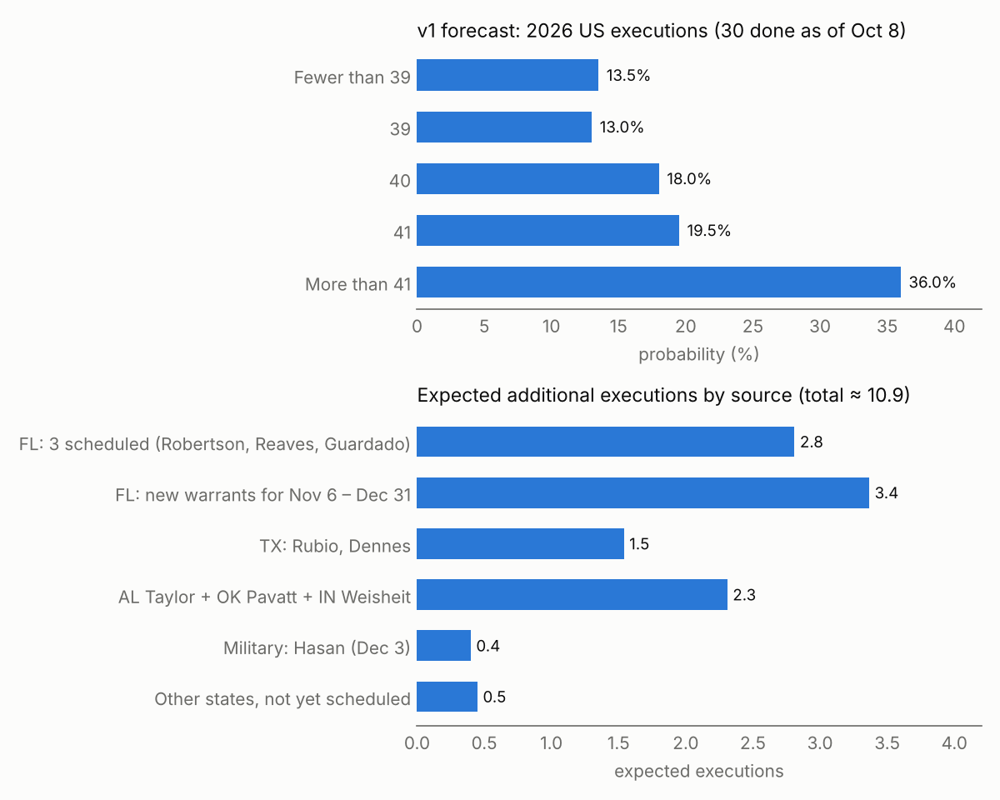

# How many executions will be carried out in the US in 2026?

| | |
|---|---|
| **Source** | Metaculus #45255 (Metaculus Cup Fall 2026) — https://www.metaculus.com/questions/45255/how-many-executions-will-be-carried-out-in-the-us-in-2026 |
| **Type** | multiple_choice (Fewer than 39 / 39 / 40 / 41 / More than 41) |
| **Opened / Closes / Resolves** | 2026-10-12 / 2026-12-02 / scheduled 2027-01-01 |
| **Status** | open |
| **Current forecast** | **<39 13.5%, 39 13.0%, 40 18.0%, 41 19.5%, >41 36.0%** — IQR on ">41" (leading option) [28.0%, 45.0%]; implied count median 41, IQR [40, 42] (v1, 2026-10-09) |
| **Community** | not yet visible — question opens 2026-10-12, CP reveal 2026-10-15 (API, 2026-10-09; n=1) |
| **Next review** | 2026-10-16 |

<!-- Versions below, newest first. APPEND-ONLY: never edit or delete a past version. -->

---

## v1 — Initial forecast — 2026-10-09

### What resolves YES

The question asks for the number of executions carried out in the United States in calendar
year 2026, binned into *Fewer than 39 / 39 / 40 / 41 / More than 41*. **The resolution
criteria and fine print are not yet published** — the post is in "upcoming" state until
2026-10-12 and the API returns `null` for both (fetched 2026-10-09). I assume, as for every
similar Metaculus question, that resolution follows the Death Penalty Information Center
(DPIC) execution database for 2026-01-01 through 2026-12-31, which counts state, federal and
(by extension) military executions. Edge cases to recheck once the text is live: (a) whether
a **military** execution (Nidal Hasan, set for 2026-12-03 at Fort Hood, Texas) counts — DPIC
already lists it among upcoming US executions, so I count it; (b) a **failed** execution
(Christa Pike, Tennessee, 2026-09-30, still alive in hospital) does not count unless DPIC adds
her, which I treat as negligible; (c) a time-zone edge for a 2026-12-31 evening execution.
The count stood at **30** (DPIC, last updated 2026-10-08).

### Outside view

Three reference classes, all pointing at ~39–43:

| Class | Calculation | Implied 2026 total |
|---|---|---|
| 2026 year-to-date run-rate | 30 executions in 281 days → 0.107/day × 84 remaining days ≈ 9.0 | ≈ 39 |
| Recent 2026 pace (Jul 1 – Oct 8) | 14 in 100 days → 0.14/day × 84 ≈ 11.8 | ≈ 42 |
| 2025 same-window additions | 2025 had 13 executions from Oct 10 to Dec 31 (47 total) [3] | ≈ 43 |

Warrant-completion base rate (DPIC 2026 outcomes table [2]): 30 of 58 scheduled dates were
carried out; excluding Ohio and Pennsylvania (11 structural governor reprieves that never
come close), 30 of 38 = **79%**. By state: Florida 16/18 (89%), Texas 7/7, Oklahoma 3/3,
Alabama 2/4 (one commutation, one injunction later re-set), Tennessee 1/4.

### Inside view

Total = 30 + (scheduled warrants that hold) + (new Florida warrants for Nov 6 – Dec 31) +
(anything else not yet scheduled).

**Nine dates on the calendar** (DPIC upcoming list, Wikipedia, TDCJ; 2026-10-08/09):

| Date | Prisoner | Jurisdiction | P(carried out) | Why |
|---|---|---|---|---|
| Oct 13 | James Robertson | FL | 0.96 | waived appeals after a 2012 guilty plea; FL completion ~90%+ |
| Oct 20 | William Reaves Jr. | FL | 0.93 | 77-year-old cop killer; no live issue reported |
| Nov 5 | Jesse Guardado | FL | 0.92 | protocol complaint pending in M.D. Fla.; such suits have never stopped a DeSantis warrant |
| Nov 5 | Michael Taylor | AL | 0.87 | lethal injection, not nitrogen; Ivey "no plans" for clemency but she commuted Burton in March |
| Nov 5 | Jeffrey Weisheit | IN | 0.72 | Indiana had **no drugs in inventory** as of the latest report; clemency hearing Oct 16/19; pentobarbital scrutiny after Pike |
| Nov 12 | John Rubio | TX | 0.72 | found competent 2026-10-07 but the Court of Criminal Appeals must still review; long mental-illness history |
| Nov 12 | James Pavatt | OK | 0.72 | clemency hearing Oct 14; innocence-flavoured petition with a former DOC director's support; Stitt commuted Tremane Wood in 2025 |
| Nov 19 | Reinaldo Dennes | TX | 0.82 | no reported litigation |
| Dec 3 | Nidal Hasan | Military | 0.40 | first military execution since 1961; counsel calls a federal habeas petition "a distinct possibility"; the last presidentially approved military execution (Ronald Gray, set for Dec 2008) was stayed by a federal court and has never happened |

Expected from these nine: **≈ 7.1** (with correlated shocks, see model).

**Florida new warrants.** DeSantis signs warrants ~30 days ahead. Since mid-July Florida has
scheduled 5–6 executions per 8-week window (Jul 14, Jul 28 ×2, Aug 18, Sep 1, Sep 10, Sep 29,
Oct 13 ×2, Oct 20, Nov 5), and in the same Nov 6 – Dec 31 window of 2025 it executed 4
(Nov 13, Nov 20, Dec 9, Dec 19) [3]. DeSantis is term-limited (leaves office Jan 2027) and
has publicly chased the record. Against that: his first-ever warrant withdrawal (Thompson,
Oct 8) and post-Pike scrutiny of lethal injection. I model the number of further Florida
warrants landing in Nov 6 – Dec 31 as a distribution with mean 3.6 (0:2%, 1:5%, 2:12%, 3:25%,
4:30%, 5:18%, 6:8%), each 93% likely to be carried out → **≈ 3.4** expected.

**Everything else.** Texas cannot add (90-day notice rule; only Rubio and Dennes are listed).
Tennessee is halted for the rest of 2026 by Gov. Lee. Oklahoma's cadence puts its next date
after Pavatt in 2027. Ohio and Pennsylvania are under reprieves. Residual paths: an Arizona
warrant (one request pending per Wikipedia; executions follow exactly 35 days after a warrant),
Mississippi (two long-pending requests), a reset Georgia date for Stacey Humphreys, a second
Alabama window, South Carolina, Louisiana, a re-signed Thompson warrant. Modelled as
Poisson(0.45).

**Model** (`raw/model_v1.py`, 400k draws, shared logit shock σ=0.4 for common-cause
correlation such as a drug-supply or protocol shock): mean 40.8, 5–95% [37, 44], IQR [40, 42];
bins <39 12.2%, 39 12.6%, 40 17.8%, 41 20.0%, >41 37.4%. I widen slightly toward the lower
tail for model uncertainty (unknown resolution text, unmodelled correlated pauses).

### Evidence

- **30 executions as of 2026-10-08** in 6 states: FL 16, TX 7, OK 3, AL 2, AZ 1, TN 1 [1].
  Amnesty USA's "29" (2026-10-09) and Wikipedia's "28" are stale snapshots [12].
- **Thompson warrant withdrawn** 2026-10-08 after a competency commission — first DeSantis
  withdrawal [6][7]. Removes one Oct 13 execution that some trackers still list (LR for
  ">41" ≈ 0.8 relative to a 10-date calendar).
- **Tennessee halted** remaining 2026 executions after the failed Pike execution
  (2026-09-30); Sutton's Dec 3 date is off [8].
- **Indiana proceeding** despite the Tennessee failure, but no drugs yet acquired [9][10].
- **Hasan**: Trump approved Oct 2; Army set Dec 3, livestream announced [11][13]. No habeas
  filed as of Oct 8; counsel undecided [14]. Gray precedent is the strongest evidence for a stay.
- **Pavatt** clemency hearing Oct 14 [15]; **Rubio** competency finding Oct 7, appellate
  review pending [16]; **Taylor** window Nov 5–6 [17]; **Guardado** warrant signed Oct 5 [4].
- Absent: no new Florida warrant after Oct 5 has been reported yet (expected — the next would
  normally come mid-October for a mid-November date). No Arizona warrant motion found since
  McGill [18].

### Other forecasters

| Source | Value | As of | Note |
|---|---|---|---|
| Metaculus CP (recency-weighted) | hidden | 2026-10-09 | question opens 2026-10-12, CP reveal 2026-10-15; n=1 |
| Metaculus Pro | hidden | 2026-10-09 | — |
| Metaculus gold medalists | hidden | 2026-10-09 | — |
| Kalshi / Polymarket | no market found | 2026-10-09 | searched; none on US execution counts |
| Manifold | no market found | 2026-10-09 | — |
| Sentinel / Mantic / GJOpen / INFER | no matching question found | 2026-10-09 | — |

No cohort comparison is possible yet. The bin design (39/40/41 as the middle options) suggests
the question author centred on ≈ 40, close to my median of 41. **Re-fetch on 2026-10-16** and
flag any gap > 10pp on ">41" against agreeing Pro + gold cohorts.

### Scenarios

| # | Scenario | Weight | Implies |
|---|---|---|---|
| 1 | Florida slows (≤ 2 new executions) and ≥ 2 of the non-FL dates fall through | 13.5% | < 39 |
| 2 | Roughly half the fragile dates (IN, OK, TX-Rubio, Hasan) fall through; Florida adds ~2–3 | 13.0% | 39 |
| 3 | Central case: Hasan stayed, one other non-FL date slips, Florida adds 3 | 18.0% | 40 |
| 4 | Central-high: Florida adds 3–4, one fragile date slips | 19.5% | 41 |
| 5 | Florida keeps its 2/month pace (4+), most dates hold, or Hasan / a surprise state adds | 36.0% | > 41 |

### Sensitivity

| Assumption | If instead | Forecast becomes |
|---|---|---|
| Florida adds ~3.4 more in Nov 6 – Dec 31 | mean ~2 (pace halves after Thompson / Pike) | <39 30%, 39 21%, 40 21%, 41 15%, >41 12% |
| | mean ~4.2 (keeps 2025–26 late-year pace) | <39 9%, 39 10%, 40 16%, 41 20%, >41 46% |
| Hasan executed with p = 0.40 | 0.15 (habeas + stay) / 0.70 (he declines to fight) | >41 32% / 43% |
| Other states add ~0.45 | 0.15 / 1.0 | >41 31% / 48% |

The Florida assumption carries the forecast; everything else moves ">41" by ≤ 6pp.

### What would change my mind (tripwires)

- [ ] Robertson (Oct 13) or Reaves (Oct 20) **not** executed on schedule → ">41" −6pp (each), mass to 39/40.
- [ ] DeSantis signs a new warrant for a mid/late-November date by **2026-10-24** → ">41" +5pp; **no** new Florida warrant by **2026-10-31** → ">41" −10pp.
- [ ] Oklahoma Pardon and Parole Board recommends clemency for Pavatt on **2026-10-14** → ">41" −4pp.
- [ ] Hasan files federal habeas with a stay request by **2026-11-20** → ">41" −4pp; publicly declines to challenge by then → +4pp.
- [ ] Indiana reports a stay, a clemency grant, or failure to obtain drugs for Weisheit by **2026-11-04** → ">41" −4pp.
- [ ] Resolution text (published **2026-10-12**) uses a source or definition other than DPIC calendar-year counts (e.g. excludes military) → re-analyse.

### Sources

1. DPIC — Executions in 2026 (30 executions, updated 2026-10-08) — https://deathpenaltyinfo.org/executions/2026 (accessed 2026-10-09)
2. DPIC — Outcomes of Death Warrants in 2026 — https://deathpenaltyinfo.org/executions/upcoming-executions/outcomes-of-warrants/outcomes-of-death-warrants-in-2026 (accessed 2026-10-09)
3. DPIC — Executions in 2025 (47) — https://deathpenaltyinfo.org/executions/2025 (accessed 2026-10-09)
4. CBS Miami — DeSantis signs 20th death warrant of 2026 (Guardado) — https://www.cbsnews.com/miami/news/desantis-20th-death-warrant-jesse-guardado-florida-2026-execution-record/ (accessed 2026-10-09)
5. DPIC — Upcoming Executions — https://deathpenaltyinfo.org/executions/upcoming-executions (accessed 2026-10-09)
6. CBS Miami — DeSantis cancels execution of William Lee Thompson — https://cbsnews.com/miami/news/desantis-cancels-execution-william-lee-thompson (accessed 2026-10-09)
7. Florida Death Penalty substack — Thompson warrant: execution stayed pending Commission review — https://fladeathpenalty.substack.com/p/thompson-warrant-execution-stayed (accessed 2026-10-09)
8. OPB/AP — Tennessee governor halts executions after Christa Gail Pike survives lethal injection — https://www.opb.org/article/2026/10/01/tennessee-governor-halts-executions-after-christa-gail-pike-survives-lethal-injection/ (accessed 2026-10-09)
9. Indiana Capital Chronicle — Indiana plans to proceed with execution after botched Tennessee attempt — https://indianacapitalchronicle.com/2026/10/02/indiana-plans-to-proceed-with-execution-after-botched-tennessee-attempt/ (accessed 2026-10-09)
10. Indiana Capital Chronicle — Indiana high court orders Jeffrey Weisheit executed Nov. 5 — https://indianacapitalchronicle.com/2026/08/28/indiana-high-court-orders-jeffrey-weisheit-executed-nov-5/ (accessed 2026-10-09)
11. NPR — Pentagon says firing squad execution of Fort Hood shooter will be livestreamed — https://www.npr.org/2026/10/09/g-s1-147419/fort-hood-shooter-execution (accessed 2026-10-09)
12. Amnesty USA — World Day Against the Death Penalty — https://amnestyusa.org/blog/world-day-against-the-death-penalty-time-for-governor-newsom-to-commute-death-sentences-in-california (accessed 2026-10-09)
13. Military Times — Army sets date, location for execution of Nidal Malik Hasan — https://www.militarytimes.com/news/your-military/2026/10/07/army-sets-date-location-for-execution-of-nidal-malik-hasan/ (accessed 2026-10-09)
14. Washington Times/AP — As Army moves to execute Fort Hood shooter, questions about procedure linger — https://www.washingtontimes.com/news/2026/oct/7/questions-procedure-linger-army-moves-execute-fort-hood-shooter/ (accessed 2026-10-09)
15. KGOU — Execution date set for Oklahoma County killer (Pavatt) — https://www.kgou.org/criminal-justice/2026-08-28/execution-date-set-for-oklahoma-county-killer (accessed 2026-10-09)
16. KRGV — John Allen Rubio found competent to be executed — https://www.krgv.com/news/john-allen-rubio-found-competent-to-be-executed (accessed 2026-10-09)
17. Alabama Reflector — Gov. Kay Ivey schedules November execution for Michael Taylor — https://alabamareflector.com/?p=22694 (accessed 2026-10-09)
18. KJZZ — Arizona Supreme Court issues first 2026 execution warrant (McGill) — https://www.kjzz.org/politics/2026-03-26/arizona-supreme-court-issues-first-2026-execution-warrant (accessed 2026-10-09)
19. TDCJ — Scheduled Executions (Rubio 11/12, Dennes 11/19; updated 2026-10-08) — https://www.tdcj.texas.gov/death_row/scheduled_executions.html (accessed 2026-10-09)
20. Wikipedia — List of people scheduled to be executed in the United States — https://en.wikipedia.org/wiki/List_of_people_scheduled_to_be_executed_in_the_United_States (accessed 2026-10-09)
21. Fox 13 — DeSantis signs death warrant for inmate featured in Netflix series, schedules double execution day — https://www.fox13news.com/news/desantis-signs-death-warrant-inmate-featured-netflix-series-schedules-double-execution-day (accessed 2026-10-09)
22. AJC — Georgia man's scheduled execution will not take place (Humphreys) — https://www.ajc.com/news/2026/09/judge-weighs-halting-execution-under-new-georgia-law/ (accessed 2026-10-09)

**Date**: 2026-10-09
**Forecast**: Fewer than 39 13.5%, 39 13.0%, 40 18.0%, 41 19.5%, More than 41 36.0% (IQR on "More than 41" [28.0%, 45.0%]; implied count median 41, IQR [40, 42])
**Thesis**: 30 executions are done (DPIC, 2026-10-08) and nine dates remain, worth ≈ 7 after stay risk — the fragile ones are Hasan's first-in-65-years military execution, Indiana's drug supply, Pavatt's clemency bid and Rubio's competency review. The swing factor is Florida, which has been scheduling ~2 a month and added 4 in the same window of 2025; ~3.4 more Florida executions puts the median at 41 with a fat right tail.
