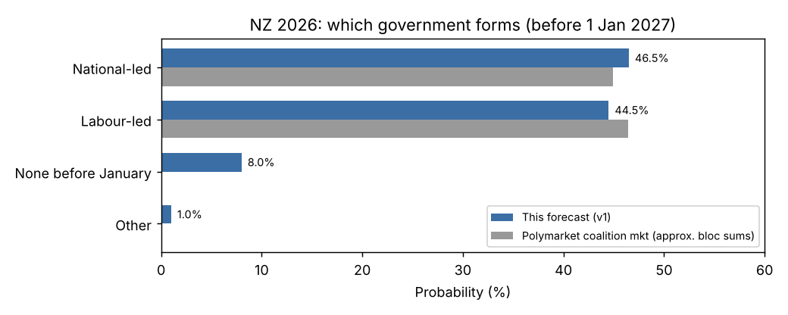

# Which government will form after the 2026 New Zealand general election?

| | |
|---|---|
| **Source** | Metaculus #45330 — https://www.metaculus.com/questions/45330/which-government-will-form-after-the-2026-new-zealand-general-election |
| **Type** | multiple_choice (Labour-led / National-led / None before January / Other) |
| **Opened / Closes / Resolves** | 2026-10-12 / 2026-11-06 (day before the 7 Nov election) / on government formation, at the latest early January 2027 |
| **Status** | open |
| **Current forecast** | **National-led 44.5%, Labour-led 45.5%, None before January 9.0%, Other 1.0%**. IQR on Labour-led (now the leading option) [38.5%, 52.5%] (v2, 2026-10-16) |
| **Community (as of 2026-10-16)** | CP hidden until 2026-10-18 (n=58); Pro and gold n/a. Polymarket: Luxon next PM 52.5%, Hipkins 45%; coalition blocs National-led 41.4% / Labour-led 52.4% |
| **Next review** | 2026-10-19 |

<!-- Versions below, newest first. APPEND-ONLY: never edit or delete a past version. -->

---

## v2 — Update — 2026-10-16

### Revision
| Driver | Direction | Effect |
|---|---|---|
| Prior (v1, 2026-10-09) | — | National-led 46.5%, Labour-led 44.5%, None before January 8.0%, Other 1.0%. IQR on National-led [39.5%, 53.5%] |
| TOP polling firmer: Verian 8–12 Oct at 8% (+1), Anacta 5.4%. Only Curia (4.8%) is below 5%. Seven-poll mean ≈ 6.2% (was 5.9%), so P(TOP clears) rises from ~71% to ~75% [2,22] | ↓ National-led | −1.5pp National-led, +1.5pp Labour-led |
| Wong (TOP leader) says TOP will "approach the largest party first" and "might need to wait until the special votes come in". Specials land 27 Nov, which leaves less time before Christmas [22] | ↑ None before January | +1.0pp None, taken −0.5pp from each major |
| The same Wong line weakens the "TOP is a de facto Labour partner" reading. If National is the largest party, TOP courts it first, which raises the odds of a National U-turn or TOP abstaining. Luxon re-ruled TOP out on 13 Oct, though, so the effect is small [22] | ↑ National-led | +0.5pp National-led, −0.5pp Labour-led |
| Polymarket moved toward Labour. Coalition-market blocs: National-led 43.0→41.4, Labour-led 46.4→52.4. Luxon PM fell 55.5→52.5 [13,14] | ↓ National-led | −0.5pp National-led (a small weight: about $65k volume, and it partly echoes the same polls) |
| Kiwipolls coalition-retains fell 40.1→38.9 (13 Oct). election2026.nz is unchanged at L57 / TOP 7 / R59 (12 Oct) [16,17] | → | already counted in the poll row |
| Metaculus: CP hidden until 18 Oct (n=58). Two commenters sit at 55–56% National-led on thin reasoning. No Pro or gold data | → | none |
| **New forecast** | | **National-led 44.5%, Labour-led 45.5%, None before January 9.0%, Other 1.0%. IQR on Labour-led (now the leading option) [38.5%, 52.5%]** |

### Tripwire check
| Tripwire from v1 | Fired? | Note |
|---|---|---|
| Final-week poll average with TOP < 5.0% (by 5 Nov) | not yet (not due) | The trend runs the other way: the current mean is ≈ 6.2%, and Curia at 4.8% is the only sub-5% reading |
| TOP commits to backing Labour | not fired (partial, opposite direction) | Wong will approach the *largest* party first and keeps the National door open. No commitment to either side |
| National or Luxon softens the TOP rule-out | not fired | Luxon re-ruled out TOP and a grand coalition on 13 Oct ("party vote National"). election2026.nz still applies the rule-out in only ~75% of its simulations |
| Election-night right bloc ≥ 63 without TOP | not yet (7 Nov) | — |
| Election-night TOP ≥ 5.3% and left + TOP ≥ 63 | not yet (7 Nov) | — |
| No coalition or confidence-and-supply agreement by 18 Dec | not yet | — |

### What resolves YES
unchanged from v1

### Outside view
unchanged from v1

### Inside view
The structure is unchanged from v1. Updated inputs:

**Polls since v1** (Wikipedia, accessed 2026-10-16):

| Poll | Dates | Nat / Lab / Grn / ACT / NZF / TPM / TOP |
|---|---|---|
| 1News–Verian | 8–12 Oct | 28 / 28 / 15 / 10 / 10 / 0.4 / 8 |
| Anacta | 6–10 Oct | 28 / 29 / 15 / 9 / 10 / 1.9 / 5.4 |

Across the seven polls from 23 Sep to 12 Oct, the right bloc averages ≈ 48.3% and the left bloc ≈ 44.4%. Both are essentially unchanged from v1.

TOP is now ≥ 5.4% in six of seven polls. Verian projects R58 / L57 (or 53, depending on the Māori-seat overhang) / TOP 10, so neither bloc governs without TOP. I raise P(TOP clears 5%) from 71% to about 75%. A minor-party fade in the final weeks is still plausible, and Curia sits below the threshold. A rerun of the seat simulation with that shift gives roughly −1.5pp to National-led.

**TOP's stated process.** Wong will go to the largest party first, then the second-largest, and may wait for the specials. Labour (54%) and National (45.5%) are near coin-flips to win the most seats on Polymarket. If National is the largest party and the right bloc is larger, TOP courts National first. Luxon's rule-out then either holds (TOP goes to Labour, but only after a delay) or cracks (National-led).

So I trim P(Labour-led | TOP pivotal, right bloc larger) from 62% to about 58%, and raise P(None before January | TOP pivotal) by a few points. Waiting for specials pushes the start of real talks to 27 Nov, which leaves about 3.5 weeks before Christmas. Labour's line is "door open" to TOP, but "no pre-election deals" [23].

### Evidence
- 1News–Verian (13 Oct): Hipkins and Luxon are tied at 20% as preferred PM, and Hipkins is up 2. Luxon repeats the TOP rule-out and rules out a grand coalition [22].
- Hipkins (9 Oct) says a vote for TOP is "giving your vote away". Labour is squeezing TOP's vote rather than courting it, which slightly lowers P(TOP clears) if the squeeze works [23].
- Absent evidence: no National U-turn, no TOP commitment, and no leadership change at National.

### Other forecasters
| Source | Value | As of | Note |
|---|---|---|---|
| Metaculus CP (recency-weighted) | hidden (n=58) | 2026-10-16 | CP reveal 2026-10-18 |
| Metaculus Pro | n/a | 2026-10-16 | hidden |
| Metaculus gold medalists | n/a | 2026-10-16 | hidden |
| Metaculus comments | National-led 55%, 56% (two users) | 2026-10-12 / 2026-10-15 | rely on Roy Morgan and Curia; low information |
| Polymarket: coalition | Nat+ACT+NZF 39.5%, Lab+Grn 33.0%, Lab+Grn+TPM 16.5%, Other 9.1%. Blocs: National-led ≈ 41.4%, Labour-led ≈ 52.4% | 2026-10-16 | $65k volume; the "Other" leg is a residual |
| Polymarket: next PM | Luxon 52.5%, Hipkins 45.0% | 2026-10-16 | $43k volume; no January cutoff |
| Polymarket: most seats | Labour 54%, National 45% | 2026-10-16 | $64k volume |
| Kiwipolls model | Coalition retains 38.9%, Opposition 2.8%, disputed 58.4% | 2026-10-13 | — |
| election2026.nz | L57 / TOP 7 / R59 of 123 (62 needed) | 2026-10-12 | 25-poll average |

Where I sit: National-led 44.5% plus about 5pp of eventual-Luxon mass from "None" gives roughly 49.5% eventual Luxon. That is about 3pp under the PM market (52.5%) and above the coalition market's National bloc (41.4%). The two Polymarket markets still disagree with each other by about 10pp on the same underlying event. I take the midpoint and do not herd to either.

### Scenarios
| # | Scenario | Weight | Implies |
|---|---|---|---|
| 1 | TOP below 5%; National–ACT–NZ First re-elected outright | 31% | National-led |
| 2 | Left + TOP majority with left bloc larger; Labour-led with TOP confidence and supply | 27% | Labour-led |
| 3 | TOP pivotal, right bloc larger: TOP backs Labour (16.5%), or National U-turns / TOP abstains (9%) | 25.5% | Lab-led 16.5% / Nat-led 9% |
| 4 | Talks wait for the specials (27 Nov) and the swearing-in slips into January | 9% | None before January |
| 5 | Other hung configurations | 6.5% | mostly National-led |
| 6 | Definitional oddity | 1% | Other |

### Sensitivity
Unchanged from v1 in structure. Each driver still moves National-led by about ±6pp. The new central inputs are P(TOP clears) ≈ 75% and P(Labour-led | TOP pivotal, right larger) ≈ 58%.

### What would change my mind (tripwires)
- [ ] Final-week poll average (polls ending by 2026-11-05) has TOP < 5.0% → National-led +8pp
- [ ] TOP publicly commits before 2026-11-07 to supporting a Labour-led government → Labour-led +6pp
- [ ] National or Luxon softens the TOP rule-out before 2026-11-07, or National changes leader → National-led +5pp
- [ ] Metaculus CP / Pro / gold revealed on 2026-10-18 with Pro or gold ≥ 10pp from me on National-led → re-examine for a missed fact (no automatic move)
- [ ] Election-night preliminary count (2026-11-07): right bloc ≥ 63 seats without TOP → National-led to about 85%; TOP ≥ 5.3% and left + TOP ≥ 63 → Labour-led to about 75%
- [ ] TOP states after election night that it will wait for the 27 Nov specials before negotiating → None before January +5pp
- [ ] No coalition or confidence-and-supply agreement announced by 2026-12-18 → None before January +20pp

### Sources
1. Metaculus #45330 question text (via aggregations script) — https://www.metaculus.com/questions/45330/ (accessed 2026-10-09)
2. Wikipedia — Opinion polling for the 2026 New Zealand general election — https://en.wikipedia.org/wiki/Opinion_polling_for_the_2026_New_Zealand_general_election (accessed 2026-10-09)
3. Wikipedia — 2026 New Zealand general election (key dates, stances) — https://en.wikipedia.org/wiki/2026_New_Zealand_general_election (accessed 2026-10-09)
4. RNZ — NZ First surge extends coalition lead, latest Taxpayers' Union Curia poll — https://rnz.co.nz/news/politics_election-2026/1795546/nz-first-surge-extends-coalition-lead-latest-taxpayers-union-curia-poll-shows (accessed 2026-10-09)
5. NZ Herald — Power remains in Opportunity's hands in latest 1News-Verian poll — https://www.nzherald.co.nz/nz/politics/election-2026-power-remains-in-opportunitys-hands-in-latest-1news-verian-poll/XAKK3QPWINB2TAYCUNK24FC6AQ/ (accessed 2026-10-09)
6. Roy Morgan — NZ voting intention, September 2026 — https://www.roymorgan.com/findings/10351-nz-national-voting-intention-september-2026 (accessed 2026-10-09)
7. The Spinoff — Labour finally officially rules out working with NZ First (11 Aug 2026) — https://thespinoff.co.nz/politics/11-08-2026/its-clearly-not-going-to-happen-labour-finally-officially-rules-out-working-with-nz-first (accessed 2026-10-09)
8. RNZ — Hipkins officially rules out working with NZ First — https://www.rnz.co.nz/news/politics/952667/chris-hipkins-officially-rules-out-working-with-new-zealand-first-in-any-government-he-leads (accessed 2026-10-09)
9. interest.co.nz — Opportunity announces its "non-negotiable" bottom lines (29 Sep 2026) — https://www.interest.co.nz/public-policy/140455/opportunity-announces-five-non-negotiable-policy-conditions-party-plans-stand (accessed 2026-10-09)
10. RNZ — National rules out working with Opportunity Party — https://www.rnz.co.nz/news/politics/809555/national-rules-out-working-with-opportunity-party (via question background; accessed 2026-10-09)
11. Waatea News — Hipkins draws lines around Te Pāti Māori (19 Aug 2026) — https://waateanews.com/2026/08/19/coalition-chess-heats-up-as-hipkins-draws-lines-around-te-pati-maori/ (accessed 2026-10-09)
12. The Spinoff / Te Ao Māori News — Maipi-Clarke leads Hauraki-Waikato (6 Oct 2026) — https://thespinoff.co.nz/atea/06-10-2026/maipi-clarke-leads-hauraki-waikato-as-party-vote-remains-neck-and-neck (accessed 2026-10-09)
13. Polymarket — Which coalition will form the next New Zealand government? — https://polymarket.com/event/which-coalition-will-form-the-next-new-zealand-government (gamma API, accessed 2026-10-09; `raw/polymarket-which-coalition-*.json`)
14. Polymarket — Next Prime Minister of New Zealand — https://polymarket.com/event/next-prime-minister-of-new-zealand-174 (gamma API, accessed 2026-10-09)
15. Polymarket — New Zealand legislative election winner — https://polymarket.com/event/new-zealand-legislative-election-winner (gamma API, accessed 2026-10-09)
16. Kiwipolls — model and poll tracker (updated 8 Oct 2026) — https://www.kiwipolls.co.nz/ (accessed 2026-10-09)
17. election2026.nz — polling average and seat projection (5 Oct 2026) — https://election2026.nz/ (accessed 2026-10-09)
18. Manifold — NZ election markets (API search) — https://api.manifold.markets/v0/search-markets?term=new%20zealand%20election%202026 (accessed 2026-10-09; `raw/manifold-search-2026-10-09.json`)
19. 1News — Christopher Luxon sworn in as prime minister (27 Nov 2023) — https://tvnz-1-news-prod.cdn.arcpublishing.com/2023/11/27/christopher-luxon-sworn-in-as-new-zealands-new-prime-minister (accessed 2026-10-09)
20. Newsroom — It's the sixth Labour government (2017 formation timeline) — https://www.newsroom.co.nz/2017/10/19/54406/its-the-sixth-labour-government (accessed 2026-10-09)
21. Newsroom — Despite Polymarket ban, Kiwi punters can still bet on Luxon's fate (13 Aug 2026) — https://newsroom.co.nz/2026/08/13/six-months-after-polymarket-ban-kiwis-are-betting-on-luxons-fate/ (accessed 2026-10-09)
22. 1News — Poll: Hipkins and Luxon now neck and neck, Opportunity on track for 10 MPs (13 Oct 2026) — https://www.1news.co.nz/2026/10/13/poll-hipkins-and-luxon-now-neck-and-neck-opportunity-on-track-for-10-mps/ (accessed 2026-10-16)
23. RNZ — As it happened: Election campaign, 9 October (Hipkins: Opportunity supporters "giving their vote away") — https://www.rnz.co.nz/news/politics_election-2026/1798632/live-hipkins-says-opportunity-supporters-giving-their-vote-away-peters-shouldn-t-even-be-in-parliament (accessed 2026-10-16)
24. NZ Herald — Labour's "door open" to Opportunity — https://www.nzherald.co.nz/nz/politics/labours-door-open-to-opportunity-senior-roles-for-te-pati-maori-unlikely-as-chris-hipkins-clarifies-vague-remarks/UBE55KHGCFGDHGYSRLQ3PUQN7Q/ (accessed 2026-10-16)
25. Wikipedia — Opinion polling for the 2026 New Zealand general election — https://en.wikipedia.org/wiki/Opinion_polling_for_the_2026_New_Zealand_general_election (accessed 2026-10-16)
26. Kiwipolls (updated 13 Oct 2026) — https://www.kiwipolls.co.nz/ (accessed 2026-10-16)
27. election2026.nz (updated 12 Oct 2026) — https://election2026.nz/ (accessed 2026-10-16)
28. Polymarket gamma API, coalition / next PM / most seats / parties-in-government events — https://gamma-api.polymarket.com/events?slug=which-coalition-will-form-the-next-new-zealand-government (and sibling slugs; `raw/polymarket-*-2026-10-16.json`) (accessed 2026-10-16)
29. Metaculus #45330 pre-fetched snapshot — https://www.metaculus.com/questions/45330/ (`raw/metaculus-2026-10-16.json`) (accessed 2026-10-16)

**Question**: [Which government will form after the 2026 New Zealand general election?](https://www.metaculus.com/questions/45330/which-government-will-form-after-the-2026-new-zealand-general-election)
**Date**: 2026-10-16
**Forecast**: National-led 44.5%, Labour-led 45.5%, None before January 9.0%, Other 1.0%. IQR on Labour-led (now the leading option) [38.5%, 52.5%]
**Thesis**: Still a dead heat that turns on the Opportunity Party (TOP). TOP has firmed above the 5% threshold (Verian 8%, mean ≈ 6.2%) and Luxon has re-ruled it out, which tilts slightly to Labour [22,25]. TOP leader Wong's "largest party first, maybe wait for specials" line adds delay risk and a thin National path [22]. Polymarket has drifted toward Labour (coalition blocs 41/52, Luxon PM 52.5%) [28].

---

## v1 — Initial forecast — 2026-10-09

### What resolves YES
Resolution depends on which party **leads** the first government appointed by the
Governor-General after the 7 Nov 2026 election. **Labour-led** and **National-led** apply
whatever the partners. **Other** applies if any other party leads. **None before January**
applies if no government is formed before January 2027. Caretaker or transitional governments
do not count. Under the Cabinet Manual, a government is "formed" when the Governor-General
appoints it, i.e. when ministers are sworn in. The New Zealand Government is the primary
source, e.g. the seating plan for the 55th Parliament. Key dates (Wikipedia, from the
Electoral Commission): election **7 Nov**, official results **27 Nov**, writ return
**3 Dec** (legal deadline 15 Jan 2027).

Counter-intuitive paths:
(a) **"None before January" is a real outcome**, not a formality. Only 34 days separate the
official result from 31 Dec, and they run into Christmas. In 2023 the government was sworn in
24 days after the official result and 44 days after election night. 7 Nov + 44 days =
21 Dec. If the deal is signed but the swearing-in slips to early January, this option
resolves.
(b) If the incumbent National–ACT–NZ First government is returned, it continues as a caretaker
until the new ministry is appointed. A renewed ministry sworn in during December resolves
National-led.
(c) A Labour minority government with confidence-and-supply support from the Opportunity Party
(TOP) and Te Pāti Māori is still "Labour-led".

### Outside view
- **Who leads.** Every MMP government since 1996 has been led by Labour or National (10/10).
  "Other" therefore has a base rate of about 0, and I give it 1% for definitional oddities.
  Every first-term government that sought a second term under MMP got one: Labour 2002,
  National 2011 and Labour 2020, so 3/3. That suggests an incumbent prior of perhaps 70–80%.
  It is weak because n is tiny, and current polling (the incumbent bloc barely ahead, TOP
  pivotal) is a far stronger signal. I give this prior little weight.
- **Timing.** Days from election to swearing-in under MMP: 1996 ≈ 65 (coalition announced
  10 Dec, sworn in 16 Dec; dates from memory, not re-verified), 1999 ≈ 13, 2002 ≈ 19,
  2005 ≈ 32, 2008 ≈ 11, 2011 ≈ 18, 2014 ≈ 18, 2017 ≈ 33, 2020 ≈ 20, 2023 = 44. One of ten
  exceeded the 54 days available here. Raw base rate ≈ 10%. That falls to about 5% for a clear
  result and rises to 15–25% for a hung or multi-party result.

### Inside view
**Polling average.** Eight polls from 31 Aug to 5 Oct 2026 (Wikipedia polling page, accessed
2026-10-09): National 28.6, Labour 27.9, Greens 14.5, ACT 9.6, NZ First 10.4, Te Pāti Māori
(TPM) 1.7, Opportunity 5.9. The right bloc (National + ACT + NZ First) has 48.6%. The left
bloc (Labour + Greens + TPM) has 44.1%.

**The pivot is TOP and the 5% threshold.**
- National has ruled out TOP entirely, including confidence and supply (Luxon, repeated late
  August).
- Labour has ruled out NZ First (Hipkins, ~10 Aug 2026). NZ First had already ruled out
  Labour.
- TOP has not ruled out Labour. It published five bottom lines on 29 Sep: Commerce Commission
  powers, lobbying and donation caps, a 10-year health plan, phasing out bottom trawling, and
  recommitting to the Paris Agreement. These fit Labour and the Greens far better than
  National. TOP also says it will not back any government with Peters as foreign minister.
- Labour and the Greens agreed in February to govern together. TPM wants to join them.
  Hipkins is lukewarm on TPM ("unlikely senior roles"), but TPM would never vote confidence in
  National.

**Seat simulation** (`raw/seat-sim-2026-10-09.py`): 20,000 draws around the average, with per-party
error σ = 2.8 for National and Labour and 1.3–1.8 for minor parties, a −0.3pp haircut on TOP,
Sainte-Laguë allocation, TPM winning 2–6 electorates (overhang), ACT holding Epsom, and a 5%
chance TOP wins an electorate. P(TOP clears) = 71%.

| Seat outcome (sim) | P | → National-led | → Labour-led | → none before Jan |
|---|---|---|---|---|
| Right bloc has an outright majority | 36% | 95% | 1% | 4% |
| Left + TOP majority, left bloc ≥ right bloc | 30% | 5% | 87% | 8% |
| Left + TOP majority, right bloc larger (TOP pivotal; TOP abstaining → National minority) | 28% | 28% | 62% | 10% |
| Other hung configurations | 6% | 60% | 15% | 25% |
| **Total** | 100% | **47.2%** | **44.6%** | **8.1%** |

I then moved 0.7pp to "Other" for definitional or constitutional oddities.

Independent models agree that TOP holding the balance is the modal outcome. election2026.nz
(5 Oct, 24-poll average) has Left 57, TOP 7, Right 59 out of 123, with 62 needed. Kiwipolls
(8 Oct) has the Coalition retaining power in 40%, the Opposition winning in 4%, and a
"disputed" outcome in 56%.

### Evidence
- **Momentum is mixed.** NZ First is rising (12% in Curia, 13% in Freshwater) and National is
  sliding (25.9% in Reid). Labour leads in Reid (30.8 vs 25.9) and Anacta. Roy Morgan and Curia
  favour the right. House effects are large, so the average is the right object.
- **TOP threshold.** Polls run 4.5–7.0, averaging 5.9. Curia's own estimate gave TOP a 42%
  chance of clearing 5% on its 4.8 reading. Manifold gives TOP ≥1 seat at 74–84% (play money,
  discounted). New Zealand minor parties near the threshold have not systematically
  underperformed polls: NZ First outperformed in 2011, 2014 and 2023, while the Conservatives
  slightly underperformed in 2014. So I apply only a small haircut. A TOP collapse is the main
  path to a clear National win.
- **Te Pāti Māori.** A Whakaata Māori–Curia poll shows TPM dominating the Māori roll.
  Maipi-Clarke leads Hauraki-Waikato by 19 points. Te Tai Tokerau is a crowded contest that
  includes ex-TPM MP Kapa-Kingi. Overhang of 2–4 seats is likely, which raises the bar to
  62–63 and slightly helps the left (TPM seats are left-bloc seats).
- **Absent evidence.** I found no TOP statement committing to Labour or to abstention, and no
  sign that National is softening its TOP rule-out. Either would move this forecast by 5–10pp.

### Other forecasters
| Source | Value | As of | Note |
|---|---|---|---|
| Metaculus CP (recency-weighted) | n/a (n=2) | 2026-10-09 | opens 2026-10-12; CP reveal 2026-10-18 |
| Metaculus Pro | n/a | 2026-10-09 | not yet available |
| Metaculus gold medalists | n/a | 2026-10-09 | not yet available |
| Polymarket: coalition market | Nat+ACT+NZF 43.0%, Lab+Grn 26.9%, Lab+Grn+TPM 17.0%, Other 7.8%. Bloc sums: Nat-led ≈ 44.9%, Lab-led ≈ 46.4% | 2026-10-09 | $59k volume; spreads ~1–4¢; "Other" likely a hedge or residual |
| Polymarket: next PM | Luxon 55.5%, Hipkins 44.0% | 2026-10-09 | $41k volume; no January deadline, so this is roughly P(Nat-led eventually) |
| Polymarket: most seats | Labour 54%, National 45.5% | 2026-10-09 | $64k volume |
| Manifold: Luxon PM on 1 Feb 2027 | 52–53% | 2026-10-09 | play money, discounted; includes a caretaker Luxon |
| Kiwipolls model | Coalition retains 40.1%, Opposition 3.8%, disputed 56.2% | 2026-10-08 | TOP-pivotal heavy |
| election2026.nz model | seats L57 / TOP7 / R59 of 123 | 2026-10-05 | no published bloc probability |

The markets disagree with each other more than I disagree with them. The PM market leans
Luxon (55.5%). The coalition market is a coin flip with a slight Labour lean. I sit between
them: National-led 46.5% plus about 4–5pp of my "none before January" mass, most of which
would go to Luxon eventually. My eventual-Luxon equivalent is about 51%, about 4.5pp under the
PM market. That is within noise for $41k of volume. No Metaculus cohorts yet. Revisit after
18 Oct.

### Scenarios
| # | Scenario | Weight | Implies |
|---|---|---|---|
| 1 | TOP below 5%; National–ACT–NZ First re-elected outright, renewal sworn in early/mid December | 34% | National-led |
| 2 | Left + TOP majority with left bloc larger; Labour–Greens government, confidence and supply from TOP and TPM | 26% | Labour-led |
| 3 | TOP pivotal, right bloc larger; TOP backs Labour (17%), or abstains / National U-turns so National governs as a minority (8%) | 25% | Lab-led 17% / Nat-led 8% |
| 4 | Negotiations or a judicial recount run past Christmas; swearing-in in January | 8% | None before January |
| 5 | Other hung or messy configurations, split roughly to National | 6% | mostly National-led |
| 6 | Definitional oddity (e.g. a government led by a third party) | 1% | Other |

### Sensitivity
| Assumption | If instead | Forecast becomes |
|---|---|---|
| P(TOP clears 5%) ≈ 71% | 55% (insurgent fade, Curia-style readings) | Nat-led ≈ 52.5%, Lab-led ≈ 38.5% |
| P(Labour-led \| TOP pivotal, right larger) = 62% | 40% (TOP abstains or National U-turns) | Nat-led ≈ 52.5%, Lab-led ≈ 38.5% |
| Government formation ≤ 54 days, ~92% | 85% (multi-party deal plus recounts plus Christmas) | None ≈ 15%, Nat ≈ 43%, Lab ≈ 41% |

### What would change my mind (tripwires)
- [ ] Final-week poll average (polls ending by 2026-11-05) has TOP < 5.0% → National-led +8pp
- [ ] TOP publicly commits before 2026-11-07 to supporting a Labour-led government → Labour-led +6pp
- [ ] National or Luxon softens the TOP rule-out (e.g. "won't rule out confidence and supply") before 2026-11-07 → National-led +5pp
- [ ] Election-night preliminary count (2026-11-07): right bloc ≥ 63 seats without TOP → National-led to about 85% (+38pp); TOP ≥ 5.3% and left + TOP ≥ 63 → Labour-led to about 75% (+30pp)
- [ ] Official result 2026-11-27 shows a seat change from specials that flips the majority → re-analyse (either direction)
- [ ] No coalition or confidence-and-supply agreement announced by 2026-12-18 → None before January +20pp

### Sources
1. Metaculus #45330 question text (via aggregations script) — https://www.metaculus.com/questions/45330/ (accessed 2026-10-09)
2. Wikipedia — Opinion polling for the 2026 New Zealand general election — https://en.wikipedia.org/wiki/Opinion_polling_for_the_2026_New_Zealand_general_election (accessed 2026-10-09)
3. Wikipedia — 2026 New Zealand general election (key dates, stances) — https://en.wikipedia.org/wiki/2026_New_Zealand_general_election (accessed 2026-10-09)
4. RNZ — NZ First surge extends coalition lead, latest Taxpayers' Union Curia poll — https://rnz.co.nz/news/politics_election-2026/1795546/nz-first-surge-extends-coalition-lead-latest-taxpayers-union-curia-poll-shows (accessed 2026-10-09)
5. NZ Herald — Power remains in Opportunity's hands in latest 1News-Verian poll — https://www.nzherald.co.nz/nz/politics/election-2026-power-remains-in-opportunitys-hands-in-latest-1news-verian-poll/XAKK3QPWINB2TAYCUNK24FC6AQ/ (accessed 2026-10-09)
6. Roy Morgan — NZ voting intention, September 2026 — https://www.roymorgan.com/findings/10351-nz-national-voting-intention-september-2026 (accessed 2026-10-09)
7. The Spinoff — Labour finally officially rules out working with NZ First (11 Aug 2026) — https://thespinoff.co.nz/politics/11-08-2026/its-clearly-not-going-to-happen-labour-finally-officially-rules-out-working-with-nz-first (accessed 2026-10-09)
8. RNZ — Hipkins officially rules out working with NZ First — https://www.rnz.co.nz/news/politics/952667/chris-hipkins-officially-rules-out-working-with-new-zealand-first-in-any-government-he-leads (accessed 2026-10-09)
9. interest.co.nz — Opportunity announces its "non-negotiable" bottom lines (29 Sep 2026) — https://www.interest.co.nz/public-policy/140455/opportunity-announces-five-non-negotiable-policy-conditions-party-plans-stand (accessed 2026-10-09)
10. RNZ — National rules out working with Opportunity Party — https://www.rnz.co.nz/news/politics/809555/national-rules-out-working-with-opportunity-party (via question background; accessed 2026-10-09)
11. Waatea News — Hipkins draws lines around Te Pāti Māori (19 Aug 2026) — https://waateanews.com/2026/08/19/coalition-chess-heats-up-as-hipkins-draws-lines-around-te-pati-maori/ (accessed 2026-10-09)
12. The Spinoff / Te Ao Māori News — Maipi-Clarke leads Hauraki-Waikato (6 Oct 2026) — https://thespinoff.co.nz/atea/06-10-2026/maipi-clarke-leads-hauraki-waikato-as-party-vote-remains-neck-and-neck (accessed 2026-10-09)
13. Polymarket — Which coalition will form the next New Zealand government? — https://polymarket.com/event/which-coalition-will-form-the-next-new-zealand-government (gamma API, accessed 2026-10-09; `raw/polymarket-which-coalition-*.json`)
14. Polymarket — Next Prime Minister of New Zealand — https://polymarket.com/event/next-prime-minister-of-new-zealand-174 (gamma API, accessed 2026-10-09)
15. Polymarket — New Zealand legislative election winner — https://polymarket.com/event/new-zealand-legislative-election-winner (gamma API, accessed 2026-10-09)
16. Kiwipolls — model and poll tracker (updated 8 Oct 2026) — https://www.kiwipolls.co.nz/ (accessed 2026-10-09)
17. election2026.nz — polling average and seat projection (5 Oct 2026) — https://election2026.nz/ (accessed 2026-10-09)
18. Manifold — NZ election markets (API search) — https://api.manifold.markets/v0/search-markets?term=new%20zealand%20election%202026 (accessed 2026-10-09; `raw/manifold-search-2026-10-09.json`)
19. 1News — Christopher Luxon sworn in as prime minister (27 Nov 2023) — https://tvnz-1-news-prod.cdn.arcpublishing.com/2023/11/27/christopher-luxon-sworn-in-as-new-zealands-new-prime-minister (accessed 2026-10-09)
20. Newsroom — It's the sixth Labour government (2017 formation timeline) — https://www.newsroom.co.nz/2017/10/19/54406/its-the-sixth-labour-government (accessed 2026-10-09)
21. Newsroom — Despite Polymarket ban, Kiwi punters can still bet on Luxon's fate (13 Aug 2026) — https://newsroom.co.nz/2026/08/13/six-months-after-polymarket-ban-kiwis-are-betting-on-luxons-fate/ (accessed 2026-10-09)

**Question**: [Which government will form after the 2026 New Zealand general election?](https://www.metaculus.com/questions/45330/which-government-will-form-after-the-2026-new-zealand-general-election)
**Date**: 2026-10-09
**Forecast**: National-led 46.5%, Labour-led 44.5%, None before January 8.0%, Other 1.0%. IQR on National-led [39.5%, 53.5%]
**Thesis**: A dead heat. The right bloc (48.6%) leads the left (44.1%), but the Opportunity Party sits at ~5.9% around the 5% threshold [2,16,17]. If it clears, it probably makes Labour PM, because National has ruled it out and its bottom lines fit the left [9,10]. If it misses, National–ACT–NZ First is likely re-elected. A 7 Nov election, official results on 27 Nov and Christmas leave about 8% for no government sworn in before January [3,19]. Markets agree (Polymarket coalition ≈ 45/46; PM market Luxon 55.5%) [13,14].
