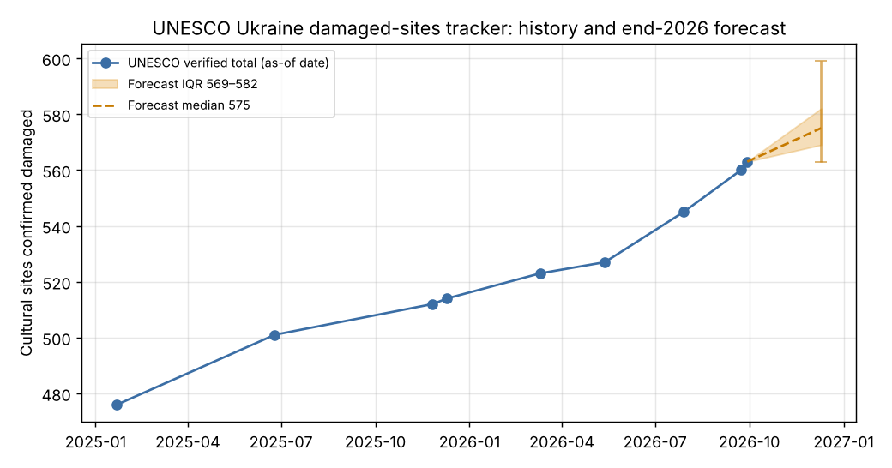

# How many cultural sites in Ukraine will be damaged as of December 31, 2026, according to UNESCO?

| | |
|---|---|
| **Source** | Metaculus #45416 — https://www.metaculus.com/questions/45416/how-many-cultural-sites-in-ukraine-will-be-damaged-as-of-december-31-2026-according-to-unesco |
| **Type** | discrete (range 560–660, open upper bound) |
| **Opened / Closes / Resolves** | 2026-10-13 / 2026-12-31 / ~2027-01-01 (value on UNESCO tracker at last 2026 update) |
| **Status** | open |
| **Current forecast** | **Median 575, IQR [569, 582]** (v1, 2026-10-09) |
| **Community (as of 2026-10-09)** | none yet — question opens 2026-10-13, CP reveal 2026-10-17 (n=2) |
| **Next review** | 2026-10-23 |

<!-- Versions below, newest first. APPEND-ONLY: never edit or delete a past version. -->

---

## v1 — Initial forecast — 2026-10-09

### What resolves YES
The question resolves to the total number of cultural sites in Ukraine shown as "confirmed as
damaged" on UNESCO's tracker (https://www.unesco.org/en/ukraine-war/damaged-cultural-sites) as
of 31 Dec 2026. Fine print: if the tracker is not updated on 31 Dec itself, the number from the
**latest update in 2026** is used. In practice this is the headline figure on the page at year
end. UNESCO publishes with a lag of about 8–9 days: the "as of 29 Sep 2026" figure went up on
7 Oct, and the "as of 26 Nov 2025" figure on 5 Dec 2025. So the last 2026 update will probably
carry an as-of date between late November and mid-December. **Current value: 563 (as of
29 Sep 2026, page updated 7 Oct 2026)**, with 165 religious sites, 285 historic/artistic
buildings, 43 museums, 33 monuments, 24 libraries, 8 archaeological sites and 5 archives. The
question background says 560 (as of 23 Sep), so the page was revised again after the question
was written. Edge cases:
(a) no further update in 2026 means it resolves at 563;
(b) a late-December update with a December as-of date counts;
(c) an update published in January 2027 with a December as-of date probably does *not* count,
because the fine print keys on the update date;
(d) UNESCO has never lowered the count as far as I can see, but it is labelled preliminary;
(e) values below 560 are out of range. Note that this is UNESCO's verified subset. It is not
Ukraine's Ministry of Culture tally (2,161 heritage sites as of end Sep 2026) or civil-society
counts (≥5,500).

### Outside view
Reference class: increments of the same tracker over comparable windows (time series below,
dated as-of points):

| As of | Total | Δ | Months | Rate/mo |
|---|---|---|---|---|
| 2025-01-22 | 476 | | | |
| 2025-06-25 | 501 | +25 | 5.1 | 4.9 |
| 2025-11-26 | 512 | +11 | 5.0 | 2.2 |
| 2025-12-10 | 514 | +2 | 0.5 | — |
| 2026-03-11 | 523 | +9 | 3.0 | 3.0 |
| ~2026-05-13 (published) | 527 | +4 | 2.1 | 1.9 |
| 2026-07-29 | 545 | +18 | 2.5 | 7.1 |
| 2026-09-23 | 560 | +15 | 1.8 | 8.3 |
| 2026-09-29 | 563 | +3 | 0.2 | — |

Rate over the trailing 21 months: 4.2/mo. Trailing 10 months: 5.0/mo. Since March 2026:
6.1/mo. Since May 2026: 7.7/mo. Increments are lumpy: single updates have ranged from +2 to
+25. In 2025 and 2026 the tracker was updated roughly every 1.5–3 months. The window to the
last 2026 as-of date is about 1.5–2.7 months, so the outside view at 4–8/mo gives about +6 to
+22, centred near +12. That implies roughly **575**.

### Inside view
- **Damage inflow is rising.** Russia began a winter strike campaign against energy and Kyiv
  infrastructure in late September 2026 (ISW 4 Oct). On 7 Oct there was a mass strike with 48
  cruise missiles, 130 drones and ballistic missiles. The UN's human-rights office (OHCHR)
  counts 55% more civilian casualties in Jan–Aug 2026 than in the same period of 2025. Several
  heritage hits in 2026 were serious: Kyiv-Pechersk Lavra and the Dormition Cathedral on
  15 Jun, and Odesa's historic centre in July. There is no ceasefire in sight.
- **Verification is the bottleneck, not damage.** UNESCO cross-checks each case against
  satellite imagery and on-site inspection. Its count (563) is about 26% of Ukraine's
  heritage-site count (2,161), so the backlog of reported but unverified sites is huge. The
  rate is set by UNESCO's processing capacity and batching. New categories (archaeological
  sites 3→8 and archives 1→5 since Nov 2025) show the verification scope widening, which helps
  the recent acceleration last.
- **Update timing.** P(no further 2026 update) ≈ 8%: the last six months had updates in March,
  May, July and two in September, and in 2025 there were two updates around late
  November/December. The modal path is one or two more updates, with the last as-of date in
  late November to mid-December.
- Model (`raw/sim-2026-10-09.py`): Δt ~ U(1.4, 2.7) months with an 8% mass at 0. Rate ~ lognormal,
  median 7.0/mo, σ_log 0.35, weighted toward the recent acceleration. Increments are
  gamma-Poisson (k=4) to reflect batching. Output: 5% 563 · 10% 565 · 25% 569 · 50% 575 ·
  75% 582 · 90% 591 · 95% 599.

### Evidence
- UNESCO page (fetched 2026-10-09): 563 as of 29 Sep, updated 7 Oct. This is the anchor.
- CFR (30 Sep 2026): 560 by end of September. Georgia Today: 523 as of 11 Mar 2026.
  Chytomo: 527 in the 13 May 2026 assessment. Wikipedia list: 514 as of 10 Dec 2025. UNESCO
  page snapshots quoted in search: 476 (22 Jan 2025), 501 (25 Jun 2025), 512 (26 Nov 2025).
- Rate evidence: the 2026 H2 acceleration (+36 in ~4.5 months) is the main reason I moved the
  rate median up from 6.3 to 7.0/mo. The likelihood ratio is modest. Recent pace is informative,
  but Mar–May 2026 showed it can also stall at +4 in two months.
- Absent: I found no UNESCO statement on publication cadence and no announced year-end report.
  If a year-end release coincided with a late-December update, the upper tail would widen.

### Other forecasters
| Source | Value | As of | Note |
|---|---|---|---|
| Metaculus CP (recency-weighted) | n/a (n=2) | 2026-10-09 | question opens 2026-10-13; CP hidden until 2026-10-17 |
| Metaculus Pro | n/a | 2026-10-09 | not yet available |
| Metaculus gold medalists | n/a | 2026-10-09 | not yet available |
| Polymarket / Kalshi / Manifold | no market found | 2026-10-09 | Manifold API search "UNESCO Ukraine" returned nothing relevant |

No cohort data to compare. Re-check after the CP reveal (17 Oct).

### Scenarios
| # | Scenario | Weight | Implies |
|---|---|---|---|
| 1 | No further update published in 2026 | 8% | 563 |
| 2 | One small update (slow verification, like Mar–May 2026) | 25% | 565–570 |
| 3 | Pace of the trailing 6–10 months (5–7/mo) to a late-Nov/early-Dec as-of date | 40% | 571–580 |
| 4 | Recent acceleration persists (8–10/mo) or a mid-December as-of date | 22% | 581–595 |
| 5 | Large batch, e.g. winter-campaign damage plus backlog clearance | 5% | >595 |

### Sensitivity
| Assumption | If instead | Forecast becomes |
|---|---|---|
| Rate median 7/mo | 5/mo (trailing 10-month rate) | median 571, IQR [567, 577] |
| Rate median 7/mo | 9/mo (Jul–Sep 2026 rate persists) | median 578, IQR [571, 587] |
| P(no more 2026 update) 8% | 20% | median 573, IQR [566, 581] |

### What would change my mind (tripwires)
- [ ] UNESCO update with an as-of date in October (published by 2026-11-15) showing ≥ 575 → up about 6 sites; ≤ 566 → down about 3
- [ ] No tracker update between 2026-10-07 and 2026-12-10 → down about 5 (a late update and a "no more updates" outcome both become more likely)
- [ ] An update published 2026-12-01 to 2026-12-31: re-centre on its value plus 0–4 → re-analyse (either direction)
- [ ] Ceasefire or truce in force before 2026-11-30 → down about 2 (backlog verification continues, so the effect is small)
- [ ] UNESCO year-end or "1,000 days"-style report announced for December 2026 → up about 4

### Sources
1. UNESCO — Damaged cultural sites in Ukraine verified by UNESCO — https://www.unesco.org/en/ukraine-war/damaged-cultural-sites (accessed 2026-10-09)
2. Metaculus #45416 question text (via aggregations script) — https://www.metaculus.com/questions/45416/ (accessed 2026-10-09)
3. CFR — Culture Under Fire: Ukraine's Fight Against Russia's Campaign of Erasure (30 Sep 2026) — https://www.cfr.org/articles/culture-under-fire-ukraines-fight-against-russias-campaign-of-erasure (accessed 2026-10-09)
4. Georgia Today — Ukraine's Cultural Heritage Under Siege (2 Apr 2026) — https://georgiatoday.ge/ukraines-cultural-heritage-under-siege-a-look-at-the-historic-sites-destroyed-in-the-ongoing-conflict/ (accessed 2026-10-09)
5. Chytomo — UNESCO verifies damage to 527 cultural sites in Ukraine (26 May 2026) — https://chytomo.com/en/unesco-verifies-damage-to-527-cultural-sites-in-ukraine-including-21-libraries/ (accessed 2026-10-09)
6. Wikipedia — List of cultural sites damaged during the Russo-Ukrainian war — https://en.wikipedia.org/wiki/List_of_cultural_sites_damaged_during_the_Russo-Ukrainian_war_(2022%E2%80%93present) (accessed 2026-10-09)
7. UNESCO article mirror — https://www.unesco.org/en/articles/damaged-cultural-sites-ukraine-verified-unesco?hub=66116 (403 on fetch; 512/26 Nov 2025, 501/25 Jun 2025 and 476/22 Jan 2025 figures taken from search snippets of UNESCO pages, accessed 2026-10-09)
8. Ministry of Culture of Ukraine — damage tallies — https://mincult.gov.ua/en/news/russians-have-damaged-1783-cultural-heritage-sites-and-2540-cultural-infrastructure-facilities/ (accessed 2026-10-09)
9. Kyiv Post — Russian Attacks Damage Over 1,700 Cultural Heritage Sites — https://www.kyivpost.com/post/72523 (accessed 2026-10-09)
10. ICOMOS — Statement on the attacks of 14–15 June 2026 — https://www.icomos.org/news/statement-attacks-june-2026-kyiv-ukraine/ (accessed 2026-10-09)
11. UN Security Council 10179th meeting press release — https://press.un.org/en/2026/sc16394.doc.htm (accessed 2026-10-09)
12. ISW / Critical Threats — Russian Offensive Campaign Assessment, 4 Oct 2026 — https://www.criticalthreats.org/analysis/russian-offensive-campaign-assessment-october-4-2026 (accessed 2026-10-09)
13. Reuters via Global Banking & Finance — Russia launches heavy strikes on Ukraine, killing at least 20 — https://www.globalbankingandfinance.com/russia-launches-heavy-strikes-ukraine-killing-least-20/ (accessed 2026-10-09)
14. UNESCO Statement 25 May 2026 — https://www.unesco.org/en/articles/unesco-statement-25-may-2026 (accessed 2026-10-09)
15. Kyiv Independent — UNESCO grants protection to two Ukrainian cultural sites — https://www.kyivindependent.com/unesco-grants-protection-to-two-ukrainian-cultural-sites (accessed 2026-10-09)
16. Manifold API market search "UNESCO Ukraine" — https://api.manifold.markets/v0/search-markets?term=UNESCO%20Ukraine (accessed 2026-10-09; no relevant market)

**Date**: 2026-10-09
**Forecast**: Median 575, IQR [569, 582]
**Thesis**: The UNESCO tracker stood at 563 as of 29 Sep 2026 [1]. It has grown 4–8 sites a month, faster since mid-2026 [1,3–6], and Russia's winter strike campaign keeps damage coming [12,13]. About 2 more months of verification to the last 2026 update adds roughly +12 (range 0 to +35). The main downside risk is no further update in 2026 (8%, resolves 563).
