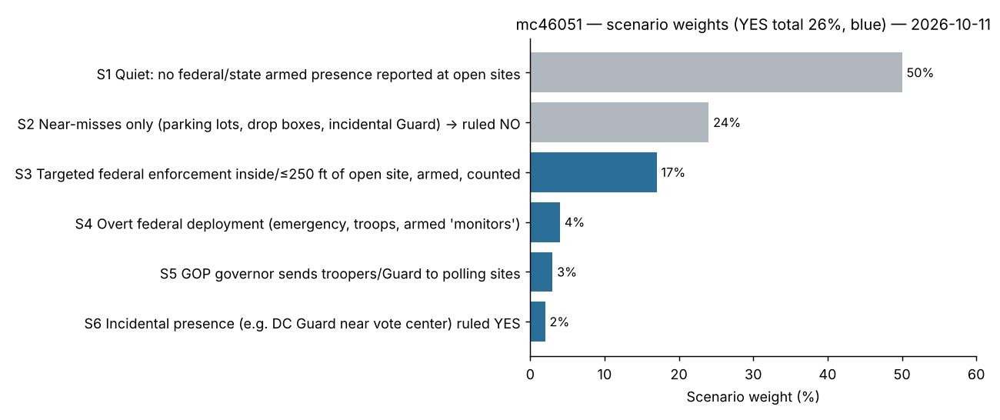

# Will the Trump administration or a GOP state governor deploy armed officers or troops to a polling or early voting site in 2026?

| | |
|---|---|
| **Source** | Metaculus #46051 — https://www.metaculus.com/questions/46051/ |
| **Type** | binary |
| **Opened / Closes / Resolves** | 2026-10-12 / 2026-11-02 / 2026-11-06 |
| **Status** | open |
| **Current forecast** | **Median 21.0%, IQR [14.0%, 29.0%]** (v2, 2026-10-16) |
| **Community (as of 2026-10-16)** | CP 15.0% · Pro 17.0% · gold 15.0% (n=64) |
| **Next review** | 2026-10-21 |

<!-- Versions below, newest first. APPEND-ONLY: never edit or delete a past version. -->

---

## v2 — Update — 2026-10-16

### Revision table

| Driver | Direction | Effect | Prior → running |
|---|---|---|---|
| Prior (v1, 2026-10-11) | — | — | **26.0%, IQR [17.0%, 36.0%]** |
| Metaculus cohorts revealed (2026-10-15/16): CP 15%, Pro 17% (n=9), gold 15% (n=27), all three in agreement. Pro and gold sit 9–11 pp below v1. Per AGENTS.md §4, I looked for a fact I missed and found none; the gap is a judgement gap over λ and the "armed / deliberate / credible" filter. I give them partial weight | ↓ | −5 pp | 21% |
| Five quiet days (2026-10-11 → 10-16) with early voting open in about 15–20 states and no qualifying report. Low share of in-person volume (≈10%) | ↓ | −1.5 pp | 19.5% |
| Question author's comment (2026-10-12): armed ICE officers specifically sent to a polling site to execute a warrant while in-person voting is underway "would seem to be consistent with a deliberate deployment". This loosens P1's "deemed deliberate" filter | ↑ | +1 pp | 20.5% |
| No injunction and no hearing reported in LULAC v. DHS (D.D.C. 1:26-cv-03157) or DSCC v. DHS. The deterrent from a court order before the peak voting weeks is now less likely | ↑ | +0.5 pp | 21% |
| **New forecast** | | | **21.0%, IQR [14.0%, 29.0%]** |

### Tripwire check (from v1)

| Tripwire | Status | Note |
|---|---|---|
| Credible report of armed federal agents inside or ≤250 ft of an open early-voting site | **not fired** | Searches on 2026-10-16 found no new incident. Hennepin County's allegations (2 DHS entries into an early-vote site; lobby arrests "near the current early-voting location") are undated and say nothing about weapons [29][7] |
| Preliminary injunction in LULAC v. DHS / DSCC v. DHS | **not fired** | No ruling or hearing found. The DSCC docket shows only the 2026-09-23 complaint [30][31] |
| DHS/ICE written field guidance keeping agents from polls | **not fired** | Only public statements: Mullin's warrant/threat carve-out, the 2026-05-11 Lyons letter, the late-July DHS letter [32] |
| Election emergency / Insurrection Act | **not fired** | Latest is still the TIME interview of 2026-10-01 [4] |
| GOP governor announces troopers or Guard at polls | **not fired** | Kemp's office has no plans. Nothing found from Abbott, DeSantis or Landry [33] |
| Metaculus cohorts revealed: CP <10% or >45%, or Pro and gold agreeing >10 pp from 26% | **partial** | CP 15%. Pro 17% (−9 pp) and gold 15% (−11 pp) agree with each other. Handled as the main driver above. I chose an incremental update with an explicit re-derivation of P1 rather than a full re-analysis, because the gap has a named cause |

### What resolves YES

Unchanged from v1, with one addition. The question author has since clarified two points:
- Armed ICE officers specifically sent to a polling site to execute a warrant, while in-person voting is underway, would count as deliberate deployment.
- Secret Service and protective details, including advance work, are excluded (fine print updated 2026-10-14) [28].

### Outside view

Unchanged from v1.

### Inside view: P1 re-derived

The cohorts' gap concentrates on P1 (targeted federal enforcement at a site). v1 put P(a deliberate entry into an open site occurs and is credibly reported) at ≈0.40, then a filter of ≈0.45 for armed, deliberate and within 250 ft, giving ≈18%.

Two things change it:
- *Occurrence* falls to ≈0.34. About 28% of the in-person window would ideally carry 10% of the hazard; five quiet days cost a little, and I trim further for the general-election caution the cohorts appear to price in.
- *Filter* rises to ≈0.48 after the author's warrant clarification.

P1 ≈ **16%**. P2 overt deployment ≈ 3%, P3 governor ≈ 2%, P4 lenient incidental ≈ 2%.

P(YES) = 1 − (0.84 × 0.97 × 0.98 × 0.98) ≈ **22%**. I shade it to 21% for the cohort weight.

### Evidence

Unchanged from v1, plus the rows in the revision table. Also new: the Arizona SB 1570 proposal to station ICE at voting sites [34]. It would need Gov. Hobbs (D) to sign it, so it cannot create a "GOP governor" path, and it is irrelevant to resolution.

### Other forecasters

| Source | Value | As of | Note |
|---|---|---|---|
| Metaculus CP (recency-weighted) | **15.0%** IQR [12.5%, 23.0%], n=64 | 2026-10-16 | Opened at 23–26% on 10-12/13, then drifted down to 15% by 10-15 |
| Metaculus Pro | **17.0%** IQR [15.0%, 23.0%], n=9 | 2026-10-16 | |
| Metaculus gold medalists | **15.0%** IQR [10.0%, 23.0%], n=27 | 2026-10-16 | |
| Manifold "Federal police presence at polling places" | 62.9% (17 traders) | 2026-10-16 | Unchanged. Broader criteria |
| Manifold "Trump sends uniformed military to polling stations" | 39.7% (21) | 2026-10-16 | Unchanged |
| Manifold "National Guard deployed at polling places" | 36.5% (28) | 2026-10-16 | Unchanged |
| Manifold "ICE deployed in polls" | 23.6% (12) | 2026-10-16 | Unchanged. Closest analogue |
| Polymarket | no market | 2026-10-16 | gamma search: none |

**Cohort agreement.** The three Metaculus cohorts agree with one another, at 15–17%. My 21% sits about 4–6 pp above them. I keep a residual gap for two reasons:
- I think the Hennepin Government Center path is under-priced. Early voting runs in the same building where ICE makes routine courthouse arrests.
- Peak in-person volume is still ahead: the final two weeks and Election Day.

### Scenarios

| # | Scenario | Weight | Implies |
|---|---|---|---|
| S1 | Quiet | 54% | NO |
| S2 | Near-misses only, ruled NO | 25% | NO |
| S3 | Targeted federal enforcement, armed, deliberate, ≤250 ft | 15% | YES |
| S4 | Overt federal deployment | 3% | YES |
| S5 | GOP governor troopers or Guard | 1.5% | YES |
| S6 | Lenient resolution of incidental presence | 1.5% | YES |

YES total = **21%**.

### Sensitivity

Unchanged from v1 in structure, with every row about 4–5 pp lower.

### What would change my mind (tripwires)

- [ ] Credible report of armed federal agents inside or ≤250 ft of an **open** early-voting or Election Day site, 2026-10-16 → 2026-11-03 → **up, +40pp** (near-resolution if armed status is explicit)
- [ ] Credible report of an ICE/HSI arrest in a building hosting open early voting (e.g. Hennepin County Government Center), armed status unclear, by 2026-11-03 → **up, +12pp**
- [ ] Preliminary injunction in LULAC v. DHS / DSCC v. DHS barring armed agents at polling places, by 2026-10-30 → **down, −5pp**
- [ ] Trump declares an election-related national emergency or invokes the Insurrection Act, by 2026-11-03 → **up, +25pp**
- [ ] A Republican governor announces troopers or Guard at polling or early-vote sites, by 2026-11-02 → **up, +20pp**
- [ ] Metaculus CP moves >7 pp from 15%, or Pro/gold move >7 pp, by 2026-10-28 → **either, re-check for a missed fact**

### Sources

Sources 1–28 are carried over from v1 with their original access dates. Sources 29–37 are new.

1. Task & Purpose, "National Guard says it is 'actively addressing' incident of troops near DC ballot drop box" (2026-10-09) — https://taskandpurpose.com/news/national-guard-washington-dc-ballot-drop-box/ (accessed 2026-10-11)
2. AP via Haitian Times, "Trump administration says it has no plans for ICE officers at polls. Activists are preparing anyway" (2026-10-05) — https://haitiantimes.com/2026/10/05/trump-administration-ice-officers-polls-activists-prepare/ (accessed 2026-10-11)
3. Civic Media, "What to know about ICE, federal agents at polling places in the 2026 midterms" (2026-10-07) — https://civicmedia.us/news/2026/10/07/what-to-know-about-ice-federal-agents-at-polling-places-in-the-2026-midterms (accessed 2026-10-11)
4. HuffPost, "Trump Won't Rule Out Declaring State Of Emergency Before Midterms" (2026-10-01) — https://www.huffpost.com/entry/trump-state-of-emergency-insurrection-act-midterms_n_6abe69b0e4b02a789b333fb9 (accessed 2026-10-11)
5. Democracy Docket, "ICE agents confront New York poll worker during voting…" (2026-06-25) — https://www.democracydocket.com/news-alerts/ice-agents-poll-worker-syracuse-new-york-polling-site-primary-elections/ (accessed 2026-10-11)
6. WSKG, "Federal investigators accuse Onondaga County poll worker…" (2026-06-26) — https://www.wskg.org/2026-06-26/federal-investigators-accuse-onondaga-county-poll-worker-of-outing-an-already-outed-undercover-ice-agent (accessed 2026-10-11)
7. Democracy Docket, "ICE is already showing up near voting sites, bolstering lawsuit against armed agents at polls" (2026-10-07) — https://www.democracydocket.com/news-alerts/ice-is-already-showing-up-near-voting-sites-bolstering-lawsuit-against-armed-agents-at-polls/ (accessed 2026-10-11)
8. KHOU, "No plans to provide military support at Texas polling locations, official says" (2020) — https://www.khou.com/article/news/politics/vote-texas/no-plans-to-provide-military-support-at-texas-polling-locations-official-says/269-5d13af99-1968-4d79-b9c4-50ac9bccad2e (accessed 2026-10-11, search snippet)
9. Common Cause press release, "Voting Rights Organizations and Local Governments Expand Challenge…" (2026-10-07) — https://www.commoncause.org/press/voting-rights-organizations-and-local-governments-expand-challenge-to-trump-vance-administrations-plans-for-armed-federal-agents-at-polling-places/ (accessed 2026-10-11, search snippet)
10. San Antonio Current, "ICE conducts enforcement action at San Antonio voting location, witnesses say" (2026-05) — https://www.sacurrent.com/news/san-antonio-news/ice-conducts-enforcement-action-at-san-antonio-voting-location-witnesses-say/ (accessed 2026-10-11)
11. KAXE/NPR, "It's illegal for armed federal officers to be at polls. Lawsuits seek to ensure that" (2026-09-18) — https://www.kaxe.org/news/2026-09-18/its-illegal-for-armed-federal-officers-to-be-at-polls-lawsuits-seek-to-ensure-that (accessed 2026-10-11)
12. AP via Vindicator, "US military has no plans to send troops to the polls in November, top general says" (2026-09) — https://www.vindy.com/news/national-news/2026/09/us-military-has-no-plans-to-send-troops-to-the-polls-in-november-top-general-says/ (accessed 2026-10-11, search snippet)
13. ABC News, "Hegseth directs military cyber forces to use 'every authorized asset' to defend midterm elections…" (2026-09-28) — https://abcnews.com/Politics/hegseth-directs-cyber-forces-authorized-asset-defend-midterm/story?id=136854785 (accessed 2026-10-11, search snippet)
14. Spotlight PA, "Trump DOJ will up monitoring of swing states for midterms" (2026-08-18) — https://www.spotlightpa.org/news/2026/08/justice-department-election-monitors-trump-administration-federal-government/ (accessed 2026-10-11)
15. Democracy Docket, "DOJ dispatched criminal prosecutors, FBI agent to monitor Arizona's primary…" (2026-10-06) — https://www.democracydocket.com/news-alerts/doj-dispatched-criminal-prosecutors-fbi-agent-to-monitor-arizonas-primary-documents-reveal/ (accessed 2026-10-11)
16. MEAWW, "'Fearmongering, false statements': Todd Blanche hits back at armed poll monitor claims" (2026-10) — https://news.meaww.com/fearmongering-false-statements-todd-blanche-hits-back-at-armed-poll-monitor-claims (accessed 2026-10-11, search snippet)
17. Spectrum News, "Newsom: ICE at Dodger Stadium on Election Day" (2025-11-04) — https://spectrumnews1.com/ca/la/politics/2025/11/04/newsom-ice-at-dodger-stadium-election-day (accessed 2026-10-11, search snippet)
18. AP via ADN, "Trump administration says it has no plans to send ICE to polls…" (2026-10-02) — https://www.adn.com/nation-world/2026/10/02/trump-administration-says-it-has-no-plans-to-send-ice-to-polls-activists-are-preparing-anyway/ (accessed 2026-10-11, search snippet)
19. 11Alive, "Rumblings of National Guard presence at Georgia's 2026 election" (2026) — https://www.11alive.com/article/news/politics/rumblings-national-guard-presence-georgia-2026-election-midterms/85-ef3c49a2-3e53-4d46-9da2-62eaaee06716 (accessed 2026-10-11, search snippet; page 403)
20. Fox 8, "Gov. Landry calls on New Orleans leaders to take responsibility for public safety as National Guard leaves" (2026-08-21) — https://www.fox8live.com/2026/08/21/gov-landry-calls-new-orleans-leaders-take-responsibility-public-safety-national-guard-leaves/ (accessed 2026-10-11, search snippet)
21. Nation of Change, "Lawsuits ask courts to bar armed federal agents from polling places before the midterms" (2026-10-08) — https://www.nationofchange.org/2026/10/08/lawsuits-ask-courts-to-bar-armed-federal-agents-from-polling-places-before-the-midterms/ (accessed 2026-10-11)
22. Hoodline, "D.C. on edge as Guard boss vows troops will obey election law" (2026-04-20) — https://hoodline.com/2026/04/d-c-on-edge-as-guard-boss-vows-troops-will-obey-election-law/ (accessed 2026-10-11)
23. Votebeat via KOTA, "New voting requirements? Troops at the polls? We asked 37 election experts…" (2026-04-18) — https://www.kotatv.com/2026/04/18/new-voting-requirements-troops-polls-we-asked-37-election-experts-what-could-disrupt-2026-elections/ (accessed 2026-10-11, search snippet)
24. ABC News, "Man arrested after posing as ICE agent at Miami polling site" (2026-10) — https://abcnews.com/US/man-arrested-after-posing-ice-agent-miami-polling/story?id=137032258 (accessed 2026-10-11, search snippet)
25. Votebeat, "Trump official: No ICE agents at polling places in 2026 election" (2026-02-26) — https://www.votebeat.org/2026/02/26/ice-agents-polling-places-2026-midterm-elections-heather-honey-election-official-meeting/ (accessed 2026-10-11, search snippet)
26. DC Board of Elections, "Time Off to Vote — 2026 General" (early voting 2026-10-26 → 11-01) — https://dcboe.org/getmedia/e076a79c-6f32-41fe-81a0-7f33c549b957/Time-Off-to-Vote-2026-General-STUDENTS.pdf (accessed 2026-10-11, search snippet)
27. Manifold Markets API snapshots (5 markets) — `raw/manifold-2026-10-11.jsonl` (accessed 2026-10-11)
28. Metaculus #46051 question text — `raw/metaculus-2026-10-11.json` (accessed 2026-10-11)
29. Democracy Docket, "ICE is already showing up near voting sites…" (2026-10-07), re-read for Hennepin details — https://www.democracydocket.com/news-alerts/ice-is-already-showing-up-near-voting-sites-bolstering-lawsuit-against-armed-agents-at-polls/ (accessed 2026-10-16)
30. Immigration Policy Tracking Project, "DHS authorizes armed ICE officers at polling locations" (status: in litigation, no ruling) — https://immpolicytracking.org/policies/dhs-authorizes-armed-ice-officers-at-polling-locations/ (accessed 2026-10-16)
31. Democracy Docket case page, DSCC v. DHS (only filing: complaint 2026-09-23) — https://www.democracydocket.com/cases/federal-election-interference-at-the-polls-challenge-dscc/ (accessed 2026-10-16)
32. Democracy Docket, "DHS chief says ICE could make arrests at polling places…" — https://www.democracydocket.com/news-alerts/dhs-chief-says-ice-could-make-arrests-at-polling-places-ignoring-federal-ban/ (accessed 2026-10-16, search snippet)
33. AJC, "Jackson suggests Kemp will use National Guard to monitor polling places" (2026-08) — https://www.ajc.com/politics/2026/08/jackson-suggests-kemp-will-use-national-guard-to-monitor-polling-places/ (accessed 2026-10-16, search snippet)
34. Hoodline, "Arizona GOP plots ICE patrol at every poll" (2026-02) — https://hoodline.com/2026/02/arizona-gop-plots-ice-patrol-at-every-poll/ (accessed 2026-10-16, search snippet)
35. NPR, "Civil rights advocates plan to send thousands of observers to midterm polling places" (2026-10-14) — https://www.npr.org/2026/10/14/nx-s1-5991802/election-polling-place-observers (accessed 2026-10-16, search snippet)
36. Metaculus #46051 CP / Pro / gold and comments — `raw/metaculus-2026-10-16.json` (accessed 2026-10-16)
37. Manifold API snapshots — `raw/manifold-2026-10-16.jsonl` (accessed 2026-10-16)

**Question**: [Will the Trump administration or a GOP state governor deploy armed officers or troops to a polling or early voting site in 2026?](https://www.metaculus.com/questions/46051/)
**Date**: 2026-10-16
**Forecast**: Median 21.0%, IQR [14.0%, 29.0%]
**Thesis**: None of the tripwires has fired: no qualifying incident, no injunction, no emergency declaration, and no GOP-governor deployment. Metaculus Pros (17%) and gold medalists (15%) agree on a lower number, and I partly defer to them. I stay a few points above because routine ICE arrests happen in buildings that host early voting (Hennepin County), the question author has said warrant-service entries count as deliberate, and peak in-person volume is still ahead.

---

## v1 — Initial forecast — 2026-10-11

### What resolves YES

YES if, **while a site is open for in-person voting in the 2026 general elections**, any of these is
**deliberately deployed** to a polling or early-voting site by the federal government or by a
Republican governor (ordered by the governor or specifically authorised by them): active-duty
military, National Guard, federal officers, or **state** troopers. The personnel must be **armed with
firearms** and either **inside the site or within 250 ft of its entrance**. The stated purpose does not
matter, so an ICE arrest at a site or Guard "protecting voters" both count. **Exclusions:**
- county and municipal police and sheriffs;
- personnel present in a personal capacity (voting, poll workers);
- **incidental proximity** (passing through, or other duties unrelated to the site), **or** any case
  that lacks "uncontroversial credible reporting" of deliberate deployment;
- **drop-box-only locations**.

Resolution rests on credible-source reporting, and the question resolves on 2026-11-06.

**Counter-intuitive paths:**
1. YES does not need a policy. One targeted ICE/HSI (Homeland Security Investigations) arrest or
   notice-service at an open site counts, if reporting establishes that the agents were armed. Two
   agents walking into the Syracuse polling site in the June 2026 primary would probably have
   qualified, armed status permitting.
2. Conversely, the most-publicised incident so far would **not** count. National Guard troops by a
   DC ballot drop box on 2026-10-08 fall under the drop-box exclusion, and the Guard says the
   placement was not deliberate.
3. The window already started on about 2026-09-18 (in-person early voting in MN, VA and others), so
   an incident before the question opens would also count.

The main ambiguity is the **"armed"** requirement. Reports of ICE incidents rarely state whether the
agents had firearms.

### Outside view

- **Class A — modern US general elections (1970–2024), deliberate armed federal or governor-ordered
  state-police deployment to open polling sites.** About 0 clear cases in ~14 federal general
  elections. 18 U.S.C. § 592 makes it a felony to station "troops or armed men" at polling places,
  and federal compliance has been near-total. State-trooper deployments are rare and undocumented
  in modern cycles. Texas 2020 (1,000 Guard sent to cities) explicitly had "no plan for any support
  at any polling location" [8]. Base rate: **≈2–5% per general election**.
- **Class B — Trump-era 2025–26 elections (the relevant regime).**
  - Nov 2025 off-year elections: about 100 ICE/CBP agents staged at a Dodger Stadium lot on Election
    Day [17]. This was not established as within 250 ft of an active vote center, so it does not
    qualify.
  - 2026 primary season (Mar–Sep, roughly 50 states plus runoffs), under intense watchdog
    monitoring: **1 clear deliberate entry** (Syracuse, 2026-06-23 — two ICE agents entered an open
    library polling site to serve a notice on a poll worker; armed status not reported) [5][6].
  - **1 alleged pair of entries** (DHS investigators "entered an early-voting polling place" at the
    Hennepin County Government Center twice in five months; purpose and dates unclear) [7][9].
  - **1 incidental case** (San Antonio, 2026-05-20: a Texas DPS (Department of Public Safety) traffic
    stop plus nine ICE officers in a polling-site parking lot during runoff early voting) [10].
  - **1 drop-box case** (Santa Maria, CA, 2026-10-05) [7].

  That is roughly **1–2 deliberate federal entries per primary season**, with **0** confirmed armed.
- **Scaling to the window.** General-election in-person turnout is roughly 2× the in-person volume
  of all 2026 primaries combined, but compressed into ~7 weeks under far heavier scrutiny on both
  sides: agents are more cautious, watchers more vigilant. My expected count of deliberate federal
  entries at open sites in the general is **λ ≈ 0.5–1.0**, so P(≥1) ≈ **40–63%**. That is *before*
  the "armed" and "deliberate" filters and the resolver's reading.

Outside-view anchor after filters: **~20%** (Class B), against **~3%** (Class A). I weight Class B
heavily because the regime has demonstrably changed.

### Inside view

Paths to YES, treated as roughly independent:

| Path | Mechanism | P(path resolves YES) |
|---|---|---|
| P1 Targeted federal enforcement | ICE/HSI/FBI arrest, warrant or notice at an open site. P(occurs, credibly reported) ≈ 0.40 × P(armed established, deemed deliberate, ≤250 ft) ≈ 0.45 | ≈ 18% |
| P2 Overt federal deployment | Emergency declaration / Insurrection Act, troops or agents sent to sites in "15 places", DOJ "monitors" who are armed agents | ≈ 4% |
| P3 GOP governor | e.g. Texas DPS sent to Harris County early-vote sites; Guard "protecting voters" | ≈ 3% |
| P4 Lenient resolution of incidental presence | e.g. JTF-DC Guard (2,978 troops, patrolling Metro stations) seen at a DC vote center Oct 26–Nov 3 | ≈ 2–3% |

P(YES) = 1 − (0.82 × 0.96 × 0.97 × 0.975) ≈ **26%**.

**Actors and incentives.**
- *DHS* has publicly said, more than once, that "ICE is not planning operations targeting polling
  locations" (2026-10-02). It keeps open arrests or warrants at polls (Secretary Mullin, Sept 2026),
  and its "Unlawful Voter Initiative" is hunting non-citizen voters, which creates a motive for
  at-site arrests [2][3][11].
- *The military* is formally out: Gen. Caine wrote to Sen. Slotkin (2026-08-31) that there are "no
  plans" to send federal military personnel or federalised Guard to polling places [12]. Hegseth's
  2026-09-22 election memo covers only cyber and intelligence [13]. JTF-DC says its troops are
  "directed not to monitor or secure polling locations" [1].
- *DOJ* plans about 1,000 monitors. They have included criminal prosecutors and one FBI special
  agent (Arizona primary) [14][15]. AG Blanche (2026-10-04) called claims of armed monitors
  "completely false" [16].
- *Trump* (Time, 2026-10-01) says "I don't rule anything out or in" on an emergency or the
  Insurrection Act, but answered "Haven't thought of it" on ICE at polls [4][18].
- *Republican governors* have no visible plan. Kemp's office says Georgia will handle the election
  "the exact same way" as before [19]. The Louisiana Guard left New Orleans in Aug 2026 [20].
- *Constraints*: § 592 is a felony for the ordering official. At least three suits are pending
  (LULAC v. DHS as amended 2026-10-07 with Hennepin County and Denver; DSCC/DCCC v. DHS;
  NAACP-led VRA (Voting Rights Act) §11(b) suit) [7][9][21]. No injunction yet.

### Evidence

| Evidence | Direction | Likelihood ratio (LR, approx.) |
|---|---|---|
| Syracuse primary entry shows agents *will* walk into open sites for unrelated enforcement | ↑ | 2.0 vs a "the law deters it" prior |
| Hennepin County alleges 2 DHS entries into an early-voting site in 5 months | ↑ | 1.3 (allegation, purpose unclear) |
| DHS / White House / JCS public denials; JTF-DC no-polling directive | ↓ | 0.7 |
| Heavy litigation plus watcher networks: deters agents, but makes any incident certain to be reported | ↓ / ↑ | ≈ 1.0 net |
| "Armed" never established in any 2026 incident report so far | ↓ | 0.7 on P1 |
| Trump: "don't rule anything out"; Bannon/Blanche earlier pro-ICE-at-polls rhetoric | ↑ | 1.1 (new salience more than new information) |
| No qualifying incident reported from 2026-09-18 to 2026-10-11 (≈ 3.5 weeks of early voting in ~15 states, low volume) | ↓ | 0.9 |

**Absent evidence I would expect under YES-heavy worlds:** no DHS field guidance *authorising*
polling-site operations; no governor announcing state police at polls; no federal emergency
declaration. All three are absent.

### Other forecasters

| Source | Value | As of | Note |
|---|---|---|---|
| Metaculus CP (recency-weighted) | hidden | 2026-10-11 | opens 10-12, CP reveal 10-15; 4 pre-open forecasters |
| Metaculus Pro | hidden | 2026-10-11 | none yet |
| Metaculus gold medalists | hidden | 2026-10-11 | none yet |
| Polymarket / Kalshi | no market found | 2026-10-11 | Polymarket gamma search: none; Kalshi API rate-limited (429) |
| Manifold "Federal police presence at polling places" | 62.9% (17 traders, M765) | 2026-10-11 | broader: includes drop boxes and any "presence"; discounted |
| Manifold "Trump sends uniformed military to polling stations" | 39.7% (21 traders) | 2026-10-11 | broader on who; ≤100 ft; low volume |
| Manifold "National Guard deployed at polling places" | 36.5% (28 traders) | 2026-10-11 | includes unarmed / civilian-clothes Guard in any state, Democratic ones included |
| Manifold "ICE deployed in polls" | 23.6% (12 traders) | 2026-10-11 | ICE-only, includes drop boxes; closest analogue to P1 |
| Votebeat expert survey (Feb–Mar 2026) | 27/37 "at least somewhat likely" | 2026-03-11 | some military or law enforcement "at or near" polls; non-scientific |
| Sentinel, Mantic, GJOpen, INFER | none found | 2026-10-11 | |

No Metaculus cohort data exists yet, so cohort disagreement cannot be assessed. **Re-check after
2026-10-15.** The Manifold markets bracket my number. The broader-criteria ones sit above it, and
the closest analogue (ICE-only, 24%) sits next to it. All are low-volume play-money and discounted.

### Scenarios

| # | Scenario | Weight | Implies |
|---|---|---|---|
| S1 | Quiet: no federal or state armed presence credibly reported at open sites | 50% | NO |
| S2 | Near-misses only (parking-lot ops, drop boxes, Guard near sites, unarmed monitors, armed status unknown) → ruled NO | 24% | NO |
| S3 | Targeted federal enforcement (ICE/HSI/FBI) inside or ≤250 ft of an open site, armed, deemed deliberate | 17% | YES |
| S4 | Overt federal deployment (emergency / Insurrection Act / troops / armed "monitors") | 4% | YES |
| S5 | GOP governor sends troopers or Guard to polling sites | 3% | YES |
| S6 | Incidental presence (e.g. DC Guard near a vote center) ruled YES by a lenient resolver | 2% | YES |

YES total = **26%**. IQR [17%, 36%]: a single ambiguous incident report could move this by
±10pp in a week. That makes it a news-driven question with a wide band.

### Sensitivity

| Assumption | If instead | Forecast becomes |
|---|---|---|
| λ (deliberate federal entries in the general) ≈ 0.5–1.0 | λ ≈ 2 (agents behave as in primaries, scaled by volume, no extra caution) | ≈ 40% |
| Resolver counts a Syracuse-type event only if "armed" is explicitly reported (P ≈ 0.45) | Resolver infers armed for on-duty ICE agents (P ≈ 0.8) | ≈ 36% |
| DHS keeps agents away after the lawsuits | Court injunction or DHS written guidance barring agents from sites | ≈ 15% |
| No overt-deployment decision | Trump declares an election emergency before Nov 3 | ≈ 50% |

### What would change my mind (tripwires)

- [ ] Credible report (AP, Reuters, major local outlet, court filing) of armed federal agents entering or ≤250 ft of an **open** early-voting site, 2026-10-12 → 2026-11-03 → **up, +35pp** (near-resolution if the armed status is explicit)
- [ ] Federal court preliminary injunction in LULAC v. DHS / DSCC v. DHS barring armed agents at polling places, by 2026-10-30 → **down, −6pp**
- [ ] DHS/ICE written field guidance keeping agents away from polling sites (published or leaked), by 2026-10-30 → **down, −5pp**
- [ ] Trump declares an election-related national emergency or invokes the Insurrection Act, by 2026-11-03 → **up, +25pp**
- [ ] A Republican governor (e.g. Abbott, DeSantis, Landry) announces state police or Guard deployment to polling or early-vote sites, by 2026-11-02 → **up, +20pp**
- [ ] Metaculus CP / Pro / gold revealed 2026-10-15: CP < 10% or > 45%, or Pro and gold agreeing > 10pp from 26%, by 2026-10-16 → **either, re-analyse**

### Sources

1. Task & Purpose, "National Guard says it is 'actively addressing' incident of troops near DC ballot drop box" (2026-10-09) — https://taskandpurpose.com/news/national-guard-washington-dc-ballot-drop-box/ (accessed 2026-10-11)
2. AP via Haitian Times, "Trump administration says it has no plans for ICE officers at polls. Activists are preparing anyway" (2026-10-05) — https://haitiantimes.com/2026/10/05/trump-administration-ice-officers-polls-activists-prepare/ (accessed 2026-10-11)
3. Civic Media, "What to know about ICE, federal agents at polling places in the 2026 midterms" (2026-10-07) — https://civicmedia.us/news/2026/10/07/what-to-know-about-ice-federal-agents-at-polling-places-in-the-2026-midterms (accessed 2026-10-11)
4. HuffPost, "Trump Won't Rule Out Declaring State Of Emergency Before Midterms" (2026-10-01) — https://www.huffpost.com/entry/trump-state-of-emergency-insurrection-act-midterms_n_6abe69b0e4b02a789b333fb9 (accessed 2026-10-11)
5. Democracy Docket, "ICE agents confront New York poll worker during voting…" (2026-06-25) — https://www.democracydocket.com/news-alerts/ice-agents-poll-worker-syracuse-new-york-polling-site-primary-elections/ (accessed 2026-10-11)
6. WSKG, "Federal investigators accuse Onondaga County poll worker…" (2026-06-26) — https://www.wskg.org/2026-06-26/federal-investigators-accuse-onondaga-county-poll-worker-of-outing-an-already-outed-undercover-ice-agent (accessed 2026-10-11)
7. Democracy Docket, "ICE is already showing up near voting sites, bolstering lawsuit against armed agents at polls" (2026-10-07) — https://www.democracydocket.com/news-alerts/ice-is-already-showing-up-near-voting-sites-bolstering-lawsuit-against-armed-agents-at-polls/ (accessed 2026-10-11)
8. KHOU, "No plans to provide military support at Texas polling locations, official says" (2020) — https://www.khou.com/article/news/politics/vote-texas/no-plans-to-provide-military-support-at-texas-polling-locations-official-says/269-5d13af99-1968-4d79-b9c4-50ac9bccad2e (accessed 2026-10-11, search snippet)
9. Common Cause press release, "Voting Rights Organizations and Local Governments Expand Challenge…" (2026-10-07) — https://www.commoncause.org/press/voting-rights-organizations-and-local-governments-expand-challenge-to-trump-vance-administrations-plans-for-armed-federal-agents-at-polling-places/ (accessed 2026-10-11, search snippet)
10. San Antonio Current, "ICE conducts enforcement action at San Antonio voting location, witnesses say" (2026-05) — https://www.sacurrent.com/news/san-antonio-news/ice-conducts-enforcement-action-at-san-antonio-voting-location-witnesses-say/ (accessed 2026-10-11)
11. KAXE/NPR, "It's illegal for armed federal officers to be at polls. Lawsuits seek to ensure that" (2026-09-18) — https://www.kaxe.org/news/2026-09-18/its-illegal-for-armed-federal-officers-to-be-at-polls-lawsuits-seek-to-ensure-that (accessed 2026-10-11)
12. AP via Vindicator, "US military has no plans to send troops to the polls in November, top general says" (2026-09) — https://www.vindy.com/news/national-news/2026/09/us-military-has-no-plans-to-send-troops-to-the-polls-in-november-top-general-says/ (accessed 2026-10-11, search snippet)
13. ABC News, "Hegseth directs military cyber forces to use 'every authorized asset' to defend midterm elections…" (2026-09-28) — https://abcnews.com/Politics/hegseth-directs-cyber-forces-authorized-asset-defend-midterm/story?id=136854785 (accessed 2026-10-11, search snippet)
14. Spotlight PA, "Trump DOJ will up monitoring of swing states for midterms" (2026-08-18) — https://www.spotlightpa.org/news/2026/08/justice-department-election-monitors-trump-administration-federal-government/ (accessed 2026-10-11)
15. Democracy Docket, "DOJ dispatched criminal prosecutors, FBI agent to monitor Arizona's primary…" (2026-10-06) — https://www.democracydocket.com/news-alerts/doj-dispatched-criminal-prosecutors-fbi-agent-to-monitor-arizonas-primary-documents-reveal/ (accessed 2026-10-11)
16. MEAWW, "'Fearmongering, false statements': Todd Blanche hits back at armed poll monitor claims" (2026-10) — https://news.meaww.com/fearmongering-false-statements-todd-blanche-hits-back-at-armed-poll-monitor-claims (accessed 2026-10-11, search snippet)
17. Spectrum News, "Newsom: ICE at Dodger Stadium on Election Day" (2025-11-04) — https://spectrumnews1.com/ca/la/politics/2025/11/04/newsom-ice-at-dodger-stadium-election-day (accessed 2026-10-11, search snippet)
18. AP via ADN, "Trump administration says it has no plans to send ICE to polls…" (2026-10-02) — https://www.adn.com/nation-world/2026/10/02/trump-administration-says-it-has-no-plans-to-send-ice-to-polls-activists-are-preparing-anyway/ (accessed 2026-10-11, search snippet)
19. 11Alive, "Rumblings of National Guard presence at Georgia's 2026 election" (2026) — https://www.11alive.com/article/news/politics/rumblings-national-guard-presence-georgia-2026-election-midterms/85-ef3c49a2-3e53-4d46-9da2-62eaaee06716 (accessed 2026-10-11, search snippet; page 403)
20. Fox 8, "Gov. Landry calls on New Orleans leaders to take responsibility for public safety as National Guard leaves" (2026-08-21) — https://www.fox8live.com/2026/08/21/gov-landry-calls-new-orleans-leaders-take-responsibility-public-safety-national-guard-leaves/ (accessed 2026-10-11, search snippet)
21. Nation of Change, "Lawsuits ask courts to bar armed federal agents from polling places before the midterms" (2026-10-08) — https://www.nationofchange.org/2026/10/08/lawsuits-ask-courts-to-bar-armed-federal-agents-from-polling-places-before-the-midterms/ (accessed 2026-10-11)
22. Hoodline, "D.C. on edge as Guard boss vows troops will obey election law" (2026-04-20) — https://hoodline.com/2026/04/d-c-on-edge-as-guard-boss-vows-troops-will-obey-election-law/ (accessed 2026-10-11)
23. Votebeat via KOTA, "New voting requirements? Troops at the polls? We asked 37 election experts…" (2026-04-18) — https://www.kotatv.com/2026/04/18/new-voting-requirements-troops-polls-we-asked-37-election-experts-what-could-disrupt-2026-elections/ (accessed 2026-10-11, search snippet)
24. ABC News, "Man arrested after posing as ICE agent at Miami polling site" (2026-10) — https://abcnews.com/US/man-arrested-after-posing-ice-agent-miami-polling/story?id=137032258 (accessed 2026-10-11, search snippet)
25. Votebeat, "Trump official: No ICE agents at polling places in 2026 election" (2026-02-26) — https://www.votebeat.org/2026/02/26/ice-agents-polling-places-2026-midterm-elections-heather-honey-election-official-meeting/ (accessed 2026-10-11, search snippet)
26. DC Board of Elections, "Time Off to Vote — 2026 General" (early voting 2026-10-26 → 11-01) — https://dcboe.org/getmedia/e076a79c-6f32-41fe-81a0-7f33c549b957/Time-Off-to-Vote-2026-General-STUDENTS.pdf (accessed 2026-10-11, search snippet)
27. Manifold Markets API snapshots (5 markets) — `raw/manifold-2026-10-11.jsonl` (accessed 2026-10-11)
28. Metaculus #46051 question text — `raw/metaculus-2026-10-11.json` (accessed 2026-10-11)

**Question**: [Will the Trump administration or a GOP state governor deploy armed officers or troops to a polling or early voting site in 2026?](https://www.metaculus.com/questions/46051/)
**Date**: 2026-10-11
**Forecast**: Median 26.0%, IQR [17.0%, 36.0%]
**Thesis**: No federal or GOP-governor *policy* of putting armed personnel at polls is in sight. DHS, the Joint Chiefs and JTF-DC have all disclaimed one, § 592 makes it a felony, and three suits are pending. The YES mass comes from isolated targeted enforcement like the June 2026 Syracuse ICE entry into an open polling site, scaled up to the far larger general-election window. It is cut roughly in half by the need for credible reporting that agents were armed, deliberate and within 250 ft.
