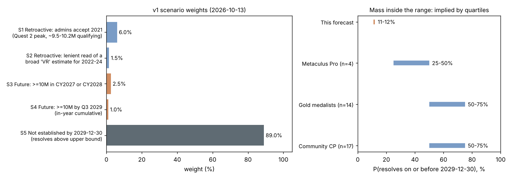

# When will virtual reality headset sales exceed 10 million units per year?

| | |
|---|---|
| **Source** | Metaculus #4845 — https://www.metaculus.com/questions/4845/ |
| **Type** | date (range 2020-07-15 … 2029-12-30, open upper bound) |
| **Opened / Closes / Resolves** | 2020-07-20 / 2030-01-01 / on the event, or ">2029-12-30" |
| **Status** | open |
| **Current forecast** | **Median >2029-12-30 (above upper bound), IQR [>2029-12-30, >2029-12-30]**; P(resolves ≤ 2029-12-30) ≈ 11.5% (v2, 2026-10-13) |
| **Community (as of 2026-10-13)** | CP 2028-01-29 [2025-03-18, ≥2029-12-30] (n=17) · Pro ≥2029-12-30 [2027-10-29, ≥2029-12-30] (n=4) · Gold 2028-11-02 [2026-03-29, ≥2029-12-30] (n=14) |
| **Next review** | 2027-01-13 |

<!-- Versions below, newest first. APPEND-ONLY: never edit or delete a past version. -->

---

## v2 — Update — 2026-10-13

Shape-only correction, same day as v1. **No new evidence, no re-fetch, no change in judgement**:
the median, IQR, P(in range) and scenario weights are those of v1. The community snapshot is
v1's (2026-10-13).

### Revision
| Driver | Direction | Effect |
|---|---|---|
| Prior (v1, 2026-10-13) | — | Median >2029-12-30, IQR [>2029-12-30, >2029-12-30]; P(in range) ≈ 11.5% |
| Lowest percentile knot moved from p6 = 2021-12-31 to p1 = 2021-12-01 (p6 kept) | → | none on median/IQR; S1 mass in the submitted CDF ≈1.3% → ≈5.6% by 2022-01-03 |
| **New forecast** | | **Median >2029-12-30, IQR [>2029-12-30, >2029-12-30]; P(in range) ≈ 11.5%** |

Why: the v1 percentile set started at p6 = 2021-12-31, so the exponential lower tail built by
`scripts/submit_metaculus.py` put ~5% of mass before the range start (2020-07-15); the closed
lower bound then dropped it and spread it proportionally over later dates. The submitted CDF
would have shown ~1.3% by end-2021 instead of the intended ~6% for S1 (admins accept 2021).
With the added p1 knot, the CDF of the ledger distribution reads ≈0.1% at 2021-06-01, ≈5.6% at
2022-01-03, ≈7.3% at 2025-01-01, ≈8.4% at 2028-01-01, ≈10.0% at 2029-01-01 and 11.5% at
2029-12-30 — matching S1–S4. v1's distribution was never submitted: the merge-triggered
submission crashed on a date-grid parsing bug (fixed in the same change).

### Tripwire check
| Tripwire from v1 | Fired? | Note |
|---|---|---|
| Admin ruling that 2021 (or another past year) meets the bar (by 2027-06-30) | no | not checked again; same day as v1 |
| Q3 2026 VR shipments YoY ≥ +30% (≈2026-12-15) | not yet due | — |
| Full-year 2026 VR shipments ≥ 6M / ≤ 4M (≈2027-03-31) | not yet due | — |
| Quest 4 at ≤ $399 announced (by 2027-10-31) | not yet due | — |
| Steam Frame first-year sales ≥ 2M (by 2027-09-30) | not yet due | — |

### What resolves YES
unchanged from v1

### Outside view
unchanged from v1

### Inside view
unchanged from v1

### Evidence
unchanged from v1

### Other forecasters
unchanged from v1 (snapshot 2026-10-13: CP 2028-01-29, Pro ≥2029-12-30, gold 2028-11-02)

### Scenarios
unchanged from v1. Percentile knots (ledger): **p1 2021-12-01**, p6 2021-12-31, p7.5 2024-12-31,
p8.3 2027-12-31, p10 2028-12-31, p11 2029-09-30, p25 2036-12-31, p50 2042-12-31, p75 2055-12-31.

### Sensitivity
unchanged from v1

### What would change my mind (tripwires)
unchanged from v1

### Sources
1. Unchanged from v1; no new sources. The CDF figures above were computed locally with `scripts/submit_metaculus.py` (`build_payload`) against the cached `raw/metaculus-2026-10-13.json` scaling (accessed 2026-10-13).

**Question**: [When will virtual reality headset sales exceed 10 million units per year?](https://www.metaculus.com/questions/4845/)
**Date**: 2026-10-13
**Forecast**: Median >2029-12-30 (above upper bound), IQR [>2029-12-30, >2029-12-30]; P(resolves ≤ 2029-12-30) ≈ 11.5% (6% retroactive 2021, 1.5% other retroactive, 3.5% a future year)
**Thesis**: Unchanged from v1; this version only fixes the distribution's lower tail so the 6% retroactive-2021 scenario survives conversion to a Metaculus CDF. Qualifying VR has never clearly reached 10M/yr, has shrunk four years running, and has no mass-market headset coming before late 2027; the Metaculus cohorts look stale.

---

## v1 — Initial forecast — 2026-10-13

### What resolves YES

The question resolves to the **end of the first period** (calendar year, or year-to-date
quarter end) for which it is established that **≥10 million qualifying VR headsets were sold
within that calendar year**. Qualifying = head-mounted, occlusive VR (not AR), **6DoF head
tracking**, and **6DoF first-party controllers** bundled or sold separately (finger-precise
hand tracking may substitute, at admin discretion); phone adapters excluded. Named as
qualifying: Vive, Rift, Quest, Index, PSVR, Windows MR; excluded: Oculus Go, Gear VR,
Cardboard/Daydream, Magic Leap, HoloLens. No resolution source is fixed: manufacturer reports
may be summed, or "credible" analyst estimates used, but **any estimate combining multiple
headsets must clearly include only qualifying headsets** — a generic "VR/AR headsets" total
does not count. Same-source differences of cumulative totals are allowed. If nothing is
established by the range end, it resolves **above the upper bound (">2029-12-30")**. Edge
cases: (i) a full-year 2029 hit resolves 2029-12-31, one day past range_max, so it is in effect
"above upper bound"; only a Q1–Q3 2029 cumulative ≥10M lands in range for 2029; (ii) every
analyst figure is *shipments*, not *sales*; (iii) **retroactive resolution** to 2021 (Quest 2
peak) is possible in principle — the question has stayed open since that data became public in
2022, and an admin tag in Nov 2025 drew no visible response; (iv) annulment at close is
possible if admins cannot establish numbers.

### Outside view

- **Track record of the quantity itself**: 10 calendar years of qualifying VR (2016–2025),
  **0 clearly ≥10M**; the 2021 peak is borderline (~9.5–10.2M estimated qualifying
  *shipments*, see Inside view). Since 2021 the market has shrunk **four years running**
  (Counterpoint: 2024 −12% "third straight annual decline", 2025 −28%) and is still falling in
  2026 (Q1 −17%, Q2 −18% YoY) [3][4][6][7].
- **Category-reversal class** (informal, no formal dataset): consumer-electronics categories
  after ≥4 years of decline rarely more than double past their old peak within 4 years
  (tablets after 2014, 3D TVs, MP3 players). I put ~5–10% on a 2.5× rebound by 2028 from this
  class alone — before conditioning on the specific product pipeline.
- **Analyst-forecast class**: in March 2022 IDC forecast >50M AR/VR headsets in 2026 [2];
  realised 2026 VR ≈ 4M (IDC's own current MR/VR figure for 2026 is 3.2M [8]) — a ~10×
  overshoot. IDC's current path (MR/VR 10.4M in **2030**) [8] would itself resolve above the
  bound, and history says discount it.

Outside-view prior for a *future* year ≥10M established inside the range: **≈3–5%**.

### Inside view

Two disjoint routes into the range.

**A. Retroactive — 2021 (S1) or a lenient read of 2022–24 (S2).**
- IDC: 2021 AR/VR = 11.2M; Meta 78%, DPVR 5.1% (mostly 3DoF/enterprise — non-qualifying),
  Pico 4.5% (mixed 3DoF/6DoF), HTC and iQIYI also top-5; AR "a small fraction" [2].
  Qualifying share ≈ 87–91% → **~9.7–10.2M shipments**.
- Counterpoint: Quest 2 cumulative 4.6M by end-Q1 2021 and 10.4M by end-2021 [5][9] →
  Quest 2 alone ~7–9M in 2021. Reality Labs 2021 revenue ($2.27B) is consistent with that.
- No single source states "≥10M qualifying headsets sold in 2021", the clause about mixed
  estimates bites, the numbers are sell-in, and the admins have left the question open for four
  years. **P(S1) ≈ 6%**. 2022–24 were lower (IDC 8.8M AR/VR 2022; CCS Insight 9.6M VR+AR 2022
  [10]); only a lenient acceptance of a broad "VR headsets" figure (e.g. Statista's 11M for
  2023, which a forecaster in the comments flagged as including non-qualifying devices) gets
  there: **P(S2) ≈ 1.5%**.

**B. Future year — CY2027/2028 (S3) or Q1–Q3 2029 cumulative (S4).**
- Run-rate: 2024 ≈ 6.5–7M (IDC: Meta 5.6M; Counterpoint: Meta 77%) [3][6] → 2025 ≈ 5M (−28%)
  → 2026 ≈ 3.5–4.5M. Reaching 10M in 2028 needs **×2.5 in two years**; Quest 2's
  pandemic-era, subsidised $299 surge was ~×2 in one year and is the only precedent.
- Pipeline: no Quest 4 at Connect 2026 (Sept 23); "Griffin" reported for late 2027 at the
  earliest, with memos asking to "improve unit economics" (higher price) [11][12]. Meta VR
  Glasses: $1,299.99, spring 2027, controllers extra [13]. Steam Frame: $1,059+, reservation
  queue since Sept 2026 [14]. PSVR2 ~1M/yr [15]; Galaxy XR and Vision Pro tiny (Vision Pro 45k
  in 2025 [6]).
- Headwinds: Quest prices **raised** in April 2026 on the DRAM shortage [16]; Reality Labs
  cuts and a CFO statement that VR spending will "decrease significantly" [17]; Q2 2026 RL
  revenue grew only on AI glasses while Quest sales fell [18]. Meta, ~55–75% of the market,
  is pivoting to glasses.
- Chain for S3: P(new sub-$400 mass-market headset ships by 2028) ≈ 0.25 × P(it drives
  ≥2.5× market | ships) ≈ 0.15 × P(a clean qualifying-only number is published and accepted)
  ≈ 0.7 → ≈2.6%. **P(S3) ≈ 2.5%, P(S4) ≈ 1%.**

**Total in range ≈ 11% (11.5% after the CDF smoothing); above upper bound ≈ 89%.**

### Evidence

| Evidence | Direction | Likelihood ratio (in-range : above) |
|---|---|---|
| Four straight annual declines, H1 2026 still −17/−18% YoY [3][4][7] | above | ~0.5 on the future paths |
| Quest price hike + memory shortage, no Quest 4 before late 2027 [11][16] | above | ~0.6 |
| Meta capex/attention shifting to AI glasses; RL VR spend cut [17][18] | above | ~0.7 |
| IDC's own (optimistic) MR/VR path reaches ~10M only in 2030 [8] | above | ~0.6 |
| 2021 qualifying total genuinely borderline (~9.7–10.2M shipments) [2][5][9] | in-range (retro) | supports a non-trivial S1 |
| Question still unresolved 4+ years after 2021 data was public; admin tag Nov 2025 unanswered [1] | above (vs retro) | ~0.4 on S1 |
| Steam Frame launch, Meta VR Glasses announced [13][14] | in-range, tiny | ~1.05 (premium, low volume) |

Absent evidence: no analyst projects a VR-only ≥10M year before 2030; no announced
sub-$400 headset; no Metaculus admin statement that 2021 counts.

### Other forecasters

| Source | Value | As of | Note |
|---|---|---|---|
| Metaculus CP (recency-weighted) | median 2028-01-29, IQR [2025-03-18, ≥2029-12-30] (n=17) | 2026-10-13 | ~50–75% mass in range; LQ in the past |
| Metaculus Pro | median ≥2029-12-30, IQR [2027-10-29, ≥2029-12-30] (n=4) | 2026-10-13 | ~25–50% in range |
| Metaculus gold medalists | median 2028-11-02, IQR [2026-03-29, ≥2029-12-30] (n=14) | 2026-10-13 | ~50–75% in range; LQ in the past |
| Kalshi / Polymarket | — | 2026-10-13 | no matching market found |
| Manifold | — | 2026-10-13 | no matching market found |
| Sentinel / Mantic / GJOpen / INFER | — | 2026-10-13 | no matching question |
| IDC (analyst forecast, not a forecaster cohort) | MR/VR 3.2M (2026) → 10.4M (2030) | 2026-07-01 | historically ~10× too optimistic |

**Disagreement.** The cohorts disagree with each other (Pro median at the bound vs gold and CP
in 2028) and all three are far above me on in-range mass (25–75% vs ~11.5%). This is a gap far
beyond 10pp, so I went looking for the missed fact. What I found instead points to
**staleness**: (a) CP and gold lower quartiles sit in **2025-03 and 2026-03** — dates that can
only resolve retroactively, since 2025 and H1 2026 were nowhere near 10M — so a quarter of that
mass is a bet on the admins accepting old data or is un-updated; (b) the CP and gold medians
drift later by 1–3 days every day, the signature of a stale population; (c) a 2024 comment
already asked why 40% of the CP lay in the past, unanswered; (d) only 17 forecasters. The Pro
cohort, the most recently consistent, is closest to me. I could find no device, data source or
admin statement that makes ≥10M before 2030 plausible at 25%+. I may still be underweighting
retroactive resolution: if forecasters know admins will lean on broad "VR headset" totals
(Statista, IDC AR/VR), S1+S2 could be 20–30% — that is the main way I am wrong.

### Scenarios

| # | Scenario | Weight | Implies |
|---|---|---|---|
| S1 | Admins accept a 2021 count ≥10M (Quest 2 peak) | 6.0% | 2021-12-31 |
| S2 | Lenient acceptance of a broad estimate for 2022–24 | 1.5% | 2022–2024 year-end |
| S3 | ≥10M qualifying in CY2027 or CY2028, established by analysts | 2.5% | 2027-12-31 / 2028-12-31 |
| S4 | ≥10M in Q1–Q3 2029 cumulative | 1.0% | 2029-06-30 … 2029-09-30 |
| S5 | Not established by 2029-12-30 (incl. a full-year 2029 hit) | 89.0% | above upper bound |

Percentile knots (ledger): p6 2021-12-31, p7.5 2024-12-31, p8.3 2027-12-31, p10 2028-12-31,
p11 2029-09-30, p25 2036-12-31, p50 2042-12-31, p75 2055-12-31. Everything from p11.5 upward
lies beyond the range and resolves ">2029-12-30"; the beyond-range dates only shape the
tail for submission and are **speculative** (first ≥10M qualifying year in the real world,
or never, if VR is absorbed by controller-less glasses).

### Sensitivity

| Assumption | If instead | Forecast becomes |
|---|---|---|
| Admins apply the "only qualifying headsets" clause strictly (S1+S2 = 7.5%) | Admins accept broad VR totals or a ~10M 2021 sum (S1+S2 ≈ 30%) | P(in range) ≈ 33%; median still >2029-12-30 |
| No sub-$400 mass-market headset before 2029 | Meta ships a $299 Quest 4 in late 2027 that sells like Quest 2 | S3+S4 ≈ 10% → P(in range) ≈ 18% |
| VR decline continues through 2026 (~4M) | 2026 ends ≥6M on Steam Frame + holiday Quest discounts | S3+S4 ≈ 6% → P(in range) ≈ 14% |

### What would change my mind (tripwires)

- [ ] Metaculus admin comment or clarification that 2021 (or another past year) meets the bar, by 2027-06-30 → resolves 2021-12-31; earlier by ~250 months on the median (direction down, retro)
- [ ] Counterpoint/IDC Q3 2026 VR shipments (release ≈ 2026-12-15): YoY ≥ +30% → earlier 24 months; another decline → no change
- [ ] Full-year 2026 VR shipments (Counterpoint/IDC, ≈ 2027-03-31) ≥ 6M → earlier 36 months; ≤ 4M → later 12 months
- [ ] Quest 4 / "Griffin" announced at ≤ $399 with 6DoF controllers by 2027-10-31 → earlier 60 months
- [ ] Reported Steam Frame first-year sales ≥ 2M by 2027-09-30 → earlier 12 months

### Sources

1. Metaculus #4845, question text, aggregations and comments (aggregations script, cached `raw/metaculus-2026-10-13.json`) — https://www.metaculus.com/questions/4845/ (accessed 2026-10-13)
2. IDC, "AR/VR Headset Shipments Grew Dramatically in 2021…" (2022-03-21), syndicated — https://www.telecomtv.com/content/digital-platforms-services/ar-vr-headset-shipments-grew-dramatically-in-2021-thanks-largely-to-metas-strong-quest-2-volumes-with-growth-forecast-to-continue-according-to-idc-43979/ (accessed 2026-10-13)
3. Counterpoint, "Global VR Market Declines 12% YoY in 2024" (2025-03-18) — https://counterpointresearch.com/insight/global-xr-arvr-headsets-market-2024 (accessed 2026-10-13)
4. Counterpoint, "Global XR (AR & VR Headsets) Market Share: Quarterly" (2025 full year −28%, Q4 −44%; Q1 2026 −17%) — https://counterpointresearch.com/en/insights/global-xr-ar-vr-headsets-market-share-quarterly (accessed 2026-10-13; figures via search summaries, page body paywalled)
5. Counterpoint, "Meta Quest 2 First VR Headset to Cross 10 mn Shipments" (2022-05-19) — https://counterpointresearch.com/insight/meta-quest-2-first-vr-headset-cross-10-mn-shipments (accessed 2026-10-13)
6. The Register, "Headset hype meets harsh reality…" (2026-01-02, IDC data) — https://www.theregister.com/2026/01/02/apple_vision_pro_meta_quest_sales_drop/ (accessed 2026-10-13)
7. vr.org, "Counterpoint Puts Q2 VR Shipments Down 18 Percent…" (2026-09-11) — https://vr.org/articles/counterpoint-q2-2026-vr-shipments-down-18-enterprise-robotics-2026 (accessed 2026-10-13); also PC Gamer — https://www.pcgamer.com/hardware/vr-hardware/vr-headset-shipments-are-down-18-percent-compared-to-this-time-last-year-and-that-may-not-be-great-news-for-valve/
8. IDC, AR/VR market insights page (updated 2026-07-01) — https://www.idc.com/promo/arvr/ (accessed 2026-10-13)
9. Counterpoint, "Oculus Quest 2 Cumulative Sales Hit Record 4.6 mn…" (Q1 2021) — https://www.counterpointresearch.com/insight/xr-headset-shipments-almost-triple-yoy-q1-2021 (accessed 2026-10-13)
10. CNBC, "Metaverse off to ominous start after VR headset sales shrank in 2022" (2022-12-28; CCS Insight 9.6M VR+AR) — https://www.cnbc.com/2022/12/28/metaverse-off-to-ominous-start-after-vr-headset-sales-shrank-in-2022.html (403 on fetch; quoted in Metaculus comment by Jgalt; accessed 2026-10-13)
11. vr.org, "Meta Quest 4: Release Date, Price, Specs" — https://vr.org/meta-quest-4 (accessed 2026-10-13)
12. Road to VR, "Meta Reportedly Targeting Quest 4 Launch…" — https://roadtovr.com/meta-quest-4-quest-pro-2-leak-the-information/ (accessed 2026-10-13)
13. Variety, "Meta Unveils VR Glasses for $1,299…" (2026-09) — https://variety.com/2026/biz/news/meta-unveils-vr-glasses-for-1299-3d-films-1236874307/ (accessed 2026-10-13)
14. vr.org, "Steam Frame Release Date: Launched September 14, 2026" — https://vr.org/steam-frame-release-date (accessed 2026-10-13); Wikipedia "Steam Frame" — https://en.wikipedia.org/wiki/Steam_Frame
15. coopboardgames, "PlayStation VR2 Sales Statistics 2026" (secondary, Treeview estimates; low reliability) — https://coopboardgames.com/statistics/playstation-vr2-sales/ (accessed 2026-10-13)
16. TechCrunch, "Meta raises Quest 3 and Quest 3S prices due to RAM shortage" (2026-04-16) — https://techcrunch.com/2026/04/16/meta-raises-quest-3-and-quest-3s-prices-due-to-ram-shortage/ (accessed 2026-10-13)
17. vr.org, "Meta Just Lost Another $4 Billion on VR. The CFO Said the Quiet Part Out Loud." (Q1 2026) — https://vr.org/articles/meta-reality-labs-q1-2026-earnings-vr-smart-glasses-pivot (accessed 2026-10-13)
18. GadgetReview, "Meta's Reality Labs Lost $4.62 Billion in Q2" (2026-07) — https://www.gadgetreview.com/metas-reality-labs-lost-4-62-billion-in-q2 (accessed 2026-10-13)
19. IDC, "Growth Expected to Pause for AR/VR Headsets" / June-2025 release (2025 −12%, +87% 2026 rebound forecast) — https://www.idc.com/resource-center/press-releases/ar-vr-market-rebounds-with-18-1-growth-in-latest-quarter-mixed-and-extended-reality-to-drive-long-term-expansion-says-idc/ (accessed 2026-10-13)
20. UploadVR, "Meta sold 20 million Quests" (2023) — https://www.uploadvr.com/meta-sold-20-million-quests/ (accessed 2026-10-13)

**Question**: [When will virtual reality headset sales exceed 10 million units per year?](https://www.metaculus.com/questions/4845/)
**Date**: 2026-10-13
**Forecast**: Median >2029-12-30 (above upper bound), IQR [>2029-12-30, >2029-12-30]; P(resolves ≤ 2029-12-30) ≈ 11.5% (6% retroactive 2021, 1.5% other retroactive, 3.5% a future year)
**Thesis**: Qualifying VR has never clearly reached 10M/yr — the 2021 Quest 2 peak was ~9.7–10.2M AR/VR-adjusted *shipments* (IDC, Counterpoint) — and has shrunk four years running (−28% in 2025, −18% YoY in Q2 2026) while Meta raises Quest prices, delays Quest 4 to late 2027+ and pivots to AI glasses; even IDC's optimistic path reaches ~10M only in 2030. The Metaculus cohorts (25–75% in range) look stale (lower quartiles in the past, daily median drift); the main risk to this forecast is a lenient retroactive admin ruling on 2021.
