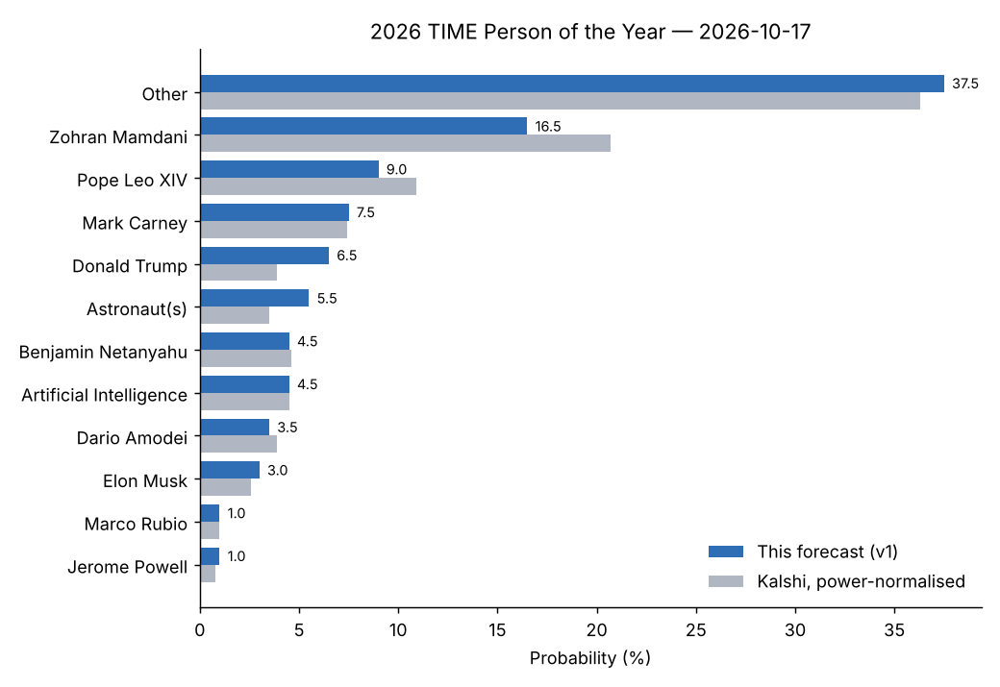

# Who will be the 2026 Time Person of the Year?

| | |
|---|---|
| **Source** | metaculus — https://www.metaculus.com/questions/45729/ |
| **Type** | multiple_choice (12 options) |
| **Opened / Closes / Resolves** | 2026-10-19 / 2026-12-01 / 2026-12-15 |
| **Status** | open |
| **Current forecast** | **Other 37.5%, Mamdani 16.5%, Pope Leo XIV 9.0%, Carney 7.5%, Trump 6.5%** (v1, 2026-10-17) |
| **Community (as of 2026-10-17)** | no CP yet (opens 2026-10-19, reveal 2026-10-24) · Pro — · Gold — · n=9 pre-open |
| **Next review** | 2026-11-05 |

<!-- Versions below, newest first. APPEND-ONLY: never edit or delete a past version. -->

---

## v1 — Initial forecast — 2026-10-17

### What resolves YES
Multiple choice: which option matches TIME's 2026 Person of the Year (announcement expected ≈
2026-12-10; AP). Options (exact Metaculus labels): Dario Amodei · Artificial Intelligence ·
Astronaut(s) · Mark Carney · Pope Leo XIV · Zohran Mamdani · Elon Musk · Benjamin Netanyahu · Jerome
Powell · Marco Rubio · Donald Trump · Other. **Caveat — inferred digest:** the Metaculus resolution
text and fine print could not be retrieved (pre-open post; bot-key API returns `null` criteria,
browser fetches Cloudflare-challenged — see `research.md`). My working reading: the option
matching the named honoree resolves YES; "Astronaut(s)" covers any astronaut or astronaut group
(e.g. the Artemis II crew); "Artificial Intelligence" covers AI as a concept (and plausibly an AI
group like 2025's "Architects of AI"); any other person, group or concept → "Other". **Unknown and
material:** how a *joint* pick that includes a listed person (e.g. "Trump and Netanyahu", or a group
that contains Amodei) resolves. I put the joint-pick mass mostly in "Other" and will re-check when
the text is readable.

### Outside view
TIME 2001–2025 (n=25):
- **Group / collective / concept: 9/25 = 36%** (Whistleblowers, American Soldier, Good Samaritans,
  You, The Protester, Ebola Fighters, Silence Breakers, Guardians, Architects of AI).
- US president / president-elect: 6/25, **all in presidential-election years; 0/6 in midterm years**.
- Non-US head of state/government: 3/25 (Putin, Merkel, Zelensky) = 12%.
- Business/tech individual: 3/25 = 12%. Culture/activist: 2/25 = 8%. Pope: 1/25 (Francis, in his first
  year; Leo XIV was passed over in his). Sub-national US official: 1/25 (Giuliani after 9/11).
- Repeat honouree within two years: none since Nixon 1971–72.

Base-rate-only vector (mine): Mamdani 10, Trump 10, Carney 8, Astronaut(s) 8, Pope Leo 6, AI 4,
Netanyahu 4, Amodei 3, Musk 3, Rubio 1, Powell 1, Other 42.

### Inside view
2026's dominant stories: the US–Israel war on Iran from 2026-02-28 (Ali Khamenei killed; Hormuz
closure; on-off ceasefires) — a Trump/Netanyahu story, but TIME answered the 2003 Iraq war with a
collective ("The American Soldier"); Trump's tariff wars and Carney's "middle powers" stand (50% US
tariffs on Canadian goods; no Nobel — it went to Navi Pillay on 2026-10-09); Artemis II's crewed lunar
flyby (splashdown 2026-04-10) — tailor-made for a TIME group cover; Mamdani's first year as NYC mayor
and a likely Democratic House win on 2026-11-03; AI — but TIME just did AI in 2025.
- **Mamdani** (16.5%): the market favourite since summer (37¢ late Aug → 28–29¢ now). Arguments for:
  national symbol of the affordability-left, foil to Trump, the midterms may be read through him.
  Against: a mayor in year one is a base-rate oddity; falling price.
- **Trump** (6.5%): biggest single driver of 2026 events, but midterm-year and 2024 repeat history
  argue against; a bad midterm makes him less likely.
- **Pope Leo XIV** (9.0%): TIME100 2026, prominent Trump/Iran-war critic; second-year pope with no
  single defining 2026 event.
- **Other** (37.5%): groups/concepts not covered by the AI/Astronaut options (e.g. a war-, protest- or
  voter-themed collective), and individuals such as Talarico (if he wins Texas), AOC, Mojtaba
  Khamenei, Xi, Altman, Huang, Swift, Bad Bunny, Messi. Kalshi's unlisted/longshot residual is ≈36%.

### Evidence
- Kalshi KXTIME-26 ($1.8M lifetime volume; mids sum to 1.92 — heavy longshot overround).
  Power-normalised (k=1.25): Mamdani 20.7%, Pope Leo 10.9%, Carney 7.4%, Netanyahu 4.6%, Trump 3.9%,
  Amodei 3.9%, AI ≈4.5% (incl. ChatGPT), astronauts ≈3.5% jointly, Musk 2.6%, Rubio 1.0%, Powell 0.8%,
  residual ≈36%.
- Polymarket ($132K) agrees within 1–2 points per name.
- Discounted: predictionhunt.com "news" (claimed Pope Leo resigned in July 2026 — false; AP shows a
  normal summer break) — appears machine-generated.
- Blend: 60% market (normalised) + 40% base rate → the vector below.

### Other forecasters
| Source | Value | As of | Note |
|---|---|---|---|
| Metaculus CP | — | 2026-10-17 | pre-open; reveal 2026-10-24 |
| Metaculus Pro | — | 2026-10-17 | n/a pre-open |
| Metaculus gold medalists | — | 2026-10-17 | n/a pre-open |
| Kalshi (raw mid) | Mamdani 28.5, Leo 17, Carney 12.5, Netanyahu 8.5, Trump 7.5, Amodei 7.5, AI 6.5 | 2026-10-17 | $902K on Mamdani alone; raw sum 192% |
| Kalshi (power-normalised) | Mamdani 20.7, Leo 10.9, Carney 7.4, Netanyahu 4.6, Trump 3.9 | 2026-10-17 | my normalisation |
| Polymarket | Mamdani 28.5, Leo 16, Carney 14.5, Netanyahu 8, Amodei 7.4, Musk 6.5, Trump 6.5, AI 6.3 | 2026-10-17 | $132K |

I sit below the market on Mamdani (16.5 vs ≈21 normalised) and above it on Trump and Astronaut(s),
for base-rate reasons; within 5 pp everywhere.

### Scenarios
| # | Scenario | Weight | Implies |
|---|---|---|---|
| 1 | A political individual in the market's top tier (Mamdani, Carney, Trump, Netanyahu, Rubio) | 36% | named option |
| 2 | Collective/concept (astronauts, AI, or an unlisted group) | 30% | Astronaut(s) / AI / Other |
| 3 | Pope Leo XIV | 9% | named option |
| 4 | Tech/finance individual (Amodei, Musk, Powell) | 7.5% | named option |
| 5 | Unlisted individual | 17.5% | Other |

### Sensitivity
| Assumption | If instead | Forecast becomes |
|---|---|---|
| Joint picks containing a listed name resolve "Other" | they resolve to the listed name | Trump +2, Netanyahu +1, Amodei +1, Other −4 |
| 60/40 market/base-rate blend | trust the market fully | Mamdani 20.7, Other 36, Trump 3.9 |
| Midterms are a normal Democratic gain | Democratic landslide incl. Senate | Mamdani +4, Other (Talarico etc.) +2, Trump −2 |

### What would change my mind (tripwires)
- [ ] US midterms 2026-11-03: Democrats win the Senate and Talarico wins Texas → Other up 4 pp, Mamdani up 2 pp, Trump down 2 pp
- [ ] Israeli election 2026-10-27: Netanyahu out of office by 2026-11-30 → Netanyahu down 2 pp
- [ ] Kalshi Mamdani mid ≥ 40¢ or ≤ 18¢ on 2026-11-20 → Mamdani up/down 5 pp
- [ ] A new war, peace deal or crisis dominating Nov–Dec news (e.g. Iran settlement signed by 2026-12-01) → either, 0 (re-analyse)
- [ ] TIME shortlist (≈ 2026-12-09): any option absent from it → that option down to ≤ 2%

### Sources
1. Kalshi API, event KXTIME-26 — https://api.elections.kalshi.com/trade-api/v2/markets?event_ticker=KXTIME-26 (accessed 2026-10-17; cached `raw/kalshi-2026-10-17.json`)
2. Kalshi market page — https://kalshi.com/markets/kxtime/times-person-of-the-year/kxtime-26 (accessed 2026-10-17)
3. Polymarket, TIME Person of the Year 2026 — https://polymarket.com/event/time-person-of-the-year-2026 (accessed 2026-10-17; cached `raw/polymarket-2026-10-17.json`)
4. Wikipedia, Time Person of the Year — https://en.wikipedia.org/wiki/Time_Person_of_the_Year (accessed 2026-10-17)
5. AP via WCAX, "Mark Carney's stand against Trump leads to Nobel Peace Prize and Time Person of the Year buzz" (2026-09-30) — https://www.wcax.com/2026/09/30/mark-carneys-stand-against-trump-leads-nobel-peace-prize-time-person-year-buzz/ (accessed 2026-10-17)
6. Kalshi News, "Time's Person of the Year Odds: Trump, Mamdani neck and neck" — https://news.kalshi.com/p/times-person-of-the-year-odds-trump-mamdani-pope-leo (accessed 2026-10-17)
7. VIN News, "Mamdani Leads Polymarket Odds for 2026 TIME Person of the Year" (2026-09-04) — https://vinnews.com/2026/09/04/mamdani-leads-polymarket-odds-for-2026-time-person-of-the-year/ (accessed 2026-10-17)
8. The Lines, "TIME Person of the Year Prediction Market: Mamdani Dominates" — https://www.thelines.com/prediction-markets/trending/time-person-of-the-year-prediction-market-mamdani-dominates/ (accessed 2026-10-17)
9. Casino.org, Time Person of the Year odds — https://www.casino.org/news/time-person-of-the-year-odds/ (accessed 2026-10-17)
10. NCR, "Pope Leo named one of TIME's 100 most influential people of 2026" — https://www.ncronline.org/news/pope-leo-named-one-time-magazines-100-most-influential-people-2026 (accessed 2026-10-17)
11. Las Vegas Sun / AP, "Pope begins his summer break" (2026-07-05) — https://lasvegassun.com/news/2026/jul/05/pope-begins-his-summer-break-after-decisive-flexin/ (accessed 2026-10-17)
12. NBC Palm Springs, "Artemis II astronauts splash down off California coast" (2026-04-10) — https://www.nbcpalmsprings.com/2026/04/10/artemis-ii-astronauts-splash-down-off-california-coast-after-historic-moon-mission (accessed 2026-10-17)
13. Business Standard, Netanyahu on Mojtaba Khamenei (2026-03) — https://www.business-standard.com/world-news/no-life-insurance-for-mojtaba-khamenei-says-israeli-pm-netanyahu-126031300074_1.html (accessed 2026-10-17)
14. Marine Insight, "US, Iran reach tentative deal to extend ceasefire for 60 days and reopen Strait of Hormuz" — https://www.marineinsight.com/us-iran-reach-tentative-deal-to-extend-ceasefire-for-60-days-and-reopen-strait-of-hormuz/ (accessed 2026-10-17)
15. Khaleej Times, "Navi Pillay wins Nobel Peace Prize 2026" — https://www.khaleejtimes.com/world/navanethem-navi-pillay-wins-nobel-peace-prize-2026 (accessed 2026-10-17)
16. Al Jazeera, "Former Israeli PMs Bennett, Lapid unite to challenge Netanyahu" (2026-04-26) — https://www.aljazeera.com/news/2026/4/26/former-israeli-pms-bennett-lapid-unite-to-challenge-netanyahu-in-elections (accessed 2026-10-17)
17. Action Network, "2026 midterm predictions: what prediction markets say vs the polls" — https://www.actionnetwork.com/politics/2026-midterm-predictions-what-prediction-markets-say-vs-the-polls (accessed 2026-10-17)
18. Metaculus API post 45729 (metadata and option labels) — https://www.metaculus.com/questions/45729/ (accessed 2026-10-17; cached `raw/metaculus-api-2026-10-17.json`)

**Question**: [Who will be the 2026 Time Person of the Year?](https://www.metaculus.com/questions/45729/)
**Date**: 2026-10-17
**Forecast**: Other 37.5%, Zohran Mamdani 16.5%, Pope Leo XIV 9.0%, Mark Carney 7.5%, Donald Trump 6.5%, Astronaut(s) 5.5%, Benjamin Netanyahu 4.5%, Artificial Intelligence 4.5%, Dario Amodei 3.5%, Elon Musk 3.0%, Marco Rubio 1.0%, Jerome Powell 1.0% (IQR on leading option "Other": [31.0%, 44.0%])
**Thesis**: TIME picks a group, concept or unlisted figure about 40% of the time, so "Other" leads; among named options I blend overround-corrected Kalshi/Polymarket prices (Mamdani ≈21%, Pope Leo ≈11%) with base rates that penalise a first-year mayor and a sitting US president in a midterm year, landing at Mamdani 16.5%.
